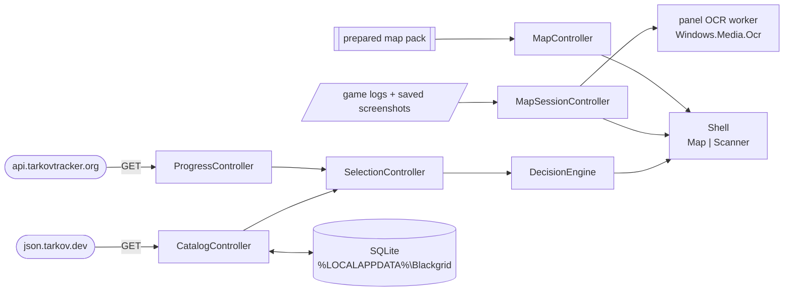

# Blackgrid

  

A Windows desktop companion for raid-time loot decisions, built in Dart/Flutter. It has two areas, **Map** and **Scanner**. It reads public catalog data from json.tarkov.dev and, if you opt in, read-only progress from tarkovtracker.org. Maps render natively from a bundled, hash-addressed pack. One conservative decision engine drives every recommendation: an unknown or stale input gives **Check / May Need**, never a confident Sell. The game itself is never touched. Blackgrid reads only the game's log files and the screenshots you save.

## ✨ What it adds

- 🛡️ **Conservative keep/sell advice.** One pure-Dart [`DecisionEngine`](lib/domain/decision_engine.dart) ranks **Keep → Keep for later → Check / May Need → Flea → Trader → Price unavailable**. Missing catalog or progress authority, unknown FIR, an unresolved requirement or a quote older than one hour all fall to Check.
- 🗺️ **Native map, no WebView.** All 13 maps render from a prepared pack in [`assets/maps/`](assets/maps/active.json). SVG is compiled to `vector_graphics` at preparation time, and the [scene](lib/maps/native_map_scene.dart) keeps decoded tiles and pictures in a 192 MiB LRU.
- 📍 **Session evidence from files only.** [`SessionLogReader`](lib/data/session_log_reader.dart) polls the newest game log every 250 ms for map and mode. [Screenshot filenames](lib/domain/screenshot_filename.dart) give position and heading. Saved exit panels are read with Windows `Windows.Media.Ocr` through a hash-bound DLL ([`panel_ocr.cpp`](windows/ocr/panel_ocr.cpp)).
- 🔐 **Read-only progress with protected tokens.** [`TrackerClient`](lib/data/tracker_client.dart) only sends GET requests to `api.tarkovtracker.org`, with a 30 s timeout. Tokens are mode-scoped (`PVP_`, `PVE_`, `SZN_`) and stored as current-user DPAPI ciphertext by the [Windows runner](windows/runner/credential_protector.cpp), never in SQLite.
- 💾 **One local store.** A single Drift SQLite file ([`database.dart`](lib/data/database.dart)) holds settings, pins, item history and one catalog snapshot per mode. The schema is versioned in [`drift_schemas/`](drift_schemas/drift_schema_v2.json), and a newer on-disk version is refused, not reset.
- 📦 **Hash-bound native code.** At install, CMake writes the panel OCR DLL's SHA-256 and a manifest of every vision file; the app refuses to load a mismatch. Third-party vision inputs (OpenCV 4.13, Tesseract engine 5.0.0, Leptonica 1.82.0, `eng.traineddata`) are pinned in [`third_party.lock.json`](windows/vision/third_party.lock.json) and checked offline by [`check_bundle.dart`](tool/vision/check_bundle.dart).
- 📥 **Explicit legacy import.** [`LegacyImport`](lib/data/legacy_import.dart) reads only the settings and history JSON files you name. It shows a preview with every collision. Accepting it commits everything in one transaction, and the same files cannot be imported twice.

## 🔄 How it fits together



| Part | Owned by | What happens |
|---|---|---|
| Startup | [`AppServices`](lib/application/app_services.dart) | Opens storage, credentials and the HTTP client, builds the controllers, disposes them in order |
| Catalog | [`CatalogController`](lib/application/catalog_controller.dart) + [`CatalogClient`](lib/data/catalog_client.dart) | Downloads 6 required and 4 optional English datasets for the chosen mode, normalises them off the UI isolate, swaps the snapshot in one transaction |
| Progress | [`ProgressController`](lib/application/progress_controller.dart) + [`TrackerClient`](lib/data/tracker_client.dart) | Reads `/token` and `/progress`, keeps them in memory only, treats them as current for 15 minutes |
| Decision | [`SelectionController`](lib/application/selection_controller.dart) + [`DecisionEngine`](lib/domain/decision_engine.dart) | One decision for the selected item, shown in both Map and Scanner |
| Map | [`MapController`](lib/application/map_controller.dart) + [`lib/maps/`](lib/maps/prepared_map_loader.dart) | Loads the active pack, floors, markers and pins; owns pan/zoom and hit testing |
| Session | [`MapSessionController`](lib/application/map_session_controller.dart) | Detected map/mode, player samples and exit highlights; one active plus one pending request |
| Storage | [`BlackgridDatabase`](lib/data/database.dart) | Settings, pins, history, catalog cache and import ledger |

---

## ⚡ Install / Update

> **Prerequisites:** Windows 11 x64, Git, and [mise](https://mise.jdx.dev/). Visual Studio with **Desktop development with C++**, its CMake tools and a Windows SDK ([Flutter's Windows setup](https://docs.flutter.dev/platform-integration/windows/setup)). Windows Developer Mode if a native build needs symlinks. Flutter 3.47.6 and git-cliff 2.14.2 come from [`mise.toml`](mise.toml); no global Flutter install is needed.

Install and update use the same commands:

```text
git pull
mise trust mise.toml
mise install
mise exec -- flutter pub get
mise run vision:fetch
```

`vision:fetch` downloads the pinned OpenCV, Tesseract, Leptonica and model inputs into `.dart_tool/blackgrid_vision_inputs/`. The Windows build stops with an error if any input is missing or changed. Run it again after `flutter clean`.

Check the toolchain with `mise exec -- flutter doctor -v`. Warnings about Android or web tooling do not block a Windows build.

## ⚡ First steps

1. **Close Escape from Tarkov**, then run `mise exec -- flutter run -d windows`.
2. Open **Settings**, choose the **Live game mode** (PvP, PvE or Seasonal; it starts as Unknown), then **Refresh complete catalog**.
3. Search items with **Ctrl K**. The Scanner area shows the decision, requirements, sources and history.
4. Optional: in **Settings**, save a Tracker token for the mode, and set the game log and screenshot directories (empty = auto-detect).
5. On **Map**, use **Read Latest** after saving a screenshot in game, or **Follow logs** to switch maps automatically. A mode found in the game log replaces the Settings mode while it is detected.

Build a Release bundle with `mise exec -- flutter build windows`. Ship the whole `build/windows/x64/runner/Release/` directory, not just `blackgrid.exe`.

---

## 🧩 What's inside

### Application (`lib/`)

| Layer | Files | Role |
|---|---|---|
| Domain | [`decision_engine.dart`](lib/domain/decision_engine.dart), [`catalog.dart`](lib/domain/catalog.dart), [`progress.dart`](lib/domain/progress.dart), [`settings.dart`](lib/domain/settings.dart), [`map_geometry.dart`](lib/domain/map_geometry.dart), [`map_floors.dart`](lib/domain/map_floors.dart), [`raid_panel_text_parser.dart`](lib/domain/raid_panel_text_parser.dart), [`raid_exfil_matcher.dart`](lib/domain/raid_exfil_matcher.dart) | Pure Dart rules: decisions, freshness, settings, map math, panel text matching |
| Application | [`app_services.dart`](lib/application/app_services.dart), [`catalog_controller.dart`](lib/application/catalog_controller.dart), [`progress_controller.dart`](lib/application/progress_controller.dart), [`selection_controller.dart`](lib/application/selection_controller.dart), [`settings_controller.dart`](lib/application/settings_controller.dart), [`history_controller.dart`](lib/application/history_controller.dart), [`map_controller.dart`](lib/application/map_controller.dart), [`map_session_controller.dart`](lib/application/map_session_controller.dart) | `ChangeNotifier` controllers built by one composition root |
| Data | [`database.dart`](lib/data/database.dart), [`catalog_client.dart`](lib/data/catalog_client.dart), [`tracker_client.dart`](lib/data/tracker_client.dart), [`credential_store.dart`](lib/data/credential_store.dart), [`session_log_reader.dart`](lib/data/session_log_reader.dart), [`screenshot_directory_watcher.dart`](lib/data/screenshot_directory_watcher.dart), [`game_paths.dart`](lib/data/game_paths.dart), [`raid_panel_ocr.dart`](lib/data/raid_panel_ocr.dart), [`legacy_import.dart`](lib/data/legacy_import.dart) | HTTP, SQLite, DPAPI, game files and OCR adapters |
| Vision | [`vision_runtime.dart`](lib/data/vision/vision_runtime.dart), [`vision_primitives.dart`](lib/data/vision/vision_primitives.dart), [`tesseract_binding.dart`](lib/data/vision/tesseract_binding.dart), [`vision_self_check.dart`](lib/application/vision_self_check.dart) | Item vision runtime; used only by `--vision-self-check` and tests so far |
| Maps | [`prepared_map_loader.dart`](lib/maps/prepared_map_loader.dart), [`prepared_map.dart`](lib/maps/prepared_map.dart), [`native_map_scene.dart`](lib/maps/native_map_scene.dart) | Pack loading and native rendering |
| UI | [`shell.dart`](lib/ui/shell.dart), [`map_screen.dart`](lib/ui/map_screen.dart), [`map_workspace.dart`](lib/ui/map_workspace.dart), [`scanner_screen.dart`](lib/ui/scanner_screen.dart), [`item_decision_card.dart`](lib/ui/item_decision_card.dart), [`settings_dialog.dart`](lib/ui/settings_dialog.dart), [`import_dialog.dart`](lib/ui/import_dialog.dart), [`theme.dart`](lib/ui/theme.dart) | Two-area shell; both areas stay mounted |

Scanner today is manual catalog inspection. Screen capture, mouse and hotkey triggers and item recognition are not built yet; see the [roadmap](openspec/roadmap.md).

### Native Windows code (`windows/`)

| Part | File | Does |
|---|---|---|
| Credentials channel | [`credential_protector.cpp`](windows/runner/credential_protector.cpp) | `blackgrid/credentials`: LocalAppData path, atomic replace, DPAPI protect/unprotect |
| Panel OCR DLL | [`panel_ocr.cpp`](windows/ocr/panel_ocr.cpp) | `blackgrid_panel_ocr.dll` over `Windows.Media.Ocr` |
| Vision DLL | [`vision.cpp`](windows/vision/vision.cpp), [`vision.h`](windows/vision/vision.h) | `blackgrid_vision.dll`: `bgv_*` C ABI over static OpenCV `core` + `imgproc` |
| Vision build | [`CMakeLists.txt`](windows/vision/CMakeLists.txt), [`verify_inputs.cmake`](windows/vision/verify_inputs.cmake), [`write_manifest.cmake`](windows/vision/write_manifest.cmake) | Refuses unpinned inputs; writes `data/vision/runtime.manifest.json` at install |

### mise tasks ([`mise.toml`](mise.toml))

| Task | Runs |
|---|---|
| `analyze` | `flutter analyze` |
| `test` | Fast suite, excludes the `qualification` tag |
| `test:qualification` | Expensive offline qualification tier only |
| `test:all` | Every test |
| `format` / `format:check` | `dart format`, or check without writing |
| `changelog` / `release-notes` | [`tool/changelog.dart`](tool/changelog.dart) over git-cliff ([`cliff.toml`](cliff.toml)) |
| `release:prepare` / `release:tag` / `build:release` | [`tool/release/release.dart`](tool/release/release.dart): prepare a release commit, tag the merged release, build a versioned Release bundle (see **Releases and changelog**) |
| `vision:fetch` | [`fetch_runtime.dart`](tool/vision/fetch_runtime.dart): download and verify pinned vision inputs |
| `bundle:check` | [`check_bundle.dart`](tool/vision/check_bundle.dart): offline check of a built Release bundle |
| `capture:selftest` | Native capture self-test ([`selftest.ps1`](windows/capture/selftest.ps1)). Refuses unless `BLACKGRID_NO_GAMES_RUNNING=1` confirms no game is running |
| `qualification:freeze` / `:validate` / `:report` | M0 reference evidence tools in [`tool/qualification/`](tool/qualification/m0.dart) |

### Tools (`tool/`)

| Tool | Does |
|---|---|
| [`maps/prepare.dart`](tool/maps/prepare.dart) | Offline map pack pipeline: `acquire`, `rebuild`, `normalize`, `compile`, `validate`, `promote`, `assets` |
| [`ocr/read_saved_panel.dart`](tool/ocr/read_saved_panel.dart) | Reads one saved screenshot with the built panel OCR DLL |
| [`m1/catalog_smoke.dart`](tool/m1/catalog_smoke.dart) | Real catalog download for all three modes into a temporary SQLite file, with reopen check |
| [`vision/make_self_check_sample.dart`](tool/vision/make_self_check_sample.dart) | Regenerates the deterministic [self-check sample](assets/vision/self_check/title.json) |

### Agent tooling

| Path | Holds |
|---|---|
| [`.mcp.json`](.mcp.json) | Official Dart MCP server, launched through mise with the pinned SDKs |
| [`.claude/skills/`](.claude/skills/UPSTREAM.json) | First-party Flutter and Dart skills (sources and hashes in `UPSTREAM.json`), plus OpenSpec and Specwright skills |
| [`.claude/agents/`](.claude/agents/specwright-implementer.md), [`.omp/agents/`](.omp/agents/specwright-implementer.md) | Specwright implementer and reviewer agents |
| [`openspec/`](openspec/config.yaml) | Specwright change workflow, [architecture](openspec/architecture.md), [roadmap](openspec/roadmap.md), [ADRs](docs/adr/README.md) |

---

## ⚙️ Settings

There is no config file. The **Settings** dialog and the Map area save one JSON row (`Preferences`, id 1) in `%LOCALAPPDATA%\Blackgrid\blackgrid.sqlite`. The fields come from [`AppSettings`](lib/domain/settings.dart):

```jsonc
{
  "mode": "unknown",            // unknown | pvp | pve | seasonal; set in Settings. A mode found in the game log wins at runtime
  "selectedMap": "shoreline",   // one of the 13 supported map IDs
  "saveMarkerFilters": false,   // true = remember marker category filters
  "markerFilters": {},          // category -> visible, e.g. "PmcExtracts": true
  "trackerEnabled": false,      // read-only Tracker progress for the current mode
  "gameLogDirectory": "",       // empty = detect from the registry or Steam libraries
  "screenshotDirectory": "",    // empty = Documents\Escape from Tarkov\Screenshots
  "followGameLogs": true        // switch the map from the logs; selectedMap is kept as the fallback
}
```

Tracker tokens are not part of this row. They live in `%LOCALAPPDATA%\Blackgrid\credentials\<mode>.dpapi`.

---

## 📖 Reference

<details>
<summary><b>Decision order</b> — how the recommendation is picked</summary>

The first row that matches wins ([`decision_engine.dart`](lib/domain/decision_engine.dart)).

| Recommendation | When |
|---|---|
| Keep | A requirement is actionable now |
| Keep for later | A requirement is a known future need |
| Check / May Need | Catalog or progress authority missing or stale, FIR unknown, a requirement unresolved, Flea eligibility unknown, or the Flea quote missing, in the future or older than one hour (unless the item cannot be sold on Flea) |
| Flea | Eligible, and the gross Flea price is **greater than** the best named-trader RUB cash offer (or there is none) |
| Trader | A usable trader cash offer exists. Equal Flea and trader prices choose the trader; equal trader offers use trader ID order |
| Price unavailable | None of the above |

Prices are gross RUB, not fee-adjusted. FIR is set per inspection and resets when the item, mode or authority context changes.
</details>

<details>
<summary><b>Data sources and freshness</b></summary>

| Source | Endpoint | Fresh for | On failure |
|---|---|---|---|
| Catalog | `json.tarkov.dev/{regular\|pve\|pvp-season}/{items,traders,tasks,hideout,crafts,barters}` plus optional `*_en` translations | 24 h, only when all six source timestamps are known and agree | Last good snapshot kept, status `stale` or `failed` |
| Flea quote | Inside the catalog | 1 h | Decision falls to Check |
| Tracker | `api.tarkovtracker.org/token`, `/progress` | 15 min, memory only | Auth or mode errors clear progress; transport errors keep it as stale. `Retry-After` is honoured; missing or bad values use 60 s |

Every request is a GET with a 30 s deadline and no redirects. There are no automatic retries; refresh is manual. The public catalog currently has no source timestamps, so a successful refresh is still shown as stale.
</details>

<details>
<summary><b>Local files</b></summary>

| Path | Holds |
|---|---|
| `%LOCALAPPDATA%\Blackgrid\blackgrid.sqlite` | Settings, pins, one history row per item and mode, catalog snapshots, import ledger |
| `%LOCALAPPDATA%\Blackgrid\credentials\<mode>.dpapi` | Tracker token, current-user DPAPI ciphertext; not portable to another Windows user |

History stores item ID, mode, source, UTC time and revision only. No telemetry, account or backend exists.
</details>

<details>
<summary><b>Map controls</b></summary>

| Input | Action |
|---|---|
| Drag / mouse wheel | Pan / zoom at the cursor |
| Arrow keys | Pan |
| Home | Fit map |
| `+` `=` numpad `+` / `-` numpad `-` | Zoom in / out |
| C | Center on the sampled player |
| N | Add a pin at the view center |
| Right-click | Add a pin at the cursor |
| Enter | Browse visible markers and pins |
| Delete | Remove the selected pin |
| Escape | Clear the selection |

Supported maps, as labelled in the UI: Factory, Customs, Woods, Shoreline, Interchange, The Lab, Reserve, Lighthouse, Streets, Ground Zero, Terminal, Icebreaker, Labyrinth (IDs in [`settings.dart`](lib/domain/settings.dart), labels in [`theme.dart`](lib/ui/theme.dart)).
</details>

<details>
<summary><b>Session inputs</b></summary>

| Input | Bound | Reads |
|---|---|---|
| Game log | 250 ms poll, 64 KiB max line | `scene preset path:` for map, `Session mode:` for mode, in the newest `log_*` folder |
| Screenshot folder | 1 s poll, 80 ms stability, 64 MiB per file | Position (XYZ) and heading (quaternion) from the filename |
| Saved panel OCR | 64 MiB, ≤ 8192 px per side, ≤ 24 × 1024² pixels, one request at a time | Exfil and transit names; a busy worker returns `unavailable` |

Evidence without a confirmed raid or map is shown as assumed. Missing or unreadable evidence is never shown as an empty panel. Check one image offline with `mise exec -- dart run tool/ocr/read_saved_panel.dart <image>`.
</details>

<details>
<summary><b>Map pack preparation</b></summary>

Runtime only loads the active pack. These commands are maintenance tools ([`prepare.dart`](tool/maps/prepare.dart)); see `--help` for details.

| Command | Does |
|---|---|
| `acquire --raw <dir>` | The only network step: freezes artwork, metadata and terms into a fresh hash-locked directory |
| `rebuild --raw <dir> --candidate <dir>` | `normalize` + `compile`, offline |
| `validate --candidate <dir>` | Checks every hash, vector payload and tile witness |
| `promote --candidate <dir> --packs <root>` | Adds an immutable `versions/<sha256>/` and swaps [`active.json`](assets/maps/active.json) atomically |
| `assets --packs <root>` | Prints the `pubspec.yaml` asset list; Flutter does not include nested tile folders by itself |

`<use>` references to symbols the publisher deleted (Customs `path493`, Streets stairs) are dropped, as a browser does. Any other missing symbol fails preparation.
</details>

<details>
<summary><b>Vision self-check</b></summary>

`blackgrid.exe --vision-self-check <report.json>` verifies and loads the bundled vision runtime, runs a template match and OCR on the bundled sample, and writes a JSON report. It shows no window and opens no database. The report directory must exist.

| Exit code | Means |
|---|---|
| 0 | Pass |
| 1 | A step failed, or the report could not be written |
| 2 | Usage error |
| 3 | A step did not return within 60 s |

`blackgrid.exe` is a GUI-subsystem app, so wait for it: `start /wait` (cmd) or `Start-Process -Wait -PassThru` (PowerShell). Check a built bundle offline with `mise run bundle:check -- build/windows/x64/runner/Release`.
</details>

<details>
<summary><b>Legacy import</b></summary>

| Rule | Detail |
|---|---|
| Inputs | Settings and/or history JSON paths you type; no directory scan |
| Supported revisions | Settings 0–3, scanner preferences 0–1, history 0–1 |
| Pins | Known map IDs and frame revisions; Labs revision 0 is converted to revision 1 |
| Never imported | Tracker keys, progress, computed advice, FIR, prices, overlay and old capture settings |
| Collisions | Source: revision, then latest UTC time, then file order. Existing records win unless you choose to replace |
| Commit | **Accept preview and import** writes all records and the digest ledger in one transaction; source files are not changed |
</details>

<details>
<summary><b>Database schema changes</b></summary>

```text
mise exec -- dart run build_runner build
mise exec -- dart run drift_dev schema dump lib/data/database.dart drift_schemas/
mise exec -- dart run drift_dev schema generate drift_schemas test/data/generated
```

Version 1 holds settings, pins, activity and catalog tables; version 2 adds the import ledger.
</details>

<details>
<summary><b>Releases and changelog</b></summary>

Versions follow [SemVer 2.0.0](https://semver.org/) with `v`-prefixed tags ([ADR-0009](docs/adr/0009-release-versioning.md)). Each milestone close bumps the minor version (M2 → `0.2.0`), fixes between milestones bump the patch, and a build handed out for user-only checks is a prerelease (`0.2.0-beta.1`). Only a release commit changes `version:` in `pubspec.yaml`. The build number is the commit count of the built `HEAD`.

| Step | Command | Does |
|---|---|---|
| Preview | `mise run release-notes -- --unreleased` | Prints the entries the next release will list |
| Prepare | `mise run release:prepare -- <version>` | On a clean `main` equal to `origin/main`, with a version above every release tag: runs `analyze`, `format:check` and `test:all`, then commits `chore(release): v<version>` (pubspec version and `CHANGELOG.md`) on `release/v<version>`. It does not push; it prints the push and PR commands |
| Merge | Push the branch, open the PR titled `chore(release): v<version>` and merge it | |
| Tag | `mise run release:tag` | On `main` right after the release merge: checks the merge and the pubspec version, then creates annotated tag `v<version>` and pushes only that tag as `github.login` from [`openspec/specwright.yaml`](openspec/specwright.yaml) |
| Build | `mise run build:release` | On a clean checkout: `vision:fetch`, `flutter build windows --release` with the version, the build number and `BLACKGRID_VERSION=<version>+<count>`, then `bundle:check` on `build/windows/x64/runner/Release` |

Pass `--trailer "<line>"` to `release:prepare` to add commit trailers; the commit and tag use Git's identity from the environment (`GIT_AUTHOR_*`, `GIT_COMMITTER_*`). `release:tag` refuses when another PR merged between `prepare` and the release merge: delete `release/v<version>` locally and on `origin`, then prepare again.

The version shows in the **Settings** dialog and in the `appVersion` field of the **Vision self-check** report. A build without the define (`flutter run`) shows `dev`. The executable's file version is `<major>.<minor>.<patch>.<count>`.

The changelog lists one entry per merged PR, titled with the PR title and grouped by its conventional type, so PR titles use `type(scope): summary`. Commits that reached `main` only through a branch are not listed, and prerelease tags get no section of their own: the final release lists everything since the previous final release.

```text
mise run changelog
mise run release-notes -- --unreleased
mise run release-notes -- --latest
mise run release-notes -- v0.1.0..v0.2.0
```
</details>

---

## 🧪 Tests

| Command | Covers |
|---|---|
| `mise run test` | Domain, data, controllers, widgets, map logic and the untagged M0 contract, statistics, comparison, export and CLI tests; offline. Use during development |
| `mise run test:qualification` | Tag `qualification` ([`dart_test.yaml`](dart_test.yaml)): map pack preparation, M0 collector and fixture integrity, panel OCR, vision runtime, CMake and bundle checks. The native capture test skips unless `BLACKGRID_NO_GAMES_RUNNING=1` confirms no game is running |
| `mise run test:all` | Both; run before merging |
| [`m1_windows_smoke_test.dart`](integration_test/m1_windows_smoke_test.dart) | Real DPAPI, real catalog, SQLite reopen on Windows |

Tests live in [`test/`](test/). **Agents and live-game checks:** no agent may launch or drive Blackgrid while Escape from Tarkov is running, and checks that need the game belong to the user. See [AGENTS.md](AGENTS.md).

## 🗑️ Uninstall

1. Delete the Release directory.
2. Delete `%LOCALAPPDATA%\Blackgrid\` to remove settings, pins, history, the catalog cache and saved tokens.

## 💡 Credits and notices

- Inspired by [TarkovTracker](https://github.com/sayser/TarkovTracker), a C# desktop companion. Blackgrid is an independent Dart/Flutter implementation and contains no code from it.
- Map artwork and metadata: the tarkov-dev SVG maps project, Tarkov.dev and TarkovBOT.eu, under the terms recorded in [THIRD_PARTY_NOTICES.md](THIRD_PARTY_NOTICES.md) and in each pack's evidence.
- Item vision: OpenCV, Tesseract, Leptonica and tessdata, pinned in [`third_party.lock.json`](windows/vision/third_party.lock.json).
- Project direction: [STRATEGY.md](STRATEGY.md), [architecture](openspec/architecture.md), [decisions](docs/adr/README.md).
- No project license has been chosen. The repository is private, and nothing here authorizes publishing it or its bundled artwork.
