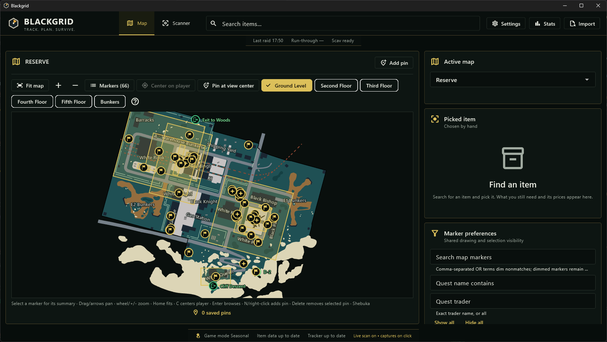
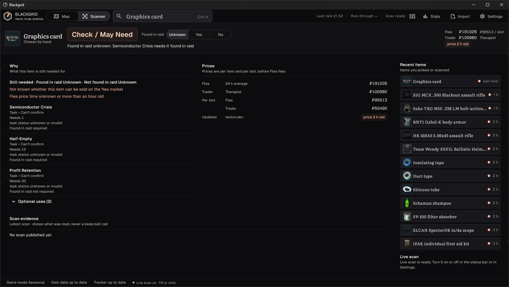
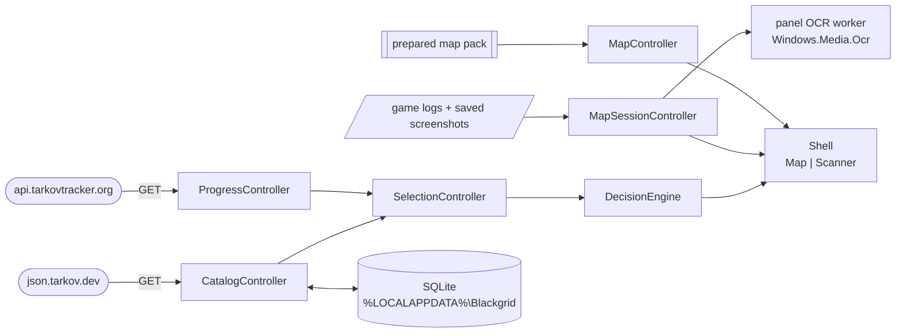

# Blackgrid

[](https://github.com/sh1ny/blackgrid/releases/latest)  

Blackgrid is a helper app for Escape from Tarkov that runs next to the game on Windows. It shows where you are on the map, which extracts you have this raid, and whether the item you are looking at is worth keeping or selling.

| Map | Scanner |
|---|---|
|  |  |

## What Blackgrid does

Blackgrid has two areas, Map and Scanner. You switch between them at the top of the window.

**Map.** Blackgrid has maps of all 13 locations: Factory, Customs, Woods, Shoreline, Interchange, The Lab, Reserve, Lighthouse, Streets, Ground Zero, Terminal, Icebreaker and Labyrinth. You choose which markers to show. There are markers for PMC, Scav and shared extracts, transits, quest items and objectives, bosses, cultists, spawns, hazards, loot containers, locks, switches, BTR stops and stationary weapons. Right-click the map to drop your own pin. Blackgrid saves pins per map.

**Scanner.** Press Ctrl K to search for an item. Blackgrid gives one of four answers, with the price:

- **Keep**: a quest or hideout upgrade needs the item now.
- **Keep for later**: you will need it further down the line.
- **Flea**: sell it on the Flea Market.
- **Trader**: sell it to the trader who pays the most.

Sometimes Blackgrid lacks what it needs to decide. The prices may be old, you may not have said whether the item is found in raid, or it may not know your quest progress. In those cases it answers **Check / May Need** instead of guessing. A wrong "sell" costs you an item, and a "check" costs you a second look.

### How it knows where you are

Blackgrid never asks the game where you are. It reads two kinds of files that the game already writes to your disk.

1. **Log files.** When you load into a raid, the game writes the map name and the game mode (PvP or PvE) to its log. Blackgrid reads the log and opens the right map. If you prefer to pick the map yourself, turn off **Follow logs**.
2. **Screenshots.** When you take a screenshot in game (Print Screen by default), the game puts your position and facing direction in the file name. Blackgrid watches your screenshot folder and places a marker where you stood, pointing the way you faced.

Your position changes on the map only when you take a screenshot. Blackgrid does not track you live.

To see which extracts you have, press O in raid to open the list of your extracts and transits, then take a screenshot. Blackgrid reads the names from the screenshot with the text recognition built into Windows, and highlights those extracts on the map.

### Item scanning is optional

The map and the scanner work independently. Searching for an item by name needs no scanning.

Live scan stays off until you turn it on in Settings or the status bar. While it is on, inspecting an item in game makes Blackgrid capture a centred band of the client, read the item's name and show the advice. A scan starts when you release the mouse button over the game window or press the scan key. The scan key is F9 by default; Settings lets you pick F1 to F24, or none. Turning live scan off stops watching mouse clicks and releases the scan key.

Accepted scans also read **Found in raid** from that inspection's picture: Yes for a recognised check, No for a complete readable corner without one, and Unknown for a cut-off or unreadable corner. The shared control on Map and Scanner shows the source. Choosing Unknown, Yes or No—even the selected value—sets a manual override for this selection. A new scan clears it. **Back to latest scan** restores the original detection, not the old override. Manual, history and correction selections start Unknown; none of these FIR choices is saved.

### Blackgrid does not touch the game

Blackgrid never connects to the game. It does not read or change the game's memory, inject anything into it, or send it key presses or clicks. It reads only these things:

- the log files the game writes to disk;
- the screenshots you take;
- with live scan on, a small capture of your screen, the same kind a screen-capture tool takes. To check that your click landed on the game, Blackgrid reads the title of the window under your mouse. Windows gives any program this title.

Blackgrid modifies no game files. A test in this repository fails if the capture code calls any Windows function that could open or control another program.

> **Note:** Blackgrid is a fan-made tool, not affiliated with Battlestate Games. Only Battlestate Games decides what its anti-cheat allows. Blackgrid keeps well away from the game, but no third-party tool can promise how anti-cheat will treat it.

### What it connects to

| Service | What Blackgrid gets from it | Needed? |
|---|---|---|
| [tarkov.dev](https://tarkov.dev) | Items, prices, traders, quests, hideout, crafts and barters. Blackgrid downloads them at start and when you change game mode | Yes, for item advice |
| [TarkovTracker](https://tarkovtracker.org) | Your quest and hideout progress, read only, so that Keep means you still need the item | No. It stays off until you paste a token in Settings |
| Windows text recognition | Reads extract names from your O screenshots, on your PC | Built into Windows |

Blackgrid downloads data and never uploads yours. There is no Blackgrid account, server or telemetry. Your settings, pins and history stay on your PC in `%LOCALAPPDATA%\Blackgrid\`. Blackgrid encrypts a TarkovTracker token so that only your Windows user can read it. The maps ship inside the app. [Data sources and credits](#data-sources-and-credits) says where they come from.

---

## For developers

The rest of this page covers building and working on Blackgrid. Blackgrid is a Dart/Flutter desktop app. It draws maps natively from a bundled map pack whose files are named by their hashes. One decision engine produces every recommendation, and an unknown or stale input always gives Check / May Need, never Sell.

## Design choices

- **Cautious keep/sell advice.** One pure-Dart [`DecisionEngine`](lib/domain/decision_engine.dart) picks the first answer that applies, in this order: Keep, Keep for later, Check / May Need, Flea, Trader, Price unavailable. It answers Check when the catalog or progress data is missing, when found-in-raid status is unknown, when a requirement is unresolved, or when the price quote is more than one hour old.
- **Native map, no WebView.** All 13 maps render from a prepared pack in [`assets/maps/`](assets/maps/active.json). Preparation compiles SVG to `vector_graphics` ahead of time. The [scene](lib/maps/native_map_scene.dart) keeps decoded tiles and pictures in a 192 MiB LRU cache.
- **Session data from files only.** [`SessionLogReader`](lib/data/session_log_reader.dart) reads the newest game log every 250 ms for the map and mode. [Screenshot file names](lib/domain/screenshot_filename.dart) give position and heading. A DLL ([`panel_ocr.cpp`](windows/ocr/panel_ocr.cpp)) reads saved extract panels with Windows `Windows.Media.Ocr`, and the app checks the DLL's hash before loading it.
- **Read-only progress, protected tokens.** [`TrackerClient`](lib/data/tracker_client.dart) sends only GET requests to `api.tarkovtracker.org`, with a 30 s timeout. Each token belongs to one mode (`PVP_`, `PVE_`, `SZN_`). The [Windows runner](windows/runner/credential_protector.cpp) encrypts tokens with DPAPI for the current user and stores them outside SQLite.
- **One local database.** A single Drift SQLite file ([`database.dart`](lib/data/database.dart)) holds settings, pins, item history and one catalog snapshot per mode. [`drift_schemas/`](drift_schemas/) records every schema version. If the file on disk has a newer version than the app knows, the app refuses to open it instead of resetting it.
- **Local progress history, not a Tracker replacement.** [`TaskLogProgressController`](lib/application/task_log_progress_controller.dart) records started, failed and finished tasks from the game logs into the [`LocalProgressStore`](lib/domain/local_progress_store.dart) ledger. Schema 9 keeps one active local wipe per mode; the first task creates it automatically. Startup catches up missed folders outside a raid. In **Settings → Local progress**, replay from a date into the same wipe, or confirm a new wipe while keeping old history. Replay never duplicates events or deletes manual corrections. Runs stop between folders if a raid starts, and report skipped records, unreadable folders and storage failures. Deleted game logs and task failures not logged during raids cannot be recovered from logs. There is no automatic wipe reset. Tracker still supplies advice and timer progress; no quest checklist is introduced here ([ADR-0044](docs/adr/0044-log-task-progress-active-wipes.md), extending [ADR-0041](docs/adr/0041-local-progress-event-ledger.md)).
  Closing Blackgrid stops replay. Replay again from the same selected date to finish; failed or interrupted results show that retry date. Startup catch-up does not resume an earlier replay below its existing folder watermark.
- **Native code checked by hash.** At install, CMake writes the SHA-256 of the panel OCR DLL and a manifest of every vision file. The app refuses to load a file that does not match. [`third_party.lock.json`](windows/vision/third_party.lock.json) pins the third-party vision inputs (OpenCV 4.13, Tesseract engine 5.0.0, Leptonica 1.82.0, `eng.traineddata`), and [`check_bundle.dart`](tool/vision/check_bundle.dart) checks them offline.
- **Explicit legacy import.** [`LegacyImport`](lib/data/legacy_import.dart) reads only the settings and history JSON files you name. It shows a preview that lists every collision. Accepting the preview writes everything in one transaction, and the same files cannot be imported twice.

## How the parts fit together



| Part | Owner | What it does |
|---|---|---|
| Startup | [`AppServices`](lib/application/app_services.dart) | Opens storage, credentials and the HTTP client, builds the controllers, and disposes of them in order |
| Catalog | [`CatalogController`](lib/application/catalog_controller.dart) and [`CatalogClient`](lib/data/catalog_client.dart) | Downloads 6 required and 4 optional English datasets for the chosen mode, normalises them off the UI isolate, and replaces the snapshot in one transaction |
| Progress | [`ProgressController`](lib/application/progress_controller.dart) and [`TrackerClient`](lib/data/tracker_client.dart) | Reads `/token` and `/progress`, keeps the results in memory only, and treats them as current for 15 minutes |
| Decision | [`SelectionController`](lib/application/selection_controller.dart) and [`DecisionEngine`](lib/domain/decision_engine.dart) | Makes one decision for the selected item and shows it in both Map and Scanner |
| Map | [`MapController`](lib/application/map_controller.dart) and [`lib/maps/`](lib/maps/prepared_map_loader.dart) | Loads the active pack, floors, markers and pins, and handles pan, zoom and hit testing |
| Session | [`MapSessionController`](lib/application/map_session_controller.dart) | Tracks the detected map and mode, player positions and highlighted extracts. It runs at most one OCR request and keeps one more waiting |
| Storage | [`BlackgridDatabase`](lib/data/database.dart) | Holds settings, pins, history, the catalog cache and the import ledger |

---

## Install and update

> **Prerequisites:** Windows 11 x64, Git and [mise](https://mise.jdx.dev/). Visual Studio with the **Desktop development with C++** workload, its CMake tools and a Windows SDK, as [Flutter's Windows setup](https://docs.flutter.dev/platform-integration/windows/setup) describes. Windows Developer Mode, if a native build needs symlinks. [`mise.toml`](mise.toml) supplies Flutter 3.47.9, so you do not need a global Flutter install.

The same commands install and update:

```text
git pull
mise trust mise.toml
mise install
mise exec -- flutter pub get
mise run vision:fetch
```

`vision:fetch` downloads the pinned OpenCV, Tesseract, Leptonica and model files into `.dart_tool/blackgrid_vision_inputs/`. The Windows build stops with an error if any of these files is missing or changed. Run `vision:fetch` again after `flutter clean`.

To check the toolchain, run `mise exec -- flutter doctor -v`. Warnings about Android or web tooling do not block a Windows build.

## First steps

1. Close Escape from Tarkov, then run `mise exec -- flutter run -d windows`.
2. Open **Settings** and choose the **Live game mode**: PvP, PvE or Seasonal. It starts as Unknown. Choosing a mode refreshes the catalog. If the refresh fails, use **Refresh complete catalog** to try again.
3. Press Ctrl K to search for an item. The Scanner area shows the decision, the requirements, the data sources and your history.
4. Optional: in **Settings**, save a Tracker token for the mode, and set the game log and screenshot folders. Leave a folder empty to detect it automatically.
5. On **Map**, choose **Read latest screenshot** in the map picker after you save a screenshot in game, or turn on **Follow logs** in **Settings** to switch maps automatically. While the game log reports a mode, that mode replaces the one in Settings.

To build a Release bundle, run `mise exec -- flutter build windows`. Ship the whole `build/windows/x64/runner/Release/` folder, not only `blackgrid.exe`.

---

## What's inside

### Application (`lib/`)

| Layer | Files | Role |
|---|---|---|
| Domain | [`decision_engine.dart`](lib/domain/decision_engine.dart), [`catalog.dart`](lib/domain/catalog.dart), [`progress.dart`](lib/domain/progress.dart), [`settings.dart`](lib/domain/settings.dart), [`map_geometry.dart`](lib/domain/map_geometry.dart), [`map_floors.dart`](lib/domain/map_floors.dart), [`raid_panel_text_parser.dart`](lib/domain/raid_panel_text_parser.dart), [`raid_exfil_matcher.dart`](lib/domain/raid_exfil_matcher.dart) | Pure Dart rules for decisions, data age, settings, map math and extract-panel text matching |
| Application | [`app_services.dart`](lib/application/app_services.dart), [`catalog_controller.dart`](lib/application/catalog_controller.dart), [`progress_controller.dart`](lib/application/progress_controller.dart), [`selection_controller.dart`](lib/application/selection_controller.dart), [`settings_controller.dart`](lib/application/settings_controller.dart), [`history_controller.dart`](lib/application/history_controller.dart), [`map_controller.dart`](lib/application/map_controller.dart), [`map_session_controller.dart`](lib/application/map_session_controller.dart) | `ChangeNotifier` controllers, all built in `AppServices` |
| Data | [`database.dart`](lib/data/database.dart), [`catalog_client.dart`](lib/data/catalog_client.dart), [`tracker_client.dart`](lib/data/tracker_client.dart), [`credential_store.dart`](lib/data/credential_store.dart), [`session_log_reader.dart`](lib/data/session_log_reader.dart), [`screenshot_directory_watcher.dart`](lib/data/screenshot_directory_watcher.dart), [`game_paths.dart`](lib/data/game_paths.dart), [`raid_panel_ocr.dart`](lib/data/raid_panel_ocr.dart), [`legacy_import.dart`](lib/data/legacy_import.dart) | Adapters for HTTP, SQLite, DPAPI, game files and OCR |
| Vision | [`vision_runtime.dart`](lib/data/vision/vision_runtime.dart), [`vision_primitives.dart`](lib/data/vision/vision_primitives.dart), [`tesseract_binding.dart`](lib/data/vision/tesseract_binding.dart), [`vision_self_check.dart`](lib/application/vision_self_check.dart) | Item vision runtime. So far only `--vision-self-check` and the tests use it |
| Maps | [`prepared_map_loader.dart`](lib/maps/prepared_map_loader.dart), [`prepared_map.dart`](lib/maps/prepared_map.dart), [`native_map_scene.dart`](lib/maps/native_map_scene.dart) | Loads the pack and renders it natively |
| UI | [`shell.dart`](lib/ui/shell.dart), [`map_screen.dart`](lib/ui/map_screen.dart), [`map_workspace.dart`](lib/ui/map_workspace.dart), [`scanner_screen.dart`](lib/ui/scanner_screen.dart), [`item_decision_card.dart`](lib/ui/item_decision_card.dart), [`settings_page.dart`](lib/ui/settings/settings_page.dart), [`import_dialog.dart`](lib/ui/import_dialog.dart), [`theme.dart`](lib/ui/theme.dart) | The window with two areas. Both areas stay mounted when you switch |

In Scanner you can look up items in the catalog by hand, or turn on **live scan**. With live scan on, releasing the mouse over the game window or pressing the scan key scans the open inspect window at the cursor, and Scanner shows what the scan found. The scan key is F9 by default. You can choose any key from F1 to F24, or Off, next to the switch. Blackgrid registers the key only while live scan is on. If another application already holds the key, mouse scans still work. A successful scan selects its item and adds it to history. The [roadmap](openspec/roadmap.md) lists what comes next.

### Native Windows code (`windows/`)

| Part | File | What it does |
|---|---|---|
| Credentials channel | [`credential_protector.cpp`](windows/runner/credential_protector.cpp) | The `blackgrid/credentials` platform channel. It finds the LocalAppData path, replaces files atomically, and encrypts and decrypts with DPAPI |
| Panel OCR DLL | [`panel_ocr.cpp`](windows/ocr/panel_ocr.cpp) | `blackgrid_panel_ocr.dll`, a wrapper over `Windows.Media.Ocr` |
| Vision DLL | [`vision.cpp`](windows/vision/vision.cpp), [`vision.h`](windows/vision/vision.h) | `blackgrid_vision.dll`, a `bgv_*` C ABI over static OpenCV `core` and `imgproc` |
| Vision build | [`CMakeLists.txt`](windows/vision/CMakeLists.txt), [`verify_inputs.cmake`](windows/vision/verify_inputs.cmake), [`write_manifest.cmake`](windows/vision/write_manifest.cmake) | Refuses inputs that are not pinned, and writes `data/vision/runtime.manifest.json` at install |

### mise tasks ([`mise.toml`](mise.toml))

| Task | What it runs |
|---|---|
| `analyze` | `flutter analyze` |
| `test` | The fast suite, without tests tagged `qualification` |
| `test:qualification` | Only the slow offline qualification tests |
| `ci:qualification` | The qualification run for CI, with a check of every skipped test. It fails locally on purpose unless you confirm that no game is running. Developers use `test:qualification` instead |
| `test:all` | Every test |
| `format` / `format:check` | `dart format`, or a check that writes nothing |
| `release-notes` | [`tool/changelog.dart`](tool/changelog.dart). Previews the next release's notes from archived proposals. With `-- --check <proposal.md>`, it validates the `## Release Notes` section of one proposal |
| `release:prepare` / `release:tag` / `build:release` / `package:release` | [`tool/release/release.dart`](tool/release/release.dart). Prepares a release commit, tags the merged release, builds a versioned Release bundle and packages it. See **Releases and changelog** under Reference |
| `vision:fetch` | [`fetch_runtime.dart`](tool/vision/fetch_runtime.dart). Downloads the pinned vision inputs and checks them |
| `maps:check` | [`prepare.dart check`](tool/maps/prepare.dart). Rebuilds the committed map pack offline and fails unless the result is identical byte for byte |
| `maps:rebuild` | [`prepare.dart refresh`](tool/maps/prepare.dart). Rebuilds the committed map pack with the installed toolchain and makes it active. It rewrites the generated asset list in `pubspec.yaml` and deletes older generations. It prints the maps that changed and, if the artwork changed, asks for an owner check |
| `maps:artwork:refresh` | [`prepare.dart artwork-refresh`](tool/maps/prepare.dart). Builds fresh artwork in a staging folder without publishing it. Pass `--packs`, `--pubspec` and `--stage` after `--` |
| `maps:artwork:publish` | [`prepare.dart artwork-publish`](tool/maps/prepare.dart). Publishes exactly the staged candidate. Pass `--candidate`, `--packs` and `--pubspec` after `--` |
| `bundle:check` | [`check_bundle.dart`](tool/vision/check_bundle.dart). Checks a built Release bundle offline |
| `capture:selftest` | The native capture self-test ([`selftest.ps1`](windows/capture/selftest.ps1)). It refuses to run unless `BLACKGRID_NO_GAMES_RUNNING=1` confirms that no game is running |
| `qualification:freeze` / `:validate` / `:report` | M0 reference evidence tools in [`tool/qualification/`](tool/qualification/m0.dart) |

### Tools (`tool/`)

| Tool | What it does |
|---|---|
| [`maps/prepare.dart`](tool/maps/prepare.dart) | The offline map pack pipeline. Its commands are `acquire`, `rebuild`, `normalize`, `compile`, `validate`, `promote` (which only moves the active pointer), `assets`, `check`, `refresh`, `artwork-refresh` (staged) and `artwork-publish` (explicit) |
| [`ocr/read_saved_panel.dart`](tool/ocr/read_saved_panel.dart) | Reads one saved screenshot with the built panel OCR DLL |
| [`m1/catalog_smoke.dart`](tool/m1/catalog_smoke.dart) | Downloads the real catalog for all three modes into a temporary SQLite file, then reopens the file to check it |
| [`vision/make_self_check_sample.dart`](tool/vision/make_self_check_sample.dart) | Regenerates the fixed [self-check sample](assets/vision/self_check/title.json) |

### Agent tooling

| Path | What it holds |
|---|---|
| [`.mcp.json`](.mcp.json) | The official Dart MCP server, started through mise with the pinned SDKs |
| [`.claude/skills/`](.claude/skills/UPSTREAM.json) | The official Flutter and Dart skills, with sources and hashes in `UPSTREAM.json`, plus the OpenSpec and Specwright skills |
| [`.claude/agents/`](.claude/agents/specwright-implementer.md), [`.omp/agents/`](.omp/agents/specwright-implementer.md) | The Specwright implementer and reviewer agents |
| [`openspec/`](openspec/config.yaml) | The Specwright change workflow, [architecture](openspec/architecture.md), [roadmap](openspec/roadmap.md) and [ADRs](docs/adr/README.md) |

---

## Settings

Blackgrid has no config file. The **Settings** dialog and the Map area save one JSON row (`Preferences`, id 1) in `%LOCALAPPDATA%\Blackgrid\blackgrid.sqlite`. [`AppSettings`](lib/domain/settings.dart) defines the fields:

```jsonc
{
  "mode": "unknown",            // unknown | pvp | pve | seasonal. Set in Settings; a mode found in the game log takes over at runtime
  "selectedMap": "shoreline",   // one of the 13 supported map IDs
  "saveMarkerFilters": false,   // true = remember which marker categories are shown
  "markerFilters": {},          // category to visibility, for example "PmcExtracts": true
  "trackerEnabled": false,      // read-only Tracker progress for the current mode
  "gameLogDirectory": "",       // empty = find it from the registry or the Steam libraries
  "screenshotDirectory": "",    // empty = Documents\Escape from Tarkov\Screenshots
  "liveScan": false,            // true = live scan is on at start
  "scanHotkey": "F9",           // off | F1 .. F24. Set in Scanner; registered only while live scan is on
  "followGameLogs": true        // switch the map from the logs; selectedMap is the fallback
}
```

Tracker tokens are not in this row. They are in `%LOCALAPPDATA%\Blackgrid\credentials\<mode>.dpapi`.

---

## Reference

<details>
<summary><b>Decision order</b>: how Blackgrid picks a recommendation</summary>

The engine checks the rows from top to bottom and uses the first one that matches ([`decision_engine.dart`](lib/domain/decision_engine.dart)).

| Recommendation | When |
|---|---|
| Keep | A quest or hideout requirement needs the item now |
| Keep for later | A known future requirement needs the item |
| Check / May Need | Any of these: catalog or progress data is missing or stale, found-in-raid status is unknown, a requirement is unresolved, Flea eligibility is unknown, or the Flea quote is missing, dated in the future or more than one hour old. An old or missing Flea quote does not count when the item cannot be sold on Flea |
| Flea | The item can be sold on Flea, and the Flea price is higher than the best cash offer in RUB from a named trader, or there is no such offer |
| Trader | A trader cash offer exists. When the Flea and trader prices are equal, the trader wins. When two traders offer the same price, the trader with the lower ID wins |
| Price unavailable | None of the rows above match |

Prices are gross RUB, before Flea fees. Accepted scans supply detected found-in-raid evidence; an explicit manual choice overrides it. Same-selection item-data, progress and age refreshes preserve both detection and override. A new selection or mode/session change clears the old context; returning to the latest scan restores its detection and clears the override.
</details>

<details>
<summary><b>Data sources and how long they stay current</b></summary>

| Source | Endpoint | Current for | On failure |
|---|---|---|---|
| Catalog | `json.tarkov.dev/{regular\|pve\|pvp-season}/{items,traders,tasks,hideout,crafts,barters}`, plus optional `*_en` translations | 24 h from download. The source's own timestamps are shown but not used | Blackgrid keeps the last good snapshot and shows the status `stale` or `failed` |
| Map markers | `json.tarkov.dev/{regular\|pve\|pvp-season}/{maps,maps_en,tasks,tasks_en,traders,traders_en}` | A compatible last good snapshot never expires | Blackgrid uses the selected mode's last good snapshot. Without one, it uses the bundled regular-mode markers and labels them as such |
| Flea quote | Inside the catalog | 1 h | The decision falls back to Check |
| Tracker | `api.tarkovtracker.org/token`, `/progress` | 15 min, in memory only | Login or mode errors clear the progress. Network errors keep it and mark it stale. Blackgrid honours `Retry-After`, and waits 60 s when the header is missing or invalid |

Every request is a GET with a 30 s deadline, and Blackgrid follows no redirects. The catalog refreshes once at launch and again on each mode switch. Progress refreshes at the same times, if you saved a Tracker token for the mode and turned on the Tracker integration. Blackgrid does not retry a failed refresh by itself. Use Refresh, or select the mode again.
</details>

<details>
<summary><b>Local files</b></summary>

| Path | What it holds |
|---|---|
| `%LOCALAPPDATA%\Blackgrid\blackgrid.sqlite` | Settings, pins, one history row per item and mode, catalog snapshots, the import ledger and map data snapshots per mode |
| `%LOCALAPPDATA%\Blackgrid\credentials\<mode>.dpapi` | The Tracker token, encrypted with DPAPI for the current user. Another Windows user cannot decrypt it |

History stores only the item ID, mode, source, UTC time and revision. Blackgrid has no telemetry, account or backend.
</details>

<details>
<summary><b>Map controls</b></summary>

| Input | Action |
|---|---|
| Select a marker badge, or a marker in the accessible list | Shows a summary in a bubble attached to the badge |
| Drag or mouse wheel outside the bubble | Pans, or zooms at the cursor |
| Controls or scrolling inside the bubble | Work on the bubble only. The map does not move and nothing on it is selected |
| Bubble `Close` button or Escape | Closes the marker bubble and removes its linked highlights |
| Arrow keys | Pan the map while the map has focus |
| Home | Fits the whole map in view |
| `+`, `=` or numpad `+` / `-` or numpad `-` | Zoom in / zoom out |
| C | Centres the view on your last known position |
| N | Adds a pin at the centre of the view |
| Right-click outside the bubble | Adds a pin at the cursor |
| Enter | Lets you browse the visible markers and pins |
| Delete | Removes the selected pin |
| Escape | Clears the selection on the focused map |

The supported maps, as the app labels them, are Factory, Customs, Woods, Shoreline, Interchange, The Lab, Reserve, Lighthouse, Streets, Ground Zero, Terminal, Icebreaker and Labyrinth. The IDs are in [`settings.dart`](lib/domain/settings.dart) and the labels in [`theme.dart`](lib/ui/theme.dart).
</details>

<details>
<summary><b>Session inputs</b></summary>

| Input | Limits | What Blackgrid reads |
|---|---|---|
| Game log | Checked every 250 ms. Lines up to 64 KiB | `scene preset path:` for the map and `Session mode:` for the mode, in the newest `log_*` folder |
| Screenshot folder | Checked every 1 s. A file must stay unchanged for 80 ms. Files up to 64 MiB | Position (XYZ) and heading (quaternion) from the file name |
| Saved panel OCR | Up to 64 MiB, at most 8192 px per side and 24 × 1024² pixels in total. One request at a time | Extract and transit names. If the worker is busy, it returns `unavailable` |

When Blackgrid has data but no confirmed raid or map, it marks the data as assumed. When data is missing or unreadable, Blackgrid says so instead of showing an empty panel. To test one image offline, run `mise exec -- dart run tool/ocr/read_saved_panel.dart <image>`.
</details>

<details>
<summary><b>Map pack preparation</b></summary>

At runtime, map artwork and calibration come only from the active pack. Marker data can refresh separately. The commands below are maintenance tools in [`prepare.dart`](tool/maps/prepare.dart). Run any of them with `--help` for details.

| Command | What it does |
|---|---|
| `acquire --raw <dir>` | Downloads all artwork, metadata and licence terms into a new raw folder, with every file's hash recorded, so that a later rebuild can run offline |
| `rebuild --raw <dir> --candidate <dir>` | Runs `normalize` and then `compile`, offline, using the reviewed calibration, source lock and notice configuration |
| `validate --candidate <dir>` | Checks every hash, vector file and sample tile |
| `promote --candidate <dir> --packs <root>` | Adds a new read-only `versions/<sha256>/` folder and switches [`active.json`](assets/maps/active.json) to it in one atomic step |
| `assets --packs <root>` | Prints the asset list for `pubspec.yaml`. Flutter does not include nested tile folders on its own |
| `check --packs <root>` | Rebuilds the active generation offline into a temporary folder, from its own inputs, calibration, source lock and notice text. It fails unless the result is identical byte for byte. Only the recorded `toolchain` may differ. Run it as `mise run maps:check`. CI runs it on every pull request |
| `refresh --packs <root> --pubspec <file>` | Rebuilds the committed inputs offline, validates the result and makes it active. It then rewrites the lines in `pubspec.yaml` between the `BEGIN` and `END generated map pack assets` markers, and deletes every other generation folder. Run it as `mise run maps:rebuild`. It downloads no new metadata |
| `artwork-refresh --packs <root> --pubspec <file> --stage <fresh-dir> [--reviewed-calibration-update]` | Downloads current artwork and builds a candidate in a staging folder. See [Refreshing artwork](#refreshing-artwork). Run it as `mise run maps:artwork:refresh -- --packs assets/maps --pubspec pubspec.yaml --stage <fresh-dir>`, with a new staging folder for each attempt |
| `artwork-publish --candidate <dir> --packs <root> --pubspec <file>` | Checks a staged candidate and publishes exactly those files, without rebuilding them. See [Publishing artwork](#publishing-artwork). Run it as `mise run maps:artwork:publish -- --candidate <dir> --packs assets/maps --pubspec pubspec.yaml` |

#### Refreshing artwork

`artwork-refresh` downloads only what it needs for new artwork: the current reviewed artwork metadata, the source vectors, five licence documents and the reviewed raster images. It builds a compiled candidate from them and reports the result. It keeps the six regular-mode data snapshots from the current verified generation. It does not publish anything, rewrite `pubspec.yaml` or change `active.json`.

The reviewed configuration holds the source URLs and expected hashes. Where they exist, the command checks pinned repository revisions and provenance. It downloads and hashes every raster tile, and checks each tile's bytes against the hash and URL recorded at acquisition in the current calibration. It also opens each distinct tile to check its PNG dimensions and transparency.

The staging folder has rules:

- It must be outside the active pack tree.
- It must have a name, and it must not exist yet. The same applies to its `.raw` sibling folder. A trailing path separator is fine.
- Neither it nor any parent folder may be a link, and it must not collide with `pubspec.yaml`.
- Download scratch files go in a sibling folder, not inside the candidate.

The command never writes to the active pack or to `pubspec.yaml`, and it deletes the downloaded inputs after the build. If the build fails after it started, keep the staging folder to find out why, and use a different new staging path for the next attempt.

By default, the reviewed configuration must match the calibration stored in the active generation. On a mismatch, the command names the path and stops before downloading anything. With `--reviewed-calibration-update`, the command adopts the current reviewed calibration instead. That calibration must still agree with the current artwork metadata and pass the usual geometry, frame, floor and dependency checks.

Older marker overrides apply only while the marker they target keeps the identity and position the override expects. An override that no longer fits is ignored, so it does not block valid metadata changes.

Review the maps, floors, files and manifest values that the command reports. The command does not publish, and it does not count as owner approval.

#### Publishing artwork

`artwork-publish` checks three things before it publishes: the current active baseline, the full set of candidate files, and the current reviewed source configuration. It hashes the candidate's output and evidence files again and checks them against the source configuration. The candidate's own manifest and recorded hashes cannot approve changed files. The command reports how the candidate compares with the active baseline as it is now, even if the baseline changed after staging. It publishes the staged files exactly as they are, through the same steps `refresh` uses: promotion, the `pubspec.yaml` rewrite, pruning and recovery. It never rebuilds the candidate, and it leaves the candidate folder in place for the operator.

#### Running writers safely

Only one command at a time may write to a pack root. This covers `refresh`, `artwork-publish` and a bare `promote`, and the operator is responsible for running them one at a time. The baseline check catches a change made by an earlier command, but it is not a lock and does not catch two commands running at once. If a command is interrupted, read its report of the pointer, `pubspec.yaml`, pruning and candidate cleanup state before you retry.

A bare `promote` only moves the active pointer. It does not rewrite `pubspec.yaml`, delete old generations or run the full publication steps.

#### When an owner check is needed

Any change beyond the recorded toolchain needs an owner check before merge. This includes metadata, manifest and evidence-only changes. A result with no changes, or with only a toolchain change, needs no owner check. A command that succeeds has not been reviewed by a person, and it does not add a review step.

A dependency update that leaves `maps:check` passing needs no new pack. When `maps:check` fails, its report lists the maps and floors whose files or manifest values changed.

The ordinary `refresh` command, and `mise run maps:rebuild` with it, rebuilds the exact inputs stored in the verified active generation. It uses that generation's calibration, the `sourceLock` in its manifest and its exact `NOTICE.txt` text. Neither downloads current REST metadata. The raw `rebuild` and `normalize` commands instead take their settings from the reviewed configuration.

#### Renewing marker metadata

Renewing the metadata is a separate staged operation, not a command-line mode. It verifies the active generation, then downloads into a new staging folder only six regular-mode JSON responses: maps, tasks, traders and their English translations.

`FrozenInputs.withMetadata` builds a view over the files that the active generation's build reads, and swaps in the six new files by hash. Every other source stays as it was, whether carried or missing. It does not unpack unused tile entries and does not download artwork.

`refreshActive(metadataInputs: ...)` then takes the view. It rebuilds the full candidate and validates it against its own stored sources. It rejects any change to prepared artwork, calibration or other non-metadata properties. It then uses the same map report, asset list rewrite, promotion, pruning and recovery steps as `refresh`. New marker content does not have to match the old facts or assignments. The owner still checks the changed maps before merge. If the build fails after it started, the candidate stays on disk under its reported name. Follow the recovery state in the report instead of deleting the candidate or retrying blindly.

#### Marker normalization

The runtime and the preparation tools share marker and quest normalization through `lib/maps/live_map_normalizer.dart`. A missing required JSON root, or a malformed record that the code uses, fails with the source named. Empty collections, and missing optional references or translations, are valid. A supported artwork map that the REST marker data does not mention gets an empty marker list. A map that appears in the REST data but is not supported does not become selectable.

Some reviewed assumptions apply only while they still match the data. They cover the Interchange marker volumes and outlines, and the identity, position, height and key of Icebreaker markers. If those markers change or disappear, renewal goes ahead, and the override does not bring them back. The following checks still apply: artwork identity, source hashes, exact reproduction of stored inputs and the ban on non-metadata changes. Changes to the REST marker maps do not loosen the separate artwork list in `metadata/maps.json`.

Some `<use>` elements point to symbols that the map's publisher deleted, such as Customs `path493` and the Streets stairs. Preparation drops these references, as a browser does. A missing symbol anywhere else fails preparation.
</details>

<details>
<summary><b>Vision self-check</b></summary>

`blackgrid.exe --vision-self-check <report.json>` checks and loads the bundled vision runtime, runs a template match and OCR on the bundled sample, and writes a JSON report. It opens no window and no database. The folder for the report must already exist.

| Exit code | Meaning |
|---|---|
| 0 | Pass |
| 1 | A step failed, or the report could not be written |
| 2 | Wrong command-line usage |
| 3 | A step did not finish within 60 s |

`blackgrid.exe` is a GUI app, so the shell does not wait for it by default. Use `start /wait` in cmd or `Start-Process -Wait -PassThru` in PowerShell. To check a built bundle offline, run `mise run bundle:check -- build/windows/x64/runner/Release`.

The FIR check template is reproducible offline from the private owner-supplied
source `.qualification/found-in-raid/afak_fir_yes_no_medal_3440x1440.jpg`.
Run `mise exec -- dart run tool/vision/make_fir_template.dart <source>` to
recreate its raw grayscale and JSON metadata in `assets/vision/fir/`. The
default recipe uses the unresampled 28×28 crop at (1199, 732) from the
3440×1440 client. The twelve qualification images remain private; their
frozen hashes, labels, and geometry are in
`test/fixtures/vision/fir/manifest.json`. If the artwork is regenerated, update
its hashes and provenance in `THIRD_PARTY_NOTICES.md`; the bundle check verifies
the manifest, artwork notices, and metadata.
</details>

<details>
<summary><b>Legacy import</b></summary>

| Rule | Detail |
|---|---|
| Inputs | The settings and history JSON paths you type. Blackgrid does not scan folders |
| Supported revisions | Settings 0 to 3, scanner preferences 0 to 1, history 0 to 1 |
| Pins | Known map IDs and frame revisions. Labs revision 0 pins are converted to revision 1 |
| Never imported | Tracker keys, progress, computed advice, found-in-raid status, prices, and old overlay and capture settings |
| Collisions | Within the source files, the higher revision wins, then the later UTC time, then file order. Existing records win unless you choose to replace them |
| Commit | **Accept preview and import** writes all records and the file digest ledger in one transaction. It does not change the source files |
</details>

<details>
<summary><b>Database schema changes</b></summary>

```text
mise exec -- dart run build_runner build
mise exec -- dart run drift_dev schema dump lib/data/database.dart drift_schemas/
mise exec -- dart run drift_dev schema generate drift_schemas test/data/generated
```

Schema history:

- Version 1 has the settings, pins, activity and catalog tables.
- Version 2 adds the import ledger.
- Version 3 adds the item icon cache.
- Version 4 adds local raid and sale statistics.
- Version 5 was a pre-release form of the map data cache.
- Version 6 drops the version 5 cache and creates the `live_map_snapshots` and `live_map_sources` tables in its place. User records are not touched.
- Version 7 adds the optional recorded verdict to item history.
- Version 8 adds the mode-scoped local progress event ledger and its derived heads.
- Version 9 adds active local wipes and their log-folder reading positions; previous cycles and history are retained.

`LiveMapCacheStore` keeps the last good map data for each game mode. That is the six exact json.tarkov.dev response bodies, their ETag and Last-Modified values, and the time of the last check. It replaces all of them together in one transaction. Each time the markers are used, Blackgrid builds them from these bodies with the current normalizer and prepared pack, so a new app version never reads outdated derived data. If a stored body no longer normalizes, Blackgrid ignores it and shows the bundled markers instead. Stored data does not expire.

`LiveMapFetcher` downloads six JSON sources from the `regular`, `pve` or `pvp-season` route of the selected mode: `maps`, `maps_en`, `tasks`, `tasks_en`, `traders` and `traders_en`. It sends a conditional request with the ETag if it has one, otherwise with Last-Modified, and otherwise a plain GET. On a 200 response it replaces the body and both validators. On a 304 it keeps the cached body and keeps or updates its validators. A failure saves no partial bodies or validators.

Each request may take 30 seconds and return 16 MiB after decoding. A whole refresh may take 120 seconds and 64 MiB across all six bodies, cached 304 bodies included. Redirects and automatic retries are not allowed, and closing the app cancels the request in progress.

`LiveMapDataController` normalizes the bodies and parses the markers in one background isolate. Markers that point to the same task, objective or location share one read-only copy of its data. The full details and the quest, objective and item IDs stay available without extra requests. Each mode runs at most one refresh at a time. If the mode changes before a refresh finishes, Blackgrid stores the result for the old mode but does not show it. Extract matching on saved panels uses the same marker data as the visible map. The prepared offline map output does not change.
</details>

<details>
<summary><b>Releases and changelog</b></summary>

Versions follow [SemVer 2.0.0](https://semver.org/), with tags that start with `v` ([ADR-0009](docs/adr/0009-release-versioning.md)). Closing a milestone raises the minor version, so M2 became `0.2.0`. Fixes between milestones raise the patch version. A build handed out for user checks is a prerelease, such as `0.2.0-beta.1`. Only a release commit changes `version:` in `pubspec.yaml`. The build number is the number of commits up to the built `HEAD`.

| Step | Command | What it does |
|---|---|---|
| Preview | `mise run release-notes` | Prints the items the next release will list, grouped by kind. It warns about changes without valid release notes, and lists commits on `main` that no change covers. It changes no files. Write the release summary from this output |
| Prepare | `mise run release:prepare -- <version> --summary-file <file>`, or `--summary "<text>"` | See [Preparing a release](#preparing-a-release). It does not push. It prints the push and pull request commands |
| Merge | Push the branch, open a pull request titled `chore(release): v<version>`, and merge it | |
| Tag | `mise run release:tag` | Run it on `main` right after the release merge. It checks the merge and the version in `pubspec.yaml`, creates the annotated tag `v<version>` and pushes only that tag, as the `github.login` user from [`openspec/specwright.yaml`](openspec/specwright.yaml). It then prints a link to the Publish run. The merge can be a merge commit, or a squash commit titled `chore(release): v<version> (#N)` that the pull request API confirms |
| Publish | Runs on the tag push ([`release.yml`](.github/workflows/release.yml)) | Checks that the tag has no release yet, runs the same gates as CI on the tag, then publishes the zip, the installer and `SHA256SUMS.txt` as one GitHub release |
| Check a build (optional) | `mise run build:release`, then `mise run package:release` | Lets you check a build before tagging. It runs `vision:fetch`, then `flutter build windows --release` with the version, the build number and `BLACKGRID_VERSION=<version>+<count>`, then `bundle:check` on `build/windows/x64/runner/Release`. It writes the zip, the installer and `SHA256SUMS.txt` to `build/release/`. CI does not use these files. It builds again from the tag |

#### Preparing a release

`release:prepare` needs a release summary of at most 600 characters that does not start with `#`. It joins the summary into one line. Keep the summary file outside the checkout.

It runs only on a clean `main` that matches `origin/main`, with a version higher than every release tag. It builds the notes, and refuses if no change was archived since the last final release. It then runs `analyze`, `format:check` and `test:all`, and commits `chore(release): v<version>` on the branch `release/v<version>`. The commit contains the new version in `pubspec.yaml` and the new section of `CHANGELOG.md`.

Pass `--trailer "<line>"` to add commit trailers. The commit and the tag use the Git identity from the environment (`GIT_AUTHOR_*`, `GIT_COMMITTER_*`).

`release:tag` refuses if another pull request merged between `prepare` and the release merge. In that case, delete `release/v<version>` locally and on `origin`, then prepare again.

#### Retrying or backfilling a release

Start a manual run of [`release.yml`](.github/workflows/release.yml) from `main` (Actions, Release, Run workflow) and enter a tag that has no release yet. The workflow refuses a manual run from another branch. It also refuses tags from before release publishing existed, such as `v0.4.0` and `v0.5.0`, so those cannot be backfilled.

A failed publish can leave a draft release. Both the preflight and the publish job refuse a tag that already has any release, drafts included. Delete the draft on the Releases page first, then start the manual run.

#### Where the version shows

The **Settings** dialog shows the version, and so does the `appVersion` field of the vision self-check report. A build without the version define, such as `flutter run`, shows `dev`. The executable's file version is `<major>.<minor>.<patch>.<count>`.

#### Where release notes come from

Release notes come from each change's proposal ([ADR-0029](docs/adr/0029-release-notes-come-from-each-proposal.md)). Every `proposal.md` has a `## Release Notes` section with a summary, then `### Added`, `### Changed`, `### Fixed` and `### Removed` lists.

`release:prepare` reads these sections from the proposals archived on the first-parent history of `main` since the last final release. It groups their items under `Added:`, `Changed:`, `Fixed:` and `Removed:`, with each change's pull request number. It puts the release summary first and inserts the section above the newest one in `CHANGELOG.md`. It never regenerates older sections.

A final release drops the sections of its own prereleases and lists everything since the previous final release. A change without a valid section appears under `Changes:` with the first sentence of its Why, and the tool prints a warning that names it.

```text
mise run release-notes
mise run release-notes -- --check openspec/changes/<change>/proposal.md
mise run release:prepare -- 0.7.0 --summary-file ../release-summary.txt
```
</details>

---

## Tests

| Command | What it covers |
|---|---|
| `mise run test` | Domain, data, controllers, widgets and map logic, plus the untagged M0 contract, statistics, comparison, export and CLI tests. All offline. Use it while you develop |
| `mise run test:qualification` | Tests tagged `qualification` ([`dart_test.yaml`](dart_test.yaml)): map pack preparation, the M0 collector and fixture integrity, panel OCR, the vision runtime, CMake and bundle checks. The native capture test is skipped unless `BLACKGRID_NO_GAMES_RUNNING=1` confirms that no game is running |
| `mise run test:all` | Both of the above. Run it before you merge |
| [`m1_windows_smoke_test.dart`](integration_test/m1_windows_smoke_test.dart) | Real DPAPI, the real catalog and reopening SQLite, on Windows |

The tests are in [`test/`](test/).

AI agents must not launch or drive Blackgrid while Escape from Tarkov is running. Any check that needs the game is done by the user. See [AGENTS.md](AGENTS.md).

## Continuous integration

[`.github/workflows/ci.yml`](.github/workflows/ci.yml) runs on every pull request and every push to `main`. It only calls [`.github/workflows/gates.yml`](.github/workflows/gates.yml), which holds the gates, so that release publishing runs the same gates. The pull request check is named `ci / Analyze, test, build and qualify`, and a branch protection rule that requires it must use that exact name.

The gates run on a GitHub-hosted `windows-2025` runner ([installed software](https://github.com/actions/runner-images/blob/main/images/windows/Windows2025-Readme.md)). They install the tools pinned in [`mise.toml`](mise.toml), then run these steps in order and stop at the first failure:

1. `mise run analyze`
2. `mise run test`
3. `mise run build:release`, from a checkout with full history, including the offline bundle check
4. `mise run ci:qualification`, the qualification tests against that bundle

A hosted runner cannot run every qualification test. The committed list [`tool/ci/qualification_skips.yaml`](tool/ci/qualification_skips.yaml) allows two kinds of skip, and any other skip fails the run.

- **Private input** (`private_input`). Three tests need inputs that are not committed: the inspection corpus, the targeted-region replay and the supplied panel image.
- **Host platform** (`host_platform`). The runner lacks a host setting the test needs, and a test that does run on CI covers the same behaviour (`covered_by`). There is one such entry, the in-process vision runtime test with a Cyrillic path. It needs a UTF-8 system code page, and the runner uses code page 1252. The `blackgrid.exe` self-check under a Cyrillic path covers it.

`mise run ci:qualification` is for CI. Locally it fails on purpose unless you confirm that no game is running, so developers use `mise run test:qualification`. Requiring the check before merge is a branch protection setting that the repository owner controls on GitHub.

## Uninstall

1. Delete the Release folder.
2. Delete `%LOCALAPPDATA%\Blackgrid\` to remove settings, pins, history, the catalog cache and saved tokens.

## Data sources and credits

Blackgrid is a fan-made companion tool. It is not affiliated with, endorsed by or sponsored by Battlestate Games. It is for personal, non-commercial use.

### tarkov.dev

Blackgrid depends on the [tarkov.dev](https://tarkov.dev) project and its community data.

| Used from tarkov.dev | Purpose |
|---|---|
| SVG map graphics ([tarkov-dev-svg-maps](https://github.com/the-hideout/tarkov-dev-svg-maps), by Shebuka and contributors) | Map backgrounds for most locations |
| Interactive map tiles | Map backgrounds for The Lab and Labyrinth. The Icebreaker tiles are by [TarkovBOT.eu](https://tarkovbot.eu/), hosted by tarkov.dev |
| Map metadata and coordinates | Bounds, transforms and floor definitions |
| Game data ([json.tarkov.dev](https://json.tarkov.dev)) | Items, prices, traders, quests, hideout, crafts and barters. Also extracts, transits, spawns, bosses, hazards, switches, locks and loot positions |
| Item icons ([assets.tarkov.dev](https://assets.tarkov.dev)) | Item pictures on the decision card and in history, downloaded when an item is shown |

Thank you to the tarkov.dev team and contributors for maintaining the maps and the open game data.

The map marker icons, for extracts, quests, spawns, bosses, hazards and the rest, are Blackgrid's own and were drawn for this project ([ADR-0023](docs/adr/0023-project-authored-map-marker-icons.md)).

### TarkovTracker

The optional quest and hideout progress comes from the read-only [TarkovTracker](https://tarkovtracker.org) API ([tarkovtracker-org](https://github.com/tarkovtracker-org)).

### Escape from Tarkov

Escape from Tarkov is a trademark of Battlestate Games Limited. Game names, item names, item images and map content belong to Battlestate Games. This project is unofficial.

### Other

- Blackgrid was inspired by [TarkovTracker](https://github.com/sayser/TarkovTracker), a C# desktop companion. Blackgrid is a separate Dart/Flutter implementation and contains no code from it.
- Map artwork and metadata come from the tarkov-dev SVG maps project, Tarkov.dev and TarkovBOT.eu. [THIRD_PARTY_NOTICES.md](THIRD_PARTY_NOTICES.md) and each pack's evidence files record their terms.
- Item vision uses OpenCV, Tesseract, Leptonica and tessdata, pinned in [`third_party.lock.json`](windows/vision/third_party.lock.json).
- Project direction is in [STRATEGY.md](STRATEGY.md), the [architecture](openspec/architecture.md) and the [decisions](docs/adr/README.md).
- Blackgrid's source code is released under the [MIT License](LICENSE). Bundled third-party code, models and map artwork keep their own licences, listed in [THIRD_PARTY_NOTICES.md](THIRD_PARTY_NOTICES.md). The map artwork is not MIT. Most of it is CC BY-NC-SA 4.0, which forbids commercial use and requires that changed versions be shared under the same terms.
