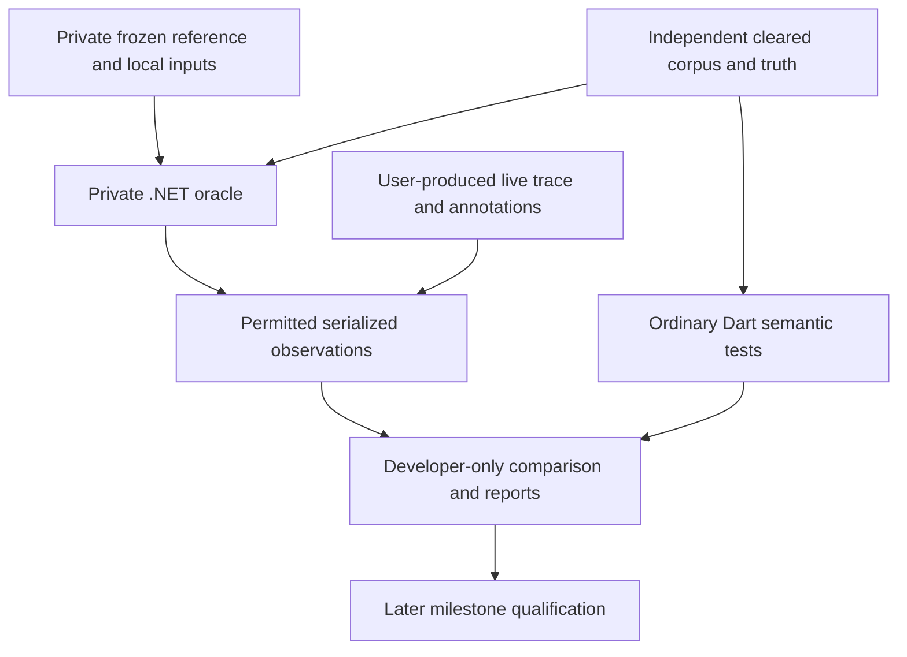
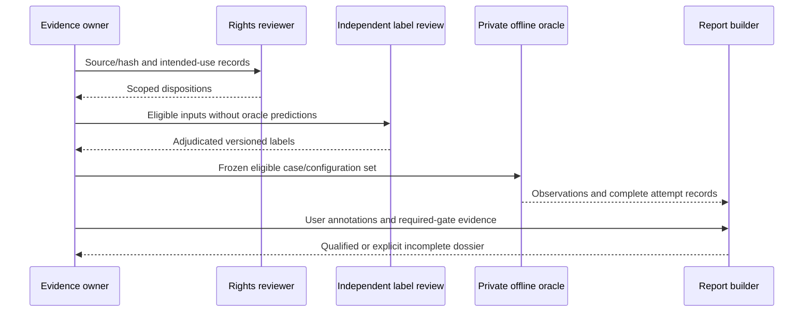
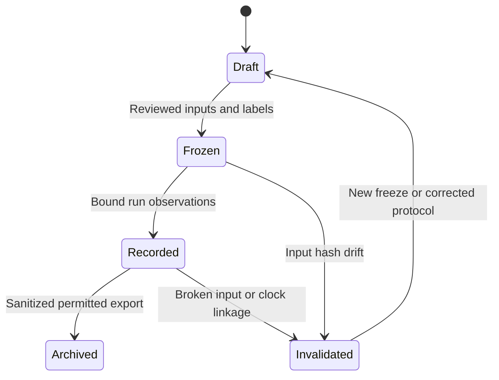
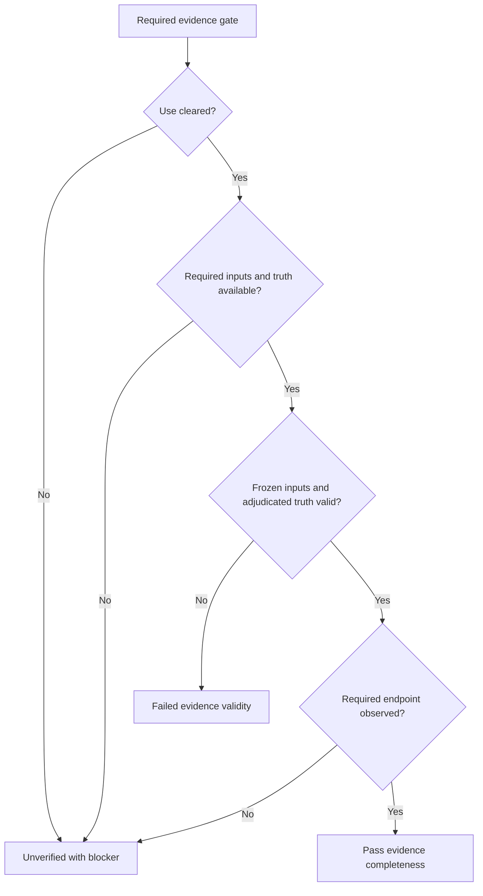
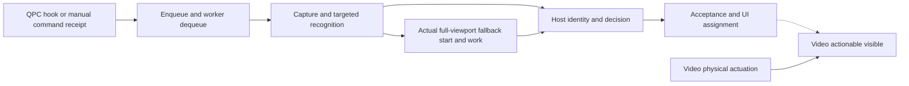
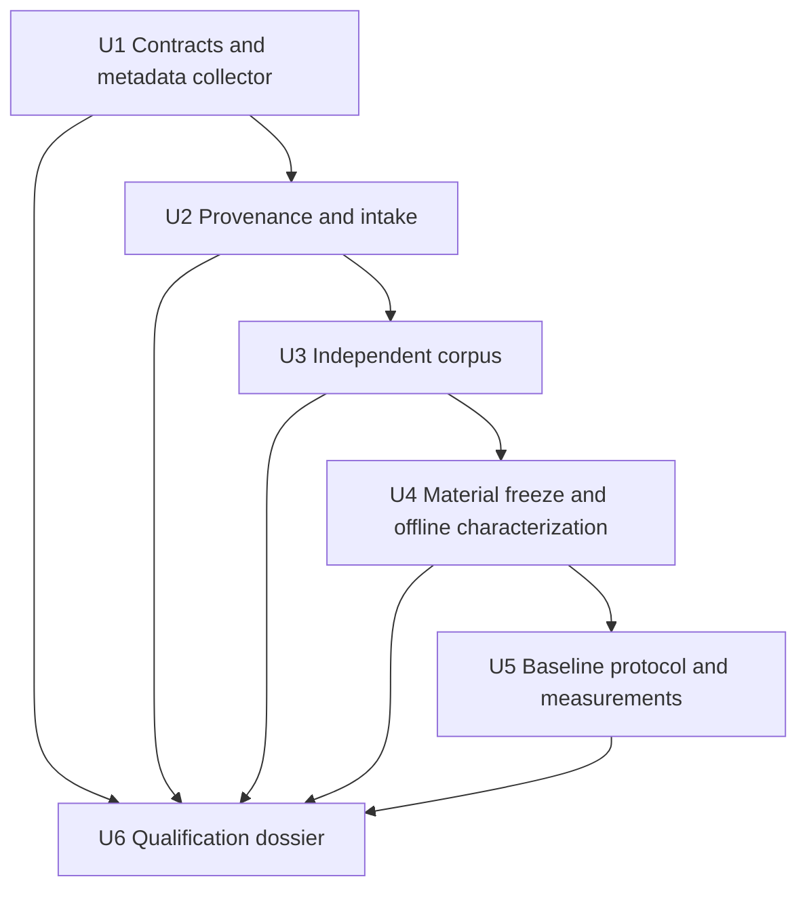

# M0 Reference Qualification and Provenance - Plan

## Goal Capsule

- **Objective:** Blackgrid's implementers can distinguish the reference's demonstrated behavior from its defects and gaps, compare later implementations against trustworthy examples and measured latency, and identify which inputs may legally be reused.
- **Means:** A frozen reference, independently labeled corpus, separate offline and user-performed baseline reports, and an artifact/use rights ledger (KTD1-KTD8).
- **Authority:** `AGENTS.md` controls testing permissions; `STRATEGY.md` controls product scope; `docs/IMPLEMENTATION_STRATEGY.md` sections 11-13 define M0 and replacement qualification. This plan supplies the M0 execution details without changing those documents.
- **Execution profile:** Characterize first, then freeze evidence. Developer-only tooling and synthetic/offline checks belong to the implementing agent. The user performs every game-dependent acquisition and measurement.
- **Stop conditions:** Stop the affected run for changed frozen inputs, missing use permission, unresolved truth, or an unavailable required observation. Apply R3 before any companion execution; apply R13 before making qualification claims.
- **Who finishes:** The implementing agent delivers tools and offline evidence; the user supplies live measurements and adjudicates requested game observations; the designated rights reviewer records use decisions. M0 is not a replacement release.

---

## Product Contract

### Summary

Qualify M0 only: establish reproducible reference evidence, independent fixtures, representative map control points, baseline measurements, and asset/dependency provenance. Keep evidence tooling outside Blackgrid's runtime. Prepare the full offline display matrix while leaving comprehensive live display qualification in its existing M2/M6 gates.

### Problem Frame

The reference contains useful behavior, weak historical fixture oracles, and unmeasured end-to-end paths. Its current working files also differ materially from its recorded commit. Copying its outputs or credits would make later parity and distribution claims unreliable.

**Product Contract preservation:** `STRATEGY.md` and `docs/IMPLEMENTATION_STRATEGY.md` remain unchanged. Their later milestones remain obligations, not work silently removed by selecting M0.

### Key Decisions

- **Evidence, not legacy dependence.** Preserve useful outcomes without coupling the product to the old implementation. Governs R2, R4, R12.
- **Human-only game testing** (session-settled: user-directed — chosen over agent-driven live checks: the repository assigns game-dependent testing entirely to the user). Preserve the R3 authority boundary. Governs R3, R6.
- **Independent safety truth.** Known unsafe legacy advice is a documented divergence, not Blackgrid's expected result. Governs R5, R11.
- **Rights before reuse.** Attribution and public availability do not establish permission for a different use. Governs R7, R8.
- **Offline matrix, named native baseline** (session-settled: user-approved — chosen over full live matrix qualification in M0: the deterministic corpus covers all cells; comprehensive native qualification stays in M2/M6). Governs R6, R9.

### Requirements

**Scope and execution authority**

- R1. Deliver the four M0 evidence products: reference qualification, fixture corpus, baseline measurements, and asset/dependency provenance, with concrete reproducibility and acceptance records.
- R2. Preserve the product boundaries in `STRATEGY.md` and the milestone ownership in `docs/IMPLEMENTATION_STRATEGY.md`; do not implement the shell, decision engine, persistence, native capture/OCR bindings, or renderer in M0.
- R3. Agents must not launch, restart, drive, attach to, or verify Blackgrid or the reference companion while Escape from Tarkov is running, and must not launch the game or automate game-dependent tests. Written tests and fixture/mocked/offline checks are allowed. Before any permitted companion/native-reference execution, confirm game absence through a fresh process observation; inability to confirm means no launch. Game-dependent acquisition and testing are user-only. Request user testing or explicit approval to skip a required live confirmation; a skip remains unverified and never authorizes agent execution. Attribute user evidence to the user.

**Reference and truth**

- R4. Every oracle result must bind an immutable effective reference snapshot, configuration, native/model inputs, catalog snapshots, fixture/label versions, and environment; commit SHA alone is insufficient.
- R5. Independently establish item identities, rejection/ambiguity outcomes, and map landmarks before revealing reference predictions; preserve disagreement rather than changing truth to fit the oracle.
- R6. Record an actual original-trigger-to-actionable-visible reference baseline on a named Windows setup, distinguishing it from offline recognition timings and state-publication timings.

**Provenance and privacy**

- R7. Inventory every actual qualification input and candidate release asset/component with source, version/hash, license evidence, derivation/dependency relationships, and a reviewed disposition for each intended use. Unknown permission blocks that use; unresolved future release rows may remain inventoried but cannot enter a release.
- R8. Keep raw captures, private reference source/binaries, unredacted recordings, and confidential grants outside committed/exported evidence. No tokens, protected credentials, real personal progression, account/chat details, or personal absolute paths in fixtures, traces, reports, or diagnostics. Only explicitly permitted, sanitized fixture material may enter the repository.

**Corpus coverage**

- R9. Cover all 16 resolution/scaling combinations in deterministic fixture specifications and report each cell's actual evidence class; derived images cannot qualify live display, capture, or DPI behavior.
- R10. Provide independently grounded control points for all 13 configured map identities/revisions, plus floor, heading, raster-extent, and coordinate-frame examples relevant to later Map qualification.
- R11. Freeze synthetic catalog/progression, advice, session, correction/history, and persistence/import examples from the implementation strategy's coverage table, including intentional conservative-advice divergences; M0 records expected behavior rather than implementing those product features.

**Consumption and qualification**

- R12. Ordinary Blackgrid tests and release builds must work without the old checkout, .NET oracle, private captures, network access, or a running companion/game; consume cleared independent fixtures and serialized evidence only.
- R13. Report failed, missing, skipped, excluded, and unmeasured checks explicitly. Required unverified checks prevent full M0 qualification; exclusions cannot silently remove a requested case, map, or display cell.

### Success Criteria

A second implementer can reproduce the eligible offline comparisons, identify the frozen source of every result, audit all recognition denominators, and trace every live claim to user-produced observation evidence. A rights reviewer can identify each proposed use and its evidence without inferring permission from the old bundle.

The inherited Blackgrid performance targets remain targeted decision latency at <=300 ms p95, genuine visible fallback near 300 ms, and <=1.5 s p95 total from the original trigger. Later automatic recognition must have baseline-or-better coverage and no worse false-positive identities. M0 measures the reference; the reference need not meet those future Blackgrid targets for its baseline to be valid.

### Actors and Acceptance Examples

- A1. Implementing agent: source/inventory research, synthetic fixtures, developer tooling, and permitted offline checks.
- A2. User: live acquisition, physical interaction, display/game settings, endpoint annotations, and game-dependent confirmation.
- A3. Rights reviewer: assessment and permission evidence for each use; an agent inventory is not legal approval.
- A4. Subsequent milestone implementer: consumes frozen fixtures and reports without executing the oracle in ordinary tests.

| Example | Given / When | Required outcome | Covers |
| --- | --- | --- | --- |
| AE1. Dirty source | `maps.json` changes without changing reference HEAD | The effective snapshot differs; results cannot retain the old freeze identity | R4 |
| AE2. Unsafe legacy sale | Reference returns Sell with unknown instance FIR and no decisive keep need | Preserve observed Sell separately from expected Blackgrid Check and record the intentional divergence | R5, R11 |
| AE3. Wrong identity | An accepted reference ID contradicts independently labeled item truth | Count a wrong accepted identity, not a successful recognition or a corrected label | R5 |
| AE4. Skipped live check | User explicitly skips the live baseline | Offline evidence may be delivered; live latency remains null/unverified and M0 cannot be called fully qualified | R3, R6, R13 |
| AE5. Private-only material | An artifact is permitted privately but not as a repository fixture | Private replay permission does not authorize committing or exporting its bytes | R7, R8 |
| AE6. Missing visible endpoint | Trace has acceptance and UI assignment but no observed actionable frame | Report publication latency only; trigger-to-visible latency remains unverified | R6, R13 |

### Scope Boundaries

The approved initial product remains Windows Map and Scanner, supporting configuration, read-only Tracker integration, and OpenCV/Tesseract item recognition. No overlay, WebView target, old-runtime dependency, backend/accounts/cloud/telemetry, other-platform release, Database area, full Progression area, or progression writes are introduced (R2).

#### Deferred to Follow-Up Work

- M1: shared shell, real data/decision authority, durable storage, and migration implementation.
- M2/M3: native binding/version selection and packaging, direct ROI capture proof, vector/raster compilation/render proof, and measured native resource budgets.
- M4-M6: complete production flows, candidate-versus-baseline gates, comprehensive live display/mixed-monitor qualification, and clean-machine release checks.

#### Considered and Not Built

- A generic benchmark platform, analytics backend, automatic live driver, or compliance/SBOM framework: small local records and tools satisfy M0; none is needed to consume these evidence products.
- New recognition engines, multilingual host support, automatic FIR detection, inventory/icon recognition, continuous player telemetry, or BTR routes: library capability and missing evidence do not create product requirements.
- Baseline-driven fixes to the reference: record defects without altering the comparison target; only private measurement instrumentation is in scope.

---

## Planning Contract

### Current Evidence and Research Basis

- Reference root HEAD is `04cf9e4b618d4921cd4d125753ece255d3e37eb0`, matching the strategy's inspection basis. The working tree has tracked changes and untracked Labs/Icebreaker, geometry, floor/configuration, tool, and test additions. These working files are part of the effective oracle, not evidence of a clean commit.
- RatEye is checked out at `24f8806e866add0750c8d24479f94639cef2ccae`; its inspected porcelain status is empty. Re-attest this at qualification time.
- Blackgrid is a minimal Flutter placeholder. `mise.toml` pins Flutter `3.47.6`; `pubspec.yaml` constrains Dart to `^3.13.5` and declares only Flutter SDK and test/lint dependencies. No M0 harness or product scanner/map implementation exists.
- The existing RatEye benchmark replays saved images and emits engine results/timings. It does not execute the production host matcher, decision resolution, capture, scheduling, publication, or visible UI. Historical real-image test sources are excluded from the normal RatEye xUnit compilation.
- Reference automatic ingress dispatches to enqueue, then a latest-wins worker settles approximately 50 ms. Production targeted capture copies the full client before cropping. Automatic fallback is not-before enqueue+200 ms and waits for synchronous targeted work; it is not a guaranteed trigger-relative start.
- No reproducible full trigger-to-visible baseline is established. Existing engine timers and UTC enqueue/capture/acceptance fields cannot supply it.

### Key Technical Decisions

- KTD1. **Separate evidence tooling from product code.** Use developer-only Dart JSON validation/comparison/reporting under `tool/qualification/` and existing Flutter test dependencies for its semantic tests. Use PowerShell for read-only Windows revision/content-hash collection. Keep independently authored, permitted oracle adapter source and instrumentation recipes under `tool/qualification/reference/`; retain restricted source/patches in an owner-controlled durable private archive with access/retention locator and content hashes. Ignored `.qualification/m0/` is the local materialization/build workspace, not the sole source of reproducibility. No imports from `lib/`, Windows runner changes, or normal-test oracle invocation. This instantiates R2, R8, R12 without creating a second application architecture.
- KTD2. **Freeze the complete effective input closure.** Capture all compiled reference source/project/build inputs, relevant submodule contents, map/configuration/artwork inputs, effective processing settings, native DLL/model bytes, and local catalog/progress inputs used by a run. After U2 clears applicable use, U4 materializes the private snapshot and patch using U1's collector; bind adapter source, instrumentation source/patch, exact build/replay recipe and ordered path/SHA-256 inventory. Metadata-only intake and synthetic collector checks need no source copying or oracle execution. Exclude `.git`, build outputs, caches, personal settings/logs/credentials, and unused files. Hash the canonical manifest payload excluding its own ID, local machine paths, and creation metadata to derive `freeze_id`; preserve exact manifest bytes separately. Check input hashes before and after each oracle run. Any drift invalidates that run rather than refreshing the expected result. Governs R4.
- KTD3. **Keep independent truth, reference observations, and target policy separate.** Each case has an adjudicated expected outcome plus independent annotation evidence. Reference outputs never populate that field. Derived cases retain their parent/source ID and transform recipe. A label or catalog/configuration change creates a new corpus version and explicit comparison basis. Require second review for map landmarks, ambiguous/numeric cases, and all intended safety divergences, plus at least one ordinary positive per display-family stratum. Unresolved truth remains a reported ambiguity/exclusion, not a guessed item. Governs R5, R9-R11.
- KTD4. **Use a small artifact/use ledger rather than infer clearance.** Store source declarations separately from reviewed conclusions. Use standard SPDX identifiers only for matching standard terms and a custom `LicenseRef` for RatEye's exact text. Record `private_reference`, `repository_fixture`, `report_export`, and `release` dispositions independently as `cleared`, `unresolved`, or `excluded`, with scope, reviewer, date, and evidence. A derived file inherits source relationships, not automatic permission. This follows the [SPDX license-expression distinction](https://spdx.github.io/spdx-spec/v2.3/SPDX-license-expressions/) and [package license fields](https://spdx.github.io/spdx-spec/v2.3/package-information/) without requiring SPDX document generation. Governs R7, R8.
- KTD5. **Characterize the production-effective host offline, not just RatEye.** The private wrapper feeds saved permitted pixels through the frozen recognizer and actual reference host matching/decision services with local snapshots. Separate `engine_inspection`, `engine_multi`, `host_resolution`, `map_geometry`, and `exfil_panel` evidence profiles. Freeze the host's English/LSTM/RawLine settings, scale calculation, disabled static-icon/cache options, preprocessing and acceptance settings from the reference; do not accept benchmark defaults as host equivalence. Reuse reference services rather than transcribing their algorithm. Assign each case `reference_characterization`, `expectation_only`, or `both`, with its existing executable seam/profile where applicable. Expectation-only cases freeze initial context, ordered inputs and expected state effects/non-effects; validate their truth/coverage without implementing the downstream feature. No capture/input callbacks, WPF window startup, HTTP, or credential loading in offline replay. Governs R4-R6, R12.
- KTD6. **Measure internal intervals with QPC and visible outcomes with a user-operated observation clock.** Private .NET instrumentation records raw `Stopwatch.GetTimestamp` ticks, frequency, run/clock domain and source event boundaries, following [Microsoft QPC guidance](https://learn.microsoft.com/en-us/windows/win32/sysinfo/acquiring-high-resolution-time-stamps) and [.NET 10 Stopwatch frequency](https://learn.microsoft.com/en-us/dotnet/api/system.diagnostics.stopwatch.frequency?view=net-10.0). UTC is separate metadata. For live totals, the user records physical mouse-release/hotkey actuation and the reference result in the same high-frame-rate video timeline; annotate trigger and first actionable result as frame intervals. Derive elapsed lower/upper bounds within that timeline, not by subtracting video time from QPC ticks. Correlate request ordinal/generation to the trace, but do not sum incompatible clocks. Name `physical_actuation` and `actionable_visible` as video endpoints, and `hook_receipt`/`manual_command_receipt` and `ui_assignment` as QPC endpoints. Only a QPC-to-video hook-receipt-to-visible claim needs calibrated alignment; QPC-only intervals and same-video physical-input-to-visible bounds do not. Every reported interval names its endpoints, trigger kind and clock. Publication/property assignment and `DwmFlush` are not generic visible-result proof. Governs R3, R6.
- KTD7. **Pre-register attempts and preserve denominators.** Use the sampling allocation below and nearest-rank p95, selecting sorted sample `ceil(0.95*N)`. Report lower/upper quantiles for interval-valued video results. Separate cold/warm, evidence profile, resolution, intended path and actual terminal outcome. For live baselines, partition latency distributions, completed-sample N and all-trigger outcome counts by automatic/manual trigger kind within each intended path and actual terminal outcome. Any pooled path-level summary must be labeled mixed-trigger descriptive evidence, not either trigger route's baseline. Retain every attempt, including reject/error/supersede/cancel/incomplete; never replace failed attempts until a success quota is reached. Repeats are timing samples, not new recognition coverage. Report unique-case correct identity, wrong accepted identity, readable-positive misses, abstentions, and all-trigger counts together. Fallback rejection is not actionable success; an identified item with honest Check can be. No cross-environment pooled p95 or precision claim unsupported by observation resolution. Governs R5, R6, R9, R13.
- KTD8. **Make partial evidence mechanically distinguishable from qualification.** Gate records carry `pass`, `fail`, `unverified`, or `not_applicable`, an owner, evidence IDs, and a reason. Required gates cannot become not-applicable merely because evidence is unavailable. Overall M0 is `qualified` only when every required M0 evidence gate passes; any required fail yields `not_qualified`, otherwise missing required evidence yields `incomplete`. Missing prerequisites or a user-approved skip produce unverified/incomplete; demonstrated invalid evidence produces fail/not-qualified. Retain unattempted planned-check records without fabricating freeze IDs or observations. Keep reference accuracy/speed defects separate from evidence-validity gates: a faithfully measured bad result is valid baseline evidence. Export only an explicit permitted/sanitized allowlist. Governs R7, R8, R13.


These choices need no bake-off: the reference behavior and available entrypoints establish the separation; no consequential competing mechanism needs a prototype before the evidence work can start. The native engine/renderer choices remain in their existing later gates.

### High-Level Technical Design

These sketches fix boundaries and evidence shapes, not exact classes or method signatures.

#### Component Boundary



There is no edge from the oracle to the Blackgrid runtime or normal test execution (KTD1).

#### Qualification Protocol



#### Evidence Lifecycle



Never rewrite an archived run to use a new label or source version (KTD2, KTD3).

#### Gate Decision Shape



The separate observed reference result can still be inaccurate or slow (KTD8).

#### Evidence Modes and Ownership

| Mode | Executor | Input / observable result | Not established |
| --- | --- | --- | --- |
| Semantic fixture checks | Agent | Synthetic/cleared JSON, geometry expectations, recorded outcomes | Native recognizer, real capture, live UI |
| Offline reference replay | Agent, under R3 | Permitted saved pixels/local snapshots; actual frozen engine/host output | Physical trigger, foreground behavior, visible live latency |
| Game-closed reference observation | Agent after fresh game-absence confirmation | Actual companion startup/map behavior with permitted offline inputs | In-game capture/support |
| Live acquisition and baseline | User only | Actual game/display settings, interactions, traces and endpoint annotations | Untested display cells or missing endpoints |
| Recorded-evidence assessment | Agent under R3 | Sanitized user-provided records after confirming the game is closed | New live verification or ownership of the user's result |

#### Versioned Record Surface

All records use schema version 1, explicit IDs, null-plus-reason for unavailable observations, and portable relative payload paths. Keep executable validation in Dart; `contracts.md` documents the record fields and compatibility rule. Unknown schema versions are rejected, not guessed.

| Record | Required information |
| --- | --- |
| Source lock | `freeze_id`, reference/submodule commits and dirty facts, included path/hash closure, private archive/patch locator and hash, adapter source/build/replay recipe identities, effective config, resolved package/native/model versions/hashes, map/frame revisions, local catalog/source/mode/locale/status/timestamp hashes, instrumentation source/patch/build identity |
| Environment | Named setup alias, CPU/GPU/RAM, Windows build/architecture, SDK/runtime, app build, actual viewport/game UI settings/locale, display pixels and OS scaling, monitor origin/topology, display mode, cache/warm state, observer/trace configuration |
| Provenance | Artifact/component ID, kind/purpose, source/revision/hash, declared terms/license text locator, assessed terms/use dispositions, notices, modifications, depends-on/derived-from/build relationships, reviewer and evidence |
| Fixture manifest | Stable case/source/parent IDs, qualification role and executable seam/profile, input path/hash/dimensions, actual-vs-derived metadata and recipe, display cell, cursor/ROI, catalog/config/annotation version, profile-specific truth, provenance/adjudication references; expectation-only scenarios bind initial context, ordered inputs and expected state effects/non-effects |
| Map controls | Canonical map and source keys, frame revision, artwork/config hashes, game XYZ with nullable Y, independent artwork-pixel and normalized anchor, floor group ID, heading convention, tolerance/uncertainty and source/review |
| Oracle observation | Common case/input/freeze/run/profile linkage, applicable result payload below, stage timings, errors and comparison/divergence result |
| Attempt trace | Run/request/generation and attempt ordinal, executor/evidence mode, intended and actual path, raw stage ticks/frequency/domain, endpoint/trigger/clock labels, terminal outcome, missing-stage reasons, observer/frame interval linkage, external-data age metadata |
| Planned check | Required/applicable scope, owner, case/stratum/allocation linkage, attempted or unattempted disposition, blocked/missing/skipped/excluded reason, evidence references and user skip-decision reference where relevant |
| Qualification report | Input manifest hashes/versions, planned-check index, expected-only versus actually observed coverage, planned/actual denominators, per-stratum results, timing method/sample counts/uncertainty, evidence gates and owners, divergence register, all 16 display rows, export allowlist/hash list |

Profile-specific truth and observation payloads form one discriminated record, not separate frameworks. Applicable-but-unavailable results differ from fields that do not apply.

| Profile | Required observed result and comparison basis |
| --- | --- |
| `engine_inspection` | Marker position/score, title ROI/diagnostic hashes, OCR text, candidates/scores, recognized item or rejection/error; compare with independently labeled identity and geometry |
| `engine_multi` | Every detection's marker/ROI, OCR/candidates and identity/rejection, associated with an independent inspection ID by geometry rather than incidental list order; retain unmatched/duplicate detections and errors |
| `host_resolution` | Selected evidence/detection linkage, accepted identity or rejection, decision/reasons/facts, snapshot and target-policy linkage |
| `map_geometry` | Applicable observed artwork-pixel/normalized or inverse game coordinates, frame revision, floor-group selection and heading; compare with the linked independent control/tolerance |
| `exfil_panel` | Panel presence/absence/unreadable/ambiguous disposition, extract/transit text, map-scoped matched identities or no-match/ambiguity; OCR spans/confidence only where available, with reasons otherwise |

#### Measurement Timeline



Keep timestamps for trigger, enqueue, dequeue, capture start/end, targeted completion, fallback deadline/start/completion, host match/decision completion, acceptance/publication, and UI assignment. Record actual fallback work start separately from its deadline and visible phase. The visible endpoint has its own observation evidence; the diagram is not permission to derive it from publication (KTD6).

#### Work Dependencies



Drafting measurement/report tooling can proceed once U1 contracts exist; actual runs follow input eligibility and frozen-truth prerequisites.

### Corpus and Map Coverage Specification

**Scanner master corpus:** At each of the four resolution families, include four independently labeled readable positives (two ordinary titles and a quantity/near-neighbor pair), four negatives (empty/no marker, UI chrome, ambiguous identity, occluded/unusable title), and one full-viewport case with at least two independently identified inspection windows and cursor/target context: 36 master cases minimum. Negative transformations may be generated from permitted material and must identify their source. Legacy inventory/icon examples do not count toward this host corpus. Extra historical probes remain separately classified.

**Matrix:** For each cell below, supply deterministic geometry vectors and at least one readable-positive, one no-marker, one chrome/ambiguous, and one multi-inspection fixture variant. Record source parents and exact transformations; variants do not increase unique-master coverage. Acquired native samples and derived offline variants remain separate report columns. Missing required variants leave the offline matrix incomplete; missing native samples leave live/native qualification unverified, not passed.

| Resolution | 100% | 125% | 150% | 200% |
| --- | --- | --- | --- | --- |
| 1920x1080 | 1920-100 | 1920-125 | 1920-150 | 1920-200 |
| 2560x1440 | 2560-100 | 2560-125 | 2560-150 | 2560-200 |
| 3440x1440 | 3440-100 | 3440-125 | 3440-150 | 3440-200 |
| 3840x2160 | 3840-100 | 3840-125 | 3840-150 | 3840-200 |

Treat OS scaling, Flutter logical coordinates, physical capture pixels, and game UI recognition scale as separate fields. Include signed negative monitor origins, client-edge clipping, wrong stride/channel/orientation, and mixed-scale transition vectors in synthetic capture contracts; their real native behavior remains a later qualification obligation (R9).

**Matcher vectors:** Just below/at/above marker `.82`, similarity `.55`, normalized title length three, runner-up margin `.05`, and guarded secondary margin `.03`; quantity agreement/disagreement, missing numeric tokens, unrelated numeric suffixes, Unicode normalization, chrome-like catalog substrings, and empty/unavailable catalogs. These characterize the frozen host rules, not calibrated probability.

**Map roster:** `factory`, `customs`, `woods`, `shoreline`, `interchange`, `lab`, `reserve`, `lighthouse`, `streetsoftarkov`, `groundzero`, `terminal`, `icebreaker`, `labyrinth`. Record explicit revision 0 where omitted by the source and revision 1 for `lab`; preserve the source/pin alias `thelab` distinctly.

For each map/revision, require three widely separated non-collinear game-to-artwork control points: at least 39 total. Determine expected artwork locations from independently identified landmarks or independently surveyed source material, not `MapGeometryService` output. Store tolerance from annotation uncertainty in pixels and its normalized equivalent; do not enlarge tolerance after observing a mismatch. Add one artwork/extent identity anchor for every configured floor group, Labs tile-seam/extent examples, all 16 Icebreaker floor-image identities, and Labyrinth raster bounds. These floor anchors need not invent world coordinates where none are established.

Use direct SVG group IDs, not the root or displayed floor label. Base-plus-overlay maps and Icebreaker's exclusive floors stay distinct. Only Labs/Icebreaker have automatic bands. Cover exact minimum/maximum, just outside, gaps, overlapping bands, unknown/invalid Y versus known zero, off-artwork points without clamping, heading/quaternion rotation, forward/inverse frames, and Labs pin revision 0-to-1. Include the exact independent synthetic anchor: rotation 90 degrees, affine `[2,100,3,200]`, zoom 4, size 4096, game X/Z `(10,20)` gives normalized `(0.234375,0.6640625)`.

**Other semantic corpus:** Cover every area in the strategy section 13 coverage table, without implementing the feature:

- Mode/source/locale-isolated items, traders, tasks, hideout, crafts and barters; required dataset omissions, last-good refresh, stale/unknown/future quote timestamps, bans/unknown eligibility, gross-value and deterministic trader ties, slot dimensions, paired find/give objectives and nullable FIR/non-FIR/hideout counts.
- Current/future/conditional needs; absent/unauthorized/wrong-mode/current-session-stale/restart-stale progress; known and unknown instance FIR; precedence with irrelevant stale prices; advice aging and instance evidence reset even for the same canonical item ID. Use a frozen scenario clock and the strategy's initial one-hour market policy only where quote timestamps support it.
- One active/one replaceable pending event sequences, ignored cancellation, mode/session/map epochs, shutdown and late completions; acceptance once per generation; correction/search/history/refresh never as a new Map scan; stored history mode independent of live mode.
- Synthetic partial/duplicate/truncated/rotated log events and map/mode aliases; sampled filename XYZ/quaternion; real permitted exfil-panel crops plus generated empty/chrome/ambiguous/partial negatives, with panel absence distinct from authoritative empty results.
- Frame-versioned pin/import records, unsupported versions, interrupted transactions, durable user-data versus evictable-cache distinction, identity/activity-only history, and synthetic token-leak exclusions. Do not collect real credentials or account progress.

### Baseline Sampling and Reporting Specification

Freeze this allocation before collecting data; changes create a protocol version and retain the prior failed/missing attempts (KTD7).

| Evidence / stratum | Planned allocation | Reported claim |
| --- | --- | --- |
| Offline corpus characterization | One run of every eligible declared executable master/variant/semantic case | Actual reference observations; expectation-only coverage is reported separately |
| Warm offline host inspection and full-viewport replay | 100 attempts per replay profile per resolution family, in batches 34/33/33; 800 attempts total | Engine/host stage distributions, with derived-vs-native fixture strata visible |
| Cold offline initialization | 10 fresh oracle processes on the named primary setup | Descriptive initialization/first-replay values, not a stable tail-budget claim |
| Warm live reference baseline | One named native display cell: 100 intended-targeted and 100 fallback-required trials, each in batches 34/33/33; balance 50 automatic and 50 manual triggers within each path | User-performed physical-input-to-visible interval distributions and internal QPC stages |
| Cold companion/startup baseline | 10 user-operated fresh starts and first scans on that setup | Launch-to-first-usable and first-scan observations, cache state and uncertainty |
| Burst interaction characterization | Three user-operated bursts of five triggers, with intended latest request noted | All 15 dispositions, queue replacement/stale-publication observations; no standalone p95 claim |
| Map/startup/memory reference observations | Three game-closed repeats on a named vector multilevel map, Labs, Icebreaker and Labyrinth; declared fixed pan/zoom/floor-switch path | Legacy load/switch/interaction elapsed and process-memory/CPU observations; no native Flutter frame-budget claim |

The primary machine, native cell, display mode, and fixed case order are execution inputs recorded before the first run, not assumptions about the current monitor. Full native/live 16-cell qualification remains in the strategy's later gates; all rows remain visible in M0's report.

For each user video trial, record the last frame before and first frame after physical trigger actuation, and the last frame without and first frame with correct item/verdict/uncertainty information. The latter excludes decorative icon completion. Calculate elapsed bounds from these frame intervals and retain original frame timestamps/frame-rate variability. Include request ordinal/generation, case ID, correctness annotation, recording method, frame resolution, and visibility/occlusion notes. Invalid linkage, unobserved actuation, or an unobservable result yields a missing endpoint, not estimated latency (KTD6).

Trace instrumentation belongs only in a separate permitted reference copy. Bind its patch/build hash alongside the base freeze. Capture lightweight integer events at existing boundaries, buffer them, and flush after the timed work; no synchronous diagnostic disk writes, extra screenshot work, or formatting on the measured path. Use game-closed repeats with tracing enabled/disabled to report perturbation before live use. Human recordings have an observation overhead/uncertainty field as well.

Coverage uses unique master/source cases, not repeat count. Report wrong accepted identities on positives and accepted negative/ambiguous cases separately, with an aggregate total. A canceled or superseded attempt stays in the all-trigger table but is not a completed actionable-latency sample. Report missing-stage counts and sample N for every quantile; zero completed samples gives null, not zero latency. Reference failures are observations, not a reason to remove the case.

### Provenance Inventory Scope

Initialize rows for all configured map SVGs and nested resources, Labs tiles, 16 Icebreaker floor images, Labyrinth raster, coordinate/floor metadata, marker/category/item icons, marker templates, models, fonts, runner icon, mockups if proposed for reuse, and each fixture. Track source-to-derived relationships for crops, conversions, tile composition and future layer compilation.

Separately inventory actual Blackgrid SDK/dev/transitive packages, private-reference managed/transitive/native packages, Tesseract/Leptonica/OpenCV binaries and English model, and future candidate components. Future candidates have no fabricated selected version or clearance; inventory them again when M1-M3 select actual artifacts.

Known initial flags:

| Material | Evidence / consequence |
| --- | --- |
| RatEye | Pinned license is custom text based on ELv2 with explicit commercial-distribution restrictions; preserve exact terms, do not label standard `Elastic-2.0`; never a Blackgrid shipped runtime |
| RatStash 6.0.0 | Legacy notice does not establish redistribution rights; record unresolved applicable dispositions |
| Icebreaker | Source notes cite re3mr and CC BY-NC-SA 4.0; review intended modifications/use and attribution/NC/SA obligations against the [actual legal code](https://creativecommons.org/licenses/by-nc-sa/4.0/legalcode.en), without an agent legal determination |
| Other maps/tiles/icons/templates | Credits and download locations are source leads, not per-file permission; resolve exact upstream revision, author, terms and derivation |
| English traineddata/native DLLs | Record upstream model/build source and file hash independently of a managed package notice; old binary pins are not Dart dependency selection |
| Legacy real-image fixtures | Missing contributor/permission/display-metadata trail; no automatic import into Blackgrid |
| Blackgrid runner icon/SDK fonts/mockups | Identify generator/upstream/license evidence or exclude/replace the affected proposed reuse |

For an unresolved future release asset, record owner, missing evidence, affected milestone and a concrete next action: obtain the grant/terms or source/create an independently cleared replacement with the same required coverage. Do not implement replacements or send permission requests without the separate authority they require. The rights ledger is a release-input gate, not permission to omit a required map.

### Execution Dependencies and Risks

- User acquisition, native display settings, permitted real screenshots/panels, and same-timeline physical-input/video observation are execution dependencies. Tooling and synthetic contract tests can start without them; affected qualification gates cannot pass without them.
- Rights review may block an artifact's private replay or repository/export use. Finish unaffected tooling/inventory work and leave the affected gate unresolved, rather than substitute uncleared files or fake results.
- Independent real map coordinates/artwork landmarks are not presently established. Resolve from permitted independently surveyed sources or user observations; reference math alone cannot supply truth.
- Build/native/model availability and exact resolved oracle package versions are checked during execution and bound by U1/U4. Do not assert the saved-image benchmark already runs successfully.
- Quote timestamp quality is a required baseline finding. Missing/future/unsupported source age remains an expected uncertainty case; a fresh download envelope must not hide an old quote.
- Physical-input video and software-hook timestamps have different origins. Preserve separate distributions unless calibrated; uncertainty can prevent a future near-threshold pass claim even when a baseline is recorded.

---

## Run Addendum: Bounded U2 Evidence Package (2026-10-06)

This run prepares the U2 provenance and permission evidence needed for a designated rights reviewer and later U3 acquisition owners to act.
It resumes this plan in place; the Product Contract, U1-U6 obligations, full M0 Definition of Done and governing strategy documents remain unchanged.
Documentation and provenance updates do not implement product behavior or complete M0 qualification.

### Run Decisions

- KTD9. **Execute only the bounded U2 evidence package** (session-settled: user-directed — chosen over executing full M0 this run: permission evidence can be prepared without acquiring or replaying restricted material). Update the existing ledger and protocol, and author `docs/qualification/m0/u2-rights-decision-packet.md`; do not rebuild the tooling described by U1/U2/U6. Governs this run's application of R7, R8, R13 and U2.
- KTD10. **Keep missing permissions unresolved** (session-settled: user-directed — chosen over inferring clearance: declarations, attribution and public availability do not establish each intended use). Group questions for the designated reviewer under KTD4 without issuing grants, sending permission requests, or expanding the version-1 schema.
- KTD11. **Prepare U3 instructions without executing U3-U5** (session-settled: user-directed — chosen over qualification execution and feature work: this run authorizes evidence documents only). No Blackgrid, reference or game launches, game process/memory inspection, capture, private materialization, native replay, acquisition, labeling execution or measurements are included. Apply R2, R3, R5, R8 and R13.
- KTD12. **Publish permitted documentation through one open PR** (session-settled: user-directed — chosen over direct-main delivery: the user authorized a new feature branch and review without merge). Commit only permitted documentation/provenance records, leave the PR open, and do not merge it. Publication remains subject to R7/R8 rather than treating branch or PR authority as restricted-material clearance.

### Evidence Baseline and Work Sequence

1. **Inspect the current dossier and contracts.** Read `docs/qualification/m0/reports/2026-10-05-m0-intake/README.md`, its `qualification.json`, the relevant sections of `docs/qualification/m0/protocol.md`, `docs/qualification/m0/contracts.md` and `docs/qualification/m0/provenance.json`. The inspected dossier is incomplete, with zero actual attempts and zero real scanner masters; missing observations are not user-approved skips. The existing intake documents 405 exact metadata rows, incomplete closure and no final freeze. Preserve the historical dossier unless new permitted evidence actually warrants a separately identified report; this run does not require report regeneration.
2. **Update primary-source evidence, not rights conclusions.** Inspect only the source files needed to substantiate ledger declarations: reference `THIRD-PARTY-NOTICES.txt`, `External/RatEye/LICENSE`, `Assets/Scanner/rat-eye-integrity.json`, `tools/README.md` and directly linked artifact/configuration evidence. Record portable source-relative locators, inspected revision/hash, relevant terms and missing evidence. Distinguish native integrity declarations from observed staged bytes. Retain RatEye's custom LicenseRef and keep RatStash, map/resource/icon/font/model/native and other unresolved uses unresolved without genuine reviewer evidence. Never copy restricted source, capture, binary/model/artwork or confidential-grant bytes into the package.
3. **Assemble the grouped rights decision packet.** In `docs/qualification/m0/u2-rights-decision-packet.md`, group exact ledger IDs into reference source/managed/native/model inputs, maps and nested resources, templates/icons/fonts/mockups, and prospective real fixtures. Each group names its actual source evidence, intended uses, dependency/derivation/build closure, missing grant or terms, reviewer owner and concrete next action. Link existing evidence rather than reproducing restricted text or adding a licensing framework. Separate a factual evidence update from a dated designated-reviewer decision.
4. **Prepare the U3 acquisition and independent-labeling checklist.** Put the checklist in the same packet and link it from `docs/qualification/m0/protocol.md`. Require an exact source/revision/hash, applicable permissions, privacy-safe acquisition/display metadata, independent item/negative/ambiguity labels before reference predictions, parent/transform linkage, label/corpus versions and KTD3's second review. Carry forward U3's 36 real scanner masters, all 16 offline display cells, all 13 map identities/revisions and at least 39 independently grounded controls plus floor/raster/frame examples. Name the user/annotator/reviewer handoffs; no material is acquired, copied, adjudicated or marked qualified by writing this checklist.
5. **Validate the permitted records and publication surface offline.** The main executor uses the existing `qualification:validate` entrypoint documented in `docs/qualification/m0/contracts.md` on changed version-1 records, then checks JSON/link consistency and the exact publication diff for restricted payloads, personal absolute paths, local sidecars/archive locators, credentials/account/progression/chat data and confidential grants. Run expensive checks serially. Do not invoke collector materialization, hash-lock writes, native tools, app/reference/game launches, builds, linters, formatters or tests for this documentation-only package.
6. **Review and publish only the permitted package.** Resolve documentation review findings against R7/R8/R13 and this addendum, update existing documentation links and the repository's documentation-change record, and leave one feature-branch PR open without merge under KTD12. The historical incomplete dossier remains evidence of outstanding full-M0 obligations, not a qualification result for this run.

### Use-Specific Decision Boundaries

The packet expresses these distinctions using the existing four disposition fields and their scope text, not new fields or a broader schema:

| Requested activity | Existing disposition and scope to review | Not authorized by that decision |
| --- | --- | --- |
| Private reference execution | `private_reference`: exact copying/build/replay purpose and complete input closure | Repository publication, report export or redistribution |
| Private fixture storage | Explicit storage/acquisition scope within the applicable private-use decision; record archive access/retention separately | Private replay unless included, or any committed fixture |
| Repository fixture storage/publication | `repository_fixture`: exact sanitized payload, derivations, repository audience and notices | Report export or release solely because the file is committed |
| Report export | `report_export`: exact metadata/observation payload and any attachments/derived metrics | Exporting denied source bytes or treating metadata authority as observation authority |
| Redistribution in a release | `release`: exact shipped component/artifact, modifications and obligations | Clearance of unreviewed parents, dependencies or future candidate versions |

If a requested storage or execution activity is outside the recorded scope, that activity remains blocked even when another use is cleared (KTD4, R7, AE5).
Original portable metadata and third-party material retain separate evidence and permission bases.

### Run Acceptance and Remaining Gates

The package is complete when the current evidence is traceable, the grouped packet identifies every addressed use and unresolved decision owner/action, the U3 handoff is actionable without inferring truth or permission, changed records pass the existing offline validator, and privacy/link/document review covers the exact published files.
**Test expectation: none — this run changes documentation/provenance evidence only and implements no tooling or product behavior.**
Report only checks actually exercised by the executor; a valid ledger is not legal approval.
Full M0 remains incomplete until its required evidence gates pass, and affected private execution, fixture intake, export or release stays blocked by unresolved applicable permissions.
U3-U5 and product milestones require their own later execution authority; no missing check is silently passed, excluded or converted into a user-approved skip.

---

## Output Structure

All paths below are proposed additions unless identified as existing. Restricted payloads remain in `.qualification/`, which is ignored and excluded from release assets.

```text
tool/qualification/
  freeze_reference.ps1
  check_fixture_hashes.ps1
  m0.dart
  contracts.dart
  compare.dart
  statistics.dart
  export.dart
  reference/
    M0Oracle.csproj
    Program.cs
    instrumentation-recipe.md
test/qualification/
  m0_contracts_test.dart
  m0_comparison_test.dart
  m0_statistics_test.dart
  m0_export_test.dart
test/fixtures/m0/
  manifest.json
  scanner/
  map/control_points.json
  semantics/
  permitted_images/
docs/qualification/m0/
  contracts.md
  protocol.md
  source-lock.json
  provenance.json
  display-matrix.json
  reports/<run-id>/
    qualification.json
    reference-results.json
    baseline-summary.json
    divergences.json
    README.md
.qualification/m0/<freeze-id>/
  reference/
  build/
  instrumentation/
  inputs/
  runs/<run-id>/
```

The committed source lock contains permitted portable identifiers/hashes, not restricted source bytes or local absolute paths. Private originals and grant evidence can live in owner-controlled storage outside the repository; export only permitted evidence locators (R8).

---

## Implementation Units

### U1. Build Input-Lock and Evidence Contracts

- **Goal:** Make every later result traceable to reproducible effective inputs.
- **Requirements:** R1, R3, R4, R8, R12; AE1; KTD1, KTD2.
- **Dependencies:** None; U1 supplies metadata-only intake and the collector. U4 creates the permitted material snapshot/final source lock after U2.
- **Files:** Create `tool/qualification/freeze_reference.ps1`, `tool/qualification/contracts.dart`, `tool/qualification/m0.dart`, `test/qualification/m0_contracts_test.dart`, `docs/qualification/m0/contracts.md`; update existing `.gitignore` and `mise.toml` with developer-only qualification entrypoints.
- **Approach:**
  1. Define the version-1 records in the Record Surface and accept explicit input/output roots; do not discover personal app-data folders.
  2. Develop the KTD2 collector against synthetic source trees, then collect actual file/hash/environment metadata for U2 intake without copying restricted material.
  3. Define final snapshot/lock creation and pre/post integrity checks for U4; distinguish portable identifiers from private archive/workspace locators.
- **Patterns:** Existing `mise.toml` tasks and `tool/changelog.dart` establish developer-tool placement; reference integrity metadata supplies a file/hash pattern, not permission to reuse its bytes.
- **Test scenarios:**
  1. An unchanged HEAD with a modified map/config input produces a distinct effective freeze and rejects results bound to the prior one.
  2. Missing required source/model/catalog hash, unknown schema, or a result referencing the wrong freeze cannot validate as complete evidence.
  3. A copied source root differs from the original working-tree contents; pre/post integrity verification invalidates the run.
  4. Unknown observation fields stay null with reasons; they cannot validate as measured zero values.
- **Verification:** Exercise the collector on a disposable synthetic dirty source tree and validate its resulting lock; collect actual reference intake metadata without mutation or material copying. Ordinary semantic tests do not execute the old checkout.

### U2. Record Provenance and Gate Fixture Intake

- **Goal:** Give each exact input/component a reviewable, use-specific rights disposition.
- **Requirements:** R7, R8, R13; AE5; KTD4, KTD8.
- **Dependencies:** U1 record contract.
- **Files:** Create `docs/qualification/m0/provenance.json`, provenance/intake sections of `docs/qualification/m0/protocol.md`, `tool/qualification/export.dart`, `test/qualification/m0_export_test.dart`; extend `tool/qualification/contracts.dart`.
- **Approach:** Enumerate actual files/components and nested map resources, then populate evidence and independent use dispositions. Apply the Provenance Inventory Scope. Resolve grants or replacement-source actions with the rights reviewer; collect no private credentials/account data. Implement allowlisted sanitized export, not a generic license scanner.
- **Patterns:** Reference `THIRD-PARTY-NOTICES.txt`, `External/RatEye/LICENSE`, `Assets/Scanner/rat-eye-integrity.json`, and `tools/README.md` are evidence leads; SPDX declared/concluded distinctions guide the ledger.
- **Test scenarios:**
  1. An artifact cleared privately but unresolved for repository/export use is refused by that export and remains counted in the blocked-use report.
  2. A crop or compiled artifact with a cleared parent but no scoped derived-use decision cannot inherit release clearance automatically.
  3. An unresolved required dependency or nested image remains visible and prevents the affected use from being marked cleared.
  4. Export with token/account fields or personal absolute paths rejects the payload rather than redacting incompletely and calling it safe.
- **Verification:** Every intended input has a ledger row and all used rows have applicable evidence; deliberately private-only synthetic records exercise the refusal path without using real secrets.

### U3. Build Independently Labeled Fixtures and Map Controls

- **Goal:** Supply trustworthy positive, negative, boundary, and intentional-divergence examples for later implementation.
- **Requirements:** R5, R8-R11; AE2, AE3; KTD3.
- **Dependencies:** U1 contracts and U2 permission for each actual input.
- **Files:** Create `test/fixtures/m0/manifest.json`, `test/fixtures/m0/scanner/`, `test/fixtures/m0/map/control_points.json`, `test/fixtures/m0/semantics/`, eligible `test/fixtures/m0/permitted_images/`, `docs/qualification/m0/display-matrix.json`, `tool/qualification/check_fixture_hashes.ps1`; extend `test/qualification/m0_contracts_test.dart` and fixture/annotation sections of `docs/qualification/m0/protocol.md`.
- **Approach:**
  1. Acquire/adjudicate the master corpus and controls from the Coverage Specification before opening predictions; user acquisition follows R3.
  2. Freeze parent/variant IDs, hashes, reviewers, display evidence classes and tolerances; retain unresolved cells/cases in the ledger.
  3. Encode synthetic semantic event sequences and target-policy truth from the source strategy, not a new product implementation.
- **Patterns:** Reference matcher/decision/geometry tests provide meaningful case shapes; excluded historical image tests and non-null tests are not imported as sufficient oracles.
- **Test scenarios:**
  1. A quantity pair whose output IDs are swapped fails comparison with independent truth despite both IDs being catalog-valid.
  2. A copied/resized source cannot count as a new master case or native DPI/capture proof.
  3. An unresolved label or missing map/floor anchor cannot satisfy required coverage; unknown Y differs from zero.
  4. A fixture whose bytes or parent recipe differ from the frozen hash is rejected before replay.
  5. A known current need with irrelevant stale price retains expected Keep; unknown decision-critical FIR without a keep reason has expected Check, irrespective of recorded legacy Sell.
- **Verification:** Manifest/hash integrity, 36-master minimum, 16-cell deterministic coverage, 13-map/39-control-point minimum, floor/raster anchors, and the complete semantic coverage roster are reviewable with independent evidence. No claimed real-game/native result comes from a synthetic transform.

### U4. Characterize the Permitted Reference Offline

- **Goal:** Produce real frozen reference observations that can be compared with independent truth without a running game or desktop companion.
- **Requirements:** R3-R5, R8, R11, R12; AE2, AE3; KTD5.
- **Dependencies:** U1-U3 eligible frozen inputs; compatible oracle SDK/native/model inputs with applicable use permission.
- **Files:** Create independently authored, permitted `tool/qualification/reference/M0Oracle.csproj`, `tool/qualification/reference/Program.cs`, `tool/qualification/reference/instrumentation-recipe.md`, `tool/qualification/compare.dart`, `test/qualification/m0_comparison_test.dart`, permitted `docs/qualification/m0/source-lock.json`, `docs/qualification/m0/reports/<run-id>/reference-results.json` and `divergences.json`. Restricted instrumentation/source bytes remain in the durable private archive and local `.qualification/m0/<freeze-id>/` workspace per KTD1.
- **Approach:**
  1. After U2 permission, use U1's collector to materialize and finalize the effective source/input lock; bind the owned adapter and instrumented build before the first run.
  2. Use the existing saved-image benchmark's behavior as prior art for the independently authored host-effective inspection/multi-inspection adapter, local snapshot input and controlled output paths.
  3. Exercise declared executable seams through actual frozen host recognizer/matcher/decision, geometry/floors, and panel-OCR services per KTD5; expectation-only scenarios remain U3 corpus evidence.
  4. Emit profile-appropriate observations, including opt-in title crop/preprocessed-image hashes where permitted; preserve actual errors.
  5. Compare against independent truth, recording target-policy divergences and unavailable stages explicitly.
- **Execution note:** Prove a positive, a genuine negative, and a numeric/ambiguous case through the actual offline native/host path before collecting the full report; source reading and fake-engine tests are not this proof.
- **Patterns:** Reference `RatEye.Benchmarks/Program.cs`, `ScanReplayManifest.cs`, `ScannerItemMatcherTests`, `ScannerDecisionResolverTests`, `MapGeometryTests`, and `RatEyeInspectionRecognizer` stage/error boundaries.
- **Test scenarios:**
  1. Wrong accepted ID on a positive and accepted ID on a chrome/ambiguous negative are counted separately and in the aggregate wrong-identity total.
  2. Engine success without host acceptance cannot validate as accepted host identity or actionable advice.
  3. A missing result row or failed native dependency remains an explicit attempted error, not an omitted denominator.
  4. Reference Sell versus expected target Check becomes an intentional divergence with inputs/rationale, not relabeled truth or an M0 evidence failure.
  5. Different catalog/mode/config/label versions cannot be pooled as an identical-corpus comparison.
  6. Missing observed geometry or confused absent-versus-present-empty panel output cannot validate as complete profile evidence; omitted/duplicate multi detections remain visible.
- **Verification:** Under R3, replay every eligible declared executable case using the actual private wrapper and inspect its positive/negative outputs; then compare the serialized bundle in Blackgrid with the old checkout unavailable. This remains offline evidence, not capture/UI qualification.

### U5. Collect Baselines with an Explicit Human Live Handoff

- **Goal:** Record trustworthy reference latency and resource observations without bypassing the testing boundary.
- **Requirements:** R3, R6, R9, R13; AE4, AE6; KTD6, KTD7.
- **Dependencies:** U4 functioning frozen offline oracle; U1-U3 metadata/truth/dispositions; user availability and observation equipment for the live portion.
- **Files:** Create `tool/qualification/statistics.dart`, `test/qualification/m0_statistics_test.dart`, private `.qualification/m0/<freeze-id>/instrumentation/` and `.qualification/m0/<freeze-id>/runs/<run-id>/`; complete `docs/qualification/m0/protocol.md`; create permitted `docs/qualification/m0/reports/<run-id>/baseline-summary.json`.
- **Approach:**
  1. Implement stage recording and aggregation according to the Measurement Timeline and Sampling Specification; verify trace perturbation only with the game closed.
  2. Run the offline allocations and permitted game-closed reference startup/map observations. Record unobservable native/WPF frame or allocation details as unavailable rather than inventing Flutter budgets.
  3. Hand the user the finite live trial table, recording/annotation instructions, native-cell/settings manifest, and the skip/unverified choice before any game-dependent action. Agents do not launch, attach, poll companion state, hot reload, or drive those sessions.
  4. After confirming game absence, assess sanitized user-exported records and report complete distributions, failures, observer uncertainty, and the remaining native matrix gaps.
- **Patterns:** Existing engine stage timers are reused only for engine stages; source `ScannerOrchestrator` and `MainWindow` identify missing hook/queue/fallback/host/UI boundaries. Microsoft timing guidance governs clocks, not observed results.
- **Test scenarios:**
  1. A fixture run containing correct, rejected, wrong-ID, canceled and incomplete rows keeps all attempts while computing actionable quantiles only from eligible endpoints with explicit N.
  2. Zero valid visible endpoints produces null visible latency and an unverified gate, even with acceptance timestamps.
  3. A balanced automatic/manual sample with different route delays yields separate route quantiles, completed-sample N and all-trigger outcome counts; a pooled summary cannot be labeled either route's baseline. Cold/warm/display strata remain distinct, and repeated variants do not increase unique-case coverage.
  4. QPC frequency/domain mismatch or unsynchronized video-to-QPC subtraction is refused as a measured total.
  5. Interval-valued video timestamps produce lower/upper quantiles; an interval crossing a target cannot become a confident pass.
  6. User-approved skip preserves its reason and unverified live gate without making the reporter request a launch.
- **Verification:** Observe real offline replay timing records and a throwaway aggregator scenario with known mixed outcomes. The user supplies actual live trigger-to-visible/visible-fallback observations. If the user skips or cannot supply them, deliver the offline report and leave full M0 qualification incomplete.

### U6. Publish the Sanitized Qualification Dossier

- **Goal:** Give later milestones a complete evidence index with honest remaining gates.
- **Requirements:** R1, R7, R8, R12, R13; KTD8.
- **Dependencies:** U1 contracts/report tooling plus available U2-U5 outputs and planned-check dispositions. Produce an incomplete dossier when upstream measurements are blocked, without fabricating their inputs/results.
- **Files:** Complete `tool/qualification/m0.dart`, `tool/qualification/export.dart`, `test/qualification/m0_export_test.dart`; create `docs/qualification/m0/reports/<run-id>/qualification.json` and `README.md`; link the dossier from `docs/qualification/m0/protocol.md` without rewriting the approved strategy documents.
- **Approach:** Build the report from explicit manifest/run inputs and the permitted export allowlist. Include recognition counts, expected-only versus observed coverage, stage/visible baselines, divergences, map controls, rights/use blockers, all display rows, and owners for outstanding checks. Tie each index entry to its immutable evidence/hash. Use the existing changelog workflow only during implementation delivery; no speculative changelog entry belongs to this planning run.
- **Test scenarios:**
  1. All required evidence gates passing gives qualified; a required unverified/skipped gate gives incomplete; a failed evidence-validity gate gives not-qualified.
  2. A perfectly recorded slow/wrong reference result does not falsely fail evidence completeness or disappear from the defect register.
  3. A missing required map/display/case cannot become not-applicable just because collection failed.
  4. A private/unresolved payload is excluded from export and its absence remains visible; a forbidden payload cannot leak through a report attachment.
  5. An unattempted blocked/skipped planned check produces an unverified gate with its reason and owner, not a failed synthetic observation or a missing row.
- **Verification:** Generate a dossier from a permitted actual run bundle and exercise a synthetic missing-live/blocked-export bundle. Its ordinary Dart tests and report consumption succeed without an old checkout, native oracle, network, or running app/game.

---

## Verification Contract

This is future implementation verification, not a claim that any qualification run has occurred. No production change or test execution is authorized by this planning artifact itself.

| Check | Owner / applicability | Mechanism | Completion evidence |
| --- | --- | --- | --- |
| Contract/comparison/statistics/export regressions | Agent; U1-U6 | Existing `mise run test` task, focused `test/qualification/` cases via the project's test runner | Behavior tests exercise corrupted linkage, wrong identities, misleading metrics and forbidden exports, not wording/wiring |
| Source/fixture hash integrity | Agent; U1/U3, no companion launch | Proposed `qualification:freeze` and `qualification:validate` developer tasks | Actual include/hash set, unchanged source tree, tampered-input refusal |
| Private native/host replay smoke | Agent only under R3; U4/U5 | Explicit private oracle invocation, never default tests | Real positive/negative/ambiguous outputs and stage rows bound to freeze/case inputs |
| Actual baseline aggregation | Agent; U5 | Proposed `qualification:report` task | Known mixed-outcome throwaway scenario and permitted real offline trace; correct counts/quantile bounds |
| Game-closed companion observations | Agent after fresh process confirmation; U5 | Offline startup/map observation protocol | Actual reference observations attributed correctly; no claim of native Blackgrid rendering |
| Live capture/trigger/render/fallback/bursts | User only; U5 | Manual trial and same-recording-clock annotation protocol | User-produced settings, all attempts, visible endpoints, uncertainty and correctness records |
| Provenance and export | Agent evidence collection plus rights reviewer decisions; U2/U6 | Per-artifact/use inventory and allowlisted export | Applicable cleared dispositions and required notices; unresolved future release rows remain blocked |
| Oracle-independent consumption | Agent; U6 | Isolated ordinary test/report run without legacy inputs present | No old checkout/.NET/private fixtures/network dependency in normal consumption |

Do not add non-null, source-text, forwarding, default-label, or fixture-copy tests. Permanent M0 tests detect plausible consumer-visible evidence failures. Product behavior tests that consume the frozen semantic corpus are added when their owning features are implemented, not as empty M0 stubs.

---

## Definition of Done

| Deliverable | Acceptance criteria | Owner |
| --- | --- | --- |
| Reference lock and protocol | Reproducible effective input closure, dirty/submodule/instrumentation identity, environment/config/native/model/catalog metadata and hash checks; no mutation of user's reference tree | Agent |
| Provenance inventory | Every actual qualification input and proposed release asset/component is accounted for; actual uses have reviewed applicable dispositions; prospective release blockers have evidence gaps/owners/actions and cannot ship | Agent + rights reviewer |
| Independent corpus | Coverage Specification met, adjudicated labels and stable hashes, 16 deterministic cells, 13 maps and >=39 independent control points plus floor/raster controls; all required semantic areas represented | Agent + annotators/user |
| Offline reference characterization | Actual frozen engine/host/map/panel observations, full case/outcome denominators, stage limitations and intentional safety divergences; reproducible serialized comparison without legacy runtime in ordinary tests | Agent |
| Baseline report | Named-setup offline and user-performed live measurements with complete attempted counts, cold/warm/path separation, original-trigger/visible endpoint distinction, uncertainty, and missing native matrix evidence explicitly recorded | Agent + user |
| Qualification dossier | KTD8 classification justified by evidence; required skipped/missing checks remain unverified; portable sanitized index and notices/use blockers; normal tests/release untouched by private oracle dependency | Agent |

Full M0 qualification requires every required evidence gate above to pass. A usable offline dossier with a user-approved skipped live baseline is a deliberately incomplete qualification record, not a finished M0 gate or permission for an agent to perform the live check. Pending future-release permission does not invalidate an unrelated permitted offline observation, but it remains a hard release-input blocker (R7, R13).

Remove abandoned experiment tooling and throwaway aggregation probes before implementation delivery; retain only the functional qualification tools, approved fixtures, and reproducible reports. Do not delete private/user captures or unrelated records as cleanup without their owner's authorization.

---

## Sources and Research

All sibling-reference paths below are relative to the Blackgrid repository root and identify development evidence, not runtime dependencies.

- Scope and qualification: `STRATEGY.md`; `docs/IMPLEMENTATION_STRATEGY.md` sections 2, 5-8, 11-14; `AGENTS.md`.
- Existing Blackgrid tooling: `mise.toml`, `pubspec.yaml`, `pubspec.lock`, `tool/changelog.dart`.
- Offline replay and record limitations: `../../DotNet/TarkovTracker/External/RatEye/RatEye.Benchmarks/Program.cs`; `../../DotNet/TarkovTracker/External/RatEye/RatEye/Diagnostics/ScanReplayManifest.cs`; `../../DotNet/TarkovTracker/External/RatEye/docs/benchmark-and-diagnostics.md`.
- Production-effective scanner behavior: `../../DotNet/TarkovTracker/Services/Scanner/RatEyeRuntime.cs`; `../../DotNet/TarkovTracker/Services/RatEyeInspectionRecognizer.cs`; `../../DotNet/TarkovTracker/Services/ScannerItemMatcher.cs`; `../../DotNet/TarkovTracker/Services/ScannerOrchestrator.cs`; `../../DotNet/TarkovTracker/MainWindow.xaml.cs` targeted/fallback and accepted-card rendering; `../../DotNet/TarkovTracker/Services/InspectionCaptureService.cs`; final scanner authority in `../../DotNet/TarkovTracker/SCANNING.md`.
- Map frames/floors and synthetic prior art: `../../DotNet/TarkovTracker/Config/maps.json`; `../../DotNet/TarkovTracker/Config/map_levels.json`; `../../DotNet/TarkovTracker/Services/MapGeometryService.cs`; `../../DotNet/TarkovTracker/Services/MapPinMigrationService.cs`; `../../DotNet/TarkovTracker/tests/TarkovTracker.Tests/MapGeometryTests.cs`; `../../DotNet/TarkovTracker/tools/invoke_offline_fixture_checks.ps1`.
- Fixture weaknesses and useful semantic cases: `../../DotNet/TarkovTracker/External/RatEye/RatEyeTest/RatEyeTest.csproj`, `InspectionTest.cs`, `OpenCvPipelineTests.cs`, `ProcessingRegressionTests.cs`; host matcher/decision/projection/mode/data/exfil tests under `../../DotNet/TarkovTracker/tests/TarkovTracker.Tests/`.
- Provenance: `../../DotNet/TarkovTracker/External/RatEye/LICENSE`; `../../DotNet/TarkovTracker/THIRD-PARTY-NOTICES.txt`; `../../DotNet/TarkovTracker/Assets/Scanner/rat-eye-integrity.json`; `../../DotNet/TarkovTracker/tools/README.md`; [CC BY-NC-SA 4.0 legal code](https://creativecommons.org/licenses/by-nc-sa/4.0/legalcode.en); [SPDX package fields](https://spdx.github.io/spdx-spec/v2.3/package-information/) and [custom license expressions](https://spdx.github.io/spdx-spec/v2.3/SPDX-license-expressions/).
- Timing: [Microsoft high-resolution timestamps](https://learn.microsoft.com/en-us/windows/win32/sysinfo/acquiring-high-resolution-time-stamps), [.NET 10 Stopwatch frequency](https://learn.microsoft.com/en-us/dotnet/api/system.diagnostics.stopwatch.frequency?view=net-10.0), and [DwmFlush's actual scope](https://learn.microsoft.com/en-us/windows/win32/api/dwmapi/nf-dwmapi-dwmflush).
