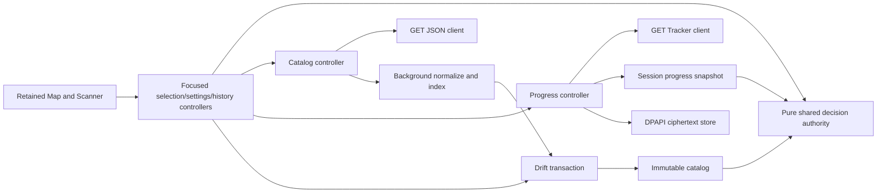
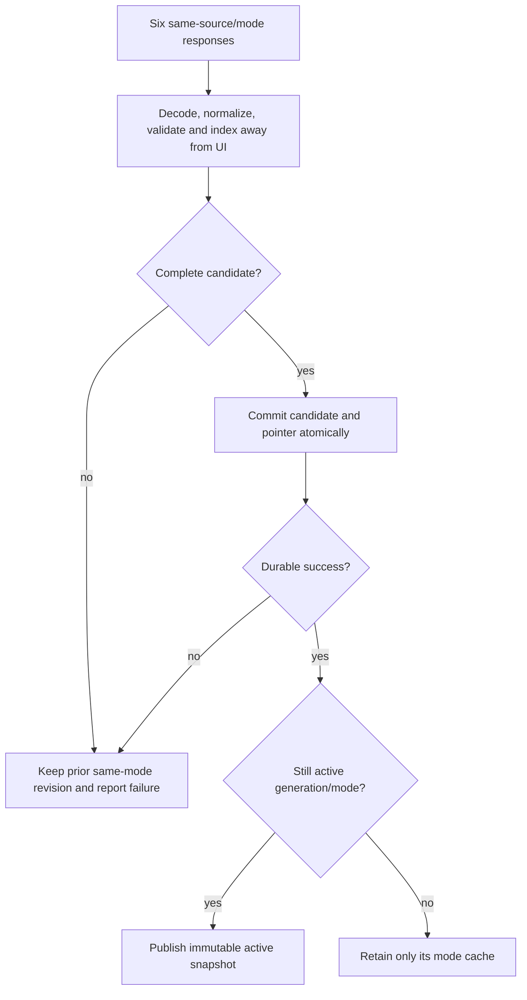
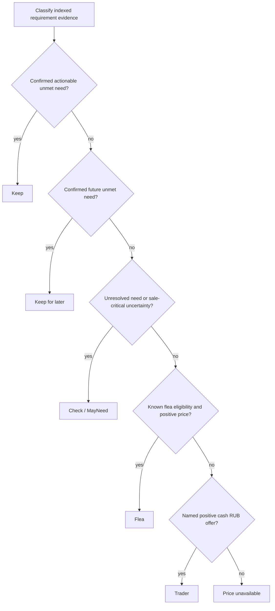
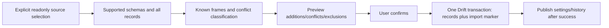

# M1 Manual Item Decisions - Plan

## Goal Capsule

**Objective:** A player can find a real item in Blackgrid, understand a safe keep-or-sell recommendation and its uncertainty, and recover useful preferences and item activity after restarting.

**Means:** Independently authored Dart decisions, a retained two-surface Flutter desktop shell, JSON catalog access, read-only Tracker integration and transactional Drift storage (KD1–KD5; KTD1–KTD6).

**Authority:** Latest user instructions, including close fidelity to the two `docs/vision/` images, override this plan; `AGENTS.md` controls game safety; `STRATEGY.md` and `docs/IMPLEMENTATION_STRATEGY.md` establish milestone boundaries. This plan resolves M1 implementation details, not full M0 qualification or M2/M3 behavior.

**Execution:** Autonomous completion by the orchestrator and at most one other author. The orchestrator integrates, runs expensive verification serially, simplifies, reviews, updates documentation/changelog and opens a feature PR targeting `sh1ny/blackgrid:main`. Stop for an essential unreachable prerequisite, a contradiction of settled scope, or a safety prohibition. Do not merge or change visibility (R16).

---

## Product Contract

### Summary

M1 makes manual item inspection useful before capture and native map delivery exist. Map and Scanner remain mounted primary surfaces with the same item-decision authority. Supporting configuration lives in reachable dialogs or panels, not additional primary tabs.

### Problem Frame

The current application is one centered label. The player cannot search a real catalog, tell a confirmed requirement from missing progress, or preserve useful activity. The older companion's behavior is context to inspect, not code to translate or a runtime dependency. M0's unresolved corpus and artwork qualification do not block independent M1 authoring, but do limit claims about replacement quality and later asset use.

### Requirements

**Shell and interaction**

- **R1.** Keep Map and Scanner mounted across navigation. Use dark Material 3 styled closely to `docs/vision/mapscreen.png` and `scanscreen.png`, including window/content placement, panel proportions, colors, typography, borders and spacing. Settings and import entry points must work without creating Database, Progression, Tools or Settings primary pages.
- **R2.** Search real catalog identities by name/short name/normalized name and canonical ID. Selecting a search result produces manual inspection, not a scan. Both surfaces display the same decision projection; query, selection and scroll state survive switching surfaces.
- **R3.** Represent active manual selection, nullable transient FIR override, durable item activity, and the latest accepted scan for the current session as separate state. A new item, mode, history selection or catalog/progress authority context clears the FIR override. History opens the row's stored mode context without changing the live mode or latest accepted scan. Refresh/search/history/manual selection never creates an accepted scan. M1 starts and remains with no accepted scan because capture is outside scope.

**Catalog and recommendations**

- **R4.** Load real mode-scoped `items`, `traders`, `tasks`, `hideout`, `crafts` and `barters` through GET from `json.tarkov.dev`. Accept a replacement only when the complete six-dataset candidate validates, commits durably and then publishes immutably. Failed download/validation/commit preserves the last-good snapshot for the same source/mode. Surface missing, loading, current, stale and failed evidence honestly.
- **R5.** Decode, normalize and index away from rendering. Keep source, mode, schema/normalizer version, observation time and available source timestamps with each catalog. Freshness is nullable; absent or mixed timestamps do not become a fresh authority claim. Different modes never share catalog or progress authority.
- **R6.** One pure Dart decision authority enforces `Keep > Keep for later > Check/MayNeed > Flea > Trader > Price unavailable`. Keep requires confirmed actionable unmet need; later requires known future unmet need; Check/MayNeed represents unresolved need gates or stale/missing authority. A price never overrides any unresolved or confirmed keep need.
- **R7.** Preserve nullable progress, FIR and requirement counts. Unknown does not mean false, zero, completed or safe to sell. Report FIR and non-FIR need separately, with reasons, prerequisite/gate uncertainty and deterministic ordering. Completed requirements do not retain items; alternatives and paired find/give objectives do not inflate quantities.
- **R8.** Show gross RUB values, not profit. Per-slot value requires valid positive dimensions; missing dimensions produce unavailable per-slot. Choose the best positive cash offer whose currency is RUB and whose named trader resolves. Exclude barter, zero/negative/invalid values and USD/EUR even when a converted RUB field exists. Break cash ties deterministically by canonical trader ID. Flea requires known eligibility and a valid positive market value; unknown eligibility cannot produce Flea.

**Progress, credentials and persistence**

- **R9.** Optional Tracker integration uses only GET `/token` and `/progress` at `api.tarkovtracker.org`, Bearer authentication, GP permission and authoritative mode/account checks. Missing credentials, invalid permission, denied access, malformed data, absent progress or unknown freshness remain explicit unknowns. Never write Tracker progress. Do not request, synthesize or print a real token for verification.
- **R10.** Store per-mode credentials using Windows current-user DPAPI outside SQLite. No plaintext tokens, returned token echo, names/account IDs or progress payloads enter production diagnostic logs, history or imports. No real credentials/account identities/progress payloads enter fixtures or committed files; independently authored synthetic wire values are permitted in tests under R13. Persist only the DPAPI ciphertext and mode identity; progress authority is current-session memory, not a restart cache.
- **R11.** Drift SQLite under the current user's local application-data directory is the sole runtime store for settings, supported custom pins, identity-only activity/history, import provenance and catalog snapshots. All coupled updates and migrations are transactional. Failed persistence does not publish a success state; newer unsupported database schemas are not downgraded, reset or deleted.
- **R12.** Explicit one-time legacy import reads selected local files only, previews supported valuable settings/pins and identity activity, and commits accepted records plus an import marker atomically. Source files are never changed. Exclude credentials, cached prices/catalog/progress, corrections, transient FIR, images/OCR, screenshot/overlay/hotkey/game-log settings and any fabricated accepted-scan state. Reject unsupported source versions/coordinate frames without partial mutation or silently dropping records.

**Delivery boundaries**

- **R13.** Use independently written Dart/Flutter code and independently authored synthetic fixtures. Normal builds/regressions have no .NET, C# companion or copied scanner dependency. Selected libraries retain their licenses/notices; API data, software licenses and map artwork rights are distinct. The existing PNGs are private design references, not shipped assets or product screenshot backgrounds.
- **R14.** Capture, OCR, auto-scan, hotkeys, overlays and native map artwork/layering belong to M2/M3. Do not show enabled controls, confidence/latency figures, a game-detected status or listener-ready claims for them. M1's Map workspace can edit durable pins as data without pretending artwork or geometry qualification exists.
- **R15.** Respect `AGENTS.md`: never interact with a game or its memory. Freshly confirm Escape from Tarkov is closed before every agent app launch/restart/verification. If closure cannot be established, do not launch; record runtime checks unverified. Offline fixtures and written tests are allowed.
- **R16.** Finish the feature branch, simplify, review, document, commit/push and open a PR to the user's `sh1ny/blackgrid` main branch. Request `@codex` up to four review iterations, then exact `@kinutsgimira` for its permitted maximum iterations. Do not substitute that identity, merge, change visibility or target historical upstream repositories. Review unavailability is reported, not passed off as completed review.

### Key Decisions

All entries below preserve supplied settled decisions. They are not alternatives to reopen during execution.

- **KD1 — session-settled: independent Dart implementation. Governs R6, R13.** The user chose independent authoring over copied C#, a bridge or the old runtime. Behavior contracts inform tests; source algorithms are not translated.
- **KD2 — session-settled: two primary surfaces. Governs R1–R3, R14.** Map/Scanner win over separate Database/Progression/Settings primary pages. The later user amendment requires close visual fidelity, not merely a similar hierarchy. Screenshot-only features remain outside M1.
- **KD3 — session-settled: Drift and explicit import. Governs R10–R12.** Transactional SQLite replaces legacy JSON runtime storage. Import is a bounded read-only migration, not a permanent fallback or alias path.
- **KD4 — session-settled: JSON and read-only Tracker. Governs R4–R5, R9.** Six mode-scoped datasets and GET progress win over GraphQL, a backend or progression writes.
- **KD5 — session-settled: independent M1 proceeds now. Governs R13–R15.** Full M0 corpus/rights/replay closure is not a blanket authoring blocker. Selected third-party material still requires its own terms. M2/M3 work is not replaced with dummy services.
- **KD6 — session-settled: feature PR, no merge/publicity. Governs R16.** The authorized delivery is a PR to the user's repository, not automatic landing or publication.

### Actors and Flows

- **F1 — Startup/offline:** Open durable settings and same-mode last-good catalog; show stale/offline status until a complete refresh succeeds. No cache means no search results and an actionable refresh/error state, not bundled demonstration items.
- **F2 — Manual inspection:** Search → select item → inspect recommendation/reasons → optionally set Yes/No/Unknown FIR. Switch surfaces without losing selection. Changing the decision context clears FIR (R3).
- **F3 — Refresh/mode:** Change live mode → invalidate active credentials/progress authority → load only that mode's persisted catalog → refresh. A late result from the prior mode may populate its durable cache but never replace the active view.
- **F4 — Tracker:** Edit the active mode's token in a masked dialog → persist protected credential → verify GP/mode/account → load validated current-session progress. Removal or replacement invalidates prior account authority immediately.
- **F5 — History:** Manual selection records identity activity after durable success. A history row opens its stored-mode inspection separately; closing returns to unchanged live mode. Latest accepted scan remains empty.
- **F6 — Import:** Select explicit source files → parse and validate all supported records → preview additions/conflicts/exclusions → confirm import → commit once → publish. Cancellation, invalid records, unsupported versions and write failure leave the destination unchanged.
- **F7 — Pins/configuration:** Edit selected map identity, durable marker preferences and supported pin records through working controls. M1 exposes stored data honestly without rendering unqualified native maps.

### Acceptance Examples

- **AE1 (R2–R3):** Search and select an item, set FIR Yes, switch to Map and see the same recommendation. Select another item and FIR returns Unknown. The latest acquired scan still says no accepted scan this session.
- **AE2 (R4–R5):** Five valid datasets plus malformed hideout, or a failed SQLite commit, leaves both current UI and restarted catalog on the previous same-mode revision. A successful six-dataset commit becomes visible only afterwards.
- **AE3 (R6–R8):** An item has a high flea price and a confirmed active FIR requirement. FIR Unknown cannot produce a flea/trader recommendation; FIR Yes yields Keep. A confirmed unmet future requirement yields later; unresolved progression yields Check/MayNeed.
- **AE4 (R8):** RUB traders offer 120 and 120; a USD trader has converted value 150, a barter advertises 200 and another offer is zero. Pick the lexically first canonical RUB trader among the tied 120 offers. A 2×2 item displays gross 120 and 30 per slot; missing dimensions display no per-slot value.
- **AE5 (R9–R10):** A PvE token used under live PvP, absent GP, mismatched returned owner or bodyless 304 without a same-session snapshot cannot authorize progress. Restart retains protected per-mode credentials but no progress authority until a new validated response.
- **AE6 (R3, R11):** A PvE history row can be inspected while live mode is PvP. Restart preserves history, not its transient FIR override or accepted scan. Token/progress/price/image fields never appear in that row.
- **AE7 (R12):** Preview valid valuable settings/history/pins; unsupported schema/frame or any malformed supported record prevents the whole import. Successful import records its identity atomically; repeating the same source is recognized and cannot duplicate rows. Existing newer records are not overwritten silently.

### Scope and Success Criteria

Completion means all R1–R16 and AE1–AE7 are covered by the units and verification below. No M0/replacement-quality, recognition, native display, live-game or packaging/release claim follows from passing M1 tests. R14 defines later functionality, not unfinished M1 implementation. Real authenticated Tracker verification without a user token is explicitly unverified, while the adapter itself is implemented and tested with synthetic responses.

---

## Planning Contract

### Repository Context and Sources

The app currently consists of `lib/main.dart` and `test/widget_test.dart`; no established application architecture needs preserving. `pubspec.yaml` declares Dart `^3.13.5`, Flutter and the existing dev tools; `mise.toml` pins Flutter `3.47.6`. Preserve the existing M0 qualification tooling/tests and historical reports. No `CONCEPTS.md` or `docs/solutions/` was present; no previous plan was selected as an implementation authority.

Source contracts below were inspected on 2026-10-06. They determine adapters and safety, not permission to copy implementation source:

- [JSON endpoint registry](https://json.tarkov.dev/endpoints), [deployed JSON documentation change](https://github.com/the-hideout/tarkov-dev/pull/1289), and live `regular/items`, `traders`, `tasks`, `hideout`, `crafts`, `barters` plus the four `_en` dictionaries. JSON is the maintained data surface; GraphQL is maintenance-only. Item/task collections are nested inside `data`; trader/hideout collections are keyed directly under `data`; crafts/barters are arrays. Translation endpoints are dictionaries, not complete localized datasets.
- [Tracker OpenAPI](https://api.tarkovtracker.org/openapi.json), version 2.5.0, and [public API documentation](https://github.com/TarkovTracker-org/TarkovTracker/blob/main/docs/api.md). These supersede older sibling `tt_` token assumptions.
- [Drift native platform guide](https://drift.simonbinder.eu/platforms/vm/) and [migration guide](https://drift.simonbinder.eu/migrations/). NativeDatabase background execution keeps SQLite off the UI isolate. Drift 2.32+ with sqlite3 3 bundles native SQLite without `sqlite3_flutter_libs`.
- [CryptProtectData](https://learn.microsoft.com/en-us/windows/win32/api/dpapi/nf-dpapi-cryptprotectdata): current-user protection by default, noninteractive flags and mandatory buffer release. Machine-wide protection is not selected.
- [Drift source license](https://github.com/simolus3/drift/blob/develop/drift/LICENSE), [HTTP license](https://github.com/dart-lang/http/blob/master/pkgs/http/LICENSE), [SQLite public-domain declaration](https://www.sqlite.org/copyright.html) and `docs/qualification/m0/u2-rights-decision-packet.md`. Runtime API access does not adopt the data-manager's GPL software license for all game data; downloaded data/artwork require distinct treatment.
- Read-only behavior inspection in the sibling repository: `../../DotNet/TarkovTracker/Models/UserSettings.cs`, `Models/ScannerModels.cs`, `Services/ScannerHistoryStore.cs`, `Services/MapPinMigrationService.cs`, `Services/MapGeometryService.cs` and `Config/maps.json`. Only wire formats and numerical frame metadata inform import. No old runtime is required to execute it.

### Key Technical Decisions

- **KTD1 — small domain/data/application/UI boundaries (KD1, R1–R9).** Use plain immutable Dart catalog/progress/decision models and one decision engine. Flutter notifiers belong only to focused application controllers. Keep HTTP/SQLite/DPAPI outside domain evaluation. No service locator, omnibus AppState, generic repository framework or duplicated per-surface decision logic. Narrow persistence/credential interfaces let HTTP/domain tests use synthetic responses without a real database or token.
- **KTD2 — candidate → transaction → publication (KD3–KD4, R4–R5, R11).** Download the required six into one source/mode candidate, decode and build projections/search indexes in a background isolate, validate IDs/references/finite numbers and only then commit the whole catalog revision and active pointer in one SQLite transaction. Persist normalized typed-compatible payloads and metadata; immutable in-memory publication follows successful commit. A retained same-mode snapshot is usable but labeled stale after refresh failure. Coalesce duplicate refreshes per key; capture generation/context at request start so a late response cannot regain active authority. Do not add a scheduler, backend, retry loop or multi-isolate SQLite pool.
- **KTD3 — mode and freshness authority (R5–R9).** First-run mode is Unknown until the player selects one; a saved explicit mode preference may restore it. Unknown issues no mode-scoped catalog/credential/progress request and cannot silently fall back to PvP. M1 has no automatic detector. Catalog modes `regular`, `pve`, `pvp-season` correspond to Tracker `pvp`, `pve`, `seasonal`. Immutable snapshots carry source/mode/revision and freshness evidence. Catalogs older than 24 hours since validated observation are stale for recommendation authority; missing source timestamp remains source-freshness unknown even within that window. Tracker progress is authoritative only after a successful response in the current credential session, and expires for decisions 15 minutes after validated observation. These conservative local age limits are implementation assumptions, not server timestamps. Unknown/stale requirement evidence yields conditional reasons rather than a sale. Prices retain source/age independently. Use `avg24hPrice` for gross flea value and `lastScanISO` for its quote-time evidence, not catalog `updated` or download time. Initial market freshness is one hour from a valid nonfuture source quote time, following the implementation strategy. Missing/future/stale sale-critical market evidence forces Check; a fresh envelope cannot refresh an old quote. Still display valid gross flea/trader values with age/uncertainty warnings while advice is Check; invalid/nonpositive values are unavailable.
- **KTD4 — explicit current Tracker wire contract (KD4, R9–R10).** Use an explicit `http` client, GET-only paths, fixed HTTPS hosts, Bearer token and a truthful versioned User-Agent of length 5–200. `/token` must return success, GP, matching protected token, owner and authoritative gameMode. Tokens start `PVP_`, `PVE_` or `SZN_`; `tt_` is rejected. `/progress` requires success, all four documented progress arrays and identity/player/meta fields; verify token owner = data.userId = meta.self and matching mode. Do not persist the echoed token or account/progress payload. Duplicate or malformed entries invalidate the candidate rather than converting missing values to false/zero. Structural completeness means all four documented arrays are present and valid, not that they enumerate every possible entity. An absent task/objective/module/part remains unknown; neither an empty array nor a missing entity manufactures zero, false or completed progress. Manual refresh is sufficient. Respect 429 Retry-After with a visible cooldown; no automatic retries. Conditional ETag GETs are allowed only when a same-credential/session snapshot exists; bodyless 304 renews local observation only for that snapshot, never creates authority. Authentication/permission/mode/account failure invalidates authority immediately; ordinary transport failure keeps a visible stale same-session result without selling through it.
- **KTD5 — local store and protected tokens (KD3, R10–R11).** Use `%LOCALAPPDATA%/Blackgrid/blackgrid.sqlite` and a separate `credentials/` directory, resolved by the app, never a repository or synchronized-directory default. Database tables cover settings, custom pins/frame metadata, unique `(item ID, mode)` activity rows with UTC/revision/source, imports and keyed catalog revisions. Foreign keys and schema versioning are explicit. Begin with a committed schema snapshot and migration tests; never reset a user's database to fix an upgrade. Implement a narrow Windows runner MethodChannel for DPAPI protect/unprotect, linked to Crypt32, with current-user scope, `CRYPTPROTECT_UI_FORBIDDEN`, no prompt and correct `LocalFree` handling. Credential replacement writes ciphertext to a sibling temporary file and atomically replaces it; on failure retain the prior credential and surface failure. Removal and replacement fence in-flight progress before it can publish. No fallback plaintext storage or machine-wide scope.
- **KTD6 — safe decision evidence (KD1, R6–R8).** Build item-to-requirement indexes once per catalog candidate for tasks/hideout/craft/barter uses. Classify each need as actionable, known future, unresolved or satisfied using available gates/progress/FIR. Unknown player level/faction/edition/quest prerequisites/station level/trader/skill gates stay unknown; the Tracker API does not provide complete trader/skill state. Crafts/barters are uses, not automatic obligations: do not keep every ingredient without an explicit unmet player requirement or choice. Group mutually exclusive acceptable items and paired find/give objectives; do not add the same acquisition requirement twice. Numeric counts may be fractional for recipe/barter quantities; preserve finite nonnegative numbers and nullable observed remainder. A task's unknown progress is not an incomplete task claim. Preserve the current JSON `types` restriction `noFlea` independently from `minLevelForFlea`; zero means no minimum encoded by that field, not proof of no ban. Missing restriction/level/player evidence keeps flea eligibility unknown. `buyFromTrader` is a purchase offer and never a sale; use `sellToTrader` for R8. Deterministic reason ordering is requirement class → stable source ID → objective/part ID. Sale decisions require all relevant need evidence satisfied or irrelevant and known FIR/eligibility where it affects sale.
- **KTD7 — exact legacy import boundary (KD3, R12).** Validate root settings `SchemaVersion` (missing/0 through 3), nested `Scanner.Version` (missing/0 through 1), and history root `SchemaVersion` (missing/0 through 1) independently. Import explicit mode preference if present, last selected map, `SaveMarkerFilters`, `MarkerFilters`, custom pins and identity activity; `Scanner.TrackerProgressEnabled` is only an integration preference. Marker booleans are `Labels`, `QuestItems`, `QuestObjectives`, `PmcExtracts`, `ScavExtracts`, `SharedExtracts`, `Transits`, `Hazards`, `HazardZones`, `Switches`, `PmcSpawns`, `ScavSpawns`, `BossSpawns`, `CultistSpawns`, `BtrStops`, `CustomPins`. Pin records contain lowercase `id`, `normalizedX`, `normalizedY`; revisions come from `CustomPinCoordinateRevisions`. History permits documented `Rows`/`Entries`, `ItemId`/`CanonicalItemId`, `FileRevision`/`Revision` aliases only inside this parser. Supported history modes are `PvP`, `PvE`, `Seasonal`; source values are `Automatic`/`Scan` and `Manual`/`ManualSearch`, including their documented numeric enum values. Unknown enum values reject the candidate. Normalize documented map aliases to one ID, not arbitrary fuzzy matching. Preserve unmatched item identities visibly in history; no fabricated catalog entry. Preview every colliding source/destination row and exact winner/loser reason. For a source-key collision, choose greatest positive activity revision, then latest UTC timestamp, then stable input order; an existing destination wins unless explicit replacement is selected. Missing legacy revisions receive deterministic positive migration revisions. Commit only after the user accepts the visible record accounting; no silent collapse. A file-content digest plus format version identifies a successful import. Listed excluded settings stay excluded; malformed supported values fail the whole candidate.
  - Recognize the documented map identities `factory`, `customs`, `woods`, `shoreline`, `interchange`, `thelab` (aliases `lab`/`labs`), `reserve`, `lighthouse`, `streetsoftarkov`, `groundzero`, `terminal`, `icebreaker`, `labyrinth`. Non-Labs normalized legacy revision 0 records can be preserved as declared legacy frames without geometry/rendering claims. Labs revision 1 is preserved directly; Labs missing/0 revision converts to 1. Any other revision/map is unsupported and fails before writes.
  - Labs legacy frame: rotation 270, affine `[0.575, 281.2, 0.575, 193.7]`, bounds `[[-80,-477],[-287,-193]]`, extent-normalized without a native pixel frame. Target frame: the same rotation/affine/bounds, native zoom 4, pixel size 2800, revision 1. Independently implement old normalized → invertible affine/world coordinates → target pixel-normalized coordinates using that metadata. Finite off-map points are valid: do not clamp or discard them for lying outside 0–1. Nonfinite/noninvertible input or conversion fails atomically. No generic map engine, geometry qualification claim or legacy service is introduced.
- **KTD8 — visual mapping with honest M1 content (KD2, R1–R3, R14).** Keep an IndexedStack-style retained shell, focus-aware search and focused notifier listeners. Derive reusable visual tokens from the reference images using independently constructed widgets: near-black green-tinted surfaces, muted olive/gold 1px panel borders, gold selected navigation, warm off-white text, muted gray-green secondary text, green only for actual success, tight rectangular cards with small radii. Use system/SDK typography and Material icons, not PNG crops, copied logos, item artwork or textures. At the Scanner reference aspect (1672×941), preserve a left control column (~19%), central detail region (~57%) and right history (~24%), top detail above two lower support panels. At the Map reference aspect (1912×823), preserve a broad left workspace (~70%) and compact right rail (~30%), paired top/secondary cards and stacked filters/pin panels. Reuse the available spaces for actual manual search, FIR, need reasons, catalog/progress status and history. No capture-preview/OCR-confidence/Database/overlay controls survive merely to match a screenshot. The Map workspace states artwork is outside M1 and exposes working pin data controls, not a fake map. Common header/footer/border/spacing rhythm follows both images despite their different resolutions. At smaller windows preserve content through independent scrolling and a stacked rail rather than overflow or clipping.

  **Amended 2026-10-21 (M4.5 change `add-item-icons`, user request of 2026-10-18).** Item icons are no longer excluded: Blackgrid downloads each shown item's icon from tarkov.dev at runtime into a bounded local cache, at the user's direction and never bundled, per [ADR-0022](../adr/0022-item-icons-runtime-cache.md). The rest of KTD8 stands: no PNG crops, copied logos, textures or other bundled artwork.

### Assumptions and Resolved Questions

- **A1.** English is the first useful display language. Fetch `_en` dictionaries for items/traders/tasks/hideout; failed localization does not invalidate the six raw datasets, but label quality is reported. A normalized-name fallback may identify an item; unresolved localization references must not masquerade as readable names or qualify a nameless trader for R8.
- **A2.** KTD3's local age limits are conservative implementation choices because upstream payloads do not provide a uniform freshness contract. Expose timestamps and unknowns; do not claim they prove current game state.
- **A3.** Pins are useful stored records during M1, not qualified renderable map positions. Frame identity/revision travels with them. Artwork, map rendering, floor bands and map geometry acceptance remain M3.
- **A4.** No user Tracker token is available for this run. Production GET integration and synthetic tests are required; authenticated end-to-end evidence is not fabricated or required from the sleeping user.
- **A5.** Source data rights are not settled by a source-code repository's license. Do not commit live downloaded catalogs or artwork; runtime cache is user-local, and fixtures are independently authored. Record selected package versions, notices and unresolved future asset uses without altering historical qualification decisions.

No product-blocking question remains. Deferred details are widget names, final token color values measured against the images, generated SQL formatting and the selected compatible transitive dependency versions. These do not authorize scope changes.

### High-Level Technical Design

The sketches describe ownership and order, not exact code signatures.

**Architecture and interfaces (KTD1, KTD5, KTD8):**

**Catalog data/commit flow (KTD2):**

**Selection and authority lifecycle (R3, KTD3–KTD4):**

```mermaid
stateDiagram-v2
  [*] --> LiveUnknown
  LiveUnknown --> LiveKnown: validated same-mode catalog/progress
  LiveKnown --> LiveUnknown: token/mode/age invalidation
  LiveUnknown --> HistoryContext: open stored-mode row
  LiveKnown --> HistoryContext: open stored-mode row
  HistoryContext --> LiveUnknown: close; live authority unknown
  HistoryContext --> LiveKnown: close; live authority still valid
```

Every context transition clears FIR. Accepted-scan state is separate and remains empty for M1; no transition above writes it.

**Decision ordering (KTD6):**

**Import and durability boundary (KTD7):**

Cancellation and any invalid candidate terminate before TX. Transaction failure publishes no success and leaves source bytes unchanged.

### Two-Owner File and Interface Contract

The orchestrator owns U1, U5–U8 and root manifest/lock/Windows integration/documentation. One second author owns U2–U4 and their tests. Establish domain model names and narrow CatalogStore/CredentialStore read/write boundaries before either side implements callers; the second author owns their declarations under `lib/domain/` and the orchestrator supplies concrete SQLite/DPAPI adapters. Catalog publication expects an awaited all-or-nothing persistence result. Progress snapshots are memory-only. The decision engine accepts an immutable catalog, optional session progress and an inspection context; returns immutable status, nullable counts, values and reasons. No widget computes those values.

Each author skips tests/analyze/format/build/hot reload mid-flight. The orchestrator waits for all edits before the serial Verification Contract. No shared file has two authors. Test-only fakes are permitted; production dummy services or no-op paths are not.

---

## Implementation Units

### U1. Durable foundation and credential boundary

**Goal:** Runtime persistence and Windows token protection exist before publication can succeed.

**Requirements:** R10–R11, R13; KD3; KTD1, KTD5. **Dependencies:** domain boundary declaration agreement; can run alongside U2–U4 implementation.

**Files:** `pubspec.yaml`, `pubspec.lock`, `lib/data/database.dart`, generated database/schema snapshots, `lib/data/local_paths.dart`, `lib/data/credential_store.dart`, `lib/domain/settings.dart`, `windows/runner/credential_protector.h`, `windows/runner/credential_protector.cpp`, `windows/runner/flutter_window.cpp`, `windows/runner/CMakeLists.txt`; tests `test/data/database_test.dart`, `test/data/credential_store_test.dart`, `test/data/migration_test.dart`.

**Approach:** Implement KTD5 and the agreed U2/U3 boundaries. Prefer Drift/drift_dev 2.35.1, http 1.6.0 and a compatible build_runner (current 2.16.1) on the pinned SDK, then lock actual resolution; no `sqlite3_flutter_libs`. Declare direct dependencies actually imported. Store coupled catalog pointer/rows and activity revision in transactions. Use OS app-data defaults, schema snapshots and generated sources as normal build inputs, not a sibling .NET generator.

**Test scenarios:** Fresh open yields defaults; close/reopen preserves settings/pins/history/catalog; injected transaction failure rolls back pointer and rows; a supported additive upgrade preserves records; newer schema refuses without destructive recovery. Test credential ciphertext contains no plaintext and per-mode paths do not collide; failed replacement keeps prior bytes; protect/unprotect error yields unavailable credentials, never plaintext fallback. Runtime Windows roundtrip belongs to orchestrator after game check.

**Verification:** Persistence failure cannot produce a successful controller publication. No raw token appears in SQLite or authored fixture bytes.

### U2. Real catalog adapters and immutable publication

**Goal:** Real search-ready mode snapshots have an all-or-nothing durable replacement boundary.

**Requirements:** R4–R5, R13; F1/F3; AE2; KD4; KTD1–KTD3. **Dependencies:** agreed persistence boundary; U1 concrete adapter for integration.

**Files:** `lib/domain/catalog.dart`, `lib/domain/catalog_store.dart`, `lib/data/catalog_client.dart`, `lib/data/catalog_normalizer.dart`, `lib/application/catalog_controller.dart`; tests `test/data/catalog_client_test.dart`, `test/data/catalog_normalizer_test.dart`, `test/application/catalog_controller_test.dart`; independently authored `test/fixtures/m1/catalog/`.

**Approach:** Use fixed current GET shapes and mode routes described in Sources. Handle all six data collections and English dictionaries, keyed IDs, nested item/task roots, station levels/objectives, string item/trader references and fractional counts. Preserve nullable optional values rather than copying permissive legacy coercions. Validate projected required identities and relationships without rejecting unrelated optional upstream extensions. Build search/requirement indexes off-render. Call persistence once per complete candidate and publish only after success. Expose same-key last-good state and generation fencing.

**Test scenarios:** Independently authored representative six-wire payloads normalize; missing/wrong collection, duplicate/mismatched ID, invalid mandatory reference or nonfinite required quantity fails atomically; empty permitted tasks/recipes remain complete while empty items/traders do not. Localization dictionary failure is explicit and not a six-dataset partial commit. Cold offline has no fabricated items; offline with last-good retains it. Late PvP refresh cannot replace active PvE. Failure before/inside commit preserves old UI and reopened DB; success advances revision once. Search matches canonical ID/name/short name/normalized name deterministically.

**Verification:** A live unauthenticated GET smoke later exercises all six supported mode routes without committing upstream bytes to the repository. Fixture tests prove commit/publication ordering and no UI decode/index work.

### U3. Read-only progress and current-session authority

**Goal:** Optional authorized progress changes decisions only within its verified mode/account/session.

**Requirements:** R5, R7, R9–R10; F3/F4; AE5; KD4; KTD3–KTD5. **Dependencies:** credential boundary agreement; U1 adapter for integration.

**Files:** `lib/domain/progress.dart`, `lib/domain/credential_store.dart`, `lib/data/tracker_client.dart`, `lib/application/progress_controller.dart`; tests `test/data/tracker_client_test.dart`, `test/application/progress_controller_test.dart`; synthetic `test/fixtures/m1/progress/`.

**Approach:** Implement KTD4 exactly, current OpenAPI ahead of older sibling assumptions. Mask token UI and return safe typed errors; prevent cross-host redirects from disclosing authorization. HTTP errors and logs exclude body/token/account metadata. Validate numeric/count fields while preserving omission. Tie every request to credential generation, live mode and verified owner. Record observedAt with no invented source time. Token refresh/removal and age expiration notify selection authority so R3's FIR reset applies.

**Test scenarios:** First-run Unknown sends no PvP request; explicit mode selection establishes only that mode. No token = unknown; GP missing/401/403, wrong prefix/mode/owner/self, missing array, duplicated ID or malformed field cannot authorize. Distinguish a missing array (invalid response), a valid empty array and an absent entity in valid arrays (unknown entity status). Bodyless304 requires a same-session snapshot; token change fences old304/200. Transport failure marks stale; age expiry changes recommendation evidence.429 displays Retry-After cooldown and emits no repeated requests. Recorded requests are GET only; no secret in logs/history/SQLite fixtures. Restart starts with unknown progress despite protected credentials.

**Verification:** Synthetic wire tests cover current contract and request headers. Real authenticated smoke remains unverified without a user-supplied token; do not create one.

### U4. Shared safe keep/sell decision projection

**Goal:** Every item surface receives the same conservative recommendation and valuation.

**Requirements:** R6–R8; AE3–AE4; KD1; KTD1, KTD3, KTD6. **Dependencies:** U2/U3 models; independent of widgets/database.

**Files:** `lib/domain/decision.dart`, `lib/domain/decision_engine.dart`, `lib/domain/inspection_context.dart`; tests `test/domain/decision_engine_test.dart`, `test/domain/requirement_index_test.dart`.

**Approach:** Implement KTD6 and R6's ordering as one pure projection. Include task prerequisites/player gates, relevant station/item requirements, progress completion/remainders, FIR Unknown/Yes/No, source/mode/freshness and explicit satisfied/irrelevant distinctions. Crafts/barters enrich use reasons without blanket keep obligations. Preserve immutable output and stable tie/reason sorting. No price service or UI copy of valuation.

**Test scenarios:** Every ordering edge R6, especially high flea price with unknown progress/FIR; known active vs known later vs unresolved requirements; complete/failed/invalid tasks; hideout completed station/part; missing counts/FIR/gates and stale authority; alternatives/paired find-give counted once; optional recipe ingredients not automatic needs. Price tests include `noFlea` with zero threshold, zero threshold without ban-clearance evidence, missing threshold/restriction/player facts, invalid amounts/dimensions, RUB/USD/EUR/barter, purchase-only offers, unknown trader names and stable ties. A fresh envelope containing a quote older than one hour, a future quote time or absent quote-time evidence yields Check without hiding a valid gross value. Reordering input records gives identical output. Identical contexts on both surfaces return identical values/reasons.

**Verification:** Pure tests demonstrate no unknown-to-zero/false conversion and no sale through unresolved keep evidence.

### U5. Focused application state and durable activity

**Goal:** Manual inspection and history work without impersonating accepted scans.

**Requirements:** R2–R3, R11; F2/F3/F5; AE1/AE6; KTD1, KTD3, KTD8. **Dependencies:** U1–U4.

**Files:** `lib/application/selection_controller.dart`, `lib/application/settings_controller.dart`, `lib/application/history_controller.dart`, `lib/application/session_scan_state.dart`, `lib/application/app_services.dart`; tests `test/application/selection_controller_test.dart`, `test/application/history_controller_test.dart`.

**Approach:** Compose concrete services at startup, with focused notifiers and explicit disposal. Await durable identity activity before reporting it recorded. Unique item/mode row updates UTC/revision/source without retaining decision payload. History context reads the stored mode catalog and cannot mutate live mode/progress. Decision context versions clear FIR only when authority/identity changes, not for unrelated typing or scrolling. Keep accepted-scan state distinct with no M1 producer and no persisted hydration.

**Test scenarios:** Manual search→selection updates activity after successful commit and never accepted scan; write failure shows error and no fake history success. New item/mode/history/authority revision resets FIR; tab switch and query editing alone do not. Stored PvE history under live PvP remains separate; close restores live context. Reopen preserves identity rows/settings only. Loading/error/unknown transitions notify relevant listeners without replacing unrelated state.

**Verification:** Controller tests prove F2/F3/F5 and both-surface projection consistency.

### U6. Close-reference Map/Scanner UI with working configuration

**Goal:** The desktop shell is useful and visually close to the references while telling the truth about M1.

**Requirements:** R1–R3, R9–R11, R14; F2/F4/F5/F7; AE1/AE6; KD2; KTD8. **Dependencies:** U5; can author tokens/widgets alongside earlier units after interface agreement.

**Files:** `lib/main.dart`, `lib/ui/app.dart`, `lib/ui/theme.dart`, `lib/ui/shell.dart`, `lib/ui/map_screen.dart`, `lib/ui/scanner_screen.dart`, `lib/ui/item_decision_card.dart`, `lib/ui/settings_dialog.dart`, `lib/ui/pin_editor.dart`; replace `test/widget_test.dart` expectations and add `test/ui/shell_test.dart`, `test/ui/scanner_screen_test.dart`, `test/ui/map_screen_test.dart`, `test/ui/settings_dialog_test.dart`.

**Approach:** Implement KTD8's reference mapping and compose U5 state rather than inventing UI-owned decisions. Scanner left rail holds manual mode/search/FIR and catalog/progress state; main region holds current item/reasons/valuation and lower real requirement/source detail; right holds identity history. Map uses broad honest workspace with useful pin data management and compact status/config rail; latest accepted scan is empty and manual inspection is separately labeled. Supporting dialogs implement mode/token/refresh, bounded import and supported map/pin preferences. Empty/loading/offline/error states are actionable without generated prices or mock items. Use keyboard focus, semantic labels, masked secret fields and independent scrolling.

**Test scenarios:** Exactly Map/Scanner primary navigation; switching retains query/selection/scroll state; typed real fixture search/manual select; FIR control defaults/resets; history inspection doesn't change live mode/latest accepted; token save/remove and refresh actions call controllers; persistence failures are visible. Working pin add/edit and invalid-coordinate/frame feedback. Reference-size layouts 1672×941 and1912×823 preserve KTD8 proportions/panel placements; smaller960×640 and 125%/150% text scaling do not overflow or clip controls. Assert no enabled capture/hotkey/overlay/OCR or Database/Progression primary controls and no game-ready claim.

**Verification:** Widget/layout tests plus fresh-game-closed desktop screenshots of Blackgrid at reference aspect ratios. Compare actual hierarchy, spacing, colors, typography, card proportions/header/footer placement to both PNGs; document intentional R14 differences rather than declaring broad resemblance sufficient. Do not capture another application or embed mockup art in app assets.

### U7. Bounded once-only legacy import

**Goal:** Valuable legacy settings/history/pins migrate safely without adopting legacy runtime storage.

**Requirements:** R11–R13; F6/F7; AE7; KD3; KTD5, KTD7. **Dependencies:** U1/U5 and U6 dialog placement.

**Files:** `lib/data/legacy_import.dart`, `lib/domain/import_preview.dart`, `lib/ui/import_dialog.dart`; tests `test/data/legacy_import_test.dart`, `test/ui/import_dialog_test.dart`; independently authored `test/fixtures/m1/legacy/`.

**Approach:** Execute KTD7 using readonly explicitly selected file paths with a digest, staged preview and atomic destination transaction. No startup auto-import, old store service, broad unknown-field copy or credential acquisition. Explain exclusions/conflicts and unsupported versions precisely. Preserve current destination by default; replacement requires an explicit preview choice. Import all supported records or none; unmatched catalog identities remain visible data, not discarded. Source format aliases exist only inside this parser.

**Test scenarios:** Settings0/1/2/3 and history0/1 representative envelopes; independently supported/unsupported root `SchemaVersion` and `Scanner.Version`; Rows/Entries and field/enum aliases. Duplicate keys with different revisions, equal revisions/different timestamps and exact ties show every row plus KTD7's deterministic winner; destination rows remain by default. Test Labs ordinary/off-map 0→1 conversion, direct revision1, preserved non-Labs revision0, nonfinite/noninvertible and unsupported frames. Valuable fields are preserved, excluded fields absent, unmatched items retained. Repeat successful digest cannot duplicate. Malformed supported row, future version, unsupported frame and failed transaction make zero destination changes and do not mark import successful. Preview cancel/replacement choice behavior; no source mutation or token/price/image/progress import.

**Verification:** Offline synthetic fixtures prove source immutability, all-or-nothing destination and visible record accounting. No actual private legacy file is committed or opened without explicit user-directed selection.

### U8. Integrated verification, documentation and feature PR

**Goal:** Deliver the complete M1 behavior and evidence without overstating optional/later checks.

**Requirements:** R1–R16; AE1–AE7; KD5–KD6. **Dependencies:** U1–U7 landed; single orchestrator.

**Files:** `README.md`, `CHANGELOG.md` through existing `tool/changelog.dart`, `docs/IMPLEMENTATION_STRATEGY.md` only where M1 behavior/limitations need alignment, selected dependency notices, integrated tests `test/application/m1_flow_test.dart`, `test/ui/m1_flow_test.dart`.

**Approach:** Run Verification Contract, simplify settled changed code, perform code/security/state/persistence review, fix retained findings and repeat only affected checks. Document catalog/progress status semantics, supported import versions/fields/frame limitations, mode-scoped DPAPI location/privacy and game safety. Remove abandoned experiments/dummy paths; preserve M0 records. Follow R16's authorized PR and exact review identities; no merge/publication ceremony beyond the feature PR.

**Test scenarios:** Fixture-backed startup→refresh→search→FIR→tab switch→history→mode switch→import→close/reopen crosses real controllers/adapters/storage; injected failures at download/parse/commit retain last-good and correct visible status. No test depends on the C# companion or a game. Fresh local DB and preexisting DB smoke; all honest empty/stale/error views.

**Verification:** Evidence names tests exercised and runtime/API/optional checks skipped. Docs and dependency notices describe actual selected bytes/versions, not inferred rights clearance. PR scope and final review state satisfy R16.

---

## Verification Contract

Only the orchestrator runs checks after authors land. Planning runs no app/build/test/analyze/format.

1. Resolve actual dependencies on Flutter3.47.6/Dart3.13.5; run required Drift code generation, commit matching generated sources/schema snapshots and test upgrades. Confirm the normal Windows build has no .NET/reference runtime input.
2. Use official Dart MCP `run_tests` for all Dart/Flutter tests, including existing M0 qualification regressions and each U-ID's named scenarios. Recover a mounted timeout's complete result rather than claiming the timeout means failure or success. Do not replace it with shell `flutter test`.
3. Run static analysis through official Dart tooling and formatting once after settled edits. Existing `mise` analysis/format definitions identify repository conventions. Formatting is not an implementation substitute.
4. Exercise unauthenticated real JSON GETs for required six datasets across `regular`, `pve`, `pvp-season`; validate projection/English resolution and failure/last-good behavior without committing downloaded bytes. Network failure is reported accurately and does not become a fabricated smoke pass.
5. Before every app launch/restart or agent UI verification, freshly establish game closure under AGENTS. Then build/launch Windows Blackgrid, connect DTD, inspect only Blackgrid, and hot reload/restart after code changes when safe. Exercise cold start, real search, shared decision, config, mode switch, history, source status and persistence after restart. Separately exercise DPAPI current-user roundtrip and ciphertext replacement failures without disclosing the token.
6. Capture only Blackgrid at the two reference aspect ratios and compare KTD8's placement/style criteria; include small-window/text-scale widget coverage. No live-game testing, capture/OCR, artwork, overlays or recognition verification is part of M1.
7. Tracker authenticated smoke without credentials is **unverified**; synthetic request/schema/authority tests remain required. Distinguish observation time, server source time, nullable age, absent credentials and stale authority in evidence. No full M0/replacement/native quality statement.
8. Simplification and code review address changed domain/data/application/UI boundaries, transaction publication, mode/account races, secrets and import data loss. Final docs/changelog and feature PR meet R16; reviewer availability is evidence, not an assumption.

## Definition of Done

- U1–U8 satisfy their named test scenarios and verification outcomes; all R-IDs/F-IDs/AE-IDs remain traced.
- A real catalog item is searchable and manually inspectable on both retained surfaces with one safe recommendation and honest statuses.
- Durable changes survive restart; transaction failure never publishes committed success; credentials are DPAPI ciphertext separate from SQLite; progress/FIR/accepted scan do not hydrate from persistence.
- Supported import is explicit, atomic, once-only and accounts for every supported record or rejects the candidate. No legacy JSON runtime or reference dependency remains.
- The actual UI closely follows the reference styling/window placement within the intentional R14 content differences, proven by widget checks and permitted Blackgrid-only screenshot comparison.
- No dummy services, fabricated scan/readiness/confidence, dead experiment code, unrelated file deletion or changed historical M0 evidence remains.
- Verification records exercised checks and all unverified optional/safety-blocked checks precisely. Docs/notices/changelog reflect actual behavior and selected inputs. Feature PR is open to `sh1ny/blackgrid:main`, required review requests/results are recorded, and nothing is merged or made public.
