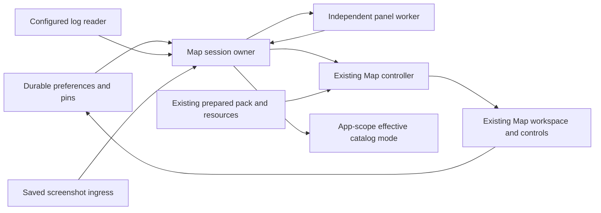
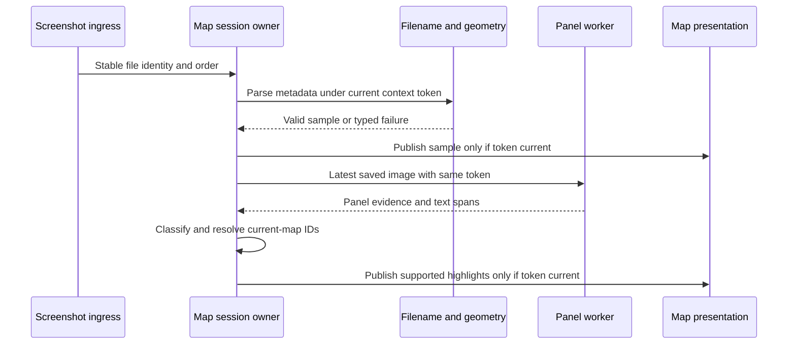
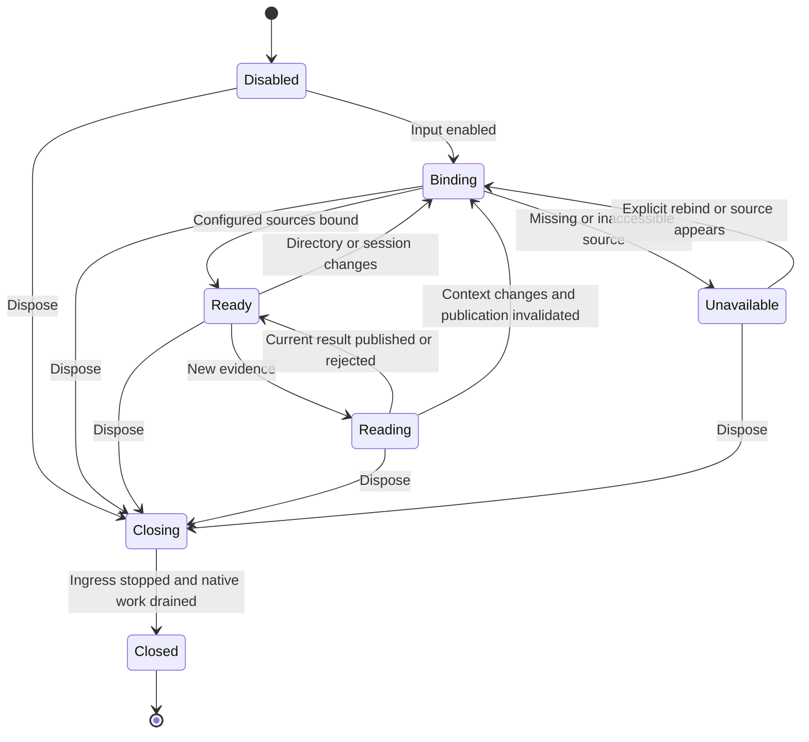
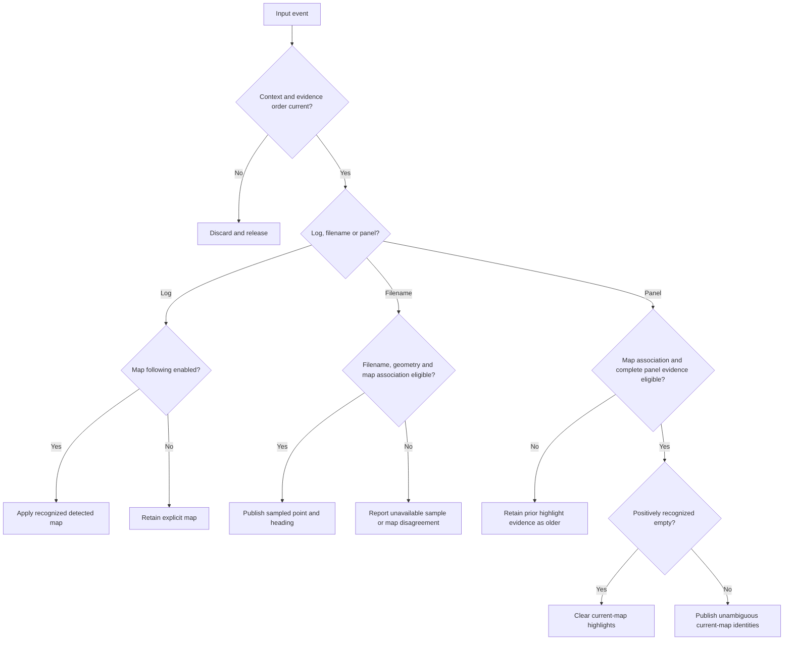
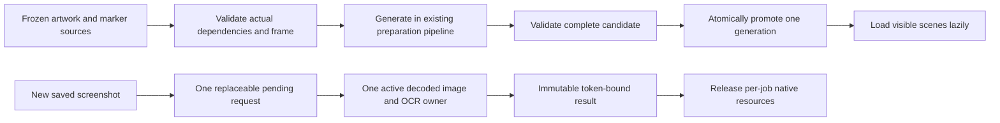

# Independent Useful Native Map - Plan

## Goal Capsule

**Objective:** Blackgrid users can use every supported map, navigate its markers and custom pins, and interpret sampled player position and raid exits without running Scanner.

**Means:** Extend the existing native Map, immutable preparation pipeline and persistence; add Map-owned file inputs and saved-panel recognition (KTD1–KTD7).

**Authority:** The user's M5 delivery contract governs scope. `STRATEGY.md` and `docs/IMPLEMENTATION_STRATEGY.md` govern project architecture and useful parity. The M3 plan/status are evidence, not M5 waivers. This plan covers the full request, not a three-map proof.

**Execution profile:** Independent Dart implementation, Windows x64, offline qualification plus permitted app-only checks. Expensive qualification runs sequentially; parallelize independently owned implementation after its shared contracts are established. Acquire missing artwork and implement missing capabilities as executor-owned work. Complete source closure and qualification remain integration and delivery gates, not blanket authoring prerequisites. The implementing owner completes all units, simplifies, reviews and fixes, verifies, commits with repository attribution, pushes and opens one PR. No merge or visibility change in this run.

**Completion blockers:** Genuinely unavailable required artwork/dependencies, missing independent placement or real panel qualification evidence, failed required qualification, invalidated product decisions, or prohibited game interaction prevent a complete qualified implementation return. Continue reachable acquisition, implementation and permitted offline checks without fabricating evidence or reporting a subset as completed M5. Record unresolved gates explicitly; do not push or ship a partial M5 deliverable as the requested completion.

## Product Contract

### Summary

Complete Map as an independently useful application capability. Preserve existing native rendering, coordinate frames, durable pins and the passive accepted-scan card. Add full marker interaction, session/log selection, sampled screenshot position and Map-owned exfil/transit OCR.

### Problem Frame

The current Map renders three prepared families and provides basic navigation and pin persistence. Ten persisted map identities have no prepared artwork. Search/quest semantics, session inputs, player samples and raid-panel recognition are not implemented, so M3 does not yet provide useful Map parity.

### Key Decisions

- **Independent Map capability.** Governs R1, R2. (session-settled: user-directed — chosen over Scanner pipeline prerequisites: Map must remain usable with Scanner disabled and M2/M4 unfinished.)
- **Complete supported-map behavior.** Governs R3–R7, R24–R27. (session-settled: user-directed — chosen over representative-map proof, manual-only operation and OCR scaffolding: M5 completes the useful Map feature set.)
- **Extend production capabilities.** Governs R5, R16, R17, R28. (session-settled: user-directed — chosen over parallel rendering, preparation, coordinate and persistence conventions: M3 already supplies these capabilities.)
- **Saved evidence, not tracking.** Governs R18–R27, R29. (session-settled: user-directed — chosen over OCR for position, Scanner ownership, continuous tracking and game process-memory inspection: Map uses sampled filename metadata and saved-panel evidence.)

### Requirements

#### Independence and asset coverage

- R1. Map operates with Scanner disabled and without item recognition, capture, triggers, matching, correction, history or worker execution.
- R2. Preserve the passive latest-accepted-scan card's existing contract; no new Scanner features or scan-derived Map markers are required.
- R3. Include all 13 canonical supported map identities and their actual artwork, markers, coordinate frames, floor policies and packaged dependencies.
- R4. Missing required artwork, dependencies or calibration evidence fails explicitly; no fabricated geometry, silent omission or replacement map.
- R5. Preserve source ordering, shared viewBox/origin, inherited transforms/styles, definitions/references, clipping, masks, raster extents and artwork/marker alignment.
- R6. Keep map identity, source key, artwork version and coordinate revision distinct; only documented aliases normalize to a canonical identity.
- R7. Freeze actual source provenance, applicable terms, modifications and notices; private inclusion does not imply public redistribution permission.

#### Interaction and marker meaning

- R8. Support pan, cursor-anchored zoom, reset-to-fit and center-on-player without changing zoom.
- R9. Preserve explicit manual map selection and marker selection/details; selection alone does not recenter the viewport.
- R10. Expose applicable marker categories, independent toggles, show/hide all and optional saved selections.
- R11. Search uses comma-separated case-insensitive substring terms combined with OR across applicable marker metadata; nonmatches, including hazard outlines, dim without changing category visibility.
- R12. Quest-name substring AND case-insensitive exact trader filters hide nonmatching quests independently of item/objective toggles; blank or `all` trader is unrestricted.
- R13. Details expose applicable name/type/faction/zone/categories/conditions/world coordinates and quest links; extract selection highlights its linked switches without inventing associations.
- R14. Preserve map-specific manual/additive/exclusive floors and supported automatic height behavior; unknown height is not zero and conventional vector maps do not gain inferred automatic floors.
- R15. Paint, hit testing and accessible selection agree on category/floor/quest eligibility through pan, zoom, resize and DPI changes; provide pointer and keyboard controls.

#### Durable pins

- R16. Add/remove normalized-artwork pins with map identity, frame and revision, and restore them after restart through existing persistence.
- R17. Reuse explicit import/migration contracts; unsupported transitions fail atomically without relocating pins or damaging existing records.

#### Map-owned session and screenshot inputs

- R18. Read configured game logs for current session/map/mode with replay, tailing, deduplication, partial-write, rotation/truncation, missing-file and session-change handling.
- R19. Present manual versus detected map/mode authority explicitly, preserving user selection and documented detected-mode/manual-fallback precedence.
- R20. Watch the configured screenshot directory and provide Read Latest with honest disabled/unavailable/empty/error/freshness states.
- R21. Derive position and heading only from supported screenshot filename XYZ/quaternion metadata and project through existing coordinate/bearing models.
- R22. Apply authoritative automatic height bands only on supported maps; keep manual floor control and distinguish missing Y from known zero.
- R23. Fence late work by session, selected-map/content generation and evidence order; no old file, decode or OCR completion may overwrite newer context.

#### Saved-panel recognition

- R24. Locate and read saved screenshot exfil/transit panels, normalize names and match current-map extract/transit identities through Map-owned OCR.
- R25. Publish raid highlights only from sufficiently supported map-local evidence; ambiguous names and text outside the panel do not authorize highlights.
- R26. Distinguish missing/unreadable/partial panels from positively recognized authoritative empty panels; only supported empty evidence may clear highlights.
- R27. Select a deployment-eligible engine from a bounded offline panel-fixture gate, independent of Scanner stack sharing, and reject stale results after screenshot/map/session changes.

#### Architecture, safety and delivery

- R28. Keep domain geometry/identity pure Dart, focused view models and explicit injection; expensive image/OCR work stays off rendering with bounded queues/resources and owned shutdown.
- R29. Never interact with any game. Before any Blackgrid/reference launch, restart, reload or UI check, immediately confirm EFT absence using only a minimal process-name check; uncertain/running means no app execution.
- R30. Game-dependent checks are user-only and unverified unless the user reports results; do not ask the user to start the game during the autonomous run.
- R31. Complete permitted offline/native/render/resource/package checks at applicable existing budgets; M3 waivers and historical intermediate-pack receipts do not pass M5 gates.
- R32. Update independent-M5 documentation and return an open PR URL, verification evidence and explicit blockers/user-only checks without merging.

### Scope Boundaries

M5 includes every requirement above. M6 broader clean-Windows product qualification is not a destination for unfinished Map behavior or required M5 checks.

Outside this change: Scanner feature development; item OCR; active-game capture; overlay/WebView; copied reference code or .NET runtime dependency; backend/cloud/telemetry; progression writes; speculative BTR routes; continuous position tracking; generic event bus, service locator, hypothetical-platform abstractions or a second asset/coordinate/storage authority.

## Planning Contract

### Current State and Complete Map Inventory

Grounding baseline: current main `ff41d8519c0aacc4d6515d744e20e279e2d85721`. Active preparation-v2 generation: `0e059640559729fcdb8ebac330688d6f40c53a319d02220a5fcfb3b7855fcabf`.

`lib/domain/settings.dart` owns the 13 persisted selector IDs. Only Interchange, Labs and Icebreaker are in the active pack. `tool/maps/pack.dart` enforces exactly those three today; extend that validator and its acquisition/calibration paths, not just the picker. Runtime asset loading is already immutable-generation-bound and offline.

| Canonical identity | Required artwork/dependencies | Floor behavior to bind to actual source | Current prepared/evidence state |
|---|---|---|---|
| `factory` | Factory SVG and dependency closure | Manual `Ground_Floor`, `Second_Floor`, `Third_Floor`, `Basement` | Missing pack; source transform known, independent placement unqualified |
| `customs` | Customs SVG and dependency closure | Manual `Ground_Level`, `Second_Floor`, `Third_Floor`, `Underground_Level` | Missing pack; placement unqualified |
| `woods` | Woods SVG; named BTR stops only | Ground/base | Missing pack; placement unqualified |
| `shoreline` | Shoreline SVG and dependency closure | Manual `Ground_Level`, `Second_Floor`, `Third_Floor`, `Underground_Level` | Missing pack; placement unqualified |
| `interchange` | Frozen Interchange SVG | Ground plus additive `First_Floor`/`Second_Floor`, displayed as 2nd/3rd | Prepared; four valid independent numeric controls |
| `thelab` | Labs wrapper plus full required tile grid | Additive `First_Level`, `Second_Level`, `Technical_Level`; authoritative auto bands | Prepared; five valid independent controls; revision-1 pin frame |
| `reserve` | Reserve SVG and dependency closure | Manual ground plus `Bunkers` | Missing pack; placement unqualified |
| `lighthouse` | Lighthouse SVG and dependency closure | Ground/base | Missing pack; placement unqualified |
| `streetsoftarkov` | Dependency-closed Streets SVG; named BTR stops only | Manual ground/upper/underground groups; attached groups preserve DOM order | Missing pack; inspected current/historical SVGs have unresolved stair uses |
| `groundzero` | Ground Zero SVG plus metadata-declared raster overlays | Manual ground/2nd/3rd/underground groups | Missing pack and complete dependency evidence |
| `terminal` | Terminal SVG and dependency closure | Ground/base | Missing pack; placement unqualified |
| `icebreaker` | 16 required raster floors and wrapper | Exclusive one overlay or Infirmary base; authoritative auto bands | Prepared; physical ownership/source parity, not independent numeric placement |
| `labyrinth` | Labyrinth SVG wrapper plus actual raster backing | Single raster extent; no invented floor groups | Only historical source/frame intake; current pixels/provenance unselected |

Icebreaker floor inventory: `Control_Room`, `Engine_Room`, `Engine_Room_Upper`, `Fuel_Pumps_Lower`, `Fuel_Pumps`, `Storage_Security`, `Infirmary`, `Helipad`, `Gym_Canteen`, `Accommodation_Lower`, `Accommodation_Mid`, `Accommodation_Upper`, `Officers_Deck`, `Stairs_Blocked`, `Bridge`, `Bridge_Roof`. Preserve raw source spelling `05_storage_ecurity` in provenance. Direct floor groups and attached layers must be refrozen from the actual selected version; this table does not synthesize absent layers.

Labs canonical selector `thelab`, legacy inputs `lab`/`labs`, and metadata source key `the-lab` are different namespaces. Preserve the existing 256/175 display-to-native tile conversion, original 2800-square display frame, revision-1 pin interpretation and crop separation. Icebreaker's original 4096-square frame/shared transform remains unchanged absent new source evidence; discarded wrong-feature labels do not justify moving it.

| Existing capability | Reuse/extension | Missing behavior |
|---|---|---|
| `MapController` fit/pan/zoom, projected markers, visibility and scene fences | Existing typed transforms and lazy resources | Player/center action, search/quest/details semantics, raid highlights |
| `MapWorkspace` canvas, gestures, marker/pin selection and browser | Existing paint/hit/semantics path | Complete keyboard actions, search dimming, detail richness and linked switches |
| `SettingsController` and Drift | Persist candidate before publishing; map+pin identity | Map input settings, busy-safe controls, effective session authority |
| Prepared marker `details`/`source`/outline/band | Normalize data from frozen sources off render path | Typed quest/extract/transit/switch relationships and applicable-category index |
| M0 synthetic session/panel JSON | Deterministic behavioral vectors | Executable file-input code and real panel pixel corpus |
| `AppServices` direct composition/disposal | Add one Map input owner | Watchers, session epochs, OCR worker and awaitable drain |

### Input Acquisition and Qualification Gates

- B1. **Authoritative dependency-closed Streets artwork.** Current published/served SVG, sibling cache and five materially older revisions inspected all contain unresolved `stairs-85`, `stairs-86` and/or `stairs-87` uses. No usable complete variant was found. Recovery: publisher/creator-supplied corrected source or an independently verified complete authoritative version with its matching frame and terms. Removing references, drawing replacements or declaring Streets unavailable does not complete R3–R5.
- B2. **Independent placement/fidelity evidence.** Ten omitted families and Icebreaker lack accepted independent numeric placement controls. Acquire independently labeled game→artwork and floor/extent anchors under `docs/qualification/m0/protocol.md`; configured transforms and production projection output are not expected-value oracles. Do not restore withdrawn Icebreaker correspondences. Bound tolerances from source/annotation precision before evaluating results.
- B3. **Complete real saved-panel qualification corpus.** The user supplied an original 3440×1440 Shoreline PNG and confirmed the visual readback of seven extracts and one transit; its identity and independent labels are recorded in the Appendix. It establishes one positive fixture, not a tested OCR result or a complete corpus. Backend selection still needs the supported exfil/transit and negative/empty/ambiguity/scale coverage in KTD6. Only the supplied file is authorized for offline inspection; broader private screenshot/log directory inspection and repository/release inclusion are not authorized by this artifact.
- B4. **Actual selected-input provenance closure.** Complete Labyrinth raster/wrapper lineage, Ground Zero overlays and other newly selected art/marker/icon dependencies. Record use-specific private repository/package versus public redistribution dispositions. Existing selected-raster notices explicitly do not assert owner-cleared public redistribution; this run does not change repository visibility or invent rights.

The user's 2026-10-07 correction makes artwork acquisition and missing-map implementation the executor's work, not inputs the user must provide before work starts. B1 blocks generation or promotion only where a required source dependency remains genuinely unavailable; investigate and acquire the actual artwork. B2 and B3 gate independent placement and OCR qualification, not authoring the corresponding implementation. B4 requires recording actual selected-input lineage and terms during acquisition, without inventing redistribution permission. Continue every reachable implementation and permitted offline check while preserving unresolved gates explicitly. No historical waiver applies, and missing evidence is never a passing result or permission to fabricate geometry, omit required maps, or claim full qualification.

### Key Technical Decisions

- KTD1. **Extend the prepared pack in place.** Expand `tool/maps/calibration.dart`, `pack.dart` and `prepare.dart` to a complete explicit canonical inventory, actual family dependencies and frozen generation validation (R3–R7). Preserve acquire→freeze→validate→generate→validate→atomic promote. No partial active generation. Runtime remains acquisition-free. This instantiates the production-reuse decision rather than introducing a second renderer. (session-settled: user-directed — chosen over a parallel preparation/renderer path: reuse M3 capabilities.)
- KTD2. **One focused Map session owner with direct collaborators.** Compose `MapSessionController` in `AppServices`; it owns session/evidence authority and coordinates log reader, screenshot ingress and an independently owned panel worker (R1, R18–R28). `MapController` keeps geometry/artwork/viewport presentation. Saved preferences remain in `SettingsController`/Drift; ephemeral detected state is not a second durable settings store.
- KTD3. **Explicit Follow logs control and mode fallback.** Manual map selection durably disables automatic map following together with saving the selected map; following can be explicitly re-enabled. With following enabled, current-session recognized maps drive effective selection without overwriting the saved manual map. Detected known mode outranks persisted manual fallback; new session clears detected mode, not fallback. Unsupported scene makes detection unavailable and clears raid evidence without rewriting pins/manual preference (R9, R19, R23). Keep session monitoring separate from the map-follow toggle. Replace `_syncMapSettings`' unconditional persisted-map publication with projection through this single effective-selection owner; filter saves must not revert a detected map.
- KTD4. **Streaming log replay then tail, with exact file/session identity.** Parse configured root only; no speculative registry/game discovery. Select session folders using inspected `log_yyyy.MM.dd_H-mm-ss` grammar and application log names, then deterministic file/path ties. Replay the current application log in bounded chunks to reconstruct its latest recognized session state, then tail at the replay offset. Preserve incremental UTF-8 and unterminated-line buffering; rotation/truncation/rebind invalidates obsolete reads. Dedup by file incarnation/record position and semantic state transition, not timestamp alone. Watcher errors trigger serialized rescan/rebind; report missing/inaccessible files. Keep bounded record buffering and reject over-limit malformed records explicitly (R18, R23).
- KTD5. **One active screenshot job and one replaceable pending request.** Directory watch and Read Latest share deterministic ingress, stable-file reads, content/file identity and evidence ordering (R20–R23). Use file time, deterministic tie-break and content identity; creation time alone cannot establish raid/session provenance. Filename grammar itself has no map/session identity: watch accepts only current-context new evidence, while explicit Read Latest in manual/offline context is labeled as a saved sample associated with that selected map, not proof of live session. If a known current-session detected map differs from the selected manual map, watched screenshots must not publish position, automatic-floor changes or raid highlights onto that manual map. Show the map disagreement without changing selection or stopping log monitoring; explicit Read Latest keeps its visibly assumed selected-map association. Session/map/directory changes clear current evidence and reject older work. Validate filename metadata independently so OCR failure does not suppress a valid position sample. Player and panel results retain the same evidence token but can publish independently through its fence. Pan/zoom and ordinary scene-decode generations do not invalidate the selected-map/content token.
- KTD6. **Deployment-filtered bounded OCR decision gate.** Windows.Media.Ocr is not a supported backend for the required unpackaged, identity-free release: Microsoft's namespace documentation requires package identity/MSIX. Tesseract native C API plus app-local English model is the deployment-eligible candidate, not an accuracy winner (R24–R28). Qualify at most two model families (`tessdata_fast` and `tessdata_best`, LSTM-only), each with one single-block and one sparse-text segmentation setting, on separate tuning and immutable held-out panel fixtures. Pin actual engine/build/ABI/model commits/hashes, preprocessing and dependency notices. No item-worker initialization, global PATH/model installation, remote OCR or packaging-identity workaround.

  Freeze independently labeled full screenshots and expected panel region/kind/row identities before tuning. Cover exfil and transit positives, every supported identity/normalization spelling, no-panel/chrome, real empty, unreadable/occluded/cut-off, ambiguous/unknown, and supported resolution/UI-scale cases. User-supplied screenshots authorize only the supplied pixels; sanitize private regions without altering panel evidence, and record separate local-test/repository/release disposition. Generated images supplement, not replace, real positives/empty/localization evidence.

  Acceptance requires exact expected authority on every held-out case: all qualified readable positives produce their labeled current-map identities; negatives/ambiguities never publish false identities or false empties; genuine empty is distinct from absent/unreadable. Record abstentions and denominators; treating positives as unreadable is failure, not a correct negative. Qualification scope must equal claimed support. Compare engine/configuration variants on the same corpus without post-result relabeling or dropping cases. Measure decode/OCR duration and retained resources; item Scanner latency budgets are not Map targets. If no candidate qualifies, stop with the failed predicates rather than borrow Scanner or relax the corpus.
- KTD7. **Native OCR primitives, Dart authority.** A dedicated non-render worker owns one mutable native OCR handle, decoded buffers and reusable scratch (R25–R28). Native code supplies image/OCR primitives only; Dart owns panel evidence classification, normalization, map-local identity matching and authority. Locate a panel from positive visual evidence and qualify full-image localization, not only hand-selected crops. Match against prepared canonical IDs; a nearest-name tie does not authorize multiple exits. Missing/unreadable/partial/ambiguous evidence preserves previous highlights only as visibly older evidence; recognized complete empty clears them. Stop ingress, invalidate publication, drain/cancel supported native work, then free handles/buffers. Never destroy an active handle after a Future timeout. Input dimension/byte/allocation caps derive from the qualified corpus/native limits and are recorded before gate execution; no unbounded decode.
- KTD8. **One eligibility model for rendering and interaction.** Extend projected marker presentation with typed metadata, quest eligibility, search dimming and selected-extract switch relations (R10–R15). Category/floor/quest exclusion removes targets; search dimming does not remove them. Derive applicable categories and search fields from frozen map data off paint. Cache immutable projected geometry; player/heading glyph and marker hit radii remain screen-sized. Only validated Labs/Icebreaker policies drive automatic height; manual changes disable automatic floor following until explicitly re-enabled.
- KTD9. **Preserve normalized pin and import authority.** New right-click creation is inside actual artwork; accessible creation provides equivalent intent (R16, R17). Keep existing finite off-artwork/unprojectable records editable rather than clamping or deleting them. Preserve `(mapId, pinId)` selection/persistence identity and current Labs 0→1 explicit conversion; no blanket revision assignment. Candidate settings/import/migrations persist atomically before publishing; failed operations retain previous records and show errors.

### High-Level Technical Design

These sketches show ownership and invariants, not copy-paste implementation APIs.

#### Owned components

Scanner does not appear because it is not a collaborator; the passive card is unchanged (R1, R2).

#### Evidence sequence

#### Lifecycle

Log and screenshot statuses remain independently visible; one unavailable source does not imply the other is unavailable.

#### Authority decisions

#### Data flow and bounded ownership

#### Mode and following combinations

| Choice | Effective map | Effective mode | Saved preference |
|---|---|---|---|
| Follow logs on; recognized current-session map/mode | Detected map | Known detected mode | Manual map/mode retained as fallback |
| Follow logs off; known detected mode | Manual map | Detected mode | Manual map and fallback mode |
| Detection unavailable/unknown | Manual map, with detected-state error if relevant | Manual fallback, otherwise unknown | Unchanged |
| New session or stop inputs | Clear old raid evidence; resolve map by current authority | Clear detected mode and resolve fallback | Pins/preferences unchanged |

### Assumptions and Considered Alternatives

Configured paths are explicit settings; automatic registry/Steam discovery is unnecessary for R18/R20 and is not built. English panel support is the inspected reference profile; non-English panels return unsupported rather than false English matches. The actual accepted identity/language inventory must be recorded by KTD6 before support is claimed.

Do not add OpenCV merely to share future Scanner primitives; use the smallest qualified panel-localization/image operations. Do not add a process boundary solely because native cancellation is imperfect; first qualify bounded serial work and cooperative drain, then record a genuinely required alternative if it cannot satisfy shutdown. No generic queue framework, repository-per-table or persistent screenshot history is planned.

### System-Wide Impact

`AppServices` becomes the only composition root for effective mode and Map session projection. Existing settings listeners must route through it without reentrant save loops. History display never changes live session/mode authority. Import reload rebinds saved paths and clears obsolete evidence; it does not pretend imported logs/screenshots were recognized. Dispose stops Map ingress before map resources and database close.

New settings fields require backward-compatible absent-field reads and explicit input-settings import policy. Existing M1 legacy import excludes log/screenshot/OCR settings; retain that exclusion unless a newly versioned supported format explicitly carries them. No raw logs/screenshots, machine-local paths, user names or credentials belong in PR evidence. Fixture pixels remain local until their repository-use disposition is recorded.

## Implementation Units

### U1. Acquire authoritative inputs and establish qualification evidence

**Goal:** Establish complete authoritative inputs without weakening R3–R7 or R24–R27.

**Requirements:** R3–R7, R24–R27, R29–R31; KTD1, KTD6.

**Files:** `tool/maps/calibration.dart`, existing frozen-source evidence conventions; proposed `docs/qualification/m5/SOURCES.md`, `PLACEMENT_CONTROLS.md`, panel fixture manifest under `test/fixtures/m5/` only for permitted committed evidence.

**Approach:** Acquire and freeze actual source/frame/floor/resource/marker inputs using the existing pipeline, recording source terms and use disposition as implementation proceeds. Investigate genuinely broken dependencies without blocking unrelated maps or behavior. Keep source-only parity separate from independent controls; retain unavailable independent placement and panel-corpus gates as unverified. Label available panel pixels independently and freeze tuning/held-out splits before qualifying an OCR configuration.

**Test scenarios:** An undefined SVG use or missing nested PNG fails closure; conflicting/unknown calibration does not generate geometry; user-supplied positive panel labels are not generated by OCR; one image cannot masquerade as all identity/negative coverage.

**Verification:** Evidence/manifest review plus dependency and control audits at U2/U6 execution. A missing required source fails its generation/promotion explicitly and preserves the active pack. Missing qualification evidence does not stop reachable implementation; report it precisely without returning a complete qualification result.

### U2. Expand the existing all-map preparation and runtime pack

**Dependencies:** U1 source acquisition and frame/dependency binding for each map; independent qualification can proceed alongside implementation.

**Goal:** All canonical selections resolve actual packaged scenes with complete metadata.

**Requirements:** R3–R7, R14, R31; KTD1.

**Files:** `tool/maps/calibration.dart`, `pack.dart`, `prepare.dart`; `lib/maps/prepared_map.dart`, `prepared_map_loader.dart`, `native_map_scene.dart`; `lib/domain/map_floors.dart`; `pubspec.yaml`, generated `assets/maps/` pack and notices. Extend `test/support/map_preparation_fixtures.dart`, `test/maps/map_preparation_test.dart`, `map_preparation_qualification_test.dart`, `map_controls_test.dart`, `map_floors_test.dart`, `map_scene_test.dart`, `map_geometry_test.dart`.

**Approach:** Replace exact-three validation with exact supported-ID closure and explicit per-family source handling. Preserve old-generation validation against its own frozen evidence. Use actual layer order/groups and independent frame controls. Package Ground Zero overlays and Labyrinth backing explicitly; preserve strict vector compiler unsupported-feature failures. Runtime consumes the same manifest, not an independent all-map registry.

**Test scenarios:** Full inventory prepares twice identically offline; missing map/dependency/floor/calibration rejects candidate and leaves active A discoverable; old A remains valid when newer B fails; bounds-only/affine/native-tile and rotated maps pass independent controls; Labs pin revision remains compatible; Icebreaker ownership/bands remain distinct; every vector/raster floor composition resolves expected art and marker eligibility.

**Verification:** Deterministic real-source rebuild, corrupt-input rejection with unchanged active pointer, complete packaged hash/directory closure, all-family placement and native render evidence at U9. Acquisition is the only network stage.

### U3. Complete marker interaction and accessible Map workspace

**Dependencies:** U2.

**Goal:** Required interaction and metadata semantics work on every supported scene.

**Requirements:** R8–R15; KTD8.

**Files:** `lib/application/map_controller.dart`, `lib/ui/map_workspace.dart`, `map_screen.dart`, prepared marker parsing/data normalization; proposed pure-Dart marker query/detail model only where existing dynamic `details` needs a concrete typed contract. Extend `test/maps/map_controller_test.dart`, `map_viewport_test.dart`, `test/ui/map_screen_test.dart` and proposed `test/domain/map_marker_query_test.dart`.

**Approach:** Normalize actual source metadata once, including quest/trader identities and extract/switch links. Reuse projected geometry/hit/semantics. Category actions preserve search state, search preserves toggles, and quest filters govern only quest eligibility. Expose busy/errors for preference writes. Keep current marker/pin browser selection contracts and handled-key propagation.

**Test scenarios:** `door, tunnel` OR search dims nonmatches including hazard outlines but permits dimmed hits; category hidden removes the same target from paint/hit/browser/semantics; quest substring plus exact case-insensitive trader hides only nonmatching quests; selected extract highlights only source-linked switches; toggling hidden floor removes glyph/hit immediately even during decode; pan/zoom/resize preserve artwork alignment and screen-sized hits; keyboard zoom/fit/selection/details have pointer-equivalent outcomes.

**Verification:** Existing and extended controller/widget tests, actual Windows interaction/AX/screenshot proof at U9, including DPI/text scaling and no accidental recenter from selection.

### U4. Complete durable pin actions and migration safety

**Dependencies:** U2; UI integration after U3.

**Goal:** Pins survive creation, deletion, restart and supported import without identity drift.

**Requirements:** R16, R17; KTD9.

**Files:** `lib/application/settings_controller.dart`, `lib/ui/map_workspace.dart`, `lib/domain/settings.dart`, `map_geometry.dart`; existing `lib/data/database.dart`, `legacy_import.dart` and migration conventions only as needed. Extend `test/data/database_test.dart`, `legacy_import_test.dart`, `migration_test.dart`, `test/maps/map_viewport_test.dart`, `test/ui/map_screen_test.dart`.

**Approach:** Reuse durable transactions and explicit frame conversion. Surface save/remove busy/error states. Add accessible in-artwork creation and retain editing of existing off-artwork/unprojectable records. No pin state in session/OCR owner.

**Test scenarios:** Create in map A, restart fresh controller/DB and recover identical normalized coordinates; duplicate pin ID in map B never selects/edits/deletes A; category-hidden pins do not enable a misleading browser; Labs legacy 0→1 conversion preserves expected position; unsupported revision/import rejects atomically with both maps' records intact; failed save/remove leaves durable previous record; extreme finite unprojectable pins remain browser-editable without paint overflow.

**Verification:** Durable DB reopen/import regressions and packaged cold-restart/import smoke at U9, not merely mock persistence.

### U5. Own log/session inputs and selection precedence

**Dependencies:** Canonical map aliases, effective-selection precedence and evidence-token contracts for authoring; U2 for all-map integration and acceptance. Can be authored independently of artwork generation and U3/U4 after these shared contracts settle.

**Goal:** Configured saved logs determine current context without overriding explicit manual intent or involving Scanner.

**Requirements:** R1, R18, R19, R23, R28; KTD2–KTD4.

**Files:** `lib/application/app_services.dart`, `settings_controller.dart`, `lib/domain/settings.dart`, `lib/ui/settings_dialog.dart`, `map_screen.dart`; proposed `lib/domain/map_session.dart`, `lib/data/session_log_reader.dart`, `lib/application/map_session_controller.dart`. Extend `test/application/app_services_test.dart`, `test/ui/settings_dialog_test.dart` if present; add behavioral `test/data/session_log_reader_test.dart`, `test/application/map_session_controller_test.dart`.

**Approach:** Independently author inspected scene/mode grammar and canonical alias reconciliation. Persist manual preferences, derive effective context once, route effective mode through app-scope catalog/progress without changing history display or Scanner. Replay/tail using KTD4 and expose independently visible log status. Rebind on configured-root/import changes.

**Test scenarios:** Replay identifies latest mode/map then tail continues once; UTF-8 and CRLF split across chunks publish only completed lines; duplicate records do not reset current evidence; truncation/file replacement/new session rejects old callbacks; missing folder/file and unsupported scene produce honest status; manual map disables following atomically and subsequent logs cannot change it; re-enabling follows current valid detection; known detected mode outranks fallback, new unknown session uses fallback; category saves cannot revert detected map; dispose during replay prevents publication.

**Verification:** Deterministic synthetic files with real offline file I/O and fake clocks/events for races; composition smoke with Scanner disabled and no item-worker dependency.

### U6. Qualify and implement independently owned panel recognition

**Dependencies:** U1 permitted inputs and deployable backend evidence; geometry/identity integration uses U2. Author independently from U5 after evidence-token contract settles. Missing held-out fixtures block accuracy qualification, not implementation of the real engine and processing path.

**Goal:** Select and implement a deployable saved-panel recognizer from actual evidence.

**Requirements:** R24–R28; KTD6, KTD7.

**Files:** Proposed `lib/domain/raid_panel_text_parser.dart`, `raid_exfil_matcher.dart`, `lib/data/raid_panel_ocr.dart`; narrow native boundary following current Windows runner/plugin conventions, with concrete final placement chosen after inspection. `windows/CMakeLists.txt` and runner build inputs as required; `pubspec.yaml`, `THIRD_PARTY_NOTICES.md`, pinned native/model acquisition manifest. Add `test/domain/raid_panel_text_parser_test.dart`, `raid_exfil_matcher_test.dart` and offline panel qualification cases under `test/qualification/` following existing tagged/durable-reporter conventions.

**Approach:** Run KTD6's bounded gate before declaring the backend selected. Independently implement panel-localization/image preprocessing and text authority; do not translate reference C# heuristics or treat its `.72`/`.78` match scores as calibrated acceptance. Record source/model/binary identities, dependency closure and crop coordinate transforms. Keep work bounded and outside render path using KTD7 ownership.

**Test scenarios:** Real readable exfil/transit panels resolve labeled exact IDs; text elsewhere/timers/chrome cannot authorize; identical/near names produce ambiguity, not multiple guessed highlights; missing/unreadable/partial differs from true empty; unsupported language/identity remains unsupported; missing/corrupt model and native initialization/decode errors report unavailable/error; max input/malformed dimensions fail before allocation; superseded job releases buffers and never publishes; repeated jobs and shutdown release handles after native work ends.

**Verification:** Exact held-out authority predicates and resource-lifetime measurements, clean app-local release loading independent of PATH/reference/Scanner, licenses and no-install offline model lookup. If no candidate qualifies, stop with evidence; engine preference is not a passing result.

### U7. Own screenshot samples, freshness and automatic floors

**Dependencies:** U2, U5; OCR portion after U6. Player/heading UI connects U3.

**Goal:** Watch/Read Latest produces correctly scoped sampled player and panel evidence.

**Requirements:** R8, R20–R23, R27, R28; KTD2, KTD5, KTD7, KTD8.

**Files:** Proposed `lib/domain/screenshot_filename.dart`, `lib/data/screenshot_directory_watcher.dart`; extend `map_session_controller.dart`, `map_controller.dart`, `settings_dialog.dart`, `map_workspace.dart`, `map_screen.dart`. Add `test/domain/screenshot_filename_test.dart`, `test/data/screenshot_directory_watcher_test.dart`; extend session/controller/workspace tests.

**Approach:** Parse embedded signed-decimal XYZ/quaternion tuples with finite/valid-quaternion checks and existing bearing math. Stable file reads, map-association eligibility and KTD5 token ordering bind samples and panel requests; never infer map/session from filename. Show sample time/age/provenance, map disagreement and new input errors without relabeling old evidence fresh. Center action uses current scale. Explicit automatic-floor switch restores automatic following after manual floor changes.

**Test scenarios:** Malformed/missing/overflow/zero quaternion rejects sample; known zero Y differs from unknown; rotation/bearing and independent projected control agree; Created/Renamed/write-in-progress burst coalesces to newest complete content; equal file times and duplicate events are deterministic; Read Latest reports missing/empty/old/manual-context source honestly; manual Woods with detected Labs reports disagreement and blocks watched position/floors/highlights without switching maps, while explicit Read Latest remains visibly assumed saved evidence; returning to the agreeing map accepts only new eligible evidence; older session/map/directory/OCR result cannot replace newer sample/highlights; pan/zoom does not discard current OCR; current Labs/Icebreaker height applies ordered half-open bands, gaps restore policy base/no overlay and vector maps remain manual; center preserves zoom exactly; shutdown invalidates reads and drains OCR.

**Verification:** Offline directory I/O and throwaway end-to-end saved-file replay through real owner, then app-only UI sample/center/freshness checks. No game screenshot capture or live tracking.

### U8. Integrate raid highlights and independent Map composition

**Dependencies:** U3–U7.

**Goal:** Full Map remains useful with Scanner disabled, through navigation, imports and context transitions.

**Requirements:** R1, R2, R13–R15, R23–R28; KTD2, KTD5, KTD7, KTD8.

**Files:** `lib/application/app_services.dart`, `map_controller.dart`, `lib/ui/map_screen.dart`, `map_workspace.dart`; extend composition/controller/Map and unchanged Scanner screen tests.

**Approach:** Commit current-map canonical highlight IDs through one session token gate, preserve category/floor controls and linked-switch relations, and label retained old evidence. Dispose ingress/worker before resources/DB. Keep latest-accepted-scan card passive and independent.

**Test scenarios:** Valid saved sample and panel drive current Map with Scanner disabled; folder/map/session/mode/import transition clears obsolete context; late OCR after a newer screenshot or map switch cannot publish; absent/unreadable preserves visibly older same-context highlights, real empty clears; same exit name on another map never leaks; manual floor/category-hidden highlighted marker remains hidden and unhittable; map navigation does not restart or couple the item worker; accepted-scan card remains unchanged throughout.

**Verification:** Real saved-file offline composition replay, navigation/disposal/native ownership observation and existing passive-card regressions. Dependency inspection supplements runtime proof; mock forwarding alone is not acceptance.

### U9. Qualify complete Map and prepare reviewed delivery

**Dependencies:** U2–U8.

**Goal:** Establish current-source offline/native/package evidence for the full feature set and deliver an unmerged PR.

**Requirements:** R7, R15–R17, R29–R32.

**Files:** `docs/IMPLEMENTATION_STRATEGY.md`, `README.md`, `CHANGELOG.md` through existing generation convention, `THIRD_PARTY_NOTICES.md`; proposed `docs/qualification/m5/STATUS.md` and portable verification receipts; extend `integration_test/m3_map_qualification.dart` or its existing native qualification entrypoint instead of another renderer harness.

**Approach:** Use Verification Contract below. Bind source, AOT payload, active generation and native/model dependencies to every release receipt. Update documentation after smoke proof, remove throwaway scaffolds/abandoned attempts, simplify branch diff, apply eligible review findings and persist fixes, record genuine residuals and durable reasoning, open PR and watch CI to a decided state. Preserve user-only checks separately.

**Test scenarios:** Every actual map and legal floor state resolves artwork, markers and hit/semantic eligibility at qualified DPI/resize contexts; repeated all-map/floor/sample/OCR transitions do not grow retained resources; outside-checkout offline release starts/restarts with all assets and pins/import intact; model/asset corruption reports failure rather than blank success; missing configured input folders produce usable manual Map and truthful status; no reference checkout, .NET, Scanner worker, network or game needed for saved-evidence operation.

**Verification:** Current native surface captures/AX and full package/analysis/test receipts, fixed-budget performance/resource checks, reviewed diff and PR/CI evidence. No acceptance from historical M3 waivers.

## Verification Contract

### Offline commands and tooling

Use pinned Flutter 3.47.6 / Dart 3.13.5 via `mise`. `mise.toml` exposes `analyze`, `format:check`, `test`, `test:qualification`, `test:all`. Official Dart MCP `run_tests` is the execution path for tests; select all required suites/tags there rather than invoking shell `flutter test`. Keep durable JSON reporter receipts to recover receive timeouts without reruns.

- Whole-project official analysis has no errors or style/documentation lints.
- Format check passes without rewriting unrelated work.
- Full official suite includes qualification tags; separate fast and qualification commands are conveniences, not permission to exclude expensive acceptance.
- Existing preparation CLI performs two independent frozen-input offline rebuilds with HTTP creation forbidden, complete validation and corrupted-candidate rejection. Promotion requires all 13 actual maps and U1 evidence closure; no fake uncompiled flag. Normalization uses the actual `rebuildCandidate(compileVectors:false)` path.
- Pinned Windows Release build succeeds. Exercise the actual changed saved-file/CLI paths through throwaway offline scenarios, not tests alone; remove throwaway scripts after recording receipts.

### Native display and resource matrix

Before each app/reference launch/restart/reload/UI observation, apply R29. If EFT is running or cannot be confirmed absent, do only permitted offline work; record native checks unverified. Never inspect a game window/process memory, capture it or ask for game startup.

Qualify current all-map generation through pan/zoom/fit, center-without-zoom, search/quest/details/switches, pin add/remove/edit, hidden categories/floors, resize and supported Windows DPI/text scaling. Capture current source/pack, logical viewport, physical context/DPR and actual surface/AX evidence. Exercise all declared floors, including Ground Zero dependencies and Labyrinth backing, not only representative families. Computer control requires live human approval; lack of it is not a test pass.

Existing M3 fixed budgets remain: warmed build and raster p95 ≤16.7 ms; warm floor-switch p95 ≤200 ms; cold scene availability ≤2,000 ms; accounted picture/raster resources ≤192 MiB without accumulating growth. Measure repeated current-pack cycles and separate full process/GPU retained memory from managed accounting. Preserve historical 35.646 ms raster failure and 14.181 ms attributed observation as unresolved prior variability, not an improvement claim or new target. Map OCR has no inherited item-Scanner latency target; report its measured full saved-file-to-result timing and UI responsiveness alongside KTD6's quality/resource predicates.

### Standalone and persistence proof

Use a fresh exclusively owned package outside checkout with only the active generation and complete licenses/notices. Bind `data/app.so`, runner, Flutter/native DLLs, asset manifest, active pointer, manifest, OCR engine/model and all declared output hashes. Runner EXE hash alone does not identify Dart code. Confirm offline startup, cold restart, DB/pin restoration, supported import and rejection of unsupported migrations. No source/reference checkout or machine-wide Tesseract/model/PATH dependency. Do not destructively overwrite user profile data; use isolated state for qualification.

### User-only live-game checks

Separately list real raid log/session transitions, actual new screenshot arrival, in-raid position/heading/floor comparison and real extracts/transits highlighting. Agents never perform these checks. Unless the user reports actual results, mark them **unverified, user-only**. This does not waive U1 input evidence or other offline/native/package gates, and does not authorize claiming full live-game qualification.

## Definition of Done

- Every R1–R32 has consumer-visible implementation and evidence or its explicitly user-only verification label; no representative-map/OCR/manual-only subset is called complete.
- U1 prerequisite closure is real, U2 includes all 13 identities, and U3–U8 behavior works without Scanner.
- U9/current-source required offline/native/package checks pass; historical M3 waivers do not transfer.
- All affected callsites/imports/tests/docs/notices are updated. No stubs, invented fallbacks, dead attempts, speculative abstractions or throwaway scaffolds remain.
- Simplification and code review complete, eligible fixes committed, meaningful residuals durable, attribution correct, PR open with CI decided and URL/evidence returned. No merge or visibility change.
- If a material prerequisite or required qualification fails, return the concrete blocker and recovery evidence; no complete work return, push of a partial M5 deliverable or DONE promise.

## Appendix

### Repository source anchors

- `lib/application/app_services.dart`, `settings_controller.dart`, `map_controller.dart`; `lib/ui/map_workspace.dart`, `map_screen.dart`, `settings_dialog.dart`; `lib/domain/settings.dart`, `map_geometry.dart`, `map_floors.dart`.
- `lib/maps/prepared_map.dart`, `prepared_map_loader.dart`, `native_map_scene.dart`; `tool/maps/calibration.dart`, `pack.dart`, `prepare.dart`; active preparation-v2 manifest and its own frozen evidence.
- `docs/IMPLEMENTATION_STRATEGY.md` §5 Useful UI parity/session evidence and §M5; `docs/qualification/m3/STATUS.md`, `PLACEMENT_CONTROLS.md`; grounding `docs/plans/2026-10-06-1026-feat-m3-native-map-proof-plan.md`.
- `docs/qualification/m0/protocol.md`, `test/fixtures/m0/semantics/session_panel.json`, `test/fixtures/m0/manifest.json`: expectation vectors, not native OCR/log qualification.
- Separate inspected `TarkovTracker` source revision `04cf9e4b618d4921cd4d125753ece255d3e37eb0`: `Services/TarkovLogMonitor.cs`, `TarkovSessionModeParser.cs`, `ScreenshotExfilParser.cs`, `RaidExfilMatcher.cs`, `MainWindow.xaml.cs:3480-3793`, `Config/maps.json`, `map_levels.json`. Prior art only; no source-copy/release dependency.

### User-supplied offline panel fixture

The user supplied one original Shoreline PNG and confirmed the visual readback on 2026-10-07. Original dimensions: 3440×1440. Original SHA-256: `67f55fcb86eed28ef18b52fc9dd4874325fbc9f9b9b4752a6046ba19964977d6`. The machine-local source path and original pixels remain outside repository artifacts.

Independent expected panel labels:

| Row | Kind | Display name |
|---|---|---|
| EXFIL01 | Extract | Road to North V-Ex |
| EXFIL02 | Extract | Road to Customs |
| EXFIL03 | Extract | Railway Bridge |
| EXFIL04 | Extract | Path to Lighthouse |
| EXFIL05 | Extract | Smugglers' Path (Co-op) |
| EXFIL06 | Extract | Pier Boat |
| EXFIL07 | Extract | Climber's Trail |
| TRANSIT01 | Transit | Transit to Lighthouse |

These are user-confirmed human labels, not OCR output. Current-map canonical marker-ID matching, pixel-localization bounds, native engine/model execution and held-out accuracy remain unverified. Preserve the original locally; any repository-qualified derivative must sanitize private regions without changing panel pixels and record a separate hash and use disposition. This positive does not supply real empty, missing-panel, unreadable, ambiguous or resolution/UI-scale coverage.

### External evidence

- [Windows.Media.Ocr namespace](https://learn.microsoft.com/en-us/uwp/api/windows.media.ocr?view=winrt-26100): desktop support requires package identity/MSIX; API availability is not supported unpackaged deployment.
- [Windows AI text recognition](https://learn.microsoft.com/en-us/windows/ai/apis/text-recognition): newer NPU-dependent API is not a general x64 substitute. No removal/sunset date was found for inspected legacy OCR APIs.
- [Tesseract 5.5.3](https://github.com/tesseract-ocr/tesseract/releases/tag/5.5.3), [C API](https://github.com/tesseract-ocr/tesseract/blob/5.5.3/include/tesseract/capi.h), [data families](https://tesseract-ocr.github.io/tessdoc/Data-Files.html), [Windows builds](https://tesseract-ocr.github.io/tessdoc/Compiling.html): candidate engine/model/ownership/dependency baseline, not a selected qualified backend.
- [Current Streets source](https://raw.githubusercontent.com/the-hideout/tarkov-dev-svg-maps/main/StreetsOfTarkov.svg), [served asset](https://assets.tarkov.dev/maps/svg/StreetsOfTarkov.svg), [file history](https://api.github.com/repos/the-hideout/tarkov-dev-svg-maps/commits?path=StreetsOfTarkov.svg&per_page=100). Inspected older revisions `b4c556ffcf85f9ef61a6b1b10c42f6339acd5d5e`, `e1eaaedf742c9b88428fb3081b063913053e8293`, `f2ac571d757680966985897d5716f9d8a63eda47`, `61cf07588af345b2606ff7ee0895bfcb2308be72`, `5d81f9292f28f024b0c686d15f764d9a777db5e6` did not supply usable dependency closure.
- [SVG source README/terms](https://github.com/the-hideout/tarkov-dev-svg-maps/blob/main/README.md): bind actual revision terms to selected artwork; do not infer raster-family permissions from repository software licensing.
