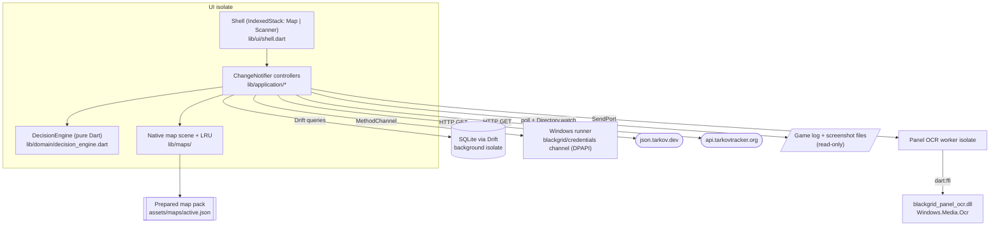

# Blackgrid Architecture

The system as the code stands on `main` after M5 (2026-10-07). Change designs read this first. It is derived from [docs/IMPLEMENTATION_STRATEGY.md](../docs/IMPLEMENTATION_STRATEGY.md), which stays the historical source; the section links below point there for detail and rationale. Every claim here was checked against `lib/` and `windows/`. Where the strategy and the code disagree, the [Strategy vs. code](#strategy-vs-code) table says so, and this file describes the code.

## System triage

All six triggers apply to the system as a whole:

- **T1 Components:** Map, Scanner (manual decisions only so far), catalog, progress, persistence, session inputs and native OCR, wired through one composition root (`lib/application/app_services.dart:27-72`).
- **T2 State:** durable SQLite user records and the catalog cache (`lib/data/database.dart:15-75`), plus memory-only progress and session evidence.
- **T3 Concurrency:** the Drift background isolate, `Isolate.run` decode/normalise work, a long-lived OCR worker isolate, file watchers and polling timers. Generation fences protect catalog, progress, selection, map and session publication; `SettingsController` and `HistoryController` have no generation or disposal guards (`settings_controller.dart:16-40`; `history_controller.dart:13-31`).
- **T4 Boundaries:** json.tarkov.dev and tarkovtracker.org HTTP, the game's log and screenshot files, the DPAPI method channel, the FFI OCR DLL, and the prepared map-pack format.
- **T5 Volume:** map artwork (1,331 hashed outputs in the active pack), the screenshot directory, the log stream and history rows.
- **T6 Risk:** a wrong Sell loses a player's needed item, credentials are protected secrets, and users' pins and history are unrecoverable if lost. The agent/game boundary in [AGENTS.md](../AGENTS.md) is a hard safety rule.

## Components

| Component | Responsibility | Owns (state) | Talks to via (contract) |
|---|---|---|---|
| `AppServices` (`lib/application/app_services.dart`) | Composition root: opens storage, credentials and the HTTP client, builds the controllers, starts the catalog refresh and, with a saved credential and the Tracker integration enabled, the progress refresh after each mode selection without awaiting them, then disposes them in order (`:181-199`) | Long-lived service graph, mode-transition and map-content generations (`:79,91`) | Constructor injection, `addListener` (`:69-71`) |
| Shell / UI (`lib/ui/`) | Two-area shell; both screens stay mounted in an `IndexedStack` (`shell.dart:160-171`) | Widget-local view state only | `ListenableBuilder` on controllers |
| `CatalogController` + `CatalogClient` | Mode-scoped catalog refresh, validation and publication | Published `CatalogSnapshot`, `CatalogStatus` (`catalog_controller.dart:9`) | HTTP GET of 6 required + 4 optional datasets (`catalog_client.dart:23-72`); Drift |
| `ProgressController` + `TrackerClient` | Read-only Tracker progress per mode and session | Memory-only progress snapshot and session authority (`progress_controller.dart:27,47-56`) | GET `/token`, `/progress` (`tracker_client.dart:43-198`) |
| `SelectionController` + `DecisionEngine` | The one decision projection that Map and Scanner both show | Current selection, transient FIR context, generation (`selection_controller.dart:58`) | Pure domain call (`selection_controller.dart:36,155`) |
| `SettingsController`, `HistoryController` | Durable preferences, pins and activity | Nothing beyond the DB rows | Drift |
| `MapController` + `lib/maps/` | Load the prepared pack, floors, markers, viewport transform, hit testing | Selected map, view transform, scene generations (`map_controller.dart:45-47`), 192 MiB native resource LRU (`native_map_scene.dart:23-35`) | Asset bundle; `vg.loadPicture` on precompiled `.vec` (`native_map_scene.dart:127-133`) |
| `MapSessionController` | Map-owned session evidence: detected map/mode, player samples, raid-exit highlights. No Scanner collaborator (`:18`) | Session epoch, one active and one pending request (`:56,319-364`) | `SessionLogReader`, `ScreenshotDirectoryWatcher` streams; `RaidPanelOcr` |
| `RaidPanelOcr` (`lib/data/raid_panel_ocr.dart`) | OCR of saved raid-exit panels | One worker isolate; single admission (`:90,116-121`) | `SendPort` → `dart:ffi` into `blackgrid_panel_ocr.dll` (`windows/ocr/panel_ocr.cpp`) |
| Windows runner (`windows/runner/`) | DPAPI protect/unprotect, atomic replace, LocalAppData path | Nothing | `MethodChannel('blackgrid/credentials')` (`credential_protector.cpp:32-107`) |
| Vision runtime (`lib/data/vision/`, `windows/vision/`) | Item vision primitives and OCR engine, verified against `data/vision/runtime.manifest.json` and loaded only from the bundle (ADR-0008). Loaded by `--vision-self-check`, tests, and the warm vision worker (ADR-0011) while live scan is on | Runtime status `ready`/`unavailable`/`disposed`, engine handle, opened libraries | `dart:ffi` into `blackgrid_vision.dll` (`bgv_*` ABI, OpenCV 4.13 `core`+`imgproc` static) and `tesseract50.dll` → `leptonica-1.82.0.dll` |
| Capture DLL (`windows/capture/`) | Global `WH_MOUSE_LL` hook thread that also owns the scan hotkey (`RegisterHotKey(NULL, ...)` with `MOD_NOREPEAT`, a transactional swap through `bgc_hotkey_set`, released at thread exit), one bounded trigger ring shared by mouse and hotkey events, window snapshots, BitBlt capture into generation-checked DIB frame slots. Facts only, no policy (ADR-0010, ADR-0019) | Hook installation, up to 2 hotkey ids during a swap, one rebind request slot, 16-event ring, 4 frame slots | `dart:ffi` into `blackgrid_capture.dll` (`bgc_*` ABI v2), hash-bound by `blackgrid_capture.dll.sha256` |
| Capture worker + `CaptureService`, `InputTriggerSource` (`lib/data/capture/`; the trigger source is `input_trigger_source.dart`, renamed from `MouseReleaseTriggerSource`) | Dart policy (validate, ROI plan, coherence, blank) in a dedicated capture worker isolate with single admission; the trigger source drains the ring on a coalesced signal, delivers mouse and hotkey `TriggerEvent`s (each with a `TriggerSource`) and rebinds the hotkey through `setHotkey`, which returns a sealed `HotkeyResult`. Started and stopped by `ScanCoordinator` (ADR-0013) | Service admission/overrun/closing state, one-entry exe-name cache, hook lifecycle | `SendPort` to the worker, then `dart:ffi` into `blackgrid_capture.dll`; frames cross isolates as `CaptureFrameTicket` |
| Vision worker + `VisionService` (`lib/data/vision/`) | One warm worker isolate owning the vision runtime, templates and scratch buffers; the service owns a single pending slot, the generation fence, the 1.5 s deadline and the `overrun` state; jobs run through a `VisionJobFactory` fixed at spawn (ADR-0011). Constructed per activation by `ScanCoordinator` | Service state, pending slot, generation; worker-side runtime, templates, scratch pool | `SendPort` to the worker, then the vision runtime; frames cross as `CaptureFrameTicket` and move with the request |
| Inspection recognition job (`lib/data/vision/`) | Marker search, title rectangle, close-button probe, crop, threshold and OCR inside the vision worker; returns sendable evidence (ADR-0012). Runs in the vision worker for every live scan | Worker-side scaled-template cache (≤4 entries) | `VisionJobFactory<InspectionRequest, InspectionRecognition>` seam of ADR-0011; vision ABI 2 `bgv_match_template_peaks` |
| Title matcher (`lib/domain/title_matching.dart`) | Pure Dart normalisation, per-snapshot `TitleMatchIndex`, primary and confirming matchers and outcome ranking, `TitleMatch.candidates` (top 5 distinct normalised names, best then runner-up first), run off the UI isolate by two `Isolate.run` adapters (ADR-0012), called by `ScanCoordinator` | Immutable index per catalog snapshot | `CatalogSnapshot` in; sealed `TitleMatch` and `RecognitionOutcome` out |
| `ScanCoordinator` (`lib/application/scan_coordinator.dart`) | Opt-in live scan: owns activation (template, then vision, then hook), the latest-wins scan flow with targeted and fallback passes, each preceded by a supersedable wait (50 ms settle and 200 ms fallback deadlines from the trigger, ADR-0014), the title-index cache, published `ScanReport`s (latest, last accepted, plus 10 recent, each carrying its trigger source) and the timing-log lines (schema v2, with `"trigger":"mouse"|"hotkey"`). It also owns the hotkey state (`inactive`, `disabled`, `registered`, `unavailable`), registered only while live scan is `ready`, and the one-at-a-time rebind (`setHotkey`: the OS accepts first, then the setting is saved on the tracked save path, with a restore if the save fails). Hotkey scans skip both waits; mouse scans keep them (ADR-0019). While frame recording is on (ADR-0015) it also copies pixels just before `submitFrame`, runs one post-publish full-client capture after a targeted acceptance and hands each scan to `ScanFrameRecorder`. Never touches selection or history (ADR-0013) | Activation state and token, session intent, in-flight scan, one pending trigger, scan generation, trigger source, hotkey state and rebind flag, per-activation capture and vision services | `InputTriggerSource`, `CaptureService`, `VisionService`, `buildTitleMatchIndexOffUi`/`matchRecognitionOffUi`; reads and saves `SettingsController` (`liveScan`, `scanHotkey`) |
| `ScanDecisionFeed` (`lib/application/scan_decision_feed.dart`) | App layer. Listens to `ScanCoordinator`'s `lastAccepted` and consumes each accepted report once, by a report-id high-water mark raised before the fences. Fences on the `ScanEpoch(modeTransition, session)` stamped at scan begin, the catalog mode and the item being in the current snapshot. Calls `SelectionController.selectScan`, and `retireScan` on a mode or session change. The offer path builds correction offers from `AcceptedScanSource.latest` through `correctionOfferFor`, behind the epoch and mode fences, with its own offer high-water mark `_offered`, and calls `SelectionController.offerCorrection`. Built and disposed by `AppServices` (ADR-0017, ADR-0018) | Consumed high-water report id, offer high-water report id `_offered` | `AcceptedScanSource` listener; `SelectionController`; reads `CatalogController` |
| `ScanTimingLog` (`lib/data/scan_timing_log.dart`) | Bounded JSONL scan-timing log, one writer loop, 1 MiB rotation (ADR-0013) | Write queue (32 lines), dropped-line count, status | `<LocalAppData>/Blackgrid/logs/scan-timings.jsonl` and `scan-timings.1.jsonl` |
| Scanner evidence panel (`lib/ui/live_scan_panel.dart`, `lib/ui/scan_evidence_panel.dart`) | The live-scan switch and status; the latest report with the decoded crop, candidates, timings and the recent list. Evidence only, no decision | Widget-local decoded crop image, one per report | `ListenableBuilder` on `ScanCoordinator` |
| Vision tooling (`tool/vision/`) | Pinned input fetch (`vision:fetch`) and the offline Release bundle integrity check (`bundle:check`) | Content-addressed input cache `.dart_tool/blackgrid_vision_inputs/` | `windows/vision/third_party.lock.json`; `tool/vision/bundle_inventory.json` |
| Map tooling (`tool/maps/prepare.dart`) | Offline acquire, normalise, compile, validate and promote of map packs | Immutable `assets/maps/versions/<sha256>/` generations | Build-time `vector_graphics_compiler` |

**Not built yet:** the Map snapshot (M4). Live scan is wired: it is off by default, and when the user switches it on, `ScanCoordinator` starts the vision worker and the input thread (mouse hook and scan hotkey) and shows the evidence in the Scanner. The scan hotkey is built (ADR-0019): F9 by default, `F1`-`F24` or off through the `scanHotkey` setting and the Scanner picker, registered only while live scan is `ready`. Decisions from accepted scans are built: `ScanDecisionFeed` passes each accepted scan to selection, history records it with the `scan` source and the decision card shows it (ADR-0017). `SessionScanState` is still a constant stub with no producer (`lib/application/session_scan_state.dart:1-7`). The vision ABI is version 2 and the capture ABI is version 2.

## State ownership

| State | Writer(s) | Lifetime | Invalidation / rebuild | Authoritative copy |
|---|---|---|---|---|
| Settings (mode, map, saved filters, Tracker enablement, game directories) | `SettingsController`; `LegacyImport` via `BlackgridDatabase.commitImport` (`legacy_import.dart:62-63`; `database.dart:265-289`), after which `AppServices.reloadAfterImport` reloads the controllers (`app_services.dart:176`; `import_dialog.dart:74`) | Durable | A failed save keeps the previous value (`settings_controller.dart:35-36`) | SQLite `Preferences` row id=1, JSON payload (`database.dart:157-175`) |
| Custom pins | `SettingsController`; `LegacyImport` via `commitImport` | Durable | Database load deserialises pins without validation (`database.dart:176-182`; `settings.dart:160-169`); frame and revision are validated on save, on import and when pins are projected (`map_coordinates.dart:118-125`). The manifest's pin frame is validated separately (`prepared_map.dart:124-131`) | SQLite `PinRecords` |
| Activity history | `HistoryController` via `recordActivity`; `LegacyImport` via `commitImport` | Durable; one row per (item, mode) with a revision (`database.dart:30-38,218-240`). `ActivitySource` gains `scan`, stored as its name in the text column, so there is no migration (ADR-0017) | Reopening re-resolves current facts. An older build reading a `scan` row fails the history load visibly | SQLite `ActivityRecords` |
| Catalog snapshot | `CatalogController` | Durable cache, one per mode | Atomic swap in one transaction (`database.dart:126-154`); last-good kept on failure (`catalog_controller.dart:127-128`) | SQLite `CatalogRecords` + `ActiveCatalogs`, normalised JSON |
| Legacy-import ledger | `LegacyImport` commit | Durable | Digest rejects re-import (`database.dart:258-302`) | SQLite `ImportRecords` |
| Tracker token | `DpapiCredentialStore` | Durable, per mode | Temp file then `MoveFileExW` (`credential_store.dart:101-105`) | `%LOCALAPPDATA%\Blackgrid\credentials\<mode>.dpapi` |
| Tracker progress | `ProgressController` | Memory, current session; 15 min (`progress.dart:42`) | Cleared on mode or credential change; transport failure keeps it as stale (`progress_controller.dart:166-182`) | None durable (by design) |
| Selection and transient FIR | `SelectionController` | Memory. Sources are `manual`, `history`, `scan` and `correction`, with precedence history row > scan > correction > manual. A scan source holds an immutable `AcceptedScan` record (ADR-0017). A correction source holds an immutable `ScanCorrection` record and is never an accepted scan. `SelectionController` also owns the current `ScanCorrectionOffer` (ADR-0018) | Reset on selection, mode and generation changes. `retireScan` clears a scan or correction source and resets FIR on a mode or session change | None durable |
| Map view transform and scene | `MapController` | Memory, per map (`_views`) | Content generation fences late loads (`map_controller.dart:430-455`) | Prepared pack (immutable) |
| Session evidence (map/mode, player sample, exit highlights) | `MapSessionController` | Memory, per epoch | Epoch bumps on log directory, session or incarnation change (`:185-188,253`); last-good kept on same-context transient error (`:254-264`) | Game files (read-only) |
| Active map generation | `tool/maps/prepare.dart promote` (offline) | Repository | Atomic `active.json` swap (`pack.dart:1452-1484`) | `assets/maps/active.json` |

## Boundaries and contracts

- **Catalog:** GET only, no redirects, 30 s timeout, at `https://json.tarkov.dev/{regular|pve|pvp-season}/<dataset>` (`catalog_client.dart:23-39`; `catalog.dart:7-12`). Normalised into a canonical `CatalogSnapshot` off the UI isolate (`catalog_client.dart:91`). The cache key is `json.tarkov.dev:<mode>`, with no locale (`database.dart:103`). The snapshot is `current` only after a fresh fetch, for 24 h from that download (`catalog.dart:305-317`; `catalog_controller.dart:106-118`). Source times are evidence only: the newest per-item `updated` for items, none for the other five datasets, which carry no time (`catalog_normalizer.dart:383-394`).
- **Tracker:** GET only, Bearer token, ETag, no redirects, 30 s timeout. 401/403/429 map to typed failures, and Retry-After defaults to 60 s (`tracker_client.dart:84-121`). Token prefix, GP permission, mode and owner are verified. It never writes.
- **SQLite schema:** Drift `schemaVersion` 2, with snapshots in `drift_schemas/`. Only the 1→2 upgrade is supported, and a newer on-disk version is refused (`database.dart:82-100`). The file is `%LOCALAPPDATA%\Blackgrid\blackgrid.sqlite` (`local_paths.dart:8-25`).
- **Prepared map pack:** `active.json` (`schemaVersion` 1) points at a sha256-named immutable generation. Its manifest must declare `vectorsCompiled` and `runtimeVectorVersion == '1.2.3'`, and v3 packs must cover the full map set (`prepared_map_loader.dart:46-121`). Content hashes are checked by the tooling, not at runtime.
- **Credentials channel:** `blackgrid/credentials` with `localDataPath`, `atomicReplace`, `protect` and `unprotect`. DPAPI runs in current-user scope with `CRYPTPROTECT_UI_FORBIDDEN` (`credential_protector.cpp:92-98`).
- **Panel OCR ABI:** a `dart:ffi` C ABI with a version check. The DLL must match the `blackgrid_panel_ocr.dll.sha256` that CMake writes at install (`windows/CMakeLists.txt:90-98`; `raid_panel_ocr.dart:188-206`). This proves the DLL matches its build; it is not tamper-proof.
- **Vision runtime ABI:** `bgv_*` C ABI over caller-owned buffers with a `bgv_abi()` version check, plus a minimal Tesseract C-API binding whose `TessVersion()` must equal the manifest's `engineVersion`. Every vision file must match `data/vision/runtime.manifest.json`, written by CMake at install, before any library opens; third-party files are pinned in `windows/vision/third_party.lock.json` (ADR-0008). Like the panel binding, this is not tamper-proof.
- **Capture ABI:** `bgc_*` C ABI over caller-owned buffers (`bgc_abi`, `bgc_hook_start/stop/drain`, `bgc_hotkey_set`, `bgc_snapshot`, `bgc_process_name`, `bgc_capture`, `bgc_frame_info/release/live_count/finalize`, `bgc_qpc_now/frequency`; `windows/capture/capture.h`) with a `bgc_abi()` version check (ABI v2: `bgc_trigger_event` is 40 bytes with a `source` field, and `bgc_hotkey_set` is new; ADR-0019). The DLL must match the `blackgrid_capture.dll.sha256` that CMake writes at install, as with panel OCR; this is not tamper-proof (ADR-0010). Native returns facts; validation and planning are Dart. Frames cross isolates only as `CaptureFrameTicket`. The code opens no handle to, reads no memory of and sends no input to the target process; an offline audit test enforces this.
- **Game inputs:** read-only. The newest `log_*` folder's `application*.log` is polled every 250 ms with a recursive watch. The parser reads `scene preset path:` for the map and `Session mode:` for the mode (`session_log_reader.dart:13-15,173-211,322-379`). Screenshot filenames carry XYZ plus a quaternion (`screenshot_filename.dart:23-76`). Paths come from registry uninstall keys or the Steam library (`game_paths.dart`). The app never touches game memory or processes.
- **Legacy import:** a one-time, read-only parse of user-chosen files in an isolate, committed atomically. Labs revision 0→1 pin conversion happens only here (`legacy_import.dart:74,161-201,371`).

## Resource bounds and failure visibility

| Flow / store | Bound | At the bound | On failure | Who finds out |
|---|---|---|---|---|
| Catalog refresh | Automatic once per mode selection, plus manual Refresh; no retry. 30 s per request; one in flight per mode (`catalog_controller.dart:20,76-91`) | Request aborted | Last-good kept, status `failed`/`stale` | Status bar `Catalog <status>` (`shell.dart:207-223`) |
| Tracker progress | 30 s per request; two sequential requests (`/token`, `/progress`) plus parsing, with no overall deadline (`tracker_client.dart:84,138,179`); 15 min age; 429 cooldown | Snapshot goes stale; cooldown shown | Auth/mode/identity failure clears authority; transport failure keeps stale | Status bar `Progress <status>`; decisions fall to Check |
| HTTP response bodies (catalog, Tracker) | **No byte cap**; whole bodies are buffered (`catalog_client.dart:30-43`; `tracker_client.dart:80-89`) | — | Timeout or parse failure | Status bar |
| Legacy import | **No byte or record cap**; whole files are read and the preview materialised (`legacy_import.dart:22-49`; `import_preview.dart:26-30`) | — | A failed commit is rolled back (one transaction, `database.dart:258-302`). If the commit succeeds but the controller reload fails, the dialog still reports failure while the imported data stays committed (`import_dialog.dart:70-84`; `app_services.dart:176-179`) | User, in the import dialog |
| Map native resources | 192 MiB of accounted decoded raster and approximate picture bytes, excluding GPU copies (`native_map_scene.dart:14-50`); 256×256 tiles enforced (`:167-171`) | Evict unleased resources; scene load fails if active leased demand prevents admission (`:221-233`) | Load error text over the canvas (`map_workspace.dart:422-427`) | User, on the Map canvas |
| Log tail | 250 ms poll, 8 KiB chunks, 64 KiB max line | Over-long line → error status | Error status; detected map/mode retained (`session_log_reader.dart:264-303`) | Map session status text (`map_screen.dart:88-118`) |
| Screenshot watch | 1 s poll, 80 ms stability, 64 MiB per file; newest changed file only | Larger files skipped | Error evidence | Map session status text |
| Screenshot directory bookkeeping | **No count cap.** `_seen` and `_fileStamps` track present files; content hashes (`_knownContentIds`) and unmatched dirty paths persist until rebinding (`screenshot_directory_watcher.dart:49-52,100-102,251-266`) | Can grow with distinct screenshot contents and unmatched paths seen this binding, independent of the current folder size | — | Nobody (unbounded) |
| Panel OCR | 64 MiB input; ≤8192 px per side, ≤24 MPix; one admission (`raid_panel_ocr.dart:110-121,390-396`) | Busy → `unavailable`, not queued | Error/unavailable/missing evidence | Map session status; highlights change only on recognised/empty results |
| Vision primitives and item OCR | Each side 1-8192 px, ≤24 MPix, channels 1/3/4, `stride >= w*channels`; checked in Dart and again natively; OCR text decoding capped at 64 KiB | `invalidImage`, no native call | Typed `VisionFailure`, never thrown | Caller; the self-check report |
| Vision call duration | 1.5 s deadline from submission (pending time counts); close drain 2 s (ADR-0011). `--vision-self-check` keeps its own 60 s watchdog and exits 3 | `visionTimeout` to the caller and the service stays `overrun` until the worker replies; no second call starts, no kill, no respawn. Close reports `shutdownIncomplete` | Caller gets `visionTimeout`; the self-check reports `timeout(step)` | `ScanCoordinator` (failed report, Scanner status); user running the self-check |
| Panel OCR duration | **None.** `RecognizeAsync().get()` blocks the worker (`panel_ocr.cpp:205`) | — | A hung call leaves Map processing active, later requests pending or replaced (`map_session_controller.dart:333-361`), and service disposal waiting indefinitely (`:449-453`). Concurrent direct adapter calls return `unavailable` | Nobody; status stays in progress |
| Capture trigger ring | 16 events in the native hook (`windows/capture/`); ≤1 pending Dart signal (coalesced) | Drop oldest, counted, reported on drain | Hook stop: 1 s join; on timeout `stopTimedOut` and the listener is kept alive | `ScanCoordinator` (warning in Scanner status) |
| Capture frames | 4 live slots; side ≤8192 and ≤25,165,824 px | `frameBudgetExceeded` / `captureTooLarge` before acquisition | Typed `CaptureFailure`, never thrown; unreleased frames are freed by the finalizer | `ScanCoordinator` (failed report) |
| Capture requests | 1 active, 0 queued; 500 ms deadline from admission | `captureBusy`; at the deadline `captureTimeout` and the service stays `overrun` until the worker replies, then the late frame is released | Service close: 2 s drain, else `shutdownIncomplete`; worker error → `unavailable`, no respawn | `ScanCoordinator` (Scanner status, failed report) |
| Scan flow | 1 scan in flight plus 1 pending trigger; at most 1 frame held; at most 10 recent reports; 1-entry title-index cache | Older pending trigger dropped and counted (`supersededTriggers`); the active scan is superseded, and a superseded scan is logged but not published (ADR-0013). A trigger during a wait starts at once and cancels the old wait (ADR-0014) | Per stage: settle wait to trigger + 50 ms and fallback wait to trigger + 200 ms for mouse triggers (0 for hotkey triggers, ADR-0019), capture 500 ms, vision 1.5 s from submission; a failed stage ends the scan with a typed failure | User: Scanner evidence panel and failed reports; dropped triggers only as counts |
| Hotkey rebind request | 1 in flight (native slot) and 1 in the coordinator; at most 2 hotkey ids during a swap | Refused as busy (Dart) or `hotkeyTimedOut` (native); a late answer to an abandoned request rolls back the swap | 1 s native wait; the UI isolate blocks at most 1 s | User: Scanner hotkey row and rebind error |
| Scan timing log write queue | 32 lines | New line dropped and counted; the next written line carries `droppedLines`; flush on close within 1 s, the rest dropped | A write error sets status `unavailable(error)`; later appends retry | User: log status in the Scanner |
| Scan timing log file | 1 MiB current + 1 MiB previous (`scan-timings.1.jsonl`) | Rename-then-append rotation; older history discarded by design | — | Nobody (a diagnostic log) |
| Map session requests | One active plus one replaceable pending (`map_session_controller.dart:319-364`) | Pending replaced | Stale results dropped by epoch/context | — |
| History | One row per (item, mode); no row limit (`database.dart:198-216`) | — | A load failure retains prior rows, and the panel shows the error only when empty (`history_controller.dart:13-31`; `evidence_panels.dart:193-199`). Manual record failures appear in the decision card (`selection_controller.dart:84-86`; `item_decision_card.dart:198-205`) | User, only partly |
| App storage open | — | — | Bootstrap error with Retry; data not reset (`lib/ui/app.dart:78-84`) | User |

## Strategy vs. code

| Strategy says | Code does | Where |
|---|---|---|
| Use `InteractiveViewer` / `TransformationController` / `toScene` ([§5](../docs/IMPLEMENTATION_STRATEGY.md#native-rendering-and-asset-preparation)) | A custom `Listener` + `GestureDetector` over `CustomPaint`, with the domain `MapViewTransform` | `map_workspace.dart:349-392`; `map_geometry.dart:267` |
| Keep pan/zoom out of application broadcasts ([§5](../docs/IMPLEMENTATION_STRATEGY.md#native-rendering-and-asset-preparation), [§9](../docs/IMPLEMENTATION_STRATEGY.md#9-state-management-strategy)) | Every pan/zoom calls `notifyListeners()` on `MapController`, and the workspace rebuilds | `map_controller.dart:336-367,413-453`; `map_workspace.dart:245` |
| Qualify `flutter_svg` with `vector_graphics` ([§5](../docs/IMPLEMENTATION_STRATEGY.md#native-rendering-and-asset-preparation)) | No `flutter_svg`; SVG is compiled at build time and only the `vector_graphics` runtime ships | `pubspec.yaml:15,25`; `tool/maps/pack.dart:75-81` |
| Key compiled scenes by content/version ([§5](../docs/IMPLEMENTATION_STRATEGY.md#native-rendering-and-asset-preparation)) | Content-addressed generation directories; no runtime hash verification | `prepared_map_loader.dart:44-124` |
| A small Windows plugin for input, capture, hotkeys and credentials ([§7](../docs/IMPLEMENTATION_STRATEGY.md#7-windows-integration-strategy)) | No plugins. Runner-embedded DPAPI channel plus standalone hash-bound FFI DLLs (panel OCR, vision runtime, capture) with an app-local Visual C++ runtime; input and capture are built as `blackgrid_capture.dll` (ADR-0010) wired into the app by `ScanCoordinator` (opt-in live scan); the scan hotkey is `RegisterHotKey` on the capture input thread, registered only while live scan is `ready` (ADR-0019) | `windows/runner/credential_protector.cpp`; `windows/ocr/`; `windows/vision/`; `windows/capture/` |
| Catalog Ready/Stale/Incomplete/Unavailable, keyed by mode/locale/source ([§8](../docs/IMPLEMENTATION_STRATEGY.md#8-data-and-persistence-strategy)) | `missing/loading/current/stale/failed`; "incomplete" only per requirement; key has no locale; English translations only | `catalog_controller.dart:9`; `catalog.dart:133,150`; `database.dart:103` |
| `ValueNotifier` for small values; async states carry their source generation ([§9](../docs/IMPLEMENTATION_STRATEGY.md#9-state-management-strategy)) | `ChangeNotifier` only; generations are mostly private counters; `authorityVersion`, the map `contentGeneration` (`map_controller.dart:67`) and session epochs are exposed | `catalog_controller.dart:26`; `progress_controller.dart:26` |
| Scanner coordinator and services survive navigation ([§6](../docs/IMPLEMENTATION_STRATEGY.md#6-scanner-strategy), [§9](../docs/IMPLEMENTATION_STRATEGY.md#9-state-management-strategy)) | `ScanCoordinator` is app-scoped and survives navigation (ADR-0013); `SessionScanState` stays a stub with no producer | `scan_coordinator.dart`; `session_scan_state.dart` |
| Exit-panel OCR backend open; Tesseract considered ([§12](../docs/IMPLEMENTATION_STRATEGY.md#12-risks-and-prototypes)) | Decided (2026-10-07): Windows.Media.Ocr, unpackaged ([§5](../docs/IMPLEMENTATION_STRATEGY.md#session-evidence-and-saved-pins), ADR-0006) | `raid_panel_ocr.dart`; `panel_ocr.cpp` |
| Noncancellable native calls must be bounded ([§6](../docs/IMPLEMENTATION_STRATEGY.md#6-scanner-strategy)) | Panel OCR has no duration bound (item OCR does not exist yet) | `panel_ocr.cpp:205` |

## In-force ADRs

| ADR | Decision | Supersedes |
|---|---|---|
| [0001](../docs/adr/0001-shared-conservative-decision-engine.md) | One pure-Dart conservative decision engine is the only keep/sell authority for Map and Scanner | — |
| [0002](../docs/adr/0002-sdk-notifiers-and-composition-root.md) | SDK `ChangeNotifier` controllers built by a hand-written composition root; generation counters fence stale results | — |
| [0003](../docs/adr/0003-single-drift-sqlite-store.md) | One Drift SQLite database in LocalAppData holds settings, pins, history and the catalog cache, with versioned migrations | — |
| [0004](../docs/adr/0004-isolate-model.md) | Single process: UI isolate, Drift background isolate, `Isolate.run` for bulk decode, a long-lived worker isolate for blocking native OCR | — |
| [0005](../docs/adr/0005-native-map-prepared-packs.md) | Native Flutter map rendering from offline-prepared, content-addressed packs with build-time vector compilation | — |
| [0006](../docs/adr/0006-windows-media-ocr-for-raid-panels.md) | Map-owned raid-panel OCR uses Windows.Media.Ocr through a hash-bound FFI DLL, separate from future item OCR | — |
| [0007](../docs/adr/0007-runner-channel-and-ffi-dll-windows-boundary.md) | Implemented Windows integration (credentials, panel OCR) is a runner-embedded method channel plus a standalone FFI DLL, not Flutter plugins; DPAPI current-user for tokens | — |
| [0008](../docs/adr/0008-item-vision-runtime.md) | Item vision runtime: owned OpenCV primitives DLL, pinned charlesw Tesseract 5.2.0 package binaries (engine 5.0.0, Leptonica 1.82.0), lock plus install-manifest binding, bundle-only load order, app-local Visual C++ runtime, UTF-8 active code page | — |
| [0009](../docs/adr/0009-release-versioning.md) | Release versioning: SemVer milestone versions set only by release commits, commit-count build numbers, a first-parent per-PR changelog, local `release:prepare`/`release:tag`/`build:release` tasks with a fenced tag push, and a `BLACKGRID_VERSION` define shown by the app | — |
| [0010](../docs/adr/0010-windows-input-and-capture-boundary.md) | Windows input and capture: standalone hash-bound `blackgrid_capture.dll`, native `WH_MOUSE_LL` hook thread with a 16-event ring and coalesced signal, DPI-independent physical-pixel ROI, clip-not-pad, 4 generation-checked frame slots with ticket hand-off, native facts with Dart policy, a capture worker isolate (500 ms deadline), and no handle to, memory access of or input to the target process. Partly superseded by 0016: the ROI region formula only | — |
| [0011](../docs/adr/0011-vision-worker-contract.md) | Vision worker contract: one warm worker per service owning runtime, templates and scratch; service-side single pending slot and generation fence; 1.5 s deadline from submission with `overrun`, no kill or respawn, 2 s close drain; job seam (`VisionJobFactory<P, R>`) fixed at spawn with sendable params and results; input ownership moves with the request; QPC clock | — |
| [0012](../docs/adr/0012-inspection-recognition-pipeline.md) | Inspection recognition pipeline: a recognition job in the vision worker returns sendable evidence; title normalisation, index, matchers and ranking are pure Dart run off the UI isolate through two `Isolate.run` adapters; native peak primitive (vision ABI 2, status -6) with Dart-side plateau and suppression; 28×28 manifest-bound marker asset with recorded provenance; same-weight grayscale; single-precision gates | — |
| [0013](../docs/adr/0013-scan-pipeline-coordination.md) | Scan pipeline coordination: one app-scoped `ScanCoordinator`; start order template, vision, hook; session intent owned by the coordinator (`setLiveScan` sole writer); latest-wins with stage-specific supersession; closed fallback-eligibility list; client size in frame provenance; JSONL timing log v1 with 1 MiB rotation and a 32-line queue; failure values mapped in the coordinator; no decisions from scans before M4. Partly superseded by 0017: that last decision only | — |
| [0017](../docs/adr/0017-accepted-scans-feed-the-decision-engine.md) | Accepted scans feed the shared decision engine through an app-layer `ScanDecisionFeed`: the coordinator still never references selection or history; each accepted report is consumed once by a report-id high-water mark raised before the fences; a `ScanEpoch(modeTransition, session)` stamped at scan begin, the catalog mode and item-in-snapshot fence a scan out of the decision path; `ActivitySource.scan` is stored by name with no Drift migration | 0013 (the decision "No decisions from scans before M4" only) |
| [0014](../docs/adr/0014-scan-settle-and-fallback-waits.md) | Scan settle and fallback waits: a supersedable `waiting` stage before each capture request, 50 ms settle and 200 ms fallback deadlines measured from the trigger's QPC stamp with no wait once passed, a trigger during a wait starts at once, injectable waiter and delays, timing log unchanged (v1) | 0013 (stage-specific supersession bullet only) |
| [0015](../docs/adr/0015-opt-in-scan-frame-recording.md) | Opt-in scan frame recording: a session-only switch (never persisted, on only while live scan is `ready`), a recording-only pixel copy on the UI isolate before `submitFrame` (an exception to the copy ADR-0010 and ADR-0011 rejected, transport unchanged), a post-publish extra full-client capture after a targeted acceptance with its accepted cost to a click during it, a writer isolate with 2 outstanding scans and a 500 hand-off cap, `frames.jsonl` v1, `image` as a runtime dependency, latency judged with recording off | — |
| [0016](../docs/adr/0016-centred-targeted-region.md) | Centred targeted region: a fixed band `(cx - f(440), 0, f(440) + f(700), cy + f(60))` around the client centre replaces the trigger-point strip, the trigger point only an in-client guard; targeted recognition lists every marker peak (.82 gate, 8 kept) like full-client; the best targeted entry wins alone when accepted, else all entries are ranked together; waits unchanged | 0010 (region formula in the ROI bullet only) |
| [0018](../docs/adr/0018-scan-correction-is-transient-selection-state.md) | Scan correction is transient selection state: `SelectionController` owns the offer and is its only writer, fed by `ScanDecisionFeed` through `AcceptedScanSource.latest`; a pick is a distinct `ScanCorrection` source, never an `AcceptedScan`, and only accepted reports may advance the Map snapshot; corrections are recorded in history as `manual`; `TitleMatch.candidates` keeps a distinct-name top 5 | — |
| [0019](../docs/adr/0019-scan-hotkey-on-the-capture-input-thread.md) | Scan hotkey on the capture input thread: `RegisterHotKey(NULL, ...)` with `MOD_NOREPEAT` on the existing input thread and ring, registered only while live scan is `ready`; hotkey scans skip the settle and fallback waits; the rebind is one native request that registers the new key before releasing the old, with Dart saving after the OS accepts and restoring on a failed save; the binding is a closed `ScanHotkey` enum (F1-F24 or off, default F9) in the settings JSON; the audit bans keyboard hooks and key-state reads; capture ABI v2 (40-byte event with `source`, `bgc_hotkey_set`) and timing log v2 (`trigger`) | — |

Planned but not built (the Map snapshot) live in the [roadmap](roadmap.md), not here.
