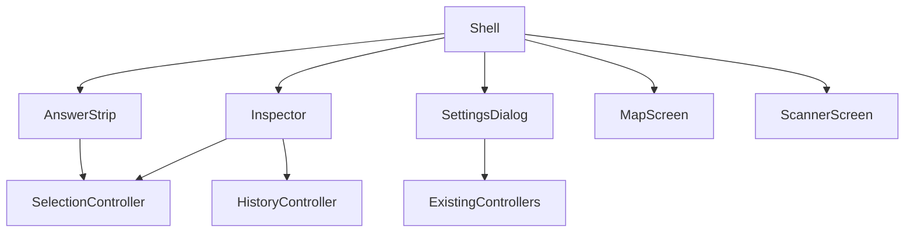
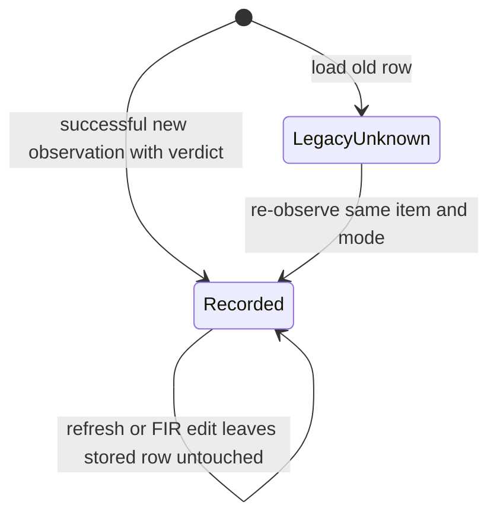
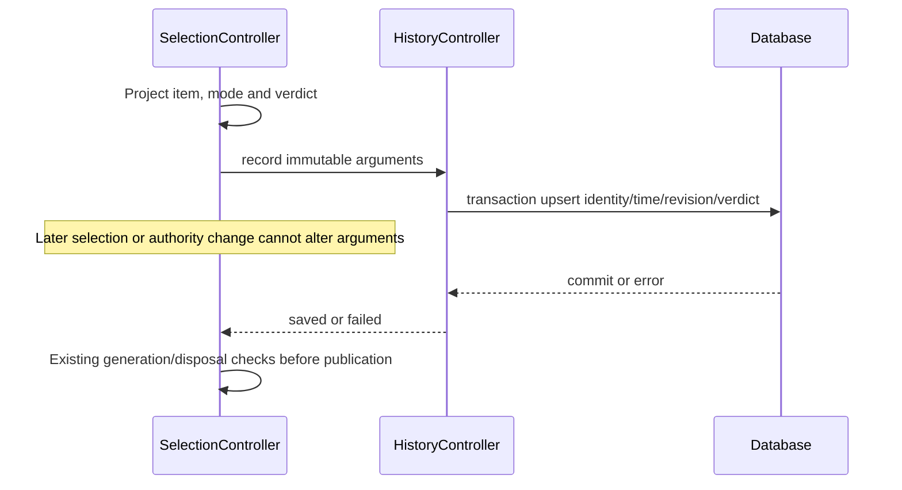
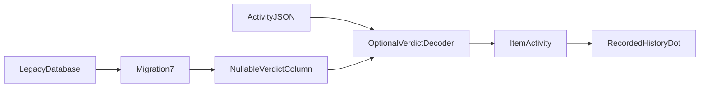

# Design

## Triage

| Trigger | Applies? | Evidence |
|---|---|---|
| T1 Components | yes | Shell, answer strip, inspector, Settings, Map and Scanner have directed UI/controller relationships. |
| T2 State | yes | Optional durable activity verdict; transient inspector state. |
| T3 Concurrency | yes | Selection records history asynchronously; authority and selection may change while storage is pending. |
| T4 Boundaries | yes | Activity table and JSON representation gain an optional verdict. |
| T5 Volume | yes | Activity has no row cap; history uses lazy rows. |
| T6 Risk | yes | Migration touches user history and a verdict must never imply false historical advice. |

TIER: FULL

## Context

Scope and owner choices are in proposal.md. Current anchors:
- `lib/ui/shell.dart:38` builds the shell; its header has a horizontal minimum width, its timer strip is separate, and the two areas stay mounted in an IndexedStack.
- `lib/ui/scanner_screen.dart:50` builds configuration before evidence and the decision card at narrow widths. `lib/ui/map_screen.dart` puts the decision below Active map in the rail.
- `lib/ui/item_decision_card.dart:165` displays the raw ID; `lib/ui/manual_controls.dart:96` owns the existing FIR controls. Extract presentation without changing controller semantics.
- `lib/ui/evidence_panels.dart:363` owns lazy history rows, already with ItemIcon leases; mode-mismatched rows get no current-mode icon.
- `lib/application/selection_controller.dart:144,191,339` are manual, scan and correction activity writes, after synchronous decision projection. `:350` opens history against the stored mode's catalog and recomputes present advice; this is not a historical decision replay.
- `lib/data/database.dart:32` keys activity by item and mode; `:201` has schema 6; `:500` decodes rows independently; `:527` transactionally replaces activity and increments revision. `lib/domain/settings.dart` holds ItemActivity and its JSON codec.
- `lib/ui/settings_dialog.dart:16` opens the current dialog without a section target. `lib/application/history_controller.dart:57` routes writes to the database and reports failure.

DESIGN.md X7/X10/X11/X14 and the approved Direction B round 2 are the visual authority. The runtime is native Windows Flutter; PRODUCT.md's `web` marker is explicitly explained there as a tooling approximation. Impeccable reported platform/sidecar drift; this change does not repair those project documents.

## Decisions

### D1: Recompose existing presentation around its current owners
- **Choice:** A shared shell renders one answer strip and the responsive inspector; Map and Scanner remain mounted, using existing AppServices controllers. Split the existing decision card into reusable summary/detail presentation and share FIR controls. Settings receives displaced configuration and a section target. No new application state framework or capture entry point.
- **Rejected:** Separate area-specific answer controllers; they could diverge from SelectionController and duplicate asynchronous lifetimes.
- **Reversal cost:** low; widget composition only.
- **Important:** no; tactical implementation of S1/S2 within the accepted controller boundary.
- **Chosen by:** agent

### D2: Recorded verdict is a fact of the activity, not a decision replay
- **Choice:** Implement S3 as an optional verdict value on ItemActivity and ActivityRecords, encoded by stable named values rather than enum ordinals. Capture the projected verdict synchronously at the three recording call sites before awaiting. Save it in the existing activity transaction. Missing, invalid or unsupported optional verdicts decode to unknown. The row's dot and tooltip say recorded verdict; opening history continues to compute current advice, visibly labelled as current history inspection. No historical prices, reasons, FIR or catalog snapshots are added.
- **Rejected:** Compute row dots from the current catalog; that would misstate history. A full immutable decision-event log would replace the existing history semantics beyond the owner's request.
- **Reversal cost:** medium; stored optional data must continue to load.
- **Important:** yes; stored format and visible behaviour, as chosen in S3.
- **Chosen by:** user (save verdict at recording time, unknown for older rows)

### D3: Responsive presentation follows the approved shell
- **Choice:** The inspector is docked above 1080 logical pixels and an overlay at or below it. Keep its expansion state above breakpoint branches; opening an overlay never reparents or recreates the Map workspace. The answer strip has a 76px normal minimum and grows for wrapped reasons and text scaling. Top/status bars use the approved tokens; compact actions retain names, tooltips and keyboard access. Settings remains a dialog until restyle-dialogs.
- **Rejected:** Stack configuration ahead of the strip or move the map into a new route to show details; either breaks the approved Answer First/Centre Holds rules.
- **Reversal cost:** low.
- **Important:** yes; visible layout already settled by the approved DESIGN.md and S2.
- **Chosen by:** user (approved Direction B and Settings transition)

### Decision summary

| # | Decision | Choice | Rejected | Reversal cost | Important | Chosen by |
|---|---|---|---|---|---|---|
| S1 | Scope | Approved Direction B shell | New direction / map-role redesign | medium | yes | user |
| S2 | Settings | Existing targeted dialog | Full page brought forward | low | yes | user |
| S3 | History | Record verdict; old rows unknown | Current verdict / defer dots | medium | yes | user |
| D1 | Composition | Shared UI, current controllers | New area controllers | low | no | agent |
| D2 | Recorded fact | Optional verdict captured at write | Recomputed dot / event log | medium | yes | user |
| D3 | Responsive shell | Approved inspector and growing strip | Pre-answer config / route replacement | low | yes | user |

## Diagrams (FULL)

T1 — presentation dependencies:

T2 — activity ownership and lifetime:

T3 — freeze the verdict before the asynchronous boundary:

T4 — durable boundary:

## State & Ownership (FULL)

| State | Owner (sole writer) | Lifetime | Invalidation / rebuild | Authoritative copy |
|---|---|---|---|---|
| Current item, FIR, correction, current advice | SelectionController | App session | Existing selection/authority generations | Controller |
| Latest accepted scan | SessionScanState via ScanDecisionFeed | Current scan epoch | Existing mode/session fences | AcceptedScan record |
| History including optional verdict | BlackgridDatabase; HistoryController routes writes | Durable, one row per item/mode | Explicit observation or existing import replaces row | ActivityRecords |
| Inspector open/tab and detail expansion | Shell/inspector widget state | Shell session | Rebuilt only at new shell session | Widget state above breakpoints |
| Map pan, zoom, filters and saved-input expansion | Existing Map controllers / MapScreen | Existing lifetimes | Unchanged; no remount on inspector toggle | Existing owners |
| Timer values and scan intent | Existing timer controller / ScanCoordinator | Existing lifetimes | Existing projections and start/stop logic | Existing controllers |
| Settings scroll target | SettingsDialog | One dialog opening | Target applied once after layout, then user scrolls | Dialog widget state |

## Failure & Visibility (FULL)

| Component | Fails / dies mid-operation → | Recovery | Retry safe? | Who finds out |
|---|---|---|---|---|
| Activity write | Transaction rolls back; current selection remains | Next user observation uses normal write path | yes, existing replace/revision semantics | Existing history and selection errors |
| Migration | Transaction fails; no partial upgrade | Existing database startup failure; never reset user DB | Retry after cause is removed | Startup error |
| Optional verdict decoder | Unknown value becomes unknown dot, row retained | None needed; no load-time rewrite | yes | Unknown tooltip/semantics |
| Item picture | Existing placeholder/frame | Existing icon cache retry policy | Through cache only | Visible fallback |
| Status action | Existing save/rebind/start error | Existing controllers; no UI-only success state | Existing policy | Visible Settings/status error |
| Overlay / target scroll | Close/dispose cancels pending callback, verify mounted | Reopen via same action | yes | Workspace remains usable |

## Resource Bounds (FULL)

| Queue / buffer / cache / transfer | Bound | At bound | Timeout | At 10x / 100x |
|---|---|---|---|---|
| Inspector and Settings overlays | One of each, reuse existing modal action semantics | Do not accumulate routes from repeated activation | None | Fixed shell state |
| History verdict | One small optional value per existing item/mode row | Existing history uniqueness, no new append log | DB operation inherits existing policy | Linear existing row load; no per-row decision projection |
| History widgets/icons | Lazy ListView with existing zero cache extent and ItemIcon leases | Only visible rows request images | ADR-0022 | Cache/network bounds unchanged |
| Row collection | Existing history has no numeric cap, uniqueness only (ADR-0003) | Do not add a second collection or query per row | Existing query | Existing linear cost remains; optional enum adds constant space per row |
| Pending history writes | Existing per-observation async calls; no new queue | Arguments frozen, existing transactional writes | Existing DB policy | No additional work per refresh/tick |
| Timers | Existing controller timers; no per-row timer | Reuse existing age updates | Existing policy | Same count regardless of history size |

## Flow & State Gaps (FULL)

- A newer selection can arrive during an older history write: immutable captured identity/mode/verdict stay paired; existing generation checks prevent old completion changing current UI. No new latest-wins history policy is introduced.
- FIR edits and authority refreshes can change current advice, but only explicit recording replaces the stored dot. A saved dot never authorises current selling advice.
- Two observations of the same item/mode keep existing transaction order and increment revision; no event-log conversion. A new observation without a verdict replaces the previous optional verdict with unknown rather than retaining a mismatched old one.
- Upgrade schema 6 to 7 by adding a nullable text column; update the supported upgrade target and earlier-version paths, regenerate database.g.dart and commit the new drift schema snapshot. Never drop/recreate ActivityRecords. Newer databases remain refused.
- ItemActivity JSON reads absent/unsupported verdict as unknown; writes optional verdict consistently. Preserve import merge/replace ordering and existing revision semantics. Legacy imported activity has no invented verdict.
- During history loading or mode mismatch, keep existing guards, image fallback and explicit unavailable/current-advice labels. Recorded dots do not need catalog or Tracker data.
- Tab switches, inspector toggles and breakpoint changes preserve both areas, map viewport, search and expanded details. Escape closes the overlay and restores focus. At enlarged text scale, grow the answer strip and let non-answer content scroll independently.
- Status game-mode actions use the existing settings/effective-mode path, preserving log-detected mode authority. A detected mode is explained rather than falsely reporting a successful override.
- Recording controls and session path/counters move together to Settings. Scanner keeps a visible recording stop/error note so an error does not vanish when Settings closes.

## Mechanism Ledger (FULL)

| Mechanism | Built? | Why | Evidence that changes the call |
|---|---|---|---|
| Optional verdict + migration | yes | Owner requested historical fact; stored format is expensive later | Owner changes S3 |
| Freeze verdict before await | yes | Existing async writes permit authority/selection changes | Recording becomes wholly synchronous |
| Fresh selection controller or event bus | no | Current owner already projects the answer | Demonstrated missing ownership boundary |
| Full decision snapshot/event log | no | Dot needs only verdict; history is coalesced activity | Separate owner request for decision replay |
| New image cache or history prefetch | no | Existing ItemIcon already bounds requests | Measured cache defect |
| Automatic migration repair/retry | no | Could overwrite irreplaceable records; existing startup error is visible | Separately designed recovery |

## Risks / Trade-offs

- Old Map rail and Scanner placement tests encode the displaced layout → replace placement assertions, retain their behavioural coverage and add geometry assertions for both rooms at 1660x870, 1100x720, 960x720 and 900px width.
- A 44px top bar with all timers may crowd search → use approved compact branding/actions and flexible search; prove all controls remain reachable and no horizontal page overflow at 960px and text scale 2.
- History dot and current advice can disagree → recorded-verdict accessibility text and current-inspection labels; test disagreement explicitly.
- A permanent schema step is added for one enum → nullable additive column, old-row/import fixtures, reopen tests and refusal of newer schemas.

## ADRs

- **In force:** ADR-0001 (single decision engine), 0002 (controllers/composition/lifetimes), 0003 (transactional Drift migration and history uniqueness), 0013/0017/0018 (scan feed and correction ownership), 0022 (icon cache), 0031 (timer projection), 0037 (theme tokens). ADR-0023's map palette is untouched. AGENTS.md controls game safety; ADR-0009 is release versioning, not game safety.
- **To record during apply:** a new accepted ADR for the optional recorded activity verdict, preserving current history inspection and one-row-per-item/mode semantics; allocate the next free number during apply and update openspec/architecture.md. Existing accepted ADRs remain unchanged.

## Open Questions

None that change scope, approach or acceptance criteria. Visual owner judgment remains at milestone close after the remaining M8.5 changes.
