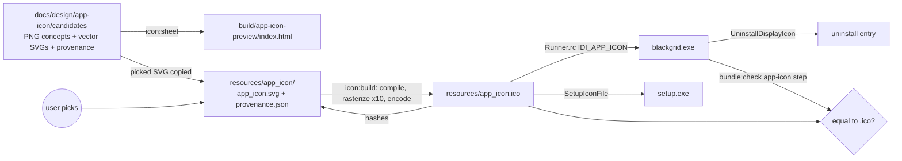
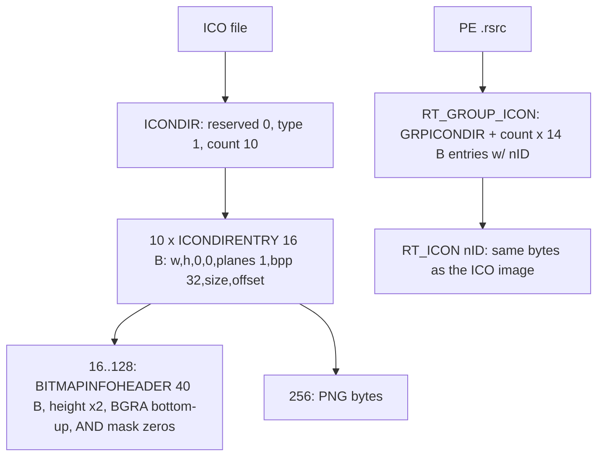

# Design

## Triage

| Trigger | Applies? | Evidence |
|---|---|---|
| T1 Components (new component, or 3+ with directed relationships) | yes | New offline tool `tool/app_icon/`. Its output runs through a chain: source SVG → renderer → ICO encoder → `app_icon.ico` → `Runner.rc:55` → `blackgrid.exe` → bundle check, and the same file feeds `blackgrid.iss` (`SetupIconFile`). |
| T2 State (persistent state, caches, 3+ state machine) | yes | A committed provenance record holds hashes that bind the sources to the `.ico`. |
| T3 Concurrency (background work, workers/isolates, async, retries) | no | One-shot offline commands. No app runtime code changes. |
| T4 Boundaries (data format, migration, shared interface, IPC, external) | yes | Writes the ICO file format consumed by `rc.exe`, Inno Setup and the Windows shell. Reads the PE resource directory (`RT_GROUP_ICON`, `RT_ICON`) in the bundle check. |
| T5 Volume (grows without a fixed bound) | no | Fixed: 10 sizes, at most 12 candidates (D3). |
| T6 Risk (security, money, data loss, unrecoverable user data) | no | No user data and no runtime code. The art-rights rule is covered by provenance (D2). |

TIER: FULL

## Context

- The icon is `windows/runner/resources/app_icon.ico`, Flutter's default, with 10 entries but only the sizes 256, 48, 32 and 16. `windows/runner/Runner.rc:55` embeds it as `IDI_APP_ICON`, and `win32_window.cpp:99` loads it for the window class. `windows/installer/blackgrid.iss` sets `SetupIconFile=..\runner\resources\app_icon.ico` and `UninstallDisplayIcon={app}\blackgrid.exe`. Replacing the file is enough for all three surfaces. No `.rc` or `.iss` edit is needed.
- The concepts are four 1024 px RGBA PNGs plus a 1280×760 preview in `docs/design/icon-concepts/`, excluded locally by `.git/info/exclude:21`. They are flat shapes in three colours (cream, slate, amber), so an exact vector redraw is cheap. The user confirmed (2026-10-31) that they are their ChatGPT concepts, to be committed. The vector set is a redraw of each concept plus two originals.
- `tool/markers/icon_set.dart:476` compiles SVG with `vector_graphics_compiler`'s `encodeSvg(warningsAsErrors: true)`, and `lib/maps/map_marker_icons.dart:301` rasterizes compiled pictures with `toImageSync`. That is the repo's one SVG-to-pixels path (ADR-0023). `tool/markers/preview.dart` is the self-contained HTML sheet pattern, and `docs/design/map-marker-icons/README.md` is the design-record pattern.
- `tool/vision/pe.dart` is a bounds-checked PE32+ reader. Its `_version()` (pe.dart:174) already walks the resource directory, type → name → language, for `RT_VERSION`. `tool/vision/check_bundle.dart:396` adds steps by name. CI runs `bundle:check` on every PR (ADR-0024).
- `image` 4.8.0's `IcoEncoder` writes every entry as PNG (`ico_encoder.dart`, comment "supported since Windows Vista").

## Decisions

### D1: Rasterize in the Flutter test host through vector_graphics; encode the ICO in plain Dart

- **Choice:** `tool/app_icon/` has two layers:
  - A `dart:ui`-free core: ICO encoder and parser, provenance record, candidate discovery, sheet HTML. It is unit-tested with plain `test` under `test/tool/app_icon/`.
  - A thin Flutter-host entry, `tool/app_icon/render_host_test.dart`. It compiles each SVG with the marker flags (`compileIconSvg`), decodes the picture, and draws it scaled to each size with `toImage`, run under `tester.runAsync`. It reads each raster with `ui.ImageByteFormat.rawStraightRgba` (straight alpha, as ICO DIB and PNG images store it). The premultiplied `rawRgba` used at `test/maps/map_scene_test.dart:1112` would darken every anti-aliased edge. The same straight-alpha bytes go to the ICO encoder and to the sheet.

  The mise tasks `icon:build` and `icon:sheet` run `flutter test tool/app_icon/render_host_test.dart --dart-define=APP_ICON_MODE=build|sheet`. `mise run test` runs only `test/`, so this host never runs in the fast loop or in CI.
- **Rejected:** A pinned external rasterizer (resvg or Inkscape, downloaded and hash-checked like Inno Setup in ADR-0025). It is a second pinned-download path for a one-off asset, and its anti-aliasing would differ from how the app draws the marker SVGs. Also rejected: hand-placing per-size PNGs exported from an editor, which leaves no reproducible build from the source.
- **Reversal cost:** low. Only the renderer behind the core's RGBA interface changes.

### D2: Provenance record with source and output hashes

- **Choice:** `windows/runner/resources/app_icon/` holds `app_icon.svg`, an optional `app_icon_small.svg` (used for 16, 20 and 24 px) and `provenance.json`. The record holds `schemaVersion: 1`, `author`, `method` (`hand-authored` | `ai-assisted`), `tools`, `date`, `pickedCandidate` (a path under the candidates folder), `pickDate`, `concept` (the candidate PNG it redraws, or null), and `sha256` for each source and for the `.ico`. Unknown fields are rejected, as in ADR-0023. Only `icon:build` writes the hashes.

  Candidates live in `docs/design/app-icon/candidates/`: `concepts/*.png` (the four square concept PNGs), `vector/*.svg`, and `provenance.json` with one entry per file (author, tool, date, optional prompt, and for a redraw the concept it redraws). `.gitattributes` gets `docs/design/app-icon/candidates/** -text` and `windows/runner/resources/app_icon/** -text`, so the hashed bytes survive checkout. The ChatGPT preview composite (`concepts-preview.png`, 1280×760) is not a candidate. It goes beside the design record as `docs/design/app-icon/concepts-preview.png`, with its provenance stated in the record, so the candidates folder holds only candidates (four concepts plus six vectors, ten columns). The zip in the concepts folder is not committed: it duplicates the four PNGs.
- **Rejected:** Byte-identical regeneration in CI, which would re-render and compare. It needs the Flutter host in CI, and it ties the gate to Skia's anti-aliasing staying bit-stable across engine upgrades. Hash binding catches the real failure, a source edited without a rebuild, at no cost.
- **Reversal cost:** low. The record is a development file. `schemaVersion` allows a change.

### D3: One comparison sheet, rendered from the same pipeline

- **Choice:** `icon:sheet` writes `build/app-icon-preview/index.html`, via `.tmp` then a rename, with PNGs inlined as data URIs. There is one column per recorded candidate, at most 12. A concept column shows the PNG scaled by the browser and is labelled as such. A vector column shows the exact D4 rasters at 1× and enlarged 4× with `image-rendering: pixelated`. Both appear on a light (`#F3F4F6`) and a dark (`#11161A`, the concepts' slate) background, close to the Windows light and dark taskbars.
- **Rejected:** Letting the browser render the SVGs at small sizes (as the marker sheet does). The user would judge the browser's 16 px raster, not the one that ships.
- **Reversal cost:** low.

### D4: ICO layout

- **Choice:** Sizes 16, 20, 24, 32, 40, 48, 64, 96, 128 and 256, in ascending order. Each image below 256 is a 32-bit BGRA `BITMAPINFOHEADER` DIB (height doubled, an all-zero AND mask, rows bottom-up). The 256 image is PNG. The encoder is written in the core, about 80 lines.
- **Rejected:** `image`'s `IcoEncoder`, which writes every entry as PNG. Visual Studio and Windows' own icons use uncompressed DIBs below 256, and PNG small entries are the less-tested path for `LoadIcon`, `rc.exe` and Inno Setup's wizard. The cost of writing our own encoder is small.
- **Reversal cost:** low.

### D5: The bundle check compares the executable's icon group with the committed `.ico`

- **Choice:** `pe.dart` gains `readIconGroup()`. It reads the first `RT_GROUP_ICON` (14) name entry, parses its `GRPICONDIR` (count at most 32, each entry 14 bytes), and resolves each `nID` to its `RT_ICON` (3) data, with every read bounds-checked like `_version()`. `check_bundle.dart` adds an `app-icon` step after `map-marker-icons`. The step keys the images on each side by (width, height, bit depth), with a stored width or height of 0 read as 256. A duplicate key on either side fails the step and names it. So does a key present on only one side, or unequal bytes for a key. The stale Flutter default (ten images: 256, plus 16, 32 and 48 at 4, 8 and 32 bpp each) therefore fails on its duplicate sizes and on the six missing sizes. `rc.exe` copies each image's bytes verbatim, so byte equality holds.
- **Rejected:** Checking only the `.rc` line and the `.ico` statically. That would not catch a stale build or a `Runner.rc` edit, and the exit criterion is about `blackgrid.exe`. Also rejected: checking the installer `setup.exe`'s embedded icon. Inno's loader is a separate PE whose bitness and icon re-encoding are not established, and the user's install check covers what they see. A static `.iss` test covers the wiring.
- **Reversal cost:** low.

## Diagrams (FULL)

## State & Ownership (FULL)

| State | Owner (sole writer) | Lifetime | Invalidation / rebuild | Authoritative copy |
|---|---|---|---|---|
| `app_icon.svg` (+ small) | Author, by hand | Committed | Edited deliberately; then `icon:build` | The SVG |
| `app_icon.ico` | `icon:build` | Committed | Rebuilt by `icon:build` | Derived from the SVG; bound by hash |
| `provenance.json` hashes | `icon:build` | Committed | Rewritten with the `.ico`, together | The record |
| Provenance fields (author, pick) | Author, by hand | Committed | Edited at the pick | The record |
| Candidate files + their provenance | Author, by hand | Committed | Added per round | `candidates/provenance.json` |
| Preview sheet | `icon:sheet` | `build/`, git-ignored | Overwritten each run | None (derived) |

## Failure & Visibility (FULL)

| Component | Fails / dies mid-operation → | Recovery | Retry safe? | Who finds out |
|---|---|---|---|---|
| `icon:build` | A compile or render error: exit 1, naming the file. Killed mid-write: `.ico` and record are written to `.tmp` and renamed, `.ico` first, then the record. A kill between the renames leaves a new `.ico` with old hashes. | Rerun | Yes | The developer (exit code). A kill between the renames fails the icon test (hash mismatch). |
| `icon:sheet` | Exit 1, naming the file. The old sheet stays (`.tmp` + rename). | Rerun | Yes | The developer |
| Icon test (`mise run test`) | Fails, naming a size, the format, the default-icon match or the hash mismatch | Fix the source and rebuild | n/a | Developer, CI |
| Bundle check `app-icon` | Fails with a size diff or an unreadable result, never an exception | Rebuild the bundle | Yes | CI (red run on the PR), developer |

## Resource Bounds (FULL)

| Queue / buffer / cache / transfer | Bound | At the bound | Timeout | At 10x / 100x |
|---|---|---|---|---|
| Rasters per build | 10 sizes, at most 256² × 4 B each | Fixed | Flutter test default | n/a (fixed set) |
| Candidates per sheet | 12 | Exit 1 before rendering, naming the count | n/a | Rejected; split rounds |
| Source SVG size | 64 KiB | Exit 1 | n/a | Rejected |
| PE icon group parse | count at most 32, data at most 1 MiB per image | Unreadable result | n/a | Rejected |

## Flow & State Gaps (FULL)

- **Interrupted build:** covered by the rename order in Failure & Visibility. The test catches the gap.
- **Pick changes later:** the author updates `pickedCandidate`, `pickDate` and the source, then reruns `icon:build`. Old candidates stay as the design record.
- **Concept prompt unknown:** `prompt` is optional. The record notes that the user generated the image, without a third-party style reference (the user attests this at the pick; the D2 fields hold it).
- **Bundle built before the icon change:** the `app-icon` step fails until the bundle is rebuilt. That is intended.

## Mechanism Ledger (FULL)

| Mechanism | Built? | Why (harm nobody catches / expensive later) | Evidence that would change the call |
|---|---|---|---|
| Source/ICO hash binding | yes | An SVG edit without a rebuild ships a stale icon, and nobody would notice by eye | none |
| Exe-vs-ICO bundle step | yes | The exit criterion names `blackgrid.exe`. A stale or rewired `.rc` passes every static test. | none |
| Byte-identical regeneration in CI | no | D2: hash binding catches the real failure | A CI-hosted Flutter renderer we already run for another reason |
| Setup.exe icon PE check | no | D5: `.iss` wiring test plus the user's install check | The user reports a wrong setup icon |
| Per-size pixel hinting beyond a small SVG | no | The sheet shows the 16 px raster before the pick | The user finds 16 to 24 px illegible on the sheet |
| ADR | yes (ADR-0027) | This is a second project-authored asset family: it reuses ADR-0023's compile flags and provenance shape, but deliberately departs from two of its rules (see ADRs). Without a record, a later reviewer would read the committed concept PNGs as an ADR-0023 violation. | none |

## Risks / Trade-offs

- [The Flutter test host may not rasterize with anti-aliasing at 16 px as expected] → The sheet shows the real rasters before the pick. `app_icon_small.svg` exists for hand-tuned small sizes.
- [Windows icon cache shows the old icon after an upgrade install] → Not a defect in the file. The design record notes `ie4uinit -show` for the user's check.
- [ChatGPT concept rights] → They are the user's own generations, and the user attests no third-party style reference. Only the redrawn SVG ships, and the PNGs stay in `docs/`.

## ADRs

- **In force, constraining this change:** ADR-0023 (provenance pattern, compile flags, no third-party art), ADR-0024 (CI runs `bundle:check`), ADR-0025 (Inno Setup per-user installer; `.iss` invariants unchanged).
- **ADR-0023 scope:** two of its rules apply to map marker icons only and are deliberately not applied here. First, "a concept image from an image-generation tool is not committed". Second, "a concept names a prompt record". The app-icon concepts are the user's own ChatGPT generations, committed as a design record under `docs/` and never bundled. Only the redrawn SVG feeds the shipped icon. A prompt is recorded when the user supplies it.
- **To record during apply:** ADR-0027, "The application icon is a project-owned SVG built offline to a committed multi-size ICO". It records D1 to D5, the scope difference from ADR-0023 above, and the hash-binding rule. It is indexed in `openspec/architecture.md`.
