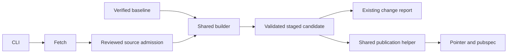
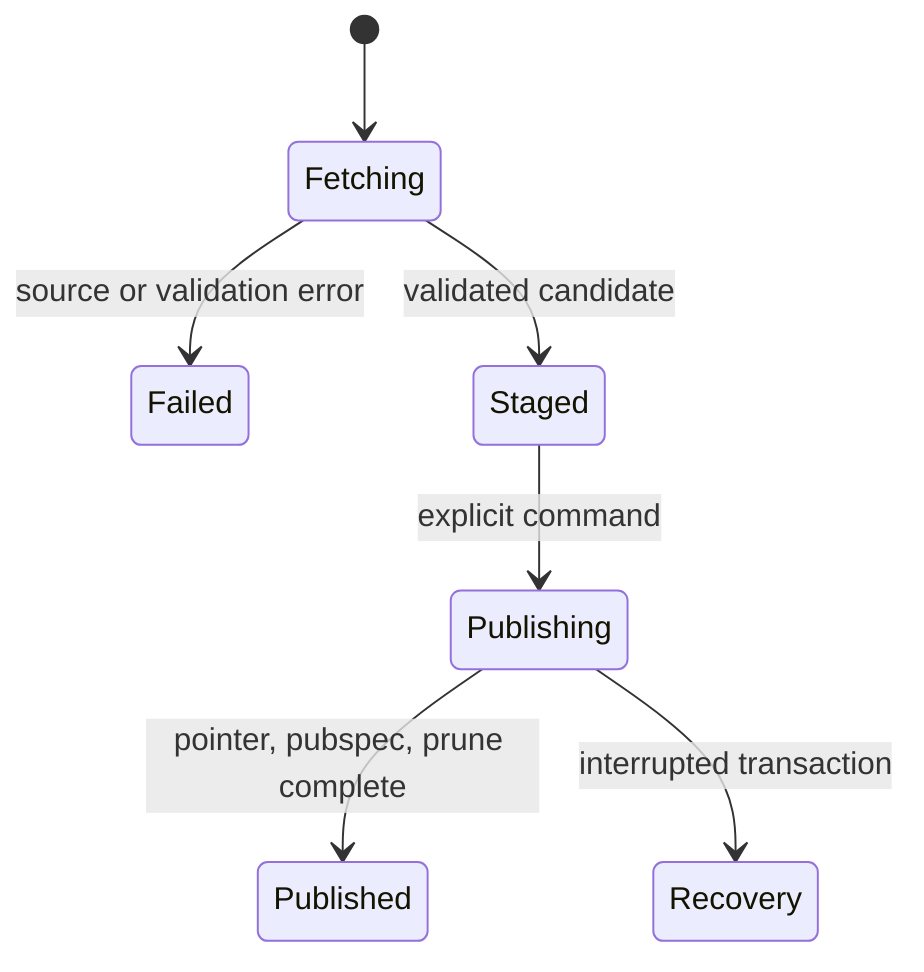
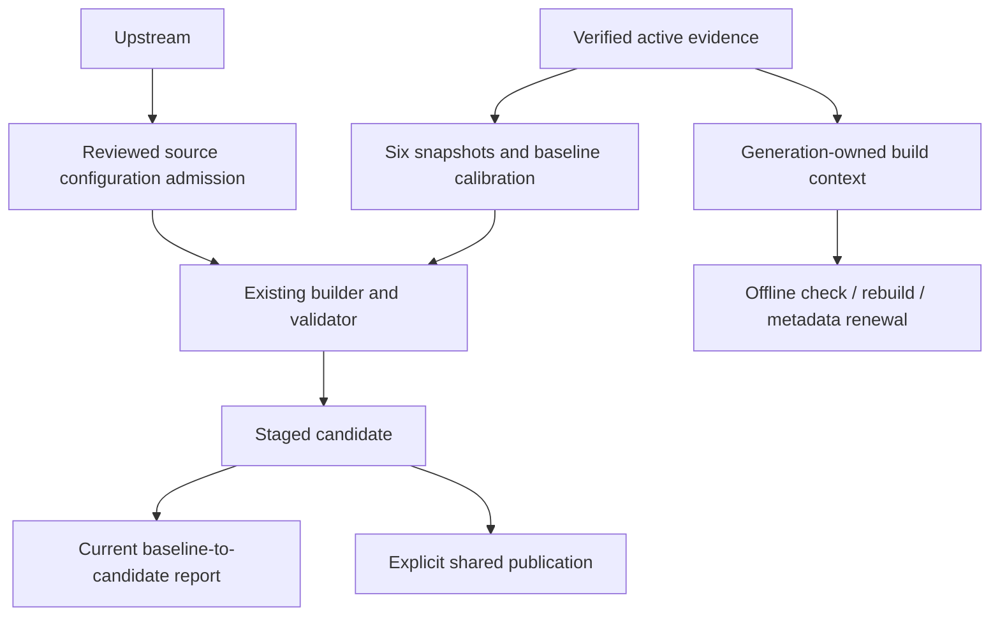

# Design

## Triage

| Trigger | Applies? | Evidence |
|---|---|---|
| T1 Components | yes | CLI coordinates fetch, frozen builder, report and publication (`tool/maps/prepare.dart:129-210`, `tool/maps/pack.dart:352-488,2760-2892`). |
| T2 State | yes | Staged candidates and existing generation, pointer and pubspec state span invocations (`tool/maps/pack.dart:2760-2892`). |
| T3 Concurrency | yes | Tile fetches are async in batches; operator commands can overlap (`tool/maps/pack.dart:434-475`). |
| T4 Boundaries | yes | HTTP sources, frozen inputs, CLI and filesystem publication cross boundaries (`tool/maps/pack.dart:145-228,352-488`). |
| T5 Volume | yes | Tile jobs, source bytes and retained stages grow with source inventory (`tool/maps/pack.dart:434-475`). |
| T6 Risk | yes | Publication has partial pointer/pubspec states and bad calibration can misplace map contents (`tool/maps/pack.dart:2840-2892`). |

TIER: FULL

## Context

See `proposal.md` for the revised user-approved scope. `acquireInputs` downloads all six marker snapshots as well as artwork; it cannot be used unchanged for selective artwork refresh (`tool/maps/pack.dart:352-488`). `FrozenInputs.fromGeneration` resolves carried evidence and output-backed tiles, permitting indexed but unread tiles to be absent (`tool/maps/pack.dart:145-228`). `rebuildCandidate` reads calibration and frozen sources, constructs outputs, writes `NOTICE.txt` and global `sourceLock` (`tool/maps/pack.dart:513-560,688-788`); its calibration check currently uses global `calibrationFor` (`tool/maps/pack.dart:984-1003`). `packChangeReport` compares per-map/floor values and output paths (`tool/maps/pack.dart:2115-2235`). `refreshActive` combines build, report and publication with phase-specific recovery (`tool/maps/pack.dart:2760-2892`); `promote` alone only calls `promoteCandidate` (`tool/maps/prepare.dart:165-176`).

Supported selectors and source identities are authored separately (`tool/maps/inventory.dart:1-18`); current source locks and floor reconciliation are in `tool/maps/calibration.dart:5-35,293-345`. The runtime requires the complete supported set (`lib/maps/prepared_map_loader.dart:44-149`). ADR-0033 requires generation-owned reproduction and ADR-0034 restricts metadata-only renewal to six sources and preserves artwork, calibration and ownership.

## Decisions

### D1: Separate fresh admission from frozen reproduction

- **Choice:** Supply the single shared builder an explicit required context containing verified frozen calibration, manifest `sourceLock` and exact `NOTICE.txt` bytes. Migrate every caller, removing implicit global reads and any compatibility shim. Active check/rebuild and metadata-only renewal derive context from the verified active generation; fresh artwork admission uses current reviewed configuration. Retain all existing builder, source-index, preservation and ownership validation.
- **Rejected:** Use current globals for every rebuild, because a pending reviewed update would contaminate or prevent reproduction of the still-active generation.
- **Reversal cost:** medium.
- **Important:** yes — binds a shared interface and reproduction authority.
- **Chosen by:** user.

Construct a generation-backed read view, not a blind copy of every indexed tile. Verify every input actually read against its index and carry the candidate's complete build-read closure. For fresh staging, retain the baseline calibration bytes by default; if they differ from current reviewed calibration, fail with a named discrepancy rather than silently substitute. `--reviewed-calibration-update` is an optional explicit selection of the already reviewed code configuration for a fresh stage; freeze and reconcile it and retain all validation. It is not approval. The six retained files are `markers/maps.json`, `markers/maps_en.json`, `quests/tasks.json`, `quests/tasks_en.json`, `quests/traders.json` and `quests/traders_en.json`.

Fresh admission distinguishes locked sources from raster tile integrity. Locked primary sources and all five required terms documents require exact reviewed identities, URLs and expected hashes, with repository revisions where available and recorded provenance. Fetch pinned repository evidence rather than merely annotating a mutable served observation; a website without a repository revision is bound by its explicit reviewed URL/hash lock, not an invented revision. Add reviewed locks for `terms/tarkov-dev-README.md`, `terms/tarkov-dev-software-LICENSE.txt` and `terms/tarkovbot-creator.html`; the two SVG terms are already hash-locked. A minimal fetch helper can report observed identity and approved/observed hashes before rejecting changed locks; it does not update configuration or turn observations into approval.

Raster tile admission uses the selected reviewed calibration's exact resource and expanded tile URL identities, including floor/dependency reconciliation. No pre-reviewed per-tile byte-hash inventory is required. Hash every acquired tile into frozen evidence and verify each build read; these hashes establish integrity after acquisition, not prior approval of the bytes. Publication repeats the applicable locked-source and tile-identity/integrity checks against the candidate's carried build-read closure.

Fetch current metadata and needed artwork/terms, retain the six baseline files and compare source identity sets against the verified baseline's frozen interactive metadata. Validate each supported identity uniquely; report newly observed unsupported identities by name and explain separate authored tool/runtime integration, without treating unsupported entries already present in the baseline as new failures. A new unsupported entry alone does not make a supported candidate incomplete; malformed or missing supported identities do. No onboarding artifact or selectable map is created.

Use existing calibration, floor, original-frame, raster dependency, source integrity and marker-ownership checks (`tool/maps/calibration.dart:293-345`, `tool/maps/pack.dart:975-1008,2413-2562`) on the applicable candidate. Name a mismatch and require reviewed correction; do not silently recalculate, clamp, reassign or delete reviewed ownership. Existing evidence identifying independent placement as unverified remains honest: agreeing sources do not prove placement. This change does not add an independent-control framework or a new marker-in-bounds feature.

Generation-owned reproduction here covers the current canonical supported inventory. Changing supported identity mappings is separate new-map integration; this design does not promise historical reproduction across future inventory migrations or introduce a migration facility.

### D2: Publish the staged bytes through the existing transaction

- **Choice:** Add Dart CLI `artwork-refresh --packs <repo-relative-root> --pubspec <file> --stage <fresh-dir>` and `artwork-publish --candidate <dir> --packs <root> --pubspec <file>`, with `maps:artwork:refresh` and `maps:artwork:publish` mise aliases. Refresh builds, validates, prints the existing report and stops. Publish verifies current baseline and candidate, checks current reviewed source admission, prints the current baseline-to-candidate report, then publishes that candidate without rebuilding.
- **Rejected:** Automatically publish during acquisition, or require a separate image/checklist/acknowledgement system, because neither is needed for the explicitly invoked publication boundary.
- **Reversal cost:** medium.
- **Important:** yes — changes commands and the publication contract.
- **Chosen by:** user.

Extract the report-independent publication portion of `refreshActive` into one internal helper: prechecks, staged pubspec block, validated `promoteCandidate` copy/pointer switch, pubspec rename, pruning, cleanup and existing phase-specific recovery. Existing offline and metadata refresh paths keep their prechecks, rebuilds, preservation gates and reports before invoking that helper. Artwork publish passes its already staged candidate, not a rebuild. Validate and rehash the candidate closure and verify the baseline before any active writes; recheck the baseline immediately before publication. The report describes the current baseline, not an assertion that an earlier human review covered it. The explicit command is the operator's choice, not proof of review; no approval file, review state, expected-hash arguments or adversarial token exists. The existing bare `promote` remains a low-level pointer-only operation, not full publication: it does not rewrite pubspec or prune.

### Decision summary

| # | Decision | Choice | Rejected | Reversal cost | Important | Chosen by |
|---|---|---|---|---|---|---|
| S1 | Supported inventory | Diagnostic and separate authored integration | Generated onboarding or automatic integration | medium | yes | user |
| S2 | Stage and publication | Explicit separate publication, no image/checklist protocol | Auto-publication or enforced review protocol | medium | yes | user |
| S3 | Source and calibration authority | Reviewed repository configuration; preserve baseline six and calibration | Automatic trust/calibration or metadata refresh | medium | yes | user |
| S4 | Raster and terms admission authority | Reviewed exact tile URLs plus frozen integrity; explicit reviewed terms locks and provenance | Pre-reviewed per-tile hash inventory or observed hashes as approval; stale retained terms | medium | yes | user |
| D1 | Reproduction context | Explicit generation-owned context; fresh admission uses reviewed config | Current globals for all rebuilds | medium | yes | user |
| D2 | Publication path | Exact staged candidate through shared transaction | Automatic publication or review-token machinery | medium | yes | user |

## Diagrams (FULL)

### Components (T1)


### State (T2)


### Sequence (T3)
```mermaid
sequenceDiagram
  actor Operator
  participant Refresh
  participant Source
  participant Stage
  participant Publish
  Operator->>Refresh: artwork-refresh
  Refresh->>Source: fetch required inputs
  Refresh->>Stage: build, validate, report
  Refresh-->>Operator: candidate and report; stop
  Operator->>Publish: artwork-publish candidate
  Publish->>Stage: verify candidate and current baseline; report
  Publish-->>Operator: publication result or recovery state
```

### Data flow (T4)


## State & Ownership (FULL)

| State | Owner (sole writer) | Lifetime | Invalidation / rebuild | Authoritative copy |
|---|---|---|---|---|
| Source configuration and calibration | Human author via reviewed repository changes | Repository | Explicit reviewed change | Existing configuration |
| Active generation and pointer | One operator-invoked publication route at a time | Until publication | Pointer switch; rollback via Git | Verified `active.json` and generation |
| Pubspec asset block | Same serialized publication route | Until publication | Transactional staged replacement | `pubspec.yaml` |
| Fetched inputs and staged candidate | One refresh invocation | Until operator removes stage | Failed or changed inputs require fresh stage | Candidate manifest and carried verified evidence |
| Report | Current command | Invocation output | Recomputed against current baseline | No durable approval state |

## Failure & Visibility (FULL)

| Component | Fails / dies mid-operation → | Recovery | Retry safe? | Who finds out |
|---|---|---|---|---|
| Fetch / admission | Missing source, unsupported identity or lock mismatch diagnosed; no active write | Correct source/configuration or separately integrate a map; start fresh | Yes with fresh stage | CLI operator |
| Builder / validator | Missing carrier, corrupted bytes or invalid calibration/ownership stops candidate | Fix named input or reviewed configuration; stage again | Yes with fresh stage | CLI operator |
| Publisher before promotion | Invalid baseline/candidate or interrupted-promotion guard fails before active writes | Repair the named problem and revalidate | Yes once corrected | CLI operator |
| Publisher after pointer switch | Pubspec or pruning may lag pointer; existing failure identifies actual phase and candidate | Follow existing phase-specific recovery | Only after inspecting reported state | CLI operator |

## Resource Bounds (FULL)

| Queue / buffer / cache / transfer | Bound | At the bound | Timeout | At 10x / 100x |
|---|---|---|---|---|
| Tile jobs and requests | Existing 16×16 grid per calibrated tile resource; batches of at most 8 requests | Await batch; missing or malformed required tile fails | Existing fetch has no explicit timeout | Work and stored bytes scale with grids; no new queue service |
| Response buffers and parsed source collections | Existing whole-response buffering, no fixed byte or collection cap | Allocation, parse or I/O failure aborts staging | No explicit deadline | 10x/100x may exhaust memory or storage; this inherits existing behavior rather than claiming a new limit |
| Stages and candidate files | One candidate per fresh invocation; no automatic retention cap | Filesystem errors stop operation; operator cleans obsolete stages | None | Disk scales with retained stages and source size |
| Writers | One operator-managed writer per pack root, including existing refresh and bare promote | Operator must wait; stale check is not a lock | None | More operators require external serialization; no concurrency guarantee |

## Flow & State Gaps (FULL)

- A failed or interrupted refresh can leave partial stage files but no validated ready candidate and no active writes. Start with a fresh stage after correction.
- The operator serializes every pack-root writer and does not modify candidate/configuration during publication. Baseline rechecking detects sequential change, not concurrent races or malicious replacement.
- A baseline that changed since staging is not automatically rejected merely because it changed: publication validates the current baseline and candidate and prints their current comparison. The operator decides whether to proceed; no durable review binding is asserted.
- A crash after pointer switch uses the existing phase-specific recovery and interrupted-promotion guard. Do not assume retry is safe after a partial transaction.
- Evidence-only changes are reported as such; no synthetic artwork difference, preview, owner-approval token or visual gate is invented.

## Mechanism Ledger (FULL)

| Mechanism | Built? | Why (harm nobody catches / expensive later) | Evidence that would change the call |
|---|---|---|---|
| Reviewed source locks and verified frozen context | yes | Current globals can contaminate an old generation; unchecked downloads could silently change approved source identity | A separately reviewed source-authority design |
| Existing integrity, calibration and ownership checks | yes | Bad input can produce corrupt or misleading packs; preservation and reproducibility are existing contracts | A reviewed replacement validation contract |
| Shared publication and phase-specific recovery | yes | Pointer can switch before pubspec/pruning complete; duplicating transaction risks divergent recovery | A separately reviewed transaction replacement |
| Operator single-writer rule | yes | Concurrent writes can invalidate a baseline recheck; existing routes lack a cross-process mutex | Requirement for concurrent writers |
| Preview exporter, onboarding package, checklist, approval token or auto-calibration | no | Adds new workflows and authority without the approved need | A separately approved product requirement |
| New fetch caps, retry daemon or cache | no | Existing acquisition is discrete and failures visible; no evidence warrants a new policy framework | Measured operational need |

## Validation Map

These 15 scenarios are proposed **red**, not executed. Use existing test seams and small complete fixtures, injected fetch/publish operations and explicit signals; no sleeps or permanent network tests. Parameterize existing integrity and calibration failures. Qualification is reserved for actual vector builds. Scenario names match the delta exactly.

| Delta scenario | Proposed test and layer | Assertions |
|---|---|---|
| Changed artwork stages without publication | `test/maps/artwork_refresh_test.dart` / `changedArtworkStages` — service | Candidate validates, existing per-map/floor/file/value report appears; active generation, pointer and pubspec unchanged. |
| No artwork change or evidence-only change | `test/maps/artwork_refresh_test.dart` / `unchangedAndEvidenceOnlyStage evidenceOnlyStage` and `unchangedAndEvidenceOnlyStage unchangedStage` — service | Both valid outcomes report actual differences and succeed without an invented visual change or image gate. A scoped real-stage fixture is immutable; the no-change case promotes it into its own private pack and stages once. |
| Baseline inputs and reviewed calibration | `test/maps/artwork_refresh_test.dart` / `retainsSixAndSelectsReviewedCalibration` — service | Six bytes and baseline calibration exact; mismatched current calibration blocks default; explicit reviewed update freezes and reconciles it, without bypassing validation. |
| Fetch or candidate failure | `test/maps/artwork_refresh_test.dart` / `failuresDoNotPublish` — service | Parameterized transport, build and validation failures identify source/check, no ready candidate or active writes. |
| Changed locked source | `test/maps/artwork_refresh_test.dart` / `changedLockNamesBothHashes` — service | Identity and approved/observed hash diagnostic; no candidate admitted before reviewed config update. |
| Reviewed source matches | `test/maps/artwork_refresh_test.dart` / `reviewedSourceAdmitted` — service | Locked primary/terms identity, URL, revision where available, bytes and hash admitted; pinned source checked and provenance carried; mismatches rejected. Raster tiles use reviewed exact URLs and frozen hashes, rejecting URL drift and carried-byte corruption without claiming prior byte approval. |
| Supported identity is invalid or a new unsupported identity appears | `test/maps/artwork_refresh_test.dart` / `supportedAndNewIdentities` — service | Missing/duplicate/ambiguous/malformed supported identity fails; newly unsupported identity is named with integration guidance, existing unsupported entries alone do not fail, neither is selected. |
| Reproduction from frozen candidate | `test/maps/map_preparation_qualification_test.dart` / `artworkReproducesWithoutRawStage` — qualification | Complete candidate builds and validates, raw stage removed, offline rebuild matches under existing reproduction rules; unread uncarried indexed tile tolerated. |
| Evidence is missing or corrupted | `test/maps/map_generation_inputs_test.dart` / `requiredEvidenceCorruptionRejected` — service | Parameterized missing or altered needed carriers and outputs name input and prevent publication. |
| Calibration or reviewed ownership no longer matches | `test/maps/artwork_refresh_test.dart` / `calibrationAndOwnershipMismatchRejected` — service | Parameterized existing geometry/frame/floor/dependency and changed/missing owned volume or assignment checks name affected item and prevent candidate publication; unchanged ownership survives. |
| Candidate is explicitly published | `test/maps/artwork_publication_test.dart` / `publishesStagedCandidate` — service and minimal filesystem | No rebuild, current report printed, exact staged bytes promoted and pointer/pubspec/pruning correct. |
| Corrupt candidate or invalid baseline | `test/maps/artwork_publication_test.dart` / `invalidCandidateOrBaselineDoesNotWrite` — service | Candidate evidence/output corruption or invalid active baseline fails before active writes; byte-identical pointer, active assets and pubspec. |
| Publication is interrupted | `test/maps/artwork_publication_test.dart` / `reportsPublicationRecoveryPhases` — injected service plus minimal filesystem | Before pointer, after pointer/before pubspec and after pubspec/during prune report actual state, applicable retained candidate and recovery; no false success. |
| Pending source and calibration changes | `test/maps/artwork_compatibility_test.dart` / `pendingConfigDoesNotContaminateBaseline` — service | Old verified lock, notices and calibration survive offline check/rebuild without fetch and valid six-source renewal; newer reviewed config is used only for fresh admission. |
| Metadata-only preservation fails | `test/maps/artwork_compatibility_test.dart` / `metadataPreservationRejectsDrift` — service | Parameterized artwork, calibration, notices, non-six records and ownership drift reject before active writes; six-source valid case passes existing gates. |

Apply-time command coverage should exercise the actual CLI and aliases. For a real CLI publication smoke, copy a real admitted candidate with matching frozen evidence and use a disposable pack root and pubspec; synthetic primary-source hashes are not admissible. If matching admitted evidence is unavailable, record the exact blocker rather than bypassing admission. Synthetic transaction permutations remain injected-service/minimal-filesystem tests. A no-new-artwork/no-change end-to-end run must succeed without forcing artwork changes, images or a user gate. Repository-active publication is optional, not required to prove this feature.

Preserve the existing report and before-merge owner-check responsibility when anything except the toolchain record changes, including metadata, manifest and evidence-only changes; a true no-change or toolchain-only outcome needs no owner check. This responsibility is separate from automated staging/publication success and adds no image, checklist, acknowledgement or user gate to the disposable CLI smoke. If repository-active assets are actually changed during apply, record the applicable exact-generation owner result or leave it waiting; do not require repository-active publication merely to complete this tooling change. An agent may perform app-side checks only after game absence is confirmed; otherwise the user performs them. No agent game or app interaction is planned here. User reports and unverified results must be attributed accurately. Static planning review is not implementation or execution proof.

## Risks / Trade-offs

- Upstream changes again before staging → existing reviewed source locks refuse unapproved bytes and identify the discrepancy.
- Same-source agreement is not independent placement evidence → retain the existing unverified distinction; human readability review remains separate.
- Stage and current baseline may change between commands → publish validates both and reports their current differences; there is no claim of automatic owner-review proof.
- Concurrent writers or unbounded source bodies → operator serialization and inherited fetch limits are explicit, not presented as automatic protections.

## ADRs

- **In force:** ADR-0005 as partially superseded by ADR-0033; ADR-0033 generation-owned reproduction and publication; ADR-0034 six-source metadata-only preservation.
- **During apply:** Supplement these decisions only if the implemented boundary needs a durable ADR; update the architecture index if one is recorded. Do not rewrite accepted ADRs or create an onboarding/preview ADR.

## Open Questions

None affecting the approved approach. The availability of a matching admitted real candidate is an apply-time evidence condition, not a reason to bypass source admission.
