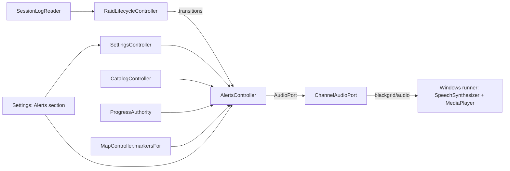
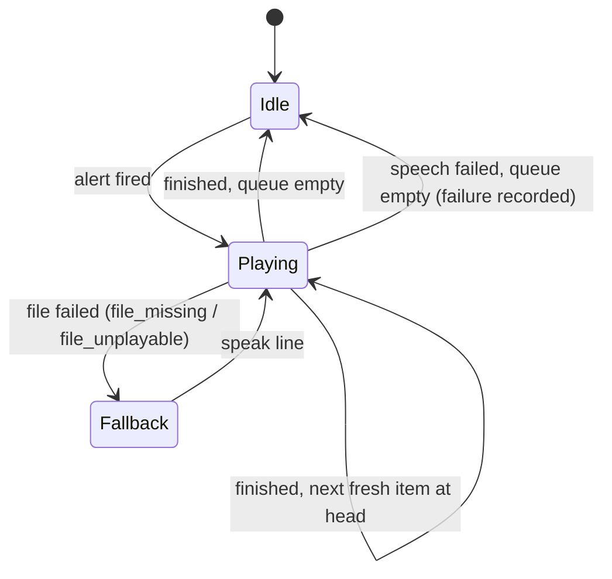
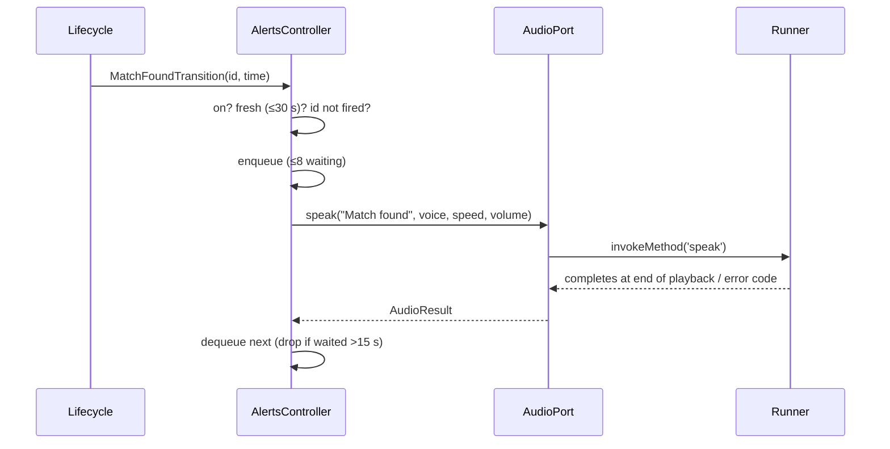
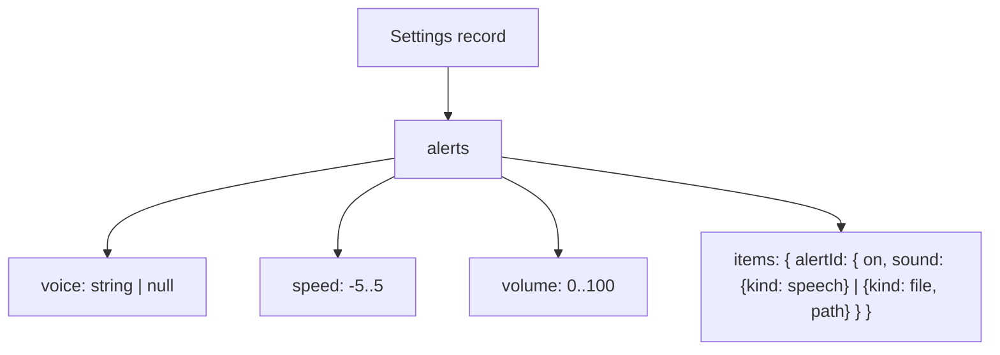

# Design

## Triage

| Trigger | Applies? | Evidence |
|---|---|---|
| T1 Components (new component, or 3+ with directed relationships) | yes | New `AlertsController`, `AudioPort`/runner `blackgrid/audio` channel, and Settings Alerts section, fed by `RaidLifecycleController`, `SettingsController`, `CatalogController`, `ProgressAuthority` and `MapController` |
| T2 State (persistent state, caches, 3+ state machine) | yes | New `alerts` block in the settings record; the in-memory playback queue (idle, waiting, playing); pending failed-task flag and fired-identity memory |
| T3 Concurrency (background work, workers/isolates, async, retries) | yes | Async speech/playback on the platform thread, one-shot deadline timers, and lifecycle transitions arriving while a sound plays |
| T4 Boundaries (data format, migration, shared interface, IPC, external) | yes | New method channel contract; new `RaidTransition` variants consumed by exhaustive switches; stored settings format; Windows speech and media APIs |
| T5 Volume (grows without a fixed bound) | yes | The alert queue and the fired-identity memory would grow without a cap |
| T6 Risk (security, money, data loss, unrecoverable user data) | no | Settings only; the custom file is read, never written; no game interaction |

TIER: FULL

## Context

See proposal.md for what changes and why. Today:

- **Lifecycle.** `RaidLifecycleController` folds each batch through the pure `reduce` and publishes transitions synchronously (`lib/application/raid_lifecycle_controller.dart:35-45`). Only raid started, raid ended, matching aborted, flea sold and task transitions exist (`lib/domain/raid_lifecycle.dart:393-470`). Match found and raid starting are phase changes in state, not transitions.
- **Replay.** The reader replays the whole session folder after each bind; the first batch starts with `LogInputReset` (`lib/data/session_log_reader.dart:113-116`). A replay can span several batches, so "first batch" does not mark the end of catch-up.
- **Timers.** `RaidTimersController` projects the timers from one clock reading (`lib/application/raid_timers_controller.dart:131-147`) and ticks only while the strip shows a moving value (`:156-164`). The strip can be switched off, so it cannot drive alerts. `scavCooldownLength` (`lib/domain/raid_timers.dart:131`) and `countsAsScavRaid` (`:77`) are reusable pure functions.
- **Progress.** `ProgressAuthority` publishes `ProgressFacts` for the applied mode. They hold `stationLevel(id)` (`lib/domain/progress_facts.dart:130`), `objectiveComplete(id)` (`:127`) and task states. `CatalogTask.restartable` (`packages/blackgrid_progress/lib/src/progress_catalog_tasks.dart:129`) and `ObjectiveType` (`packages/blackgrid_progress/lib/src/progress_catalog.dart:73`) come from the progress catalog.
- **Maps.** Live map data already joins a settings map ID to its quest objectives. Quest markers on a map carry `taskId` and `objectiveId` (`lib/maps/live_map_normalizer.dart:159-176`, marker fields from `:600`). `LiveMapDataController` does not hold them: it pushes them into `MapController.publishMarkers`, which keeps them in the private `_activeMarkerInventories`. A `null` push restores the bundled pack markers (`lib/application/map_controller.dart:275-301`).
- **Native boundary.** The runner registers one channel, `blackgrid/local_data` (`windows/runner/flutter_window.cpp:28`, `windows/runner/local_data_channel.cpp`, `lib/data/local_paths.dart:9,32`). No Flutter plugins are used (ADR-0007).
- **Settings.** Settings live in one record. Each block is decoded in its own `try` so a bad block yields that block's defaults (`lib/domain/settings.dart:315-332`; architecture State table, Raid timer settings row).

## Decisions

### D1: Speech and playback through a runner method channel

- **Choice:** A new `blackgrid/audio` channel in `windows/runner/`, beside `local_data_channel.cpp`. It has these methods:
  - `voices` returns the voice id and display name of each `Windows.Media.SpeechSynthesis` voice (the OneCore list, which includes Mark and installed language voices).
  - `speak` takes text, a voice id or null, a speed step and a volume. It synthesises to a stream and plays it through `Windows.Media.Playback.MediaPlayer`.
  - `playFile` takes a path and a volume.
  - `stop` stops what is playing.
  - `openVoiceSettings` launches `ms-settings:speech`.
  - `pickSoundFile` opens the Windows Open dialog (`IFileOpenDialog`), owned by Blackgrid's window and filtered to `.wav` and `.mp3`. It returns the absolute path, or null when the player cancels (D5, review M4).

  **Threading and completion contract (review M5):**
  - WinRT async work and `MediaPlayer` events are marshalled back to the platform thread before any `MethodResult` completes. They post a private window message that `FlutterWindow::MessageHandler` handles.
  - Nothing calls a blocking `.get()` on the UI thread.
  - At most one playback result is pending, and it completes exactly once: when playback ends, when it fails, when `stop` is called (code `stopped`), when the window is destroyed (code `stopped`), or when the runner's own file timeout expires (code `timeout`).
  - **File timeout (review N1):** the runner enforces it. Once `MediaPlayer` opens the file, the runner arms a timer for `NaturalDuration` plus 5 s, capped at 120 s, or 30 s when the length is unknown. When the timer expires, the runner stops playback and completes with `timeout`. Dart keeps one backstop of 125 s for any `playFile` call and 30 s for any `speak` call. When a backstop expires, Dart calls `stop` and treats the item as failed. The length never crosses the channel.
  - A `speak` or `playFile` call that arrives while a result is pending fails at once with `busy`. The Dart queue never sends one (D3).
  - The runner links `windowsapp.lib`.

  `speak` and `playFile` complete when playback ends, or fail with a typed error code: `voice_missing`, `file_missing`, `file_unplayable` or `speech_failed`. Dart reaches it only through an `AudioPort` interface (`lib/application/`), with a `ChannelAudioPort` in `lib/data/`.
- **Rejected:** A standalone FFI DLL like `blackgrid_panel_ocr.dll`. It adds a hash-bound file to every release and the bundle inventory. Completion would need `NativeCallable` callbacks across FFI, which is more machinery for light, async work.
- **Reversal cost:** low. The channel sits behind `AudioPort`.
- **Important:** yes, it binds future changes as a boundary.
- **Chosen by:** user

### D2: Freshness rule for log-driven alerts

- **Choice:** A transition fires its alert only when `clock() - transition.time <= 30 s` at the moment it is read. A log time in the future counts as fresh. Timer alerts fire only when a deadline passes while the controller is running. A deadline already past when the controller first computes it never fires.
- **Rejected:** Gating on the first batch or on `LogInputReset`, because a replay can span several batches. A catch-up summary at startup.
- **Reversal cost:** low
- **Important:** yes, it changes behaviour users see.
- **Chosen by:** user

### D3: One FIFO playback queue, 15 s staleness, 8 waiting

- **Choice:** `AlertsController` owns a queue. One item plays at a time. An item that has not started within 15 s of firing is dropped when it reaches the head. A ninth waiting item is dropped at once. Tests use the same queue.
- **Rejected:** The newest alert interrupting the one playing.
- **Reversal cost:** low
- **Important:** yes, it changes behaviour users see.
- **Chosen by:** user

### D4: Typed sound source in stored settings

- **Choice:** Each alert's settings are stored as `{on: bool, sound: {kind: "speech"}}` or `{on: bool, sound: {kind: "file", path: "<abs path>"}}`, under `alerts.items.<alertId>`. Voice, speed and volume are stored beside them as `alerts.voice` (a voice id, or null for the Windows default), `alerts.speed` and `alerts.volume`. In Dart the sound is a sealed `AlertSound` with `SpeechSound` and `FileSound`. An unknown `kind` loads as speech, so a later `pack` kind is additive. Alert ids are stable strings: `matchFound`, `raidStarting`, `runThroughOver`, `scavReady`, `airFilterOn`, `airFilterOff`, `questItems` and `failedTasks`.
- **Rejected:** An on/off flag and a nullable path. A recorded pack would then need a migration.
- **Reversal cost:** medium, because it is the stored format.
- **Important:** yes, it binds future changes as a data format and config keys.
- **Chosen by:** user (S3)

### D5: Custom files limited to WAV and MP3, falling back to speech

- **Choice:** The player picks the file through the channel's `pickSoundFile` dialog (D1); there is no typed path field. The dialog filter and the save check both accept only `.wav` and `.mp3`. When playback fails with `file_missing` or `file_unplayable`, the controller speaks the alert's line in place of the file and records the problem against that alert's row. The problem clears after that file next plays.
- **Rejected:** Any format Windows can play, staying silent on failure.
- **Reversal cost:** low
- **Important:** yes, it changes behaviour users see.
- **Chosen by:** user

### D6: Lifecycle publishes queue progress transitions

- **Choice:** The `reduce` function adds `QueueEnteredTransition`, `MapKnownTransition(mapId?)`, `MatchFoundTransition` and `RaidStartingTransition`, each with the event's record identity and time. Existing exhaustive switches add the new variants as no-ops.
- **Rejected:** `AlertsController` diffing `RaidLifecycleState.phase` on `notifyListeners`. Phase changes inside one batch collapse, so match found followed by raid starting in one batch would be seen once. They also carry no record identity for de-duplication.
- **Reversal cost:** low
- **Important:** yes, it binds future changes as a shared interface.
- **Chosen by:** agent

### D7: Timer alerts use their own one-shot deadline timers

- **Choice:** `AlertsController` works out two deadlines: the current raid's run-through end (`raid.startTime + runThroughLength`) and the active mode's scav-ready time (`start + scavCooldownLength(...)`). It uses the same pure functions as the strip. It arms one `Timer` for the earliest deadline still ahead, through an injected timer factory and clock. It re-plans on every change to the lifecycle, settings, catalog or progress.
  - Run-through over fires once per raid identity.
  - Scav ready fires once per mode and cooldown start.
  - A deadline that was already in the past when first planned is marked as seen and never fires.
  - **Scav ready (review M2):** it fires only when the clock passes a deadline that was ahead at the previous plan with the same inputs. A re-plan that moves the deadline into the past because an input changed (progress loaded, catalog arrived, Fence reputation or a hideout level changed, mode switched) marks it as seen and does not fire.
  - **Run-through over:** the same rule applies. A change of the run-through length that moves the deadline into the past marks it as seen and does not fire.
  - Both are armed even when the timer strip is off.
- **Rejected:** Watching `RaidTimersController.view` for a crossing. It ticks only while the strip shows a moving value, so with the strip off nothing would fire. It also renders text, not deadlines.
- **Reversal cost:** low
- **Important:** no
- **Chosen by:** agent

### D8: "On that map" means the quest objectives the Map shows

- **Choice:** The quest items rule takes the objective IDs of the queued map's quest markers through a new public read, `MapController.markersFor(settingsMapId)`. It returns the active marker inventory for that map: live map data when published, otherwise the bundled pack markers, which count too. It returns null when no map pack is loaded. It keeps those whose task is started, whose catalog objective type is `plantItem`, `plantQuestItem`, `mark` or `giveQuestItem`, and that `ProgressFacts.objectiveComplete` does not report as done. "Unavailable" means one of three things: `markersFor` returns null (no pack loaded), the progress catalog for the active mode is missing, or `ProgressAuthority` has no facts. In each case the rule does not fire and reports why for the Alerts section.
- **Rejected:** Joining `TaskObjective.mapIds`, which are tarkov.dev map IDs, to settings map IDs through a new published lookup. That would change the live map cache format for one alert, and the join already exists inside the marker build.
- **Reversal cost:** low
- **Important:** no. It is the implementation of S5's rule, and it reuses the Map's own definition of "on this map".
- **Chosen by:** agent

### D9: Air filter station resolved by catalog identity

- **Choice:** The Air Filtering Unit is found in the progress catalog's stations by `normalizedName == "air-filtering-unit"`. The rule fires when `ProgressFacts.stationLevel(id) >= 1` for the active mode. When the catalog or the facts are unavailable, or the station is not in the catalog, nothing fires and the Alerts section says the reminders wait for local progress.
- **Rejected:** Hard-coding the station's tarkov.dev ID, which is brittle across catalog refreshes. Firing when progress is unknown, which would contradict the "only when built" rule in S4.
- **Reversal cost:** low
- **Important:** no
- **Chosen by:** agent

### D10: Failed-task reminder is a pending flag released by the menus

- **Choice:** A fresh `TaskTransition` with status failed, for a task whose catalog entry has `restartable == true`, sets a pending flag. The flag is released when `state.phase == inMenus && state.currentRaid == null` (review M1). This condition is checked on each lifecycle notify and also when the failed transition arrives, because the controller notifies before it publishes (`lib/application/raid_lifecycle_controller.dart:43-44`), so the state is already the end-of-batch state. When the condition holds, the alert fires once and the flag clears. After a client restart mid-raid, the phase is in menus while the interrupted raid is still current, so the flag waits. If the player does not rejoin, the interrupted raid ends only when the next queue is entered, so the reminder then plays after that next raid, when the player is back in the menus (review N3). Tests and the owner's in-play check expect this. The flag lives only in memory, so a restart loses it, as D2 allows.
- **Rejected:** Persisting the flag, which would make a stale reminder possible after a restart.
- **Reversal cost:** low
- **Important:** no
- **Chosen by:** agent

### D11: Record an ADR for the audio boundary

- **Choice:** During apply, record ADR-0047, which includes D1's threading and completion contract, "Alerts speak through a runner audio channel". It covers the channel, the use of OS components only, no bundled audio, the typed sound source and the extension point for recorded packs. The architecture components table and index get the matching rows.
- **Rejected:** Folding this into ADR-0007, which is accepted and cannot be edited.
- **Reversal cost:** low
- **Important:** yes, it binds future changes.
- **Chosen by:** agent

### Decision summary

| # | Decision | Choice | Rejected | Reversal cost | Important | Chosen by |
|---|---|---|---|---|---|---|
| S1 | Default sound | Runtime Windows speech | Tones, recordings, CC0 library | medium | yes | user |
| S2 | Voice choice | One global voice picker with preview, speed, volume, more voices, fallback | Voice per alert | low | yes | user |
| S3 | Recorded packs later | Typed sound source; packs out of scope | Flag plus path | medium | yes | user |
| S4 | Air filter alerts | Reminders at queue and raid end, only when the unit is built | Detect toggle now; raid end only | low | yes | user |
| S5 | Quest items trigger | Once per queue on map known, item objectives only | Every queue; at match found | low | yes | user |
| S6 | Failed tasks trigger | Back in menus, restartable only | Immediately; any failed task | low | yes | user |
| S7 | Default switches | Raid four on, rest off | All on; all off | low | yes | user |
| D1 | Native boundary | Runner `blackgrid/audio` channel with file dialog and threading contract | FFI DLL | low | yes | user |
| D2 | Replay handling | Fresh within 30 s; timers only on crossing | First-batch gate; catch-up summary | low | yes | user |
| D3 | Overlap | FIFO queue, 15 s stale, 8 waiting | Newest interrupts | low | yes | user |
| D4 | Stored format | Sealed sound source under `alerts` | Flag plus path | medium | yes | user |
| D5 | Custom files | Windows Open dialog; WAV and MP3; speech fallback | Typed path; any format, silent | low | yes | user |
| D6 | Queue transitions | New lifecycle transition variants | Diff phase in listener | low | yes | agent |
| D7 | Timer alerts | Own one-shot deadline timers; input-caused past deadlines never fire | Watch strip view | low | no | agent |
| D8 | Quest objectives on map | `MapController.markersFor`, live or bundled | New map ID lookup | low | no | agent |
| D9 | Air filter station | Catalog `normalizedName` lookup | Hard-coded ID; fire when unknown | low | no | agent |
| D10 | Failed-task reminder | In-memory flag released in menus with no current raid | Persisted flag; any phase change | low | no | agent |
| D11 | ADR | New ADR-0047 | Edit ADR-0007 | low | yes | agent |

## Diagrams (FULL)

Components (T1):

Playback queue (T2/T3):

Live event to sound (T3/T4):

Stored format (T4):

## State & Ownership (FULL)

| State | Owner (sole writer) | Lifetime | Invalidation / rebuild | Authoritative copy |
|---|---|---|---|---|
| Alert settings (switches, sounds, voice, speed, volume) | `SettingsController` (user setters) | Durable | Own `try` on decode: a malformed `alerts` block gives the alert defaults; a bad item gives that item's default; values are clamped; a failed save keeps the previous value | `Preferences` row, `alerts` key |
| Playback queue and current item | `AlertsController` | App session | Emptied on dispose | Memory |
| Fired identities (transition ids, raid ids for run-through, mode plus start for scav) | `AlertsController` | App session | Bounded (see Resource Bounds) | Memory |
| Pending failed-task flag | `AlertsController` | App session | Cleared when it fires; lost on restart (D10) | Memory |
| Per-alert file problem, last playback failure, waiting-for-data notes | `AlertsController` | App session | Cleared by the next successful play of that alert or source, or when the data arrives | Memory |
| Installed voice list | `AlertsController`, read through `AudioPort.voices` | Refreshed each time the Alerts section opens | Re-read on open; a failed read gives a list with only "Windows default" | Windows |

## Failure & Visibility (FULL)

| Component | Fails / dies mid-operation → | Recovery | Retry safe? | Who finds out |
|---|---|---|---|---|
| Runner speech | `speech_failed` or `voice_missing` | `voice_missing`: retry once with the default voice. Otherwise drop the item and play the next | Yes, once | User: playback failure line in Alerts |
| Runner file playback | `file_missing` or `file_unplayable` | Speak the line in place of the file | Yes | User: problem under that alert's row |
| File plays past its timeout | Runner completes with `timeout` (D1) | The item is dropped and does not fall back to speech, because the file did play (review N4) | Yes | User: playback failure line names the alert |
| Channel call never completes | Queue stuck | Dart backstop (125 s file, 30 s speech) calls `stop` and treats the item as failed | Yes | User: playback failure line |
| Window destroyed while a result is pending | Pending result | The runner completes it with `stopped`; the controller is being disposed | n/a | Nobody, by design: the app is closing |
| File dialog fails to open | Error | Previous sound kept | Yes | User: message under the alert's row |
| Voice list read | Error | List with only "Windows default" | Yes, on next open | User: "voice list unavailable" |
| Settings save | Write fails | Keep the previous value | Yes | User: message under the row, as other saves |
| Progress, catalog or map data missing | Rule cannot decide | Rule does not fire | n/a | User: waiting note in Alerts |
| `AlertsController` throws in a rule | One transition lost | The error is caught per transition; other alerts continue | n/a | User: the last-failure line in Alerts names the alert that could not be decided |

## Resource Bounds (FULL)

| Queue / buffer / cache / transfer | Bound | At the bound | Timeout | At 10x / 100x |
|---|---|---|---|---|
| Playback queue | 8 waiting plus 1 playing | A ninth is dropped | 15 s waiting; playing: 30 s speech, runner file timeout up to 120 s, Dart backstop 125 s | A burst of 80 alerts drops all but 8; at most 9 sounds play |
| Fired transition ids | Last 256 ids | Oldest evicted. Ids older than the 30 s freshness window can never fire again anyway | n/a | Constant |
| Fired run-through raids, scav starts | Last 16 each | Oldest evicted | n/a | Constant |
| Voice list | OS-sized (tens) | n/a | 5 s for the call | Negligible |
| Custom sound file | Not loaded into Dart; the runner streams it from disk | n/a | Runner: length plus 5 s, at most 120 s (30 s unknown); Dart backstop 125 s | n/a |

## Flow & State Gaps (FULL)

- **Replay after restart or rebind:** D2 drops stale transitions. A replayed queue-entered transition does not set air filter or quest-items state either, because each rule is gated by freshness first.
- **Match found and raid starting in one batch:** these are separate transitions (D6), so both fire, in order.
- **Mode change mid-cooldown:** the scav deadline is re-planned for the new mode. A new mode whose cooldown is already ready is marked as seen and does not fire.
- **Run-through length changed mid-raid:** the deadline is re-planned. A new deadline already in the past is marked as seen and does not fire (D7).
- **Raid ended by a client restart:** the ending is published when the next queue is entered, so "air filter off" would play right before "air filter on". The air filter off rule skips endings whose cause is client restart (review S3).
- **Rejoin:** a raid rejoined event does not publish map-known, and neither does a scene loaded after it: map-known is published only for scenes after a queue entered, while the pending entry is a queue (review N2). A rejoin is not a queue, so the quest items rule does not apply. "Once per queue" is keyed by the queue-entered transition's identity (review S2).
- **Reconnect:** the raid keeps its identity and start. A raid entered by a reconnect has no run-through over alert, since its start time is the rejoin, not the raid's own start.
- **Scav raid:** run-through over is a PMC rule, so a raid whose guessed side is not PMC has no run-through alert. The timer strip still shows the countdown.
- **Cancelled matching:** the game logs matching completed on a cancel too, so match found waits for the client to join the raid's server after it.
- **No countdown:** a queued raid whose countdown line is missing says raid starting when it starts, so the line is not lost.
- **Scav cooldown ends mid-raid:** scav ready is dropped, not delayed to the raid's end.
- **Transit:** a new raid starts a new run-through count.
- **Settings changed while an alert waits:** the item plays with the settings read when it starts playing. An alert switched off while it waits is dropped.
- **Test pressed rapidly:** each press is queued, subject to the bound of 8.
- **App shutdown while playing:** dispose calls `stop` and empties the queue.

## Mechanism Ledger (FULL)

| Mechanism | Built? | Why (harm nobody catches / expensive later) | Evidence that would change the call |
|---|---|---|---|
| Freshness gate | Yes | Without it, every start would speak a burst of old alerts | n/a |
| De-duplication by transition id | Yes | The reader can deliver a transition again after a rebind inside the window | n/a |
| Playback timeout | Yes | A lost completion would silence every later alert with no sign | n/a |
| Voice-missing retry with default | Yes | Otherwise a removed voice silences speech alerts | n/a |
| Typed sound source | Yes | Stored format; expensive to change later | n/a |
| Persisted pending failed-task flag | No | A restart losing one reminder harms nothing much | Owner reports missed reminders |
| Ducking or pausing other apps' audio | No | No harm traced | Owner reports alerts drowned by game audio |
| Rate limit per alert | No | De-duplication and freshness already bound repeats | A log that repeats events legitimately |

## Risks / Trade-offs

- [Game audio drowns the voice] → Volume setting and the owner's in-play check. Ducking is recorded as not built.
- [OneCore voices missing on some Windows editions] → The default voice always works, and the voice list falls back to it.
- [Quest items misses objectives with no map zones] → Accepted under D8. Revisit if the owner's in-play check finds a missed objective.
- [Log time and wall clock drift] → Same machine, same clock. Future times count as fresh.
- [New `RaidTransition` variants break exhaustive switches] → The compiler finds every one; each gets a no-op arm.

## ADRs

- **In force, constraining this change:** ADR-0004 (isolate model: alert logic runs on the UI isolate, with no new worker), ADR-0007 (runner channel boundary, no plugins), ADR-0031 (raid timers: the same arithmetic is reused), ADR-0046 (local progress is the only progress input), ADR-0037 (Ember theme colours for the new section).
- **To record during apply:** ADR-0047, "Alerts speak through a runner audio channel" (D11).

## Open Questions

- The exact speech rate mapping from the −5..5 steps to `SpeechSynthesizerOptions.SpeakingRate` (0.5–6.0). This is tuned during apply; the spec fixes only the step range.
