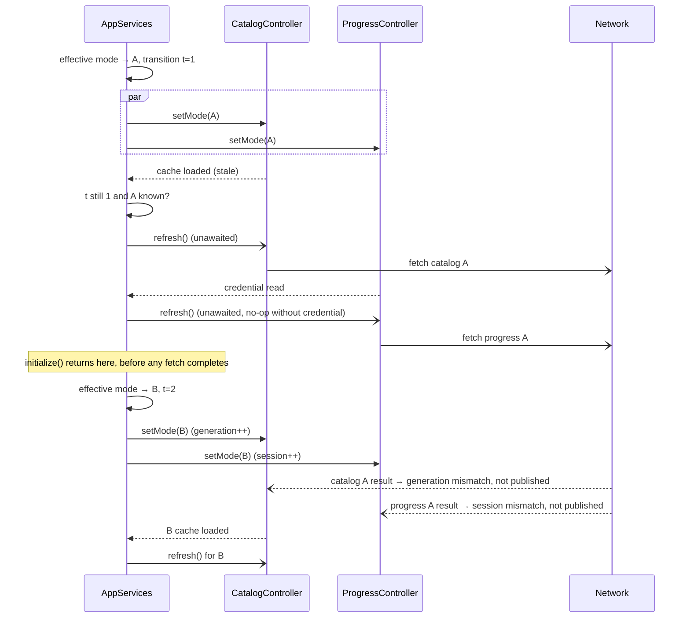
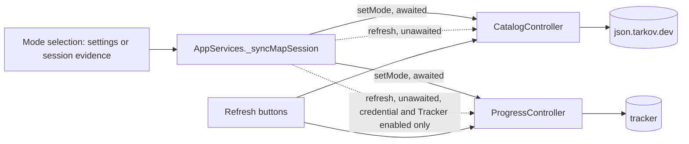

# Design

## Triage

| Trigger | Applies? | Evidence |
|---|---|---|
| T1 Components (new component, or 3+ with directed relationships) | No | No new component. `AppServices` already drives `CatalogController` and `ProgressController` (`lib/application/app_services.dart:238`); only the wiring changes. |
| T2 State (persistent state, caches, 3+ state machine) | No | No new persistent state. The catalog cache and the status enums (`catalog_controller.dart:9`, `progress_controller.dart:10`) are unchanged; the existing transitions now also run without user action. |
| T3 Concurrency (background work, workers/isolates, async, retries) | Yes | Two network refreshes start in the background, unawaited, and race mode switches, manual refreshes and disposal. |
| T4 Boundaries (data format, migration, shared interface, IPC, external) | Borderline, treated as applying | External systems (`json.tarkov.dev`, the tracker) are now contacted without user action. Wire format and client code are unchanged. |
| T5 Volume (grows without a fixed bound) | No | At most one fetch per controller per mode selection; fetches are deduplicated in the controllers. |
| T6 Risk (security, money, data loss, unrecoverable user data) | No | The tracker token is sent only to the tracker, as on a manual refresh. A failed refresh keeps the last-good catalog (`catalog_controller.dart:121-127`). |

TIER: FULL

## Context

See `proposal.md` for the problem. The current state:

- `AppServices._syncMapSession` (`app_services.dart:231-247`) detects a change in `mapSession.effectiveMode`, bumps `_modeTransition` and sets `_modeChange = Future.wait([progress.setMode(mode), catalog.setMode(mode)])`. `initialize()` (`:195`) and `setMode()` (`:253`) await `_modeChange`. The effective mode can change from settings or from session evidence, and both paths go through this block. `initialize()` re-runs on `reloadAfterImport` (`:257`), but the block fires only when the mode actually changes.
- `CatalogController.setMode` (`catalog_controller.dart:39-70`) publishes `loading`, reads the cache and publishes `stale`, `missing` or `failed`. It returns early, without publishing, when a later `setMode` or a committed refresh superseded it. `refresh()` (`:72-90`) deduplicates per mode through `_refreshes` and joins an in-flight fetch by stamping `_refreshGenerations[key] = _generation`. `_refresh` (`:92-128`) publishes only when the mode and generation still match, and a failure keeps the snapshot (`stale`) or reports `failed`.
- `ProgressController.setMode` (`progress_controller.dart:58-75`) invalidates its session, reads the credential and sets `_credential`. `refresh()` (`:129-144`) is a no-op without a credential or during a cooldown, and deduplicates through `_refreshing`. `_invalidate` (`:47-56`) clears `_refreshing` and `cooldownUntil` on each new selection. `_refresh` (`:146-184`) publishes only while `session` and `mode` still match.
- Today the only callers of `refresh()` are UI buttons (`manual_controls.dart:66`, `settings_dialog.dart:119,249`, `evidence_panels.dart:176`).
- `SelectionController` treats any catalog status other than `current`, and any progress status other than `current`, as stale (`selection_controller.dart:393-396`). `DecisionEngine` then withholds totals (`decision_engine.dart:14-28`). A `loading` status during the refresh is no worse than today's `stale`.
- Tests build `AppServices` over `MockClient` (`test/support/m1_harness.dart:47`, `test/application/app_services_test.dart:64`). `M1Harness.initialize` calls `catalog.refresh()` by hand after `setMode` (`m1_harness.dart:71-77`).

## Decisions

### D1: The composition root starts the refresh after each controller's `setMode`

- **Choice:** In `_syncMapSession`, chain onto each controller's `setMode` future separately: when it completes, and the selection is still current (`!_disposed`, `_modeTransition` unchanged since this block bumped it, `mode != GameMode.unknown`), call `unawaited(catalog.refresh())` or `unawaited(progress.refresh())`. The catalog call is also skipped when `catalog.status` is already `CatalogStatus.current`: a manual refresh published during the cached read, so a second fetch would only add a chance of downgrading a fresh catalog to `stale` on a transient failure. Progress needs no such check, because `progress.refresh()` cannot run before the credential read sets `_credential`. Progress is instead skipped while `settings.settings.trackerEnabled` is false, the same preference that disables the manual progress Refresh buttons (`settings_dialog.dart:243-250`, `evidence_panels.dart:175`); `ProgressController.refresh()` itself does not read it (amended after PR review, 2026-10-19). `_modeChange` stays the `Future.wait` of the two `setMode` futures only, so `initialize()` and `setMode()` never wait on the network.
- **Rejected:** a `refreshOnSelect` flag inside each controller's `setMode`, because it hides a network call inside a method that callers await for local state, and couples the controllers' unit tests to the policy. Wiring behaviour across controllers belongs to the composition root (ADR-0002).
- **Rejected:** one refresh after `Future.wait` of both `setMode` calls, because a slow credential read would delay the catalog refresh, and a failed read in one would hold up the other.
- **Reversal cost:** low. The change is a few lines in one method.

### D2: The supersession fence is `_modeTransition`, and the controllers' own fences stay authoritative

- **Choice:** The chained callback captures the transition number it created and starts no refresh if `_modeTransition` has moved on. This is how "a selection superseded during its local read starts no refresh" is met. Everything after the fetch starts relies on the existing controller fences: the catalog generation check and per-mode join, and the progress session check. No new fence is added.
- **Rejected:** comparing `catalog.mode == mode` alone, because A → B → A within one cached read would let the first A callback start a refresh for a selection the user left and came back to; the transition number tells the two A selections apart.
- **Reversal cost:** low.

### D3: Tests observe the automatic refreshes through a test-only future

- **Choice:** Each mode selection in `_syncMapSession` creates one future, stored in `_automaticRefreshes` and exposed as `@visibleForTesting Future<void> get automaticRefreshes`. It covers the whole selection: both `setMode` calls, then whichever refreshes the callbacks start, and it completes when all of them have finished, or right after the `setMode` calls when no refresh was started. A test captures the getter's value before switching modes, and that captured future stays fixed even after a later selection replaces the field, so a test can await the superseded selection's work and the new one separately. Fetches are held on a `Completer` in the fake HTTP handler to observe the in-flight state, and the cached load is held with a test subclass of `BlackgridDatabase` whose `loadCatalog` waits on a `Completer`. One catalog fetch is counted as one request to a single dataset path, because a fetch makes one HTTP request per dataset. No sleeps.
- **Rejected:** polling the controller status in tests, because AGENTS.md forbids arbitrary waits and a status poll cannot tell "not started" from "finished".
- **Reversal cost:** low.

### D4: Progress is included; no retry and no persisted cooldown

- **Choice:** Progress refreshes on the same trigger, gated by the controller's existing credential and cooldown checks (decided with the user on 2026-10-19). A failure, of either controller, is final until a manual refresh or the next mode selection.
- **Rejected:** a bounded retry with backoff, because the M4 criterion forbids looping, and a manual Refresh is one click away and already visible.
- **Rejected:** catalog only, with progress filed separately, because live M4 checks would still need a manual progress refresh after each launch.
- **Reversal cost:** low.

## Diagrams (FULL)

T3: automatic refresh at launch with a superseding switch.

T4: the external calls are unchanged, only their trigger is new.

## State & Ownership (FULL)

| State | Owner (sole writer) | Lifetime | Invalidation / rebuild | Authoritative copy |
|---|---|---|---|---|
| `_modeTransition` | `AppServices._syncMapSession` | App | Bumped on each effective-mode change | `AppServices` |
| Automatic refresh futures (for D3) | `AppServices._syncMapSession` | Until the next mode selection | Replaced on each selection | `AppServices` (test-only read) |
| Catalog snapshot, status, `_refreshes`, `_refreshGenerations` | `CatalogController` | App | Existing: `setMode` generation, refresh publication | SQLite cache for data, controller for status |
| Progress snapshot, status, `_credential`, `_refreshing`, `cooldownUntil` | `ProgressController` | Per selection session | Existing: `_invalidate` on `setMode`, credential edits | Controller memory; credential in the DPAPI store |

No new writer is added to controller state; automatic and manual refreshes both go through the same `refresh()` entry point.

## Failure & Visibility (FULL)

| Component | Fails / dies mid-operation → | Recovery | Retry safe? | Who finds out |
|---|---|---|---|---|
| Catalog fetch or validation | Last-good snapshot kept, status `stale` with "Catalog refresh failed; last-good data retained", or `failed` with no cache | Manual Refresh or the next mode selection | Yes (idempotent fetch; dedup per mode) | User: catalog status and error in the existing evidence and settings views |
| Catalog cache read | Status `failed`, "Stored catalog unavailable"; the automatic refresh still runs and can recover | The refresh itself | Yes | User: status |
| Progress fetch | `failed` with the tracker error, or `cooldown` with its deadline | Manual Refresh after the cooldown, or the next mode selection | Yes | User: progress status and error |
| Credential read | `failed`, "Protected credential unavailable"; no request | Re-save the credential | n/a | User: progress status |
| App disposed while a fetch is in flight | Controllers drop the result (`_disposed` checks); the closed HTTP client makes the fetch throw, which the controller catches | None needed | n/a | Nobody, by design: the app is shutting down |

## Resource Bounds (FULL)

| Queue / buffer / cache / transfer | Bound | At the bound | Timeout | At 10x / 100x |
|---|---|---|---|---|
| Catalog fetches in flight | 1 per mode (`_refreshes`); 3 known modes (`pvp`, `pve`, `seasonal`) | A further call joins the in-flight fetch | Existing `CatalogClient` behaviour, unchanged | Mode switches ×10 still cost one fetch per selection; a fetch for a mode that is no longer selected finishes unpublished |
| Progress fetches in flight | 1 per selection session; superseded ones are unpublished | A further call joins | Existing `TrackerClient` behaviour, unchanged | Rapid switching sends one request per selection; a tracker cooldown answers further ones |
| Automatic refresh future | 1 field (latest selection only); captured older futures are held only by tests | Replaced | Bounded by the clients' 30 s timeouts | Constant |

## Flow & State Gaps (FULL)

- **Superseded during the local read:** the callback sees a newer `_modeTransition` and starts nothing (D2).
- **Switch during a fetch:** controller fences drop the old result. The new selection starts its own refresh.
- **A → B → A with the catalog fetch for A still in flight:** the second A selection's refresh joins the in-flight fetch (`catalog_controller.dart:75-82`), which then publishes. If that fetch ends during A's second cached read, it is unpublished (generation mismatch) and the automatic refresh then makes one new fetch. Both are allowed by the spec, which forbids only a concurrent second fetch.
- **A → B → A for progress:** `_invalidate` dropped the first fetch's slot, so the latest A selection starts a new request; the first one's result is unpublished (session fence).
- **Manual Refresh while the cached read is still running:** the manual fetch may commit first; `setMode` then skips publishing the cache (`refreshPublication` check). If the manual fetch is still in flight when the cached read ends, the automatic refresh joins it. If it has already published `current`, no automatic fetch starts (D1). If it failed, the automatic refresh makes one fetch.
- **Credential saved after launch:** no automatic refresh (spec); the user refreshes.
- **Effective mode changed by session evidence during a raid:** counts as a selection and refreshes. The change happens at most once per raid transition.
- **`reloadAfterImport`:** no mode change, so no refresh.
- **Restart mid-refresh:** nothing persisted mid-way except a validated catalog commit, which is already atomic (ADR-0003).

## Mechanism Ledger (FULL)

| Mechanism | Built? | Why (harm nobody catches / expensive later) | Evidence that would change the call |
|---|---|---|---|
| Transition fence before starting a refresh (D2) | Yes | Without it a superseded selection fires a needless request, which the spec forbids and tests check | — |
| Test-only `automaticRefreshes` future (D3) | Yes | Without it tests must sleep or poll | — |
| Automatic retry or backoff | No | Forbidden by the M4 criterion; failure is visible and Refresh is one click | User reports frequent transient failures at launch |
| Skip the refresh when the cached catalog is younger than N hours | No | A cached catalog starts `stale` by spec, so it never backs decisions; skipping would leave decisions degraded | A source rate limit or user complaint about launch traffic |
| Persisted progress cooldown across selections | No | The tracker re-answers with a cooldown; harm is one extra request per switch | Tracker blocks the token for repeated 429s |
| Skip the automatic catalog fetch when the status is already `current` (D1) | Yes | Without it a transient failure of the redundant fetch would downgrade a catalog the user just refreshed to `stale`, a visible regression nobody would trace | — |
| Auto refresh after saving a credential | No | Out of scope by spec; the user is already in the settings dialog with a Refresh button | User request |

## Risks / Trade-offs

- [`test/application/app_services_test.dart:64-70` uses a client that throws "Saved Map inputs must not request HTTP" as its no-network check. After this change the automatic `pve` catalog refresh calls it, the controller swallows the error, and the test keeps passing while no longer proving what its message says] → The task replaces that client with one that records requests and answers catalog dataset requests. The test first awaits the last selection's `automaticRefreshes` future, then asserts that every recorded request goes to the catalog host `json.tarkov.dev` and none goes to the tracker host `api.tarkovtracker.org` (no credential is saved there). It does not assert routes: depending on whether the cached load or the log read finishes first, the saved `pvp` selection may fetch before the log moves the mode to `pve` (`app_services_test.dart:76-82`, `app_services.dart:191-193`), and the later switch to `seasonal` fetches `pvp-season`.
- [Existing tests assume no request until a manual refresh, or count requests] → Run the suite. Update each failing assertion only where it states the old "no automatic refresh" behaviour, and record each update in the task. `M1Harness.initialize` keeps its manual `refresh()`, which now joins or repeats harmlessly. Unknown-mode "no request" tests must still pass unchanged.
- [Status shows `loading` right after launch instead of `stale`] → Decisions are degraded in both, so nothing changes for the user. Wherever the UI already shows the catalog or progress status, it now shows `loading` during the refresh. Unverified assumption: no view breaks on `loading` at launch, since a manual refresh already produces the same state.
- [Launch traffic to two external services without user action] → The spec states it. Progress is contacted only when the user saved a credential and enabled the Tracker integration.

## ADRs

- **In force, constraining this change:** ADR-0002 (composition root, generation counters fence stale results), ADR-0003 (catalog cache in SQLite, atomic commit), ADR-0001 (the decision engine stays the only authority; this change only feeds it fresher inputs), ADR-0007 (DPAPI-protected token, unchanged), ADR-0017 (mode transitions retire scans through `ScanEpoch`; the refresh does not move the epoch).
- **To record during apply:** none. This is wiring inside the existing composition-root pattern, not a binding decision.
