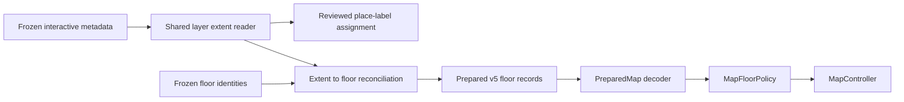
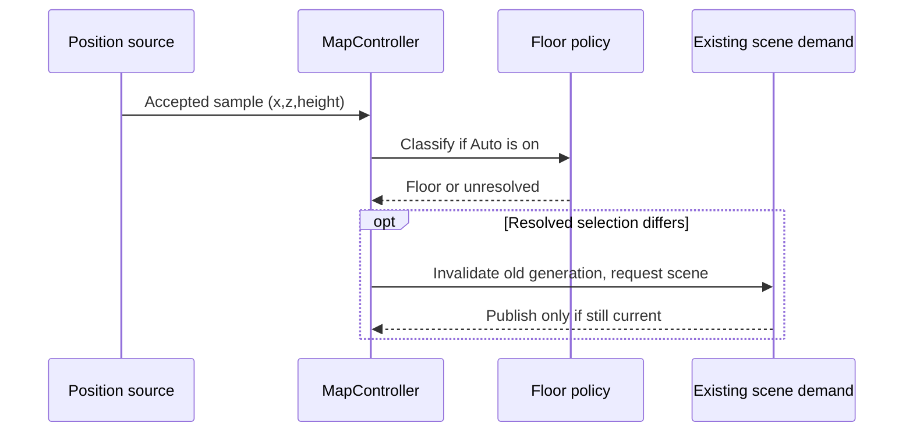
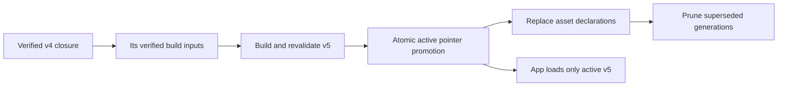

# Design

## Triage

| Trigger | Applies? | Evidence |
|---|---|---|
| T1 Modules | Yes | Preparation, manifest decoder, domain classification and controller form a directed path (`tool/maps/pack.dart:997-1003`, `lib/maps/prepared_map.dart:181-210`, `lib/application/map_controller.dart:426-437`). |
| T2 State | Yes | Extents change the immutable active generation and its loaded policy. The controller already retains Auto per map (`lib/application/map_controller.dart:63,105-108`). |
| T3 Concurrency | Yes | A floor change invalidates and requests async scene demand (`lib/application/map_controller.dart:566-579`); the same path will now handle Auto on more maps. |
| T4 Boundaries | Yes | Current preparation version 4 and single floor `heightBand` are read at the tool/app seam (`tool/maps/pack.dart:1209-1212`, `lib/maps/prepared_map_loader.dart:83-87`, `lib/maps/prepared_map.dart:181-199`). |
| T5 Volume | Yes | Layer extent and rectangle lists can grow with the frozen source; unlike scene requests, position matching does not queue work. |
| T6 Risk | No | No user data mutation, new live acquisition, or change to pack publication safety. |

TIER: FULL

## Context

See [proposal](proposal.md) and #131. App services forward the Map session sample to `setPlayerSample` (`lib/application/app_services.dart:397-408`). Its `GamePoint` is finite in game-space X/Z with optional height (`lib/domain/map_coordinates.dart:14-22`). The controller deduplicates all three coordinates but currently passes only height into Auto (`lib/application/map_controller.dart:426-437`). The policy gates Auto by map ID and scans only the overlays' single bands (`lib/domain/map_floors.dart:71-73,193-217`). Marker selection currently prefers explicit ownership, then uses the same old height classifier (`lib/domain/map_floors.dart:282-295`, `lib/application/map_controller.dart:800-812`). The controller already binds marker projections per inventory (`lib/application/map_controller.dart:226-246,301-312`).

The generator and validator both call `reconcileFloors` with frozen calibration and the matching interactive map; validation compares the prepared floor fields with that result (`tool/maps/pack.dart:997-1003,1751-1760,1786-1791`). The floor inventory currently chooses SVG identity for vectors and tile identity otherwise (`tool/maps/calibration.dart:360-380`). The place-label table also resolves metadata layers by name and reads `extents[index].height`; its separate label assignment remains reviewed and follows ADR-0036 (`tool/maps/place_labels.dart:313-359,381-408`). The older-generation integrity reader accepts the old manifest as rebuild input without treating it as a current candidate (`tool/maps/pack.dart:2136-2155`).

Artwork staging compares default baseline calibration to current reviewed calibration, and publishing compares the staged evidence to that same reviewed calibration (`tool/maps/pack.dart:638-659,3110-3120`). Keeping the removed floor band keys in the new bundled evidence would block both operations.

## Decisions

### D1: Derive a required v5 extent list per floor, not new calibration

- **Choice:** Share the layer-extent reading seam with the place-label checks, preserving label selection and order. Link extent-bearing layers by nonempty `svgLayer`/floor `id` or `tilePath`/`sourceTileUrl`, with SVG precedence. Include a base appearing as a layer (Icebreaker); do not manufacture extents from root height ranges. Emit `height: [min, max]` and required `bounds: [[minX, minZ, maxX, maxZ], …]`, canonical empty list for height-only. Emit `extents: []` when a floor has none. In source only, omitted `bounds` is height-only; present non-list bounds (including null), malformed height, or a bad rectangle fails with map and layer, before generic floor inventory checks. Ignore optional rectangle names. Delete the authored runtime band table. Only the active offline rebuild, after verifying a v4 generation and its indexed build inputs, removes direct floor `heightBand` keys from a derived calibration and rebinds the calibration source hash, output hash and `sourceGeneration`; it retains other bytes including nested marker evidence. Candidate validation rejects direct legacy keys in v5 calibration and manifest floor records. Exact artwork staging/publishing admission is unchanged. Use the same extent derivation in assembly and validation. The app validates v5, with no fallback.
- **Rejected:** Read the entire interactive source at runtime, or copy the ranges into authored calibration. The first would give the runtime a new parser and authority; the second would require modifying frozen evidence to add data already carried there.
- **Reversal cost:** Medium; loader, tool and generation change together.
- **Important:** Yes (prepared data format and ownership).
- **Chosen by:** User (#131; v5 follows the existing single-version contract).

### D2: One allocation-free position classifier and existing selection state

- **Choice:** Use half-open height intervals, closed game-space X/Z rectangles, and the narrowest height span. Break exact cross-floor span ties by ascending stable floor ID. Unmatched known positions select base; unknown heights and unsupported maps do not resolve. Keep one classifier behind `floorForPosition` and existing manual and map-local Auto state. Sample and Auto-enable paths apply the position synchronously. Resolve an unassigned marker's floor when binding the existing projection record (explicit `floorId` short-circuits inference); paint, hits, selection and lists use the same eligibility path.
- **Rejected:** Keep map-ID branches or a separate marker-height classifier; those contradict the user-approved rule and let player and unassigned-marker classifications diverge.
- **Reversal cost:** Medium; changes where an unassigned marker is shown.
- **Important:** Yes (visible floor and marker behavior).
- **Chosen by:** User (#131 and S3; stable ID is the implementation tie-break).

### Decision summary

| # | Decision | Choice | Rejected | Reversal cost | Important | Chosen by |
|---|---|---|---|---|---|---|
| S1 | Scope | All supported maps with extents | Per-map Auto exceptions | Medium | Yes | User |
| S2 | Roadmap | Off-roadmap M5 maintenance | Change M10 or milestone split | Low | No | User |
| S3 | Marker inference | Full X/Z/height for unassigned markers | Keep old marker rule | Medium | Yes | User |
| D1 | Pack | Derived v5 extent lists from frozen evidence | Runtime parsing or authored calibration bands | Medium | Yes | User |
| D2 | Classification | One position classifier and existing controller state | Per-map or marker-specific classifier | Medium | Yes | User |

## Assumptions

None. The owner-only verification below is not a premise of the offline contract.

## Carried constraints

- **C1:** The pack is the only floor and extent authority; the six-source marker refresh cannot update extents. Kind: invariant. Destination: ADR 0050.
- **C2:** No match at a known height means base, while unknown height changes nothing; no name-based Auto fallback or interpolation between extents. Kind: deliberate gap. Destination: spec: specs/map-controls/spec.md → Requirement: Auto follows the sampled player position.
- **C3:** Explicit loaded ownership outranks inferred marker floor; marker eligibility does not consult the Auto toggle. Kind: invariant. Destination: spec: specs/map-controls/spec.md → Requirement: Unassigned markers use the prepared floor extents.
- **C4:** Malformed source extents must neither broaden into height-only matches nor disappear behind generic inventory errors. Kind: invariant. Destination: spec: specs/prepared-map-packs/spec.md → Requirement: Malformed source floor extents fail preparation.
- **C5:** Literal layer extents are the only Auto source; root height ranges do not produce a fallback extent. Kind: rejected alternative. Destination: spec: specs/prepared-map-packs/spec.md → Requirement: Prepared floor extents come from frozen interactive layers.
- **C6:** Reviewed label floor assignment is independent of Auto extents, even though both read the same interactive metadata. Kind: invariant. Destination: spec: specs/prepared-map-packs/spec.md → Requirement: Validation re-derives floor extents from candidate evidence.
- **C7:** Marker activation bands and authored ownership evidence are not floor extent data and survive the calibration upgrade. Kind: invariant. Destination: spec: specs/prepared-map-packs/spec.md → Requirement: Offline rebuild migrates legacy floor calibration.

## Diagrams (FULL)

```mermaid
stateDiagram-v2
  [*] --> Auto: map has extents
  [*] --> ManualOnly: no extents
  Auto --> Auto: known sample applies floor; unknown keeps selection
  Auto --> Manual: manually choose a floor or disable Auto
  Manual --> Manual: later position changes marker location only
  Manual --> Auto: enable Auto; apply current sample if known
```

## State & Ownership (FULL)

| State | Sole writer | Lifetime | Invalidation / rebuild | Authority |
|---|---|---|---|---|
| Floor extents | Offline pack builder | Immutable generation | Re-derived during build and validation; replaced by publication only | Frozen interactive layers joined to reviewed floor IDs |
| Floor selection and Auto opt-out | `MapController` | Controller lifetime, per map | Accepted sample in Auto or manual selection | Controller; immutable `MapFloorSelection` |
| Resolved marker floor | `MapController` while binding marker projections | Same as bound marker inventory and floor policy | Recompute with existing inventory/pack binding | Explicit prepared marker owner, otherwise immutable policy |

## Failure & Visibility (FULL)

| Module | Failure | Recovery | Retry safe? | Audience |
|---|---|---|---|---|
| Pack builder/validator | Bad shape, nonfinite/empty extent, nonunique link, or evidence mismatch rejects the candidate before promotion | Correct and review the frozen input, rerun existing build | Yes, no partial new generation on a validation failure | Build operator and CI, map/layer/floor identified |
| Pack publication | After pointer promotion a failure to replace `pubspec.yaml` can leave the new active generation with old asset declarations (`tool/maps/pack.dart:2939-2954`) | Existing phase-specific recovery instructions (`tool/maps/pack.dart:2969-3023`) | Restore the reported state before using the existing rebuild workflow | Build operator sees the failure phase and recovery |
| Pack loader | Absent/malformed extent list or unsupported version refuses the active pack | Rebuild or restore matching code and pack, never load another generation implicitly | Yes, on corrected bundle | Player via existing Map load failure |
| Classifier | Valid approximation yields a gap, or sample height is unknown | Known gap falls back to base; unknown leaves selection alone; user may choose floors manually | No retry | Player sees actual visible floor or unchanged state |
| Controller scene | Previous floor's async scene completes late | Existing scene generation guard discards it | Existing policy, no new retry | No stale scene publication |

## Resource Bounds (FULL)

| Collection / work | Bound | At the bound | Timeout | At 10× / 100× |
|---|---|---|---|---|
| Extents and rectangles | Finite list in shipped candidate; no new runtime external input | Parse once at load; reject malformed values. No silent truncation | Existing pack loading | O(extents + rectangles) storage, no decoded art or spatial index added |
| Classifier | One scan of a map's extents, rectangle scan only on matching heights | Stop checking an extent's rectangles on first match; maintain one winning floor/span | Synchronous, no timeout | O(extents + rectangles), no per-sample allocations or queue; evaluate profiling before adding an index |
| Marker inference | At most one classification per unassigned marker per inventory bind | Returns a nullable floor ID stored in the existing marker record | Existing marker binding | Linear in markers times per-map extent work; no repeat scan on viewport or floor changes |
| Scene demand | Existing controller/resource orchestration bounds | Same invalidation/request path only when floor changes | Unchanged | Does not create a new work queue |

## Flow & State Gaps (FULL)

- Rebuild starts from verified v4 evidence, removes only direct floor `heightBand` keys in the new calibration evidence and promotes v5 only after validating the rebound closure. Old v4 may be verified as input, not loaded as v5. A v5 generation rebuilds from its own unchanged calibration bytes. Exact artwork admission comparisons, pointer swapping, asset wiring and rollback are unchanged.
- Auto follows only accepted position samples for the displayed map. Map switches and late scene results keep their existing evidence and generation fences. An X/Z-only change at height −9 must be evaluated; an unknown height must not overwrite the current floor.
- Returning to a map preserves its manual-override state in the session; an Auto-enabled map applies its next accepted sample. Marker inference remains independent of that toggle. Marker publication and pack replacement invalidate the same marker records they bind today.
- Do not interpolate upstream gaps or extend rectangles. Known positions in gaps use base. That rule makes no claim about accuracy in actual raids.

## Bundled marker before/after

[`test/fixtures/map_floor_marker_delta.json`](../../../test/fixtures/map_floor_marker_delta.json), committed as `ebbbd4a622`, records every changed marker by stable ID and stores the original Labs/Icebreaker bands, per-map inventory sizes, and exact explicit ownership pairs. With the same seven frozen evidence hashes, the regression independently evaluates v4 inference on every rebuilt marker, including unchanged markers, against the new classifier. It checks the complete transition groups and stable IDs, as well as inventory sizes and explicit ownership, not merely aggregate counts. The result is a regression for that input snapshot, not an admission gate for future marker sources; later valid source hashes are checked by their own evidence and generic behavior, not these historical transitions. Base and non-base changes are counted separately even where the visible base is additive.

| Map | New base | New non-base |
|---|---:|---:|
| Factory | 220 | 222 |
| Customs | 1003 | 400 |
| Shoreline | 1331 | 398 |
| Interchange | 771 | 902 |
| Labs | 2 | 0 |
| Reserve | 750 | 1072 |
| Streets | 2777 | 187 |
| Ground Zero | 594 | 361 |

Labs' Hangar Gate and Parking Gate move from `Second_Level` to `First_Level`. Icebreaker and the remaining maps have no bundled marker-floor changes. This comparison does not verify in-raid correctness.

## Mechanism Ledger (FULL)

| Mechanism | Built? | Why | Evidence that would change the call |
|---|---|---|---|
| Strict typed extent admission and source equality | Yes | An omitted/replaced area otherwise silently sends position and markers to a plausible wrong floor; the pack interface is durable | None while v5 is current |
| Resolve marker floor at existing projection binding | Yes | Rendering and hit paths repeatedly query marker visibility; classification does not depend on selection or viewport | Only a change to inventory/pack ownership |
| Legacy runtime v4 adapter or extra download | No | The app loads only its bundled version; rebuild already accepts verified older inputs | A separately approved compatibility requirement |
| Map-specific exceptions, hysteresis, or spatial index | No | The requested rule is deterministic over a small frozen dataset; no observation requires a special correction or acceleration | Owner-confirmed bad source data or a measured bottleneck |

## Risks / Trade-offs

- Community bounds can be wrong. Preserve exact source semantics and manual recovery, and leave owner checks for Reserve bunkers/dome floors, Streets underground/upper floors, Labs and Icebreaker, and affected marker visibility unverified until the owner reports them. No agent interacts with the game.
- Base-level dimming (#130) is independently scoped; this change leaves the renderer untouched.
- Metadata-only refresh must preserve prepared floor records exactly; frozen interactive artwork metadata is not in its six-source replacement allowlist (`tool/maps/pack.dart:2413-2420,2559-2564`).

## ADRs

- **In force:** ADR-0005 (offline immutable generation), ADR-0033 (reproduction, exact publication and no fallback), ADR-0034 (offline marker renewal preserves non-marker evidence and output), ADR-0035 (marker refresh does not own floors), ADR-0036 (labels remain separately reviewed and pack-owned).
- **During apply:** ADR-0050 records pack-owned spatial extents and v5; supersedes only the preparation-version-4 statements in ADR-0036. Keep its label decisions and all source/asset integrity guarantees.
