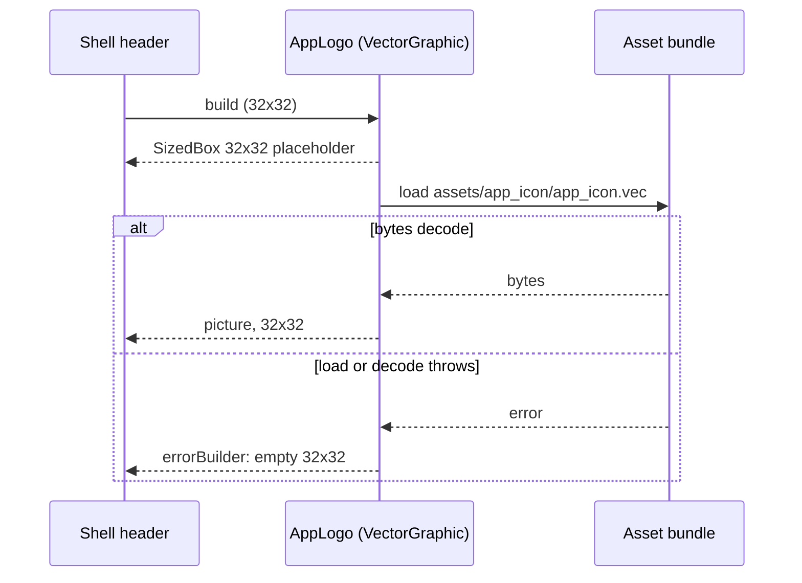
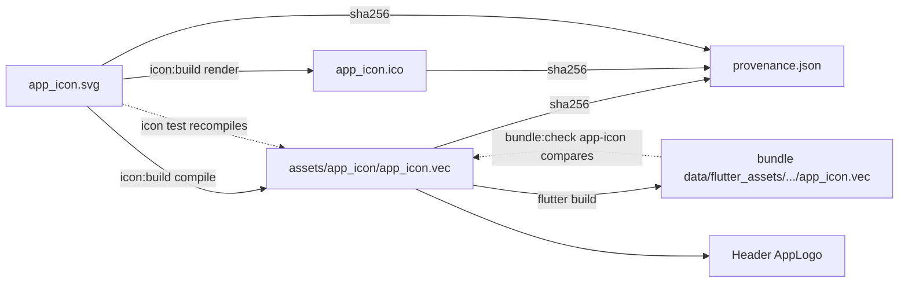

# Design

## Triage

| Trigger | Applies? | Evidence |
|---|---|---|
| T1 Components (new component, or 3+ with directed relationships) | No | One small widget in `lib/ui/`, used by the header and the startup screen; the build, the icon test and the bundle check already exist and gain one output and one comparison each. |
| T2 State (persistent state, caches, 3+ state machine) | No | No runtime state. The committed `.vec` and its hash are build outputs; `vector_graphics` keeps its own picture cache. |
| T3 Concurrency (background work, workers/isolates, async, retries) | Yes (minor) | The header loads the `.vec` asynchronously (`VectorGraphic` loads, then decodes); the first frames show a placeholder. |
| T4 Boundaries (data format, migration, shared interface, IPC, external) | Yes | `provenance.json` gains a hash key (stored format, ADR-0027); a new bundled Flutter asset; `checkBundle` gains an input; ADR-0027's "never bundled" rule is amended. |
| T5 Volume (grows without a fixed bound) | No | One file of a few KiB, compiled from a source capped at 64 KiB (`maxSourceBytes`). |
| T6 Risk (security, money, data loss, unrecoverable user data) | No | No user data; the asset is project-authored and its source is recorded. |

TIER: FULL

## Context

See `proposal.md`. Current state:

- The header draws `const Icon(Icons.hub_outlined, color: GridColors.gold, size: 32)` (`lib/ui/shell.dart:73-77`), followed by a 12 px gap and the `BLACKGRID` / `TRACK. PLAN. SURVIVE.` column.
- The startup screen in `BlackgridBootstrap` (`lib/ui/app.dart:60-64`) draws `Icons.hub_outlined` at 54 px above `BLACKGRID`, while `AppServices.open()` runs and when it fails. `BlackgridBootstrap` calls `AppServices.open()` directly (`app.dart:28`), and no test covers it.
- `buildIcon` (`tool/app_icon/build.dart:42`) reads and checks the record, compiles each source with `compileSources` (`tool/app_icon/render.dart:65`), renders ten sizes, encodes the `.ico`, then writes the `.ico` and the record through `writeAtomically` (`build.dart:131-138`, `render.dart:119`). `CompiledSource.compiled` already holds the compiled vector bytes of `app_icon.svg` (`render.dart:45-57`). Today they are only rasterized.
- `compileIconSvg` (`tool/markers/icon_set.dart:476`) is the map marker compile: `encodeSvg` with warnings as errors and the masking, clipping and overdraw optimizers off. It is pure Dart and deterministic. `bundle:check` relies on this when it recompiles every marker and compares the result with the bundled `.vec` (`tool/vision/check_bundle.dart`, `markerIconFailures`). CI runs that comparison on every PR.
- `parseSourceRecord` (`tool/app_icon/provenance.dart:287`) rejects unknown `sha256` keys (`_hashFields`, `:49`) and treats `app_icon_small.svg` as optional (`:317`). `checkHashBinding` (`:354`) compares each recorded hash with bytes on disk, and reports "the file exists but the record has no hash for it", naming `mise run icon:build`.
- Map markers already ship as compiled `.vec` assets (`pubspec.yaml:38-39`, `assets/map_markers/** -text` in `.gitattributes`) and draw through `vg.loadPicture` (`lib/maps/map_marker_icons.dart:272`).
- `vector_graphics` 1.2.3's `VectorGraphic` catches a loader error into state and shows `errorBuilder`, else a `SizedBox(width, height)` (`vector_graphics.dart:391-399, 518-528`). It does not call `FlutterError.onError`. A failed `loadBytes` also fails the future that `_loadPicture` discards after `result.whenComplete(...)` (`:385`), so the error escapes once more as an uncaught async error. In the app no `PlatformDispatcher.onError` handler is set (`lib/` has none), so it would only be printed to the console. In a widget test the binding (Flutter 3.47.6, `binding.dart:1815-1921`) reports it through `FlutterError.onError` and fails the test; `tester.takeException()` cannot take it first. D4 therefore never hands `VectorGraphic` a loader that can fail. With `excludeFromSemantics: true` it adds no `Semantics` node (`:536-545`).
- The `app-icon` bundle step is `appIconStep(exe, icoPath)` (`check_bundle.dart:487`). It is wired from `checkBundle(appIconPath:)` and the `--app-icon` CLI flag, and the path is in the report's protected files (`:901`).

## Decisions

### D1: The icon build writes the compiled vector it already has

- **Choice:** `buildIcon` gains a `vecPath` parameter (`defaultVecPath = 'assets/app_icon/app_icon.vec'`, passed by `render_host_test.dart`). It writes `main.compiled`, the bytes it compiled from `app_icon.svg` before rendering, as the `.vec`. The write order is `.ico`, `.vec`, record, each through `writeAtomically`, and only after every size rendered and encoded. `renderSourceRecord` gains the `vec` bytes and writes `sha256["app_icon.vec"]`. The small SVG never feeds the `.vec`, because the header draws at 32 px, which uses the main source.
- **Rejected:** a separate `icon:vec` task, or a step in the `map:pack` marker tool, that compiles the SVG on its own. It would be a second writer of the same output, and could run without the other. The record would then bind an `.ico` and a `.vec` built at different times.
- **Rejected:** bundling `app_icon.svg` and compiling it at runtime with `flutter_svg`. It adds a dependency and a runtime parser for one file, and ships the source folder that ADR-0027 keeps out of the bundle.
- **Reversal cost:** low. One extra output file.

### D2: The `.vec` hash is optional when parsed and required by the binding

- **Choice:** `app_icon.vec` joins `_hashFields`. `parseSourceRecord` accepts a record without it, as it does for `app_icon_small.svg`. `checkHashBinding` gains a required `vec` argument (`Uint8List?`, null when the file is absent). Today's committed record has no `.vec` hash, but the `.vec` will exist, so the binding fails with "the file exists but the record has no hash for it". The committed-icon test also requires the `.vec` to exist. `schemaVersion` stays 1.
- **Rejected:** make the key required in the parser, or bump `schemaVersion` to 2. `buildIcon` parses the record before rewriting it, so a required key would stop the one command that adds it. A version bump would make the build accept version 1 anyway. The record has one instance, written only by `icon:build`, so it has no other reader to migrate.
- **Reversal cost:** low. Requiring the key later is a parser change once every record has it.

### D3: The icon test recompiles the source and compares it with the `.vec`

- **Choice:** `test/tool/app_icon/committed_icon_test.dart` gains two checks. First, the hash binding including the `.vec` (D2). Second, compiling `app_icon.svg` through `compileSources` (the build's own path, `render.dart:65`) must equal the committed `.vec` bytes; on failure it names `app_icon.vec` and `mise run icon:build`. This runs in `mise run test` and so in CI. The compile is pure Dart and needs no Flutter host.
- **Rejected:** rely on the hash binding alone. The binding proves the `.vec` is the one `icon:build` wrote, but a hand-edited record could bind a `.vec` compiled from another source. The recompile closes that gap for one cheap compile. The marker bundle step already proves the compile is stable on the CI runner.
- **Reversal cost:** low.

### D4: A decorative `AppLogo` widget draws the asset

- **Choice:** add `lib/ui/app_logo.dart` with a `StatefulWidget` `AppLogo({double size = 32, Future<ByteData> Function(BuildContext)? load})`, where `appLogoAsset = 'assets/app_icon/app_icon.vec'`. The state starts the load once (in `didChangeDependencies`, guarded so it runs once), by default `DefaultAssetBundle.of(context).load(appLogoAsset)`, and handles the error on that future itself. While loading, and after a failure, it builds `SizedBox.square(dimension: size)`. After a success it builds `VectorGraphic(loader: _LoadedBytes(bytes), width: size, height: size, excludeFromSemantics: true)`, where `_LoadedBytes` is a private `BytesLoader` over the bytes already in memory, with a cache key of `appLogoAsset`. A failed asset load therefore never enters `VectorGraphic._loadPicture`, so nothing leaks, and `FlutterError.onError` is not called. The one remaining leak is a `.vec` that loads but fails to decode. D3's recompile check and D5's bundle comparison stop such a file from shipping, so no widget test covers it. The `shell.dart` header uses `const AppLogo()` in place of the `Icon`, and the startup screen (`app.dart`) uses `const AppLogo(size: 54)`. Gaps and text are unchanged. The logo keeps the icon's own colours (cream hex, slate, amber sweep). The gold tint is not applied: tinting would flatten the three colours into one. `pubspec.yaml` gains `- assets/app_icon/`. `.gitattributes` gains `assets/app_icon/** -text`, so the hashed bytes survive an autocrlf checkout, as for `assets/map_markers/**`.
- **Rejected:** `VectorGraphic(loader: AssetBytesLoader(appLogoAsset), errorBuilder: ...)`. The empty box would show, but the failed load leaks an uncaught async error (Context), which fails any widget test of that path.
- **Rejected:** decode with `vg.loadPicture` into a `CustomPaint`, as the map markers do. That path suits many icons drawn on a map canvas, while the header needs one widget with layout, placeholder and error handling, which `VectorGraphic` already provides.
- **Rejected:** keep a Material icon and tint it to match. It would not be Blackgrid's logo.
- **Rejected:** leave the startup screen on the hub icon. Every launch would show two different logos inside the window, the outcome this change exists to avoid.
- **Reversal cost:** low.

### D5: The bundle step compares the bundled `.vec` with the committed one

- **Choice:** `appIconStep(exe, icoPath, {bundledVec, vecPath})` gains the bundled `.vec` bytes (`bytesOf('data/flutter_assets/assets/app_icon/app_icon.vec')`, null when missing) and the committed path (`defaultAppLogoPath = 'assets/app_icon/app_icon.vec'`). `checkBundle` and the CLI pass them, with a `--app-logo <path>` flag, and the CLI adds the path to `protectedFiles`. The `.vec` comparison runs first and its failures are kept on every path, including the early returns for a missing executable or an unreadable icon group or `.ico` (`check_bundle.dart:489-512`), so one run reports both problems. A missing bundled file, an unreadable committed file or unequal bytes adds a failure naming the file. On a pass, the details gain `app_icon.vec` after the ten sizes. `test/tool/vision/check_bundle_test.dart`'s fixtures gain a committed `.vec` passed with `--app-logo` and a bundled copy, and the details expectation gains `app_icon.vec`. Step names and order stay the same, so `test/qualification/m2_bundle_integrity_test.dart` needs no change.
- **Rejected:** a separate `app-logo` step. That changes the step list that the qualification test and the CI report pin, for one byte comparison that belongs with the icon.
- **Rejected:** add the file to `bundle_inventory.json`. The inventory lists native, model and sample files with roles and pins. Flutter assets are covered by their own steps, as the markers are.
- **Reversal cost:** low.

### D7: `BlackgridBootstrap` takes its storage opener as a parameter

- **Choice:** `BlackgridBootstrap({super.key, Future<AppServices> Function() open = AppServices.open})`, so `late Future<AppServices> _opening = widget.open();`. `main.dart` keeps `const BlackgridBootstrap()`. A new `test/ui/app_test.dart` pumps it with an opener that returns a `Completer`'s never-completed future (the startup screen) and one that returns a failed future (the storage error screen), and asserts the 54x54 `AppLogo` and no `Icons.hub_outlined` on both.
- **Rejected:** extract the startup screen into its own widget and test that alone. That proves the widget, not that the bootstrap shows it in both states, and it moves more code than one constructor parameter.
- **Reversal cost:** low.

### D6: ADR-0028 amends ADR-0027's bundling rule

- **Choice:** write `docs/adr/0028-app-icon-ships-a-compiled-header-logo.md` (Status accepted, Amends 0027). The icon source folder stays unbundled. `icon:build` also writes `assets/app_icon/app_icon.vec`, a bundled Flutter asset compiled with the marker flags. The record binds it by hash. The icon test recompiles it. `bundle:check`'s `app-icon` step compares the bundled copy. Update `openspec/architecture.md`: add a row for 0028, and append "amended by 0028" to the 0027 row's status column. ADR-0028 restates the two ADR-0027 statements it makes false: "the folder is not a Flutter asset and is never bundled" (the source folder still is not, but its compiled vector is), and the hash binding's list of files (now including the `.vec`). Its Consequences say the header and the startup screen now depend on the bundled asset. Update the rebuild section of `docs/design/app-icon/README.md`, and the `icon:build` description in `mise.toml` so it names the `.vec`.
- **Rejected:** edit ADR-0027 in place. Accepted ADRs are immutable (`docs/adr/README.md`).
- **Reversal cost:** low.

## Diagrams (FULL)

T3: the header's async load.

T4: what binds the `.vec`.

## State & Ownership (FULL)

| State | Owner (sole writer) | Lifetime | Invalidation / rebuild | Authoritative copy |
|---|---|---|---|---|
| `assets/app_icon/app_icon.vec` | `icon:build` (`buildIcon`) | committed | rebuilt by `icon:build` after a source edit | the committed file, bound by the record and by recompiling the source |
| `sha256["app_icon.vec"]` in `provenance.json` | `icon:build` (`renderSourceRecord`) | committed | rewritten with the other hashes on every build | the committed record |
| Bundled `app_icon.vec` | `flutter build` (asset copy) | per bundle | rebuilt on every build | the committed file; `bundle:check` compares against it |
| Decoded picture in the header | `vector_graphics` cache | while a widget holds it | released when the last holder is disposed | the bundled asset |

## Failure & Visibility (FULL)

| Component | Fails / dies mid-operation → | Recovery | Retry safe? | Who finds out |
|---|---|---|---|---|
| `icon:build` compile or render | nothing written | fix the source, rerun | yes | the developer: non-zero exit naming the file |
| `icon:build` write after the `.ico` (`.vec` or record write fails) | `.ico` new; `.vec` or record old | rerun `icon:build` | yes, every write is `.tmp` and rename | the developer: an exit naming the file and the rebuild command; then `mise run test` and CI, through the hash binding |
| Committed `.vec` drift (hand edit, source edit without rebuild) | — | rerun `icon:build` | yes | `mise run test` and CI, naming `app_icon.vec` and the rebuild command |
| Asset missing from the bundle (pubspec entry dropped) | header shows an empty 32x32 box | restore the entry, rebuild | yes | `bundle:check` in CI fails the `app-icon` step; the widget test (`AppLogo` resolves the real asset) |
| Header asset load error at runtime | empty 32x32 box, layout unchanged; `AppLogo` handles the error, nothing is printed | none needed; the next start reloads | — | the user sees no logo. This is acceptable because `bundle:check` and the icon test catch every way it can happen in a shipped build |
| Header `.vec` that loads but fails to decode | empty 32x32 box; `VectorGraphic` leaks an uncaught async error, printed to the console | rebuild with `icon:build` | — | developers before release: D3's recompile check and D5's bundle comparison fail on any `.vec` that differs from the compiled source |
| Startup screen logo load error | empty 54x54 box above `BLACKGRID`; the progress indicator or storage error still shows | none needed | — | as for the header |

## Resource Bounds (FULL)

| Queue / buffer / cache / transfer | Bound | At the bound | Timeout | At 10x / 100x |
|---|---|---|---|---|
| `.vec` file | source capped at 64 KiB (`maxSourceBytes`); today's compiled file is a few KiB | compile refuses an oversize source | none (sync file IO) | n/a: one file |
| Header picture | one 32x32 picture, cached by `vector_graphics` | — | none | n/a |
| Bundle step reads | two files read once | — | none | n/a |

## Flow & State Gaps (FULL)

- **Partial build:** covered in Failure & Visibility. The record is written last, so any partial write leaves a hash mismatch that the test reports.
- **First run after this change:** the committed record has no `.vec` hash. The apply runs `icon:build` once (D2), which writes the `.vec` and adds the hash. The `.ico` bytes should come out unchanged. If they differ, the rebuild is still valid, but the apply reports it, because the `.ico` should be stable for an unchanged source.
- **Stale bundle:** a bundle built before a rebuild carries the old `.vec`. `bundle:check` fails it (D5).
- **Widget disposed mid-load:** `VectorGraphic` ignores a result that arrives after unmount (`_handleError` checks `mounted`).

## Mechanism Ledger (FULL)

| Mechanism | Built? | Why (harm nobody catches / expensive later) | Evidence that would change the call |
|---|---|---|---|
| Hash binding of the `.vec` | yes | without it, a hand-replaced `.vec` ships unseen | — |
| Recompile check of the `.vec` in the icon test | yes | the only proof that the `.vec` comes from the committed source | the compile proving non-deterministic across runners (the marker step shows it is not) |
| Bundle byte comparison | yes | a dropped asset entry or a stale bundle would ship the wrong or no logo | — |
| Logging a header load failure | no | every way it can fail in a shipped build is caught before release (rows above) | a user report of a missing logo in a build that passed `bundle:check` |
| Golden image test of the header | no | pixel goldens of the vector are font- and engine-sensitive; the widget test proves the asset and size, and the user's look check proves appearance | a regression that the widget test and the user check both miss |
| `schemaVersion` bump | no | see D2 | a second reader of the record |

## Risks / Trade-offs

- [The widget test may not decode the asset in the fake-async test zone] → the test asserts the `VectorGraphic`'s loader, size and semantics, and loads the real asset bytes through `rootBundle` inside `tester.runAsync` to prove the bundled file is there. The error-path test (`test/ui/app_logo_test.dart`) injects a `load` that returns a failed `Future`, the path a real missing asset takes. It pumps until the error is handled, then asserts a 32x32 empty box, the `BLACKGRID` text's position unchanged against a pump with working bytes, no `ErrorWidget`, a `FlutterError.onError` spy that was never called (restored before any `expect`), and `tester.takeException()` returning null.
- [Untinted logo colours may clash with the dark header] → the icon was designed on a slate field to sit on dark backgrounds. The user checks it in the running app before the release (a user check in tasks.md, recorded as unverified until they report it); if it clashes, a follow-up picks a size or treatment.
- [Hosted Windows checkout with autocrlf] → `-text` for `assets/app_icon/**` (D4).

## ADRs

- **In force, constraining this change:** ADR-0027 (icon pipeline, record format, the `app-icon` step), ADR-0023 (compile flags, provenance shape), ADR-0024 (CI runs `bundle:check`).
- **To record during apply:** ADR-0028, which amends ADR-0027: the compiled header logo ships, the source does not (D6).
