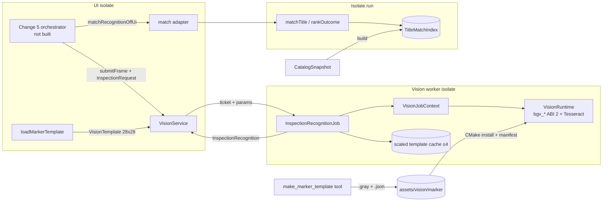
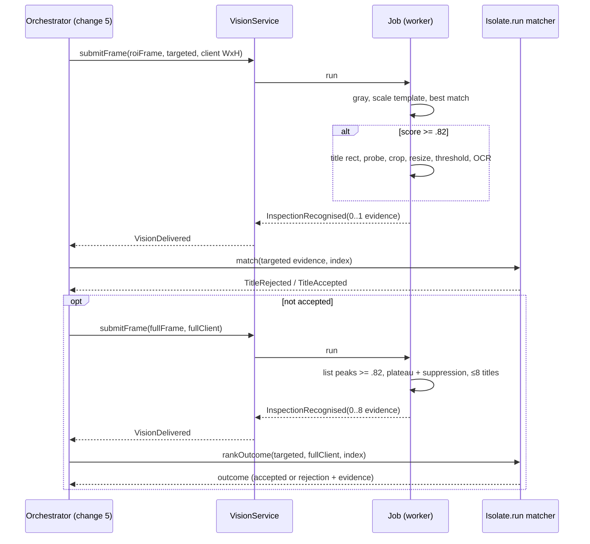
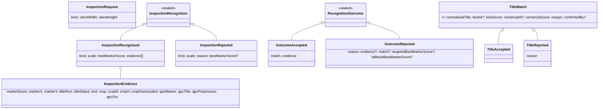

# Design

## Triage

| Trigger | Applies? | Evidence |
|---|---|---|
| T1 Components (new component, or 3+ with directed relationships) | yes | New components: the recognition job (worker), title matcher and match index (domain), template loader, crop tool and corpus runner. They relate as capture frame → `VisionService` → job → evidence → matcher → outcome |
| T2 State (persistent state, caches, 3+ state machine) | yes | A per-worker scaled-template cache inside the long-lived job (`lib/data/vision/vision_worker.dart:194` builds the job once per worker). An immutable match index per catalog snapshot. A committed asset and its metadata format |
| T3 Concurrency (background work, workers/isolates, async, retries) | yes | The job runs in the vision worker isolate; matching runs in a one-shot `Isolate.run` |
| T4 Boundaries (data format, migration, shared interface, IPC, external) | yes | Sendable job params and evidence (ADR-0011 seam); a new native primitive with ABI 1 → 2; the marker asset format and its manifest binding; a notices-entry format checked by `tool/vision/check_bundle.dart` |
| T5 Volume (grows without a fixed bound) | yes | Full-client peaks per frame, and catalog size for the index (about 4–5k items today, growing with game updates) |
| T6 Risk (security, money, data loss, unrecoverable user data) | yes (rights) | The marker is game UI artwork redistributed in the bundle. No user data is involved |

TIER: FULL

## Context

- Upstream contracts are in force and unchanged except where noted:
  - Capture (`openspec/specs/inspection-capture/spec.md`): the targeted ROI is `(x − m/2, y − m/2, m + r, m)` with `m = floor(50s)` and `r = floor(600s)`. The fallback frame is the full client. Frames are BGRX, 4 channels.
  - Worker (`openspec/specs/vision-worker/spec.md`, ADR-0011): one job, built once per worker by a top-level factory (`vision_worker.dart:194`); sendable `P` and `R`; templates are copied in at spawn and validated (1 channel, non-zero variance); 1.5 s deadline; one active request plus one pending.
- `VisionJobContext` (`lib/data/vision/vision_job.dart:47-98`) exposes `toGray`, `resize`, `thresholdBinaryInv`, `matchTemplate` (best only), `findInRangeRow` and `recognise`. Nothing can list several peaks, so full-client multi-inspection needs one more primitive (D3).
- `CaptureFrameMetadata` (`lib/data/capture/capture_frame.dart:15-56`) carries the ROI size and rectangles but not the client size. The processing scale needs the client size, so the params carry it (D2).
- The catalog (`lib/domain/catalog.dart:240-297`) is an immutable `CatalogSnapshot` per mode. `CatalogItem` has `id`, `name` and `normalizedName` (tarkov.dev kebab-case). The existing `search` index is a lowercase substring index, not usable for fuzzy matching.
- Vision bundle files are hash-bound by `data/vision/runtime.manifest.json`, which CMake writes from `BGV_MANIFEST_FILES` (`windows/vision/CMakeLists.txt:228-233` shows the self-check sample pattern). `visionCoreFiles` (`lib/data/vision/vision_runtime.dart:27-32`) lists the files that must appear in the manifest.
- The reference behaviour comes from the user's private reference companion, read as a behavioural oracle; no code is copied. The proposal holds the full numeric rules; the specs are normative. One deliberate deviation: the reference converts frames to grayscale for marker search with swapped R/B weights. Blackgrid's template is its own capture, so frame and template use the same correct BGR weights (D5).

## Decisions

### D1: Vision stages run in the worker job; matching is pure Dart outside the worker

- **Choice:** `InspectionRecognitionJob` (in `lib/data/vision/`) runs marker search, title extraction, threshold and OCR, and returns sendable `InspectionEvidence`. Normalisation, the index, both matchers and outcome ranking live in `lib/domain/title_matching.dart`. They are pure, synchronous and free of `dart:ffi`. Two async adapters follow ADR-0004's bulk-CPU pattern (`lib/data/catalog_client.dart:91`). `buildTitleMatchIndexOffUi(snapshot)` builds the index in one `Isolate.run` per catalog snapshot, and returns it to the caller. `matchRecognitionOffUi(index, targeted, fullClient?, mode)` runs matching and ranking of all evidence of one outcome in one `Isolate.run`, so one targeted-plus-fallback outcome costs one match isolate, not one per title.
- **Rejected:** matching inside the worker job, with the catalog index sent to the worker. The worker serialises every native call, so matching would delay the next OCR. The index would have to cross into the worker and stay in step with mode changes and catalog refreshes, coupling a catalog lifecycle to the vision service generation.
- **Rejected:** matching on the UI isolate. Each title is scored against every candidate twice (primary and confirming), about 9k Levenshtein computations of up to ~40 characters. That is an estimated 5–20 ms per title, multiplied by the full-client peak count, and it would drop frames.
- **Reversal cost:** low. The matcher is pure, so moving its call site only changes the adapter.

### D2: Job params and result are small sealed value types

- **Choice:**
  - `P = InspectionRequest {kind: targeted | fullClient, clientWidth, clientHeight}`. The template needs no scale field: it is always 28×28 at the reference footprint (D4), so the job scales it by (16/28) × processing scale.
  - `R = InspectionRecognition`, a sealed type with two cases:
    - `InspectionRecognised(kind, scale, bestMarkerScore, List<InspectionEvidence>)`. Targeted holds 0 or 1 entries; full client holds 0..`maxPeaks` entries. An empty list is the `noMarker` case: there is no separate type, and the matcher layer names it (D7).
    - `InspectionRejected(kind, scale, reason, bestMarkerScore?)`, with reasons `scaleOutOfRange` and `markerPeaksOverflow`.
  - Each evidence entry holds the marker score and position, the title rectangle, `titleStatus` (`read` | `emptyTitleRegion`), the trimmed OCR text, the thresholded crop as plain `Uint8List` bytes with its width and height, a `cropDownscaled` flag, and four stage QPC timestamps. Kind and scale live on the result, not on the entry.
  - A missing marker template (unreachable in practice, because the service validates templates at start) throws a `StateError`, which the worker answers `jobFailed` with its description. A native failure inside a stage is thrown as `VisionJobAbort(failure)`, so the caller sees the typed `VisionFailure` (vision-worker spec "Native failure inside a job").
- **Rejected:** passing the client size through `CaptureFrameMetadata`. That would change the capture ABI and the frame contract for one integer pair the caller already knows from its capture plan.
- **Reversal cost:** medium. Change 5 codes against these types.

### D3: A native peak-listing primitive; plateau and suppression stay in Dart

- **Choice:** add `bgv_match_template_peaks(img…, tpl…, float threshold, int32 cap, out x[], out y[], out score[], out count)` to `windows/vision/vision.cpp`. It runs `matchTemplate` with `TM_CCOEFF_NORMED` over the same scratch as `bgv_match_template_best`. It walks the response in raster order, emits every non-NaN value ≥ threshold, and returns a new status `BGV_ERR_OVERFLOW` (-6; -1…-5 are taken, `windows/vision/vision.h:21-25`) when the count would exceed `cap`. Only -6 maps to `markerPeaksOverflow`; every other negative status, including `BGV_ERR_NO_MEMORY` (-4), stays a `VisionNativeFailure`. `BGV_ABI_VERSION` becomes 2 and `visionExpectedAbi` becomes 2. Dart applies the plateau rule (equal-scored 8-neighbours, earliest in raster order wins), sorts by score desc, y asc, x asc, and suppresses greedily within one template width and height. Cap: 4096 candidates. A real inspection marker produces a few dozen above .82, so overflow means a degenerate frame and is reported as `markerPeaksOverflow`.
- **Rejected:** returning the full float response map to Dart. That is about 32 MiB per 4K frame, copied across FFI for each fallback.
- **Rejected:** iterative best-match, masking the found region and matching again. It needs N full-frame matches, and painting over pixels alters neighbouring correlations, so it cannot reproduce the plateau and suppression rule.
- **Rejected:** native-side suppression. It would put policy in native code, against the "native facts, Dart policy" pattern (ADR-0010), and make the rule untestable without the DLL.
- **Reversal cost:** low. The primitive is additive; the ABI bump is a manifest and constant change.

### D4: The marker asset is a raw grayscale file plus JSON metadata, manifest-bound and listed as a core file

- **Choice:**
  - `tool/vision/make_marker_template.dart <client-screenshot.png> --origin x,y` decodes a user-supplied PNG of the game client area with `package:image` (already a dependency, `pubspec.yaml:26`). It converts it with the BGR luma weights the runtime uses (`0.114B + 0.587G + 0.299R`, rounded as OpenCV does). With `s = min(W/1920, H/1080)` of the screenshot, it crops the square footprint of side `trunc(16·s)` at the marker origin, which is the same footprint the reference marker covers (`icon_search.png` 28×28 scaled by 16/28 per 1080p unit). It resizes the crop to 28×28 (area when shrinking, cubic when enlarging, in pure Dart with a fixed kernel so that output is deterministic), and writes `assets/vision/marker/inspection_marker.gray` and `inspection_marker.json`.
  - The JSON holds `format`, `width` = `height` = 28, `stride`, the source client size, `s`, the origin, the screenshot's SHA-256 and the recipe version. The rectangle is derived, never free-form, so the title geometry (offset 1.2 × scaled width, probe row at half height) applies to it exactly as to the reference marker. The tool rejects a footprint outside the screenshot and any `s < 1`. A 4K screenshot (32 px footprint) is preferred.
  - CMake installs both files into `data/vision/marker/` and appends them to `BGV_MANIFEST_FILES`, following the self-check pattern.
  - Both paths join `visionCoreFiles`, so a missing marker makes the runtime `unavailable(missingFile)`, and a changed byte gives `hashMismatch`.
  - `loadMarkerTemplate(runtimeDirectory)` reads the manifest, hashes and validates both files, and checks it is 28×28, and returns a `VisionTemplate('inspectionMarker', …)` or a typed failure. Change 5 calls it before constructing the service.
  - The screenshot itself is never committed. Only the crop is, and the screenshot's hash is the provenance.
- **Rejected:** a PNG asset decoded in the worker. It adds a codec to the runtime path, and the decoder's output would become part of the template's identity. The self-check already established raw `.gray` plus `.json` (`assets/vision/self_check/`).
- **Rejected:** loading the template in the job from the runtime directory. `VisionJobContext` exposes no path, and ADR-0011 fixes templates as service-construction input.
- **Reversal cost:** medium. The format is committed data, but only one file uses it.

### D5: Same grayscale weights for template and frame; template scaled once per size and cached in the job

- **Choice:**
  - The job converts the frame with `toGray(rgbOrder: false)` (BGRX → correct luma). The template was produced with the same weights (D4).
  - Scale factor `k = (16/28) · processingScale`. Scaled size `(trunc(28·k), trunc(28·k))`, so 16 px at 1080p and 32 px at 4K; area interpolation when shrinking, cubic when enlarging, identity at exactly 1, as the reference's `Rescale`.
  - Scaled templates are cached in the job instance, keyed by target size, holding at most 4 entries with oldest-first eviction. The job lives for the worker's lifetime, and a session sees one or two client sizes.
- **Rejected:** reproducing the reference's swapped-weight marker conversion. It only made sense for RatEye's RGBA template composited on a fixed background; with a template cut from a real screenshot, consistent weights maximise correlation. The baseline comparison on the corpus will show any shift in score distribution.
- **Reversal cost:** low.

### D6: Targeted and full-client recognition share one code path per inspection

- **Choice:**
  - Targeted mode takes the best match (`matchTemplate`) and applies the .82 gate.
  - Full-client mode lists peaks (D3), suppresses them in Dart, and keeps at most `maxPeaks = 8` after suppression, in visit order. More than 8 genuine inspection windows on screen is not a real game state, and each title costs an OCR call against the 1.5 s deadline.
  - Each kept marker runs the same `readTitle` routine. It computes the title rectangle (spec rule). If the start x is at or beyond the frame's right edge, or the clamped width or height is 0 or less, it emits `emptyTitleRegion` without calling `findInRangeRow`, which would otherwise reject the out-of-range start and abort the whole request. Otherwise it probes the close button with `findInRangeRow` on row `markerY + scaledH div 2` from the title start x. The colour bounds are passed in the frame's channel order (BGRX: lo `[10,10,50,0]`, hi `[15,15,80,255]`). It then crops without padding, resizes by `2/scale`, converts to gray, thresholds inverted at 120, and runs OCR.
  - The thresholded crop is copied into the evidence. Above 256 KiB it is area-downscaled to fit, and `cropDownscaled` is set.
- **Rejected:** running OCR only on the best full-client peak. The reference reads every peak, and ranking needs each one's match.
- **Reversal cost:** low.

### D7: Matcher structure: one index per snapshot, two matchers, typed outcome

- **Choice:**
  - **Normalisation:** NFKC comes from `unorm_dart` 0.3.3 (MIT, pure Dart; the Dart SDK has no Unicode normalisation), pinned exactly in `pubspec.yaml`. Its licence reaches the app's licence page through the standard pub `LicenseRegistry` path; it is a Dart package, not a bundled native file, so `THIRD_PARTY_NOTICES.md`'s native-file check does not apply. Lower case is `String.toLowerCase()`. The kept-character test is `RegExp(r'[\p{L}\p{Nd}\p{Nl}]', unicode: true)` over runes.
  - **Single precision:** every similarity is rounded through a `Float32List` cell, the margin is computed and rounded the same way, and the gates are stored as their single-precision values. This reproduces the reference's float32 boundary behaviour (spec: "Scores and gates are evaluated in single precision").
  - `TitleMatchIndex.build(CatalogSnapshot)` precomputes, per item in ID order: `id`, the raw lower-cased name with Cyrillic look-alikes mapped (for the confirming matcher), the normalised candidate name, its non-space form, and the last number in the raw name. The index is sendable, so it can cross into `Isolate.run`.
  - `matchTitle(index, ocrText, mode)` returns a sealed `TitleMatch`, either `TitleAccepted` or `TitleRejected(reason)`. Reasons: `emptyCatalog`, `titleTooShort`, `uiChrome`, `belowSimilarity`, `ambiguous`, `catalogModeMismatch`. Every case carries the normalised title, the best and runner-up IDs and scores, the margin and `confirmedBy`.
  - `rankOutcome(targeted, fullClient)` applies the spec's ranking rule and returns a sealed `RecognitionOutcome`: `OutcomeAccepted(match, evidence)` or `OutcomeRejected(reason, evidence?, match?, targetedBestMarkerScore?, fallbackBestMarkerScore?)`. The two scores are copied from the targeted and full-client results when present. Outcome-level reasons are `noMarker` (no evidence in either result), `matcherFailed` (set by the async adapter when its isolate errors), or the `TitleRejected` reason of the top-ranked entry. An evidence entry with `emptyTitleRegion` is matched as an empty title, which gives `titleTooShort`.
  - The confirming matcher is RatEye-equivalent behaviour reimplemented. It uses only Cyrillic-capital → Latin mapping (`АВЕЅZІКМНОРСТХ`); lower-case Cyrillic mapping in RatStash is unverified, so it is not built (see Open Questions).
  - The constants (.82, .55, 3, .05, .03, .85, 10, 100000) live in one `RecognitionGates` const object.
- **Rejected:** reusing the existing substring `searchIndex` (`catalog.dart:276-284`). It has no edit distance and mixes IDs into the haystack.
- **Reversal cost:** low.

### D8: Corpus runner is a qualification-tagged test over a manifest, comparing against an optional baseline

- **Choice:** `test/qualification/inspection_corpus_test.dart` (`@Tags(['qualification'])`) reads `BLACKGRID_CORPUS_DIR` (absent → skip, with the reason printed). That directory holds `corpus.json`, a list of cases each with an image path, client size, kind, the cursor point in client pixels (targeted cases are cropped with the capture spec's ROI rule from that point, so they are comparable with the reference), and expected item ID or `reject`, plus the images. The test starts a real `VisionService` with the bundled runtime and marker, runs the job and the matcher per case, and writes `report.json` with per-case marker score, crop path, OCR text, top candidates and outcome. It also writes coverage and false-positive counts, and per resolution family the full-client job time against the 1.5 s deadline. If `baseline.json` (reference per-case outcomes) is present, it adds the comparison and fails when coverage is lower or false positives are higher.
  - Images are user-supplied and never committed. The default offline tier runs the same code over committed synthetic fixtures, which are rendered with the self-check font tooling (`tool/vision/make_self_check_sample.dart`) onto small frames with a synthetic marker.
- **Rejected:** committing the corpus. The images are user game screenshots with unresolved redistribution status, and they are large.
- **Reversal cost:** low.

### D9a: Test layers

- **Choice:**
  - Gate, normalisation, quantity, similarity, ranking, title-geometry, scale and peak-suppression rules are pure Dart functions with unit tests (`test/domain/title_matching_test.dart`, `test/data/vision/inspection_geometry_test.dart`). Every boundary vector lives at this layer.
  - The job's stage sequencing (gate before OCR, `emptyTitleRegion` skips, abort on native failure, crop cap) is tested by running the real job against `VisionRuntime.open` over a fake runtime directory and a fake `VisionNative`/`VisionEngine`. This is the existing seam (`lib/data/vision/vision_native.dart:31-67`) used by the worker tests, because `VisionJobContext` is final. The fake's primitives return scripted scores and texts.
  - Real NCC, threshold and OCR on synthetic rendered frames run in the qualification tier with the built bundle (`@Tags(['qualification'])`), as does the corpus runner (D8).
  - Scenarios that name exact correlation scores (.8199, .82) are proven with scripted scores at the fake layer, not by crafting pixels.
- **Rejected:** widget or full-app tests. Nothing here has UI.
- **Reversal cost:** low.

### D9: ADR-worthy outcome

- **Choice:** record ADR-0012, "Inspection recognition pipeline". It covers the split between the vision job and Dart matching, the matcher running off the UI isolate, the peak primitive with Dart-side suppression, the marker asset format and its provenance, and same-weight grayscale. Future recognition work (M4 hotkeys, other languages) binds to these. The gate constants stay in specs, not in the ADR.
- **Rejected:** no ADR. Change 5 and M4 depend on the job seam and the evidence contract.
- **Reversal cost:** low.

## Diagrams (FULL)

Components (T1):

Sequence (T3) for one targeted miss followed by a full-client fallback, as change 5 will drive it:

Data contract (T4):

## State & Ownership (FULL)

| State | Owner (sole writer) | Lifetime | Invalidation / rebuild | Authoritative copy |
|---|---|---|---|---|
| Marker asset and metadata | Crop tool (developer run, user-supplied screenshot) | Committed; changes only by regeneration | Regenerate, then the manifest is rewritten by the build; notices updated in the same commit | `assets/vision/marker/*`; bundle copy bound by the manifest |
| Loaded marker `VisionTemplate` | `loadMarkerTemplate` result, then copied into the worker by `VisionService` (ADR-0011) | Service lifetime | A new service | Worker's copy |
| Scaled-template cache | `InspectionRecognitionJob` instance in the worker | Worker lifetime | Bounded at 4 entries, oldest evicted; dies with the worker | Derived; recomputable |
| `TitleMatchIndex` | Builder from one `CatalogSnapshot` (caller, change 5) | Until that snapshot is replaced | Rebuilt per new snapshot (mode switch or refresh); immutable | The `CatalogSnapshot` |
| Evidence and outcome values | Job / matcher (create once, never mutate) | Per request | n/a | The value |

## Failure & Visibility (FULL)

| Component | Fails / dies mid-operation → | Recovery | Retry safe? | Who finds out |
|---|---|---|---|---|
| Marker asset missing or altered in the bundle | Runtime verification `missingFile`/`hashMismatch`; service `unavailable` | Rebuild or reinstall the bundle | Yes | `check_bundle` (offline) and the service state; change 5 shows it in the UI |
| `loadMarkerTemplate` | Typed failure (`invalidTemplate`, `missingFile`, `hashMismatch`) | None at runtime | Yes | Caller (change 5); tests |
| Job stage native failure | `VisionJobAbort(VisionFailure)` → typed answer; the worker stays ready (vision-worker spec) | Next request | Yes | Caller, as a typed failure |
| Job throws (bug, or a missing marker template) | `jobFailed` with description | Next request | Yes | Caller; tests |
| Peak overflow | `InspectionRejected(markerPeaksOverflow)` | None; the frame is degenerate | Yes | Caller, as a typed rejection |
| OCR hang | Deadline → `visionTimeout`, service `overrun` (ADR-0011) | Call returns eventually | n/a | Caller and the service state |
| Matcher isolate | `Isolate.run` error | The adapter returns `OutcomeRejected(matcherFailed)` | Yes (pure) | Caller; logged by change 5 |
| Crop tool | Non-zero exit, no files written | Fix the input | Yes | Developer |
| Corpus runner without a corpus | Skips with the reason printed; never passes | Supply the corpus | n/a | Developer; the exit criterion stays unverified |

## Resource Bounds (FULL)

| Queue / buffer / cache / transfer | Bound | At the bound | Timeout | At 10x / 100x |
|---|---|---|---|---|
| Peak candidates from native | 4096 | `BGV_ERR_OVERFLOW` → `markerPeaksOverflow` | Within the 1.5 s request deadline | Cap is fixed; the native scan is O(response pixels) regardless |
| Kept inspections per full-client frame | 8 | Lower-ranked peaks are dropped (visit order) | Request deadline | Fixed |
| OCR calls per request | 1 targeted, ≤ 8 full client | As above | Request deadline (ADR-0011) | Fixed |
| Crop copy per evidence | 256 KiB | Area-downscaled preview, `cropDownscaled` | n/a | Fixed; full-client result ≤ 2 MiB |
| Scaled-template cache | 4 entries (each ≤ ~2 KiB at 4K) | Oldest evicted | n/a | Fixed |
| Native scratch | Existing pool, trimmed to 16 MiB per buffer (ADR-0011) | Freed after the request | n/a | Unchanged |
| `TitleMatchIndex` | O(catalog items); ~5k items × ~150 B ≈ 0.75 MiB | None needed | n/a | 50k items ≈ 7.5 MiB and ~10× matching time; benchmark (task 4.6) guards the per-title time |
| Index copy into `Isolate.run` | One copy per outcome | n/a | n/a | At 10× the copy is ~5–10 ms; if measured as material, change 5 can switch to a long-lived matcher isolate (ledger) |

## Flow & State Gaps (FULL)

- **Catalog replaced mid-match:** the matcher runs on the index it was given. The result carries mode and revision, and change 5 fences on them. A mode mismatch at outcome time is `catalogModeMismatch`.
- **Supersession or invalidation during the job:** handled by the service (ADR-0011). The job is synchronous and cannot observe it, and late evidence is discarded by the service.
- **Client resized between capture and job:** the scale comes from `InspectionRequest`, which was stamped from the capture plan, so the frame and the scale agree. A wrong client size can only mis-scale, and the marker gate then rejects (`noMarker`). No identity is accepted from a wrong-scale frame unless the marker correlates at .82 or more.
- **Targeted frame clipped at the client edge:** title clamping handles it (spec); clipped frames are already typed by capture.
- **Partial full-client completion:** if OCR on peak k fails natively, the whole request aborts with that typed failure. Partial evidence is not returned; a failing engine is not trusted for the remaining peaks.
- **Restart mid-operation:** nothing is persisted; there is nothing to resume.

## Mechanism Ledger (FULL)

| Mechanism | Built? | Why (harm nobody catches / expensive later) | Evidence that would change the call |
|---|---|---|---|
| Manifest binding of the marker | Yes | A silently altered template changes recognition with no visible error | — |
| Notices check for the marker | Yes | Redistributing game artwork without a record is a rights defect nobody catches at runtime | — |
| Peak cap with overflow | Yes | An uncapped list from a degenerate frame could allocate without bound | — |
| Kept-peak cap (8) | Yes | Unbounded OCR calls would blow the deadline and leave the worker overrun | A real screen with more than 8 inspections |
| Scaled-template cache | Yes | Cheap; avoids a resize on every request | — |
| Long-lived matcher isolate | No | `Isolate.run` is simpler; the index copy is small today | Benchmark shows copy + spawn > 20 ms p95 |
| Lower-case Cyrillic mapping in the confirming matcher | No | The reference's behaviour is unverified | RatStash source, or a corpus case that needs it |
| Multilingual OCR | No | Out of M2 scope; English only (ADR-0008) | M6 or a user request |
| Tesseract confidence | No | The reference never reads it | Corpus false positives that confidence would separate |
| Per-stage timeouts | No | The request deadline covers them; native calls cannot be interrupted | — |
| Partial evidence on mid-request OCR failure | No | Simpler and conservative; a failing engine is suspect | Corpus shows transient single-peak failures |

## Risks / Trade-offs

- [The user's marker crop does not reach .82 at other resolutions after scaling] → The tool records the source scale. Synthetic tests prove scale arithmetic only. The corpus runner reports marker score per resolution family, and if scores fall short, a per-family template set is a follow-up change. Not claimed until the user's corpus runs.
- [Correct-weight grayscale shifts marker scores compared with the reference] → The corpus baseline comparison makes the shift visible. The gate stays .82.
- [Synthetic fixtures overfit] → They prove only geometry and gate arithmetic. Coverage and false-positive claims need the user corpus, and the exit criterion stays unverified until then.
- [Game artwork redistributed] → The user chose this explicitly. The notices entry states the status, and `check_bundle` enforces the entry.
- [ABI bump breaks a stale bundle] → `abiMismatch` is already a typed failure; the self-check reports it.
- [Matcher per-title cost at a large catalog] → Benchmark test (qualification tier) with a 10k synthetic catalog asserts p95 ≤ 20 ms per title.

## ADRs

- **In force, constraining this change:** ADR-0004 (isolate model, `Isolate.run` for bulk CPU), ADR-0008 (vision runtime, manifest binding, English LSTM raw-line), ADR-0010 (native facts and Dart policy; physical-pixel frames), ADR-0011 (job seam, sendable P/R, templates at construction, deadline).
- **To record during apply:** ADR-0012, "Inspection recognition pipeline" (D9), with the `openspec/architecture.md` index and component table updated in the same task.

## Open Questions

- Exact crop rectangle and source resolution of the user's screenshot. They come from the user's file at apply time, and the agent reads only the supplied screenshot.
