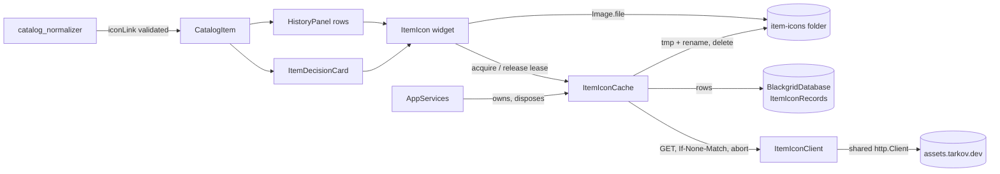
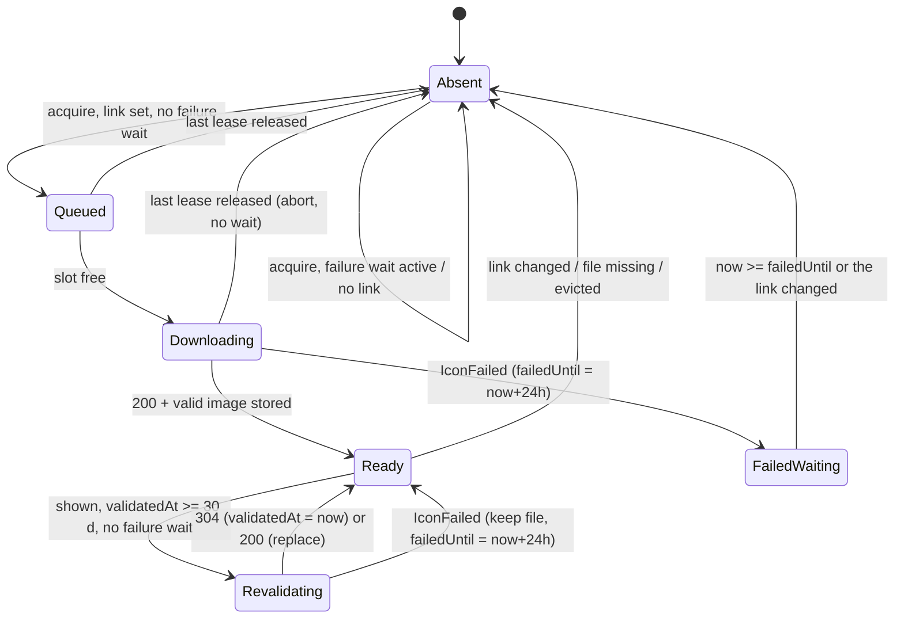
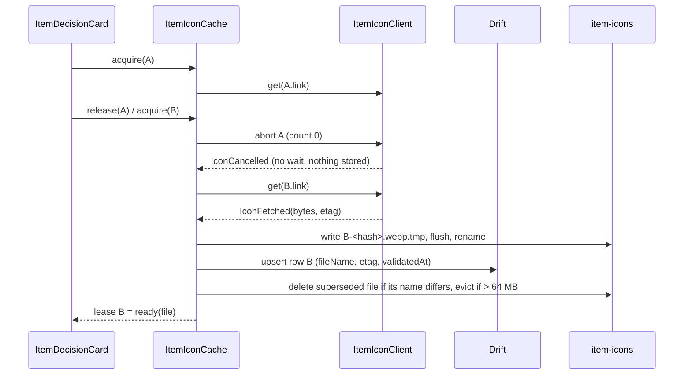
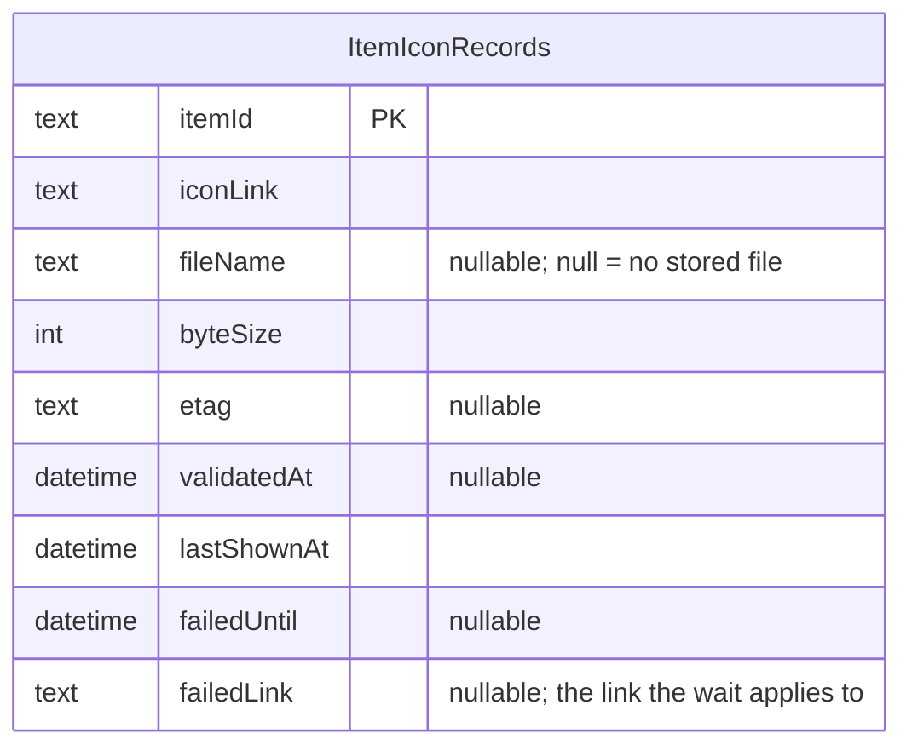

# Design

## Triage

| Trigger | Applies? | Evidence |
|---|---|---|
| T1 Components (new component, or 3+ with directed relationships) | yes | New `ItemIconClient`, `ItemIconCache` and `ItemIcon` widget, wired between `AppServices`, `BlackgridDatabase`, the catalog and two UI surfaces |
| T2 State (persistent state, caches, 3+ state machine) | yes | A new on-disk icon cache plus a new Drift table. Per-item states: absent, queued, downloading, ready, revalidating, failed-waiting |
| T3 Concurrency (background work, workers/isolates, async, retries) | yes | Concurrent downloads with a cap, shared in-flight requests, cancellation when nothing shows the item, a 24 h retry wait |
| T4 Boundaries (data format, migration, shared interface, IPC, external) | yes | Drift schema 2 → 3, a new catalog projection field, a new external host (`assets.tarkov.dev`), an on-disk file layout |
| T5 Volume (grows without a fixed bound) | yes | Cache files and metadata rows grow with every item shown |
| T6 Risk (security, money, data loss, unrecoverable user data) | yes | Untrusted network bytes are written to disk and decoded. The migration touches the database that holds user history and pins |

TIER: FULL

## Context

The proposal (`proposal.md`) states the what and the why. The code facts the approach needs:

- **The catalog** is downloaded from `json.tarkov.dev` and normalized off the UI isolate (`lib/data/catalog_client.dart:21-49`, `:90`).
  - `normalizeCatalog` builds `CatalogItem` from a fixed field list and drops the image links (`lib/data/catalog_normalizer.dart:93-130`).
  - `CatalogItem.fromJson` reads optional keys with nullable casts (`lib/domain/catalog.dart:99-114`).
  - `CatalogSnapshot.fromJson` rejects any `schemaVersion`/`normalizerVersion` other than 1 (`lib/domain/catalog.dart:366-369`). Bumping either would make every stored projection fail to load, so the new field must be additive.
  - `commitCatalog` rewrites the payload even when the revision is unchanged (`lib/data/database.dart:129-148`), so the next refresh replaces an old projection with one that has icon links.
- **The live catalog** (checked 2026-10-21, `regular/items`) has 5,480 items, all with an `iconLink`:
  - 5,359 are `https://assets.tarkov.dev/<id>-icon.webp`.
  - 121 point at the shared placeholder `https://assets.tarkov.dev/unknown-item-icon.jpg`.
  - None has a query.
  - A sample icon is 1,928 bytes, `image/webp`, with a strong `etag`. A conditional GET with `If-None-Match` returned `304`.
- **HTTP.** The clients take a raw `package:http` client through the constructor. They use `http.AbortableRequest` with `followRedirects = false` and a timeout that completes the abort trigger (`lib/data/catalog_client.dart:22-39`, `lib/data/tracker_client.dart:66-89`). The tracker already sends `If-None-Match` and handles `304` (`lib/data/tracker_client.dart:76`, `:122-123`). No client caps body size today (`openspec/architecture.md`, Resource bounds).
- **Composition** (ADR-0002) is hand-written in `AppServices`.
  - Optional directories fall back to the system temp folder for tests (`lib/application/app_services.dart:87-98`).
  - `open()` passes the real `LocalPaths` folders (`:177-194`).
  - `dispose()` closes the shared client last (`:320-349`).
- **Storage** (ADR-0003) is one Drift database. It is at `schemaVersion` 2 with snapshots in `drift_schemas/`, migration tests in `test/data/migration_test.dart`, and a refusal of newer on-disk versions (`lib/data/database.dart:81-101`).
- **Atomic file writes** in this repo use a temp file plus rename (`lib/application/output_path_guard.dart:87-109`, `lib/data/scan_frame_recorder.dart:470-471`).
- **UI.**
  - `ItemDecisionCard` draws a Material icon only in the wide Scanner layout and has no image slot in compact or narrow layouts (`lib/ui/item_decision_card.dart:202-256`).
  - `HistoryPanel` is a `ListView.builder` with a constant leading Material icon (`lib/ui/evidence_panels.dart:213-246`), so it builds only visible rows.
  - Selection switches are fenced by a generation counter, not cancelled (`lib/application/selection_controller.dart:128-224`).

## Decisions

### D1: The icon link rides on the catalog item as an optional, validated field

- **Choice:** Add `String? iconLink` to `CatalogItem`, with no change to `schemaVersion` or `normalizerVersion`.
  - The normalizer keeps a link only if `Uri.tryParse` gives scheme `https`, host `assets.tarkov.dev`, no port, no user info, no query and no fragment, and the path is not `/unknown-item-icon.jpg`. Otherwise the field is null.
  - A wrong type or a malformed link drops only the field. It never rejects the item or the catalog: icons are cosmetic and must not weaken catalog authority.
  - `fromJson` applies the same validation, so a tampered stored projection cannot inject another host.
- **Rejected:** A separate icon-link index fetched apart from the catalog (for example the GraphQL `items { id iconLink }` query) because it adds a second network authority and a second refresh cycle for data the catalog already carries.
- **Rejected:** Bumping the normalizer version because it makes every stored projection unreadable until a refresh succeeds, which breaks offline start.
- **Reversal cost:** low. The field is optional in the projection.

### D2: Icon metadata in a new Drift table, icon bytes as files

- **Choice:** Store the bytes as files in `%LOCALAPPDATA%\Blackgrid\item-icons\`.
  - Each file name is content-addressed and derives nothing from the raw item id: `<first 16 hex of sha256(itemId)>-<first 16 hex of sha256(bytes)>.<webp|png|jpg>`.
    - Item ids are catalog keys with no format check (`lib/data/catalog_normalizer.dart:93`), and the live catalog has a non-hex id, `customdogtags12345678910`. D1 treats a stored projection as untrusted, so the id never reaches a path.
    - Every path the cache writes, renames or deletes is built from such a name inside the folder.
  - A superseded file is deleted only when its name differs from the new `fileName`. A body byte-identical to the stored file has the same name: the cache keeps the file, does not rewrite it, and updates only `etag`, `validatedAt` and `iconLink`.
  - A new table `ItemIconRecords` holds one row per item: `itemId` (primary key), `iconLink`, `fileName?`, `byteSize`, `etag?`, `validatedAt?`, `lastShownAt`, `failedUntil?`, `failedLink?`.
  - This is Drift schema 3.
    - `onUpgrade` applies its steps in order from `from` to `to`: 1→2 creates `ImportRecords` (today's step, `lib/data/database.dart:85-90`), 2→3 creates `ItemIconRecords`. Any other range still throws.
    - `drift_schema_v3.json` and the generated `schema_v3.dart` are added.
    - The migration tests cover 2→3 and 1→3, each keeping existing preferences, activity and the active catalog. The existing v1→v2 test keeps passing.
  - Content addressing means a replaced icon gets a new path, so Flutter's `FileImage` cache (keyed by path) can never show stale bytes.
- **Rejected:** A JSON index file next to the icons because ADR-0003 rejected hand-written versioned JSON stores.
- **Rejected:** Storing the bytes as blobs in SQLite because the roadmap names a file folder, and blobs would move every image decode through the Drift isolate instead of `FileImage`.
- **Reversal cost:** medium. A schema step is permanent, but the table holds only re-downloadable cache data: a later version could drop it and empty the folder.

### D3: One owner, `ItemIconCache`, with leases

- **Choice:** `ItemIconCache` in `lib/application/` is the only writer of the folder and the table, and the only caller of the icon client.
  - Consumers call `acquire(itemId, iconLink)` and get an `ItemIconLease`: a `ValueListenable<ItemIconView>`, where the view is `generic` or `ready(File)`, plus `release()`.
  - The cache counts leases per item. One shared in-flight operation per item satisfies **One download per item at a time**.
  - When an item's count drops to zero before its download finishes, the request is aborted. This is how a newer scan cancels the older download: the card's lease for A is released when it shows B.
- **Rejected:** Selection-driven downloads (`SelectionController` asks for the icon of the selected item) because history rows also show icons and would need a second path. It would also couple the decision engine's controller to cosmetic network work.
- **Rejected:** A plain `Image.network`, because it has no disk cache, ETag handling, failure wait or size cap.
- **Reversal cost:** low. It is internal.

### D4: The `ItemIcon` widget binds an icon to its item

- **Choice:** One `ItemIcon(cache, item, size)` widget, used by both surfaces.
  - It acquires a lease in `initState` and in `didUpdateWidget` when the `itemId` or `iconLink` changes, and releases the old lease first.
  - It renders `Image.file(file, key: ValueKey(file.path), cacheWidth: …, errorBuilder: generic, frameBuilder: generic until the first frame)`.
  - Callers also key it by `itemId`, so a new item always gets a new element.
  - Together these mean the previous item's image is never drawn for a new item. A late completion for A updates only A's lease listeners.
- **Rejected:** Keeping the last image during the switch (`gaplessPlayback`) because it is exactly the stale-icon bug the exit criterion forbids.
- **Reversal cost:** low.

### D5: Bounded single-request client

- **Choice:** `ItemIconClient` in `lib/data/` sends one GET per call through the shared `http.Client` and the existing abort-trigger pattern. The numbers are stated once, here:
  - timeout **15 s**;
  - `followRedirects = false`;
  - `User-Agent: Blackgrid/<version>`, as the tracker client sends;
  - body cap **256 KiB**: reject at once on a larger `Content-Length`, otherwise count bytes while streaming and abort past the cap;
  - optional `If-None-Match`.

  It returns a sealed result: `IconFetched(bytes, etag?)`, `IconNotModified`, `IconFailed(kind)` or `IconCancelled`. `IconFetched` requires status 200 and a body that starts with the WebP (`RIFF....WEBP`), PNG or JPEG (`FF D8 FF`) signature. It does not trust `Content-Type`, because the placeholder JPEG is served as `binary/octet-stream`.
- **Rejected:** A second `http.Client` used only for icons because the shared client already pools connections, and `AppServices` owns one close point.
- **Reversal cost:** low.

### D6: Policy clock values

The cache applies these, reading time from the `AppServices` clock:

- **Revalidate** a shown icon when `now - validatedAt >= 30 days`.
- **Failure wait:** after any `IconFailed`, the cache sets `failedUntil = now + 24 h` and `failedLink` to the link that failed.
  - It is persisted, so it survives a restart.
  - It applies only while the item's current link equals `failedLink`. A new link from a committed catalog refresh clears it, which adds at most one request per item per refresh.
  - A cancel sets no wait.
  - The in-memory index records the wait before the database write, and keeps it even when that write fails (a full disk, for example). The wait then lasts for the process, so a failing database cannot turn into a request on every show.
- **Concurrency:** at most **4** network operations at once, in a FIFO queue. A queued item whose leases all drop leaves the queue without a request.
- **Budget:** after each stored icon, when the sum of `byteSize` is over **64 MB**, the cache deletes the least-recently-shown rows and files (never the icon just stored) until the sum is at or below 64 MB.
- **`lastShownAt`** is written on acquire only when the stored value is more than 1 hour old. This keeps a scrolled history list from writing a row per frame.

Rejected: an in-memory failure wait, because a restart loop (crash, relaunch) would re-request every failing icon and is the retry storm the exit criterion forbids. Reversal cost: low.

### D7: Disabled cache in tests and when the folder is unavailable

- **Choice:** `AppServices` takes an optional `ItemIconCache? itemIcons`.
  - `open()` builds a real one on `LocalPaths.itemIcons`.
  - Without one (existing harnesses), it uses `ItemIconCache.disabled()`, which always gives `generic` and sends nothing. Existing tests with strict `MockClient` request expectations stay unchanged.
  - If the folder cannot be created at start, the real cache also degrades to disabled, so start never fails over a cosmetic feature.
- **Rejected:** Defaulting to a temp folder like the scan logs, because existing widget tests would then send icon GETs to their mock clients.
- **Reversal cost:** low.

## Diagrams (FULL)

Components (T1):

Per-item state machine (T2):

Download and cancel sequence (T3):

Storage boundary (T4):

## State & Ownership (FULL)

| State | Owner (sole writer) | Lifetime | Invalidation / rebuild | Authoritative copy |
|---|---|---|---|---|
| `CatalogItem.iconLink` | catalog normalizer, through `CatalogController` | the catalog projection | replaced by the next committed refresh | the active projection in `CatalogRecords` |
| `ItemIconRecords` rows | `ItemIconCache` (serialised write queue) | until link change, eviction or a missing file | link change → file deleted and row reset; startup sweep reconciles rows and files | the database |
| Icon files in `item-icons\` | `ItemIconCache` | while a row names them | deleted on replace or evict; the startup sweep deletes `*.tmp` files and files no row names | the row (`fileName`); a file no row names is garbage |
| In-memory index (row mirror) | `ItemIconCache` | process | loaded at `open()`; updated after each database write succeeds, except a failure wait and a `304`'s validation time, which are recorded first and kept even if their write fails (D6) | the database, except for a failure wait or validation time that could not be persisted |
| Startup gate | `ItemIconCache` | until `open()` completes | `open()` loads the index and sweeps the folder before it returns. `AppServices.initialize` awaits it, and an `acquire` before then gets `generic` and enqueues nothing, so the sweep never races a download | memory only |
| Lease counts, in-flight operations, FIFO queue | `ItemIconCache` | process | dropped on dispose (all requests aborted) | memory only |
| `ItemIconView` per lease | `ItemIconCache` | while the lease is held | set by the cache; the widget only reads it | memory only |

## Failure & Visibility (FULL)

| Component | Fails / dies mid-operation → | Recovery | Retry safe? | Who finds out |
|---|---|---|---|---|
| `ItemIconClient` | timeout, transport error, bad status, redirect, oversize, non-image | `IconFailed` → 24 h wait for that item | yes, after 24 h (a GET is idempotent) | the user sees the generic icon; the row records `failedUntil` |
| `ItemIconCache` file write | crash between tmp write and rename, or before the database upsert | the startup sweep deletes `*.tmp` files and files no row names; the item downloads again when shown | yes | nobody needs to: there is no wrong output, at worst one more GET |
| Database upsert | fails after the rename | the new file is deleted in the same operation and the item is treated as failed (24 h); a crash instead leaves a file no row names, which the sweep deletes | yes | the generic icon |
| File missing or unreadable at display | user or antivirus deleted it | `errorBuilder` shows the generic icon, and the cache's `exists` check on acquire resets the row and downloads again | yes | the generic icon briefly |
| Undecodable image | stored bytes passed the signature check but do not decode | `errorBuilder` shows the generic icon. Not rewritten (see Mechanism Ledger) | n/a | the user sees the generic icon for that item |
| Folder cannot be created at start | permissions, disk | the cache runs disabled | n/a | the generic icon everywhere; the cause is printed once with `debugPrint` |
| Migration 2 → 3 | fails | Drift aborts the open, as for any migration failure today | no | the user (the app fails to open), as today |

## Resource Bounds (FULL)

| Queue / buffer / cache / transfer | Bound | At the bound | Timeout | At 10x / 100x |
|---|---|---|---|---|
| One icon response body | 256 KiB | abort, `IconFailed(oversize)` | 15 s per request | per item, so volume does not change it |
| Network operations in flight | 4 | FIFO queue | 15 s each | a queue as long as the visible rows plus the card (about 30), since only shown items enqueue |
| Pending queue | number of distinct items with live leases | entries leave when their leases drop | none needed | bounded by what is on screen |
| Disk cache | 64 MB of icon bytes | evict least-recently-shown until at or below 64 MB | n/a | the whole catalog is about 15 MB (5,480 × about 2-3 KB); 10x icon size is still bounded by eviction |
| `ItemIconRecords` rows | one per item ever shown or failed; at most the item ids of all catalogs | rows of evicted files are deleted; failure rows are reused per item | n/a | about 5,500 rows today, 55k at 10x: a few MB |
| In-memory index | same as rows | same | n/a | as above |
| Flutter `ImageCache` | the framework default, with `cacheWidth` at display size | framework LRU | n/a | small decoded images |
| Requests to tarkov.dev | about 1 per item ever shown, plus at most 1 per shown item per 30 days, plus at most 1 per failing item per 24 h | n/a | n/a | grows with what the user looks at, never with catalog size |

## Flow & State Gaps (FULL)

- **Concurrent acquires for one item** join the one in-flight operation (D3). A second acquire while the item is queued joins its queue entry.
- **The link changes while a download is in flight:**
  - An acquire with a different link for the same item aborts the old operation, as long as nothing still holds a lease on the old link.
  - The latest catalog wins: leases carry the link, and a completed fetch is stored only if its link equals the item's current requested link. Otherwise the result is discarded.
- **Out-of-order completion** (A completes after the card moved to B): only A's lease listeners update (D4). The B widget never reads A's lease.
- **Revalidation while the icon is shown** keeps the `ready` view, and switches to the new file only on a `200`.
- **A mode change, history inspection, or a catalog of another mode:** the card uses `selection.item`, which already comes from the inspection catalog, so its link is correct. History rows use the current catalog only when the modes match. Otherwise there is no lease and the generic icon shows.
- **Restart mid-download:** the operation is lost, with no wait set (it was a cancel). The sweep cleans `*.tmp` files.
- **Restart inside a failure wait:** `failedUntil` is persisted, so the item is not retried (spec scenario).
- **Clock moves backwards:** for a wait, `now < failedUntil` only lengthens it, with no retry storm. For revalidation, `now - validatedAt` becomes negative and revalidation is skipped until the clock passes 30 days. Both are safe directions.
- **Dispose with downloads in flight:** the cache aborts every request and awaits its write queue before `AppServices` closes the shared client and the database.

## Mechanism Ledger (FULL)

| Mechanism | Built? | Why (harm nobody catches / expensive later) | Evidence that would change the call |
|---|---|---|---|
| Persisted 24 h failure wait | yes | an in-memory wait loses to restart loops: a retry storm on a third-party host nobody here would see | none; the exit criterion requires it |
| Image signature check before storing | yes | an HTML error page with a 200 would be cached forever (no expiry) and shown as broken | none |
| Body size cap and no redirects | yes | untrusted bytes go to disk; a redirect could leave the allowed host | none |
| Content-addressed file names | yes | path-keyed `FileImage` would show stale bytes after a replace; renaming on change is cheap now, while changing the stored format later needs a migration | none |
| Startup sweep of `*.tmp` and files no row names | yes | otherwise the folder grows outside the budget with nobody noticing | none |
| Concurrency cap (4) with a queue | yes | a history list of 20 uncached rows would open 20 sockets to one host at start | none |
| `lastShownAt` write throttle (1 h) | yes | cheap; avoids a database write per row per rebuild | if profiling shows no write pressure, it could go |
| Re-download or invalidate on a decode failure | no | the signature check plus a complete-body write make undecodable files very unlikely; the fallback is the generic icon, which is honest | user reports of permanently blank icons → add invalidation on `errorBuilder` |
| Exponential backoff | no | one attempt per 24 h per item is already a strict bound | none |
| Persisting the memory index to speed startup | no | about 5k rows load in milliseconds on the Drift isolate | startup profiling showing otherwise |
| Diagnostics UI for icon failures | no | icons are cosmetic, and the generic icon is the visible signal | user asks; M4.5 change 7's diagnostics setting could show counts later |

## Risks / Trade-offs

- [tarkov.dev changes its icon URLs or host] → the links fail validation and the generic icon shows. A host change is a one-line allow-list edit plus a spec amendment.
- [Rights: Battlestate renders] → the icons are downloaded at runtime at the user's direction and never committed or bundled. The notices entry and the ADR record this. `bundle:check` already fails on undeclared bundled game artwork.
- [A database written by this version is refused by older builds] → this is the existing downgrade rule (`lib/data/database.dart:92-97`). The release notes for the version that ships this change mention it.
- [The `304` path depends on the CDN keeping strong ETags] → without an ETag, revalidation is a plain GET, at most once per 30 days per shown item. That is still bounded.
- [WebP decoding on Windows] → Flutter's engine codecs decode WebP. A widget test decodes a small synthetic WebP fixture so a regression is caught offline.

## ADRs

- **In force, constraining this change:**
  - ADR-0002: controllers, a hand-written composition root, generation fences.
  - ADR-0003: one Drift database, explicit migrations.
  - ADR-0004: the isolate model; Drift runs on its own isolate.
  - ADR-0005: maps have no runtime network. That ADR is about maps only, so this change does not conflict with it, and the new ADR says so.
  - ADR-0012: game artwork needs a notices entry.
- **To record during apply:** ADR-0022, "Item icons are downloaded from tarkov.dev at runtime into a bounded local cache". It records:
  - the host allow-list;
  - the cache folder, the table and the content-addressed names;
  - the 30-day revalidation, the 24 h failure wait and the 64 MB budget;
  - the rights position: downloaded at the user's direction, never bundled;
  - the amendment of the M1 plan's KTD8.

  The same task adds it to the architecture index, updates the Resource bounds rows (icon bodies are capped; the cache has a budget), and adds a dated note under KTD8 in `docs/plans/2026-10-06-0242-feat-m1-manual-item-decisions-plan.md` that points to ADR-0022.
