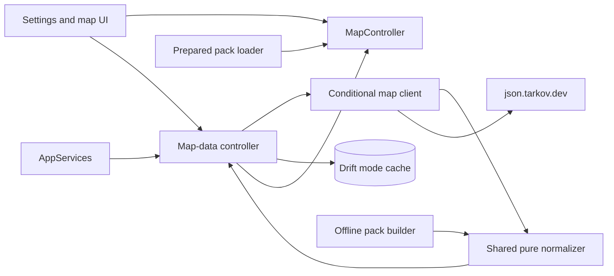
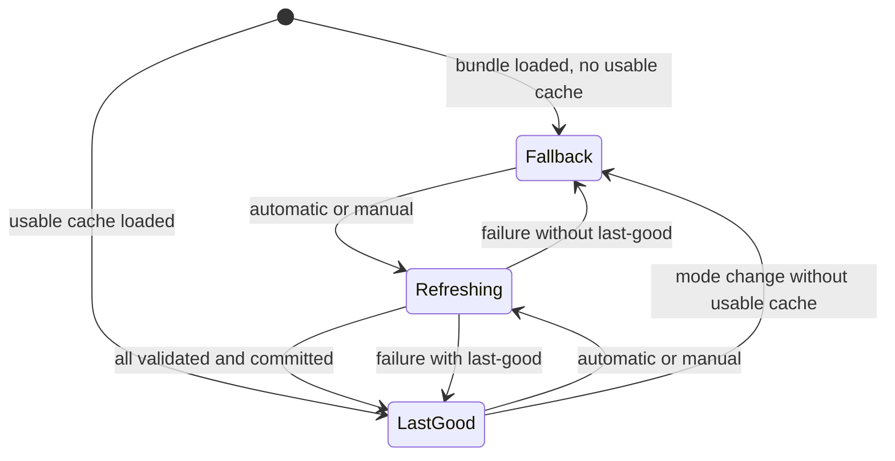
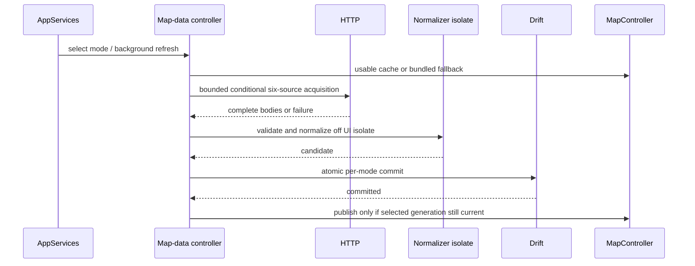
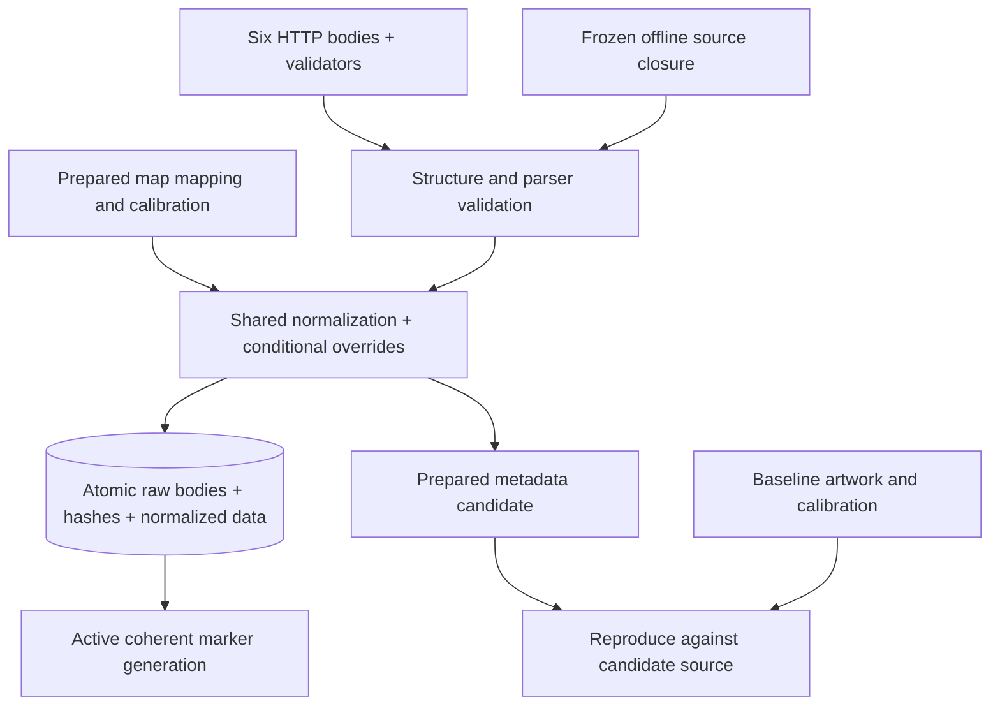

# Design

## Triage

| Trigger | Applies? | Evidence |
|---|---|---|
| T1 Components | yes | New map-data controller/client/store and shared normalizer connect AppServices, map, Settings and offline builder. |
| T2 State | yes | `lib/data/database.dart:195-255` has mode caches; this adds persistent snapshots and refresh states. |
| T3 Concurrency | yes | Startup, mode switches, HTTP, database and isolate normalization overlap (`lib/application/app_services.dart:272-298`). |
| T4 Boundaries | yes | Six external JSON resources, SQLite migration, isolate messages and shared offline/runtime normalization. |
| T5 Volume | yes | Upstream collections can grow; transfer and work must be bounded. |
| T6 Risk | yes | SQLite contains irreplaceable pins and other user data, so a cache migration must preserve them. |

TIER: FULL

## Context

See `proposal.md` for scope and the three delta specifications for normative behavior. `PreparedMapPackLoader` loads the active bundled generation and its map inventory (`lib/maps/prepared_map_loader.dart:28-149`); `PreparedMap` combines scene properties and markers (`lib/maps/prepared_map.dart:300-360`). `MapController` binds these and caches projected marker positions (`lib/application/map_controller.dart:155-224`); `map_workspace.dart` uses it for browsing and rendering. `CatalogController` already demonstrates per-mode singleflight and generation fences (`lib/application/catalog_controller.dart:33-167`); `AppServices` owns background refresh and lifetime, and `settings_dialog.dart:189-237` provides the existing separate item-data action. `database.dart:195-255` shows transactional mode cache persistence. `tool/maps/pack.dart:1220-1285,2050-2310` already derives quests and marker facts from the six sources. The active bundled pack remains indispensable for artwork and is never replaced by a cache.

A live regular-mode probe supplied by the orchestrator observed six HTTP 200 JSON responses with ETags followed by 304 on revalidation: maps 9,053,178 bytes, maps_en 24,204, tasks 2,116,046, tasks_en 252,682, traders 58,898 and traders_en 3,537. The maps root has `data.maps`; tasks has `data.tasks` and `data.questItems`; trader data is an object keyed by IDs, not `data.traders`; English `data` values are dictionaries. Other observed roots and keys are not themselves required merely because present. Probe evidence is not a frozen content contract.

## Decisions

### S1: Effective-mode snapshots
- **Choice:** Independent regular, PvE and seasonal PvP snapshots, with honestly labelled regular bundled fallback.
- **Rejected:** One regular snapshot for every mode because it misstates the selected mode's facts.
- **Reversal cost:** medium.
- **Important:** yes, visible behavior and future contract.
- **Chosen by:** user.

### S2: Last-good without expiry
- **Choice:** Usable last-good data remains usable regardless of age; otherwise use the bundle.
- **Rejected:** Expire or discard old data on failure, which loses valid offline information.
- **Reversal cost:** low.
- **Important:** yes, visible behavior.
- **Chosen by:** user.

### S3: Immediate coherent activation
- **Choice:** Publish complete content immediately, preserve view and user state, clear marker selection on content replacement.
- **Rejected:** Wait for restart, leaving corrected data unapplied.
- **Reversal cost:** medium.
- **Important:** yes, visible behavior and publication contract.
- **Chosen by:** user.

### S4: Independent refresh and status
- **Choice:** Background startup/mode refresh and separate Settings action/status; no polling, auto-retry or toggle.
- **Rejected:** Combined item/map control, which conflates independent failures.
- **Reversal cost:** low.
- **Important:** yes, visible behavior.
- **Chosen by:** user.

### S5: Prepared artwork boundary
- **Choice:** Only metadata refreshes; artwork inventory, calibration and labels remain prepared.
- **Rejected:** Runtime artwork acquisition or automatic new-map integration, which crosses the calibrated-art boundary.
- **Reversal cost:** high; this is a user-approved scope and boundary rather than a weak-evidence choice.
- **Important:** yes, binds future changes.
- **Chosen by:** user.

### S6: Upstream owns metadata content
- **Choice:** Admit structurally valid current metadata changes in both runtime and offline workflows; make historical floor overrides conditional.
- **Rejected:** Historical identities, counts, coordinates or hashes as admission criteria, which reject legitimate upstream changes.
- **Reversal cost:** medium.
- **Important:** yes, visible behavior and future contract.
- **Chosen by:** user.

### S7: Runtime facts derived from cached sources
- **Choice:** Keep complete facts per marker, sharing each frozen task, objective or location between the markers that refer to it. Cache only the six source bodies and re-derive markers on every load. No resource budget beyond the acquisition limits.
- **Rejected:** A compact fact pool with lightweight references, a versioned runtime codec and 256 MiB/64 MiB materialization and serialization budgets. Superseded on 2026-11-07: its conservative accounting rejected the complete baseline dataset on the second refresh ("Materialized live-map data exceeds its configured limit"), while the bundled manifest already loads the same expanded markers. The user asked to remove the budget and the compact representation.
- **Reversal cost:** low; the cache holds only sources.
- **Important:** yes, user-visible failures and cache contract.
- **Chosen by:** user.

### D1: Transactional mode cache
- **Choice:** Add Drift cache tables storing the six raw bodies, their validators and the check time per mode; commit atomically separately from user records. Markers are re-derived from the bodies on load, so no normalized payload, digest or compatibility fingerprint is stored.
- **Rejected:** Separate cache files and pointer, requiring another atomicity/recovery protocol beside SQLite.
- **Reversal cost:** medium.
- **Important:** yes, stored data contract.
- **Chosen by:** user.

### D2: Shared pure normalization
- **Choice:** Extract the existing marker and quest normalization from `tool/maps/pack.dart` to a runtime-safe pure Dart module used by both builder and runtime; apply conditional overrides there.
- **Rejected:** A new runtime-only parser, which would diverge on label rules, boss multiplicity and floor handling.
- **Reversal cost:** medium.
- **Important:** yes, shared boundary and output contract.
- **Chosen by:** user.

### D3: Six-source conditional transaction
- **Choice:** Revalidate each of six mode endpoints with ETag, otherwise Last-Modified, otherwise unconditional; reuse a usable cached body for 304 only, then normalize and commit the complete candidate.
- **Rejected:** Independent per-source activation or full unconditional downloads, which risk mixed generations or waste repeated transfers.
- **Reversal cost:** medium.
- **Important:** yes, external/cache protocol.
- **Chosen by:** user.

### D4: Supersede only obsolete ADR boundaries
- **Choice:** During apply record a new ADR partly superseding ADR-0005's offline-only marker boundary and ADR-0034's runtime-data prohibition and historical marker-preservation gate, and update the architecture index. Retain artwork preservation and ADR-0033 frozen reproduction.
- **Rejected:** Rewrite accepted ADRs or retain their contradictory marker restrictions, which destroys history or prevents the approved change.
- **Reversal cost:** medium.
- **Important:** yes, durable architectural boundary.
- **Chosen by:** user.

### D5: Normalize off the UI isolate with shared frozen facts
- **Choice:** Normalize and parse markers in one `Isolate.run`, freezing nested facts through an identity memo so markers that share a source record share its frozen copy. The result returns to the UI isolate without a copy. The frozen offline format is unchanged.
- **Rejected:** The compact fact pool, runtime codec and incremental budgets of the earlier D5 (superseded with S7 on 2026-11-07), and a long-lived worker isolate.
- **Reversal cost:** low.
- **Important:** yes, cache/publication contract.
- **Chosen by:** user.

### Decision summary

| # | Decision | Choice | Rejected | Reversal cost | Important | Chosen by |
|---|---|---|---|---|---|---|
| S1 | Mode | Independent snapshots and honest fallback | One regular snapshot | medium | yes | user |
| S2 | Fallback | Last-good regardless of age | Expiry or discard | low | yes | user |
| S3 | Activation | Immediate coherent swap | Restart activation | medium | yes | user |
| S4 | Scheduling | Separate background/manual status | Combined item refresh | low | yes | user |
| S5 | Artwork | Prepared-only artwork and labels | Runtime artwork admission | high | yes | user |
| S6 | Content | Accept structurally valid upstream evolution | Historical content gates | medium | yes | user |
| S7 | Runtime facts | Complete per-marker facts re-derived from cached sources; no materialization budget | Compact fact pool with 256/64 MiB budgets (superseded 2026-11-07) | low | yes | user |
| D1 | Cache | Atomic Drift mode snapshots of sources and validators | Separate files or stored normalized data | medium | yes | user |
| D2 | Parser | Shared pure normalizer | Parallel parsers | medium | yes | user |
| D3 | HTTP | Six conditional bodies as one transaction | Partial activation/unconditional only | medium | yes | user |
| D4 | ADR | Superseding ADR and index | Rewrite or retain conflict | medium | yes | user |
| D5 | Representation | One off-UI isolate run with identity-shared frozen facts; frozen offline output unchanged | Compact pool, runtime codec and budgets (superseded 2026-11-07) | low | yes | user |

## Diagrams (FULL)

### T1: Components

### T2: State

### T3: Concurrency

### T4: Data boundary

## State & Ownership (FULL)

| State | Owner (sole writer) | Lifetime | Invalidation / rebuild | Authoritative copy |
|---|---|---|---|---|
| Mode cache: bodies, validators, check time | Map-data controller through Drift transaction | Durable, one per supported mode | Replace only as complete transaction; an incomplete or unparsable cache is not shown and a refresh still runs | Committed SQLite row/set for that mode |
| Effective mode and refresh operation/status | Map-data controller, composed by AppServices | App lifetime | Selection generation changes; dispose cancels/ignores late work | Controller for current mode; cache is durable evidence |
| Active marker generation and projections | MapController | App lifetime | Atomically swap inventory; clear position cache, selection and linked highlights; recompute all queries | Current immutable snapshot, or loaded bundle fallback |
| Map view, selected floor and pin/filter settings | Existing map/settings owners | Session or existing durable lifetime | Existing user actions only; metadata replacement does not reset | Existing settings/SQLite and view state |
| Artwork, map geometry and calibration | Offline pack tooling | Bundled generation | Existing explicit validated promotion | `active.json` and its generation |
| Frozen metadata source closure | Offline pack tooling | Candidate/generation | New acquisition or explicit rebuild | Candidate's carried source bytes and hashes |

**Cache contents.** Store only the six source bodies, their validators (which may be absent) and the check time per mode. Markers are re-derived from the bodies by the current normalizer and active pack on every load, so a normalizer or calibration change needs no fingerprint or invalidation: the next load applies it. An incomplete cache reads as absent; one that fails normalization is not shown, its failure is reported and a refresh still runs. Schema v6 replaces the pre-release v5 cache tables (v5 never shipped in a release) and preserves preferences, pins, history and other existing records. Rollback leaves the prior snapshot usable.

**Shared normalization and offline cutover.** Separate source decoding/normalization from file I/O and compiler-dependent code in `tool/maps/pack.dart`; both callers pass the six bodies and prepared mapping/calibration inputs. Validate only roots, keys and field types actually needed by the parser. Present-but-empty collections and dictionaries are valid. An absent member in a valid dictionary or a removed referenced quest, trader, item or translation ID is content evolution, not an absent required root or a historical referential-completeness failure: retain existing unavailable-name or optional-fact omission behavior and never invent facts. Fail on malformed present consumed records; do not drop them silently. Supported artwork inventory drives display: absent source map yields empty markers; unsupported source maps do not become display maps. Retain existing category and translated-name derivation, quest and trader linkage, deterministic IDs and every source boss position occurrence, including duplicates. Validate candidate output against its own source, not against historical semantic facts.

For historical overrides, find the marker in the new normalized source, then match the reviewed identity and placement evidence. Interchange's console requires the matching complete `sourceVolume`/outline; Icebreaker Helicopter and C-1, which lack that volume, require matching bundled reviewed identity and position/height and relevant source/key identity evidence (`docs/qualification/m3/PLACEMENT_CONTROLS.md:35-44,90-113`). A missing or changed record gets no override and uses `MapFloorSelection`'s existing floor/height policy. Do not insert a marker because an override exists or reject a candidate because the override no longer applies. Retain provenance for matching overrides; source parity is not independent placement proof.

Update offline metadata renewal, validation, preservation and fresh-artwork staging entry points in `tool/maps/pack.dart` to stop treating source-map completeness and reviewed marker ownership as historical metadata gates. Preserve independent complete artwork identity/admission, verified active baseline, six-source replacement, nonmetadata bytes/properties, source closure, hashes and exact-candidate promotion. Frozen checks compare each candidate to its own recorded bytes, and reproduction remains byte-for-byte; they never compare a fresh response to old content hashes. Existing builder fixtures and regression assertions that freeze historical marker content must be revised to test source fidelity and S6 instead.

**Runtime representation.** Markers keep complete facts. Normalization and marker parsing run together in one `Isolate.run`; parsing freezes nested maps and lists through an identity memo, so markers that share a task, objective or location share one frozen copy, and the result returns to the UI isolate without a copy. Marker occurrence IDs, category/filter keys, display names, positions, outlines, height/floor policy, source paths and complete `source.originalIdentity` tuples are those of the shared normalizer. Search keeps its existing per-marker representation. No quest-tracking feature is added. Duplicate marker IDs reject the candidate.

**Publication.** AppServices loads the bundle as before and starts background work without awaiting network. After pack load, resolve effective mode and load its cached data; a publication counter prevents an older cache read from replacing a newer publication. Unknown mode makes no mode-specific request and shows labelled regular bundled fallback until effective mode becomes known. On selected-mode changes, immediately show the bundled fallback, then the new mode's own cache if usable, then schedule refresh. Commit may complete for an obsolete mode as that mode's last-good data, but cannot publish into the current display. `MapController` swaps one immutable inventory across maps, rebuilds derived categories/projections and invalidates `_markerPositions` even if map ID is unchanged; all marker lookup, browser, hit tests, filters and popup metadata read that same generation. Preserve map, transform, floor, pins and filter preferences. Clear selection only on content replacement, not a 304 check with unchanged content; stale browser results are generation-fenced. Do not reload artwork or conceal pack load errors.

## Failure & Visibility (FULL)

| Component | Fails / dies mid-operation → | Recovery | Retry safe? | Who finds out |
|---|---|---|---|---|
| Bundle loader | Missing/incompatible active pack → map unavailable, not replaced by metadata cache | Existing pack repair/reinstall | Existing loader retry | User sees map load error |
| Cache read | Incomplete cache reads as absent; unparsable cache → not shown, bundled fallback stays | Fresh explicit/automatic refresh | Yes; no automatic retry after failure | User sees source and cache failure in map-data status |
| HTTP client | Request, limit, redirect, deadline or unusable 304 → abort candidate | Keep last-good or bundle; next user trigger/mode selection | Yes, explicit next trigger only | User sees map-data failure and last check |
| Normalizer/isolate | Missing required shape, invalid record, duplicate marker ID or worker failure → discard candidate before commit | Keep last-good or bundle and existing active markers | Yes with new source or explicit trigger | User sees source-specific error |
| Drift transaction | Commit error or interruption → rollback six sources and snapshot row | Existing last-good remains; restart reads committed state | Yes | User sees storage failure |
| Controller/disposal | Mode superseded or disposed while work runs → no stale publication | New mode selection starts its own work; cancel resources | Yes, new trigger only | Status stays specific to current mode |
| Offline tooling | Invalid frozen input, source mismatch or artwork drift → no promotion | Correct offending input/config and rebuild | Yes | Operator gets offending path/property and active generation remains |

## Resource Bounds (FULL)

Normative HTTP limits are owned by `runtime-map-data`'s acquisition resource-bound requirement; conditional request behavior is owned by its conditional acquisition requirement. Limits apply to decoded transfer bytes, including reused cached bodies in the total, and are enforced while streaming, not after allocating an unlimited body. The overall deadline covers the six downloads. Requests are abortable; a deadline or controller close aborts the request in flight. A transaction already begun is awaited to its atomic outcome and never publishes after its fence.

Normalized markers have no separate budget. The 64 MiB transfer cap bounds the input, and the expanded result is the same shape the bundled manifest already loads. The superseded 256 MiB/64 MiB materialization and serialization budgets rejected the complete baseline dataset on repeat refreshes and were removed on 2026-11-07.

| Queue / buffer / cache / transfer | Bound | At the bound | Timeout | At 10x / 100x |
|---|---|---|---|---|
| Transfers | Spec's per-body and aggregate caps; six bodies only | Abort candidate, preserve last-good | Spec's request and overall deadlines | The observed ~9 MiB maps body would exceed the cap at 10x or 100x: explicit resource rejection, not a claim that content is semantically invalid. |
| Refresh admission | At most one refresh per mode (three in all); same-mode calls join | A superseded mode's refresh finishes and commits for that mode but does not publish | Each refresh has its own download deadline | Mode churn cannot exceed three concurrent downloads. |
| Normalization | One `Isolate.run` per load or refresh; input bounded by the transfer cap | Failure discards the candidate; retain authority | None beyond the download deadline | Grows with source content like the bundled manifest; facts shared by identity. |
| Durable cache | One six-body snapshot per each of three modes, each within the transfer cap; no history | Atomic replacement, no age eviction | None | At most 3 × 64 MiB of source bodies. |
| In-memory inventories and projections | Current inventory plus in-flight candidates | Discard superseded candidate/read result | None | Same scale as the bundled inventory. |

## Flow & State Gaps (FULL)

- **Partial responses:** Keep per-response bodies and validators private until every response has completed, passed source checks and normalized. No earlier HTTP success changes cache or UI. A 304 without a cached body fails without retry. A 200 replaces both body and corresponding validators, including clearing an absent validator; a 304 updates only validators actually returned while retaining the body.
- **Singleflight:** Concurrent same-mode requests join one result. Different modes may refresh concurrently. Closing the controller aborts downloads; a late answer for a superseded mode commits for that mode but cannot publish. Manual joining reports the same outcome.
- **Mode switch and late loads:** Advance the selection generation before asynchronous reads; fence cache read, refresh result, status and map publication independently. A prior mode may commit a complete result for itself only if still the latest operation for that mode. A cache read started before a newer commit cannot revert the active generation.
- **Restart or disposal:** Before commit, candidate data is disposable. During commit SQLite recovers all-or-nothing; after commit, next startup reads the complete result. Dispose stops admission, cancels network/worker, closes listeners before database/client shutdown, and suppresses stale notifications.
- **Unchanged versus changed content:** Compare the candidate's six source bodies with those of the published snapshot to decide whether marker content was replaced. This comparison controls selection clearing only, never admission. Update successful last-check/status even when content is unchanged. A failed check changes status, not authority.
- **Modes and pack errors:** Unknown effective mode uses explicitly labelled regular fallback, no guessed endpoint. Any active-pack load error remains visible even if metadata cache exists. No older asset generation is loaded.

## Mechanism Ledger (FULL)

| Mechanism | Built? | Why (harm nobody catches / expensive later) | Evidence that would change the call |
|---|---|---|---|
| One SQLite transaction and schema migration | yes | Partial bodies/normalized records can appear complete after crash; user data must survive migration. | A different durable storage architecture. |
| Per-body hashes and compatibility fingerprint | no | Markers are re-derived from the cached bodies on every load, so no normalized form can go stale; SQLite guards storage integrity. | Storing a derived form again. |
| Per-mode singleflight and selection fences | yes | Mode switches and delayed cache/network responses can publish the wrong mode. | Demonstrably serialized lifecycle without them. |
| Streaming byte/time caps and disposal | yes | External inputs and stalled streams can exhaust memory or hang the refresh. | Measured resource limits and a replacement bounded transport. |
| Incremental expanded-data accounting and compact fact pool | no (removed 2026-11-07) | Its conservative charges rejected the complete baseline dataset on repeat refreshes; identity-shared frozen facts keep the bundled-manifest footprint. | Measured memory exhaustion from real upstream data. |
| Shared parser and candidate-source fidelity | yes | Two normalization conventions diverge and valid corrupt output could be accepted. | A separately specified equivalent shared contract with proof. |
| Conditional reviewed overrides | yes | Old floor ownership can misplace or recreate changed markers; rejecting all changes violates S6. | New independent reviewed floor evidence for changed identities. |
| Historical content equality, count thresholds or old hashes | no | They cannot distinguish legitimate upstream changes from corruption; frozen candidate integrity already detects mutation. | A separately user-approved content-authority contract. |
| Polling, auto-retry, expiring cache and toggle | no | Not required and would introduce extra traffic or user-visible authority changes. | New approved product requirement. |
| Separate offline promotion transaction | no | Existing promotion already protects active assets and supports recovery. | Evidence existing transaction cannot enforce the preservation boundary. |

## Risks / Trade-offs

- Upstream changes can be structurally valid but wrong → display sourced facts honestly; no historical semantic gate can establish truth. User can see source/check/error; artwork remains separately reviewed.
- A stale but valid cache may remain old indefinitely → expose last check and separate manual refresh rather than silently expiring it.
- Shared extraction can perturb frozen output → retain candidate-source fidelity and byte-identical frozen rebuild; regression tests cover categories, quests, duplicate boss positions, empty map/task collections and dictionaries, changed or missing translation/reference IDs, and all three conditional overrides with reviewed markers unchanged, removed, moved and with changed volume.
- Transfer caps reject sufficiently large valid datasets → report the failure and preserve last-good, not historical content gates. Qualify the complete active frozen source closure through the runtime builder against the bundled markers. Use handwritten fakes, no sleeps or app launch.
- Mode churn and cache reads can race publication → per-mode singleflight plus selection and publication counters; deterministic tests use handwritten fakes and controllable futures, no sleeps.
- Schema migration threatens user data if implemented incorrectly → a migration that touches only the cache tables and pinned migration checks, testing preservation of existing user rows at the lowest practical layer.

## ADRs

- **In force, constraining this change:** ADR-0002 (composition and fences), ADR-0003 (single transactional Drift store), ADR-0004 (bulk work off UI), ADR-0005 and ADR-0033 (prepared artwork and immutable active pack), ADR-0034 (six-source frozen renewal and nonmetadata preservation, except portions to be superseded).
- **To record during apply:** A new accepted ADR partly superseding ADR-0005's offline-only marker-data boundary and ADR-0034's runtime-data prohibition and historical marker-preservation requirement, while retaining its nonmetadata preservation and frozen-source guarantees. Update `openspec/architecture.md` and the ADR index; do not edit accepted ADRs.

## Open Questions

None affecting the approved scope or approach.
