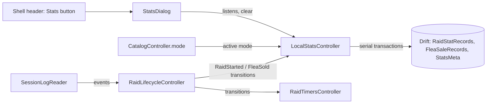

# Design

## Triage

| Trigger | Applies? | Evidence |
|---|---|---|
| T1 Components (new component, or 3+ with directed relationships) | Yes | New `LocalStatsController` fed by `RaidLifecycleController`, reading `CatalogController.mode`, writing `BlackgridDatabase`, read by a new Stats dialog. |
| T2 State (persistent state, caches, 3+ state machine) | Yes | Three new Drift tables, among them the durable clear watermark. |
| T3 Concurrency (background work, workers/isolates, async, retries) | Yes | Async Drift writes on the background isolate (`database.dart:129`), fed by a synchronous broadcast stream (`raid_lifecycle_controller.dart:22`); a clear can race in-flight writes. |
| T4 Boundaries (data format, migration, shared interface, IPC, external) | Yes | Drift schema 3→4 with a new `drift_schemas/drift_schema_v4.json`. `LogRecordId` becomes stored data (ADR-0030 Consequences). `RaidTransition` gains a case. |
| T5 Volume (grows without a fixed bound) | Yes | One row per raid and per sale, for as long as the player plays and does not clear. |
| T6 Risk (security, money, data loss, unrecoverable user data) | Yes | Stats cannot be recreated once cleared or lost: the reader only reads the newest folder. |

TIER: FULL

## Context

- The reducer drops `FleaSale` (`lib/domain/raid_lifecycle.dart:588-591`). It publishes `RaidStartedTransition` with the raid's start identity, once per raid start (`:487-493`). A rejoin after a client restart, while Blackgrid kept running, continues the interrupted raid with no new transition (`:722-733`, `:766-775`). A fresh Blackgrid that only sees the new folder publishes that rejoin as a new raid with entry `reconnect` (`:735-748`).
- `RaidLifecycleController` republishes transitions on a synchronous broadcast stream (`raid_lifecycle_controller.dart:20-46`). `RaidTimersController` already consumes it with an exhaustive switch (`raid_timers_controller.dart:103-110`), and is subscribed before the reader binds (`app_services.dart:93-103`).
- `SessionLogReader` replays the newest folder at bind and after an application-log rewrite (`LogInputReset`), with identities `(folder, file, offset)` (ADR-0030 D5). Older folders are never read.
- The database is one Drift store (ADR-0003), schema 3, migration steps in `database.dart:134-150`, migration tests through `SchemaVerifier` (`test/data/migration_test.dart:20-95`). Every write is a transaction.
- `HistoryController` is the pattern for a DB-backed controller with an `error` string (`history_controller.dart:7-60`).
- The app's active mode is `CatalogController.mode` (`catalog_controller.dart:45`), the same source the timers use (ADR-0031).
- Labels: `mapLabel`, `modeLabel`, `localTimeLabel` in `lib/ui/labels.dart`.

## Decisions

### D1: Flea sales travel as a lifecycle transition

- **Choice:** add `FleaSoldTransition(id, time, itemId, count, roubles, mode)` to the sealed `RaidTransition`. `reduce` publishes it for `FleaSale` with `state.sessionMode`, leaving the state unchanged. The stats controller consumes only `transitions`.
- **Rejected:** the stats controller also subscribes to `SessionLogReader.events` and tracks the session mode itself, because it would duplicate the reducer's mode bookkeeping and its reset handling, and the two subscriptions could order raid starts and sales differently.
- **Reversal cost:** low (internal API; `RaidTimersController` ignores the new case).

### D2: An idempotent ledger keyed by record identity, not counters

- **Choice:** one row per counted raid (`RaidStatRecords`) and per sale (`FleaSaleRecords`), primary key `(folder, file, offset)`, inserted with insert-or-ignore. Totals are `GROUP BY` queries per mode. Times are stored as integer milliseconds since the epoch, so the watermark compares at the log's millisecond precision rather than Drift's default whole seconds.
- **Rejected:** per-mode counters (`raids[map]++`, `roubles += n`) with a separate "seen ids" set, because a counter cannot tell a replay from a new event without the set anyway, and a counter and its set written apart could drift. The ledger is also what M15's raid history extends.
- **Reversal cost:** high once shipped (stored format; ADR-0030 already marks `LogRecordId` as durable once stored). The evidence is in hand: replay at every bind is the reader's contract.

### D3: The clear is a durable watermark written with the delete

- **Choice:** a one-row `StatsMeta(id = 0, clearedAtMs)` table. Clear deletes both ledgers and upserts the watermark (the injected clock's now) in one transaction. Every insert reads the watermark in its own transaction and skips a record whose log time is at or before it.
- **Rejected:** keeping the cleared record identities as tombstones, because the tombstone set grows forever and a rewritten log restarting at offset 0 could collide with a tombstone of a different record.
- **Reversal cost:** medium (stored format; a later switch would need a migration).

### D4: One serial write queue in the controller

- **Choice:** `AppServices` builds `LocalStatsController` in its constructor, beside `RaidTimersController` and before `MapSessionController` binds the reader, because the transitions stream is a synchronous broadcast that does not buffer (`raid_lifecycle_controller.dart:20-23`, `app_services.dart:91-102`); a later build would miss the startup replay. It is disposed with the other controllers, after its queue stops accepting work and before the database closes. `LocalStatsController` chains every insert and the clear on one `Future` in transition order, so a clear lands after the writes published before it. After each write and after a mode change, it reloads the active mode's totals; reloads coalesce (one reload pending at a time).
- **Rejected:** firing each write unawaited, because Drift would still serialise transactions, but the reconnect rule's "newest stored raid" read could run before an earlier raid's insert committed.
- **Reversal cost:** low.

### D5: The reconnect rule lives in the insert transaction

- **Choice:** for a raid with entry `reconnect`, the insert transaction reads the newest stored raid of the same mode whose start is strictly before the reconnect's start, and skips the insert when it is on the same map and started at most 2 hours before. Raids stored later in log time never affect the decision, so a replay (which re-meets the same earlier rows) decides the same way even after later raids were stored. The pure decision (`countsReconnect(previous, candidate)`) is in `lib/domain/local_stats.dart`, so its permutations are tested without a database; the replay-after-a-later-raid case is also a database ledger test.
- **Rejected:** skipping every reconnect, because a reconnect after Blackgrid was closed for the whole raid start is the only record of that raid; counting every reconnect double-counts a raid continued after both apps restarted. Also rejected: storing a skipped reconnect as a "not counted" row, because it adds a column every total must filter, while comparing only against earlier starts gives the same replay stability with no extra stored state.
- **Reversal cost:** low (the 2-hour window is one constant; changing it never rewrites stored rows).

### D6: The dialog reads the controller, the shell owns the button

- **Choice:** a "Stats" `OutlinedButton` beside Settings in the shell header opens `StatsDialog`, which listens to `LocalStatsController` (totals, `since`, `error`). Clearing goes through an `AlertDialog` confirmation.
- **Rejected:** a section in the Settings dialog, because stats are data, not preferences, and the Settings dialog already holds raid timers, logs and Tracker.
- **Reversal cost:** low.

## Diagrams (FULL)



```mermaid
sequenceDiagram
  participant L as Lifecycle
  participant S as LocalStatsController
  participant D as Database
  L->>S: RaidStartedTransition(id, time, raid)
  S->>D: txn: read clearedAt; time <= clearedAt? skip
  S->>D: reconnect? newest raid of mode starting before it; same map within 2 h? skip
  S->>D: INSERT OR IGNORE (folder, file, offset)
  S->>D: reload totals(active mode)
  Note over S,D: Clear: txn delete both ledgers + upsert clearedAt = now
```

Data model (schema 4):

| Table | Columns | Key |
|---|---|---|
| `RaidStatRecords` | folder, file, offset, mode, mapId?, startMs, entry | (folder, file, offset); index (mode, startMs) |
| `FleaSaleRecords` | folder, file, offset, mode, timeMs, itemId, count, roubles? | (folder, file, offset); index (mode) |
| `StatsMeta` | id = 0, clearedAtMs? | id |

`mode` is the `GameMode` name, `unknown` when the transition had none; `file` and `entry` are enum names.

## State & Ownership (FULL)

| State | Owner (sole writer) | Lifetime | Invalidation / rebuild | Authoritative copy |
|---|---|---|---|---|
| Raid and sale ledgers | `LocalStatsController`, through `BlackgridDatabase` stats methods | Durable until cleared | Rows never change; only inserted or cleared | The database |
| Clear watermark | `LocalStatsController.clear` only | Durable | Moves only on clear | The database |
| Shown totals and `since` | `LocalStatsController` | Memory | Reloaded after each write, clear and mode change | The database |
| `readError` | `LocalStatsController` | Memory | Set by a failed totals read; cleared only by the next successful read | — |
| `writeError` | `LocalStatsController` | Memory | Set by a failed insert; cleared only by the next successful insert (reloads never touch it) | — |
| `clearError` | `LocalStatsController` | Memory | Set by a failed clear; cleared by the next successful clear or by the dialog's `dismissClearError()` when it closes | — |

## Failure & Visibility (FULL)

| Component | Fails / dies mid-operation → | Recovery | Retry safe? | Who finds out |
|---|---|---|---|---|
| Insert transaction | Rolled back; that raid or sale is not stored | The next replay of the same folder (next start) inserts it again if after the watermark | Yes (insert-or-ignore) | User: "Some raids or sales could not be saved." in the dialog |
| Clear transaction | Rolled back: ledgers and watermark unchanged | User presses Clear again | Yes | User: "Stats could not be cleared." |
| Totals read | Previous totals kept | Next write or mode change reloads | Yes | User: "Stats could not be read." |
| App closed with writes queued | Queued writes lost | Next start replays the newest folder; records after the watermark are stored | Yes | Nobody needs to: replay restores them, except records in a folder the game has since left |
| Migration 3→4 | Drift rolls back the upgrade transaction (`database.dart:141`); the startup storage error shows | Restart | Yes | User: existing generic storage message |

## Resource Bounds (FULL)

| Queue / buffer / cache / transfer | Bound | At the bound | Timeout | At 10x / 100x |
|---|---|---|---|---|
| Serial write queue | Transitions of one scan; a folder replay is bounded by the folder's records (one game session, typically < 100 raids and sales) | Drains in order; no drop | None (local SQLite) | 1 000 / 10 000 queued transactions at startup: seconds at worst, on the Drift isolate, UI unblocked |
| Ledger tables | Unbounded by design: the player's own history, a few rows per raid (~10 000 a year for a heavy player) | Clear empties them | — | 10^5 / 10^6 rows: indexed `GROUP BY mode` stays in milliseconds; rows are under 200 bytes |
| Totals in memory | One mode's map list (≤ supported maps + unknown) and four numbers | — | — | Unchanged |
| Pending reload | At most one queued | Further requests coalesce | — | Unchanged |

## Flow & State Gaps (FULL)

- **Replay at bind or after `LogInputReset`:** the same identities re-arrive; insert-or-ignore stores nothing new.
- **Clear while writes are queued:** the clear is queued behind them (D4) and removes them; replayed copies are then under the watermark.
- **A record logged before the clear but read after it** (a late poll): skipped by the watermark. That is the intended meaning of "clear everything up to now".
- **Rewritten log reusing offsets:** a different record at a stored identity is ignored. Accepted: ADR-0030 D5 treats a rewritten file as replaced, and such rewrites happen only on a game reinstall or launcher cache clear, which also deletes the old records.
- **Mode changes while writes are queued:** writes carry their own mode; the reload after the queue uses the new active mode.
- **Raid with no mode or map:** stored under `unknown` mode or a null map (spec).
- **App mode unknown:** the controller loads no totals and the dialog says the stats show once the mode is known; the `unknown` bucket is never shown as a mode's stats.
- **Reconnect replayed after later raids were stored:** decided against the newest raid that started before it (D5), so the replay repeats the original decision.
- **Disposal mid-queue:** the controller stops reloading and notifying after dispose; a running transaction finishes or rolls back; queued writes after dispose are dropped (recovered by replay).
- **Clock or DST:** log times and the clock are both local wall time on one machine. In the autumn DST repeat hour a record could compare wrongly against a clear made in that hour; accepted.

## Mechanism Ledger (FULL)

| Mechanism | Built? | Why (harm nobody catches / expensive later) | Evidence that would change the call |
|---|---|---|---|
| Identity-keyed insert-or-ignore | Yes | Replay at every start would otherwise multiply stats silently; stored format | — |
| Durable clear watermark | Yes | Without it a restart undoes the clear | — |
| Reconnect dedupe window | Yes | Double count after both apps restart; silent | User reports of missed reconnect raids |
| Serial write queue | Yes | Reconnect rule reads stale rows otherwise | — |
| Retry of a failed insert | No | Replay at next start re-inserts; a DB that fails one insert will likely fail a retry | Repeated transient write failures in user reports |
| Reading older session folders | No | Out of scope; would need folder-level bookkeeping | M15 raid history |
| Per-mode clear | No | Spec clears every mode; per-mode adds a watermark per mode | User asks for it |
| Pruning old rows | No | Volume is small (Resource Bounds) | Database size complaints |

## Risks / Trade-offs

- [Rows tied to `LogRecordId`'s exact shape] → ADR-0030 already declares it durable; a migration test pins schema 4.
- [Push log misses sales during raid loading (ADR-0030 Consequences)] → stats undercount those; the dialog says stats are counted from the game's logs.
- [The 2-hour window misjudges a rare long disconnect] → constant in one place, decision unit-tested.
- [Stats start only from what Blackgrid reads] → stated in the proposal; M15 can read older folders.

## ADRs

- **In force, constraining this change:** ADR-0002 (ChangeNotifier controllers in the composition root), ADR-0003 (one Drift store, every schema change has a migration and snapshot, every write a transaction), ADR-0030 (record identity, replay at bind), ADR-0031 (timers read the catalog's mode; same source here).
- **To record during apply:** ADR-0032 "Local stats are an identity-keyed ledger with a clear watermark": D2 and D3, since the stored format binds M15's raid history and any future stat.

## Open Questions

- The exact Stats dialog layout (two cards or one list) is left to apply within the spec's content.
