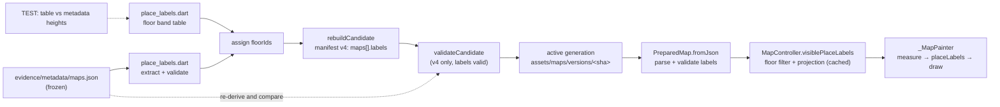
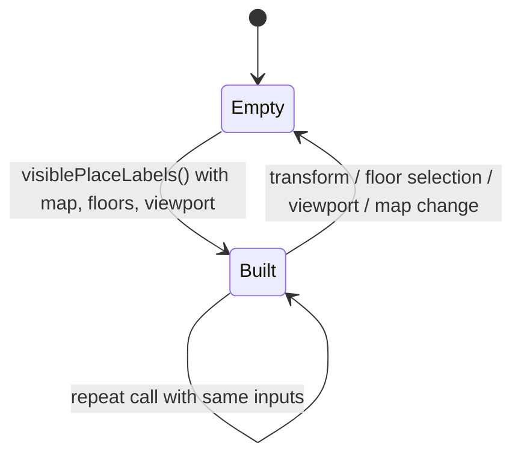

# Design

## Triage

| Trigger | Applies? | Evidence |
|---|---|---|
| T1 Components (new component, or 3+ with directed relationships) | yes | Builder (`tool/maps/pack.dart`) → pack manifest → loader (`lib/maps/prepared_map.dart`) → `MapController` → `_MapPainter`: four components with directed relationships, plus a new label module on each side |
| T2 State (persistent state, caches, 3+ state machine) | yes | The committed pack generation is persistent state that changes (a new `assets/maps/versions/<sha256>/`); the controller gains a projected-label cache like its marker cache (`map_controller.dart:565-586`) |
| T3 Concurrency (background work, workers/isolates, async, retries) | no | Labels are parsed with the manifest in the existing load and projected and painted synchronously on the UI isolate; no new async work |
| T4 Boundaries (data format, migration, shared interface, IPC, external) | yes | Prepared pack format: `preparationVersion` 3 → 4 with a `labels` list per map (`pack.dart:1177`, `prepared_map_loader.dart:84`) |
| T5 Volume (grows without a fixed bound) | no | 303 labels in the frozen metadata, at most 77 on one map; the count changes only with a reviewed pack rebuild |
| T6 Risk (security, money, data loss, unrecoverable user data) | no | No user data is touched; a bad pack fails to load visibly and is caught by `maps:check` in CI |

TIER: FULL

## Context

See proposal.md for the why and the scope decisions S1–S5.

- **Source data.** `evidence/metadata/maps.json` in the active generation holds tarkov.dev's interactive metadata, frozen with its URL and SHA-256 in `evidence/sources.json`. Each interactive map entry has a `labels` list: `position` `[x, z]` in game coordinates, `text`, optional `rotation` (degrees; three Customs labels give it as a string, e.g. `"-9"`), optional `size` (60–100), optional `bottom`/`top` heights. The labels are on 10 maps: Streets 46, Ground Zero 13, Customs 24, Factory 27, Interchange 77, Labs 31, Lighthouse 22, Reserve 27, Shoreline 20, Woods 16. Terminal, Icebreaker and Labyrinth have none. Eleven Interchange shop signs are in Cyrillic, and one Reserve label starts with "д". The repository that holds the file is MIT-licensed; its licence text is already frozen as `evidence/terms/tarkov-dev-software-LICENSE.txt`.
- **Build.** `rebuildCandidate` (`tool/maps/pack.dart:931-1196`) reads `metadata/maps.json` once (`:950`), finds each map's interactive entry with `interactiveMetadata` (`tool/maps/calibration.dart:348`, used at `pack.dart:999`), and writes `floors`, `markers` and `attribution` per map (`:1146-1170`) into a manifest with `preparationVersion: 3` (`:1177`). `validateCandidate` accepts only version 3 (`:1554`). `maps:check` and `maps:rebuild` rebuild from the active generation's own frozen calibration, source lock and `NOTICE.txt` (`MapBuildContext.fromGeneration`, `pack.dart:383-402`). A builder change that changes output therefore makes `maps:check` fail until `maps:rebuild` regenerates the pack (ADR-0033). That is the intended path here: no source is re-acquired.
- **Metadata-only renewal.** `validateMetadataPreservation` (`pack.dart:2454`) rejects any change to preserved non-marker map properties (ADR-0034). It must cover the new `labels` property.
- **Floors.** Most maps' floors carry no height band in the manifest. Only Interchange, Labs and Icebreaker overlays have one, and automatic height selection is limited to Labs and Icebreaker (`map_floors.dart:69-70`, `:194-210`). Markers on other maps are never hidden by floor. Visibility goes through `MapFloorSelection.isLayerVisible` (`map_floors.dart:262-272`): the base is visible unless the policy is exclusive and an overlay is selected, and an overlay is visible when it is selected.
- **Projection.** Markers are projected once per map with `map.gameToScene` (`map_controller.dart:209-225`) and per view with `_trySceneToViewport`. The projections are cached until the transform, floor or viewport changes (`:565-586`, `_invalidateMarkers` `:614-618`).
- **Painting.** `_MapPainter.paint` (`map_workspace.dart:709`) paints the scene, then outlines (`:720`), extract names (`:723`, `_name` `:814`), badges (`:730`), the player and pins. Extract names use a fixed 12 px font with a stroke-halo pass in the marker background colour followed by a fill pass (`:812-850`). Name colours and their palette rule live in `lib/domain/map_zone_style.dart:39`.
- **Notices.** `THIRD_PARTY_NOTICES.md:10` credits "Metadata and markers — Tarkov.dev" with the metadata URL, but not the repository's licence or the place labels.

## Decisions

### D1: Label floor bands live in a builder table, checked by a test

- **Choice:** A new `tool/maps/place_labels.dart` holds a const table: map id → Blackgrid floor id → band, each entry naming the metadata height it is taken from (the map's `heightRange`, Interchange's `_heightRange`, or a layer name and extent index). The bands are:
  - factory: `Ground_Floor` ← `heightRange` [-1, 3); `Second_Floor` ← "2nd Floor"#0; `Third_Floor` ← "3rd Floor"#0; `Basement` ← "Tunnels"#0.
  - interchange: `Ground_Level` ← `_heightRange` [-1000, 25); `First_Floor` ← "2nd Floor"#0; `Second_Floor` ← "3rd Floor"#0.
  - thelab: `First_Level` ← `heightRange`; `Second_Level` ← "Second Level"#0; `Technical_Level` ← "Technical"#0.
  - shoreline: `Ground_Level` ← `heightRange`; `Second_Floor` ← "2nd Floor"#0; `Third_Floor` ← "3rd Floor"#0; `Underground_Level` ← "Underground"#0.
  - groundzero: `Ground_Level` ← `heightRange`; `Second_Floor` ← "2nd Floor"#0; `Third_Floor` ← "3rd Floor"#0.
  - reserve: `Ground_Level` ← `heightRange` only.

  Reserve's upper floors and Ground Zero's garage are left out: their metadata layers are many bounded pieces, not one band, and no label needs them (every Reserve label is "−6 and up"; no Ground Zero label is below 21). The builder applies the table to every rebuild, so `maps:rebuild` produces the new pack offline. A fast test resolves each entry against the frozen metadata and fails naming the map, floor and both bands on any difference.
- **Rejected:** Adding the bands to the frozen calibration (`calibration.dart` → `evidence/calibration.json`). Check and rebuild read the generation's frozen calibration (`pack.dart:383-402`), so new calibration can enter only through `artwork-refresh --reviewed-calibration-update`, which re-downloads artwork sources. The change would then depend on the network and on unrelated artwork drift.
- **Reversal cost:** low. The table is builder input; moving it into calibration later is a rebuild.
- **Important:** yes, binds future changes (builder input that every pack rebuild reads)
- **Chosen by:** user

### D2: Prepared version 4, and the app loads only version 4

- **Choice:** The manifest's `preparationVersion` becomes 4, and every map carries a `labels` list, empty when it has none. The builder, `validateCandidate` and the app loader accept only 4, and the validator and loader require the `labels` key on every map (a missing key fails naming the map; it is never read as empty). A label in the manifest is `{text, position: {x, z}, rotation, size, floorIds}` with defaults applied (rotation 0, size 80) and numeric strings converted, so the app parses one strict shape.
- **Rejected:** Keeping version 3 with an optional `labels` key. A missing key and a map with no labels would look the same, so a builder bug could drop every label silently.
- **Reversal cost:** medium. The format is a contract between builder and app; the app only ever loads its own bundled active pack (ADR-0033), so there is no compatibility to keep.
- **Important:** yes, binds future changes (data format)
- **Chosen by:** user

### D3: The rights note is in THIRD_PARTY_NOTICES.md

- **Choice:** Add a place-labels entry next to `THIRD_PARTY_NOTICES.md:10`. It names `the-hideout/tarkov-dev`, `src/data/maps.json`, its MIT licence and copyright line ("Copyright (c) 2019 Oskar Risberg"), the licence text's pack path `evidence/terms/tarkov-dev-software-LICENSE.txt`, and that the frozen URL and hash are in the pack's `evidence/sources.json`. It also says that Blackgrid claims no ownership of the place names. A fast test checks the entry and the licence file's presence in the active pack. `NOTICE.txt` is not changed.
- **Rejected:** A generated credit section in the pack's `NOTICE.txt`. Check and rebuild copy the generation's notice bytes verbatim (`pack.dart:396-399`, `:1174`) and artwork admission compares them with reviewed bytes (`:3049-3053`), so a generated section would need split-and-regenerate logic in three places.
- **Reversal cost:** low
- **Important:** yes, binds future changes (where the project credits third-party data)
- **Chosen by:** user

### D4: Floor assignment happens in the builder; the app only tests visibility

- **Choice:** The builder writes `floorIds` for each label. A banded label `[bottom, top]` (a missing bound is infinite) belongs to every table floor `[min, max)` with `bottom < max && top >= min`. An unbanded label belongs to the map's base floor. An empty result fails the build. `validateCandidate` runs the same extraction and assignment again on the candidate's own `evidence/metadata/maps.json` and requires canonical equality with each map's manifest `labels`, naming the map on a mismatch, as it does for markers (`pack.dart:1670-1676`). It is the gate for promote, staged publication and committed-generation verification. The app shows a label when `floorIds.any(selection.isLayerVisible)`. The loader rejects an unknown floor id.
- **Rejected:** Shipping raw bands and per-floor bands to the app and intersecting at runtime. It moves the reviewed table into the runtime format and duplicates the floor model's height logic for a decision that never changes between rebuilds.
- **Reversal cost:** medium (pack format)
- **Important:** yes, binds future changes (data format)
- **Chosen by:** agent

### D5: Thinning is a pure greedy pass in the domain layer; the painter measures

- **Choice:** `lib/domain/map_place_labels.dart` holds the font-size rule (13 × size / 80, clamped to 10–16), the label colour, and `placeLabels`. `placeLabels` takes candidates (anchor, measured width and height, rotation, size, pack index) and returns the indices to draw. It sorts labels that belong to a selected overlay floor first (S2), then by size descending, then pack index, drops a candidate whose rotated bounds miss the viewport, and skips one whose axis-aligned rotated bounds, grown by 2 px, overlap a placed one. The controller supplies the visible labels with viewport anchors (`visiblePlaceLabels()`, cached and invalidated with the marker cache). The painter lays out each label's `TextPainter` once per paint, calls `placeLabels`, and draws the chosen labels with the halo pass and the fill pass, rotated about the anchor. The painter does this before outlines.
- **Rejected:** Running the collision pass in `MapController`. The controller has no text metrics; measuring text there would pull `dart:ui` text layout into the application layer and make the controller tests depend on fonts.
- **Reversal cost:** low
- **Important:** no
- **Chosen by:** agent

### D6: Muted off-white label colour

- **Choice:** Place labels use `#C8D0CB` at 85% opacity over the marker-background halo. The palette test checks that it differs from the four faction name colours and reaches at least 3:1 against `#090F0D`, judged on the colour blended at 85% opacity.
- **Rejected:** A dim grey (about `#8F9A94`). It recedes further, but is harder to read over the light Labs and Ground Zero raster artwork.
- **Reversal cost:** low (M8.5 restyles the map anyway)
- **Important:** yes, changes what users see
- **Chosen by:** user

### D7: Label rotation is clockwise screen degrees about the anchor

- **Choice:** Rotation is applied as `canvas.rotate(degrees × π / 180)` about the projected anchor, with the text centred there. Blackgrid draws each map in its source artwork frame, the same orientation tarkov.dev shows. A Streets label at −90 runs bottom to top along Primorsky Ave.
- **Rejected:** Adding the map's geometry rotation (`geometry.rotation`, e.g. 180 on Customs) to each label. That would turn Customs labels upside down: the rotation already describes the drawn artwork, not game axes.
- **Reversal cost:** low
- **Important:** yes, weak evidence: how the source rotation was meant is inferred from the data, not documented. The user check at the M8 close settles it, by whether the Streets road names and Reserve's rotated labels follow their roads and buildings.
- **Chosen by:** agent

### D8: Full-rebuild qualification tests get a 10-minute timeout

- **Choice:** Each qualification test in `test/maps/artwork_refresh_test.dart` and `test/maps/map_preparation_qualification_test.dart` that runs a full staging or `rebuildCandidate` gets `timeout: Timeout(Duration(minutes: 10))`, through one shared constant in `test/support/map_preparation_fixtures.dart` whose doc comment gives the reason. The `qualification` tag default in `dart_test.yaml` stays 2 minutes for everything else. On CI "staging and frozen reproduction omit stale marker overrides" takes about 2 minutes on a normal runner and timed out in runs 42395244727, 42410087351 and 42410085044. The other two tests that failed in 42395244727 ("staging accepts missing and unsupported metadata maps independently of artwork", `artworkReproducesWithoutRawStage`) run the same kind of rebuild. 10 minutes is about five times the observed duration. The CI job has no `timeout-minutes`, so the job limit does not cap it.
- **Rejected:** Raising the tag default for all qualification tests (it hides slow tests that are not full rebuilds). Making cleanup wait for the abandoned rebuild (removes the follow-on errors but not the timeout; kept as follow-up). Shrinking the fixtures (the better long-term fix, but it changes what these tests prove and is outside this change).
- **Reversal cost:** low
- **Important:** yes, it changes a CI gate's limits
- **Chosen by:** user (2026-11-07: "add the first in this change")

### Decision summary

| # | Decision | Choice | Rejected | Reversal cost | Important | Chosen by |
|---|---|---|---|---|---|---|
| S1 | Ground labels under an overlay | Show while any of the label's floors is visible | Show only the selected floor's labels | low | yes | user |
| S2 | Thinning | Skip overlapping labels; selected floor first, then larger, then pack order | Zoom threshold; both; size-only order | low | yes | user |
| S3 | Hide switch | No switch | Saved "Place labels" switch | low | yes | user |
| S4 | Text size | Relative size at a fixed screen size, 10–16 px | One size | low | yes | user |
| S5 | Ownership | Pack-owned, from frozen metadata | Runtime download | medium | yes | agent |
| D1 | Floor band source | Builder table, test-checked against metadata | Frozen calibration via artwork refresh | low | yes | user |
| D2 | Pack version | v4, labels required, app loads only v4 | v3 with optional labels | medium | yes | user |
| D3 | Rights note | `THIRD_PARTY_NOTICES.md` entry + test | Generated `NOTICE.txt` section | low | yes | user |
| D4 | Floor assignment | Builder writes `floorIds`; app tests visibility | Runtime band intersection | medium | yes | agent |
| D5 | Thinning placement | Pure domain greedy pass, painter measures | Collision in `MapController` | low | no | agent |
| D6 | Label colour | `#C8D0CB` at 85% | Dim grey | low | yes | user |
| D7 | Rotation | Clockwise screen degrees about the anchor | Add map geometry rotation | low | yes | agent |
| D8 | Full-rebuild test timeout | 10-minute per-test timeout on full staging/rebuild qualification tests | Raise the tag default; cleanup waits; smaller fixtures | low | yes | user |

## Diagrams (FULL)

T1 components and T4 data flow:

T2 projected-label cache:

## State & Ownership (FULL)

| State | Owner (sole writer) | Lifetime | Invalidation / rebuild | Authoritative copy |
|---|---|---|---|---|
| Active map generation with `labels` | `tool/maps/prepare.dart refresh` (`maps:rebuild`) | Repository | Replaced only by a rebuild or publish (ADR-0033) | `assets/maps/active.json` → manifest |
| Floor band table | Source code `tool/maps/place_labels.dart` (reviewed in PR) | Repository | Edited by hand; drift test against frozen metadata | The table |
| Parsed labels per map (`PreparedMap.placeLabels`) | `PreparedMap.fromJson` | App run, immutable | Re-read only with a new pack | The manifest |
| Projected visible labels | `MapController` | Until the transform, floor selection, viewport or map changes | Cleared with `_invalidateMarkers` | Recomputed from the parsed labels |
| Placed (thinned) label set | `_MapPainter`, per paint | One paint | Recomputed every paint | None (derived) |

## Failure & Visibility (FULL)

| Component | Fails / dies mid-operation → | Recovery | Retry safe? | Who finds out |
|---|---|---|---|---|
| Label extraction / floor assignment (build) | Malformed label or no floor → `FormatException` naming map and label; no candidate is promoted | Fix the table or the source, rerun `maps:rebuild` | yes (fresh candidate each run) | The operator, in the command output; CI's `maps:check` |
| Band table drift | Test fails naming map, floor, both bands | Update the table in a reviewed change | yes | Developer and CI (fast suite) |
| `validateCandidate` | Rejects a non-v4 manifest, a map without `labels`, an invalid label, or labels that differ from those re-derived from the candidate's own metadata (naming the map); nothing is promoted or published | As above | yes | Operator / CI |
| App loader | Old version or invalid label → map load error naming the problem; the map shows the existing load-error text (`map_workspace.dart:563-576`) | A correct pack in a new build | n/a | User sees the error; it cannot ship because CI's `maps:check` and the loader tests run first |
| Painter | Text layout cannot fail on valid strings; an empty placement draws no labels | None needed | n/a | Nobody needs to: labels are decoration |
| Notices test | Missing entry or licence file → fast test fails | Restore the entry or file | yes | Developer and CI |

## Resource Bounds (FULL)

| Queue / buffer / cache / transfer | Bound | At the bound | Timeout | At 10x / 100x |
|---|---|---|---|---|
| Labels per map in the manifest | Frozen count, at most 77 today | No runtime bound needed; the count changes only through a reviewed rebuild | none | 770 labels on one map: projection is O(n) per view change, and greedy placement is O(n²) on the visible subset, about 300k box tests worst case per paint. That is still under a millisecond in Dart. At 100x (7,700), O(n²) is too slow per frame: a grid index would be needed (see Mechanism Ledger) |
| `TextPainter`s per paint | Two per eligible label per paint (halo pass and fill pass), as `_name` does | Disposed at the end of each paint, as `_name` does (`map_workspace.dart:845`) | none | 10x: ~1,500 layouts per paint at 60 fps while panning; cache needed (Mechanism Ledger) |
| Projected-label cache | One list per selected map | Replaced on invalidation | none | Same as labels per map |

## Flow & State Gaps (FULL)

- **Partial rebuild.** `maps:rebuild` promotes only a fully validated candidate; a failure leaves the active v3 generation, pointer and pubspec unchanged (existing behaviour, `prepare.dart` usage text). The app code and the pack land in the same PR, so main never pairs a v4 loader with a v3 pack. CI's `maps:check` and the loader tests would catch it.
- **Floor selection changes mid-paint.** The controller invalidates its caches synchronously on a floor change and notifies, so the next paint sees one consistent selection. Labels and markers read the same `MapFloorSelection`.
- **Map change while labels are cached.** `_invalidateMarkers` runs on map selection; the label cache is cleared at the same call sites.
- **Live map data publication.** Publishing a new marker generation does not touch labels (they are pack-owned, ADR-0035); the label cache is not cleared by marker publication, and no marker selection logic reads labels.
- **Metadata-only renewal.** Labels come only from `metadata/maps.json`, which metadata renewal does not replace; `validateMetadataPreservation` also compares `labels`, so a builder bug that changes them fails renewal.
- **Artwork refresh with a changed `maps.json`.** New labels are extracted and assigned with the same table; a changed layer height fails the drift test, and a label outside every band fails the build. Both stop before publication.

## Mechanism Ledger (FULL)

| Mechanism | Built? | Why (harm nobody catches / expensive later) | Evidence that would change the call |
|---|---|---|---|
| Drift test between band table and metadata heights | yes | Without it an upstream height change (via artwork refresh) silently moves labels to the wrong floor; nobody would catch it before the owner happened to look | — |
| Build failure on a label with no floor | yes | Dropping it silently hides a place name with no signal | — |
| Strict v4 gate in builder, validator and loader | yes | Format contract; loosening later is cheap, tightening later is not | — |
| `TextPainter` layout cache across paints | no | ≤77 labels × 2 layouts per paint is in line with the existing per-paint extract-name layout (`_name`); no frame budget problem is known | A profile showing label layout over ~2 ms per frame while panning on Interchange |
| Spatial grid for collision tests | no | O(n²) over at most 77 visible labels is ~3,000 box tests | A map with several hundred labels |
| Hide switch / preference | no | S3 | Owner asks for it (M8.5 Settings page is the natural place) |
| Ellipsis or max width on labels | no | Source labels are short (longest "Corridor To Building #2"); thinning handles overlap | A label wider than ~300 px at 16 px |
| Runtime floor-band intersection | no | D4 | — |

## Risks / Trade-offs

- [Rotation semantics inferred, not documented] → D7 records the inference; the owner's real-map check at the M8 close judges it on Streets and Reserve; a wrong sign is a one-line fix.
- [Fixed-size labels crowd small maps when zoomed out] → greedy thinning keeps the largest; zooming in restores the rest (S2).
- [Labels over the map hide artwork details] → drawn first, with a halo and a muted colour (D6), so markers and outlines stay on top.
- [Rebuild changes pack identity and asset list] → expected: `maps:rebuild` prints `<id>: manifest values changed` for all 13 maps (key `labels`) and `pack: manifest values changed` (`preparationVersion`), then the "Artwork changed: the owner must check…" line (`pack.dart:2203-2215`, `:2263-2269`, `:3266-3276`), as the main spec requires. It lists no changed files: a non-empty changed-files list is the signal to stop and investigate. It rewrites `pubspec.yaml`'s marked block and prunes the old generation. Per AGENTS.md the PR summary is marked "artwork changed: owner check" with the printed per-map summary; that owner check is the M8-close user check and is recorded as unverified until the user reports it.
- [Full-rebuild tests near the 2-minute qualification limit; labels add work to each rebuild] → D8 gives those tests a 10-minute per-test timeout before the pack changes land. A timed-out test's teardown (`artwork_refresh_test.dart:105`) still deletes its temp folder under the abandoned rebuild, so a real timeout still shows follow-on `PathNotFoundException` errors; making cleanup wait is a follow-up.
- [Cyrillic shop signs] → drawn as source text with the default font fallback; no transliteration.

## ADRs

- **In force, constraining this change:** ADR-0005 (native map from prepared packs, as partly superseded by ADR-0035), ADR-0023 (map colours; faction and role colours unchanged), ADR-0033 (packs proven by reproduction; `maps:check`/`maps:rebuild`), ADR-0034 (metadata refresh preserves prepared non-marker output), ADR-0035 (live map data; labels stay pack-owned).
- **To record during apply:** ADR-0036 "Place labels are pack-owned and floor-assigned at build": prepared version 4 with per-map `labels`; floors assigned by a reviewed builder band table checked against the frozen metadata; validation re-derives labels from the candidate's own metadata; the app filters by floor visibility only; credit in `THIRD_PARTY_NOTICES.md`. It partly supersedes ADR-0033: its "preparation version 3" statements (D2, loader order; D8, only version 3 validates or loads) become version 4; ADR-0033's file stays unchanged. The same task updates `openspec/architecture.md`: the ADR-0036 index row, ADR-0033's row ("preparation version 3 only") and its superseded-by column, the "Prepared map pack" bullet (version 4, labels), and the Map tooling and `MapController` rows.
