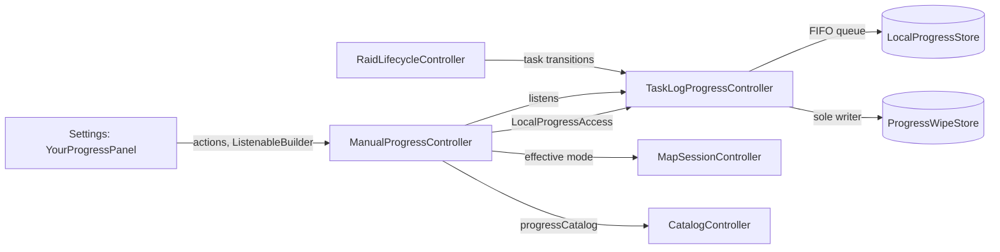
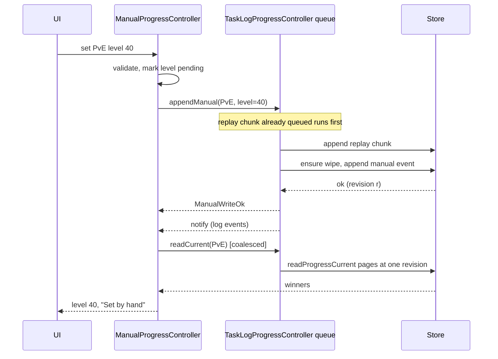
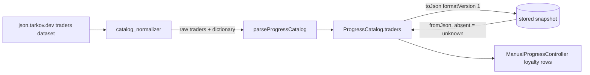

# Design

## Triage

| Trigger | Applies? | Evidence |
|---|---|---|
| T1 Components (new component, or 3+ with directed relationships) | yes | New `ManualProgressController` between `TaskLogProgressController`, `CatalogController`, `MapSessionController` (effective mode) and the Settings UI. |
| T2 State (persistent state, caches, 3+ state machine) | yes | New persisted manual events and auto-created wipes; an in-memory projection of the effective mode's current values; a per-value pending/failed state. |
| T3 Concurrency (background work, workers/isolates, async, retries) | yes | Manual writes and reads share the async FIFO queue with live log writes and replay chunks (`task_log_progress_controller.dart:247`); mode can change while a write is queued. |
| T4 Boundaries (data format, migration, shared interface, IPC, external) | yes | Stored progress-catalog JSON gains `traders` (ADR-0042 format); a new shared `LocalProgressAccess` interface later reused by the checklist; tarkov.dev `traders` wire levels. |
| T5 Volume (grows without a fixed bound) | yes | Event history grows with every edit (no trimming, ADR-0041); current-value reads are paged. |
| T6 Risk (security, money, data loss, unrecoverable user data) | yes | Manual progress is user data that cannot be recreated from the logs. |

TIER: FULL

## Context

See proposal.md for scope (S1-S7). Current state the approach depends on:

- `LocalProgressStore` (`lib/domain/local_progress_store.dart:204-314`) already supports every register this change writes: player level/faction/edition, trader loyalty, station level and task state (`lib/domain/local_progress.dart:407-416`), plus unset values, guarded undo and paged current-value reads. Manual source ranks below log at equal time (ADR-0041). No schema change is needed.
- `TaskLogProgressController` is the sole active-wipe writer and owns the one FIFO queue every progress reader and writer must use (ADR-0044; `enqueueProgress` at `task_log_progress_controller.dart:247`, `_createWipe`/`_ensureWipe` at `:372-401`). Replay enqueues per chunk (`:632-670`), so queued manual work interleaves between chunks instead of hitting `ProgressBusy`.
- The device ID is loaded once by that controller (`_deviceId`). Random UUIDs are generated by `_randomProgressId` in `lib/data/database_progress.dart:141` (private to the data layer).
- The app's effective mode is `MapSessionController.effectiveMode` (`map_session_controller.dart:108`): the game's detected session mode, else the header choice; `AppServices` switches the catalog with it (`app_services.dart:359-369`). Only that mode's `CatalogSnapshot` is in memory (`catalog_controller.dart:46-48`); its optional `progressCatalog` holds tasks and stations (`lib/domain/catalog.dart:474`).
- The normalizer already downloads the `traders` dataset and passes only trader IDs to `parseProgressCatalog` (`lib/data/catalog_normalizer.dart:76,470-476`); the real wire carries `levels[].level` (checked against `json.tarkov.dev/regular/traders` on 2026-11-13: 4 levels for Prapor..Ref, 3 for Fence, 1 for Lightkeeper and others).
- `ProgressCatalog` stores `formatVersion: 1` (`packages/blackgrid_progress/lib/src/progress_catalog.dart:191-232`); earlier additive facts kept that version (task-catalog spec, "Stored catalogs without the new facts still load").
- The edition vocabulary lives in `editionTable` (`packages/blackgrid_progress/lib/src/edition_table.dart:4-12`).
- Settings mounts `LocalProgressSettings(controller: _services.localProgress)` in the Local progress section (`lib/ui/settings/settings_page.dart:325-326`).

## Decisions

### D1: Manual work goes through a narrow access interface on the shared queue

- **Choice:** `TaskLogProgressController` implements a new `LocalProgressAccess` interface: `appendManual(mode, targets+values)` (ensures the mode's wipe, creating it when absent with the earlier of today's local date and the live session folder's date (`RaidLifecycleState.currentFolder`, parsed as the live path does at `:350`), so the running session's task events are not dropped by the start-date filter at `:353` and `_inRange` at `:528-531`; then appends manual events with random IDs, the device ID and the clock's UTC ms), `undo(mode, cycleId, targetEventId)` (random request ID). Random IDs come from an ID generator injected through the controller's constructor (default: a public UUID v4 helper moved from `_randomProgressId` in `lib/data/database_progress.dart:141` into the domain layer), so tests use fixed IDs. The interface also has `redo(mode, cycleId, undoEventId)` (D7) and `readCurrent(mode)` (all current pages of the active wipe at one revision, retrying once from the start on a stale cursor). Each call is one `enqueueProgress` operation and returns a sealed result. A new `ManualProgressController` (app layer) owns the Your progress view state and input validation and depends only on that interface.
- **Rejected:** extracting the queue and wipe ownership into a new `LocalProgressCoordinator` because it refactors ADR-0044's tested writer inside a feature change; growing `TaskLogProgressController` with form state because it mixes log runs with view state in a ~700-line class.
- **Reversal cost:** medium (the checklist will build on the interface)
- **Important:** yes: binds future changes (the shared progress access contract).
- **Chosen by:** user

### D2: Traders are an optional block of the progress catalog at format version 1

- **Choice:** `ProgressCatalog` gains an optional `traders` list of `CatalogTraderLevels` (`id`, `name`, `normalizedName`, `levels` ascending or null). `parseProgressCatalog` takes the raw `traders` data and its dictionary; malformed or duplicate level numbers make that trader's levels null. Stored JSON keeps `formatVersion: 1`; an absent key decodes as traders unknown (null list).
- **Rejected:** bumping to format version 2, because stored v1 blocks would load as unavailable until the next refresh, hiding tasks and stations after upgrade; levels on the app-side `CatalogTrader`, because the plain-Dart package and future apps could not see them.
- **Reversal cost:** medium (stored format)
- **Important:** yes: binds future changes (stored data format).
- **Chosen by:** user

### D3: The view holds one projection of the effective mode, re-read as a whole

- **Choice:** `ManualProgressController` keeps the effective mode's current winners (`Map<ProgressTarget, ProgressEvent>`) from one `readCurrent`, only while the Your progress part is mounted (it attaches and detaches the controller). `LocalProgressAccess` exposes a `progressRevision` counter that `TaskLogProgressController` raises only when an append inserts at least one event, an undo commits, an active wipe is created or replaced, or a mode's availability changes (`unavailableModes`); the controller re-reads when that counter moves, after its own write or undo, or when the effective mode or catalog snapshot changes. Plain lifecycle and run-progress notifications (`_onLifecycle` at `:327-330`, per-folder notifies) do not trigger a read. It reads once when the part is shown. At most one read runs; a change during it marks the projection dirty and triggers exactly one more read. Detached, it holds no projection and queues nothing. Amended after design review round 1.
- **Rejected:** reading each value on demand per row, because hundreds of task rows would each queue a store read, and patching the projection from the write result, because it misses log events that win between write and display.
- **Reversal cost:** low
- **Important:** no
- **Chosen by:** agent

### D4: Each write captures its mode and cycle when submitted

- **Choice:** a write records the mode shown at submission. The access layer resolves the active wipe of that mode inside the queued operation, so a mode switch while queued still writes to the submitting mode. A write for a mode whose wipe changed (new wipe) before it runs goes to the new active wipe; undo carries the cycle ID it was offered for and fails as a conflict if the active wipe differs.
- **Rejected:** dropping queued writes on mode change, because a player's confirmed entry would silently vanish.
- **Reversal cost:** low
- **Important:** no
- **Chosen by:** agent

### D5: One action per value at a time, validation before the queue

- **Choice:** level (1-79), faction, edition (from `editionTable.editions`), loyalty (the trader's catalog levels) and station level (0 or a catalog level) are validated by `ManualProgressController` before enqueueing. Catalog-backed rows and validation use the catalog snapshot only while `catalog.mode` equals the effective mode; otherwise they show task data as not loaded. Entry is disabled for every mode while the log controller's initial load failed (no device ID or wipes). While a value's write or undo is pending, its controls are disabled. Failures are kept per value until that value's next action or the next successful read.
- **Rejected:** a global busy flag for the whole part, because one slow write would freeze unrelated rows.
- **Reversal cost:** low
- **Important:** no
- **Chosen by:** agent

### D6: Task search filters the loaded catalog in memory, capped at 50 shown

- **Choice:** case-insensitive substring match on task display names of the effective mode's catalog, in catalog order, showing the first 50 matches and a "refine your search" note when more match. An empty query shows no list.
- **Rejected:** listing every task (500 rows with per-row controls) because it slows Settings scrolling for no gain.
- **Reversal cost:** low
- **Important:** no
- **Chosen by:** agent

### D7: Redo is a new manual edit, so undo chains never form

- **Choice:** Undo is offered only when the winner is a manual event with no `undoOf`; it calls the store's guarded undo. When the winner is a compensation (`undoOf` set), the control reads Redo: inside one queued operation the access layer reads the compensation's target by ID through a new `LocalProgressStore.readProgressEvent(scope, eventId)` (one row by its unique ID, same validation as history reads), checks the compensation is still the register's winner, and appends a new ordinary manual edit with the target's value. The new edit is not an undo, so the control reads Undo again. The label follows from the winner alone: no `undoOf` → Undo, `undoOf` → Redo. Compensations are never undone, so a chain has depth 1.
- **Rejected:** Redo as the store's undo of the compensation, because the result is an undo of an undo whose label would need the parity of the whole `undoOf` chain, which the projection does not hold; a session-memory label map, because it is lost on restart.
- **Reversal cost:** low (one read-only store method; no stored-format change)
- **Important:** no (the user-visible Undo/Redo behaviour is S4's; this is its mechanism)
- **Chosen by:** agent

### Decision summary

| # | Decision | Choice | Rejected | Reversal cost | Important | Chosen by |
|---|---|---|---|---|---|---|
| S1 | Where manual entry lives | Your progress part of Settings' Local progress | New top-level Progress area | low | yes | user |
| S2 | Faction and edition entered too | Yes | Roadmap fields only | low | yes | user |
| S3 | Entry with no active wipe | Create one starting on the earlier of today and the live folder's date | Refuse until a wipe exists; start today only | medium | yes | user |
| S4 | Task overrides | Search, set (not started = unset), undo and redo | Also show availability; set only | low | yes | user |
| S5 | Trader loyalty levels source | Catalog keeps tarkov.dev levels | Fixed 1-4 picker | medium | yes | user |
| S6 | Mode edited | Effective mode, no own chooser | Own mode chooser | low | yes | user |
| S7 | Consumers | Stay on the Tracker token | Switch now | low | no | agent |
| D1 | Write path | `LocalProgressAccess` on the shared queue + `ManualProgressController` | Extract coordinator; grow log controller | medium | yes | user |
| D2 | Trader levels format | Optional `traders`, format version 1 | Version 2; app-side `CatalogTrader` | medium | yes | user |
| D3 | View values | One coalesced projection while shown, re-read on a progress-revision signal | Per-row reads; patch from write results | low | no | agent |
| D4 | Mode change while queued | Write goes to the submitting mode | Drop queued writes | low | no | agent |
| D5 | Validation and pending state | Per value, before the queue | Global busy flag | low | no | agent |
| D6 | Task search | In-memory, 50 shown | List every task | low | no | agent |
| D7 | Redo mechanism | New manual edit with the undone value, via a by-ID event read | Store undo of the compensation; session label map | low | no | agent |

## Diagrams (FULL)

Components (T1):

Manual write and log event racing (T3, T2):

Catalog data flow (T4):

## State & Ownership (FULL)

| State | Owner (sole writer) | Lifetime | Invalidation / rebuild | Authoritative copy |
|---|---|---|---|---|
| Manual progress events | `TaskLogProgressController` via `LocalProgressAccess` (store append) | Durable, never trimmed | Never edited; undo appends a compensation | Event history in the database |
| Active wipes (including ones created by manual entry) | `TaskLogProgressController` | Durable | Replaced only by new wipe; start moves earlier on replay | `ProgressWipes` table |
| Current-value projection of the effective mode | `ManualProgressController` | Memory, while Your progress is shown | Re-read on own write/undo, a progress-revision change, mode or catalog change (D3) | Store heads |
| Per-value pending flag and last failure | `ManualProgressController` | Memory | Cleared on that value's next action or next successful read | none (view only) |
| Task search query and level text field | Widget state | While Settings is open | Reset when Settings closes | none |
| Trader levels | Catalog refresh (`parseProgressCatalog`) | With the mode's snapshot | Replaced with the next successful refresh | Stored snapshot |

## Failure & Visibility (FULL)

| Component | Fails / dies mid-operation → | Recovery | Retry safe? | Who finds out |
|---|---|---|---|---|
| `appendManual` wipe creation | No cycle or no wipe row: nothing appended (create-then-append inside one queued op; a failed `replaceProgressWipe` after `createProgressCycle` leaves an orphan cycle, as on the log path) | Player retries the entry | Yes: a new cycle is created; the orphan is harmless and unselected | User: failure text beside the value |
| `appendManual` append | Store rejects the batch atomically (storage, busy, invalid, unavailable) | Player retries; the entry generates a new event ID | Yes | User: failure beside the value; previous value stays shown |
| `undo` | Undo conflict (winner changed or wipe replaced), storage failure | Projection is re-read; player decides again | Yes, with a new request ID after re-read | User: "This value changed; it now shows the latest." |
| `readCurrent` | Unavailable cycle, storage failure, stale cursor twice | Next notify or mode change re-reads | Yes (read-only) | User: Your progress shows "Progress could not be read: <reason>" and disables entry |
| Log controller's initial load failed | No device ID or wipes: every manual write would fail | Restart Blackgrid | n/a | User: Your progress shows that local progress could not be loaded and disables entry |
| App closes with a write queued | Queued op never runs; nothing partial (append is atomic) | None needed | n/a | User sees the value unset on next launch (unverified assumption: acceptable, as for log writes) |
| Catalog trader parse | Malformed trader levels → that trader's levels null | Next refresh | n/a | User: that trader is absent from loyalty rows; Diagnostics unchanged |

## Resource Bounds (FULL)

| Queue / buffer / cache / transfer | Bound | At the bound | Timeout | At 10x / 100x |
|---|---|---|---|---|
| Shared FIFO queue | Unbounded in count, but each value allows one pending action (D5) and the projection one read plus one dirty flag (D3), only while Your progress is shown, so manual work adds at most (values shown + 1) entries and none while it is hidden | n/a | none (store ops are local) | 10x values: still one per value; fine |
| Manual append batch | 1 event per action | n/a | none | n/a |
| `readCurrent` | Pages of 256 (ADR-0041); registers per wipe ~ tasks (~500) + objectives (later) + stations (~26) + traders (~10) + 3 ≈ 600 today → 3 pages | Whole projection held in memory (~600 events) only while Your progress is shown | none | Reads happen only on a data change while shown (D3); during a replay with the part open that is at most one read per stored chunk, coalesced to one in flight. 10x (6k registers, 24 pages) is still a few MB; 100x would make each read slow but not more frequent |
| Task search results | 50 shown (D6) | "Refine your search" note | none | unaffected |
| Event history | Not trimmed (ADR-0041) | n/a | n/a | One event per deliberate click; 100x is still tiny |

## Flow & State Gaps (FULL)

- **Log event between write and display:** the projection is always re-read after the write (D3), so the newer winner shows.
- **Mode switch with a queued write:** the write goes to the submitting mode (D4); the view switches immediately and re-reads the new mode.
- **New wipe started with a queued write:** the write lands in the new active wipe (the queued op resolves the wipe when it runs). An offered undo for the old wipe fails as a conflict.
- **Wipe created by manual entry while a session spans midnight:** the wipe starts on the live folder's date when that is earlier than today (D1), so the live path's start-date filter keeps the session's later task events.
- **Effective mode unknown:** no entry; the part says to choose a game mode.
- **Catalog snapshot without a progress catalog or without trader levels:** level, faction and edition stay editable; loyalty, stations and tasks show "Task data is not loaded yet".
- **Catalog changes while open:** the rows are rebuilt from the new catalog; values for IDs no longer listed stay in the store and are not shown.
- **Double click on Undo:** blocked by the per-value pending flag (D5). A later click on the same value is Redo (S4), which re-applies the undone value.
- **Clock behind the newest log event:** a manual edit with an older time loses to the log event and the shown value does not change (see Mechanism ledger).
- **Restart mid-operation:** an append is atomic; the worst case is a missing entry.

## Mechanism Ledger (FULL)

| Mechanism | Built? | Why (harm nobody catches / expensive later) | Evidence that would change the call |
|---|---|---|---|
| Shared queue for manual work | yes | ADR-0044 requires it; a second store caller gets `ProgressBusy` | none |
| Per-value pending flag | yes | Double-clicks would create two events or a spurious undo conflict | none |
| Coalesced projection re-read on a revision signal, only while shown | yes | The log controller notifies on every lifecycle batch and per folder during runs; reading on each would put a full `readCurrent` on the shared queue all session and slow catch-up and replay | none |
| Optional traders in stored catalog (format 1) | yes | Stored format is expensive to change later | none |
| Timestamp lift (write at max(now, current winner + 1 ms)) so manual always wins | no | Rare: log times come from the same machine's clock; when it happens the unchanged value is visible | Reports of edits that "don't stick" after clock changes |
| Automatic retry of failed writes | no | ADR-0041 forbids automatic retry; failures are shown | none |
| Undo history list (multi-step undo) | no | The store's undo restores its target's greatest strict predecessor, so undoing a compensation would re-apply the value it undid (`database_progress.dart:854-922`, ADR-0041). Compensations are therefore never undone: Redo is a new edit (D7), and stepping further back means setting the value by hand. A compensation that restores a log value shows "Set by hand", since its winner is a manual event | Owner asks for multi-step undo or a history view |
| Separate progress-catalog decode for non-effective modes | no | S6 chose the effective mode | S6 reversed |
| Edition label table in UI | yes (plain mapping of the five `editionTable` IDs to names) | Raw IDs are unreadable | Edition table gains entries (a test fails on an unmapped ID) |

## Risks / Trade-offs

- [Manual entry creates a wipe starting on today or the live folder's date, so catch-up skips older log folders] → The Local progress row shows the start date, and replay from an earlier date moves it back (task-log-progress).
- [An older stored catalog has no traders until the next refresh] → Loyalty rows say task data is not loaded; a refresh happens on mode selection.
- [The checklist (change 7) may need more from `LocalProgressAccess`] → The interface is app-internal and can grow; it is not a stored format.
- [Users may expect advice to use their manual level now] → Proposal and release notes say advice still uses Tracker progress; `retire-tracker-token` switches it.

## ADRs

- **In force, constraining this change:** ADR-0041 (event ledger, ordering, undo, no automatic retry), ADR-0042 (progress catalog package and format), ADR-0043 (edition table is the edition vocabulary), ADR-0044 (sole wipe writer, shared queue).
- **To record during apply:** none. D1 applies ADR-0044's shared-queue rule rather than changing it, and D2 extends ADR-0042's format additively in the way that ADR allows for new lenient facts; the architecture index's `LocalProgressStore`, `TaskLogProgressController` and `blackgrid_progress` rows are updated during apply to name manual writes and trader levels.
