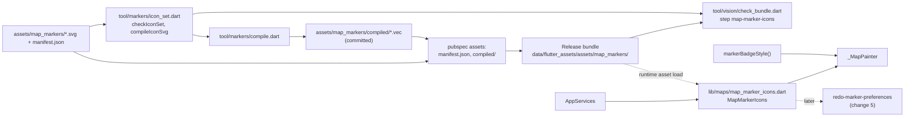
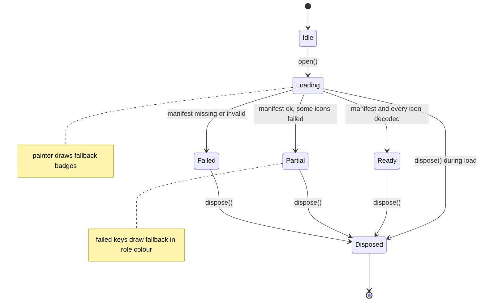
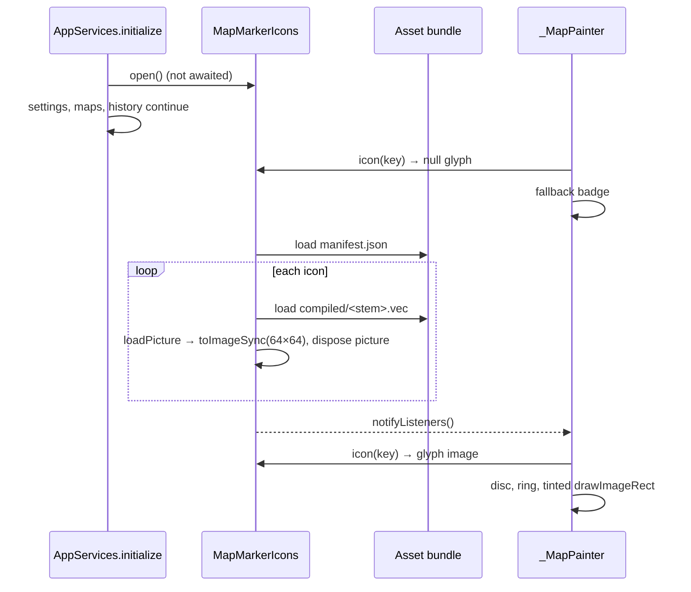
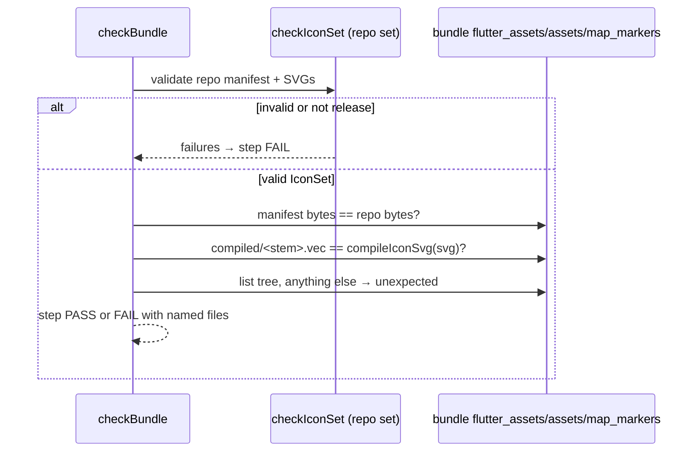

# Design

## Triage

| Trigger | Applies? | Evidence |
|---|---|---|
| T1 Components (new component, or 3+ with directed relationships) | Yes | New `MapMarkerIcons` loader in `lib/maps/`, consumed by `_MapPainter` and later by change 5's tiles; new `tool/markers/compile.dart`; `tool/vision/check_bundle.dart` gains a step that calls `tool/markers/icon_set.dart`. |
| T2 State (persistent state, caches, 3+ state machine) | Yes | Committed compiled `.vec` files (new persistent state bound to the SVGs); an in-memory cache of rasterized glyphs; the loader's loading → ready / partial / failed states. |
| T3 Concurrency (background work, workers/isolates, async, retries) | Yes | Icons load asynchronously after start-up while the map may already paint; disposal can race a load in flight. |
| T4 Boundaries (data format, migration, shared interface, IPC, external) | Yes | The app now reads `manifest.json` schema 1 at runtime; a new bundled asset tree; a new bundle-check step and its inputs. |
| T5 Volume (grows without a fixed bound) | No | 19 icons, fixed by the key list. Markers per map are bounded by the pack (largest pack: 2 969 markers, `assets/maps/versions/d5a0…/manifest.json`); the per-frame cost is covered under Resource Bounds. |
| T6 Risk (security, money, data loss, unrecoverable user data) | Yes (rights) | The milestone's provenance gate: no third-party marker art may ship. No user data. |

TIER: FULL

## Context

See proposal.md for the why.

- **Today's painter.** `_MapPainter._glyph` draws an inset disc of radius 9 (12 when selected), a 2 px ring and a 3 px dot (`lib/ui/map_workspace.dart:674-681`). Colour: highlight → `Colors.cyanAccent`, a filter key containing `Extract` → `GridColors.green`, category `hazards` → `Colors.redAccent`, else `GridColors.gold`, alpha 0.22 when dimmed (`:620-634`). A highlighted marker also uses the selected size (`:631-633`). Pins draw `Colors.lightBlueAccent`, alpha 0.22 when the search does not match (`:655-671`). Hazard zone polygons are drawn before the glyph (`:599-618`). Markers outside the viewport ± 22 px are skipped (`:587-619`). The painter repaints on `maps` only (`:569`) and `shouldRepaint` is always true (`:736`).
- **The set.** `assets/map_markers/` holds the approved release set: 19 SVGs and `manifest.json` (schema 1: `background` `#090F0D` = `GridColors.inset`, badge `{diameter 24, selectedDiameter 30, glyph 16, ring 2}`, 8 roles, per-icon key/file/role/sha256/provenance). The user approved it on 2026-10-28 (`docs/design/map-marker-icons/README.md`, "Approval"). There is no `prompts/` folder; every icon has concept source `none`.
- **The approved look.** The preview draws a badge as a disc in `background` with a ring of width `ring` in the state colour, and the glyph at `glyph` px, tinted by alpha in the same colour; highlighted uses `#18FFFF` for both ring and glyph; dimmed applies opacity 0.22 to the whole badge; selected uses `selectedDiameter` (`tool/markers/preview.dart:317-355`).
- **Checker library.** `tool/markers/icon_set.dart` exposes `checkIconSet` → sealed `IconSetResult` (`IconSetValid(IconSet)` / `IconSetInvalid(failures)`), `iconKeys`, `iconFileName`, `sha256Hex` and `compileIconSvg` (`encodeSvg` with `warningsAsErrors: true` and the three optimizers off, `:472-483`). It does not reject extra files in the set's directory (no directory listing in `checkIconSet`). It imports `dart:io` and `vector_graphics_compiler`, so the app cannot import it.
- **Vector runtime.** The app decodes precompiled `.vec` with `vg.vg.loadPicture` over a custom `BytesLoader` (`lib/maps/native_map_scene.dart:127-133,473-480`); `vector_graphics` 1.2.3 is a runtime dependency, `vector_graphics_compiler` 1.3.0 a dev dependency (`pubspec.yaml:16,28`). Map packs commit their compiled `.vec` artwork, produced by `tool/maps/pack.dart` (`:418`).
- **Composition.** `AppServices` takes optional cosmetic services and defaults to a disabled one (`itemIcons ?? ItemIconCache.disabled()`, `lib/application/app_services.dart:46,56`); `AppServices.open()` builds the real one (`:192,208-224`) and a failure only logs with `debugPrint` (`:216`). `dispose` tears services down (`:351`).
- **Bundle check.** `checkBundle` runs named steps over a bundle directory and returns a `BundleReport`; the CLI prints `PASS`/`FAIL` per step and writes a JSON report (`tool/vision/check_bundle.dart:106-200,581-676`). Its inventory covers DLLs and models only; nothing checks `data/flutter_assets/` today. Tests in `test/tool/vision/check_bundle_test.dart` build synthetic bundles.
- **ADR-0023 notes for this change.** A fallback glyph is needed for a filter key `_markerFilterKey` passes through unchanged (`lib/maps/prepared_map.dart:703`, the `_ => category` arm); and this change decides whether `prompts/` ships.

## Decisions

### D1: Commit compiled `.vec` files, bundle only the manifest and the compiled tree

- **Choice:**
  - `tool/markers/compile.dart [<manifest>]` (default `assets/map_markers/manifest.json`) first runs `checkIconSet`; on any failure it prints them, exits 1 and writes nothing. Otherwise it writes `compiled/<stem>.vec` beside the manifest for each icon (`<stem>` = the icon's file name without `.svg`) with `compileIconSvg`, each through a `.tmp` file renamed into place, and deletes any other file in `compiled/`.
  - The `.vec` files are committed. `assets/map_markers/**` is already `-text` (`.gitattributes`).
  - `pubspec.yaml` adds `assets/map_markers/manifest.json` and `assets/map_markers/compiled/`. Flutter bundles only the files directly in a listed directory, so the SVGs, `prompts/` and any other folder stay out of the app. This settles ADR-0023's `prompts/` note: prompt records are design records, not app assets.
  - A library function `compiledSetFailures(IconSet set)` in `tool/markers/compile.dart` returns one failure per stale, missing or unexpected compiled file. A fast test runs it on the committed set, so an SVG edit without a recompile fails `mise run test`.
- **Rejected:** compiling at `flutter build` with an asset transformer (`transformers: - package: vector_graphics_compiler` on the SVGs). The bundled bytes would then exist only in the build output, so the compile-sync test could not run in the fast suite, the bundle check would need its own compile anyway, and the transformer's flags would be a second copy of the checker's settings. Committed `.vec` files keep one compile path (`compileIconSvg`) and follow the map packs (ADR-0005).
- **Rejected:** bundling the SVGs and parsing them in the app. ADR-0005 rules out runtime SVG parsing (no `flutter_svg`).
- **Reversal cost:** low. Switching to a transformer later removes the committed files and the tool.

### D2: One `MapMarkerIcons` loader owns the decoded glyphs

- **Choice:**
  - `lib/maps/map_marker_icons.dart` defines `MapMarkerIcons extends ChangeNotifier`. Constructor parameter: `Future<ByteData> Function(String assetPath) load` (default `rootBundle.load`). `MapMarkerIcons.disabled()` never loads and always reports the fallback.
  - `Future<void> open()` loads `assets/map_markers/manifest.json`, then each icon's `assets/map_markers/compiled/<stem>.vec` one after another, decodes it with `vg.vg.loadPicture` and rasterizes it once (D3). It calls `notifyListeners()` once, when loading ends. A second `open()` returns the first call's future.
  - The runtime manifest read is a narrow parser: `schemaVersion` must be 1, `background` and every role colour must be `#RRGGBB`, `badge` must hold four positive integers, and each icon needs `key`, `file` and a known `role`. It ignores `sha256` and `provenance`: integrity is proven offline (D5), not at runtime. Any failure in the manifest makes the whole set the fallback.
  - Public read API (also what change 5 needs):
    - `MarkerBadgeGeometry get geometry` (manifest badge, or the default `24/30/16/2` until loaded);
    - `Color get background` (manifest, or `GridColors.inset`);
    - `MarkerIcon? icon(String filterKey)` returning the role colour and, when decoded, the glyph image. A key without a manifest entry returns `null`.
  - `AppServices` gains `MapMarkerIcons? markerIcons`, defaulting to `MapMarkerIcons.disabled()`, like `itemIcons`. `AppServices.open()` passes `MapMarkerIcons()` and `initialize()` starts `markerIcons.open()` without awaiting it, so start-up never waits on cosmetic assets. `dispose()` disposes it.
- **Rejected:** loading inside `MapController` next to the pack. The icons are app-wide, do not change with the map, and change 5 shows them in Settings without a map loaded. Tying them to the pack's load and generation would reload them per map switch.
- **Rejected:** generating Dart constants for roles and geometry from the manifest. That would be a second copy of the manifest that could drift from the bundled one, and the bundle check proves the bundled manifest, not a generated file.
- **Reversal cost:** low. It is internal, with one consumer until change 5.

### D3: Rasterize each glyph once and tint per draw, no layer per marker

- **Choice:**
  - Each decoded picture is drawn once, scaled from 24 × 24 to 64 × 64 px (4 × the 16 px `glyph` size), into a `ui.Image` with `toImageSync`. The picture is then disposed.
  - Per marker, the painter draws:
    1. the disc: `drawCircle` radius `d/2 - ring/2`, colour `background`;
    2. the ring: stroke width `ring` at the same radius, in the state colour;
    3. the glyph: `drawImageRect` into a `glyph × glyph` square (16 px at every badge size, as the approved sheet draws it, `tool/markers/preview.dart:339-342`) centred on the point, with `Paint()..colorFilter = ColorFilter.mode(stateColour, BlendMode.srcIn)..filterQuality = FilterQuality.medium`.

    `d` is `diameter`, or `selectedDiameter` when selected or highlighted.
  - Dimming multiplies the alpha of all three paints by 0.22. That matches the preview's group opacity except where the glyph overlaps the disc, where the glyph composites over a translucent disc instead of an opaque one; the difference is small at 0.22 alpha and is accepted.
  - The fallback badge (no icon, or icons not ready) draws steps 1 and 2 and a 3 px centre dot in the state colour, instead of step 3.
- **Rejected:** `canvas.saveLayer` with a `srcIn` colour filter and `drawPicture` per marker, which is the literal form of ADR-0023's "tints by alpha". One offscreen layer per marker each frame, for up to 2 969 markers while panning, is the expensive path in Skia/Impeller. A tinted image draw needs no layer and gives the same alpha tint.
- **Rejected:** caching one pre-tinted image per (key, colour, alpha). That multiplies images by states (normal, highlighted, dimmed × both) for no gain, since a colour filter on the draw is cheap.
- **Reversal cost:** low. It is local to the painter and loader.

### D4: A pure badge-style function decides colour, size and opacity

- **Choice:** `markerBadgeStyle({required Color? role, required bool selected, required bool highlighted, required bool dimmed, required MarkerBadgeGeometry geometry})` in `lib/maps/map_marker_icons.dart` returns `(Color colour, double diameter, double opacity)`:
  - colour: highlight cyan `Color(0xFF18FFFF)` (`Colors.cyanAccent`) when highlighted, else `role`, else `GridColors.gold`;
  - diameter: `selectedDiameter` when selected or highlighted, else `diameter`;
  - opacity: 0.22 when dimmed, else 1.

  `_MapPainter` resolves each marker's style with it: `highlighted = linkedHighlighted || raidHighlighted`, `selected = id == selectedMarker`, `dimmed = projected.dimmed`. For a pin: role from `icon('CustomPins')` (pin colour), `highlighted` false, `selected = pin.id == selectedPin`, `dimmed = !matches`. Until the icons load, a pin's role colour is `Colors.lightBlueAccent` and an exit's or hazard's is today's colour, so the fallback keeps today's meanings. The fallback colours are a small table keyed by filter key in the same file, not a second palette: `PmcExtracts`, `ScavExtracts`, `SharedExtracts` → `GridColors.green` (`#48D28B`); `Hazards`, `HazardZones` → `Colors.redAccent` (`#FF5252`); `CustomPins` → `Colors.lightBlueAccent` (`#40C4FF`); every other key → `GridColors.gold` (`#DCC05A`). Once the manifest is loaded, its role colour is used instead.
  - Every permutation of the three flags is proven in unit tests on this function, not through the widget (AGENTS.md cheapest layer).
- **Rejected:** keeping the colour choice inline in `_MapPainter.paint`, as today. The permutations could then only be tested through a painted widget.
- **Reversal cost:** low.

### D5: The bundle check validates the repository set, then the bundled tree against it

- **Choice:** a new step `map-marker-icons` in `checkBundle`, with a new parameter `markerManifestPath` (default `assets/map_markers/manifest.json`, CLI `--marker-icons <path>`):
  1. `checkIconSet(markerManifestPath)` must return `IconSetValid` with scope `release`; otherwise every failure is reported with `formatFailure` and the remaining sub-checks are skipped.
  2. The bundle's `data/flutter_assets/assets/map_markers/manifest.json` must equal the repository manifest's bytes.
  3. For each icon, `data/flutter_assets/assets/map_markers/compiled/<stem>.vec` must exist and equal `compileIconSvg` of its checked SVG.
  4. A recursive listing of the bundle's `assets/map_markers/` must hold nothing else. Any other file or directory is reported as unexpected.
  - The report gains the step like any other; the CLI exits 1 when it fails. The compiled bytes are compared to a fresh compile, not to the committed `.vec`, so a hand-edited committed file cannot pass even if the sync test were skipped.
- **Rejected:** adding the 20 files to `bundle_inventory.json` with pinned hashes. The inventory would duplicate the manifest's file list and its hashes would need a manual refresh after every icon edit; the manifest is already the one hash-bound record (ADR-0023).
- **Rejected:** reading provenance from the bundled manifest only. The bundled copy is what the build took; the repository copy and its SVGs are where the hashes bind to the authored files. Comparing the two bytes-for-bytes proves they are the same record.
- **Reversal cost:** low.

### D6: Logging and failure visibility

- **Choice:** `open()` catches per file. A manifest failure logs one `debugPrint('Map marker icons unavailable: <reason>')`. A per-icon load or decode failure logs `Map marker icon <file> failed: <error>` once and leaves that key on the fallback. The loader exposes `List<String> failures` so a test, and later a diagnostics view, can read them. Nothing is shown to the player: a fallback badge is still a usable marker, and a broken shipped icon is caught before release by D5.
- **Rejected:** a visible error banner on the map. It interrupts a raid for a cosmetic fault that the release gate already blocks.
- **Reversal cost:** low.

## Diagrams (FULL)

Components (T1):

Loader state (T2, T3):

Start-up and paint (T3, T4):

Bundle check data flow (T4):

## State & Ownership (FULL)

| State | Owner (sole writer) | Lifetime | Invalidation / rebuild | Authoritative copy |
|---|---|---|---|---|
| Release SVGs + `manifest.json` | The change author, through commits (ADR-0023) | Committed | Edit → hash refresh by re-attestation | Git `main` |
| `assets/map_markers/compiled/*.vec` | `tool/markers/compile.dart` | Committed | Rerun the tool after an SVG edit; the sync test fails until then | Derived: compiling the SVG is authoritative (D5 compares to a fresh compile) |
| Bundled `flutter_assets/assets/map_markers/` | `flutter build` from `pubspec.yaml` | One build | Rebuilt per build | The repository set, through D5 |
| Decoded glyph images, role colours, geometry | `MapMarkerIcons` (only `open()` writes) | App session | Never refreshed in a session; replaced on restart | Bundled manifest and `.vec` files |
| `failures` list | `MapMarkerIcons.open()` | App session | Written once per `open()` | — |

## Failure & Visibility (FULL)

| Component | Fails / dies mid-operation → | Recovery | Retry safe? | Who finds out |
|---|---|---|---|---|
| `MapMarkerIcons.open()`: manifest missing or invalid | Every key draws the fallback badge in its D4 fallback colour | Restart after a fixed build | Yes, read-only | Log line (D6); the release bundle check fails before such a build ships (D5) |
| `open()`: one `.vec` fails to load or decode | That key on the fallback in its role colour; others draw icons | Same | Yes | Log line naming the file; `failures` |
| `open()` running when `dispose()` is called | Remaining loads are skipped, decoded images are disposed, no notify after dispose | — | n/a | Nobody needs to; covered by a test |
| `toImageSync` throws | Treated as a decode failure for that key | Same | Yes | Log line |
| `compile.dart`: invalid set | Exits 1, prints failures, writes nothing | Fix and rerun | Yes | Author |
| `compile.dart` killed mid-write | A `.tmp` may remain; the committed `.vec` is either old or new, never partial | Rerun | Yes | Sync test fails while a file is old; author sees a stray `.tmp` in `git status` |
| Bundle check step | FAIL with named files; exit 1 | Rebuild or fix the set | Yes, read-only | Whoever runs `bundle:check` before a release (M6 gate) |

## Resource Bounds (FULL)

| Queue / buffer / cache / transfer | Bound | At the bound | Timeout | At 10x / 100x |
|---|---|---|---|---|
| Decoded glyph images | 19 × 64 × 64 × 4 B ≈ 311 KB | Fixed by the key list; unknown keys are not loaded | n/a | Keys are fixed by `markerCategories`; 10x keys ≈ 3.1 MB |
| Asset loads in `open()` | 20 sequential reads, each ≤ a few KB | n/a | None: bundled assets are local; a hung read leaves markers on the fallback and does not block the map | n/a |
| Per-frame marker draws | One disc, one ring, one image draw per visible marker; no layers | Off-screen markers skipped as today (`map_workspace.dart:619`) | n/a | Largest pack 2 969 markers ≈ 8 900 draw calls when all are visible, the same order as today's 3 circles per marker; 10x is outside any pack |
| Bundle check compile | 19 `encodeSvg` calls | n/a | Test runner default | Trivial |

## Flow & State Gaps (FULL)

- **Paint before load:** fallback badges in the known colours (D4); the loader's single notify repaints the map. The painter repaints on `Listenable.merge([maps, markerIcons])`.
- **Map switch during load:** no effect; icons do not depend on the map.
- **Dispose during load:** `open()` checks a disposed flag after each await, disposes any image it made and never notifies after dispose.
- **Second `open()`** (for example `reloadAfterImport` calls `initialize()` again, `app_services.dart:345-348`): returns the first call's future, so icons load once per session.
- **Partial load:** keys that decoded draw icons, others the fallback; there is no retry in a session, since bundled bytes do not change while the app runs.
- **SVG edited, `.vec` not recompiled:** the compile-sync test fails in `mise run test` (`pr.validate`); D5 fails the bundle too.
- **Manifest edited (e.g. a role colour) without a rebuild:** the bundled manifest differs from the repository's, so D5 fails on a stale bundle.
- **Device pixel ratio above 4:** the 64 px raster is upscaled slightly; accepted. Unverified assumption: Blackgrid's target displays run below DPR 4.

## Mechanism Ledger (FULL)

| Mechanism | Built? | Why (harm nobody catches / expensive later) | Evidence that would change the call |
|---|---|---|---|
| Compile-sync test over committed `.vec` | Yes | An SVG edit without a recompile would ship the old glyph and nobody would notice until a raid | — |
| Bundle step comparing to a fresh compile and listing the tree | Yes | The milestone's provenance gate: an unlisted or altered icon could ship without a record | — |
| Narrow runtime manifest parser | Yes | Without it a malformed manifest would throw during paint | — |
| Fallback badge for unknown keys and load failures | Yes | ADR-0023 note: a future pack category would otherwise draw nothing | — |
| Runtime SHA-256 verification of bundled icons | No | D5 proves the bundle before release; a tampered local install is outside the threat model for cosmetic assets | A support report of a corrupted install drawing wrong icons |
| Batched `drawAtlas` for markers | No | Per-marker image draws are the same call count order as today's three circles | A frame-time regression measured on the largest pack |
| Retry of a failed icon load in-session | No | Bundled bytes cannot change while the app runs | — |
| Visible error banner on icon failure | No | D6 | User reports missing icons without a log to look at |
| Golden image tests of badges | No | Pure style function and a widget test with a recording canvas prove what is drawn; goldens need per-platform baselines | Rendering regressions that the recording test cannot see |

## Risks / Trade-offs

- [The 64 px raster with `FilterQuality.medium` looks softer than vector at 24 px] → The glyph is downsampled from 4× with mipmaps, which is close to vector quality at this size. The user judges the in-raid look (user check); if it is soft, rasterize per DPR at first paint instead (low cost, D3).
- [Badge opacity differs slightly from the preview's group opacity where glyph and disc overlap] → Small at 0.22 alpha; accepted (D3), and the user judges the dimmed look.
- [`encodeSvg` output not byte-stable across compiler versions] → The compiler is pinned (`1.3.0`); a version bump fails the sync test and the tool regenerates the files in the same change. The determinism assumption (same input, same output within a version) is proven by a test that compiles twice.
- [Existing bundle-check tests need the new step's files] → The tests' synthetic bundle helper copies the committed manifest and compiled files; the step takes `markerManifestPath` so tests can point it at a set under a temp directory.
- [A highlighted marker now changes from a 12 px-radius ring to a 30 px badge] → Highlighted markers keep today's enlarged (selected) size, which the approved preview drew at 24 px instead; markers may overlap more when many are highlighted. The user judges this in the user check.

## ADRs

- **In force, constraining this change:**
  - ADR-0005: precompiled `.vec` decoded with `vector_graphics`, no `flutter_svg`, markers drawn by `CustomPaint`. D1 and D3 keep it.
  - ADR-0012: manifest-bound assets with recorded provenance. D5 follows it.
  - ADR-0022: tarkov.dev artwork is never bundled. Nothing from tarkov.dev is added; D5's tree listing rejects any foreign file in the icon directory.
  - ADR-0023: the set's form, manifest and palette. D2 reads schema 1 without changing it; D3 tints by alpha with a colour filter on the image draw, which is the same alpha tint ADR-0023 describes without a layer; D1 settles its `prompts/` note; D4's fallback answers its `_markerFilterKey` note.
- **To record during apply:** none. No decision here binds future changes beyond ADR-0023. The architecture file's `MapController + lib/maps/` row (`openspec/architecture.md:55`) gains the marker icon loader and its bundled assets.

## Open Questions

None.
