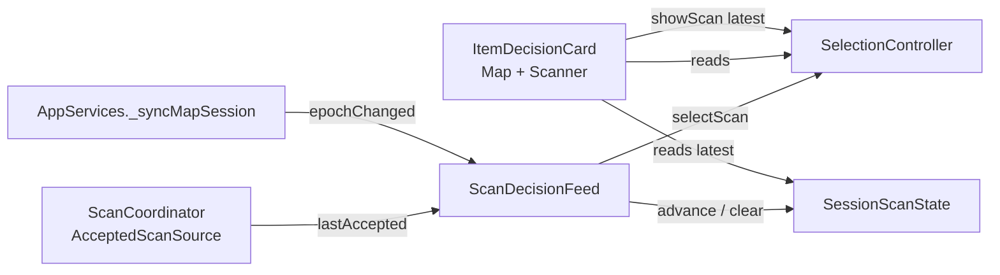
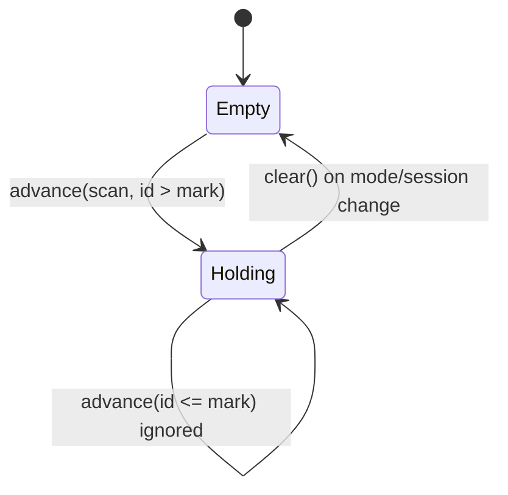
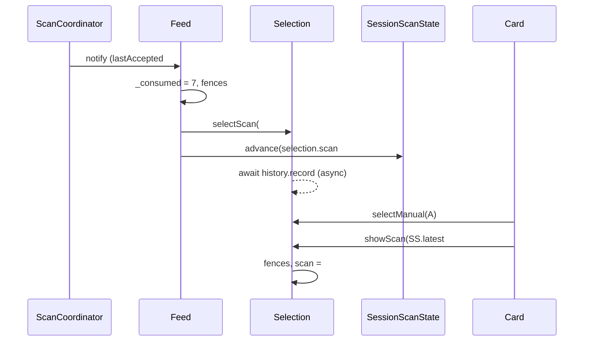

# Design

## Triage

| Trigger | Applies? | Evidence |
|---|---|---|
| T1 Components (new component, or 3+ with directed relationships) | Yes | `ScanCoordinator` → `ScanDecisionFeed` → `SelectionController` and the new producer for `SessionScanState`, read by `ItemDecisionCard` on two screens (`app_services.dart:114-119,154`) |
| T2 State (persistent state, caches, 3+ state machine) | Yes | New in-memory session state: the latest accepted scan, which is empty, holds a scan, or is cleared. Not persisted |
| T3 Concurrency (background work, workers/isolates, async, retries) | Yes | `selectScan` is async with a history write (`selection_controller.dart:155-200`). Accepted reports, epoch changes and taps on the card interleave |
| T4 Boundaries (data format, migration, shared interface, IPC, external) | No | No storage, schema, native, ABI or file format change. `AppServices.scans` is an in-app interface, used only by tests and `map_screen.dart:349` |
| T5 Volume (grows without a fixed bound) | No | One record, replaced in place |
| T6 Risk (security, money, data loss, unrecoverable user data) | No | Session-only display state. History stays the durable record, and this change does not write it |

TIER: FULL

## Context

See proposal.md for the why. Current state:

- `SessionScanState` is a `const` stub (`session_scan_state.dart:1-7`). `AppServices.scans` exposes it (`app_services.dart:154`). Only the Map stub panel reads `status` (`map_screen.dart:343-356`). Tests read `hasAcceptedScan`, for example `test/ui/map_screen_test.dart:260-261` and `test/application/selection_controller_test.dart:23`.
- `ScanDecisionFeed._applyAccepted` (`scan_decision_feed.dart:81-130`) raises its high-water mark `_consumed` first, then applies the epoch, mode and catalog fences, then calls `selection.selectScan` unawaited. `epochChanged()` calls `selection.retireScan()` (`:133`). `AppServices._syncMapSession` calls it once per mode or session change (`app_services.dart:284`).
- `selectScan` builds the `AcceptedScan` and sets `selection.scan` before its first `await` (`selection_controller.dart:155-190`; the await is `history.record` at `:191`), and only when the projection yields a decision. Manual, history and correction clear `_scan` (`:135`, `:290-310`, `:313+`).
- ADR-0018: "only accepted reports from `AcceptedScanSource` may advance the Map snapshot. A correction never does." A reducer that read `selection.correction` would break that rule.
- ADR-0001 and ADR-0017: one shared decision projection for Map and Scanner. The card is `ItemDecisionCard` on both screens (`map_screen.dart:395`, `scanner_screen.dart:67`). Its `trailing` holds the history close button (`item_decision_card.dart:65-71`).
- The shell keeps both screens alive in an `IndexedStack` (`shell.dart:161-172`), and `ScanCoordinator` is app-scoped (ADR-0013). Scanning with Map open therefore needs no new mechanism, only proof.
- User decision, 2026-10-19: Map and Scanner share the selection card, which offers a way back to the latest scan, rather than Map being pinned to the snapshot.

## Decisions

### D1: The feed is the snapshot's only writer, advancing from the selection it just made

- **Choice:** `SessionScanState` becomes a `ChangeNotifier` with `AcceptedScan? latest`, `hasAcceptedScan`, `advance(AcceptedScan)` and `clear()`. `ScanDecisionFeed` takes it as a constructor parameter. Right after the synchronous call to `selection.selectScan(...)`, the feed reads `selection.scan`. When that scan's `reportId` equals the report being applied, the feed calls `scans.advance(scan)`. `advance` ignores a scan whose `reportId` is not above the current latest one (D3). `epochChanged()` calls `selection.retireScan()` and then `scans.clear()`. No other code holds a reference that can write it.
- **Rejected:** `SessionScanState` listening to `SelectionController` and adopting each new `selection.scan`. That gives the snapshot a second input path, the selection's whole notification stream, and the binding rule then rests on `scan` never being set by a non-accepted path. D2 sets `scan` again on a return, which a listener would have to tell apart by report id. The feed already holds the fenced, accepted report.
- **Rejected:** a callback injected into `SelectionController` and fired from `selectScan`. That gives selection a second output channel and puts snapshot ownership in the class that also owns manual, history and correction.
- **Reversal cost:** low. It is in-app wiring with no stored data.

### D2: Return to the latest scan is a fenced selection source that reuses the record

- **Choice:** `SelectionController.showScan(AcceptedScan scan)` makes `scan` the current selection again. It uses the same immutable record, so the acceptance time and the decision at acceptance stay unchanged. It applies only while `scan.epoch` equals the current epoch (when an epoch reader is set), `scan.mode == catalog.mode`, and the live catalog holds `scan.itemId`. Otherwise it changes nothing and logs one `debugPrint` line, like the correction fences (`selection_controller.dart:259-276`). On success it bumps `_generation`, clears manual, correction, offer, history and `scanRetired`, resets FIR to unknown, re-projects and notifies. It writes no history. The card passes `services.scans.latest` at tap time, so a scan accepted between the render and the tap is the one shown.
- **Rejected:** calling `selectScan` again with the stored report. That records a second history row and a new acceptance time, so the return would pass as a new scan, which the spec forbids.
- **Rejected:** pinning Map's card to the snapshot. The user chose against it on 2026-10-19: it gives Map and Scanner two projections, and the FIR toggle and correction offer would leave Map.
- **Reversal cost:** low.

### D3: Monotonic by report id, not by time

- **Choice:** `advance` accepts a scan only when `latest == null || scan.reportId > latest.reportId`. Report ids rise with each report (`scan_decision_feed.dart:19-28` relies on the same order). `clear()` sets `latest` to null but keeps the high-water report id, so a late call for a scan from before the clear can never restore it. The feed's own `_consumed` mark already stops re-publication. This guard keeps the record correct even if the feed changes.
- **Rejected:** ordering by `acceptedAt`. The selection's clock sets it, and an injected or adjusted clock can repeat or go back. Report ids cannot.
- **Reversal cost:** low.

### D4: The card offers the return. The Map stub panel is removed

- **Choice:** `ItemDecisionCard` listens to `Listenable.merge([selection, scans])`. When `scans.latest` is non-null and `selection.scan?.reportId != latest.reportId`, its `trailing` shows a `TextButton.icon` labelled "Back to latest scan", with a tooltip naming the item (`catalog.snapshot.items[id]?.name`, else the id). An open history view shows it beside the close button. The Map rail's first row keeps the Active map panel alone, at full width. The "Latest accepted scan" `GridPanel` and `SessionScanState.status` are deleted.
- **Rejected:** a separate "latest scan" chip or panel on Map only. The user ruled out a second scan card on 2026-10-18.
- **Reversal cost:** low. M4.5's `polish-map-rail` reworks the rail anyway.

## Diagrams (FULL)

Components (T1):

Snapshot state (T2):

Ordering of one accepted scan and a return (T3):

## State & Ownership (FULL)

| State | Owner (sole writer) | Lifetime | Invalidation / rebuild | Authoritative copy |
|---|---|---|---|---|
| `SessionScanState.latest` and its report-id mark | `ScanDecisionFeed` (`advance`, `clear`) | App run, in memory | Cleared on a mode or session change through `epochChanged`. Never rebuilt from history | This object |
| `selection.scan` when restored | `SelectionController.showScan` (the card only triggers it) | Until the next selection or retire | `retireScan` clears it (`selection_controller.dart:208-222`) | The same `AcceptedScan` instance the snapshot holds |
| Activity history | `HistoryController`, unchanged | Durable | Unchanged. `showScan` never writes | SQLite |

## Failure & Visibility (FULL)

| Component | Fails / dies mid-operation → | Recovery | Retry safe? | Who finds out |
|---|---|---|---|---|
| `selectScan`'s projection yields no decision | `selection.scan` stays null, so the feed does not advance | None needed. The next accepted scan advances | n/a | User: the card shows its existing unresolved state. Log: none |
| History write for an accepted scan fails | Selection and snapshot still hold the scan. The card shows the existing "not recorded" error (`scan-decisions` spec) | Unchanged | Unchanged | User |
| `showScan` fenced (epoch, mode, missing item) | Nothing changes | The user scans again | Yes, idempotent | Log: one `debugPrint` per refused tap. User: the card still shows the previous item |
| App shutdown | `SessionScanState` is disposed with `AppServices` | n/a, session-only | n/a | Nobody needs to |

## Resource Bounds (FULL)

| Queue / buffer / cache / transfer | Bound | At the bound | Timeout | At 10x / 100x |
|---|---|---|---|---|
| Latest accepted scan | 1 record | Replaced in place | none | Same: one record |
| Card listeners | 2 per card (selection, scans), 2 cards | n/a | none | Same |

## Flow & State Gaps (FULL)

- **Late history write after a return:** `showScan` bumps `_generation`, so the earlier selection's pending write cannot set `error` on the restored scan. This matches `selectManual`.
- **Accepted scan arrives while the user taps Back:** both run on the UI isolate. If the scan is applied first, the tap reads the new `latest` and shows it, which is already current, so the button is hidden at the next build. If the tap comes first, the scan then replaces it.
- **Mode or session change between the render and the tap:** `epochChanged` clears the snapshot synchronously, in the same `_syncMapSession` call as the mode change, so a stale button tap reads `latest == null` and is a no-op. `showScan`'s own epoch and mode fences cover callers that hold an old record.
- **Catalog refresh drops the item:** `showScan` refuses, D2. The button may still show until the user taps, which is acceptable: the tap logs and changes nothing. Assumption: hiding it on a catalog miss is not needed.
- **Correction offer pending when Back is used:** `showScan` clears the offer, as `selectManual` does. The offer belonged to a newer unaccepted scan that the user chose to leave.
- **Restart:** the snapshot starts empty. History is not read back (spec).

## Mechanism Ledger (FULL)

| Mechanism | Built? | Why (harm nobody catches / expensive later) | Evidence that would change the call |
|---|---|---|---|
| Report-id monotonic guard in `advance` | Yes | Cheap. Without it, a regression in the feed's `_consumed` mark would silently move Map back to an older scan | none |
| High-water mark kept across `clear()` | Yes | Without it, an out-of-order `advance` after a mode change could restore a scan from the previous mode, the one stale case the exit criterion names | none |
| Fences in `showScan` | Yes | A stale record would otherwise become current advice in the wrong mode | none |
| Hiding the button when the catalog lacks the item | No | A tap is already refused and harmless | User reports of a dead button |
| Persisting the snapshot | No | The strategy makes it session-only (`IMPLEMENTATION_STRATEGY.md` §6, line 200) | none |

## Risks / Trade-offs

- [The feed relies on `selectScan` setting `scan` before its first await] → A feed test asserts `scans.latest` right after the source notifies, with no pump. A refactor that moves the assignment past the await fails that test.
- [Two buttons in the card's `trailing` during history] → Widget test at a normal text scale. Small-window large-scale layout is out of scope, as for other cards.

## ADRs

- **In force, constraining this change:** 0001 (one shared decision engine and card), 0013 (app-scoped scanner, coordinator never imports selection), 0017 (accepted scans feed selection, `AcceptedScan` record), 0018 (only accepted reports advance the Map snapshot; correction is never an `AcceptedScan`).
- **To record during apply:** none. The snapshot follows ADR-0018's binding rule and adds no boundary or format. The architecture file is updated in place: the "Not built yet" note, the components table (the `ScanDecisionFeed` row, plus `SessionScanState` as the snapshot owner), the state-ownership table, the §9 row (line 140) and line 168, "Planned but not built (the Map snapshot)".
