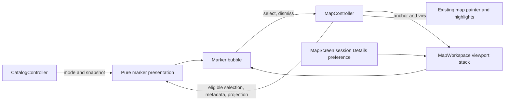
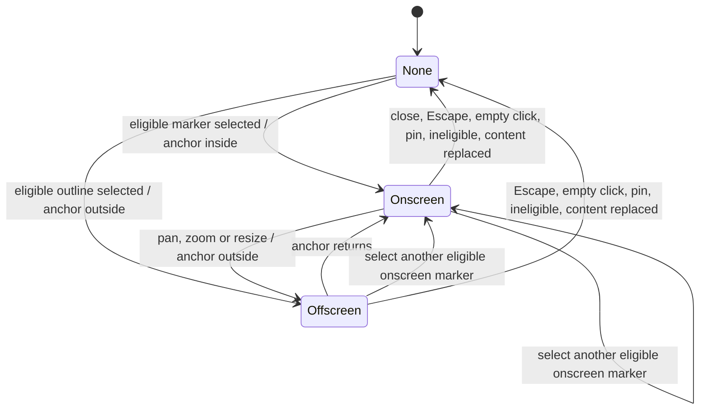
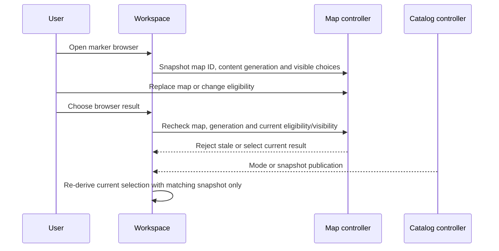
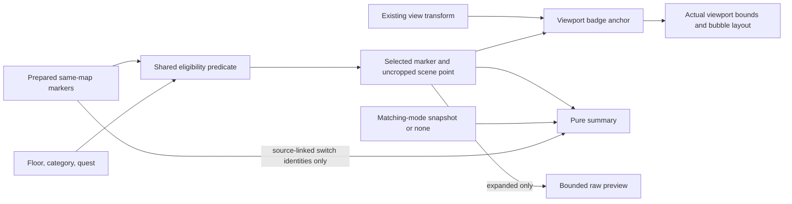

# Design

## Triage

| Trigger | Applies? | Evidence |
|---|---|---|
| T1 Components | Yes | A focused presentation module and popup join the map controller, workspace, and catalog (`lib/ui/map_workspace.dart:360-390`, `lib/application/catalog_controller.dart:26-55`). |
| T2 State | Yes | Selection has absent, selected-onscreen and selected-offscreen states and can become ineligible; Details has a session preference. Currently selection is mirrored (`lib/ui/map_workspace.dart:48-88`, `lib/application/map_controller.dart:52-58,222-232`). No persistent state is added. |
| T3 Concurrency | Yes | Existing browser is asynchronous and fences stale selections; catalog mode/load/refresh publishes asynchronously (`lib/ui/map_workspace.dart:240-309`, `lib/application/catalog_controller.dart:62-100,102-150`). No popup work runs asynchronously. |
| T4 Boundaries | Yes | The workspace needs a shared, uncropped selection/projection and catalog-mode interface (`lib/application/map_controller.dart:463-590`, `lib/domain/catalog.dart:402-455`). No disk or network format changes. |
| T5 Volume | Yes | Prepared marker source contains arbitrary nested task structures (`tool/maps/quest_markers.dart:1-172`); a bounded diagnostic preview is necessary. |
| T6 Risk | No | This change neither writes saved pins nor changes security, finance or unrecoverable data. Existing pin editor remains separate (`lib/ui/map_workspace.dart:588-635`). |

TIER: FULL

## Context

The proposal is the scope and release-note authority. `MapWorkspace` owns a selected marker ID and content generation in addition to the controller's private `_selectedMarkerId`; its build resolves the ID from the viewport-culled inventory and places raw marker details below the canvas (`lib/ui/map_workspace.dart:48-88,360-390,578-692`). The controller's eligibility predicate includes category, quest and floor, while its visible inventory uses projected bounds including outlines plus a margin (`lib/application/map_controller.dart:463-590`). The latter is not an anchor-visibility test. Geometry already projects scene coordinates to viewport (`lib/domain/map_geometry.dart:215-308`).

The existing marker data and links live in `PreparedMarker` and `MapMarkerMetadata` (`lib/maps/prepared_map.dart:601-671`, `lib/domain/map_marker_query.dart:1-95`). Offline preparation preserves details and translates quest data (`tool/maps/pack.dart:1479-1617`, `tool/maps/quest_markers.dart:1-172`). Catalog `mode` and `snapshot` are exposed by `CatalogController`, with cached and later refresh publication fenced by mode/generation (`lib/application/catalog_controller.dart:26-100,119-150`); snapshot itself records mode and items (`lib/domain/catalog.dart:402-455`). Existing `DetailsSection` takes an owned expansion value and lazily builds children (`lib/ui/theme.dart:220-282`). `MapScreen` owns analogous `_inputsExpanded` above the layout split (`lib/ui/map_screen.dart:212-218,327-351,517-539`); Map and Scanner remain mounted across tabs (`lib/ui/shell.dart:160-171`).

## Decisions

### D1: Reuse prepared data and current catalog

- **Choice:** Derive summaries from the selected prepared marker, same-map source-linked switches and the already published matching-mode catalog, retaining last-good data when available; unresolved names say unavailable, with IDs confined to Details. No popup fetch, pack enrichment, proximity inference or location-specific boss probability.
- **Rejected:** Fetch on selection or enrich the pack: these introduce a data pipeline and change the approved scope; prepared-only names would unnecessarily omit available catalog names.
- **Reversal cost:** medium.
- **Important:** yes — changes user-visible content and a data boundary.
- **Chosen by:** user.

### D2: Viewport stack and interaction isolation

- **Choice:** Place a fixed-screen-size, scrollable in-map bubble above the badge if it fits, otherwise below, then clamp it to the viewport and tether it to the projected badge; the bubble owns its inputs while uncovered map space retains navigation.
- **Rejected:** A detached global overlay or an external details strip: the former adds a second coordinate/lifecycle boundary and the latter loses the selected-place association.
- **Reversal cost:** medium.
- **Important:** yes — changes user-visible placement and interactions.
- **Chosen by:** user.

### D3: Separate offscreen from ineligible

- **Choice:** Keep selection when its anchor leaves the viewport and hide the bubble until re-entry; clear permanently for map/content replacement or floor/category/quest ineligibility. Close, Escape, empty map click or pin selection clear; another marker replaces.
- **Rejected:** Clear on viewport culling or pin the bubble to an unrelated edge: the former loses selection while panning and the latter suggests a false location.
- **Reversal cost:** medium.
- **Important:** yes — changes user-visible selection lifecycle.
- **Chosen by:** user.

### D4: One lazy session Details preference and bounded preview

- **Choice:** Use one initially collapsed preference for all marker Details, surviving marker/tab/layout changes without persistence. Construct only the current marker's raw preview on expansion, with a 16 KiB cap and an explicit shortening notice.
- **Rejected:** Per-marker or saved expansion, or complete eager serialization: these change the agreed lifetime or perform unbounded work on source snapshots.
- **Reversal cost:** low.
- **Important:** yes — changes user-visible state and diagnostic output.
- **Chosen by:** user.

### D5: Controller owns marker selection

- **Choice:** Make the existing map controller's marker selection authoritative, including eligibility and uncropped projection, and remove the workspace's duplicate marker ID/generation. Keep saved-pin selection local and unrelated; carry the Details value/callback above the layout split.
- **Rejected:** Retain two marker selections with synchronization or invent a general selection framework: the former can diverge on resize/invalidation; the latter widens this tactical change.
- **Reversal cost:** low.
- **Important:** no — internal ownership implements the already chosen lifecycle without changing its contract.
- **Chosen by:** agent.

### Decision summary

| # | Decision | Choice | Rejected | Reversal cost | Important | Chosen by |
|---|---|---|---|---|---|---|
| S1 | Scope | One M8 presentation change only | Bundle other initiatives or implement during planning | low | yes | user |
| S2 | Data | Existing matching catalog and prepared data | Pack-only or new data endpoint/enrichment | medium | yes | user |
| D1 | Summary source | Prepared facts and matching last-good catalog | Fetch, enrich, or prepared-only names | medium | yes | user |
| D2 | Placement and input | In-map clamped tethered stack bubble | Detached overlay or strip | medium | yes | user |
| D3 | Lifecycle | Hide offscreen; clear ineligible and dismissals | Clear on culling or detach at edge | medium | yes | user |
| D4 | Details | Lazy bounded session-wide preference | Saved/per-marker or eager complete source | low | yes | user |
| D5 | Ownership | Controller selection and parent-owned Details | Duplicate selection or broad framework | low | no | agent |

## Diagrams (FULL)

### T1 — components

### T2 — selection states

### T3 — existing asynchronous publication and browser

### T4 — data and geometry interface

## State & Ownership (FULL)

| State | Owner (sole writer) | Lifetime | Invalidation / rebuild | Authoritative copy |
|---|---|---|---|---|
| Selected marker ID | `MapController` | Map session, including workspace reconstruction | Clear synchronously on ineligibility, map/content replacement or explicit dismissal; replace on selection. Search dimming and viewport motion do not clear. | Controller ID, not a widget mirror |
| Selected projection / summary | Derived by controller and presentation at read/build | Current frame | Recompute from current eligible marker, transform, active map and catalog; no cached second selection | Prepared marker plus controller transform and matching snapshot |
| Marker Details expansion | `MapScreen` state | App session while shell remains mounted | Toggle callback; starts false on new launch; no settings write; pass required value/callback to every `MapWorkspace` caller | Single parent boolean |
| Saved-pin selection and hover | `MapWorkspace` | Workspace lifetime | Existing map/pin rules; selecting a pin clears controller marker selection; marker selection clears pin | Existing local state |
| Catalog | `CatalogController` | Existing mode/cache lifetime | Existing mode/generation publication and last-good policy | `mode` and `snapshot`; accept only known active mode with `snapshot.mode == mode` |
| Preview | Popup build | Expanded current marker only | Discard on collapse or selection replacement; build lazily, no retained raw cache | Current marker data |

Implement a controller accessor that resolves the selected eligible marker and its scene/viewport anchor independent of `visibleMarkers` culling. Use the exact `_markerEligible` predicate for both; apply eligibility invalidation on floor/category/quest changes and map/content authority change, not just during paint, and notify listeners coherently. The selection and linked highlights must clear together. Preserve browser's map/content generation fence and recheck its result against current eligible visible inventory. Do not introduce a second projection formula: use the current transform and marker scene point; test the badge center against `[0,width] × [0,height]`, not the margin or outline bounds. A selected outline may remain painted/hittable when its anchor is outside.

In `MapScreen`, put the bool beside `_inputsExpanded`, pass it and an `onExpandedChanged` callback through `MapWorkspace` for every caller. Before apply changes exported constructors or methods, use LSP references and update all callsites. Selection remains in the controller when `MapWorkspace` is reconstructed across the compact breakpoint; pin behavior is not redesigned.

## Failure & Visibility (FULL)

| Component | Fails / dies mid-operation → | Recovery | Retry safe? | Who finds out |
|---|---|---|---|---|
| Map selection/projection | Map replaced or marker becomes ineligible → clear selection and linked highlights, never show stale data | Select a current eligible marker | Yes, user action | User sees bubble disappear |
| Browser | Result arrives after content replacement or is no longer visible/eligible → discard | Reopen browser | Yes | User sees no stale selection |
| Catalog/presentation | Absent, wrong-mode, missing ID or failed load → unavailable name, no summary ID; existing last-good matching data remains usable | Existing catalog publication rebuilds bubble | No popup retry; existing refresh policy unchanged | User sees unavailable name; existing catalog status reports failure |
| Raw preview | Input exceeds byte, depth, node or collection bounds → stop traversal and show shortening notice | Collapse or inspect bounded prefix | Yes, deterministic rebuild | User sees shortening notice |
| Bubble layout | Anchor outside or viewport has no usable area → hide bubble, keep eligible selection | Anchor/space returns on view change | Not applicable | User sees it return; map still operates |
| Map artwork/resources | Existing load error stays on map; no new fallback generation | Existing loader behavior | Existing policy | User sees map load error |

## Resource Bounds (FULL)

| Queue / buffer / cache / transfer | Bound | At the bound | Timeout | At 10x / 100x |
|---|---|---|---|---|
| Selection and Details state | One marker ID, one bool, existing pin/hover state | Replacement overwrites marker; no history | None | Constant |
| Raw preview | At most 16 KiB UTF-8 output including diagnostic content; iterative/recursive traversal also stops at depth 16, 1,024 visited nodes, 128 entries per collection, and the byte budget. Include a visible shortening notice outside the preview when any bound truncates. Encode incrementally, respecting UTF-8 character boundaries; never `jsonEncode` all data then truncate. | Stop traversal immediately, indicate shortening; no complete task snapshot or extra full-size string | None; synchronous bounded work | Same bounds for 10x/100x source, including a single huge string and huge collection |
| Summary | One selected marker and only referenced same-map switches; lookups against existing marker inventory/catalog, no extra cache or fetched collection | Missing or malformed optional values omitted/unavailable | None | Linear in existing same-map marker inventory/links; no added accumulation of raw source; no independent unbounded history |
| Popup layout | At most viewport-sized widget; scroll content inside constrained height | Clamp available dimensions; hide when unusable | None | Same viewport cap; long text scrolls |
| Browser/catalog async work | Existing browser and catalog flow; no new queue, worker, timer or request | Existing controller behavior; stale browser result discarded | Existing catalog policy | No popup multiplication of requests |

## Flow & State Gaps (FULL)

- **Selection and replacement:** Hit testing, browser and accessibility all call the one selection authority; selecting a marker clears a selected pin, and selecting a pin clears marker state. On an offscreen outline hit, selection/highlights update but the bubble stays hidden. Resize reconstruction retains controller state. A close action restores usable map focus; map help's modal Escape closes help only. Focused popup controls get key events first; an ancestor map handler must ignore Enter/N/Delete while focus is inside the popup, and popup Escape dismisses only when no modal is above it.
- **Geometry and input:** Place the bubble as a sibling above the canvas input layer in the clipped viewport stack, not inside the map's opaque gesture listener. Resolve pointer signals at the popup scrollable so its wheel cannot reach map zoom; hit testing and secondary clicks within its bounds do not reach canvas. Uncovered canvas retains pan, zoom, selection and context pin input. Place/clamp from measured bubble size and current actual `LayoutBuilder` bounds, including narrow/zero constraints, with a tether painted to the badge anchor. No map transform mutation for placement.
- **Data interpretation:** Re-derive from the current marker and current same-map inventory. Extract `transferItem`'s `count`/`item` and source switch links, including scalar alias when present, using the existing link semantics (`lib/domain/map_marker_query.dart:1-45`); resolve switch names only against current map and include reverse activation links supported by the controller. For locks consume `key`, `lockType`, `needsPower` only when present and well typed. Quest descriptions, quest/trader/wiki data and quest item names are already translated by preparation; show applicable names and objective text, not raw serialized task data. Use prepared container names. Treat a finite numeric boss `spawnChance` in [0,1] as a boss-wide percentage (0.35 → 35%), omit invalid/missing values, never claim location-level chance. Replace category-key fallback names with `markerCategoryLabel`; don't synthesize availability or IDs.
- **Catalog race:** Listen to the catalog notifier alongside map/settings; compare both controller mode and snapshot mode before lookup. A mode switch clears or mismatches the old snapshot, so it cannot supply a name. A later matching publication refreshes the summary; failure uses matching last-good data if present. No selection-triggered load, retry or request.
- **Restart/partial work:** No persistence, network operation or background popup task is introduced. Restart clears selection and Details preference; partial preview is simply discarded on rebuild. Existing map scene loads and browser await retain their existing generation fences.
- **Tests at apply:** Pure presentation/preview cases cover each fact shape, scalar links, same-map-only linking, missing/mismatched/cached/updated catalog, invalid probabilities, malformed and deeply nested/large strings and collections. Controller tests cover eligibility, shared highlights and uncropped anchor. Widget tests cover all selection paths, corner placement/tether, scroll/pointer/key/modal isolation, resize/tab/session state, offscreen return and invalidation. In `test/maps/map_viewport_test.dart:740-766`, replace only the now-invalid offscreen bubble title expectation while retaining hazard paint, outline hit and highlight proof. In `:767-817`, preserve cursor-anchor/21-vs-23 logical-pixel hit assertions, replacing the raw-open assertion with collapsed/expanded Details behavior. Use deterministic fixtures, handwritten fakes and bounded pumping/completers, no sleeps or game access.

## Mechanism Ledger (FULL)

| Mechanism | Built? | Why (harm nobody catches / expensive later) | Evidence that would change the call |
|---|---|---|---|
| Shared uncropped selection/eligibility | Yes | Current culled inventory conflates offscreen and ineligible; duplicate state can leave highlights stale across reconstruction | Existing controller API proving identical behavior without the seam |
| Browser generation and eligibility fence | Yes, retain/extend existing | Browser result can arrive after a real map/content/filter change | A synchronous browser without deferred results |
| Matching-mode catalog guard | Yes | Async mode change can otherwise render another mode's item name | Catalog type enforcing mode match at the consumption boundary |
| Bounded incremental raw preview | Yes | Frozen task source may be large/deep, and eager encoding can block/allocate before truncation | A proven fixed bound on every raw source and string |
| Pointer/focus isolation | Yes | Parent map listener and keyboard handler currently receive input around their descendants | Widget event routing proving both wheel and key isolation without an explicit boundary |
| Additional cache, async worker or retry | No | Presentation is synchronous, one selection, existing catalog publication already provides updates; no demonstrated need | Measured contention after bounded implementation or a real asynchronous source |
| Generic selection framework or persistent preference | No | Only marker selection and one memory-only preference change; pins and storage already have owners | Multiple unrelated consumers requiring a shared contract |

## Risks / Trade-offs

- [Tiny viewports and large text leave little room] → Clamp to actual viewport, scroll content, hide only when there is no usable space; test constrained and scaled layouts.
- [Visible outline with offscreen anchor seems selectable without a bubble] → Keep correct selected/highlight state; show bubble when anchor returns, and preserve outline hit testing.
- [Prepared fields differ by marker] → Validate field shapes, use available translated values, omit unsupported facts and never guess by proximity.
- [Preview shortening loses later diagnostics] → Show an explicit notice; this is a diagnostic prefix, not an export.
- [Catalog change while open or mode mismatch] → Listen for publication and compare both modes, not catalog freshness alone.
- [Layout reconstruction breaks focus/selection] → Controller owns marker identity; parent owns expansion; widget tests cross the breakpoint and exercise keyboard and modal precedence.

## ADRs

- **In force, constraining this change:** ADR-0002 (notifiers/composition and stale publication), ADR-0005 as amended by ADR-0033 (native transform and offline immutable pack), ADR-0023 (existing badge art/painter), ADR-0029 (proposal release notes).
- **To record during apply:** None. This is a tactical presentation and shared internal interface, not a new durable format, protocol or architectural boundary.

## Open Questions

None.
