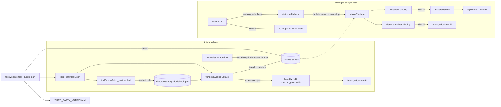
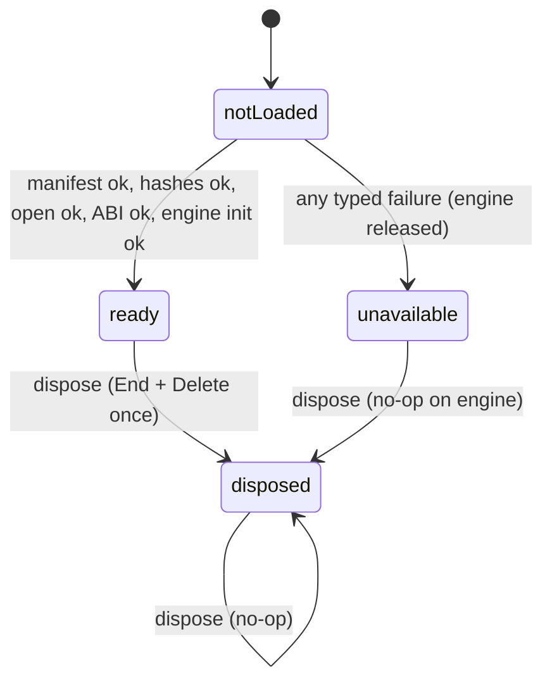
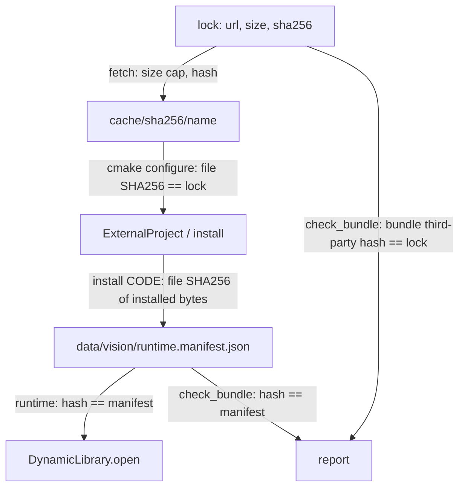

# Design

## Triage

| Trigger | Applies? | Evidence |
|---|---|---|
| T1 Components (new component, or 3+ with directed relationships) | Yes | New: the `blackgrid_vision.dll` C++ target, the Dart vision runtime loader, the Tesseract binding, the fetch tool, the bundle integrity tool, and the self-check entry. Directed chain: lock → fetch → CMake → install manifest → loader → self-check. |
| T2 State (persistent state, caches, 3+ state machine) | Yes | Gitignored input cache under `.dart_tool/`. Install-generated runtime manifest. Runtime status machine `notLoaded → ready \| unavailable → disposed`. |
| T3 Concurrency (background work, workers/isolates, async, retries) | Yes | The self-check runs native steps in a helper isolate under a watchdog timeout. Otherwise all native calls are synchronous in one isolate; the warm worker is change 3. |
| T4 Boundaries (data format, migration, shared interface, IPC, external) | Yes | New C ABI (`bgv_*`), Tesseract C-API binding, lock-file format, runtime-manifest format, self-check report format and CLI, external downloads (GitHub, NuGet). |
| T5 Volume (grows without a fixed bound) | No | The inventory is fixed and committed. Image sizes are capped (D5). The report is one per run with a fixed set of steps. Nothing accumulates. |
| T6 Risk (security, money, data loss, unrecoverable user data) | Yes | Loading third-party native code into the process, DLL search-order hijacking, and supply chain (downloaded binaries). |

TIER: FULL

## Context

See `proposal.md` for the why and the user's four decisions:
- owned OpenCV DLL;
- the fork's Tesseract binaries (charlesw package 5.2.0, engine 5.0.0);
- a pinned fetch script;
- a self-check CLI.

Current state this design builds on:

- **Panel OCR precedent.**
  - The CMake subproject `windows/ocr/CMakeLists.txt:1-11` builds a standalone x64 FFI DLL. It is installed beside the exe at `windows/CMakeLists.txt:93-94`.
  - `install(CODE …)` at `windows/CMakeLists.txt:95-99` writes the installed bytes' SHA-256 to a `.sha256` sidecar.
  - The Dart loader (`lib/data/raid_panel_ocr.dart:181-207`) works in this order:
    1. requires an absolute path;
    2. requires the DLL and its sidecar to exist;
    3. hashes the DLL with `package:crypto` and compares;
    4. only then calls `DynamicLibrary.open`;
    5. checks the ABI (`bg_ocr_abi() != 2`).
  - Failures surface as an `unavailable` state with a message (`:457-480`). The binding "proves the DLL matches its build; it is not tamper-proof" (`openspec/architecture.md:85`).
- **The Visual C++ runtime is an undeclared system dependency today.**
  - The existing Release `blackgrid.exe` imports `MSVCP140.dll`, `VCRUNTIME140.dll` and `VCRUNTIME140_1.dll`. So does `blackgrid_panel_ocr.dll`, even though it sets `MSVC_RUNTIME_LIBRARY "MultiThreaded…"` (`windows/ocr/CMakeLists.txt:10`). These imports were observed by parsing the PE import tables in `build/windows/x64/runner/Release`.
  - Cause: the root `cmake_minimum_required(VERSION 3.14)` and `project()` (`windows/CMakeLists.txt:2-3`) leave policy CMP0091 OLD when the first `project()` runs. CMake then puts `/MD` in the cache flags and ignores the target property.
  - `flutter_windows.dll` imports no CRT. `sqlite3.dll` imports only `KERNEL32`.
- **Reference fork.**
  - Native files: OpenCvSharp 4.13.0.20260627, charlesw `Tesseract` NuGet 5.2.0, whose `tesseract50.dll` embeds Tesseract engine 5.0.0 (`tesseract 5.0.0` version string in the fork's binary, per review), plus `leptonica-1.82.0.dll`, and tessdata_fast 4.1.0 `eng.traineddata`.
  - The traineddata SHA-256 is `7d4322bd2a7749724879683fc3912cb542f19906c83bcc1a52132556427170b2`, 4,113,088 bytes. It is recorded in `docs/qualification/m0/u2-rights-decision-packet.md:72-74`, and the fork's `Assets\Scanner\rat-eye-integrity.json` holds the DLL hashes.
  - Engine settings: `EngineMode.LstmOnly` and `PageSegMode.RawLine`, with no whitelist (fork `RatEye/Processing/Inspection.cs:360-403`).
  - Amendment 2026-10-08: on a uniformly white image, Tesseract 5.0.0 with tessdata_fast `eng` in raw-line mode returns short noise (`ee` for 320x48, `an` for 64x32; reproduced directly with `TessBaseAPIGetUTF8Text` outside Blackgrid). The reference runs the same engine and settings, so the runtime does not filter it: a blank image must recognise without failure, not to empty text. Rejecting noise belongs to the item pipeline's matching against known names.
  - OpenCV operations used: `CvtColor`, `Resize` (cubic up, area down), `Threshold(120, 255, BinaryInv)`, `MatchTemplate(CCoeffNormed)` plus `MinMaxLoc`, and a BGR range scan along one row.
- **Strategy constraints.**
  - Dart owns policy; native code supplies primitives (`docs/IMPLEMENTATION_STRATEGY.md:171-173`).
  - Use explicit buffer ownership, respect stride and channels, release returned Tesseract text, and avoid PNG round-trips (`:204`).
  - No machine-wide Tesseract, model or PATH dependency (`docs/plans/2026-10-07-0050-feat-m5-independent-useful-map-plan.md:154-155`).
- **No build or bundle tooling exists.** `mise.toml` has no build or bundle task, and no integrity check exists. Qualification tests are gated on env vars (`test/qualification/m5_panel_ocr_test.dart:15-20`). `.dart_tool/` is already gitignored.
- **Entry point.** `lib/main.dart` is `void main()` → `runApp`. The runner passes command-line arguments to Dart (`windows/runner/main.cpp:21-24`). It shows the window only on the first frame (`windows/runner/flutter_window.cpp:32-33`), so a Dart path that exits before `runApp` shows no window.

## Decisions

### D1: Owned `blackgrid_vision.dll` that statically links OpenCV `core` and `imgproc`

- **Choice:**
  - A new CMake subproject, `windows/vision/`, builds OpenCV 4.13.0 with `ExternalProject_Add`. The source archive comes from the verified input cache. Configure verifies the cached archive against the lock SHA-256 before anything builds. The download step (`windows/vision/extract_source.cmake`) re-checks that hash whenever it extracts, and extracts once into a content-addressed source directory shared by every configuration; a completed extraction of the same SHA-256 is reused without re-hashing. The OpenCV build and install directories carry the same hash prefix, so a pin change starts fresh trees instead of reusing a CMake cache made from the earlier source. ExternalProject's own `URL` step runs once per configuration in a multi-config build, re-extracting and renaming over the source tree; on Windows that rename failed with "Access is denied" during apply.
  - OpenCV is built as static libraries (`BUILD_SHARED_LIBS=OFF`, `BUILD_LIST=core,imgproc`, `BUILD_WITH_STATIC_CRT=ON`). Everything that downloads or adds unneeded third-party code is off: `WITH_IPP`, `WITH_OPENCL`, `WITH_ADE`, `WITH_EIGEN`, `WITH_ITT`, `WITH_PROTOBUF`, `WITH_JPEG/PNG/TIFF/WEBP/OPENEXR/OPENJPEG/IMGCODEC_*` (no `imgcodecs` module), tests, apps, docs and Java/Python.
  - The vision DLL is C++20 with static CRT, links those libraries, and exports a small C ABI (D4).
- **Configuration mapping:**
  - Flutter's `Release` and `Profile` configurations link an OpenCV build made in `Release` (`/MT`).
  - `Debug` links a separate OpenCV build made in `Debug` (`/MTd`), so `flutter run` keeps working and avoids LNK2038 runtime mismatches.
  - Each OpenCV configuration is a separate ExternalProject install prefix (`opencv-install-<sha16>/Release`, `opencv-install-<sha16>/Debug`), built once and reused by later builds of that configuration. `Profile` maps to the Release prefix through `$<IF:$<CONFIG:Debug>,Debug,Release>`.
- **Rejected:** the `dartcv4` 2.3.x native-assets hook package, because:
  - it brings a large, version-churning Dart API surface for 5 calls;
  - its hook fetches and builds OpenCV outside our lock and hash pinning;
  - ADR-0007 places heavy native work in standalone hash-bound DLLs built by the Windows CMake.
- **Also rejected:** a wrapper over the official prebuilt `opencv_world4130.dll`. It would add a DLL of tens of MB holding every module, and our wrapper would take on its CRT and ABI coupling.
- **Reversal cost:** medium. Callers only see Dart wrapper types (`VisionImage`, `TemplateMatch`), so swapping the backend touches the native subproject and the binding file, not the pipeline (changes 4 and 5).

### D2: Tesseract engine 5.0.0 and Leptonica 1.82.0 binaries taken from the pinned charlesw NuGet 5.2.0 package; owned C-API binding

- **Choice:**
  - The fetch tool downloads `https://www.nuget.org/api/v2/package/Tesseract/5.2.0`, pinned by nupkg SHA-256. It extracts `x64/tesseract50.dll` and `x64/leptonica-1.82.0.dll` and verifies each extracted file against its own lock pin, cross-checked against the fork manifest's values when the lock is written.
  - The lock entry carries both `packageVersion` (5.2.0) and `engineVersion`. The engine version is expected to be 5.0.0 and is confirmed from `TessVersion()` when the lock is written.
  - The Dart binding uses only these functions, looked up by name: `TessVersion`, `TessBaseAPICreate`, `TessBaseAPIGetInitLanguagesAsString`, `TessBaseAPIOem`, `TessBaseAPIGetPageSegMode`, `TessBaseAPIInit2(handle, datapath, "eng", OEM_LSTM_ONLY)`, `TessBaseAPISetPageSegMode(PSM_RAW_LINE)`, `TessBaseAPISetImage(handle, data, w, h, bytesPerPixel, bytesPerLine)`, `TessBaseAPIGetUTF8Text`, `TessDeleteText`, `TessBaseAPIClear`, `TessBaseAPIEnd` and `TessBaseAPIDelete`.
  - Leptonica is not called directly; `SetImage` takes raw bytes.
- **Rejected:** building Tesseract 5.5 and Leptonica from source through vcpkg. It is a heavy build dependency and would move recognition away from the reference baseline that the M2 corpus comparison is measured against.
- **Reversal cost:** low. Changing the binaries is a change to the lock and binding version checks; the C API is stable across 5.x.

### D3: One install-generated runtime manifest as the build binding; the committed lock as the third-party pin

- **Choice:**
  - `windows/vision/third_party.lock.json` is committed and is the sole authority for third-party inputs. Format 1 holds one entry per input: `id`, `version` (with `packageVersion` and `engineVersion` for the Tesseract entry), `url`, `sha256`, `size`, `license`, `noticeAnchor`, and for extracted files `extractFrom` and `path`.
  - At install, CMake writes `data/vision/runtime.manifest.json` with: format 1, `abi` (the vision ABI), `engineVersion` (from the lock), and `files: [{path, sha256, size}]` for every vision file. Paths are relative to the exe directory.
  - The runtime verifies installed files against this manifest. The integrity tool checks the manifest against the files and the lock against the third-party files.
- **Rejected:** a per-file `.sha256` sidecar for each of the five files, as the panel OCR does. Five independent bindings can be partially present or stale, and one manifest is read once.
- **Also rejected:** Dart constants generated from the lock. A pin compiled into `app.so` is no harder to tamper with than a file next to it ("not tamper-proof", `architecture.md:85`), and it adds a codegen step.
- **Reversal cost:** low. The format is internal to the bundle, versioned, and rebuilt on every install.

### D4: Primitive C ABI with caller-owned memory only

- **Choice:**
  - Every `bgv_*` function takes input and output buffers allocated by Dart (`package:ffi` `calloc`), returns an `int32` status (0 = ok, negative = typed error), and never allocates memory that outlives the call.
  - Functions:
    - `bgv_abi()`
    - `bgv_to_gray(src, w, h, stride, channels, rgbOrder, dst, dstStride)`
    - `bgv_resize(src, w, h, stride, channels, dst, dw, dh, dstStride, interp)`
    - `bgv_threshold_binary_inv(src, w, h, stride, thresh, maxval, dst, dstStride)`
    - `bgv_match_template_best(img…, tpl…, outScore, outX, outY)` (grayscale only)
    - `bgv_find_in_range_row(src, w, h, stride, channels, row, startX, lo[3], hi[3], outX)`
  - Native code wraps buffers with a `cv::Mat` header (no copy) and catches all C++ exceptions at the boundary, mapping them to a status.
- **Rejected:** native code returning allocated result images with a `bgv_free`. That creates two-sided ownership and use-after-free risk once the worker (change 3) exists. Dart-owned output buffers keep one owner per buffer.
- **Reversal cost:** medium. This ABI is what changes 3 and 4 code against. It is versioned by `bgv_abi()`, so additions can be appended with an ABI bump.

### D5: The Dart loader is synchronous, verifies before it opens, and reports typed failures

- **Choice:**
  - `VisionRuntime.open({required String runtimeDirectory})` returns a `VisionRuntimeStatus`. The status is sealed: `VisionReady(identity)`, `VisionUnavailable(VisionFailure)`, or `VisionDisposed`.
  - `VisionFailure` is a sealed set: `invalidPath`, `missingFile(path)`, `hashMismatch(path, expected, actual)`, `abiMismatch(component, expected, actual)`, `loadFailed(path, osError)`, `engineInitFailed`, `invalidImage(reason)`, `nativeFailure(status, detail)`, `disposed` and `timeout(step)`. `invalidImage` is reserved for inputs Dart rejects before any native call; a non-success status returned by a native primitive (for example `BGV_ERR_IMAGE` for a uniform template, or a caught OpenCV exception) is `nativeFailure` carrying that status, so the two causes stay distinguishable.
  - Order:
    1. absolute-path check;
    2. read the manifest;
    3. check that every listed file and the expected set exist;
    4. hash every file;
    5. open `leptonica-1.82.0.dll`, then `tesseract50.dll`, then `blackgrid_vision.dll`, each by absolute path;
    6. check `bgv_abi()` against the expected ABI, and check that `TessVersion()` equals the lock's `engineVersion`. The value is carried into the bundle through `runtime.manifest.json` (`engineVersion` field written at install from the lock), not hard-coded;
    7. create and init the engine with `datapath = <exe>/data/vision/tessdata`;
    8. set PSM to raw line.
  - Any failure, and `dispose()`, releases the engine and then closes every opened `DynamicLibrary` in reverse load order with `close()`, as the panel OCR does (`raid_panel_ocr.dart:446-448`).
  - Image caps match the panel OCR precedent: each side 1-8192 px and at most 24 MPix (`raid_panel_ocr.dart:390-396`); channels 1, 3 or 4; `stride >= w*channels`; `buffer.length >= stride*h`. These are checked in Dart before any native call and again in native code.
- **Rejected:** a long-lived worker isolate owning the runtime in this change. ADR-0004 and the roadmap put that in change 3 with admission and duration bounds. Building it here would pre-empt that design. This change exposes no UI-isolate call path, so ADR-0004 is not violated.
- **Reversal cost:** low.

### D6: DLL resolution uses explicit absolute load order, not changes to the search path

- **Choice:**
  - Load `leptonica-1.82.0.dll` by absolute path before `tesseract50.dll`. The loader then satisfies `tesseract50.dll`'s import of `leptonica-1.82.0.dll` from the module already loaded under that name.
  - The Visual C++ runtime DLLs are already loaded by `blackgrid.exe` from its own directory, which comes first in the standard search order.
  - The self-check report records each loaded module's actual path from `GetModuleFileNameW`, taken through `kernel32` `GetModuleHandleW`. This proves bundle origin.
- **Non-ASCII paths:** `tesseract50.dll` opens the model only through narrow `char*` paths (the `Init*` entry points, no `_wfopen`). `windows/runner/runner.exe.manifest` therefore gains `<activeCodePage>UTF-8</activeCodePage>` (Windows 10 1903+), and the binding passes the datapath as UTF-8.
  - The effect is process-wide: every `-A` API and narrow CRT call in the process interprets strings as UTF-8. Flutter, Dart and our C++ use wide APIs or explicit conversion (`windows/runner/utils.cpp` `GetCommandLineArguments` converts wide to UTF-8), so nothing in the process relied on the legacy ANSI code page. ADR-0008 records this.
  - On `engineInitFailed`, the self-check report names the datapath it passed.
- **Rejected:** `SetDefaultDllDirectories` and `AddDllDirectory`, as the fork does. They change the search policy for the whole process, which affects Flutter, panel OCR and sqlite as well. The explicit order achieves the same result for our modules without that side effect.
- **Reversal cost:** low.

### D7: App-local Visual C++ runtime, and CMP0091 set so per-target static CRT takes effect

- **Choice:**
  - In `windows/CMakeLists.txt`, set `cmake_policy(SET CMP0091 NEW)` before `project()`.
  - Install the runtime DLLs the bundle imports (`msvcp140.dll`, `vcruntime140.dll`, `vcruntime140_1.dll`, plus any others the import check finds needed) from `CMAKE_INSTALL_SYSTEM_RUNTIME_LIBS`, which `include(InstallRequiredSystemLibraries)` populates with `CMAKE_INSTALL_SYSTEM_RUNTIME_LIBS_SKIP TRUE`. Filter that list to an explicit committed name list.
  - Keep the vision DLL and panel OCR on static CRT.
  - UCRT (`api-ms-win-crt-*`) is part of Windows 10+ and is on the system allow-list.
- The Visual C++ runtime DLLs are not pinned in the lock, because they come from whichever toolchain builds the bundle. Instead `tool/vision/bundle_inventory.json` records a committed minimum PE file version per runtime DLL. The minimum is the version `tesseract50.dll` requires, and no older than the VS 2022 (14.3x) toolset. The integrity check reads each shipped runtime DLL's `VS_FIXEDFILEINFO` and fails below it. The notices entry records the redistributable version and terms, without a SHA-256.
- The fork's `tesseract50.dll` and `leptonica-1.82.0.dll` import no `vcomp140.dll` (per review), so the three core runtime DLLs are expected to suffice. The import check confirms this.
- **Rejected:** switching the Flutter runner and wrapper to static CRT. That would remove the exe's need, but `tesseract50.dll` still imports the Visual C++ runtime (the charlesw package states this requirement), so the app-local copies are needed regardless. Changing the Flutter template's CRT also adds risk for no gain.
- **Also rejected:** requiring users to install the Visual C++ redistributable. That breaks "no system installation".
- **Reversal cost:** low.

### D8: The fetch tool caches only verified files; the build refuses anything unverified

- **Choice:**
  - `dart run tool/vision/fetch_runtime.dart` (mise task `vision:fetch`) reads the lock and downloads each URL over HTTPS with a 120 s timeout. Each download is capped at the lock's `size` and refused once it exceeds it.
  - It hashes the download and writes into `.dart_tool/blackgrid_vision_inputs/<sha256>/<name>` atomically (temp file, then rename) only when the hash matches.
  - It extracts nupkg members with `package:archive`, a pinned dev dependency recorded in notices, and verifies each member against its pin.
  - `windows/vision/CMakeLists.txt` reads the lock with `string(JSON)` and `file(SHA256)`-checks every cached input. A missing input or a mismatch is a `FATAL_ERROR` naming the input, both hashes and `mise run vision:fetch`.
- **Rejected:** committing the binaries to the repo (user decision). Also rejected: having CMake download at configure time, which would mix network fetching into every Flutter build and be harder to reason about offline.
- **Reversal cost:** low.

### D9: The self-check is a Dart entry path before `runApp`, with an isolate watchdog

- **Choice:**
  - `main(List<String> args)` checks for `--vision-self-check` first. If present, it runs `runVisionSelfCheck(reportPath)` and calls `exit(code)` without calling `WidgetsFlutterBinding.ensureInitialized()` or `runApp`. With no first frame, no window is shown and the database is not opened.
  - The steps (verify and load, template match, OCR, dispose) run in `Isolate.spawn`. The main isolate waits for the result with a 60 s overall watchdog.
  - On timeout it writes the report with `timeout(step)`. The step name comes from progress messages the helper isolate sends before each step. It then calls `exit(3)`, which ends the process and the stuck native thread.
  - The report is written to `<path>.tmp` and then renamed over `<path>`, so it is either absent, the previous complete report, or the new complete report. Its `result` field (`pass` or `fail`) is the authoritative outcome; the exit code mirrors it.
  - `blackgrid.exe` is a GUI-subsystem app, so a shell does not wait for it. The supported invocation, documented in the self-check's help text and in the PR, is:
    `$p = Start-Process -Wait -PassThru .\blackgrid.exe -ArgumentList '--vision-self-check','C:\temp\vision.json'; $p.ExitCode`
    In `cmd`, use `start /wait blackgrid.exe --vision-self-check C:\temp\vision.json` then `echo %ERRORLEVEL%`.
  - `runVisionSelfCheck` returns the exit code. Only `main` calls `exit`, so the watchdog path can be tested with a blocking stub without ending the test process.
  - Exit codes:
    - `0` pass
    - `1` a step failed
    - `2` usage error (no report path, or the report directory is missing), detected before any loading
    - `3` timeout
  - Report: `{format: 1, startedAt, runtimeIdentity: {files:[{path, sha256}], tesseractVersion, visionAbi, loadedModulePaths}, steps:[{name, ok, ms, failure?, detail}], result}`.
  - Sample:
    - committed as raw 8-bit grayscale, `assets/vision/self_check/title.gray`, plus `title.json` holding w, h, stride, expected text and the template rect;
    - generated once by `tool/vision/make_self_check_sample.dart` from a redistributable font recorded in notices;
    - installed under `data/vision/self_check/`;
    - read with `dart:io`, so no codec is needed at runtime.
  - The template is a crop of the same image, so its expected location is known exactly.
- **Rejected:** a separate console executable. It would be another binary to bundle, hash-bind and keep in step, and it would not prove that `blackgrid.exe` itself loads the runtime.
- **Also rejected:** a readiness line in the UI. The user chose the CLI, and the UI has no surface for it before change 5.
- **Reversal cost:** low.

### D10: The bundle integrity check is a pure-Dart tool plus a qualification test

- **Choice:**
  - `dart run tool/vision/check_bundle.dart <bundleDir> [--report <path>]` (mise task `bundle:check`) runs these steps:
    1. **inventory:** the expected set is committed in `tool/vision/bundle_inventory.json`. It lists exe, Flutter, panel OCR, sqlite, vision files, Visual C++ runtime names and the model. Any other `.dll` or `.traineddata` anywhere under the bundle is unexpected.
    2. **bindings:** the panel `.sha256` sidecar and the vision manifest.
    3. **pins:** lock SHA-256 against the third-party files in the bundle.
    4. **imports:** a minimal PE32+ import-table parser (header, sections, import directory, including delay-load). Each import must be in the bundle or match the committed `system_allowlist.json`. Names are compared case-insensitively. `api-ms-win-*` and `ext-ms-*` API sets are allowed by prefix, and the Visual C++ runtime names are never allowed.
    5. **runtime versions:** each app-local Visual C++ runtime DLL's file version is at or above its committed minimum.
    6. **notices:** for each lock entry, `THIRD_PARTY_NOTICES.md` contains the version, URL and SHA-256 under the entry's anchor.
  - It writes a JSON report and exits non-zero on any failure. It uses no network.
  - `test/qualification/m2_bundle_integrity_test.dart` (`@Tags(['qualification'])`) runs the check on `BLACKGRID_RELEASE_BUNDLE` and skips without it, the same pattern as `m5_panel_ocr_test.dart`.
- **Rejected:** a PowerShell script using `dumpbin`. It depends on a Visual Studio developer shell, and unlike Dart it cannot be fast-tested.
- **Reversal cost:** low.

## Diagrams (FULL)

### Components (T1)



### Runtime status (T2)



### Self-check sequence (T3)

```mermaid
sequenceDiagram
  participant M as main isolate
  participant H as helper isolate
  participant N as native DLLs
  M->>M: parse args; validate report dir (else exit 2)
  M->>H: spawn(runtimeDir, samplePath)
  H->>M: progress(verify)
  H->>H: read manifest, hash files
  H->>M: progress(load)
  H->>N: open leptonica, tesseract, vision; abi/version; init eng
  H->>M: progress(match)
  H->>N: bgv_match_template_best
  H->>M: progress(ocr)
  H->>N: SetImage, GetUTF8Text, DeleteText, Clear
  H->>N: End, Delete
  H->>M: result(steps, identity)
  alt result before 60 s
    M->>M: write report.tmp, rename; exit 0 or 1
  else watchdog fires
    M->>M: write report.tmp timeout(last progress step), rename; exit 3
  end
```

### Input and binding data flow (T4)



## State & Ownership (FULL)

| State | Owner (sole writer) | Lifetime | Invalidation / rebuild | Authoritative copy |
|---|---|---|---|---|
| `third_party.lock.json` | Developer edits (reviewed in PR) | Repo | Edited when an input version changes; notices are updated in the same commit | Repo file |
| Input cache `.dart_tool/blackgrid_vision_inputs/` | `fetch_runtime.dart` | Until `.dart_tool` is cleaned | Content-addressed by SHA-256, so a new pin goes to a new directory; CMake re-verifies before use | Lock (the cache is derived) |
| OpenCV static build tree | CMake `ExternalProject` | Flutter build directory | Rebuilt when the URL hash or options change; `flutter clean` wipes it | Lock + CMake options |
| `data/vision/runtime.manifest.json` | CMake `install(CODE)` | One install | Rewritten on every install | The installed bytes it hashes |
| Installed vision files in the bundle | CMake install | One install | Replaced on every install | Lock (third-party) / build (owned DLL) |
| `VisionRuntime` status and handles | `VisionRuntime` instance (one isolate) | Instance lifetime | `dispose()` releases the engine and closes the libraries once | The instance |
| Self-check report file | Self-check main isolate | Written once per run | Overwritten by the next run at the same path | The file |
| `bundle_inventory.json`, `system_allowlist.json` | Developer edits | Repo | Changed with the bundle layout | Repo file |

There are no multi-writer states. The helper isolate never writes the report; it sends results to the main isolate.

## Failure & Visibility (FULL)

| Component | Fails / dies mid-operation → | Recovery | Retry safe? | Who finds out |
|---|---|---|---|---|
| Fetch tool | Network error, size overrun or hash mismatch; any temp file is deleted, nothing is renamed into the cache | Re-run `mise run vision:fetch` | Yes (content-addressed, atomic rename) | Developer: non-zero exit with the input id and both hashes |
| CMake configure | Input missing or mismatched | Fetch, then rebuild | Yes | Developer: `FATAL_ERROR` text in the `flutter build` output |
| OpenCV ExternalProject build | Compiler error, or the build is interrupted | Rebuild; ExternalProject resumes its steps | Yes | Developer: build log |
| Install manifest generation | Interrupted install leaves a partial bundle | Re-run the build | Yes | Runtime (`missingFile` / `hashMismatch`) and the integrity check |
| VisionRuntime open | Typed failure, the engine is released and the libraries are closed | A new open after fixing the bundle | Yes | The caller via `VisionUnavailable`; the self-check report and exit code |
| Native primitive call | Returns a negative status; a C++ exception is caught at the boundary | None needed | Yes | Caller: typed failure |
| Native call hangs or crashes | A crash takes the process down (ADR-0004:28); a hang is caught only by the self-check watchdog in this change | The self-check exits 3; change 3 adds the worker duration bound | n/a | User running the self-check: report `timeout`. A crash produces no report, and the missing report plus the non-zero exit is the signal |
| Self-check report write | Disk full or directory removed after validation | None | Yes | User: the exit code is still non-zero (failure to write maps to 1); stderr carries the error when a console is attached |
| Integrity check | Invalid PE, missing files | None | Yes | Agent or developer: non-zero exit and the report |

## Resource Bounds (FULL)

| Queue / buffer / cache / transfer | Bound | At the bound | Timeout | At 10x / 100x |
|---|---|---|---|---|
| Fetch download per input | The lock's `size` (largest is the OpenCV source archive, ~95 MB) | Abort and delete the temp file | 120 s per HTTP request | Fixed inventory; volume does not grow |
| Input cache | One directory per pinned SHA-256 (about 110 MB total) | Old pins stay until `.dart_tool` is cleaned | n/a | It grows only when pins change, a few times a year; acceptable, and documented in the fetch tool's help |
| Image passed to a primitive or OCR | Each side ≤ 8192, ≤ 24 MPix, channels 1/3/4 | `invalidImage`, no native call | None (synchronous; change 3 adds the bound) | n/a, a per-call cap |
| Output buffers | Allocated by Dart from validated input dimensions; resize target under the same caps | `invalidImage` | n/a | n/a |
| OCR text | Tesseract-owned, freed with `TessDeleteText` after decoding | Decoding is capped at 64 KiB of UTF-8, and longer text is truncated with a flag in the result. A single title line is far below this | n/a | n/a |
| Self-check run | A fixed 4 steps | Watchdog | 60 s overall | n/a |
| Integrity-check PE parsing | Each file read fully into memory; largest is `flutter_windows.dll` at ~20 MB | n/a | n/a | n/a, fixed inventory |

## Flow & State Gaps (FULL)

- **Partial install** (the build is interrupted between copying files and writing the manifest): the manifest is missing or stale. The runtime fails with `missingFile` or `hashMismatch`, never a silent load.
- **Concurrent fetch runs:** content-addressed paths plus an atomic rename mean the last writer wins with identical bytes. Two runs are harmless.
- **Stale cache after a lock edit:** the new SHA-256 maps to a new directory, and CMake checks against the lock, so a stale file cannot be used.
- **Dispose during a call:** impossible in this change, because a single isolate makes synchronous calls. Change 3 owns the concurrent case.
- **Repeated open in one process:** each open re-verifies hashes before loading. If an earlier instance is still alive, Windows reference-counts the modules and returns the already-mapped image. Hash verification checks the file on disk, not a module that is already mapped; this is accepted as "not tamper-proof".
- **Self-check while the app is already running:** a separate process with no shared state. Allowed.
- **Watchdog fires while the helper is writing nothing:** only the main isolate writes the report, so there is no torn write.
- **Bundle under a non-ASCII path** (for example `C:\Users\Иван\…`): without a UTF-8 code page, Tesseract's narrow `fopen` cannot open the model and init fails. D6 resolves this with the UTF-8 active code page. A qualification test copies the bundle to a temp directory with a Cyrillic name and runs the self-check.
- **The model is present, but Tesseract reads a different file:** prevented, because `datapath` is passed explicitly. A test with `TESSDATA_PREFIX` set confirms it (spec scenario).

## Mechanism Ledger (FULL)

| Mechanism | Built? | Why (harm nobody catches / expensive later) | Evidence that would change the call |
|---|---|---|---|
| Pre-load SHA-256 verification against the install manifest | Yes | A mismatched DLL would otherwise load silently; it extends the established panel OCR contract | n/a |
| Lock pins plus a fetch-time hash check | Yes | Supply chain: an altered upstream binary would ship unnoticed | n/a |
| CMake configure re-check | Yes | Cache tampering or stale files would enter the bundle with no other check before install | n/a |
| ABI and engine version check | Yes | An ABI drift between `bgv_*` and Dart would produce memory corruption, not an error | n/a |
| Typed failure set | Yes | A shared interface for changes 3 to 5; adding it later means touching every caller | n/a |
| PE import check | Yes | The Visual C++ dependency already slipped through unnoticed (Context); clean-machine failures are invisible otherwise | n/a |
| Self-check watchdog | Yes | A hung native call during the user's clean-machine check would otherwise leave a stuck process and no report | n/a |
| Explicit load order instead of process-wide DLL directories | Yes | It prevents resolving leptonica from elsewhere | Evidence of a second-order dependency that is not loaded by name (the import check would show it) |
| Signature or Authenticode verification | No | The bundle is not tamper-proof by design (architecture.md:85); a local attacker can replace the manifest too | A decision to sign releases (M6 packaging) |
| Per-call native timeout | No | It belongs to the worker (change 3, ADR-0004:30); there is no UI-isolate caller in this change | Any UI-isolate caller appearing before change 3 |
| Retry on load failure | No | Failures are deterministic bundle states; a retry changes nothing | n/a |
| Runtime caching of the verified status across launches | No | Hashing ~15 MB on each open costs well under 100 ms; there is no persistent cache to invalidate | A measured open time above 300 ms on the user's machine |
| OCR text length cap | Yes (64 KiB) | Cheap; it prevents a pathological allocation when decoding | n/a |
| Removing old cache directories | No | Growth is tiny and rare | The cache exceeding 1 GB |

## Risks / Trade-offs

- [OpenCV static build adds minutes to a clean build, once per configuration family (Debug, and Release/Profile)] → Each ExternalProject prefix survives incremental builds. Only `flutter clean` or an option change rebuilds it. `flutter clean` also deletes `.dart_tool/`, so the inputs must be fetched again after a clean (CMake's error names `mise run vision:fetch`). Build times are recorded in the PR.
- [OpenCV without IPP produces slightly different `matchTemplate` scores than the fork's OpenCvSharp build, which may use IPP] → The differences are floating-point-level, far below the .82 gate margin. Change 4's corpus comparison against the reference baseline is the real check.
- [charlesw `tesseract50.dll` may import something besides leptonica and the Visual C++ runtime, such as OpenMP `vcomp140.dll`] → The PE import check fails until it is added to the app-local runtime list or the inventory. This is discovered at apply time and is not a silent risk.
- [The GitHub tag archive for OpenCV 4.13.0 is pinned on first fetch (trust on first use)] → Cross-check the archive's SHA-256 from two independent downloads (`github.com/.../archive` and `codeload.github.com`), and record both URLs in the lock. GitHub guarantees stable archive checksums.
- [Licensing for app-local Visual C++ runtime redistribution] → The runtime DLLs are listed as Distributable Code in the Visual Studio license terms. Record the notice entry with the toolchain version.
- [The self-check sample font licence] → Generate the sample from a font whose licence permits redistribution of rendered output (for example a Flutter SDK-bundled font with a known licence), and record it in notices. The sample is rendered pixels, not a font file.
- [The panel OCR DLL's hash changes because CMP0091 now applies static CRT] → It is expected; the binding is regenerated at install. The M5 qualification test re-runs.

## ADRs

- **In force, constraining this change:**
  - 0004 (isolate model): blocking native work belongs to a worker, and item recognition gets its own warm worker with a duration bound. This change adds no UI-isolate call path, and the worker is deferred to change 3.
  - 0006 (Windows.Media.Ocr for panels): panel OCR stays separate from item OCR. This change touches only panel OCR's CRT linkage through CMP0091.
  - 0007 (runner channel and FFI DLL boundary): heavy native work goes in standalone hash-bound FFI DLLs built by the Windows CMake, with no plugin packages.
- **To record during apply:**
  - **ADR-0008: Item vision runtime: owned primitives DLL, pinned third-party OCR binaries (charlesw package 5.2.0, Tesseract engine 5.0.0, Leptonica 1.82.0), app-local Visual C++ runtime, UTF-8 active code page.** It records D1, D2, D3, D6 and D7: the lock and manifest binding model, the bundle-only load rule, and the app-local Visual C++ runtime as a bundle-wide rule.
  - Update `openspec/architecture.md`:
    - component table;
    - "Not built yet" (`:60`);
    - resource bounds (image caps, no per-call timeout until change 3);
    - strategy vs. code row for packaging;
    - ADR index.

## Open Questions

- The exact redistributable font for the self-check sample. Any font with a known licence that permits redistributing rendered output satisfies D9, and the spec does not depend on the choice.
