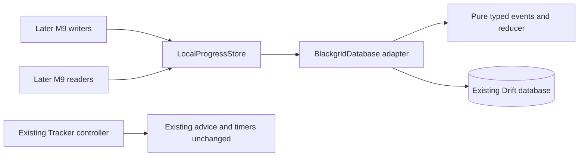
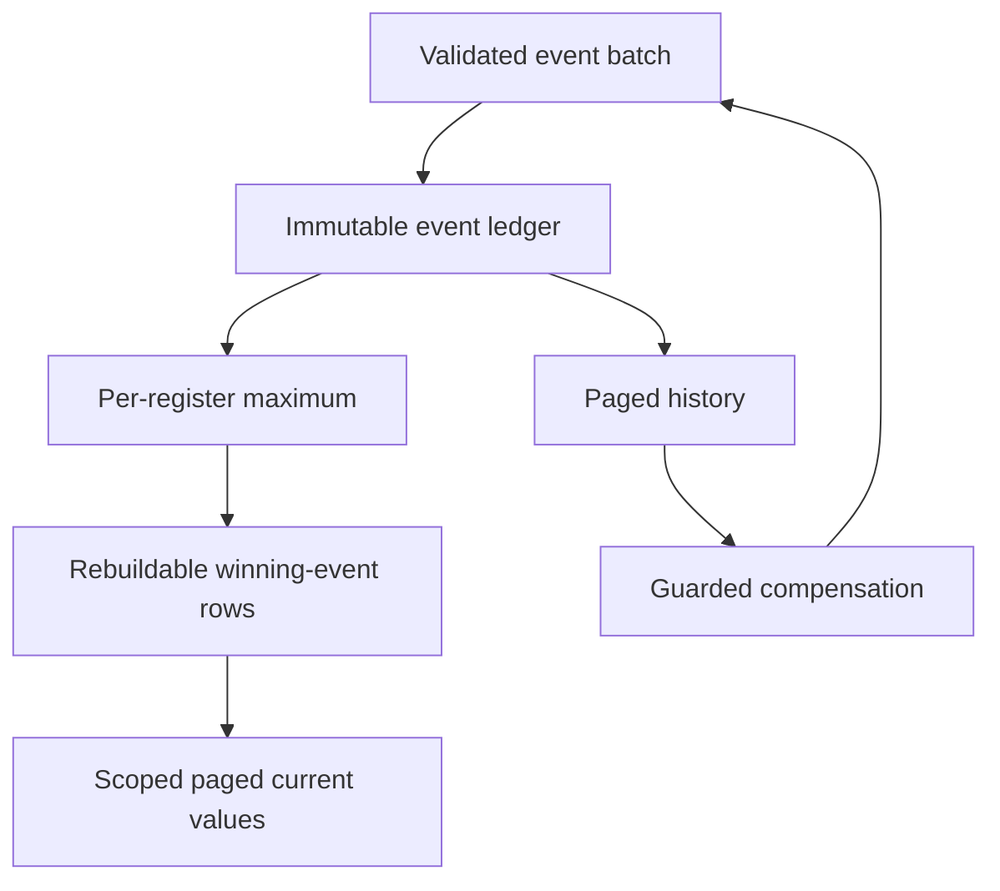
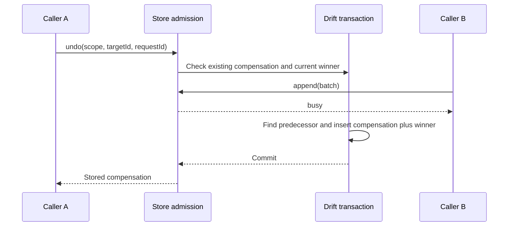
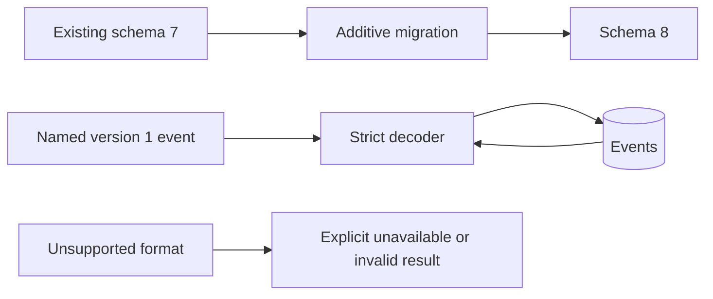

# Design

## Triage

| Trigger | Applies? | Evidence |
|---|---|---|
| T1 Components | Yes | New local-progress domain/store module; Drift adapter and later M9 callers have directed relationships. |
| T2 State | Yes | New device identity, cycles, immutable events and derived winners; current database is schema 7 (`lib/data/database.dart:181-239`). |
| T3 Concurrency | Yes | Async database transactions run through the existing background executor (`lib/data/database.dart:200-201`); appends and undo can race. |
| T4 Boundaries | Yes | Versioned durable event format, store interface and additive migration. |
| T5 Volume | Yes | History grows throughout each progress cycle; unlike activity it is not one row per entity (`lib/data/database.dart:33-42`). |
| T6 Risk | Yes | Manual progress cannot be recreated from game logs; losing or misprojecting it can later affect item advice. |

TIER: FULL

## Context

Scope and owner decisions are in `proposal.md`. This is M9's storage change, not the Tracker cutover.

- `lib/domain/progress.dart:15-42` describes a credential/session-bound, expiring Tracker snapshot, not a local ledger. `lib/application/progress_controller.dart:13-38` owns that Tracker state. Neither is repurposed here.
- One SQLite database already owns durable records; all writes use transactions. The current upgrade chain ends at schema 7 (`lib/data/database.dart:197-239`). `test/data/migration_test.dart:20-58,288-369` proves preservation and newer-schema refusal.
- Stats establish the small pure-domain store seam and transactional adapter pattern (`lib/domain/local_stats.dart:139-164`; `lib/data/database.dart:304-428`), but insert-or-ignore alone is insufficient when duplicate progress IDs can disagree.
- A literal search of `lib/` found mode/season routing but no wipe identifier. Cycles are locally created histories, not guessed official wipe IDs.
- The package already has Drift, crypto and deterministic offline testing dependencies (`pubspec.yaml:9-31`). No new runtime package is required.

## Decisions

### D1: Order field values by occurrence time

- **Choice:** Use the exact total ordering in `local-progress`'s newest-value requirement. Arrival sequence is never conflict authority. Source has only manual/log tags; undo is a manual event.
- **Rejected:** Permanent log-source priority, which prevents correcting stale game evidence; ingestion-time ordering, which makes replay overwrite newer edits.
- **Reversal cost:** high; changes replay outcomes for existing history.
- **Important:** yes — durable conflict contract and user-visible precedence.
- **Chosen by:** user.

### D2: Undo is guarded compensation

- **Choice:** Append a linked manual event only while the requested target is the winner; restore its immediate predecessor under D1, or unset. Retrying the same request returns the stored compensation before checking whether the old target is still the winner. The format budgets below reserve space for compensation, including undo of a compensation.
- **Rejected:** Deleting history or retracting arbitrary historical events, which complicates transfer and can change later edits unexpectedly.
- **Reversal cost:** high; event semantics and undo links persist.
- **Important:** yes — durable format and user-visible editing behavior.
- **Chosen by:** user.

### D3: Ledger plus transactional current winners

- **Choice:** Events are authoritative; current-value rows name their winning event. Append and winner updates share a transaction. Rebuild runs the same pure per-field reducer over paged events. Each page binds its revision check, validation and rows to one database snapshot.
- **Rejected:** Full-history replay on every read; it makes checklist/advice reads grow with history rather than current fields.
- **Reversal cost:** medium; derived rows can be rebuilt without migrating event meaning.
- **Important:** yes — persistence and future read contract.
- **Chosen by:** user.

### D4: Typed field registers, atomic batches

- **Choice:** A register is `(mode, cycleId, entityKind, entityId, field)`. Independent objective count/completion and player attributes do not overwrite each other. A batch supports related changes atomically. Unset is an explicit value, not deletion.
- **Rejected:** Whole-entity snapshots, which force log writers to invent values for fields they did not observe.
- **Reversal cost:** high; register identity is durable.
- **Important:** yes — binds every later M9 writer.
- **Chosen by:** user.

### D5: Portable version 1 with explicit identities

- **Choice:** Stable named JSON fields/tags, UTC millisecond occurrence time and immutable origin identities. Random UUID v4 device/cycle/local-event IDs use injected generators over `Random.secure`; replay writers can provide stable event IDs. Preserve IDs on future transfer. Use the identity/text budgets below, explicitly confirmed by the owner after review, so accepted values remain compensable. Store only progress facts, not catalog copies.
- **Rejected:** Database row numbers as portable identity and enum ordinals as persisted meaning. Row numbers remain private paging cursors only.
- **Reversal cost:** high; the first durable event format binds future readers.
- **Important:** yes — stored data format and future transfer contract.
- **Chosen by:** user.

### D6: Fail closed without rewriting history

- **Choice:** Canonically compare duplicate event content, rejecting contradictory reuse atomically. Validate an opened cycle before exposing its projection; encountered malformed/future history reports unavailable, not partial progress. Preserve events for a compatible version or explicit repair outside this change.
- **Rejected:** Silent insert-or-ignore and skipping bad progress rows; either can make a needed task look complete or absent.
- **Reversal cost:** medium.
- **Important:** yes — safety behavior and compatibility contract.
- **Chosen by:** user.

### D7: Bounded calls, no automatic retry or trimming

- **Choice:** Use the batch/page/event limits and busy behavior in the spec, including reserved encoding space for undo. Rebuild and writes share admission. Disk history is intentionally retained and paged; no application operation queue, hidden retries, compaction or sync engine.
- **Rejected:** Unlimited batches/whole-history buffers and premature background job infrastructure.
- **Reversal cost:** medium; increasing limits is easy, relaxing retained history is not.
- **Important:** yes — shared interface limits and error behavior.
- **Chosen by:** user.

### Decision summary

| # | Decision | Choice | Rejected | Reversal cost | Important | Chosen by |
|---|---|---|---|---|---|---|
| S1 | Delivery | Store/projection/undo only; Tracker unchanged | Pull screens/cutover forward | medium | yes | user |
| S2 | Value families | All M9 families | Entity-only format | high | yes | user |
| S3 | Cycle identity | Local explicit cycles | Guessed or external wipe ID | high | yes | user |
| D1 | Conflict order | Occurrence time first | Log always wins; arrival order | high | yes | user |
| D2 | Undo | Guarded compensation with encoding headroom | Destructive/arbitrary retraction | high | yes | user |
| D3 | Current values | Transactional winners and snapshot-consistent pages | Replay every read | medium | yes | user |
| D4 | Granularity | Typed independent registers | Entity snapshots | high | yes | user |
| D5 | Format | Named v1, portable IDs, reserved field budgets | Ordinals/local row identities | high | yes | user |
| D6 | Failures | Fail closed; exact replay only | Skip conflicting/damaged facts | medium | yes | user |
| D7 | Work | Bounded calls/encoding, retained paged history | Whole-history buffers/queue | medium | yes | user |

## Diagrams (FULL)

### T1: Module relationships

### T2: Event and derived-state ownership

### T3: Competing undo and append

### T4: Format and migration

## State & Ownership (FULL)

| State | Owner (sole writer) | Lifetime | Invalidation / rebuild | Authoritative copy |
|---|---|---|---|---|
| Device identity | Local-progress database adapter, transactional get-or-create | Database lifetime | Never regenerated on ordinary reopen | `ProgressMeta` singleton |
| Mode-scoped cycles | Adapter's explicit create operation | Durable, retained | No automatic selection, rollover or deletion | `ProgressCycles` |
| Versioned event facts | Adapter's validated append/undo transaction | Durable, immutable | Never update/delete; exact replay leaves them unchanged | `ProgressEvents` |
| Current winner per register | Adapter in append/rebuild transaction | Durable derived state | Reconstruct from event facts | `ProgressHeads` references events |
| Cycle ledger revision | Adapter with each committed new event batch | Durable | Duplicates do not advance it | Cycle row |
| Admission and validated scope/revision | Adapter per database instance | Instance lifetime | Released in `finally`; cache invalidated by revision or scope change/failure | Memory; one scope token only |
| Tracker progress/authority | Existing controller | Existing session lifetime | Unchanged | Existing Tracker flow |

### Implementation seam and stored shape

Add `lib/domain/local_progress.dart` for typed keys, scalar values, cycles, event envelope, strict version-1 codec and pure winner selection; `lib/domain/local_progress_store.dart` for the small async interface and sealed result/failure vocabulary. Keep these free of Flutter, SQL and Windows imports. `BlackgridDatabase` implements that interface following its existing `LocalStatsStore` pattern; no new controller or app subscription is introduced.

The interface provides device identity, explicit cycle creation/listing, cycle opening/validation, append batch, paged current values/history, guarded undo and explicit rebuild. Calls name scope explicitly; there is no hidden active mode/wipe. Existing database close owns disposal. Tests inject clock and ID generators; production defaults are nondeterministic and local. Later writers construct an event once and retain its ID when retrying; storage never invents a new ID for an already identified event.

Schema 8 adds:

- `ProgressMeta(id, deviceId)` with one fixed singleton key.
- `ProgressCycles(cycleId, mode, createdAtMs, revision)`; cycle IDs are globally unique, and `UNIQUE(mode, cycleId)` is the parent candidate key for the composite event foreign key. Creation is an explicit new cycle each time, not an idempotent reset command.
- `ProgressEvents(sequence, eventId, mode, cycleId, occurredAtMs, sourceRank, deviceId, entityKind, entityId, field, formatVersion, canonicalPayload, undoOf?)`. `sequence` is a private monotonic SQLite integer; `eventId` is globally unique. A composite scope foreign key prevents cycle/mode mismatch. Index by scope/sequence for history, and scope/register/conflict-order for predecessor lookup. Indexed envelope columns must equal their decoded canonical payload.
- `ProgressHeads(mode, cycleId, entityKind, entityId, field, eventId)` with one row per register; references an event in the same scope/register, checked transactionally. Read the value from the referenced event rather than duplicate it in two formats.

Version-1 envelope fields are `formatVersion`, `eventId`, `deviceId`, `occurredAtMs`, `mode`, `cycleId`, `source`, `target` (`kind`, `id`, `field`), `value` and optional `undoOf`. The canonical codec emits a fixed field order and canonical scalar representation. Decode rejects unknown fields/tags instead of stripping future meaning. Same-ID equality compares canonical semantic content, independent of incoming JSON property order. Times are integers, never a local formatted date or floating-point seconds.

Target/value table (unset is accepted for every target):

| Target | Field | Value |
|---|---|---|
| `task`, tarkov.dev task ID | `state` | `started`, `failed`, `finished` |
| `objective`, tarkov.dev objective ID | `count`, `complete` | Nonnegative integer; boolean |
| `station`, tarkov.dev station ID | `level` | Nonnegative integer |
| `player`, fixed ID `self` | `level`, `faction`, `edition` | Nonnegative integer; `bear`/`usec`; nonempty edition identifier string |
| `trader`, tarkov.dev trader ID | `loyalty` | Nonnegative integer |

The codec checks structural types, integer precision, known mode/source/target/field combinations and nonempty identifiers. It does not require IDs to exist in today's downloaded catalog and does not clamp to today's station/loyalty maxima: old history must survive catalog changes. Edition identifiers are opaque here; later edition rules own interpretation. Values use named tags (`integer`, `boolean`, `text`, `task-state`, `unset`). Missing and unset are distinct in history; both expose an unknown effective field, never an inferred zero.

### Version-1 encoding budgets

The `local-progress` encoding-budget requirement owns the identity/text caps, measured as UTF-8 bytes of each complete canonical JSON string token, including its quotes and escapes. Apply them to generated and incoming events, including every `undoOf` and compensation request ID. Edition text is the only open-ended text value; all other value strings are fixed tags. Times use the full signed Dart `DateTime` millisecond range (absolute value at most 8640000000000000); nonnegative numeric progress values fit an exact portable integer (at most 9007199254740991). Canonical encoding has no whitespace or unknown fields.

Reserve five maximum-size identity tokens (`eventId`, `deviceId`, `cycleId`, target ID and optional `undoOf`), one maximum-size text-value token, and a conservative 512 bytes for fixed field names, tags, punctuation and maximum-width numbers. This totals 2816 bytes, below the spec's event cap. A codec boundary test must prove that fixed-envelope allowance against every target/value shape, worst-case JSON escaping and maximum-width time. The same budgets apply to compensations, so repeated undo cannot grow the envelope: `undoOf` names one target, never embeds its event. Reject the complete batch if any token exceeds its budget; do not truncate or reject a later compensation merely because its predecessor used the maximum accepted text.

## Failure & Visibility (FULL)

| Component | Fails / dies mid-operation → | Recovery | Retry safe? | Who finds out |
|---|---|---|---|---|
| Domain codec | Invalid batch/envelope → no write | Caller corrects input | Same corrected request only | Caller gets invalid-input result with reason |
| Adapter admission | Another operation active → nothing admitted | Caller waits for its own prior result and explicitly resubmits | Yes, preserve event/request IDs | Caller gets busy |
| Append/identity conflict | Contradictory duplicate or commit error → transaction rolls back | Correct identity/content or explicitly retry after storage recovery | Exact identified events are safe | Caller gets identity-conflict or storage failure |
| Cycle opening/history | Damaged/future event → cycle unavailable; no partial success | Compatible build or explicit data repair; no reset offered here | Reads safe, not automatically retried | Caller gets unavailable reason and cycle identity |
| Rebuild | Failure rolls back derived rows and leaves events | Explicit reopen/rebuild | Yes | Caller gets unavailable/storage failure |
| Undo | Target no longer current → no append | Caller reloads and chooses again | Original request ID returns committed result after ambiguous delivery | Caller gets undo-conflict or original compensation |
| Database migration | Failure/newer schema → existing bootstrap failure/refusal | Existing Retry / install compatible build | Existing database policy | Existing startup screen |

These are caller-visible interfaces, not a new logging/telemetry system. This change has no progress UI to display operation failures; later screens must render returned failures rather than translate unavailable into empty progress. A caller-visible failure is the full deliverable at this layer.

## Resource Bounds (FULL)

The spec owns public record/byte/admission caps; the implementation applies those constants before accepting work.

| Queue / buffer / cache / transfer | Bound | At the bound | Timeout | At 10x / 100x |
|---|---|---|---|---|
| Public batch | Spec record limit; checked before materializing an arbitrary iterable past limit plus one | Invalid-input, no transaction | No artificial deadline | Producers explicitly chunk; each batch atomic, not whole replay |
| Canonical event buffer | Spec encoded-byte limit, UTF-8 bytes | Reject before insert; check stored payload length before decoding | None | Scalar progress only, no catalogs/images/log bodies |
| Page/current/history result | Spec page limit | Keyset continuation, not offset/all-row loads | None | Fixed per-call memory |
| Local-progress in-flight work | Spec single-operation admission | Busy; no pending application queue | No timeout that could falsely imply a committed write was cancelled | SQLite operations await actual completion |
| Rebuild/validation working set | One event page and one register comparison at a time | Fold into derived database rows inside the transaction | None; explicit await, no background retry | Linear event scan, bounded process memory |
| Validated scope cache | One `(mode, cycleId, revision)` token | Evict on scope/revision change | Instance lifetime | No per-cycle growing memory map |
| Durable cycles/events/heads | Intentionally unbounded disk history; heads proportional to distinct fields | Storage failure is explicit; no pruning of manual history | SQLite's existing executor policy | Assume 10k events per ordinary cycle; 100k/1m at 10x/100x. Indexed appends/current reads remain local; open/rebuild remains linear, with longer transaction occupancy |

History cursor uses `(scope, highWaterSequence, lastSequence)`, captured on the first page, ordered ascending by private insertion sequence. Events appended during traversal do not enter that traversal, even when their occurrence time is older. Current-value cursors include scope, ledger revision and last register key; a changed revision returns stale-cursor rather than silently skipping changed winners. For each current-value page, obtain revision, compare cursor/validation token, perform any required validation/rebuild, and read/decode its returned rows in one database transaction/snapshot. Do not retain that transaction between public calls. A concurrent commit after the revision check must either leave the complete page at the checked snapshot (including the final page), or produce a changed-revision/storage failure; it must never return newer rows as success under the old revision. Cycle listing is also keyset-paged. No all-events/all-values convenience method is introduced.

## Flow & State Gaps (FULL)

- **Append:** obtain admission; validate batch and scope; in one transaction compare existing IDs (including duplicates inside the batch), insert new events, use the pure comparator against each head, update winning references, and advance the cycle revision once if any event was new. Return results only after commit. Empty batch is invalid.
- **Opening/reopening a cycle:** before exposing values, validate its events in pages and rebuild heads transactionally. Cache only the resulting scope/revision token after commit. Each operation checks the current persisted revision; another adapter's writes or switching scopes invalidates the token and requires validation again. A page's revision check, token decision, any validation/rebuild, and returned rows share the snapshot described above; an earlier independent check never authorizes a later query. A stored indexed envelope/payload mismatch is corruption. Reads never rewrite authoritative events. Direct external SQL mutation while the app is running is outside this interface; reopening detects stored corruption.
- **Rebuild:** use one transaction, delete only that scope's derived heads, then fold pages using the same comparison as append. Other scopes and event bytes remain untouched. Success installs the complete projection; failure rolls the deletion back and returns no usable partial state.
- **Late/out-of-order events:** store even losing events. They remain history and can be the predecessor of a later undo; they do not overwrite the head merely because they arrived later.
- **Undo:** request contains scope, target event ID and a stable compensation event ID. Check a previously committed compensation with the same request ID first, requiring its link/scope to match; contradictory reuse is an identity conflict. Otherwise require the target to be current, select its greatest strict predecessor for the same register, and append that value (or unset) as a manual event with `undoOf`. Set time to `max(injected now in ms, target time + 1 ms)` and reject unrepresentable overflow. Same transaction commits both fact and head. Original log replay remains a duplicate; undoing a compensation uses the same current-winner rule.
- **Concurrent database instances:** the busy gate is per instance, not a cross-process mutex. SQLite transactions serialize writes; database lock errors surface without automatic retries. Transaction checks, not memory tokens, decide winner/undo correctness.
- **Crash before/after commit:** before commit no batch is visible; after commit a caller can safely retry the same IDs, including undo. No success is published from an uncommitted transaction.
- **Cycles:** create persists a new random cycle with the supplied known mode and clock time, without selecting it or deleting the previous one. A caller must reuse the returned ID; a retry of explicit new-cycle creation can create another empty cycle. Active-cycle selection/reset UI belongs to later M9 work, not to preferences now.
- **Clock/source limits:** caller-supplied occurrence time is authoritative for ordinary events; replay must not restamp it. This module does not guess game-log timezone or correct clock skew. Log ingestion must define conversion and stable source event IDs in `add-task-log-progress`. No profile ownership or account synchronization is claimed by a device ID.

## Mechanism Ledger (FULL)

| Mechanism | Built? | Why (harm nobody catches / expensive later) | Evidence that would change the call |
|---|---|---|---|
| Versioned strict codec and typed field keys | Yes | Persisted meaning is expensive to retrofit | New value family needs a reviewed version migration |
| Canonical duplicate comparison | Yes | Insert-or-ignore can conceal contradictory progress under one ID | Never silently relax |
| Transactional heads plus rebuild | Yes | Partial commits would misrepresent progress; history supports deterministic recovery | Measured read workload could justify different derived indexes |
| Undo current-winner check/link | Yes | A stale undo otherwise erases newer user work | Owner explicitly requests arbitrary historical retraction |
| Cycle validation and bounded token | Yes | Derived heads must not conceal unsupported older history at reopen | Profiling may justify a different integrity strategy, not skipping facts |
| Single-operation admission and paging | Yes | Batches/replays otherwise retain unbounded work | Measured callers need reviewed larger caps |
| Automatic retries/recovery loop | No | Exact identified resubmission is enough and errors must remain visible | A real caller needs a bounded retry policy |
| Sync, export/import, wipe discovery, automatic reset | No | Outside approved scope; identities/format preserve the extension seam | Later roadmap change |
| Compaction/snapshots/pruning | No | Would sacrifice undo and manual history without a demonstrated need | Measured disk/rebuild cost plus owner-approved retention policy |
| New isolate/controller/UI subscription | No | Existing Drift executor suffices; no live consumer in this change | A later M9 consumer needs a notifier, or measured fold CPU exceeds budget |

## Risks / Trade-offs

- [Local cycle IDs are not official wipe IDs] → label the concept honestly; future import/sync must match or explicitly map cycles, not merge by date. No claim of automatic cross-device cycle discovery.
- [Wrong clocks can win indefinitely] → retain original facts and explicit undo; no hidden restamping. Future synchronization needs a reviewed clock-skew policy before shipping.
- [Full integrity/rebuild on cycle open grows with history] → bounded memory, indexed steady-state reads, explicit long-running operation; benchmark synthetic large cycles during apply, without promising a hard time limit unsupported by evidence.
- [Corrupt history blocks a cycle instead of showing a subset] → accepted fail-closed choice; preserves facts and avoids unsafe later advice. Repair tooling is not silently added.
- [Field granularity can represent count/completion disagreement] → store facts honestly; later rules and UI decide meaning. A log writer can batch related known changes.
- [No screen consumes the ledger yet] → prove through the real database interface with an offline smoke script, and keep release notes explicit about unchanged Tracker-backed behavior.

## ADRs

- **In force, constraining this change:** ADR-0001 (shared conservative advice, no authority cutover here), ADR-0003 (single database, transactions, migration/snapshot), ADR-0004 (existing isolate placement). ADR-0032 supplies the established identity-ledger pattern but governs statistics, not progress conflict/clear semantics; it remains unchanged.
- **To record during apply:** ADR-0041, `local-progress-event-ledger`, recording local cycle/device ownership, named event format, independent registers, conflict ordering, compensation, atomic derived winners and retained history. It extends rather than supersedes ADR-0003; accepted ADRs remain immutable. Update the architecture's ownership, database version and index with it.

## Open Questions

None affecting this change. Official wipe discovery, cycle-selection UI, log timezone conversion and cross-device cycle reconciliation are explicitly outside this change; their later owners must not infer answers from a local cycle UUID.
