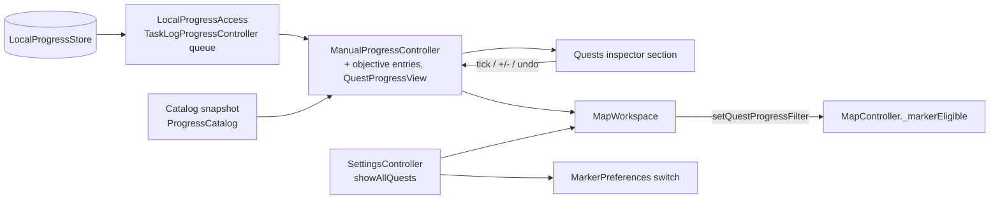
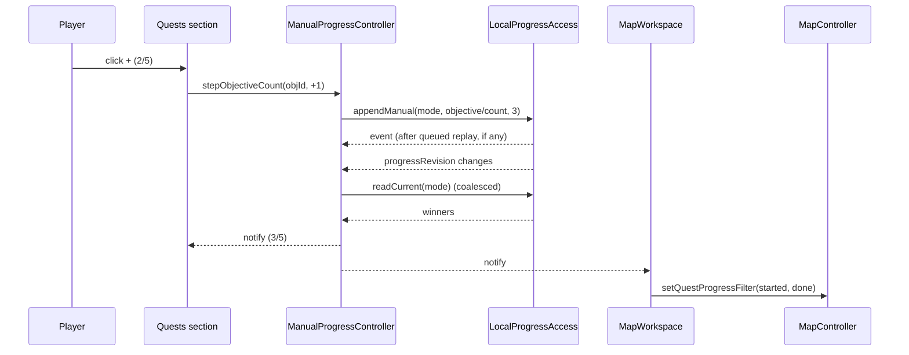

# Design

## Triage

| Trigger | Applies? | Evidence |
|---|---|---|
| T1 Components (new component, or 3+ with directed relationships) | yes | New Quests inspector section and a quest-marker filter feeding `MapController`; both read `ManualProgressController`, which reads `LocalProgressAccess` (`lib/application/manual_progress_controller.dart:47`). |
| T2 State (persistent state, caches, 3+ state machine) | yes | New persisted `showAllQuests` settings field; objective count and completion events in the existing ledger. |
| T3 Concurrency (background work, workers/isolates, async, retries) | yes | Entries go through the shared progress queue behind replay and catch-up; projection reads are coalesced (`manual_progress_controller.dart:43-46`). |
| T4 Boundaries (data format, migration, shared interface, IPC, external) | yes | `AppSettings` JSON gains a field (`lib/domain/settings.dart:307`); `MapController` gains a quest-progress input. |
| T5 Volume (grows without a fixed bound) | no | Lists are bounded by the mode's task catalog (hundreds of tasks, a few objectives each); events go to the existing bounded store. |
| T6 Risk (security, money, data loss, unrecoverable user data) | no | Append-only manual events in the existing ledger (ADR-0041); undo compensates, nothing is deleted. |

TIER: FULL

## Context

- Progress access is in place. `LocalProgressAccess` (`lib/application/local_progress_access.dart:24`) serializes manual appends, undo, redo and current reads on the task-log controller's queue. `ManualProgressController` already projects the effective mode's winners while a view is attached (`attach`/`detach`, `manual_progress_controller.dart:150-170`), exposes `value`, `actionLabel`, `pending`, `failure` per `ProgressTarget`, and implements Undo/Redo (`undoOrRedo`, line 294). Objective registers exist: `ProgressEntityKind.objective` with `ProgressField.count` and `ProgressField.complete` (`lib/domain/local_progress.dart:24-27`).
- The task catalog holds objectives per task with `count` (`num?`), `optional`, `description`, `mapIds` (tarkov.dev map IDs, which no loaded map exposes: `LiveMapBinding` keeps only `sourceKey`, `mapId` and calibration) and `isShared` (`packages/blackgrid_progress/lib/src/progress_catalog_tasks.dart:361-422`), reached through `ManualProgressController.progressCatalog` (line 125).
- Quest markers come from live map data (ADR-0035). Both quest-objective and quest-item markers carry `details.id` = objective ID and `details.quest.id` = task ID (`lib/maps/live_map_normalizer.dart:619-628`, `:745-752`). `MapMarkerMetadata` keeps `sourceId` (= `details.id`) but not the task ID (`lib/domain/map_marker_query.dart:23-38`). Eligibility is decided in `MapController._markerEligible` (`lib/application/map_controller.dart:774-785`).
- The Map inspector builds This raid, Markers and Pins (`lib/ui/map_inspector.dart:35-60`). Marker filters persist only when Save marker filters is on: `SettingsController.load` clears them otherwise (`lib/application/settings_controller.dart:50-52`). `AppSettings.fromJson` rejects unknown `markerFilters` keys (`lib/domain/settings.dart:314-316`) and reads optional fields with defaults (`themeMode`, line 327).
- Scope and user choices: see proposal.md (S1-S6).

## Decisions

### D1: Extend ManualProgressController rather than add a second progress controller

- **Choice:** add objective entries (`setObjectiveCount`, `stepObjectiveCount`, `setObjectiveComplete`) and a derived `QuestProgressView` (started task IDs, done objective IDs, per-objective count and done) to `ManualProgressController`. The Quests section and the map filter read the same projection; Undo/Redo reuse `undoOrRedo`.
- **Rejected:** a separate `QuestChecklistController` over `LocalProgressAccess` because it would duplicate the coalesced read, mode-switch, failure and undo logic, and two projections of one wipe could disagree for a frame.
- **Reversal cost:** low
- **Important:** no
- **Chosen by:** agent

### D2: The map reads quest progress as a pushed filter value

- **Choice:** `MapController` gains `setQuestProgressFilter(QuestMarkerFilter?)`, a value holding started task IDs and done objective IDs, or `null` for "every quest marker eligible". `MapWorkspace` attaches `ManualProgressController` while mounted and pushes a new value when its projection or `showAllQuests` changes. `MapMarkerMetadata` gains `questTaskId` (from `details.quest.id`).
- **Rejected:** `MapController` depending on `ManualProgressController` directly because it couples the map's pure eligibility logic to progress loading and makes map tests need a progress fake.
- **Reversal cost:** low
- **Important:** no
- **Chosen by:** agent

### D3: Counter objectives are governed by count alone

- **Choice:** an objective whose catalog `count` is a whole number over 1 is a counter: +/- and its tick write only `ProgressField.count`; it reads done when count ≥ target or a recorded completion is true. Other objectives write only `ProgressField.complete`. Each click writes one register, so the store's single-target Undo/Redo is exact. A non-integer count is treated as no counter.
- **Rejected:** a separate done flag written with the count in one batch because Undo would have to reverse two registers in two transactions and could half-fail.
- **Reversal cost:** low
- **Important:** yes: changes behaviour users see (no untick on counters).
- **Chosen by:** user

### D4: Shared objectives share one register

- **Choice:** an objective with `isShared` reads and writes its one `(objective, id)` register under every task that lists it; its row names the other tasks that list it.
- **Rejected:** shared objectives read-only because the player could not record progress the game tracks.
- **Reversal cost:** low
- **Important:** yes: changes behaviour users see.
- **Chosen by:** user

### D5: All started quests, current map first

- **Choice:** list every started task; tasks with an objective on the current map come first, then the rest; each group ordered by trader name, then task name. "On the current map" is read from the current map's loaded quest markers, not from a map ID: a task is on the map when any quest-objective or quest-item marker of the map carries its task ID (`details.quest.id`), and an objective row is marked "On this map" when a marker carries its objective ID (`details.id`). Both live and bundled quest markers carry both IDs (`live_map_normalizer.dart:619-628`, `:745-752`; all 803 bundled quest markers checked in review). `LiveMapBinding` holds no tarkov.dev map ID and the progress catalog has no maps table, so no map names are shown per objective. Fallback: while the current map has no quest markers loaded, every started task is in one group (trader, then name) and no row is marked.
- **Rejected:** current map only with an All maps toggle (one more control in a narrow panel); all by trader (in-raid quests sink in a long list).
- **Reversal cost:** low
- **Important:** yes: changes what users see.
- **Chosen by:** user; the "On this map" mark in place of per-objective map names (review round 1, M3) was also put to the user and agreed on 2026-11-18.

### D6: showAllQuests is its own settings field

- **Choice:** `AppSettings.showAllQuests` (bool, default false), written as `showAllQuests`, read as `json['showAllQuests'] as bool? ?? false`. `SettingsController.load` resets it to false when `saveMarkerFilters` is off, as it clears `markerFilters`. No settings version change: older builds ignore the key.
- **Rejected:** a reserved key inside `markerFilters` because `fromJson` rejects unknown marker keys, so older builds would refuse the settings, and Show all/Hide all would need a special case.
- **Reversal cost:** medium (persisted key)
- **Important:** yes: binds future changes (config key).
- **Chosen by:** user

### D7: Markers without quest identity stay eligible

- **Choice:** under the active-quest filter a quest marker with no task ID or no objective ID is kept eligible (fail open). All live quest markers carry both today, so this is a guard against source drift, not a visible behaviour.
- **Rejected:** hiding them because a source change would silently empty the map's quests.
- **Reversal cost:** low
- **Important:** no
- **Chosen by:** agent

### D8: No new ADR

- **Choice:** record no ADR. The settings field is a tactical preference and the objective registers are ADR-0041's; the filter is presentation.
- **Rejected:** an ADR for the active-quest marker filter because it binds no later change's contract.
- **Reversal cost:** low
- **Important:** no
- **Chosen by:** agent

### Decision summary

| # | Decision | Choice | Rejected | Reversal cost | Important | Chosen by |
|---|---|---|---|---|---|---|
| S1 | Checklist location | Map inspector Quests section | Top-level area; Settings | low | yes | user |
| S2 | Active set | Started tasks | Started + available | low | yes | user |
| S3 | Marker behaviour | Filter to open objectives of started tasks, Show all quests switch | Hide done only; dim done | low | yes | user |
| S4 | Counters | Reaching target completes the objective, never the task | Independent tick/count; auto-finish task | low | yes | user |
| S5 | Mode | Effective mode | Own mode choice | low | no | agent |
| S6 | Consumers | Stay on Tracker token | Switch now | low | no | agent |
| D1 | Controller | Extend ManualProgressController | Second controller | low | no | agent |
| D2 | Map input | Pushed QuestMarkerFilter value | MapController reads progress | low | no | agent |
| D3 | Counter registers | Count alone | Count + done batch | low | yes | user |
| D4 | Shared objectives | One shared register | Read-only | low | yes | user |
| D5 | List scope | All, current map first, read from the map's quest markers | This map + toggle; by trader | low | yes | user |
| D6 | Settings key | `showAllQuests` field | Key in markerFilters | medium | yes | user |
| D7 | Unidentified markers | Stay eligible | Hidden | low | no | agent |
| D8 | ADR | None | ADR for the filter | low | no | agent |

## Diagrams (FULL)

Components (T1, T4):

Entry and filter update (T2, T3):

## State & Ownership (FULL)

| State | Owner (sole writer) | Lifetime | Invalidation / rebuild | Authoritative copy |
|---|---|---|---|---|
| Objective count/completion events | `LocalProgressStore` via `LocalProgressAccess.appendManual`/`undo`/`redo` | Persistent, per mode and wipe | Append-only; heads rebuilt by the store | Store event history |
| Projected winners and `QuestProgressView` | `ManualProgressController` | While a view is attached | Re-read on progress revision, mode, catalog change; cleared on last detach | Store; this is a cache |
| `QuestMarkerFilter` in `MapController` | `MapWorkspace` (pushes) | While Map is mounted | Replaced on every projection or `showAllQuests` change; `null` when progress is not usable | Derived from the projection |
| `AppSettings.showAllQuests` | `SettingsController` | Persistent; reset on load when Save marker filters is off | Saved like other settings | Settings row in the database |

## Failure & Visibility (FULL)

| Component | Fails / dies mid-operation → | Recovery | Retry safe? | Who finds out |
|---|---|---|---|---|
| Objective append | Busy, storage, unavailable or invalid failure: nothing recorded (atomic append) | Player clicks again | Yes: a new event; nothing partial was written | User: the row shows the reason (existing `failure(target)`) |
| Undo/Redo | Undo conflict: the value changed | Projection re-read; row shows latest | Yes | User: row message |
| Projection read | Read error | Next revision triggers a new read | Yes | User: Quests shows `disabledReason`; map filter falls back to `null` (all quest markers) |
| Catalog missing for mode | No objectives to show | Next catalog refresh | n/a | User: Quests shows quest data not available |
| Settings save of `showAllQuests` | Save fails | Existing settings error path | Yes | User: existing settings error; the switch shows the saved value |

## Resource Bounds (FULL)

| Queue / buffer / cache / transfer | Bound | At the bound | Timeout | At 10x / 100x |
|---|---|---|---|---|
| Pending entries | One in flight per objective register, held until a fresh read lands (see Flow & State Gaps) | Controls disabled until that read | None (store's own) | Unchanged: per-register |
| Projection read | One in flight, further changes coalesced into one re-read (existing) | Coalesced | None | Winners map grows with recorded registers; a few thousand at 10x is a small map |
| `QuestMarkerFilter` sets | Started tasks and done objectives of one wipe, bounded by the catalog | n/a | n/a | Set lookups stay O(1) per marker |
| Quests list | Started tasks only (tens) with their objectives | Lazy list in the inspector's scroll | n/a | 10x started tasks still renders in a lazy list |

## Flow & State Gaps (FULL)

- **Click during replay:** the append waits on the shared queue (manual-progress rule); the control stays pending, then the result shows.
- **Rapid +/- clicks:** `_perform` clears pending as soon as the append returns, before the refreshed projection lands (`manual_progress_controller.dart:341-370`), and counts are absolute (ADR-0041), so releasing the lock there would let a second + re-write the same count. An objective register therefore stays pending until a projection read that started after its append completed has landed (or failed); only then are its controls enabled again, and the next step computes from that read's winner. A failed append releases the lock at once, since nothing was written. Proved by a controller test in `test/application/manual_progress_controller_test.dart`: with the post-append read held on a completer, a second + is ignored; after the read lands at 3, + records 4, so two + clicks from 2 end at 4.
- **Mode switch mid-entry:** the entry is recorded in the mode it was submitted for (existing `submittingMode`), and the view shows the new mode.
- **Task finished from logs while ticking:** the tick still records; the task leaves the list on the next read; its values stay stored.
- **Started task missing from catalog:** not listed; still counted as started for the map filter only if markers name it (they come from the same tarkov.dev data).
- **Progress not loaded at Map open:** filter is `null`, so every quest marker shows; once loaded the filter applies.
- **No wipe:** no started tasks, so the filter is `null` and Quests shows the empty state; the first tick creates the wipe (manual-progress rule), but a tick needs a listed started task, so in practice the wipe exists.

## Mechanism Ledger (FULL)

| Mechanism | Built? | Why (harm nobody catches / expensive later) | Evidence that would change the call |
|---|---|---|---|
| Per-register lock on objective controls held until a read started after the append has landed | yes | Absolute counts: releasing on append return lets two fast + clicks write the same count, losing a step silently (`_perform` releases before the re-read) | n/a |
| Fail-open for markers without quest identity (D7) | yes | A source change would empty the quest layer with nobody noticing | n/a |
| Batch write of count + complete | no | D3 makes one register per click | Need for a separate done flag |
| Optimistic UI update before the store confirms | no | Reads are fast and local; optimistic state could show a value that failed | Visible lag in play |
| Auto-finish task from objectives | no | User choice S4 | Owner request |
| Persisting the Quests list's scroll or expansion | no | Nothing is lost when it resets | Owner request |

## Risks / Trade-offs

- [Objective IDs in live map data differ from the catalog's] → both come from tarkov.dev `tasks` for the same mode; a fixture test asserts the marker's `details.quest.id`/`details.id` match the catalog's task and objective IDs for the same source body. D7 keeps unmatched markers visible.
- [Filter hides a quest the player has but the logs missed] → the empty-progress fallback shows all; Show all quests and Settings' task override fix the rest.
- [Inspector gets long] → Quests is the last section and scrolls with the inspector.

## ADRs

- **In force, constraining this change:** ADR-0041 (event ledger, independent objective registers, guarded undo), ADR-0042 (progress catalog package), ADR-0044 (active wipes), ADR-0035 (live map data owns quest markers), ADR-0037 (Ember theme colours only), ADR-0039 (amber is reserved for selection on the map).
- **To record during apply:** none (D8).
