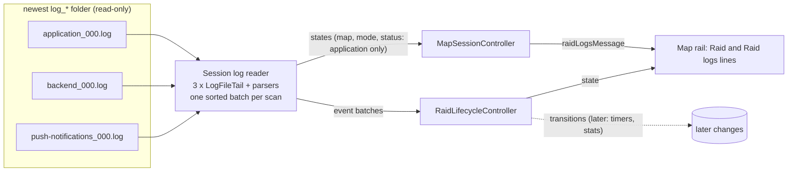
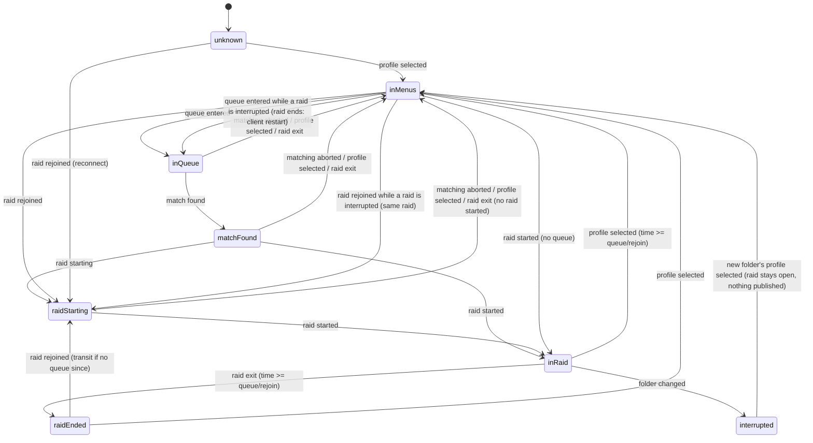
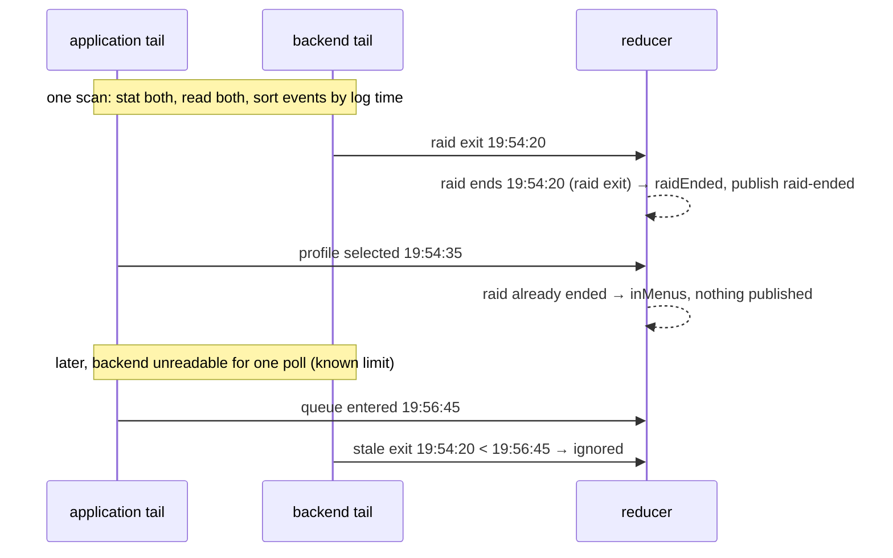

# Design

## Triage

| Trigger | Applies? | Evidence |
|---|---|---|
| T1 Components (new component, or 3+ with directed relationships) | Yes | New per-file tail, record parsers, raid reducer and `RaidLifecycleController`; the reader feeds both `MapSessionController` and the new controller (`lib/application/app_services.dart:88`). |
| T2 State (persistent state, caches, 3+ state machine) | Yes | A seven-phase raid state machine; per-file offsets, windows and partial-record buffers. |
| T3 Concurrency (background work, workers/isolates, async, retries) | Yes | Three files polled on one 250 ms timer plus a directory watch (`session_log_reader.dart:44-80`); events from different files arrive out of log order. |
| T4 Boundaries (data format, migration, shared interface, IPC, external) | Yes | The game's log formats (external, undocumented, changed across versions); a new event contract that `add-raid-timers`, `add-local-stats` and M9 consume. |
| T5 Volume (grows without a fixed bound) | Yes | Log files grow during play (push log up to 3.2 MB, backend up to 0.9 MB per session in the user's folder); bodies up to 2 105 lines. |
| T6 Risk (security, money, data loss, unrecoverable user data) | Yes | The agent/game boundary: reading must never touch the game process (AGENTS.md). No user data is written. |

TIER: FULL

## Context

- `SessionLogReader` (`lib/data/session_log_reader.dart`) picks the newest `log_*` folder and its `application*.log` (`_select`, `:173`) and tails it from a byte offset in 8 KiB chunks (`_scan`, `:213`). It detects in-place rewrites by re-reading the last 4 KiB it consumed through the same handle (`:244`), rejects lines over 64 KiB (`:264`), and decodes a line only after its newline, rejecting malformed UTF-8 (`_record`, `:307-313`). `_reset` (`:94`) bumps the incarnation and clears the detected map. It publishes one `SessionLogState` (status, session, incarnation, map, mode, message) on a sync broadcast stream (`:20`). Its record identity is already "incarnation plus byte offset" (`:9`). Scenes map to map IDs in `_sceneMap` (`:402`).
- `MapSessionController` owns the reader's lifecycle: it subscribes before binding (`map_session_controller.dart:124`), binds on log-directory changes, and closes it on `close`. Any log status other than `watching` makes it label watched screenshots assumed (`_waitingForLogContext`, `:82`, used at `:137`). A session or incarnation change, `missing` or `unavailable` invalidates its evidence (`_invalidate`, `:153`). `AppServices` builds it at `app_services.dart:88` and closes it at `:377`; the reader can be injected (`map_session_controller.dart:24,30`).
- The real formats, read from the user's folder on 2026-11-01, are in proposal.md. The facts the design depends on:
  - Application and backend events are single header lines. Continuation lines (stack traces, settings JSON) follow some headers and carry no event.
  - A push notification is a header `Got notification | <Kind>`, a JSON body starting `{` and ending with `}` alone on its line, then a `NotificationMessageProcessor.ProcessMessage` header in the same millisecond. All 309 bodies in the largest file ended with a lone `}`.
  - The push log misses notifications during raid loading and play; the backend log has one `payloadType=` line for each. The push log is created about a minute after its folder, and 54 of 782 folders never get one.
  - Every new folder starts with `Session mode` and `PrepareSelectedProfileLocally`. A transit is logged as raid exit, one profile select, then `Transit reconnect` 2-3 s later, with no queue between.
  - Event raids use the `factory_event_preset` and `laboratory_event_preset` scenes and the `factory_event` and `laboratory_event` locations; `_sceneMap` does not know them yet.
  - Times are local wall-clock with milliseconds and no zone. Line endings are LF. Cyrillic text occurs.
- ADR-0002 (SDK notifiers and composition root) constrains the controller: a `ChangeNotifier` built and disposed by `AppServices` in a fixed order.

## Decisions

### D1: One reader owns all three files of one session folder

- **Choice:** `SessionLogReader` keeps its public API and becomes a reader that selects the session folder once per scan and drives three `LogFileTail`s (application, backend, push-notifications) over that folder. Each tail is the existing byte tail extracted unchanged: offset, 4 KiB window revalidation, 64 KiB line cap, decode on newline. The reader adds `Stream<List<GameLogEvent>> events` (one batch per scan, D3) beside `states`. Map and mode still come from application events through the code that publishes `SessionLogState` today (D7 keeps the other two files out of it).
- **Rejected:** three independent readers, one per file, each choosing its own newest folder, because a folder switch could leave them reading different sessions for a poll, and the reducer could not tell whether a raid exit belongs to the folder whose raid it ends.
- **Reversal cost:** low. The tail is internal; only the `events` stream is a contract.

### D2: Records are framed per file; push bodies end at a lone `}`

- **Choice:** a header is a line matching `^\d{4}-\d{2}-\d{2} \d{2}:\d{2}:\d{2}\.\d{3}\|`. Application and backend parsers see header lines only and emit at the newline; continuation lines are dropped. The push parser opens a record at a `Got notification |` header, collects body lines and completes at a line equal to `}` or at the next header, then parses the body with `jsonDecode` and Dart map patterns into a sealed result (`dart-use-pattern-matching`).
- **Rejected:** completing every record only at the next header, because the last event before a quiet period (a profile select, a flea sale) would wait until the game writes another line, which can be minutes.
- **Reversal cost:** low.

### D3: Each scan is sorted by log time; the reducer guards endings by log time

- **Choice:** one scan stats all three files first, then reads each to its stat size, collects that scan's events and sorts them by (log time, file rank application < backend < push, offset) before emitting them as one batch. The bind-time replay is one such scan, so a replay and a live read reduce the same events in the same order (spec "Events read together are reduced in log-time order"). The reducer also guards each ending by log time: an ending logged before the current queue or rejoin time is ignored, and the first applied ending of a raid wins. Log times are parsed as local `DateTime`s.
- **Rejected:** handing events over file by file in read order, because a replay then applies every application event before any backend event, so every replayed raid would end "from the menus" at a different time and with a different identity than the live read (review C1). Also rejected: a timed merge window across polls, because it adds a timer and latency to every event, while sorting within a scan needs neither.
- **Reversal cost:** low; the reducer is pure and its tests cover the orders.
- **Known limit:** when one file cannot be read for a poll, its events arrive one poll later and may lose to an ending read on time (spec scenario "A file could not be read for a poll"). Events written between the first and the last `stat` of a scan are read on the next scan; that window is the time of three `stat` calls.

### D4: A pure reducer and one controller own raid state

- **Choice:** `lib/domain/raid_lifecycle.dart` holds sealed `GameLogEvent`s (including `SessionFolderChanged` and `LogInputReset` from the reader), the `RaidPhase` enum, the immutable `RaidLifecycleState` (phase, current or last raid, last queue outcome, current folder, whether a transit is possible, interrupted flag) and `reduce(state, event) → (state, transitions)`. `RaidLifecycleController` (`lib/application/raid_lifecycle_controller.dart`, a `ChangeNotifier`) subscribes to `reader.events` in its constructor, holds the state, and exposes `state` and a broadcast `Stream<RaidTransition>`. `AppServices` builds the reader, then the controller, then `MapSessionController` with the reader injected, so the controller is subscribed before the first bind replays the folder. `MapSessionController` keeps binding and closing the reader. `AppServices.dispose` disposes the controller after `mapSession.close()` has closed the reader (ADR-0002's fixed order).
- **Rejected:** putting the raid state into `MapSessionController`, because that controller is the Map's evidence authority with its own epoch rules, and timers and stats would then depend on the Map.
- **Reversal cost:** medium: later changes subscribe to the controller.

### D5: Event identity is folder name, file and record start offset

- **Choice:** `LogRecordId(folder, LogFile, offset)`, with the folder's directory name (not its path) and the byte offset of the record's header line. A rewritten file's records restart from offset 0 and so collide with the old ones by design: the file was replaced.
- **Rejected:** a hash of the record text, because two identical lines (two `Matching with group id` lines) are different events.
- **Reversal cost:** high once `add-local-stats` stores it. The evidence that it is enough: folder names carry the start second and the game version, and offsets are unique within a file.

### D6: Transit or reconnect is decided by what came before, not by the status text

- **Choice:** a rejoin is a transit when the last raid ended in the same folder and no queue was entered or aborted since; any other rejoin is a reconnect. The `status:` value (`Busy`, `MatchWait`) is kept on the event but does not decide.
- **Rejected:** deciding by `status:`, because the user's logs show `Busy` for a transit and `MatchWait` for a rejoin later in a folder (2026-10-15 23:15:30), so neither value marks one kind. Also rejected: "any raid ended earlier in the folder", which calls a rejoin after a later queue a transit (review M1).
- **Reversal cost:** low now; medium once `add-local-stats` stores the entry.

### D7: The Map's log state stays application-only; the other files get their own status

- **Choice:** `SessionLogState.status`, `incarnation`, `detectedMapId`, `detectedMode` and `message` keep coming from the application log alone. Backend and push problems (missing, unreadable, rewritten, a rejected record) go into a new `raidLogsMessage` field, which the Map shows on its own "Raid logs:" line. A backend or push rewrite resets only that file's tail, never the incarnation or the detected map. A missing push log reads "notifications log not written yet", because the game writes it a minute late or never.
- **Rejected:** folding all three files into the one status, because `MapSessionController` treats any non-`watching` status as missing log context and would label screenshots assumed and drop evidence for a push-log problem (review C2), which would change Map behaviour that `map-rail` describes.
- **Reversal cost:** low.

### D8: A client restart during a raid continues the raid

- **Choice:** a folder change while a raid is current marks it interrupted. The new folder's profile select sets the phase to in menus, so the "Raid:" line follows the game, but does not end the interrupted raid; it remembers that time and publishes nothing. A rejoin continues the same raid (no new raid-started; the phase goes raid starting, then in raid). A queue entered first ends it with cause client restart at the remembered time. A replay that sees only the new folder starts one raid with entry reconnect at the rejoin.
- **Rejected:** ending the raid at the new folder's profile select and starting a second raid at the rejoin, because one played raid would count as two when Blackgrid was running and as one when it started later (review M2).
- **Reversal cost:** medium once stats store raids.
- **Known limit:** a raid followed live across a restart keeps the old folder's raid-started identity, while a later replay of only the new folder publishes one with the rejoin's identity and entry reconnect. `add-local-stats` must treat a reconnect raid-started that overlaps a stored raid as the same raid; recorded for that change.

## Diagrams (FULL)

## State & Ownership (FULL)

| State | Owner (sole writer) | Lifetime | Invalidation / rebuild | Authoritative copy |
|---|---|---|---|---|
| Selected folder, per-file offset, 4 KiB window, line buffer, open push record | The reader (each `LogFileTail` owns its file's) | Memory, per binding | Reset on rebind, folder change, file replacement or rewrite (as `_reset` does today, per file) | The log files |
| Map, mode, log status, incarnation (`SessionLogState`) | The reader, from the application tail only (D7) | Memory | As today | The application log |
| Raid-logs message (`raidLogsMessage`) | The reader, from the backend and push tails | Memory | Cleared when both files read cleanly | The backend and push logs |
| `RaidLifecycleState` | `RaidLifecycleController` via the pure reducer | Memory, app run | Rebuilt by replay of the current folder at bind; reset to unknown on log-root rebind (`LogInputReset`) | The log files |
| Published transitions | `RaidLifecycleController` | Stream only, not stored | Re-published with the same identities on replay (D3, D5) | The log files |

## Failure & Visibility (FULL)

| Component | Fails / dies mid-operation → | Recovery | Retry safe? | Who finds out |
|---|---|---|---|---|
| Application tail (sharing violation, file vanishes) | No application events; Map status as today | Next poll retries | Yes: offsets advance only on bytes read | User: "Logs:" line |
| Backend or push tail (sharing violation, missing, rewritten) | That file's events stop or restart; Map unaffected (D7) | Next poll retries; a rewrite restarts that tail | Yes | User: "Raid logs:" line |
| A rejected record (over-long, bad UTF-8, bad JSON, missing task ID) | One record produces no event | Next record reads normally | Yes | User: "Logs:" line for the application log, "Raid logs:" for the others |
| Push log drops in-raid notifications | Flea sales and task messages logged only in the backend log are not seen | None in this change | n/a | Documented in proposal and here; `add-local-stats` decides how to show it |
| Unknown future line format (game update) | Phase stays where it was (e.g. in menus) | Code update | n/a | User sees a phase that does not follow the game; the user-verified M7 check catches it |
| Reducer receives an out-of-place event | Phase follows the spec's out-of-place rules | n/a | n/a | Tests |
| Controller listener throws | Exception surfaces in the zone | n/a | n/a | Debug log |

## Resource Bounds (FULL)

| Queue / buffer / cache / transfer | Bound | At the bound | Timeout | At 10x / 100x |
|---|---|---|---|---|
| Read per poll per file | 8 KiB chunks, up to the size seen at the scan's `stat` (as today) | n/a | 250 ms poll | 30 MB backend at 100x: replay reads it once at bind (one-time, about a second of byte loop); polls read only new bytes |
| Line buffer per file | 64 KiB (as today) | Line rejected, reported | n/a | Unchanged |
| Open push record | 1 MiB and 8 192 lines (largest seen: 2 105 lines) | Record rejected, reported; framing resumes at the next header | n/a | Unchanged |
| Event batch per scan | Bounded by the bytes read in that scan; sorted in memory and delivered synchronously | n/a | n/a | Replay of a 3 MB push log yields a few hundred events once |
| Transitions stream | Broadcast, sync, no buffer | Dropped if nobody listens (no consumer yet) | n/a | n/a |

## Flow & State Gaps (FULL)

- **Out-of-order files:** D3.
- **App starts mid-raid:** replay of the current folder reaches in raid. The replayed transitions carry the same identities as a live read (D3, D5).
- **Queue ends without a raid and without a cancel line** (failed load, kick): a profile select or raid exit after the queue time aborts the queue (spec "A queue that ends without a raid is aborted").
- **Game crashed or closed in raid:** no exit and no profile select are logged, so the phase stays in raid until the new folder's profile select, then shows in menus with the raid interrupted (D8). Without reading the process, Blackgrid cannot know sooner. `add-raid-timers` must not count an unbounded raid; noted for that change.
- **New folder appears mid-raid (client restart):** D8. Real order in the new folder: session mode, profile selected, rejoin, raid started.
- **Log root changed in settings:** the reader emits `LogInputReset`; the reducer goes to unknown.
- **Only the application log is replaced or rewritten:** the reader restarts all three tails of the folder, emits `LogInputReset` and replays the folder in one scan, as at startup, so old raids are rebuilt with the same identities instead of ending "from the menus" (review round 2, S1). A backend or push rewrite restarts only that tail (D7).
- **Partial record at shutdown:** dropped; the next run re-reads the folder from the start.
- **Restart mid-operation:** nothing is stored, so nothing is half-written.

## Mechanism Ledger (FULL)

| Mechanism | Built? | Why (harm nobody catches / expensive later) | Evidence that would change the call |
|---|---|---|---|
| Per-file rewrite detection (existing window) | Yes | Without it, a replaced file feeds old offsets into a new file silently | — |
| Sort each scan's events by log time | Yes | Without it, replay and live reads end raids differently and stats double count (review C1) | — |
| Log-time guard on ending events | Yes | The either-order bug is the one TarkovMonitor has; it ends the wrong raid without anyone noticing | — |
| Stable record identity | Yes | Expensive later: `add-local-stats` stores it to avoid double counting | — |
| Separate raid-logs status (D7) | Yes | A push-log problem would otherwise silently change Map evidence | — |
| Timed merge window across polls | No | D3 | A real log where the per-scan sort plus the time guard end a raid wrongly |
| Recovering dropped push notifications from the backend log | No | Bodies are not in the backend log | A backend log format that carries bodies |
| Persisting reducer state across restarts | No | Replay rebuilds it from the files | A need to remember raids from folders no longer newest (that is `add-local-stats`) |
| Process check to end a stale in-raid phase | Never | Forbidden by AGENTS.md | — |
| Offline Dart audit for process access and file writes | Yes. Scans `lib/data/game_log/` and `lib/data/session_log_reader.dart` and bans `Process.run`, `Process.start`, `Process.killPid`, `dart:ffi`, `openWrite`, `writeAsBytes`, `writeAsString`, `FileMode.write`, `FileMode.append`, `.rename(` and `.delete(`. The existing `capture_source_audit_test.dart` covers native C/C++ only | A regression would risk the user's account and nothing else would catch it | — |

## Risks / Trade-offs

- [A game update renames a line] → Each parser matches one fixed message, kept in one table with a fixture per line taken from 1.3.0.0.48484; the user-verified M7 check notices a phase that stops moving.
- [Push log gaps make flea and task events incomplete] → Stated in the proposal; this change produces what the log has, and later changes report the gap.
- [Local times jump at a daylight-saving change during a raid] → Ending guards compare times within one folder; a one-hour backward jump in the hour after a raid start could ignore an exit, and the next profile select still ends the raid. Accepted.
- [The restart-and-reconnect line is unverified] → No folder in the user's logs has a raid rejoin before its first raid start, so what a client restart followed by a reconnect writes has never been seen. D8's rejoin handling rests on assumed fixtures (the real `Transit reconnect` line placed after a new folder's profile select) until the user observes one; the user-verified M7 check asks for it if it happens.
- [Replaying a large backend log at startup] → One-time; measured sizes are under 1 MB.
- [Event-map scenes unknown today] → `_sceneMap` and the new location table gain `factory_event_preset`/`factory_event` → Factory and `laboratory_event_preset`/`laboratory_event` → The Lab, seen in 4 of the user's 6 raids on 2026-10-31. This also improves today's detected map.

## ADRs

- **In force, constraining this change:** ADR-0002 (notifiers built and disposed by the composition root).
- **To record during apply:** ADR-0030 "Game log input: one reader per session folder, framed records, per-scan log-time ordering, application-only Map state and stable record identity" (D1, D2, D3, D5, D7). The same task updates `openspec/architecture.md`: a component row for the reader and the raid controller, the "Game inputs" boundary (three files, record framing, event identity) and the log-tail row in Resource bounds.

## Open Questions

- Whether `add-raid-timers` should cap time in raid when no end is logged (game crash). Answerable in that change; nothing here changes.
