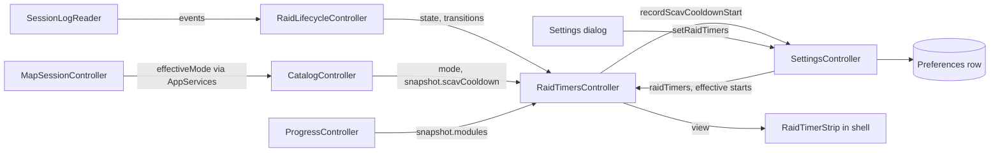
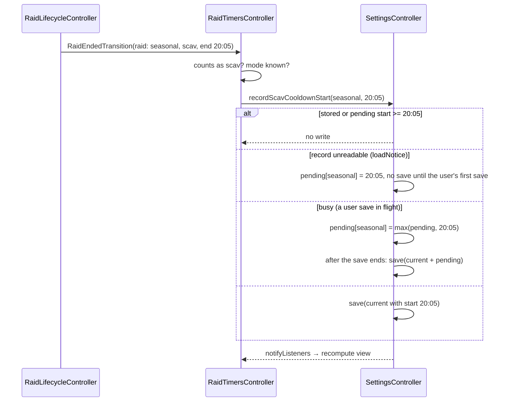

# Design

## Triage

| Trigger | Applies? | Evidence |
|---|---|---|
| T1 Components (new component, or 3+ with directed relationships) | yes | New `RaidTimersController` reads `RaidLifecycleController`, `SettingsController`, `CatalogController` and `ProgressController`, and is read by a new shell strip |
| T2 State (persistent state, caches, 3+ state machine) | yes | Timer settings, per-mode Fence reputation and per-mode cooldown starts are added to the stored settings record (`database.dart:228-232`, `settings.dart:144-179`); `Raid` gains two fields |
| T3 Concurrency (background work, workers/isolates, async, retries) | yes | A 1 s periodic timer; cooldown saves can race user settings saves through the single-flight `SettingsController.save` (`settings_controller.dart:55-71`) |
| T4 Boundaries (data format, migration, shared interface, IPC, external) | yes | New keys in the settings JSON payload; a new optional `scavCooldown` block in the stored catalog snapshot JSON (`catalog.dart:437-478`); new fields read from json.tarkov.dev's `items`, `traders` and `hideout` datasets |
| T5 Volume (grows without a fixed bound) | no | At most 3 modes × one start, one reputation each; at most a few dozen hideout bonus entries and 15 Fence levels per catalog |
| T6 Risk (security, money, data loss, unrecoverable user data) | yes | A malformed timer block must not make the whole settings record unreadable and so reset the user's other settings (`database.dart:205-226`) |

TIER: FULL

## Context

See `proposal.md` for the why, and the user's decisions recorded there: the scav-raid rule, the cooldown starting at the raid end, the strip in the shell and the settings in the Settings dialog.

What exists:

- **Raid state.** `RaidLifecycleController` (`lib/application/raid_lifecycle_controller.dart:13-51`) folds each log batch through the pure `reduce` and publishes `RaidTransition`s on a sync broadcast stream. A `Raid` (`lib/domain/raid_lifecycle.dart:288-363`) carries `mode`, `startTime`, `startId`, `entry`, `endTime`, `endCause` and `interrupted`, but no raid-starting time and no side. `RaidStarting` only sets the phase (`:541`). `_raidStarted` (`:734-769`) either continues an interrupted raid (a reconnect keeps the raid and its start, `:737-746`) or builds a new raid from `pendingEntry` and `pendingStart` (`:747-768`). A transit or reconnect into a new raid starts at the raid-rejoined record (`:724-727`).
- **Replay.** The reader's bind-time replay of the newest session folder re-publishes the same transitions with the same identities (raid-lifecycle spec, "Each lifecycle transition is published once"). `AppServices.initialize` awaits `settings.load()` (`app_services.dart:248`) before `mapSession.initialize()` binds the reader (`:261`). `raidLifecycle` is built at `:93`, before any bind.
- **Settings.** One JSON payload in the `Preferences` row (ADR-0003; `database.dart:228-232`). `AppSettings.fromJson` throws on any bad field (`settings.dart:156-179`), and the load then falls back to defaults for the whole record and flags it unreadable (`database.dart:205-226`). `SettingsController.save` is single-flight: it returns `false` and drops the write while `busy` (`settings_controller.dart:55-57`). On failure it sets `error` and keeps the previous value (`:66`). The legacy import merges with `copyWith` (`import_preview.dart:47-53`), so new fields survive an import.
- **Item data.** The catalog downloads `items`, `traders`, `tasks`, `hideout`, `crafts` and `barters` from json.tarkov.dev per mode (`catalog_normalizer.dart:8-15`), the REST JSON source. tarkov.dev's GraphQL API is deprecated and is not used. Checked on 2026-11-01 against `regular`, `pve` and `pvp-season`:
  - `items` → `data.settings.scavCooldownSeconds` (1500 in all three);
  - `traders` → the trader with `normalizedName: "fence"` has `reputationLevels[]` with `minimumReputation` and `scavCooldownModifier`, 15 levels from −7 (×6) to 100 (×0.4);
  - `hideout` → `levels[].bonuses[]` with `type: "ScavCooldownTimer"` and a negative fraction `value`, today Intelligence Center level 1 (−0.15) and level 3 (−0.2).

  The normalizer reads `roots['items']['data']['items']` (`catalog_normalizer.dart:71-74`) and drops the rest. Snapshots are stored as JSON (`catalog.dart:437-478`).
- **Progress.** `ProgressController.snapshot` (`progress_controller.dart:23`) holds one mode's `ProgressSnapshot`, cleared on a mode or credential change and kept stale on transport failure (`architecture.md`, Tracker progress row). Hideout modules are keyed `<stationId>-<level>` (`decision_engine.dart:347`), the same id as a tarkov.dev station level.
- **Shell.** A header `Container` and then an `Expanded` `IndexedStack` of Map and Scanner (`shell.dart:55-171`). Both screens stay mounted.
- **Clock and timers.** `AppServices` already injects `clock` into the controllers (`app_services.dart:43,74,79`). Tests use `fake_async` from `flutter_test` (`test/data/catalog_client_test.dart`).

## Decisions

### D1: Timers are a pure projection of log times and the clock

- **Choice:** A pure function `raidTimersView(inputs, now)` in `lib/domain/raid_timers.dart` computes every shown value from the lifecycle state, the stored settings, the cooldown inputs and one clock reading. `RaidTimersController` only gathers inputs, reads the clock and notifies. The 1 s timer triggers a recompute; no value is accumulated from ticks.
- **Rejected:** A stopwatch per timer, started on a transition and decremented per tick (TarkovMonitor's `TimersManager`). It loses: a late read, a replay or a restart mid-raid starts the stopwatch at the wrong time, and missed ticks drift.
- **Reversal cost:** low. The view function is internal.

### D2: The side guess lives in the raid lifecycle, the scav rule in the timers

- **Choice:** The reducer records `raidStartingTime` and a `RaidSide` (`pmc`, `scav`, `unknown`) on `Raid`. The gap rule (more than 3 s → PMC) is applied once, in `_raidStarted`. `pendingCountdown` in the state is set by `RaidStarting` and cleared by queue entered, matching aborted, profile selected and raid started. A transit takes `state.raid?.side`. A continued reconnect keeps its raid. A new reconnect or a no-queue raid is `unknown`. "Counts as a scav raid" (PvE, or side scav) is decided in `raid_timers.dart`.
- **Rejected:** Keeping the raid untouched and classifying in the timers controller from the raw `RaidStarting` events. It loses: the controller would have to track queue, abort and rejoin order a second time, which duplicates the reducer's state machine. `add-local-stats` will also want the side.
- **Reversal cost:** low. These are memory-only fields of a pure reducer, and the rule is one comparison.

### D3: Cooldown starts and timer settings live in the settings record, as a separately decoded block

- **Choice:** `AppSettings` gains `raidTimers: RaidTimerSettings` stored under the payload key `raidTimers`:

  ```json
  {"enabled": true, "showTimeInRaid": true, "showRunThrough": true,
   "showScavCooldown": true, "runThroughSeconds": 430,
   "fenceReputation": {"pvp": 0.0, "pve": 1.5, "seasonal": 3.2},
   "scavCooldownStarts": {"seasonal": "2026-11-01T19:05:00.000Z"}}
  ```

  Keys are `GameMode.name`. Reputation is a JSON number rounded to two decimals and validated on decode to −7.00..6.00. Starts are UTC ISO-8601. `AppSettings.fromJson` decodes this block in its own `try`: a missing or malformed block gives `RaidTimerSettings.defaults` and leaves the rest of the record valid. Inside a valid block, an unknown mode key or an out-of-range value drops only that entry.
- **Rejected:** A new Drift table for cooldown starts (schema 4, a migration). It loses: three rows do not justify a migration, and the settings record is already the durable home for per-user preferences (ADR-0003). Also rejected: decoding the block with the existing throw-on-anything rule. A bad timer field would reset every other setting.
- **Reversal cost:** medium. The payload format is stored data. Moving it later means reading the old key once.

### D4: Cooldown saves are coalesced behind the single-flight settings save

- **Choice:** `SettingsController` becomes the one place that guards cooldown starts:
  - `recordScavCooldownStart(GameMode mode, DateTime start)` merges `start` into a pending map, keeping the later time per mode, and notifies. When not busy it saves at once. When a save is in flight, it saves as soon as that save ends.
  - **Every** `save(value)` writes `value` with its `scavCooldownStarts` max-merged per mode with the current stored starts and the pending starts. So no writer can move a start back, including a Settings-dialog save built from values read before a start was recorded (spec: "A cooldown start is never moved back or started twice").
  - A pending start is removed only when a save that contained it succeeds. After a failed save it stays pending, and the next save retries it.
  - `effectiveScavCooldownStarts` (stored max-merged with pending) is what `RaidTimersController` reads, so the countdown runs even when the save failed.
  - While the loaded record is unreadable (`_settingsUnreadable`, which drives `loadNotice`, `settings_controller.dart:25-33`), `recordScavCooldownStart` only fills the pending map and never saves. The pending starts are written by the user's first save, which also clears the notice. A replayed ending therefore never overwrites a record the app could not read (`database.dart:205-210`).
  - User-facing setters keep today's busy behaviour.
- **Rejected:** Calling `save(settings.copyWith(...))` from the timers controller. It loses: `save` returns `false` while busy (`settings_controller.dart:56`), so a raid ending during a user's settings save would be dropped silently. Also rejected: a timers-owned second writer of the `Preferences` row, which would give the row two writers that overwrite each other.
- **Reversal cost:** low.

### D5: Cooldown inputs ride on the catalog snapshot, optional

- **Choice:** `CatalogSnapshot` gains `ScavCooldownInputs? scavCooldown` (`baseSeconds`, the Fence levels sorted by `minimumReputation`, and `bonuses: Map<String levelId, double>`). The normalizer fills it from the three datasets above. Any missing or malformed part makes it `null`, never an invalid catalog. The JSON key is optional on load, so a stored snapshot from before this change loads with `null` until the next refresh, which `catalog-authority` already starts at launch. `schemaVersion` and `normalizerVersion` stay 1.
- **Rejected:** A separate download and cache for the timer data. It loses: the data is already in datasets the catalog fetches, and a second cache would need its own mode fence, expiry and failure text. Also rejected: bumping `normalizerVersion`. It would make every cached catalog non-authoritative under `catalog-authority` until its refresh succeeds, which costs offline users their item data for a timer.
- **Reversal cost:** low. The key is optional and additive.

### D6: Only the selected mode's cooldown is shown and computed

- **Choice:** Starts are stored per mode, but the view computes only the **active mode**'s length. The active mode is the app's effective mode: `MapSessionController.effectiveMode`, the mode detected from the logs, else `settings.mode` (`map_session_controller.dart:77-79`). `AppServices._syncMapSession` sets `catalog.setMode`/`progress.setMode` from it synchronously (`app_services.dart:299-308`), so the controller reads it as `catalog.mode`. It uses `catalog.snapshot` only when `snapshot.mode == catalog.mode`, and `progress.snapshot` only when `progress.snapshot.mode == catalog.mode`. The Settings dialog's Fence reputation field edits the active mode's value, as its mode dropdown already shows `catalog.mode` (`settings_dialog.dart:97-98`). A raid ending records its own mode's start, whatever mode is active.
- **Rejected:** Keeping a catalog and progress per mode to show all three cooldowns. It loses: the controllers are single-mode by design, and the strip shows one mode at a time. Also rejected: `settings.mode` as the mode. It is unknown by default when the mode comes from the logs, so the scav timer would never show for most users. When it differs from the detected mode, it would mix one mode's start with another mode's item data.
- **Reversal cost:** low.

### D7: The controller owns one periodic timer, armed only while something moves

- **Choice:** `AppServices` builds `RaidTimersController` right after `raidLifecycle` (`app_services.dart:93`). The controller subscribes to `raidLifecycle.transitions` in its constructor, before `mapSession.initialize()` binds the reader (`:261`). The transition stream is a sync broadcast stream that does not replay, so a later subscription would miss the bind-time replay's endings. `RaidTimersController({required clock, Duration tick = const Duration(seconds: 1)})` arms one `Timer.periodic(tick)` when the view has a moving value: a current raid with time in raid or run-through shown, or the selected mode's scav cooldown counting and shown. It cancels the timer otherwise and on dispose. Inputs changing (lifecycle, settings, catalog, progress) recompute at once and re-evaluate arming.
- **Rejected:** A `Ticker` or `StreamBuilder` per widget. It loses: the same values would be recomputed per screen, and an always-on ticker would tick while idle. Tests would need a widget pump to prove the countdowns.
- **Reversal cost:** low.

### D8: The strip sits under the header, outside the IndexedStack

- **Choice:** `RaidTimerStrip` (`lib/ui/raid_timer_strip.dart`) is a `ListenableBuilder` on the controller, inserted between the header `Container` and the `Expanded` in `shell.dart`. It is a `SizedBox.shrink()` when the view has no entries. Each entry is a `Tooltip` around a text. The scav tooltip states the inputs ("Base 25:00 × Fence 0.80 × hideout 0.65"), or the reason ("No Tracker progress for this mode: no hideout bonuses", "No item data for this mode", "Choose a mode").
- **Rejected:** One copy of the strip inside each screen. It loses: two copies of the same view, and the timers vanish on whichever screen did not get a copy.
- **Reversal cost:** low.

## Diagrams (FULL)

Components (T1):



Side guess in the reducer (T2):

```mermaid
stateDiagram-v2
  [*] --> NoCountdown
  NoCountdown --> Countdown: RaidStarting (pendingCountdown = t)
  Countdown --> NoCountdown: QueueEntered / MatchingAborted / ProfileSelected
  Countdown --> Classified: RaidStarted, gap > 3 s → PMC, else scav
  NoCountdown --> Classified: RaidStarted, entry queue → scav; transit → previous side; reconnect new / noQueue → unknown
  Classified --> NoCountdown
```



Cooldown start on replay and live (T3):



Stored format (T4): see the JSON in D3. The catalog's `scavCooldown` block is `{"baseSeconds": 1500, "fenceLevels": [{"min": -7, "modifier": 6}, ...], "bonuses": {"<stationId>-1": -0.15, "<stationId>-3": -0.2}}`.

## State & Ownership (FULL)

| State | Owner (sole writer) | Lifetime | Invalidation / rebuild | Authoritative copy |
|---|---|---|---|---|
| `RaidTimerSettings` (enabled, shown timers, run-through length, Fence reputation per mode) | `SettingsController` (user setters, `recordScavCooldownStart`) | Durable | A failed save keeps the previous value (`settings_controller.dart:66`); a malformed block decodes to defaults (D3) | `Preferences` row, `raidTimers` key |
| Cooldown start per mode | `SettingsController` only: `recordScavCooldownStart` (fed only by `RaidTimersController`) and the max-merge in every `save` (D4) | Durable | Only moves later; never cleared by this change | `Preferences` row, `raidTimers.scavCooldownStarts` |
| Pending cooldown starts | `SettingsController` | Memory, until a save that contains them succeeds | Kept after a failed save; never saved while the record is unreadable; lost on exit (replay restores them) | Stored row once saved; until then the pending map, exposed as `effectiveScavCooldownStarts` |
| `Raid.raidStartingTime`, `Raid.side`, `RaidLifecycleState.pendingCountdown` | The pure reducer, via `RaidLifecycleController` | Memory, app run | Rebuilt by replay; reset by `LogInputReset` with the rest of the state | Game log files |
| `ScavCooldownInputs` | `CatalogController` (through the normalizer) | Durable with the catalog snapshot | Replaced by each successful refresh; `null` when the data is absent | Stored catalog snapshot |
| Timer view | `RaidTimersController` | Memory, recomputed per input change and tick | Recomputed from inputs and the clock; never accumulated | None (derived) |
| Periodic timer | `RaidTimersController` | While a value moves | Cancelled when nothing moves and on dispose | — |

## Failure & Visibility (FULL)

| Component | Fails / dies mid-operation → | Recovery | Retry safe? | Who finds out |
|---|---|---|---|---|
| Cooldown save | Write fails | The start stays pending and the view keeps using it for this run; the stored start is unchanged; the next save retries it | Yes, max-merge is idempotent | User: the existing settings error text (`settings_controller.dart:66`) |
| Cooldown record while the record is unreadable | Not saved by design | Pending until the user's first save, which writes it and clears the notice | — | User: the existing "could not be read" notice stays (`settings_controller.dart:25-33`) |
| Settings block decode | Malformed `raidTimers` | Timer defaults, rest of the record kept (D3) | — | Nobody needs to: the user sees default timers and can set them again. No other setting is lost |
| Catalog cooldown inputs | Missing or malformed in the download | `scavCooldown: null`; the catalog stays valid | — | User: the scav entry shows "unknown" and its tooltip says no item data |
| Progress | No snapshot for the mode, or transport failure | No hideout bonus, or the stale snapshot is used | — | User: the scav tooltip says no hideout bonuses |
| `RaidTimersController` | Throws in a listener | Not expected: the view is pure and total over its inputs; tests cover each missing input | — | Flutter error log; the strip keeps its last frame |
| App shutdown during a pending save | Pending start lost | The next replay of the same folder publishes the ending again and records it | Yes | Nobody, and nobody needs to: the replay restores it when the folder is still the newest |

## Resource Bounds (FULL)

| Queue / buffer / cache / transfer | Bound | At the bound | Timeout | At 10x / 100x |
|---|---|---|---|---|
| Pending cooldown starts | One entry per `GameMode` (3) | Max-merge replaces the entry | — | Same: bounded by modes, not raids |
| Stored starts and reputations | 3 each | — | — | Same |
| `fenceLevels` | Whatever the dataset holds (15 today) | Validated to at most 64 levels; more makes the inputs `null` | — | A 10x dataset is still under 64 |
| `bonuses` | Station levels with a `ScavCooldownTimer` bonus (2 today) | Validated to at most 256 entries; more makes the inputs `null` | — | Under the bound |
| Periodic timer | One | — | 1 s period | Same |

## Flow & State Gaps (FULL)

- **Replay before settings load.** It cannot happen: `settings.load()` is awaited before the reader binds (`app_services.dart:248,261`). As a guard, `recordScavCooldownStart` before `load` completes only merges into the pending map, which the first save after load flushes.
- **Replay with an unreadable record.** The ending is pending and shown, and is never saved until the user's first save (D4).
- **Replay of an old ending.** Max-merge leaves a later stored start in place (spec scenarios "Replay after restart" and "Older folder replayed").
- **Out-of-order endings.** The lifecycle already guarantees one ending per raid, in log-time order within a batch. Endings from different raids arrive in log order. Max-merge makes the order irrelevant for the stored value.
- **Mode switch while a cooldown runs.** Starts are per mode. The active mode changes when the logs detect another mode or the user picks one. The view switches to the new mode's start, length inputs and progress. Until the new mode's catalog loads (`snapshot.mode != catalog.mode`), its length is unknown.
- **Settings-dialog save racing a recorded start.** The dialog's value predates the start. The max-merge in `save` keeps the newer start (D4).
- **Catalog refreshed or progress loaded mid-countdown.** The length is recomputed and the remaining time jumps to the new value (spec "Reputation changed while counting" applies to every input).
- **Blackgrid starts after a game restart mid-raid.** Only the new folder is replayed. The raid's entry is reconnect, its start is the rejoin time, and its side is unknown. Time in raid then counts from the rejoin (raid-lifecycle behaviour, unchanged). This is a known limit of reading only the newest folder.
- **Game closed mid-raid with no ending logged.** The lifecycle keeps the raid current, so time in raid keeps growing until the next session folder. No cap is added (see the Mechanism Ledger).
- **Clock behind the log.** Time in raid clamps at 0:00, and a start in the future gives a remaining time above the length. It is shown as is, so a clock fix shows at once.
- **Daylight-saving change.** Log times are local wall times. A raid spanning the change is off by an hour once a year. This is accepted and not handled.
- **Legacy import.** `applyTo` keeps `raidTimers` through `copyWith` (`import_preview.dart:47-53`). `reloadAfterImport` reloads settings, and the controller re-reads them.

## Mechanism Ledger (FULL)

| Mechanism | Built? | Why (harm nobody catches / expensive later) | Evidence that would change the call |
|---|---|---|---|
| Separate decode of the `raidTimers` block | Built | A bad field would otherwise reset every setting, silently to the user (T6) | — |
| Coalesced pending cooldown save | Built | A raid ending during a user save would be dropped with no sign (D4) | — |
| Max-merge of starts inside every `save` | Built | A dialog save built from older values would move a start back, silently (D4) | — |
| No automatic save while the record is unreadable | Built | A replayed ending would overwrite settings the user may still recover (T6) | — |
| Max-merge of cooldown starts | Built | Replay would otherwise restart or move back a running cooldown | — |
| Bounds on Fence levels and bonuses | Built | Stored data: an absurd dataset would be persisted into every snapshot | — |
| Cap on time in raid for a raid left current | Not built | The lifecycle owns raid endings. A cap here would hide, not fix, a missing ending | User reports of stuck "In raid" times after closing the game |
| Manual start or clear of the scav cooldown | Not built | Out of scope by the user's choice | The real-raid check finding wrong guesses |
| Fallback cooldown length without item data | Not built | A guessed 25:00 can be wrong per mode. "Unknown" is honest | tarkov.dev dropping `settings.scavCooldownSeconds` |
| Retry loop for a failed cooldown save | Not built | The next save or replay retries, and the error is visible | Repeated save failures in user reports |

## Risks / Trade-offs

- [The side guess misclassifies a raid: a PMC raid with a countdown of 3 s or less, or a scav raid with a long one] → It is the user's chosen rule, and the same as TarkovMonitor's. M7's user-verified criterion checks it in real raids. The rule is one constant in the reducer.
- [The game changes the cooldown's real start (raid start rather than end)] → The user chose the end. Changing it is one field of the ending transition.
- [tarkov.dev renames or drops the fields] → The inputs become `null`, the scav entry shows "unknown" with a reason, and nothing else in the catalog is affected.
- [Hideout bonuses do not add up in-game] → The rule is the sum, as TarkovMonitor uses. The user's check compares one cooldown with the game.

## ADRs

- **In force, constraining this change:**
  - ADR-0002: SDK `ChangeNotifier` controllers built by the composition root; `RaidTimersController` follows it.
  - ADR-0003: the one Drift store; the timers use the settings record, so no migration is needed.
  - ADR-0030: game log input; the timers read only lifecycle state and transitions, never the logs.
- **To record during apply:** ADR-0031 "Raid timers are projections of log times": timers computed from log times and the clock, never accumulated ticks; per-mode cooldown starts and timer settings in the settings record as a separately decoded `raidTimers` block, moved only later and saved through a coalesced pending slot; cooldown inputs carried as an optional catalog block from json.tarkov.dev's REST datasets (no GraphQL), with no version bump. The same task adds the architecture rows for `RaidTimersController` and the state rows above.

## Open Questions

None. The scav rule, the start at the raid end, the placement and the settings home were decided by the user on 2026-11-01.
