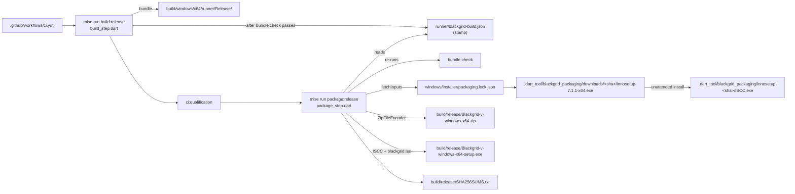
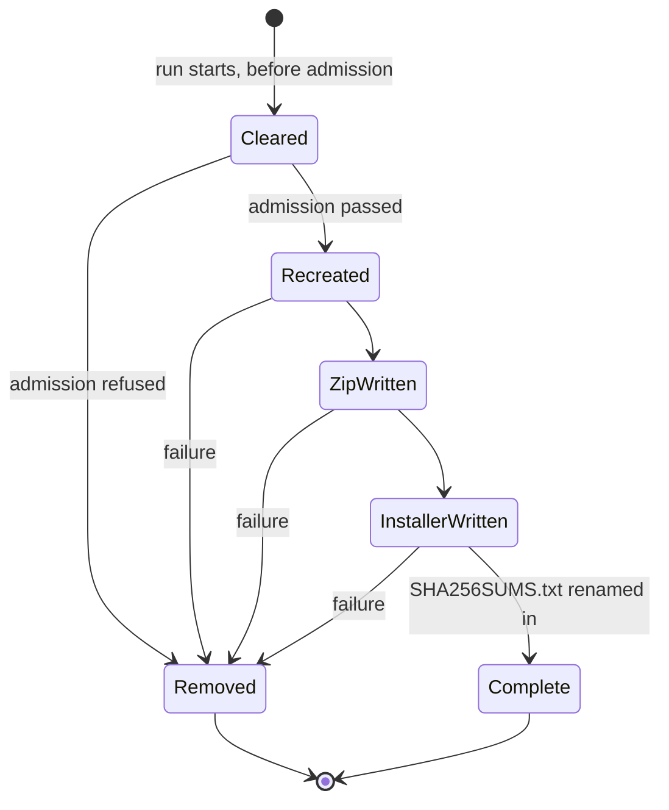

# Design

## Triage

| Trigger | Applies? | Evidence |
|---|---|---|
| T1 Components (new component, or 3+ with directed relationships) | yes | New `package` command and installer script. Directed chain: `build:release` → stamp → `package:release` → `bundle:check`, `fetchInputs`, ISCC → `build/release/` → CI and, later, the publish workflow |
| T2 State (persistent state, caches, 3+ state machine) | yes | New build stamp file; new tool cache `.dart_tool/blackgrid_packaging/` (installer download and installed compiler) |
| T3 Concurrency (background work, workers/isolates, async, retries) | no | One sequential CLI run. Child processes are awaited one at a time. No retries beyond the existing fetch (`tool/vision/fetch_runtime.dart:78`) |
| T4 Boundaries (data format, migration, shared interface, IPC, external) | yes | Artifact file names and zip layout that change 3 publishes and users download; stamp format; packaging lock file; external tool (Inno Setup); installer `AppId` (permanent once shipped); CI workflow |
| T5 Volume (grows without a fixed bound) | no | `build/release/` is cleared on every run. The packaging cache grows only when the pin changes, as the vision cache does (`fetch_runtime.dart:25`). Bundle is ~151 MB today |
| T6 Risk (security, money, data loss, unrecoverable user data) | yes | The installer and uninstaller run next to `%LOCALAPPDATA%\Blackgrid` (database, DPAPI credentials), which cannot be recreated. The downloaded compiler runs on dev and CI machines (supply chain) |

TIER: FULL

## Context

- **Bundle and its check.** `mise run build:release` (`tool/release/src/build_step.dart:10`):
  - refuses a dirty tree (`:19-29`);
  - reads the pubspec version (`:31-42`) and counts commits (`:44-54`);
  - runs `vision:fetch`, `flutter build windows` with `--build-name`/`--build-number`, then `bundle:check` on `build/windows/x64/runner/Release` (`:56-85`).

  Nothing records which commit the bundle came from.
- **Pinned downloads.** `fetchInputs` (`tool/vision/fetch_runtime.dart:78-124`) reads any format-1 lock file and caches each input at `<cache>/<sha256>/<name>`. It re-verifies on reuse (`:129-134`), refuses non-HTTPS (`:136-143`) and enforces a size cap and a 120 s timeout. It takes `--lock` and `--cache`, so the compiler pin can reuse it as is.
- **User data.** It lives under `%LOCALAPPDATA%\Blackgrid` (`lib/data/local_paths.dart:28-33`: database, `credentials/`, logs, scan frames, item icons). The per-user install folder `%LOCALAPPDATA%\Programs\Blackgrid` is a sibling, not a parent.
- **Notices.** `THIRD_PARTY_NOTICES.md` sits at the repo root. `bundle:check` reads it from there (`tool/vision/check_bundle.dart:21`); the bundle itself does not contain it.
- **Version resource.** `windows/runner/Runner.rc` still says `CompanyName "com.example"` and `ProductName "blackgrid"` (`:92-98`). The installer's metadata comes from the `.iss` script, not from that resource; fixing the resource is out of scope.
- **CI.** `.github/workflows/ci.yml` runs analyze → test → build:release → cache save → qualification. `test/tool/ci/workflow_test.dart` pins that order, `contents: read`, SHA-pinned actions and the cache paths (ADR-0024).
- **Release tool tests.** `test/tool/release/build_test.dart` uses a real Git fixture plus a `FakeRunner` that stubs `flutter`/`mise`. Packaging tests follow it.
- **Inno Setup.** 7.1.1 is current, published as `innosetup-7.1.1-x64.exe` on `github.com/jrsoftware/issrc` releases. No hash is published, so we pin our own. The setup accepts `/VERYSILENT /SUPPRESSMSGBOXES /SP- /NORESTART /CURRENTUSER /DIR=<path> /NOICONS /LOG=<path> /TASKS=<list>`. That its setup also offers a `/PORTABLE=1` mode is an unverified assumption, checked by task 2.1 (D2).
- **Decisions already made.** The user's decisions (Inno Setup, unsigned for now with #66 open, per-user install) are in proposal.md. They are not reopened here.

## Decisions

### D1: The build writes a stamp; packaging trusts the stamp plus a fresh bundle check

- **Choice:**
  - **Stamp.** `build:release` deletes any old `build/windows/x64/runner/blackgrid-build.json` before it starts. Only after `bundle:check` passes does it write `{"format":1,"version":"<v>","buildNumber":<n>,"commit":"<40-hex HEAD>"}`, through a temp file and a rename. The stamp sits outside the `Release/` directory, so the bundle inventory is unchanged.
  - **Packaging admission.** `package` first deletes `build/release/` (D5), then refuses unless:
    - the tree is clean;
    - the stamp parses;
    - `stamp.commit == HEAD`;
    - `stamp.version == pubspec version`.

    It then re-runs `mise run bundle:check -- <bundle>` before writing anything.
- **Rejected:** packaging builds the bundle itself, as one `build:release --package` flow. CI would build twice, or the qualification tier would test a different build from the one shipped. The ordering the spec relies on is build, qualify, then package that exact bundle.
- **Rejected:** reading the version back from `blackgrid.exe`'s resource. That gives the version and build number but not the commit, so a rebuilt tree at the same count would pass.
- **Reversal cost:** low. The stamp is a build artifact, never committed.

### D2: The compiler is pinned in its own lock file and fetched by the existing fetcher

- **Choice:**
  - **Pin.** `windows/installer/packaging.lock.json` holds one format-1 entry, `inno-setup`, with the name, version, HTTPS URL, size, SHA-256 and license. The value is the vendor's free-use license; it is recorded for provenance only, since nothing of the compiler ships.
  - **Fetch.** `package` calls `fetchInputs(lockFile: packaging.lock.json, cacheDir: .dart_tool/blackgrid_packaging/downloads)`.
  - **Install, leaving no machine registration.** It unpacks the verified installer into `.dart_tool/blackgrid_packaging/innosetup-<sha256>/`, writes a `.complete` marker and uses only `<that dir>/ISCC.exe`, by absolute path. The unpack method is the first of these that task 2.1 confirms works on the dev machine:
    1. Inno Setup's own portable mode: `/PORTABLE=1 /VERYSILENT /SUPPRESSMSGBOXES /SP- /NORESTART /CURRENTUSER /NOICONS /DIR=<abs path> /LOG=<abs log>`. This writes no uninstall entry, no shortcuts and no file associations.
    2. `innoextract`, pinned in the same lock file, if it supports the 7.1.1 setup format.
    3. Last resort: a full per-user install with the same switches plus an explicit empty `/TASKS=""`, so no default-checked task runs. Each checkout then overwrites one shared HKCU uninstall entry, which goes stale after `flutter clean`. If task 2.1 has to fall back to this, it records the effect in the proposal's "Machine side effects".
  - **Partial installs.** A directory without the marker is deleted and installed again.
- **Rejected:** installing through mise, winget or Chocolatey. mise has no Inno Setup backend. winget and Chocolatey install machine-wide or into user folders we do not control, and do not let us pin our own hash.
- **Rejected:** a committed `ISCC.exe`. That would put binaries in the repo, and the vendor terms for redistribution would need checking.
- **Rejected:** using whatever `ISCC.exe` is on `PATH`. That would be unpinned and would drift between machines.
- **Reversal cost:** low.

### D3: Artifact names and layout

- **Choice:** all output goes to `build/release/`:
  - `Blackgrid-<version>-windows-x64.zip`, with a top-level `Blackgrid-<version>/` holding the bundle tree plus `THIRD_PARTY_NOTICES.md`;
  - `Blackgrid-<version>-windows-x64-setup.exe`;
  - `SHA256SUMS.txt`, in `sha256sum` format: two spaces between hash and name, LF line endings, entries sorted by name.

  `<version>` is the full SemVer, including `-beta.N`. The zip is written with `package:archive`'s `ZipFileEncoder`, which streams from disk; `archive` is already a dependency (`fetch_runtime.dart:6`).
- **Rejected:** a flat zip with no top-level folder. Extracting into Downloads would spray more than 15 files, and two versions would overwrite each other.
- **Rejected:** `Compress-Archive` from PowerShell. It is hard to unit-test, and its behaviour has differed across PowerShell versions.
- **Reversal cost:** medium once change 3 publishes. Download links and user habits depend on the names, so ADR-0025 records them.

### D4: Installer script and its invariants

- **Choice:** `windows/installer/blackgrid.iss`, compiled as `ISCC.exe /Q /DAppVersion=<v> /DFileVersion=<core>.<build> /DSourceDir=<abs bundle> /DNoticesFile=<abs notices> /DOutputDir=<abs build/release> /DOutputBaseFilename=Blackgrid-<v>-windows-x64-setup <iss>`. It sets:
  - `AppId={{<fixed GUID>}`, `AppName=Blackgrid`, `AppPublisher=Nikolay Bochev`;
  - `PrivilegesRequired=lowest`, with no `PrivilegesRequiredOverridesAllowed`;
  - `DefaultDirName={autopf}\Blackgrid`, which resolves to `%LOCALAPPDATA%\Programs\Blackgrid` under `lowest`;
  - `DisableProgramGroupPage=yes`;
  - `ArchitecturesAllowed=x64os` and `ArchitecturesInstallIn64BitMode=x64os`, `MinVersion=10.0`;
  - `CloseApplications=yes` and `RestartApplications=no`;
  - `UninstallDisplayIcon={app}\blackgrid.exe`, `VersionInfoVersion={#FileVersion}`;
  - `Compression=lzma2/max`, `SolidCompression=yes`.

  `[Files]` copies `{#SourceDir}\*` with `Flags: ignoreversion recursesubdirs createallsubdirs`, plus the notices file with `Flags: ignoreversion`. Without `ignoreversion`, Inno Setup keeps an installed file that has a version resource with the same or a newer version, but always replaces unversioned files (`app.so`, the `.sha256` bindings, the runtime manifest). A downgrade, or a same-version rebuild of a pinned DLL, would then mix versions and fail the runtime hash bindings. `[Icons]` has a Start menu entry and a desktop entry under an unchecked `desktopicon` task. `[Run]` offers "Launch Blackgrid" as a `postinstall nowait skipifsilent unchecked` entry. There are no `[InstallDelete]` or `[UninstallDelete]` sections.
- **File version.** `<core>` is `major.minor.patch`, taken from the version without its prerelease, because Windows file versions are four 16-bit numbers. ADR-0009 already caps the build number at 65535.
- **Script check.** An offline test parses the script and asserts these invariants:
  - `PrivilegesRequired=lowest` and no `PrivilegesRequiredOverridesAllowed`;
  - the committed `AppId`;
  - `ignoreversion` on every `[Files]` entry;
  - no `[InstallDelete]`, `[UninstallDelete]`, `[UninstallRun]` or `[Code]` section.

  The last rule is structural, not a list of forbidden paths: it rules out every way the script could delete or run something outside Setup's own install log. If a delete entry is ever needed, the change that adds it must also relax this test, allowing only paths that start with `{app}\` and contain no `..`.
- **Rejected:** `[UninstallDelete]` of the whole `{app}` folder. A user who picks a shared folder could lose unrelated files, and the files Setup installed are already removed by its own log.
- **Rejected:** a per-machine install that offers a per-user override. That needs elevation by default, which the user ruled out.
- **Reversal cost:** **high for `AppId`**, because a changed id makes the next version a second install beside the first. The id is generated once, committed and recorded in ADR-0025. Low for the rest.

### D5: Packaging is all-or-nothing in `build/release/`

- **Choice:** `package` deletes `build/release/` as its first action, before admission (D1), so a refused or failed run never leaves an earlier set behind. It recreates the directory only after admission passes, then writes:
  1. the zip;
  2. the installer;
  3. `SHA256SUMS.txt`, last, via a temp file and a rename.

  On any failure, including a thrown exception, it deletes `build/release/` and exits 1, naming the failed stage and the child's own exit code in the message. The child's code is not passed through: ISCC exits 2 on a compile error, which would collide with the tool's usage-error code 2.
- **Rejected:** keeping earlier outputs and only adding new ones. A publish step could pick up a stale installer next to a fresh zip.
- **Reversal cost:** low.

### D6: CI packages after qualification and uploads nothing

- **Choice:** add one step, `Package` (`run: mise run package:release`), after `Qualification` in `.github/workflows/ci.yml`:
  - no `env:`, so it does not inherit the no-games confirmation;
  - no cache for the compiler, so the "caches hold only…" test stays unchanged;
  - no `continue-on-error`.

  `workflow_test.dart`'s order test gains `package:release` as the last gate. Its no-games scope test already proves that only `Qualification` sets the variable.
- **Rejected:** packaging only in the tag workflow (change 3). A broken `.iss` or a moved compiler URL would surface only when a release is tagged.
- **Rejected:** uploading the packages as workflow artifacts. That costs about 300 MB of storage per run, and nobody consumes it before change 3.
- **Reversal cost:** low.

### D6b: Child processes get a timeout

- **Choice:** the release tool's `CommandRunner` (`tool/release/src/git.dart`) has no timeout today. It gains an optional `timeout` on `run`. When the timeout expires, it kills the child's process tree with `taskkill /PID <pid> /T /F` and returns a typed timeout failure, which the caller reports as its stage failing. Only `package` passes a timeout. Existing callers are unchanged. Tests inject a fake runner, so no test waits on a real timeout.
- **Rejected:** wrapping the calls in `Future.timeout`. That abandons the future but leaves the process, and its children, running.
- **Reversal cost:** low.

### D7: Unsigned, with the signing seam left open

- **Choice:** nothing is signed. `package` has no signing code and the script sets no `SignTool`. ADR-0025 records that signing, if #66 recommends it, wraps two points: the bundle's `blackgrid.exe` and DLLs before the zip, and the setup through `SignTool=`. Both are inside `package`, so callers do not change.
- **Rejected:** a no-op `--sign` flag now. That would be speculative interface.
- **Reversal cost:** low.

## Diagrams (FULL)

T1 / T4, components and artifacts:

T2, `build/release/` state:

## State & Ownership (FULL)

| State | Owner (sole writer) | Lifetime | Invalidation / rebuild | Authoritative copy |
|---|---|---|---|---|
| Build stamp `runner/blackgrid-build.json` | `build_step.dart` | Until the next build starts (deleted first) or `flutter clean` | Deleted at build start; written only after `bundle:check` passes | The stamp, cross-checked against `git rev-parse HEAD` and pubspec |
| `.dart_tool/blackgrid_packaging/downloads/<sha>/…` | `fetchInputs` | Until the pin changes or `flutter clean` | Re-hashed on every use (`fetch_runtime.dart:129`) | `packaging.lock.json` |
| `.dart_tool/blackgrid_packaging/innosetup-<sha>/` | `package_step.dart` | Same as above | No `.complete` marker means delete and reinstall; keyed by installer SHA, so a new pin installs beside the old one | The verified installer it came from |
| `build/release/*` | `package_step.dart` | Until the next `package` run | Cleared first thing, before admission; removed on failure | The files plus `SHA256SUMS.txt` |
| Installer `AppId` GUID | `blackgrid.iss`, committed | Permanent once a release ships | Never changed (ADR-0025) | The script |
| Machine registration of the compiler | none with option 1 or 2 of D2 | n/a | n/a | n/a. Only D2's last resort writes a shared HKCU uninstall entry, recorded in the proposal if used |

## Failure & Visibility (FULL)

| Component | Fails / dies mid-operation → | Recovery | Retry safe? | Who finds out |
|---|---|---|---|---|
| Build stamp write | Stamp missing (old one deleted, new one not yet renamed in) | Run `build:release` again | yes | Developer or CI: `package` refuses with "run `mise run build:release` first" |
| Admission | Refuses after clearing `build/release/` and before any other write | Fix the named condition | yes | Exit message names the condition (dirty files, both commits, versions) |
| `bundle:check` re-run | Non-zero | Rebuild | yes | Its own report and exit code are passed through |
| Compiler download | `FetchException` (bad hash, size, non-HTTPS, timeout) | Re-run; if the vendor moved the file, update the pin in a PR | yes (atomic cache placement) | Exit message with expected and actual hashes; red CI step |
| Compiler install | Non-zero exit or killed: directory has no `.complete` | Next run deletes the directory and reinstalls | yes | Exit code plus the path of the setup's `/LOG` file, which is passed to the setup |
| ZIP write / ISCC | Exception or non-zero | `build/release/` removed | yes | ISCC's output is streamed and the exit code passed through; red CI step |
| Installed app upgrade (user machine) | Blackgrid running holds files | `CloseApplications=yes` asks to close it; if refused, Setup reports the locked file | yes (rerun setup) | The user, in Setup's own dialog |

## Resource Bounds (FULL)

| Queue / buffer / cache / transfer | Bound | At the bound | Timeout | At 10x / 100x |
|---|---|---|---|---|
| Compiler download | Pinned `size` (about 7 MB) | `fetchInputs` aborts over size | 120 s per request (existing) | n/a: one file |
| Compiler install | One directory per pinned SHA | Old pins linger until `flutter clean`, as with vision inputs | 5 min; then the process tree is killed (`taskkill /T /F`, because Inno's `setup.exe` hands off to a child `setup.tmp`) and the run fails (D6b) | n/a |
| ZIP write | Bundle size (151 MB today), streamed file by file | Disk full raises an exception, and D5 cleans up | none: local I/O | 1.5 GB: still streamed, fine. 15 GB: past the zip32 limits; `ZipFileEncoder` writes zip64 for files over 4 GB, an unverified assumption that becomes relevant only far beyond plausible size |
| ISCC compile | Bundle size | Disk full makes ISCC fail and D5 clean up | 20 min; then the process tree is killed and the run fails (D6b) | lzma2/max at 10x (1.5 GB) could take more than 20 min. The timeout is a constant in `package_step.dart` and is raised if CI step times show a need |
| `build/release/` | 3 files | Cleared each run | n/a | n/a |

## Flow & State Gaps (FULL)

- **Stale bundle.** The stamp is from an older `HEAD` because a commit landed after the build: admission refuses (spec scenario "Bundle built from another commit").
- **Bundle edited after the build:** the `bundle:check` re-run fails.
- **Two `package` runs at once in one checkout:** not supported, and neither is concurrent `build:release`. Both write fixed paths under `build/`. Default assumption: one build per checkout, as everywhere in this repo. Parallel agents use separate worktrees, and `.dart_tool/` and `build/` are per worktree.
- **Interrupted install of the compiler:** handled by the `.complete` marker (D2).
- **Killed between zip and installer:** `build/release/` holds a lone zip and no `SHA256SUMS.txt`. A consumer must require `SHA256SUMS.txt`, and change 3 will publish only when it is present and lists both files. The next `package` run clears the directory.
- **Upgrade from the zip to the installer:** these are separate installs. The zip is portable, wherever it was extracted. Both read the same `%LOCALAPPDATA%\Blackgrid` data. Running both at once is the user's choice; the app's single-instance behaviour is unchanged.
- **Downgrade with the installer:** Inno Setup installs over the existing install without a version check. `ignoreversion` (D4) means every bundled file is replaced by the older one, so no version mix remains. User data written by a newer schema stays, and the app's existing Drift schema handling applies. Not changed here.

## Mechanism Ledger (FULL)

| Mechanism | Built? | Why (harm nobody catches / expensive later) | Evidence that would change the call |
|---|---|---|---|
| Build stamp + commit check | yes | Without it, a stale bundle ships under a new version and nobody notices: the version resource would show the old count, but no one reads it | — |
| `bundle:check` re-run in `package` | yes | Cheap (offline, seconds); catches a replaced or added native file before it ships. It does not cover non-native stray files (see Risks) | — |
| Pinned and hashed compiler | yes | The compiler output ships to users; an unpinned tool is a supply-chain hole and a source of drift | — |
| `.complete` marker for the compiler install | yes | Without it, a killed install leaves a half-populated directory that ISCC might partly run from, giving confusing failures | — |
| Re-hash of the installed compiler files on every run | no | They were installed from verified bytes into a repo-private directory; tampering there is as likely as tampering with `.dart_tool/` itself | A reason to distrust `.dart_tool/`, such as a shared build machine |
| Delete `build/release/` on failure | yes | Change 3 globs this directory; a partial set could be published | — |
| CI cache for the compiler | no | 7 MB per run is negligible, and caching would widen ADR-0024's cache rules | Download failures or rate limits seen on CI |
| Signing hook (`--sign`, `SignTool=`) | no | Speculative until #66 decides (D7) | #66 recommends a signing route |
| Version check against a downgrade in the installer | no | Release users install forward. A downgrade replaces every file (D4 `ignoreversion`) and keeps the data; Drift refuses a newer schema version, a failure that is visible to the user | A user report of a broken downgrade |
| Installing and uninstalling the produced setup in an automated test | no | It would write Start menu entries and an HKCU uninstall entry on the developer machine. Install behaviour is the user's M6 check, and the script invariants are asserted offline | A hosted-runner smoke test in change 3, where the side effects are disposable |

## Risks / Trade-offs

- [Neither portable mode nor `innoextract` works for 7.1.1] → D2's last resort, a per-user install, still works, at the cost of a registry entry. Task 2.1 picks the method before any code depends on it. This changes only D2's install step, not the specs.
- [The vendor deletes or moves the 7.1.1 asset] → The fetch fails loudly, and the fix is a pin update PR. The GitHub release assets are immutable per tag in practice.
- [Unsigned setup shows SmartScreen "unknown publisher"] → Accepted by the user; #66 tracks signing. The user's install check notes the warning is expected.
- [A stray non-DLL file in `Release/` (for example a leftover log) ships in both packages; `bundle:check` checks only the native inventory] → Accepted. `build:release` runs `flutter build` on a clean tree, so stray files come only from manual edits, which the stamp's freshness rule already discourages. If one ever ships, the fix is a bundle allowlist in `bundle:check`.
- [`AppId` mistakes are permanent] → Generated once in task 3.1, recorded in ADR-0025 and asserted by the script test, so a later edit fails CI.
- [lzma2/max makes CI slower] → It is measured on the first CI run. Use `lzma2/normal` if the step takes more than about 5 min; that is a constant in the script and needs no spec change.

## ADRs

- **In force, constraining this change:**
  - 0009, release versioning: SemVer with `-beta.N`, the commit-count build number capped at 65535, and `build:release` as the build.
  - 0024, hosted CI: one sequential job, `contents: read`, SHA-pinned actions, caches re-verified, and the no-games confirmation only in the qualification step.
- **To record during apply:** **0025, Release packaging: a per-user Inno Setup installer and a zip, unsigned for now.** It records:
  - the format choice, rejecting MSIX for AppData virtualization and the signature requirement, and rejecting WiX MSI;
  - the per-user scope and the fixed `AppId` (with its value);
  - the artifact names (D3);
  - the stamp and fresh check rule (D1);
  - the pinned compiler (D2);
  - unsigned until #66, and where signing goes (D7);
  - the reversal cost.

  ADR-0025 carries an `Amends: 0024` header line, as 0024 does for 0009: ADR-0024's CI step list gains `package:release` after `ci:qualification` (D6). ADR-0024 itself is not edited. The same task updates `openspec/architecture.md`: the CI workflow row in the components table, the 0024 index row (noting "amended by 0025"), and a new 0025 index row.

## Open Questions

- The exact SHA-256 and size of `innosetup-7.1.1-x64.exe`, measured when the pin is written (task 2.1). This is a value, not a decision.
