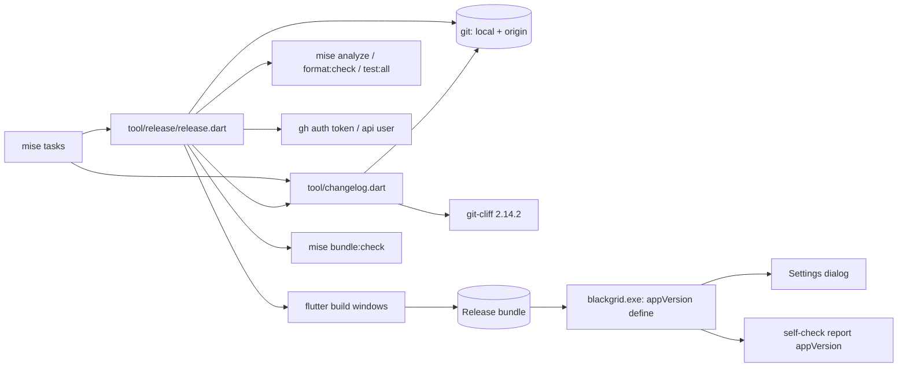
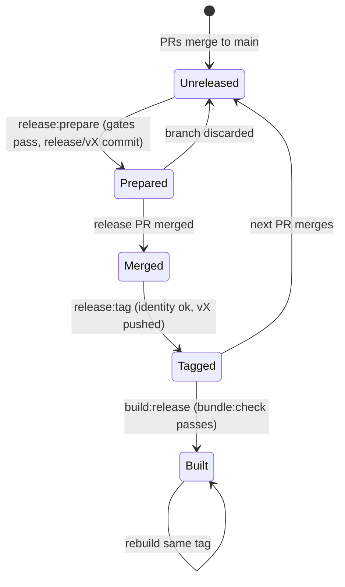
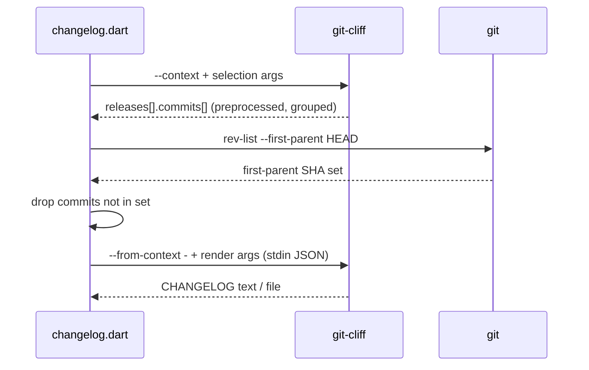

# Design

## Triage

| Trigger | Applies? | Evidence |
|---|---|---|
| T1 Components (new component, or 3+ with directed relationships) | Yes | New `tool/release/` component driving git, git-cliff, Flutter, `bundle:check` and `gh`; `tool/changelog.dart` gains a two-stage git-cliff pipeline |
| T2 State (persistent state, caches, 3+ state machine) | Yes | New persistent repository state: release tags on `origin`, `release/v*` branches, the `pubspec.yaml` version rule. The release itself has a multi-step lifecycle (prepared → merged → tagged → built) |
| T3 Concurrency (background work, workers/isolates, async, retries) | No | Each task runs its subprocesses one after another; no app concurrency changes. The app reads a compile-time constant |
| T4 Boundaries (data format, migration, shared interface, IPC, external) | Yes | Changelog format changes; tag and version formats; new `appVersion` field in the self-check report (format 1); the external GitHub remote (tag push) |
| T5 Volume (grows without a fixed bound) | Yes (bounded below) | Commit history and the changelog grow forever; the build number grows with commits and must stay ≤ 65535 |
| T6 Risk (security, money, data loss, unrecoverable user data) | Yes | Authenticated push to GitHub with a per-process token (CLAUDE.md account fencing). A pushed tag is public and hard to retract |

TIER: FULL

## Context

The plan and its reasons are in [proposal.md](proposal.md) and the [roadmap section](../../roadmap.md#release-versioning-add-release-versioning). Current state that the approach depends on:

- `pubspec.yaml:4` is `version: 0.1.0+1`. Flutter writes the version into `windows/flutter/ephemeral/generated_config.cmake`, and `windows/runner/Runner.rc:63-77` turns it into `FILEVERSION major,minor,patch,build`. Flutter 3.47.6 (`flutter_tools/lib/src/cmake.dart:83-107`) parses `--build-name`/`--build-number` as a SemVer `Version`, so a prerelease name such as `0.2.0-beta.1` with build number 120 gives `FLUTTER_VERSION "0.2.0-beta.1+120"` and file version `0.2.0.120`. Each file-version field is 16 bits.
- `cliff.toml:31` skips every merge commit (`merge_commit = true → skip`), so today the changelog lists branch commits and no PR entries. `tool/changelog.dart:1-46` wraps `git-cliff --offline --config cliff.toml` and handles an unborn `HEAD`. `mise.toml` pins `git-cliff` 2.14.2, and its CLI has no first-parent option (checked: `git-cliff --help` lists `--skip-commit`, `--context`, `--from-context`, no `--first-parent`).
- Main's history: 91 commits, 18 on the first-parent line. GitHub merges have subject `Merge pull request #N from <owner>/<branch>`, then a blank line and the PR title as the first body line. Older shapes also exist (PR #1: `Merge pull request #1: <text>`), as do direct commits (`cf272df … archive change`, `9dd3d49 chore(ai): …`).
- `origin` is `https://github.com/sh1ny/blackgrid.git`. `gh auth git-credential` uses `GH_TOKEN` when it is set, but which credential helpers Git consults depends on each machine's Git config (this machine also has `store` and Git Credential Manager as general helpers), so the design must not rely on the ambient helper chain (D6). `openspec/specwright.yaml` holds `github.login: KintsugiBot`.
- The Settings dialog is `lib/ui/settings_dialog.dart:72-272` (an `AlertDialog` titled `Blackgrid configuration`, with a `Close` action). The self-check report map is built at `lib/application/vision_self_check.dart:285-291`, report `format` 1 (`:19`). `lib/application/launch_mode.dart` keeps self-check dispatch free of Flutter imports.
- `yaml` and `pub_semver` are only transitive in `pubspec.lock`. `flutter_lints` (`depend_on_referenced_packages`) forbids importing them without a direct dependency.
- The qualification tests check for a running game with `tasklist` (`test/qualification/m2_vision_self_check_test.dart:119-130`) and skip when they cannot confirm it is absent.

## Decisions

### D1: Changelog keeps only main's first-parent line, by filtering git-cliff's context

- **Choice:** `tool/changelog.dart` runs two git-cliff stages. Stage 1 is `git-cliff --offline --config cliff.toml --context` plus the caller's selection options (range, `--tag`, `--unreleased`, `--latest` …). Dart then reads `git rev-list --first-parent HEAD` into a set and removes from every release's `commits` each commit whose `id` is not in that set. Stage 2 is `git-cliff --offline --config cliff.toml --from-context -` plus the render options (`--output`/`-o`, `--strip`/`-s`, `--prepend`/`-p`). Stage 2 reads the filtered JSON on stdin. The context is decoded from and encoded to UTF-8 explicitly (commit bodies already hold non-ASCII text, and Dart's process default is the system code page). Options are split between the stages by an explicit allowlist (selection: range, `--tag`, `-t`, `--unreleased`, `-u`, `--latest`, `-l`; render: `--output`, `-o`, `--strip`, `-s`, `--prepend`, `-p`); any other option is refused with exit 2, so a flag cannot silently land on the wrong stage. git-cliff's `ignore_tags` (D10) still treats prerelease tags as section boundaries for `--latest` and `--unreleased`, so `changelog.dart` does not forward those two flags. It turns them into ranges between final (non-prerelease) release tags, ordered by SemVer precedence: `--unreleased` becomes `<latest final tag>..HEAD` (all of `HEAD` when no final tag exists), and `--latest` becomes `<previous final tag>..<latest final tag>` with `--tag <latest final tag>` (from the root when there is no previous one). `--current` is not supported. The unborn-`HEAD` path stays (empty context).
- **Rejected:** passing every non-first-parent SHA as `--skip-commit`, or writing a `.cliffignore`. `--skip-commit` grows by ~53 characters per branch commit and hits the 32,767-character Windows command line after ~600 branch commits (73 today, ~20-30 per PR). `.cliffignore` is a file in the repo root that the tool would have to write and clean up. Also rejected: dropping git-cliff and rendering in Dart, which throws away the existing template and conventional-commit parsing.
- **Reversal cost:** low. The tool is a dev script with no stored output except `CHANGELOG.md`, which is regenerated.

### D2: GitHub merge commits become PR entries in `cliff.toml`

- **Choice:** remove the `merge_commit → skip` parser. Add a `commit_preprocessors` rule, applied to the whole message before conventional parsing: `(?s)\AMerge pull request #(\d+) from \S+\n\n([^\n]+).*` → `$2 (#$1)`. The PR title then parses as a conventional commit. Add skip parsers, placed before the group parsers: `^chore\(release\): v` (release commits and their merges), and, as a guard for direct commits on main, branch-only subjects `^\w+(\([^)]*\))?: (task \d|amend (specs|design|tasks)|address review feedback|add planning artifacts|archive change)`. Other merge shapes (PR #1) stay unconventional and land under **Other**, inside `v0.1.0`.
- **Rejected:** rewriting messages in the Dart filter after stage 1. The context already holds parsed groups, so the tool would have to re-implement conventional parsing.
- **Reversal cost:** low.
- **Confirmed (review round 1):** git-cliff 2.14.2 applies `commit_preprocessors` to the full message (summary plus body), and a filtered `--context` renders through `--from-context -` honouring `--output`, `--strip` and a stage-1 `--tag`. The fixture test (task 2.1) keeps both facts pinned.
- **Known residue:** non-conventional commits inside `v0.1.0` (PR #1's merge, early direct commits) render with their body, including `Co-authored-by` lines. Accepted: that history is frozen, and every later PR title is conventional (D9).

### D3: One Dart release tool with injected effects, driven by `mise` tasks

- **Choice:** `tool/release/release.dart` has the subcommands `prepare <version>`, `tag` and `build`, mapped to `mise` tasks `release:prepare`, `release:tag` and `build:release`. Logic is in `tool/release/src/`:
  - `semver.dart`: an owned strict SemVer 2.0.0 parser and precedence comparator. Release versions reject build metadata.
  - `git.dart`: a thin `git` runner.
  - `release_steps.dart`: precondition checks, the pubspec edit and the step orchestration.
  - `push_identity.dart`: D6.
  
  Every external effect (process runs, gates, git-cliff, `gh`, Flutter) goes through an injected runner, so tests drive real temporary git repositories (a bare repo as `origin`) and stub only the gates, Flutter and `gh`.
- **Rejected:** PowerShell scripts in `mise.toml` (the qualification freeze precedent). They are hard to unit-test, the repo's tested tools are Dart (`tool/vision/*.dart`), and Git Bash and PowerShell disagree on quoting. Also rejected: `pub_semver`. It is lenient where the spec is strict (it accepts forms the spec refuses and has no "no build metadata" mode), and it is not a direct dependency.
- **Reversal cost:** low.

### D4: Release preparation order: check, gate, then mutate

- **Choice:** `prepare` runs, in order, and stops at the first failure with a typed message:
  1. Validate the version (D3 `semver`).
  2. Branch is `main`, and `git status --porcelain --untracked-files=all` is empty.
  3. `git fetch origin main --tags`; `HEAD == origin/main`.
  4. The latest tag is the maximum by SemVer precedence over tags matching `cliff.toml`'s pattern; the version must be greater.
  5. Tag `v<version>` and branch `release/v<version>` are absent locally (`git rev-parse`) and on `origin` (`git ls-remote`).
  6. Gates: `mise run analyze`, `mise run format:check`, `mise run test:all`.
  7. `git checkout -b release/v<version>`.
  8. Rewrite the single `^version:` line of `pubspec.yaml` to `version: <version>`. Zero or several matches is an error.
  9. `dart run tool/changelog.dart --tag v<version> --output CHANGELOG.md`.
  10. `git add pubspec.yaml CHANGELOG.md`, then `git commit -m "chore(release): v<version>"`, plus `--trailer` values the caller forwards with `--trailer <line>`. The tool uses Git's ambient identity; callers set `GIT_AUTHOR_*`/`GIT_COMMITTER_*` (CLAUDE.md identity) through the environment.
  11. Print `git-cliff --bumped-version` as information only (its failure is ignored), and print the push and PR commands. The tool does not push.
- **Rejected:** creating the branch first and gating on it. A gate failure would then leave a stray branch, and the spec requires that nothing changes before the gates pass.
- **Reversal cost:** low.

### D5: Tagging identifies the release from the merge, not from arguments

- **Choice:** `tag` takes no version argument. Clean `main`, fetch, and `HEAD == origin/main` (as in D4 steps 2-3). `HEAD` must have exactly two parents, and the second parent's subject must match `^chore\(release\): v(<semver>)$`; that version must equal the pubspec version and pass D4 step 5's tag absence check. Then: confirm the push identity (D6), run `git tag -a v<version> -m "v<version>" HEAD`, and push only `refs/tags/v<version>` to `origin`. It also requires that the release commit's first parent equals `HEAD`'s first parent, so no other PR merged between `prepare` and the release merge. Otherwise it refuses, naming the intervening commits (`git log --oneline <release^1>..HEAD^1`) and the recovery: discard the release and run a new `prepare`. The changelog committed in the tagged tree is then exactly the tag's changelog. If the push fails, the local tag is deleted, so a re-run starts clean. The annotated tag's tagger is Git's ambient committer identity; callers set `GIT_COMMITTER_NAME`/`GIT_COMMITTER_EMAIL` (CLAUDE.md identity), as for D4's commit.
- **Rejected:** `release:tag -- <version>`. A typed version can disagree with the merged release, and the merge already records it.
- **Reversal cost:** low for the tool. A pushed tag is public; deleting it is possible but other clones may keep it.

### D6: Push identity is fenced per process

- **Choice:** before creating the tag, `push_identity.dart` reads `github.login` from `openspec/specwright.yaml` with `package:yaml`, added as a direct dev dependency at the locked `3.1.4`. It removes `GH_TOKEN` and `GITHUB_TOKEN` from a copied environment, runs `gh auth token --hostname github.com --user <login>`, and keeps the token only in that environment map. It then confirms `gh api --hostname github.com user --jq .login` == `<login>`. Every network Git call of `tag` (`fetch`, `ls-remote`, `push`) runs as `git -c credential.helper= -c "credential.helper=!gh auth git-credential" …` with that environment. The empty value clears the inherited helper list, so the fenced `GH_TOKEN` is the only credential source, whatever the machine's Git config. Tests (task group 4) record every process invocation of `tag` through the injected runner. They assert that the `fetch`, `ls-remote` and `push` argument lists each carry both `-c credential.helper=` and `-c credential.helper=!gh auth git-credential`, and that the token value from the stubbed `gh auth token` appears in no argument list, no stdout or stderr output, and no exception message, only in the child environment. The token is never printed, logged or passed as an argument. On any mismatch or missing credential, no tag is created. It never runs `gh auth switch`.
- **Rejected:** pushing with whatever account is active. Other agents can switch it concurrently (CLAUDE.md).
- **Reversal cost:** low.

### D7: Build number is the commit count of the built HEAD; the version reaches the app as a define

- **Choice:** `build` refuses a dirty tree (D4 step 2's porcelain check). It reads `version:` from pubspec and computes `count = git rev-list --count HEAD`, refusing if `count > 65535`. It then runs `mise run vision:fetch`, `flutter build windows --release --build-name <version> --build-number <count> --dart-define=BLACKGRID_VERSION=<version>+<count>`, and `mise run bundle:check -- build/windows/x64/runner/Release`. Its exit code is the first failure's. `lib/application/app_version.dart` holds `const appVersion = String.fromEnvironment('BLACKGRID_VERSION', defaultValue: 'dev')`, with no Flutter import, so `vision_self_check.dart` can use it. Consumers take the version as a parameter defaulting to that constant (`SettingsDialog(version:)`, the self-check report builder's `appVersion:`), so tests can assert a release string, not only `dev`. A build off a branch gets the last release's version with its own count. That is accepted: the count still identifies the commit line.
- **Rejected:** a build counter stored in pubspec or a file. Every PR would conflict on it, and it is not monotonic across branches. Also rejected: reading the version resource at runtime through FFI. That needs more code than the define, and `flutter run` would show the scaffold `1.0.0`.
- **Reversal cost:** low. The count only increases; switching to another monotonic source later does not reuse numbers if it starts above the last count.

### D8: The self-check report gains `appVersion` within format 1

- **Choice:** add `'appVersion': appVersion` to the report map. `visionSelfCheckReportFormat` stays `1`, because the field is additive and the only reader (`m2_vision_self_check_test.dart`) ignores unknown keys.
- **Rejected:** bumping to format 2. No reader needs to tell the two apart, and a bump would churn the qualification test and its spec scenario for nothing.
- **Reversal cost:** low.

### D10: Prerelease sections fold into the final release

- **Choice:** `cliff.toml` sets `ignore_tags` to the prerelease form of the tag pattern (a `v` tag with a `-` part). git-cliff then treats prerelease tags as if absent: each `-beta.N` changelog lists everything since the last final release under that beta, and the final `0.2.0` changelog lists the whole milestone under `v0.2.0`, with no prerelease sections. `prepare`'s version-increase check (D4 step 4) still reads every tag, prereleases included.
- **Rejected:** separate sections per prerelease. The final milestone section would hold only what landed after the last beta, often nothing, and the milestone's work would be filed under a beta heading.
- **Reversal cost:** low (`CHANGELOG.md` is regenerated from history).

### D9: Workflow rules live in `openspec/config.yaml` context; the baseline tag is a one-time apply step

- **Choice:** add two context lines. (1) PR titles are conventional `type(scope): summary`, because the changelog uses them. (2) At a milestone close, suggest `mise run release:prepare -- <next minor>`, and `-beta.N` first while user-only checks are open. The `v0.1.0` annotated tag on `cf02bb7` is made once during apply: `git tag -a`, then a push through the same fenced path. The user confirms first, because the push is outward-facing. `pubspec.yaml` becomes `version: 0.1.0`.
- **Rejected:** editing the vendored `specwright-roadmap`/`specwright-pr` skills (a Specwright update overwrites them). Also rejected: a `release:tag --baseline` mode for a one-off.
- **Reversal cost:** low.

## Diagrams (FULL)

**T1 - components**

**T2 - release lifecycle**

**T4 - changelog data flow**

## State & Ownership (FULL)

| State | Owner (sole writer) | Lifetime | Invalidation / rebuild | Authoritative copy |
|---|---|---|---|---|
| `pubspec.yaml` `version:` | `release:prepare` (release commit only) | Until the next release commit | Replaced by the next release commit | `main` |
| Release tags `v*` | `release:tag` (plus the one-time `v0.1.0`) | Permanent | Never moved; a wrong tag is deleted by hand (Risks) | `origin` |
| `release/v*` branches | `release:prepare` | Until the PR merges | Deleted after the merge, like any PR branch | `origin` once pushed |
| `CHANGELOG.md` | `release:prepare` via `changelog.dart` | Until the next release | Regenerated in full from git history each release | Git history + `cliff.toml` (the file is derived) |
| Build number | Computed by `build`, not stored | Per build | Recomputed from `HEAD` | Git history |
| `appVersion` | Compile-time define set by `build` | Per binary | Rebuilt | The binary |
| Workflow rules | Humans/agents editing `openspec/config.yaml` | Until changed | — | `main` |

## Failure & Visibility (FULL)

| Component | Fails / dies mid-operation → | Recovery | Retry safe? | Who finds out |
|---|---|---|---|---|
| `prepare` precondition/gate | Stops before any mutation | Fix the cause and re-run | Yes | User: typed message and non-zero exit |
| `prepare` after step 7 (changelog or commit fails) | `release/vX` exists with an edited pubspec and maybe a changelog, no commit | Message names the branch and files; `git checkout main && git branch -D release/vX` | Yes after cleanup; step 5 refuses while the branch exists | User |
| `prepare` killed mid-run | Same as the row above, or no change | Same | Same | User (the next run's step 2/5 refusal names it) |
| `changelog.dart` stage 1 or 2 | Non-zero exit with git-cliff's stderr; no partial `CHANGELOG.md` because git-cliff writes `--output` itself only on success | Re-run | Yes | User |
| `tag` identity check | No tag created | Fix the credential and re-run | Yes | User: names the expected login |
| `tag` push fails | Local tag deleted (D5) | Re-run | Yes | User: git's push error |
| `tag` killed between create and push | Local tag exists, remote does not | The next run refuses on the local tag; `git tag -d vX`, then re-run | Yes after delete | User |
| `build` (fetch, Flutter or bundle check) | Non-zero exit; partial `build/` output | Re-run; Flutter rebuilds incrementally | Yes | User: the failing stage name |
| App with no define | Shows `dev` | — | — | User sees `dev` in Settings and in the report |

## Resource Bounds (FULL)

| Queue / buffer / cache / transfer | Bound | At the bound | Timeout | At 10x / 100x |
|---|---|---|---|---|
| Build number | ≤ 65535 (16-bit file-version field) | `build` refuses with the count | — | 91 commits today; 100x = 9,100, still far below |
| First-parent SHA set | One entry per main commit (18 today) | — | — | 1,800 at 100x: trivial |
| git-cliff context JSON on stdin | Proportional to history (~91 commits ≈ tens of KB) | — | None; local process | ~10 MB at 100x, fine through a pipe |
| Subprocess output capture | Streamed to the console (gates, Flutter); captured only for short git/gh/cliff queries | — | Gates and builds have none (user-interruptible); network calls (`fetch`, `ls-remote`, `push`, `gh api`) rely on git/gh defaults | — |
| `CHANGELOG.md` | Grows one section per release | — | — | Hundreds of sections remain readable; trimming is a later decision |

## Flow & State Gaps (FULL)

- **Partial `prepare`:** covered in Failure & Visibility. Step 5 makes a half-done run visible on the next attempt instead of overwriting it.
- **Main moves during `prepare`:** if another PR merges before the release PR, the release merge would ship that PR while the committed `CHANGELOG.md` omits it, and a later regeneration would file it under this tag. `tag` refuses in that case (D5 first-parent check). Recovery: delete `release/vX` locally and on `origin`, then run `prepare` again for the same version on the new `main` (it creates a new release commit and PR).
- **Two releases prepared at once:** the second fails step 5 only if it uses the same version. Different versions can both be prepared. Default: one release at a time, by convention (single maintainer); not guarded.
- **A PR merged between the release merge and `tag`:** `HEAD` is no longer the release merge, so `tag` refuses (spec scenario). Recovery is a manual `git tag -a vX <release-merge>` and a push through the same fenced path, or a new patch release.
- **Tag exists remotely, not locally (another clone):** `prepare` steps 3 and 5 fetch tags and `ls-remote`, so they refuse.
- **Building an older tag:** `git checkout vX && mise run build:release` works (clean tree; the count is that commit's).
- **Merge without a PR title body:** `(?s)` needs the blank line and the first body line; without them the preprocessor leaves the subject, and the entry lands under Other.

## Mechanism Ledger (FULL)

| Mechanism | Built? | Why (harm nobody catches / expensive later) | Evidence that would change the call |
|---|---|---|---|
| First-parent filter (D1) | Yes | Without it, the changelog lists every task commit (today's defect) | — |
| Branch-only subject skip parsers (D2) | Yes | Direct archive commits on main (e.g. `cf272df`) would otherwise list `archive change` | When no direct commits remain on main, it is harmless |
| Release first parent == HEAD first parent (D5) | Yes | Otherwise a tagged release ships a PR its committed changelog omits (reproduced in review round 1) | — |
| Credential-helper override on `tag`'s network calls (D6) | Yes | On a machine with other general helpers, the push can go out as another account despite a passing identity check | — |
| Prerelease folding via `ignore_tags` (D10) | Yes | Otherwise the final milestone section is empty | — |
| Release-commit skip (D2) | Yes | Every release would list its own release commit | — |
| Fenced push identity (D6) | Yes | CLAUDE.md requirement; a wrong-account push is silent | — |
| Local tag rollback on push failure (D5) | Yes | Otherwise a re-run refuses with a confusing "tag exists" | — |
| 65535 cap check (D7) | Yes | Windows file-version overflow wraps silently | — |
| Version-increase check (D4.4) | Yes | A non-increasing tag breaks changelog order and SemVer comparisons | — |
| Lock against concurrent `prepare` | No | Single maintainer; the step 5 duplicate check catches same-version runs | A second person releasing |
| Network timeouts on fetch/push | No | Interactive local task; the user can interrupt it | A non-interactive or CI use (M6) |
| `--allow-dirty` build | No | Release builds must map to a commit | A need for ad-hoc test builds with local edits |
| Short SHA in `appVersion` | No | The count plus the tag identify main builds | Bug reports from branch builds that cannot be traced |
| Self-check format bump | No | Additive field (D8) | A reader that must reject old reports |

## Risks / Trade-offs

- [The git-cliff preprocessor does not see the body] → The fixture test (task 2.1) proves it first; the fallback is in D2.
- [The changelog test needs `git-cliff` on `PATH`] → `mise run test` puts the pinned tool there. Without it, the test fails with a message naming `mise run test` (no silent skip).
- [A wrong tag is pushed] → `tag` derives the version from the merge and checks pubspec first. A public tag can be deleted (`git push origin :refs/tags/vX`), but other clones may keep it, so this is documented in the ADR.
- [The release PR title must be `chore(release): vX`] → `prepare` prints the exact `gh pr create --title` command. The skip parser also covers the commit subject.
- [`test:all` in `prepare` is slow] → Accepted: a release is rare, and the full gate is the point.
- [The baseline `v0.1.0` push is outward-facing] → Done once during apply, after the user confirms.

## ADRs

- **In force, constraining this change:** ADR-0007 (runner/FFI boundary: the version stays a Dart define and a Runner.rc resource; no new channel). ADR-0008 (the vision runtime manifest and ABI keep their own versions; `bundle:check` is unchanged and runs inside `build:release`).
- **To record during apply:** ADR-0009 "Release versioning": the SemVer milestone scheme, version only in release commits, build number = commit count, the first-parent per-PR changelog, local release tasks with fenced push, and the version define. Index it in `openspec/architecture.md`.

## Open Questions

- Should `CHANGELOG.md` keep the current header text `# blackgrid Changelog` or say `Blackgrid`? This is cosmetic and is decided in task 2.2 without affecting anything else.
