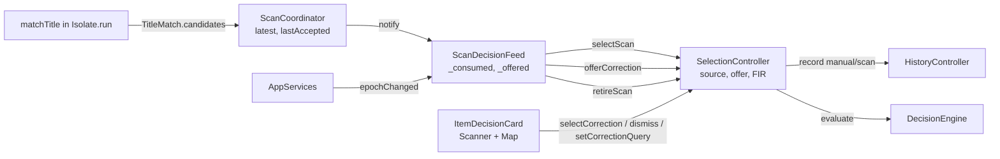
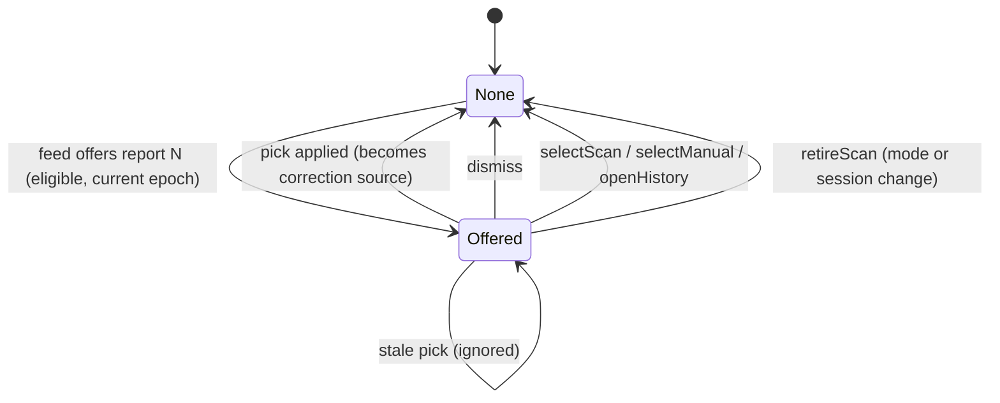
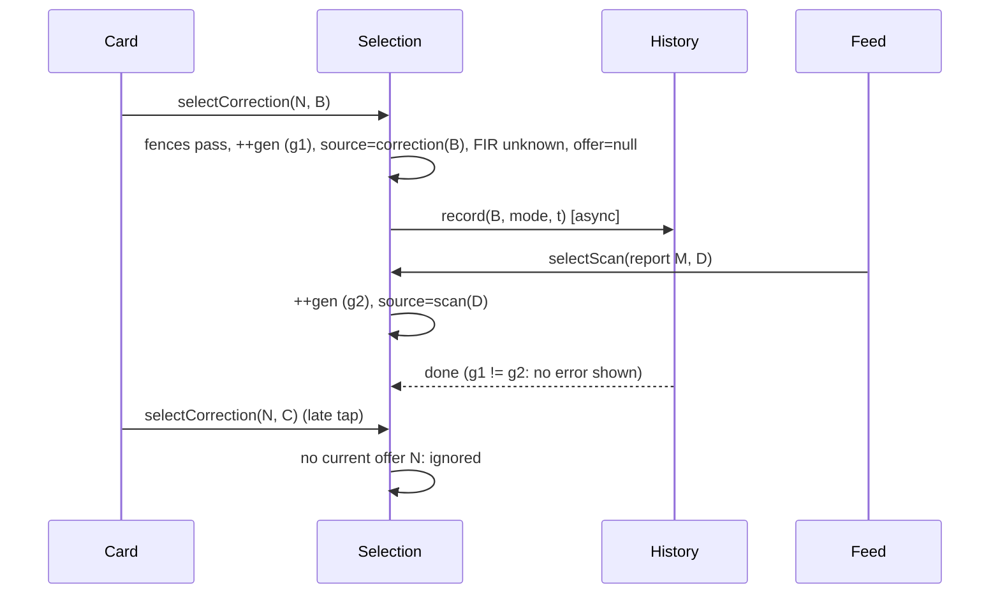

# Design

## Triage

| Trigger | Applies? | Evidence |
|---|---|---|
| T1 Components (new component, or 3+ with directed relationships) | Yes | `ScanCoordinator` → `ScanDecisionFeed` → `SelectionController` → `HistoryController`, plus the decision card on Scanner and Map. This change adds a second flow along that chain. |
| T2 State (persistent state, caches, 3+ state machine) | Yes | A new correction offer with four states (none, offered, replaced, cleared), and a new selection source next to manual, scan and history. |
| T3 Concurrency (background work, workers/isolates, async, retries) | Yes | The pick's history write is async and races newer scans, selections and epoch changes. Candidates are computed inside `Isolate.run` (`buildTitleMatchIndexOffUi`/`matchRecognitionOffUi`, ADR-0012). |
| T4 Boundaries (data format, migration, shared interface, IPC, external) | Yes | `TitleMatch` is a sendable cross-isolate result type, and it gains `candidates`. The shared `AcceptedScanSource` interface gains `latest`. No stored format changes. |
| T5 Volume (grows without a fixed bound) | No | 5 candidates per match, 8 search results, one offer at a time. History is still one row per item and mode. |
| T6 Risk (security, money, data loss, unrecoverable user data) | No | Corrections are transient. History rows use the existing `manual` source, with no migration. |

TIER: FULL

## Context

The proposal covers the why. What exists today:

- **Selection.** `SelectionController` owns the current item and its decision. Its sources are manual (`selectManual`, `lib/application/selection_controller.dart:85-103`), accepted scan (`selectScan`, `:110-153`, with an immutable `AcceptedScan` from `lib/application/accepted_scan.dart`) and history (`openHistory`, `:179-205`). Every source change bumps `_generation`, which fences the async history write (`:99-102`, `:144-152`). `retireScan` (`:160-172`) clears only a scan source on a mode or session change. `_project` (`:241-262`) is the only call into `DecisionEngine` (ADR-0001).
- **Feed.** `ScanDecisionFeed` (`lib/application/scan_decision_feed.dart:45-90`) listens to `AcceptedScanSource.lastAccepted` (`lib/application/scan_coordinator.dart:661-664`). It consumes each accepted report once by a high-water mark raised before the fences: epoch, catalog mode, item in snapshot (ADR-0017). `AppServices` builds it (`lib/application/app_services.dart:112-117`) and calls `epochChanged()` once per combined mode or session change (`:231-245`).
- **Coordinator publication.** `_publish` (`scan_coordinator.dart:2776-2785`) sets `latest`, sets `lastAccepted` when the report is accepted, and notifies once. A rejected report carries `OutcomeRejected.match`, a `TitleRejected` with its reason, best and runner-up (`scan_coordinator.dart:604-627`; `lib/domain/title_matching.dart:93-168`).
- **Matcher.** `matchTitle` scores every item into `scores`. One pass keeps best and runner-up, skipping names equal to the current best's (`title_matching.dart:625-639`). A score depends only on the normalised name (`scorer.better(_nameRunes[i], _nameCompact[i])`, `:607-609`), so equal names always tie and the strict `>` keeps the smaller ID. A distinct-name top-5 ranked by score, then ID, therefore always starts with the existing best and runner-up.
- **Search.** `CatalogSnapshot.search` (`lib/domain/catalog.dart:318-324`) is a single-substring match over `id\nname\nshortName\nnormalizedName`, lower-cased (`:276-283`). OCR text such as `ANA M1 OD GREEN` is not a substring of "ana tactical m1 plate carrier (od green)", so the main search cannot be reused unchanged for the pre-filled text.
- **UI.** `ItemDecisionCard` (`lib/ui/item_decision_card.dart:41-59`) titles the card by source. Map embeds it compact (`lib/ui/map_screen.dart:395`). The evidence panel's "Last scan not accepted" note (`lib/ui/scan_evidence_panel.dart:195-230`) is evidence only and stays as it is.
- **History.** `HistoryController.record` (`lib/application/history_controller.dart:44-63`) sets a manual or scan error message from the source.
- **Reference companion.** It publishes a correction context (OCR text, generation, source) for any unaccepted match, shows an editable text box with "Use text" (exact normalised name or short-name match) and "Dismiss", records the pick as `Manual` history, and raises no accepted-scan event for it. Only accepted scans reach its Map snapshot reducer.

## Decisions

### D1: The offer is selection state, fed by the existing feed

- **Choice:** `SelectionController` owns the current `ScanCorrectionOffer` and is its only writer: `offerCorrection`, `setCorrectionQuery`, `selectCorrection`, `dismissCorrection`, plus clearing in `selectManual`, `selectScan`, `openHistory` and `retireScan`. `closeHistory` keeps the offer: an offer can arrive while a history view is open (see Flow & State Gaps), and closing the view to return to live must not lose it. `reloadAfterImport`, which calls `closeHistory`, keeps it too. `ScanDecisionFeed` builds offers from `source.latest` with its own offer high-water mark (D6) and calls `offerCorrection`. The coordinator still imports neither selection nor history (ADR-0013, ADR-0017).
- **Rejected:** a separate `ScanCorrectionController` notifier, listened to by the card. Every selection path would have to clear it through a second controller. That gives two writers whose ordering must agree. A scan accepted between "selection changed" and "offer cleared" could leave an offer next to the wrong item, and every new selection path would need wiring in both places.
- **Reversal cost:** medium. Change 5 and M4.5's plain-language pass read the offer from selection.

### D2: A correction is its own selection source, never an `AcceptedScan`

- **Choice:** a picked correction sets a correction source. It holds an immutable `ScanCorrection` record: report id, item, mode, catalog revision, `correctedAt` from the selection clock, and epoch. `selection.scan` stays null and `selection.correction` is set. `selectedId` resolves by precedence: history row, then scan, then correction, then manual. `selectCorrection` clears `_manualId`, `_scanItemId` and `_scan`, so a correction retired by a session change never brings an older manual item back as current advice. `openHistory` keeps the manual fallback as today (`test/application/selection_controller_test.dart:36-58`: closing history restores the manual item), and it clears the correction source, as it clears a scan source. The card titles it "Corrected scan", with the subtitle "Corrected from scan #N · <age> ago · not an accepted scan". `retireScan` retires a correction like a scan: it clears the source, sets the retired flag and fences its write.
- **Rejected:** calling `selectScan` with a flag, or building an `AcceptedScan`. Change 5's Map snapshot and the "Accepted scan" card read accepted-scan state, so a correction would pass as a new accepted scan, which the spec forbids. Also rejected: routing through `selectManual`. The card could not label the correction, and it would survive a session change, while a correction belongs to the inspection that produced it.
- **Reversal cost:** medium. Change 5 relies on "only `AcceptedScanSource` accepted reports advance Map".

### D3: History records a correction as `manual`

- **Choice:** `history.record(itemId, liveMode, correctedAt)` uses the default `manual` source. On failure, selection replaces history's manual message with "Correction was not recorded: local persistence failed." No OCR text, candidates or correction record is stored. The user chose this on 2026-10-18 for reference-companion parity.
- **Rejected:** a new `ActivitySource.correction`. History could then tell corrections apart, but older builds fail to load the row, as with `scan`, and nothing reads the distinction yet.
- **Reversal cost:** low. Adding the source later is additive, by name with no migration. Rows recorded before then stay `manual`.

### D4: The matcher keeps a distinct-name top 5 in its result

- **Choice:** `TitleMatch` gains `candidates`: an unmodifiable `List<TitleCandidate(id, score)>` of up to 5 entries (`maxTitleCandidates = 5`). Each has a distinct normalised name, ranked by score descending, then ID, drawn from the same pool as best (after the quantity restriction). It is filled by an insertion pass over `scores` in the same `matchTitle` call, off the UI isolate. Results rejected before scoring carry `const []`. The constructor parameter defaults to `const []`, so existing call sites and test builders compile unchanged. A debug assertion checks that `candidates[0]` is the best and `candidates[1]` the runner-up. The timing log and `frames.jsonl` are unchanged.
- **Rejected:** re-scoring the OCR text against the catalog on the UI isolate when the offer is built. It would duplicate the quantity and duplicate-name rules, and it would cost a full Levenshtein pass over every catalog item on the UI isolate, which ADR-0012 moved off it. Also rejected: offering only best and runner-up, which the user ruled out because a third close variant could not be picked.
- **Reversal cost:** low. The field is additive on a sendable value type.

### D5: Which scans offer, and what the offer holds

- **Choice:** the feed offers a report whose end is `ScanRejected` with reason `ambiguous` or `belowSimilarity`, whose ranked outcome has both evidence with non-empty OCR text and a match, read by an application-layer helper in `scan_correction.dart` from `ScanRejected.outcome.evidence.text` and the same `outcome.match` (so the text and the candidates always come from one entry), offering nothing when either is absent, and whose `epoch` and `catalogMode` equal the current ones. The offer stores the report id, epoch, mode, catalog revision, OCR text, the match's candidates scoring at least `.40` (`correctionCandidateFloor`), and the query, initially the OCR text. The evidence panel keeps its own `shownEvidence` (`scan_evidence_panel.dart:400-407`) for display, and nothing in `lib/application` imports `lib/ui`. The card resolves names from the live snapshot and leaves out a candidate the snapshot lacks. Search results come from a new `CatalogSnapshot.searchWords`. Every word of the query, through `normaliseTitle`, must be a substring of the item's existing search text. Results are in ID order, at most 8 (`correctionSearchLimit`). Both caps live once, in `scan_correction.dart`.
- **Rejected:** offering on every unaccepted end, as the reference does for any unaccepted match. `noMarker`, `uiChrome` and `titleTooShort` come from clicks that were not an item inspection, such as a click on the stash or on the search box. An offer there is raid-time noise, and it would replace a useful offer under "newer offer replaces". Also rejected: reusing `search` for the pre-filled text. Its single-substring match finds nothing for OCR word order.
- **Reversal cost:** low. These are constants and a predicate, covered by service tests.

### D6: Offers are consumed once, and picks are fenced by offer identity and epoch

- **Choice:** the feed keeps `_offered`, the highest report id considered for an offer. It starts at `source.latest?.id ?? 0` and is raised before the eligibility checks, like `_consumed`. A re-notification or a dismissed offer is never offered again. `selectCorrection(reportId, itemId)` applies only when: the current offer's report id equals `reportId`; the offer's epoch equals the current epoch, which selection reads through an injected `ScanEpoch Function()`, the same reader the feed gets; `catalog.mode` equals the offer's mode; and the item is in `catalog.snapshot`. Otherwise it returns without any change. A newer offer replaces the current one, whatever the selection. A newer report with nothing to offer leaves it in place.
- **Rejected:** fencing a pick only by item presence. A pick queued behind a newer accepted scan, or one made after a mode change, would then replace newer intent with stale intent.
- **Reversal cost:** low.

### D7: The offer's query is app state

- **Choice:** the query lives on the offer in `SelectionController` (`setCorrectionQuery`), apart from the main `query`. Both screens stay mounted in the shell's `IndexedStack` (`lib/ui/shell.dart:161-171`), so two cards, each with its own `TextEditingController`, are live at once. On every selection notify each card sets its controller's text to `correctionOffer.query` when they differ, keeping the cursor and selection when the field has focus, and its `onChanged` calls `setCorrectionQuery`. So the two fields always equal the offer's query, and switching screens shows the same text.
- **Rejected:** a widget-local `TextEditingController` as the source of truth, or syncing it only when the offer's report id changes. Both cards are mounted at once (`shell.dart:161-171`), so text edited on Scanner would never reach Map's field, which breaks the spec's "Navigation keeps the offer" scenario.
- **Reversal cost:** low.

### D8: `AcceptedScanSource` exposes `latest`

- **Choice:** add `ScanReport? get latest` to the interface (`scan_coordinator.dart:661-664`). `ScanCoordinator` already implements it (`:1601-1602`). The interface name stays, to keep churn small, and its doc says it is the feed's scan-report source. `FakeAcceptedScanSource` gains a settable `latest`.
- **Rejected:** a second interface plus a second listener registration on the coordinator. Both would fire on the same notify, and the feed would have to merge them in order.
- **Reversal cost:** low.

## Diagrams (FULL)

Components (T1, T4):

Offer lifecycle (T2):

Pick racing a newer accepted scan (T3):

## State & Ownership (FULL)

| State | Owner (sole writer) | Lifetime | Invalidation / rebuild | Authoritative copy |
|---|---|---|---|---|
| Current correction offer (report id, epoch, mode, revision, OCR text, candidates, query) | `SelectionController` | Until replaced or cleared (D1, D6) | Cleared by `selectManual`, `selectScan`, `openHistory`, a pick, `dismissCorrection` and `retireScan`, and replaced by a newer offer. `closeHistory` keeps it | `SelectionController.correctionOffer` |
| Correction source (`ScanCorrection` record) | `SelectionController` | Until the next selection or retirement | Cleared by `selectManual`, `selectScan`, `openHistory`, `closeHistory`, `retireScan` | `SelectionController.correction` |
| Offer high-water report id `_offered` | `ScanDecisionFeed` | Feed lifetime (`AppServices`) | Only raised; seeded from `source.latest` | The feed |
| Accepted high-water `_consumed` | `ScanDecisionFeed` (unchanged) | Feed lifetime | A correction never touches it | The feed |
| `TitleMatch.candidates` | `matchTitle` (pure) | Lifetime of the report holding the match | Immutable | The report |
| Transient FIR | `SelectionController` (unchanged) | Per source | Reset on a pick (D2), as on every source change | `SelectionController.fir` |
| Manual activity row from a correction | `BlackgridDatabase` via `HistoryController` | Durable, one row per (item, mode) | Revised by later records | SQLite `ActivityRecords` |

## Failure & Visibility (FULL)

| Component | Fails / dies mid-operation → | Recovery | Retry safe? | Who finds out |
|---|---|---|---|---|
| History write on a pick | The card keeps the correction and the decision | None automatic. A later record of the item revises the row | Yes: re-picking records again, one row per item and mode | User: card error "Correction was not recorded: local persistence failed." (D3) |
| Feed offer path | Pure synchronous code, so a throw would surface in the listener | Not expected. The checks are total over sealed `ScanEnd` | n/a | Debug log. A fenced offer is logged like a fenced scan (`scan_decision_feed.dart:50-80`) |
| Matcher top-5 pass | Runs inside the same `Isolate.run` as matching, and a throw there already maps to `matcherFailed` (ADR-0012) | Existing path | n/a | User: evidence panel shows `matcherFailed`, and no offer is made (D5) |
| Stale pick | Ignored by design (D6) | n/a | Yes | Nobody needs to: the newer selection is already shown. Debug log line |
| Catalog refresh removes a candidate | The card leaves it out, and a pick of it is ignored | n/a | n/a | User: the candidate disappears from the list |

## Resource Bounds (FULL)

| Queue / buffer / cache / transfer | Bound | At the bound | Timeout | At 10x / 100x |
|---|---|---|---|---|
| `TitleMatch.candidates` | 5 per match (`maxTitleCandidates`) | Lower-ranked candidates dropped | n/a | A scan has at most 16 ranked entries (8 targeted + 8 fallback peaks, ADR-0016). The 10-report recent list holds at most 16×5 small records per report. A 10x catalog only lengthens the existing O(n) pass |
| Offer candidates shown | 5, after the `.40` floor | Same list, filtered | n/a | Fixed |
| Offer search results | 8 (`correctionSearchLimit`) | Truncated in ID order | n/a | One linear pass over `searchIndex` per keystroke: about 5k items today, 50k at 10x, still well under a frame. Not debounced (ledger) |
| Current offer | 1 | Replaced by a newer one | n/a | Fixed |
| History writes in flight | One per selection change, fenced by `_generation` (existing) | An older result is ignored | Existing | Unchanged |

## Flow & State Gaps (FULL)

- **One notify that publishes an accepted report:** the feed handles `lastAccepted` first, so `selectScan` clears any offer. `latest` is then that same accepted report and is not eligible. `_offered` is still raised to its id.
- **One notify that publishes a rejected report while `lastAccepted` is an older, consumed report:** the `lastAccepted` check returns early, because its id is at most `_consumed`. The `latest` check then offers the rejected report.
- **Feed built after scans already ran:** both high-water marks are seeded from the source, so no old report is offered or applied.
- **Mode change is asynchronous** (`catalog.setMode` future, `app_services.dart:236-238`): `epochChanged` retires synchronously and clears the offer first. A report published while the catalog is still switching carries the old epoch and is fenced. A pick in that window fails the epoch check.
- **Pick while a history row is loading:** the pick bumps `_generation`, so the load's completion is ignored (`selection_controller.dart:192-200`) and the history view closes, as with `selectScan`.
- **Dismiss while the pick's history write is in flight:** there is no offer to dismiss once the pick has applied. Dismiss is a no-op and does not touch the generation.
- **Offer made while history view is open:** the history view stays. The offer shows in the card above the history inspection. A pick closes the view (spec).
- **Catalog refresh after an offer:** the offer keeps the candidate ids. Names and presence resolve against the live snapshot at render and at pick time. A changed revision does not void the offer, because the epoch and mode are unchanged.
- **Restart:** offers and corrections are memory-only and are gone after a restart. A correction's manual history row survives.
- **Disposal:** the feed removes its listener. Selection's `_disposed` check already guards the pick's history completion.

## Mechanism Ledger (FULL)

| Mechanism | Built? | Why (harm nobody catches / expensive later) | Evidence that would change the call |
|---|---|---|---|
| Offer high-water `_offered` | Yes | Without it, every coordinator notify (phase changes) would re-offer a dismissed scan. Spec scenario "Re-notification" | n/a |
| Offer-identity check on pick | Yes | A late tap would replace a newer accepted scan with a stale correction, unnoticed | n/a |
| Epoch and mode fence on pick | Yes | A pick after a raid or mode change would record the item in the wrong mode | n/a |
| Candidate floor `.40` | Yes | Without it, `belowSimilarity` offers junk names in raid | Corpus or live recordings where the right item scores below .40 but in the top 5 |
| Distinct correction source | Yes | Without it, change 5 would treat a correction as an accepted scan (D2) | n/a |
| Persisting corrections or learning from them | No | The strategy defers correction learning, and the reference has none | A user request to remember corrections |
| Search debounce | No | 8 results over one linear pass per keystroke cost nothing visible | Profiling showing jank on a 10x catalog |
| Re-matching candidates on catalog refresh | No | Names re-resolve live, and an id that left the catalog drops out | A refresh that renames items so that the old ids mislead |
| New `ActivitySource.correction` | No | The user chose `manual` (D3) | A history view that needs to tell corrections apart |
| Offer on Map with a separate widget | No | The shared card covers both screens | M4.5 plain-language or layout pass asking for it |

## Risks / Trade-offs

- [The offer crowds the compact Map card in raid] → It renders as a bounded block: up to 5 candidate buttons, one text field and up to 8 results, scrolled inside the card. M4.5 `plain-language-pass` and `polish-map-rail` own further layout. Small-window and large-text combinations are out of scope.
- [The `.40` floor is a guess] → It is one constant, covered by a service test. Change 6 (`qualify-scanner-latency`) reviews corpus coverage and can tune it.
- [`manual` history hides that a correction happened] → Accepted for parity (D3). The card shows it while the correction is current.
- [Offers from `ambiguous` false positives the user ignores pile up] → Only one offer exists at a time. It is replaced or cleared, never queued.
- [An existing test builder constructs `TitleMatch` without candidates] → The parameter defaults to `const []`. The candidates assertion only checks non-empty lists.

## ADRs

- **In force, constraining this change:** ADR-0001 (one decision engine, `SelectionController` its only caller), ADR-0002 (notifiers, composition root, generation fences), ADR-0003 (history one row per item and mode), ADR-0012 (matcher result shape, matching off the UI isolate), ADR-0013 (coordinator never references selection or history), ADR-0017 (feed, high-water consumption, epoch fence, activity source by name).
- **To record during apply:** ADR-0018 "Scan correction is transient selection state". It records:
  - the offer owned by `SelectionController` and fed by `ScanDecisionFeed` through `AcceptedScanSource.latest`;
  - the distinct correction source, never an `AcceptedScan`, which only accepted reports may advance (binding on change 5's Map snapshot);
  - corrections recorded as `manual`;
  - `TitleMatch.candidates` (top 5, distinct names, best then runner-up first).

  It supersedes nothing. The same task updates `openspec/architecture.md`: the `ScanDecisionFeed` and Selection rows, the In-force ADRs index, and the "Not built yet" line, which drops scan correction.
