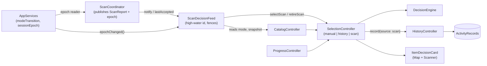
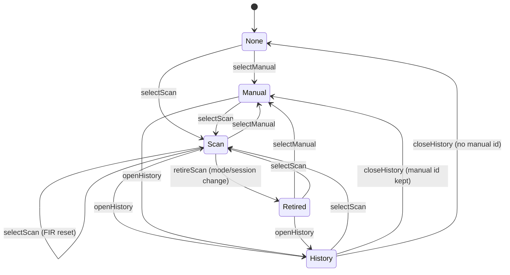
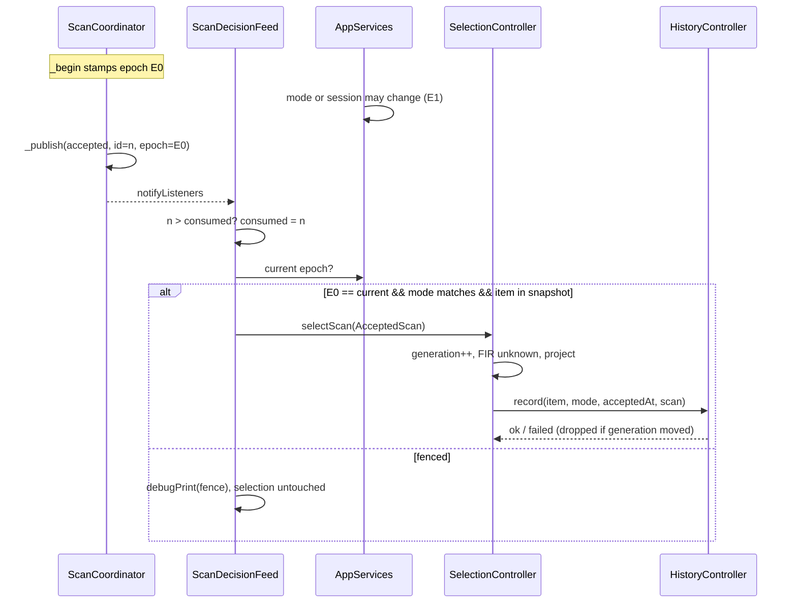

# Design

## Triage

| Trigger | Applies? | Evidence |
|---|---|---|
| T1 Components (new component, or 3+ with directed relationships) | Yes | A new `ScanDecisionFeed` sits between `ScanCoordinator`, `SelectionController`, `HistoryController` and `AppServices`' mode and session state (`app_services.dart:207-217`), which is four components with directed edges. |
| T2 State (persistent state, caches, 3+ state machine) | Yes | Persistent: `ActivitySource` gains `scan`, written to the `ActivityRecords.source` text column (`database.dart:33`). In memory: the selection now has three sources (manual, history, scan), and the accepted-scan record is new state. |
| T3 Concurrency (background work, workers/isolates, async, retries) | Yes | Accepted reports arrive asynchronously from the scan flow. History writes are async Drift calls (`history_controller.dart:25-33`). Mode transitions (`app_services.dart:213-216`) and session-epoch bumps (`map_session_controller.dart:187,253`) can land between a trigger and its publication. |
| T4 Boundaries (data format, migration, shared interface, IPC, external) | Yes | A stored enum value (`ActivitySource.scan`) that older builds cannot read (`database.dart:210` uses `byName`). `ScanReport` gains a field, and `HistoryController.record` changes signature. |
| T5 Volume (grows without a fixed bound) | Yes | History rows: one per (item, mode) with no row cap (`database.dart:198-216`). The bound is the catalog size, which scans do not change. |
| T6 Risk (security, money, data loss, unrecoverable user data) | Yes | A wrong Sell from a stale or misattributed scan loses a needed item (architecture T6). History is unrecoverable user data. |

TIER: FULL

## Context

The proposal gives the scope. What the approach depends on, as the code stands:

- **Selection is the one decision projection.** `SelectionController` is the only caller of `DecisionEngine` (`selection_controller.dart:36,155-177`, ADR-0001). Its sources are a manual id (`_manualId`) and a history row (`_historyRow`). Each entry point bumps `_generation` so that a late `history.record` or `loadCatalog` result is dropped (`:68-82,84-110`). `_onAuthority` re-projects on catalog and progress changes and resets FIR when the authority fingerprint changes (`:126-145`). That fingerprint contains `catalog.mode`, so a mode change already resets FIR. A 30 s timer re-ages catalog and progress (`:26-30`). Session epochs are not part of the fingerprint.
- **The coordinator publishes but never selects.** `_publish` sets `_latest`, sets `_lastAccepted` for an accepted end, and notifies synchronously (`scan_coordinator.dart:2735-2745,1713-1715`). Report ids come from `_nextReportId++` in `_begin` (`:2026-2031`), which is monotonic for the coordinator's life and never reset. A superseded scan is never published (`:2404-2409`). ADR-0013 forbids the coordinator any reference to selection or history, and `scan_coordinator_flow_test.dart` asserts that.
- **Mode and session belong to `AppServices`.** `_syncMapSession` bumps `_modeTransition` and calls `catalog.setMode` / `progress.setMode` synchronously when `mapSession.effectiveMode` changes (`app_services.dart:207-217`). `catalog.setMode` clears the snapshot at once (`catalog_controller.dart:39-49`). The game session epoch is `mapSession.state.sessionEpoch` (`map_session_controller.dart:92`), bumped on a log directory, session or incarnation change (`:187,253`).
- **History is one row per (item, mode).** `recordActivity` always writes `ActivitySource.manual` (`database.dart:218-240`). Rows are read with `ActivitySource.values.byName` (`:210`). `ActivitySource` is `{manual, importedScan, importedManual}` (`settings.dart:180`).
- **The card says it is not a scan.** `ItemDecisionCard` titles itself "Current manual inspection" and "not an accepted scan" (`item_decision_card.dart:32-38`). Map and Scanner both render it (ADR-0001).
- **`SessionScanState` is a constant stub** (`session_scan_state.dart:1-7`) that `AppServices.scans` exposes. Its producer is change 5. This change leaves it alone.

## Decisions

### D1: A separate app-layer feed carries accepted scans into selection

- **Choice:** a new `ScanDecisionFeed` (`lib/application/scan_decision_feed.dart`), built and disposed by `AppServices`. It listens to an `AcceptedScanSource` (a `Listenable` with `ScanReport? lastAccepted`, which `ScanCoordinator` already satisfies). When `lastAccepted.id` is above its high-water mark, it raises the mark first, then applies the D3 fences, then calls `SelectionController.selectScan`. The coordinator still never imports selection or history, so ADR-0013's ownership split and its two source audits stand.
- **Rejected:** giving `ScanCoordinator` a `SelectionController` and calling it from `_publish`. It merges the evidence pipeline with decision state, puts a Drift write behind the latency-critical publish, and breaks the audit that keeps the coordinator the only file allowed to reference the capture and vision services, with no extra dependencies.
- **Rejected:** having `SelectionController` listen to the scanner itself. Selection would then need the mode-transition and session state that `AppServices` owns, and its tests would need a coordinator.
- **Reversal cost:** low. It is one class, wired in one place.

### D2: Exactly-once by report id, not by notification

- **Choice:** the feed keeps `_consumed`, the highest accepted report id it has seen, starting at the current `lastAccepted?.id ?? 0` when it is built. A notification acts only when `lastAccepted.id > _consumed`. The mark rises before the fences, so a scan that is fenced out is never retried. Everything that notifies without a new accepted publish leaves the mark alone: phase changes, status changes, rejected and failed publishes, recording status, and the coordinator's own re-notifications.
- **Rejected:** a per-notification diff of `latest`. `latest` changes on rejected and failed scans too, and a fenced scan would be seen again on the next notification.
- **Rejected:** an event stream from the coordinator. It adds a second publication channel, with its own ordering, beside `notifyListeners`, for the same fact.
- **Reversal cost:** low.

### D3: Fence with an epoch stamped when the scan begins

- **Choice:** a value type `ScanEpoch(int modeTransition, int session)` (`lib/application/scan_epoch.dart`). `ScanCoordinator` takes an optional `ScanEpoch Function()? epoch` reader. `AppServices` passes `() => ScanEpoch(_modeTransition, mapSession.state.sessionEpoch)`, and the reader defaults to a constant. `_begin` stores the reading on `_Scan`; a trigger queued behind a capture (`_pending`) is read when it is queued and carries that reading into its `_begin`, so a change during the wait fences it. `_report` copies it to a new `ScanReport.epoch` field (nullable, kept by `withoutCrops`). At consumption the feed requires all of:
  1. `report.epoch == current epoch`;
  2. `report.catalogMode == catalog.mode`;
  3. `catalog.snapshot?.items[report.itemId] != null`.

  A failed check drops the scan from the decision path. Its evidence stays published. A `debugPrint` names the failed fence, and the timing log line is unchanged.
- **Rejected:** fencing on `report.catalogMode` alone. It misses a session change (a new raid or game restart in the same mode), and the strategy says a session change must reset scan authority (§6 "latest-wins coordination").
- **Rejected:** taking the epoch at publication. That is the moment that must be checked against, so it proves nothing.
- **Reversal cost:** low. The field is in memory only and not in the timing log, so log schema v1 is unchanged.

### D4: Scan is a third selection source with its own generation

- **Choice:** `SelectionController.selectScan(...)` takes the report fields: report id, item id, mode, catalog revision and epoch. It stamps the acceptance time itself from `SelectionController.clock` when the scan is consumed, never from `report.utc`, which comes from the coordinator's own real clock. That one clock gives `AcceptedScan.acceptedAt`, the history `observedAt` and the card's age. After its first projection it builds `AcceptedScan`, an immutable record of those fields plus `decisionAtAcceptance`, so the record is complete when it is constructed. `retireScan()` bumps `_generation`, so a pending scan-write error cannot replace the retired message. It resets FIR for every source. When the source is a scan, it clears it and sets `scanRetired`, which the next select or open clears.

  `selectScan` does what `selectManual` does (`:68-82`): bump `_generation`, set `_scan`, clear `_manualId`, `_historyRow` and `_historyCatalog`, set `loadingHistory = false`, set `_fir = unknown`, clear `error`, refresh `_authority`, project, notify. `selectManual` gets the same `loadingHistory = false` line. Then it awaits `history.record(id, mode, scan.acceptedAt, source: ActivitySource.scan)` behind the generation check.

  `selectManual`, `openHistory` and `closeHistory` clear `_scan`. `selectedId` and `item` resolve `_historyRow ?? _scan ?? _manualId`.
- **Rejected:** routing a scan through `selectManual(item)`. History would record it as `manual`, the card could not label it or show its age, and change 3 (correction) needs to tell a scan selection from a manual one.
- **Rejected:** a separate scan-decision controller beside `SelectionController`. That would give the decision two projections for Map and Scanner, which ADR-0001 rules out.
- **Reversal cost:** medium. Change 3 (correction) and change 5 (Map snapshot) code against `AcceptedScan` and `selection.scan`.

### D5: Advice ages through the live projection, with the scan frozen beside it

- **Choice:** the card shows the live engine projection for the scanned item, exactly as for a manual selection. Stale catalog, progress or Flea facts already downgrade to Check through the engine (`decision_engine.dart:100-114`) and the 30 s tick. `AcceptedScan` keeps the decision at acceptance and the acceptance time unchanged. The card shows "Scanned <age> ago", recomputed on each projection. A refresh therefore never changes the acceptance time and never records anything (D2).

  On a mode transition or a session-epoch change, `AppServices` calls `feed.epochChanged()` once, at the end of `_syncMapSession` (`app_services.dart:192-218`). It tracks the session with a new `_appliedSessionEpoch` field beside `_appliedMode`. The call comes after the mode block, so a combined mode and session change retires once, after the mode is applied. The feed then calls `selection.retireScan()` (D4). If the current source is a scan, that clears it: the card shows its empty state with "Last scan was in an earlier mode or session; scan again". It also resets FIR for every source.
- **Rejected:** showing the frozen decision at acceptance as the card's current advice. The decision at acceptance is computed with FIR unknown, because FIR resets on every scan, so it is always Keep, Keep for later or Check (`decision_engine.dart:106-114`). Freezing it would hide the sale advice the user unlocks by setting FIR. Freezing a later decision instead would keep a Flea as a confident Sell after its quote expired, which §6 "advice aging" forbids.
- **Rejected:** keeping the scanned item current across a mode change by re-projecting it in the new mode. A PvP scan would turn into PvE advice for an item the player never scanned in PvE.
- **Reversal cost:** low.

### D6: History source `scan`, with no Drift migration

- **Choice:** `ActivitySource` gains `scan`, stored as its name in the existing text column, so there is no schema change and `schemaVersion` stays 2. `recordActivity` and `HistoryController.record` take a `source` parameter, defaulting to `manual`. A scan write failure sets the error "Accepted scan was not recorded: local persistence failed." and keeps the decision shown (the manual pattern, `history_controller.dart:29-31`). The history panel labels scan rows.

  Downgrade: an older build reading a `scan` row throws in `byName`. `HistoryController.load` then keeps its error state (`:13-21`): the history panel shows an error, and nothing is lost or rewritten.
- **Rejected:** writing scans as `manual`. History would then lie about where an entry came from, and ADR-0003 keeps sources distinct (`importedScan` exists for the same reason).
- **Rejected:** a separate scan-history table. It needs a migration and splits one-row-per-(item, mode) activity in two.
- **Reversal cost:** medium. The stored value is user data. The settling evidence is that downgrades are rare (local builds only until M6), and the failure is a visible load error, not loss.

### D7: Supersede only ADR-0013's last decision

- **Choice:** a new ADR 0017, "Accepted scans feed the shared decision engine through an app-layer feed", with `Supersedes: 0013 (the decision "No decisions from scans before M4")`. It records D1-D3 and D6. ADR-0013 is not edited, and the architecture index marks 0013 as partly superseded.
- **Rejected:** no ADR. M4 changes 3 and 5 and M6 code against the feed, the epoch fence and the stored source.
- **Reversal cost:** low.

## Diagrams (FULL)

Components (T1):

Selection source state machine (T2):

Consumption sequence (T3):

Data (T4): `ActivityRecords.source` gains the value `scan`. `ScanReport.epoch` is in memory only.

## State & Ownership (FULL)

| State | Owner (sole writer) | Lifetime | Invalidation / rebuild | Authoritative copy |
|---|---|---|---|---|
| Consumed high-water report id | `ScanDecisionFeed` | App session | Never lowered | The feed |
| `ScanReport.epoch` | `ScanCoordinator` (at `_begin`) | The report's life | Immutable | The report |
| Mode-transition counter | `AppServices._syncMapSession` | App session | Bumped per effective mode change | `AppServices` |
| Session epoch | `MapSessionController` | App session | Bumped per log directory, session or incarnation change | `MapSessionController` |
| Current selection source and `AcceptedScan` | `SelectionController` | Memory | Replaced by any select or open, cleared by `retireScan` | `SelectionController` |
| `scanRetired` flag | `SelectionController` | Memory | Set by `retireScan` when the source was a scan; cleared by the next select or open | `SelectionController` |
| Last applied session epoch | `AppServices._syncMapSession` | App session | Updated when `mapSession.state.sessionEpoch` changes | `AppServices` |
| Transient FIR | `SelectionController` | Memory | Reset on each select or open, authority change and `retireScan` | `SelectionController` |
| Activity rows, source `scan` | `HistoryController` through `BlackgridDatabase.recordActivity` | Durable | Upsert per (item, mode), revision +1 | SQLite `ActivityRecords` |

Every row has one writer. `AppServices` reads the session epoch but never writes it.

## Failure & Visibility (FULL)

| Component | Fails / dies mid-operation → | Recovery | Retry safe? | Who finds out |
|---|---|---|---|---|
| Feed fence rejects a scan | Selection unchanged, evidence still shown | The next accepted scan | Not retried (D2) | User sees evidence with no decision change; developer sees a `debugPrint` |
| History write for a scan | Decision shown; row missing | The next scan of that item writes a fresh row | Yes (upsert) | User: card error "Accepted scan was not recorded…" |
| Write lands after a newer selection | Result dropped by the generation check; the row is still written | — | — | Nobody needs to. The row is correct; only the stale error or notification is suppressed |
| Feed throws inside a listener | `ChangeNotifier.notifyListeners` catches it, reports it through `FlutterError.reportError` and calls the other listeners | None needed; the next accepted scan is handled normally | — | Developer log; a test failure in tests |
| App disposed during a history write | `_disposed` guard in selection drops the result | — | — | Nobody; the row either committed or did not |
| Older build reads a `scan` row | `byName` throws; history load fails | Run a current build | — | User: history panel error (prior rows retained) |

## Resource Bounds (FULL)

| Queue / buffer / cache / transfer | Bound | At the bound | Timeout | At 10x / 100x |
|---|---|---|---|---|
| Accepted scans awaiting consumption | 0 queued; consumed synchronously per notification | — | — | Bursts are already latest-wins in the coordinator (ADR-0013); the feed sees at most one accepted publish per notification |
| History writes in flight | At most one per accepted scan, each fenced by generation | Earlier ones finish and are ignored | Drift has none; same as manual | 100 scans per minute would be 100 small upserts; Drift serialises them. Bounded by the scan rate, which the coordinator caps at about one in flight |
| History rows | One per (item, mode) | Upsert, revision +1 | — | Bounded by catalog size × 3 modes (a few thousand rows) |
| `AcceptedScan` records | One (the current one) | Replaced | — | Constant |

## Flow & State Gaps (FULL)

- **Trigger in mode A, publication after a switch to mode B.** The epoch differs, so the scan is fenced (D3). The B catalog may still be loading. The scan never selects in either mode.
- **Mode A → B → A while one scan runs.** `modeTransition` has moved, so the scan is fenced. The scan matched an index from before the switch, which is conservative and correct.
- **Session change after a scan is current.** `retireScan` clears the scan and resets FIR (D5). A manual selection stays and only its FIR resets.
- **Catalog revision changes between match and publication, same mode.** The item is looked up in the current snapshot. If it is present it selects and the decision uses current facts; if absent it is fenced. `AcceptedScan.catalogRevision` records the matched revision for change 5.
- **Accepted scan while a history row is loading.** `selectScan` bumps the generation, and the pending `loadCatalog` result is dropped (`selection_controller.dart:96,103`).
- **Accepted scan while a history row is loading, then retired.** `selectScan` clears `loadingHistory` (D4), so after `retireScan` the card shows the retired-scan message, not "Opening stored-mode catalog…" (`item_decision_card.dart:57`).
- **Manual selection while a scan's history write is pending.** The write completes and the row is kept. Its result does not touch the new selection.
- **The coordinator is switched off and on.** Report ids keep rising and the high-water mark holds, so an old `lastAccepted` is never consumed again.
- **Acceptance time under a fixed clock.** The acceptance time comes from the selection clock (D4), so AppServices-level tests on `M1Harness`'s fixed clock see a deterministic acceptance time, `observedAt` and age, whatever day they run.
- **App restart.** Nothing restores `AcceptedScan`. The card starts empty, as now; history shows the rows.
- **Import reload** (`app_services.dart:226-229`) calls `closeHistory`, which clears the scan source too. This is acceptable because the import replaces the context.

## Mechanism Ledger (FULL)

| Mechanism | Built? | Why (harm nobody catches / expensive later) | Evidence that would change the call |
|---|---|---|---|
| High-water report id | Yes | Without it a re-notify records history twice and resets FIR the user set, silently | — |
| Epoch stamped at `_begin` | Yes | Without it, mode or session changes mid-scan give advice from the wrong context, a wrong-Sell risk (T6) | — |
| Item-in-current-snapshot check | Yes | Without it, the card shows "Find an item" with a scan source, and history records an id the catalog lacks | — |
| `ActivitySource.scan` | Yes | Stored data; relabelling it later needs a rewrite | — |
| Frozen `decisionAtAcceptance` | Yes | Change 5's Map card needs the decision at acceptance; adding it later means touching the selection API twice. It is computed with FIR unknown, so it is Keep, Keep for later or Check | Change 5 needs the sale decision the user saw; that would need a different snapshot, for example the decision at the time FIR was set |
| Listener `try`/`catch` in the feed | No | `ChangeNotifier` already isolates and reports listener errors; a catch would hide bugs that `reportError` turns into test failures, and `selectScan`'s async errors would not reach it anyway | A listener error is seen to stop Scanner updates |
| `HistoryController` disposal guard | Yes | A scan accepted just before shutdown can finish `record` → `load` → `notifyListeners` after `dispose`, which asserts | — |
| Separate scan-history retention or cap | No | Rows are bounded by catalog × mode | A per-scan event log is requested |
| Retry of fenced scans once the new mode loads | No | The player can scan again; a retry would give advice from a context the trigger did not see | Users report missed decisions right after mode detection |
| Persisting `AcceptedScan` across restart | No | §8 lists "current result" as in-memory | User asks for it |
| Timing-log field for the fence outcome | No | Would need log schema v2 (ADR-0013); `debugPrint` is enough for this change | Qualification (change 6) needs fence counts |

## Risks / Trade-offs

- [A scan replaces a manual or history view the user was reading] → It is the latest intent, as in the reference. The card title says it is a scan, and history keeps the earlier item one click away.
- [Fenced scans look like "scan did nothing" to the user] → Evidence is still shown. Fences fire only across a mode or session change, which is rare during a scan.
- [A downgrade build cannot load history with `scan` rows] → The load fails visibly with no data loss, and builds are local-only until M6.
- [The live projection can upgrade a scanned Check to Sell after a refresh] → That is current advice on current facts, the same as for a manual selection. The acceptance time stays honest, and nothing counts as a new scan.

## ADRs

- **In force, constraining this change:** 0001 (one engine, one caller), 0002 (notifiers, composition root, generation fences), 0003 (one store, history one row per item and mode), 0013 (coordinator ownership, latest-wins, log schema v1; its last decision is superseded here).
- **To record during apply:** 0017, which supersedes ADR-0013's "No decisions from scans before M4" with D1-D3 and D6. The architecture file's index, its "Not built yet" line and its state-ownership rows for selection and history are updated in the same task.

## Open Questions

- The exact card wording ("Accepted scan" title, "Scanned 2 min ago" subtitle, the retired-scan message) can be tuned in apply without changing behaviour.
