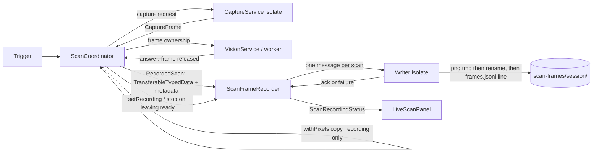
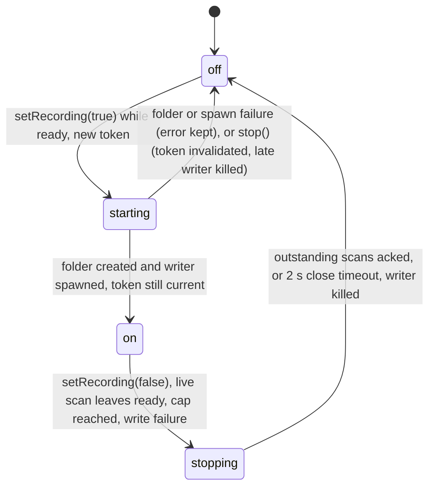
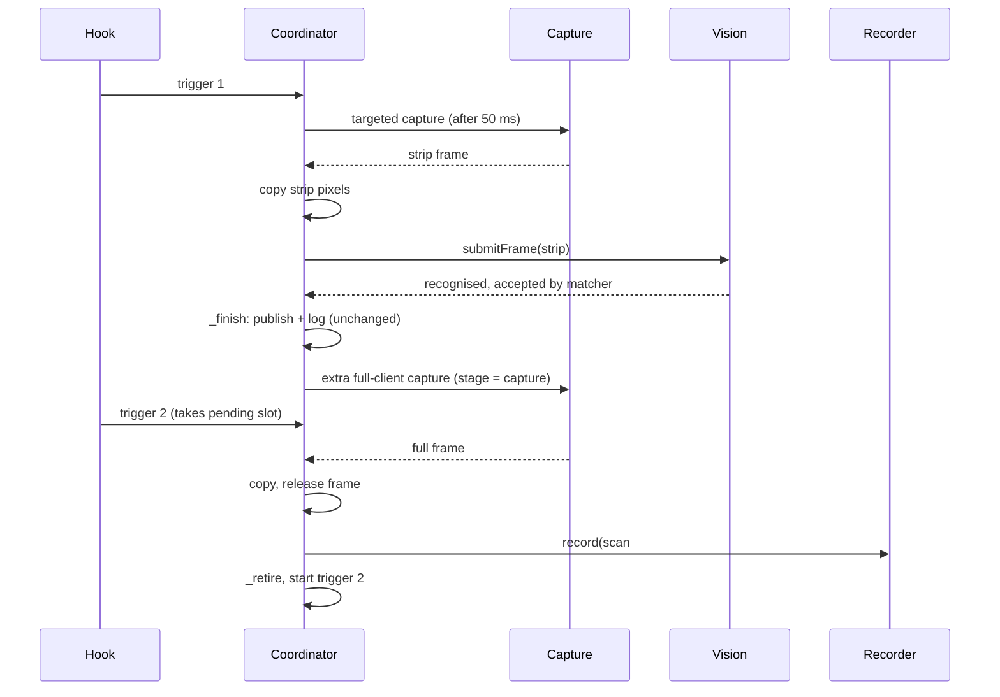

# Design

## Triage

| Trigger | Applies? | Evidence |
|---|---|---|
| T1 Components (new component, or 3+ with directed relationships) | yes | New recorder plus its writer isolate. Data flows coordinator → recorder → writer isolate → files, and recorder → Scanner panel. |
| T2 State (persistent state, caches, 3+ state machine) | yes | New files on disk (PNG, `frames.jsonl`). Recording state machine `off → starting → on → stopping → off`, plus a stop reason and a session token. |
| T3 Concurrency (background work, workers/isolates, async, retries) | yes | A writer isolate, a queue, a post-publish capture racing new triggers, and a flush at close. |
| T4 Boundaries (data format, migration, shared interface, IPC, external) | yes | `frames.jsonl` is a file format that corpus tooling reads. Pixels cross an isolate as `TransferableTypedData`. New runtime dependency `image`. |
| T5 Volume (grows without a fixed bound) | yes | Files grow with every recorded scan. Bounded by the session cap (D6). |
| T6 Risk (security, money, data loss, unrecoverable user data) | yes | Screen content is written to disk (privacy). |

TIER: FULL

## Context

See `proposal.md`. Current code the design builds on:
- **Frames are reachable only briefly.** The coordinator holds a `CaptureFrame` from the capture answer until `submitFrame` (`lib/application/scan_coordinator.dart:2190-2215`). Pixels are reachable only through the synchronous `CaptureFrame.withPixels` (`lib/data/capture/capture_frame.dart:140-161`), in BGRX, top-down, with `stride ≥ width*4`.
- **Who owns a frame.** The vision worker releases it after its job (`lib/data/vision/vision_worker.dart:241-244`), and the native slot budget is 4 frames (`lib/data/capture/capture_native.dart:28`).
- **A targeted frame is only the strip** (`(m+r) x m`, 650x50 at 1080p; `lib/data/capture/capture_geometry.dart:45-65`). A full-client frame exists only on the fallback pass (`:68-72`, `scan_coordinator.dart:2163-2169`).
- **Frames carry no cursor.** It is recovered from the trigger and the frame metadata: client point = `trigger.x - (desktopLeft - captured.left)`, and the same for y (`capture_frame.dart:15-70`, `capture_snapshot.dart:102-121`).
- **Scan flow and ending.** The flow is `_flow` (`scan_coordinator.dart:2018-2100`). A scan ends in `_finish` → `_publish`, and the log line is written at `:2457`. The in-flight slot is freed in `_retire` from `_run`'s `finally` (`:1990-2011`).
- **Supersession during capture.** A trigger during `_Stage.capture` takes the pending slot (ADR-0013, ADR-0014).
- **Audits.** Only `scan_coordinator.dart` under `lib/application`, `lib/ui` and `lib/main.dart` may import `data/capture/` or reference the vision service (`test/data/capture/capture_source_audit_test.dart:92-105`, `test/data/vision/vision_worker_audit_test.dart:22-28`).
- **Pattern to copy for a bounded background writer:** `ScanTimingLog` (`lib/data/scan_timing_log.dart`), with:
  - an injectable sink;
  - a dropping queue;
  - a `ValueListenable` status;
  - a bounded `close()` called from `AppServices.dispose` (`lib/application/app_services.dart:220-230`).
- **Local paths.** `%LOCALAPPDATA%\Blackgrid` comes from `LocalPaths` (`lib/data/local_paths.dart:16-32`).
- **The Scanner switch.** It lives in `LiveScanPanel` (`lib/ui/live_scan_panel.dart`), over the coordinator as a `Listenable`.
- **PNG encoding.** `package:image` 4.8.0 is a dev dependency (`pubspec.yaml:27`). `test/qualification/support/inspection_corpus.dart:241-266` decodes and encodes PNGs with it.
- **Privacy rules.** Screenshots/OCR are not persisted by default (`docs/IMPLEMENTATION_STRATEGY.md:236`), and the timing log holds no pixels (ADR-0013).

## Decisions

### D1: The coordinator copies pixels on the UI isolate, just before `submitFrame`, only while recording

- **Choice:**
  - In `_runPass`, after the `_dead` check and before `submitFrame`, the coordinator calls `frame.withPixels` when the recorder is on. It copies the lent bytes into a `TransferableTypedData` with one copy, and keeps that copy plus the metadata the recorder needs on the `_Scan`.
  - With recording off, the branch is skipped and nothing is copied.
  - Frame ownership, release and the vision hand-off are unchanged.
- **Rejected:** copying inside the vision job (`VisionJobInput.withImage`) and returning the copy with the answer. The worker is serial, so copying and sending about 8-33 MB delays the reply and the next request inside the 1.5 s deadline. It would also put recording into the vision request contract (`vision-worker` spec), which other scans share.
- **Also rejected:** zero-copy, keeping the frame slot until the writer has encoded it. That holds 1 of 4 native slots for seconds per frame, so captures would fail `frameBudgetExceeded`.
- **Reversal cost:** low. The copy is one branch in `_runPass`.

### D2: The recorder lives in `lib/data/` behind a plain-data port; it never sees capture types

- **Choice:**
  - New `lib/data/scan_frame_recorder.dart` with `ScanFrameRecorder`. It owns the session folder, the writer isolate, the queue, the counters and a `ValueListenable<ScanRecordingStatus>`.
  - Its input is plain data defined in that file:
    - `RecordedFrame`: `width`, `height`, `stride`, `TransferableTypedData pixels`, `clipped`;
    - `RecordedScan`: id, client size, kind, cursor, outcome hint fields, `full` and `strip` frames, and an optional capture failure.
  - The coordinator builds these from `CaptureFrameMetadata` and the `ScanReport`.
  - The recorder imports nothing from `data/capture/` or `data/vision/`, so both audits stay as they are.
- **Rejected:** the recorder adopting `CaptureFrame`s or tickets itself. A second frame owner breaks "Frame ownership is single" (`inspection-capture` spec) and needs both audits relaxed.
- **Reversal cost:** low.

### D3: PNG encoding and file writes run in one writer isolate per recording session

- **Choice:**
  - The recorder spawns a writer isolate when recording turns on and sends it one message per recorded scan.
  - For each frame, the writer:
    - materialises the `TransferableTypedData`;
    - builds an RGB image from the BGRX rows with `package:image`, dropping the undefined 4th byte;
    - encodes the PNG at a fast compression level and writes it to `<name>.png.tmp`, then renames it to `<name>.png`.
  - Once every PNG of the scan exists, it appends the scan's JSON line to `frames.jsonl` in one write, then acks.
  - Errors go back as a typed failure.
  - The isolate ends when the session stops (D5).
  - `image` moves from `dev_dependencies` to `dependencies` in `pubspec.yaml`.
- **Unverified assumption:** the `image` 4.8.0 calls needed (`Image.fromBytes` with `rowStride`, `numChannels: 4`, `order: ChannelOrder.bgra`, then a 3-channel conversion and `encodePng(level:)`). Task 1 checks them against the package docs before code depends on them. This is a cheaper choice than a native encoder; a native encoder is out of scope.
- **Rejected:**
  - **A PNG encoder in the vision DLL (OpenCV `imencode`):** it would grow the native ABI and the bundle surface, and put file I/O next to the recognition worker.
  - **`Isolate.run` per scan:** it spawns an isolate per click, and the queue bound would have to be tracked across spawns.
  - **`dart:ui` image encoding:** it runs on the UI/raster threads.
- **Reversal cost:** low. Swapping the encoder stays inside the writer.

### D4: After a targeted acceptance, one extra full-client capture runs as a post-publish capture stage of the same scan

- **Choice:**
  - In `_flow`'s targeted-accept branch, when recording is on: `_finish` publishes and logs the scan as today. The coordinator then sets `s.stage = _Stage.capture` and requests `CaptureMode.fallback` for `s.trigger.event`.
  - It copies the pixels when the answer is a frame, and releases that frame at once on the UI isolate. It then hands the `RecordedScan` to the recorder.
  - `_run`'s `finally` → `_retire` frees the slot only after this, so a trigger in the meantime takes the pending slot exactly as during a capture stage (spec: the trigger waits for the answer). The 500 ms capture deadline bounds that wait.
  - The extra frame never reaches vision, matching, `ScanReport` or the timing log.
  - **Accepted cost (review M3):** a click during the extra capture waits up to the 500 ms capture deadline. If the extra capture answers `captureTimeout`, that pending scan ends `ScanFailed(captureBusy)`, exactly as for any capture-stage supersession (ADR-0014). The scan-pipeline delta states both. They are the price of a whole-client image for every targeted acceptance, paid only while recording.
- **Rejected:**
  - **Forcing the fallback pass to run while recording:** it changes recognition and publication, against "Recording never blocks or changes scanning".
  - **Capturing the full client in parallel with the targeted pass:** capture admits one request at a time, and ADR-0013 rejected parallel captures per trigger.
  - **Recording strip-only cases for targeted acceptances:** the corpus runner needs the whole client (`docs/qualification/m2/CORPUS.md`), so those scans would be useless once the targeted pass is fixed.
- **Reversal cost:** low. One branch, off unless recording.

### D5: Recording state is owned by the coordinator and tied to `ready`

- **Choice:**
  - **States:** `off → starting → on → stopping → off`.
  - **Switching on.** `ScanCoordinator.setRecording(true)` is accepted only while the live scan state is `ready` and the recorder is `off`; otherwise it is refused and the switch stays off. It calls `recorder.start()`, which:
    - takes a new session token (an incrementing int);
    - enters `starting`;
    - creates the session folder (D6) and spawns the writer.
  - **A start that completes late.** When the folder and the writer are ready, `start()` checks that the token is still current and the state is still `starting`. Otherwise it kills the writer it just spawned and leaves the state as `stop()` set it. The folder may remain, empty.
  - **Switching off.** Any transition out of `ready` (`_set` with another state) calls `recorder.stop()`, and so does `setRecording(false)`.
    - From `starting`, `stop()` goes straight to `off` and invalidates the token.
    - From `on`, `stop()` goes to `stopping`: it refuses new scans, lets the outstanding ones finish, kills the writer, then goes to `off`.
  - **Stale messages.** Every writer message carries its session token, and the recorder ignores acks, failures and exits from any other token.
  - **Not persisted:** `AppSettings` is untouched.
  - The coordinator exposes `recordingStatus` (the recorder's listenable) to the panel, and the panel holds no state.
- **Rejected:** a persisted setting in `AppSettings`. It could leave recording on unnoticed after a restart and fill the disk with screen content, against the privacy line in `docs/IMPLEMENTATION_STRATEGY.md:236`.
- **Reversal cost:** low.

### D6: Session folder, file names and bounds

- **Choice:**
  - **Folder:** `<LocalPaths root>\scan-frames\<yyyyMMdd-HHmmss>[-N]\`, created by `start()` with `create(recursive: true)` after an existence check for the suffix.
  - **Names:**
    - the case id is `<session folder name>-NNNN`, where `NNNN` is `ScanReport.id` zero-padded to 4 digits; Scanner shows the same "Scan #N". The session prefix keeps ids and file names unique when sessions are merged into one corpus (review S2);
    - `<id>-full.png`, `<id>-targeted.png` and `frames.jsonl`.
  - **Bounds:**
    - **Outstanding scans** (the one definition used everywhere, review S4): scans handed to the writer and not yet acked, counting the one being written. At most 2. A scan ending while 2 are outstanding is dropped and counted.
    - **Cap:** 500 hand-offs per session (review S1). The 500th hand-off stops the recorder from taking new scans, and its ack turns recording off with reason `capReached`. A session therefore never holds more than 500 lines.
  - **Flush:** `close()` from `AppServices.dispose` (after `scanner.dispose()`, beside `scanTimingLog.close()`) waits at most 2 s for acks, then kills the writer.
  - The tmp-then-rename order means a kill leaves at most a `.png.tmp`, never a partial `.png` or an orphan line.
- **Rejected:** a byte budget (for example 2 GB) instead of a count. Frame size varies by resolution, so a count is easier to reason about and to show, and 500 4K scans is about 15-20 GB worst case, which the user sees growing in the panel. This is revisited if disk use is reported as a problem.
- **Reversal cost:** low. These are constants in one file.

### D7: The case line format

- **Choice:**
  - One JSON object per line:
    - the corpus case fields: `id`, `image`, `client {width,height}`, `kind`, `cursor {x,y}` (omitted for `fullClient`);
    - `captured {left,top,width,height}` in client pixels, from the full frame's `CaptureFrameMetadata.captured`. The full PNG covers exactly this rectangle;
    - hint fields: `clipped`, `strip`, `outcome` (`accepted|rejected|failed`), `acceptedId`, `rejectReason`, `failure` (the scan's failure code), `fullFailure` (why no full-client frame exists, when a capture for it was attempted), `text`, `targetedMarkerScore`, `fallbackMarkerScore`, `stripCapturedAtUtc`, `fullCapturedAtUtc` (from each frame's metadata, review S3);
    - `v: 1`.
  - Rules:
    - Every published scan gets a line (spec). `image` and `strip` are null when that frame does not exist, and `captured` is null with `image`.
    - `kind` is `fullClient` when the targeted pass failed `roiOutsideClient`, and `targeted` otherwise.
    - There is no `expected` field. Labelling stays the user's (roadmap exit criterion).
    - **A `clipped: true` line is not a valid corpus case as recorded.** The runner requires the image size to equal the client size (`test/qualification/support/inspection_corpus.dart:53-58`), and ADR-0010 is clip-not-pad. `CORPUS.md` says so, and the `captured` offset lets a later tool place the cursor if that is ever needed.
  - Readers skip an unparseable final line, which can be left by a crash during the append.
- **Rejected:** writing `corpus.json` directly. It would need a label the recorder cannot know, and rewriting one JSON document per scan is not append-safe.
- **Reversal cost:** medium once corpora exist, which is why the line carries `v: 1`.

### D8: ADR

- **Choice:** record ADR-0015, "Opt-in scan frame recording", during apply. It covers:
  - the opt-in, session-only mode;
  - the recording-only exception to ADR-0010's and ADR-0011's rejected "copy frame pixels into a Dart buffer / `TransferableTypedData`" (rejected for the scan path, allowed only while recording);
  - the post-publish extra capture and its accepted cost to a click made during it (D4);
  - that latency is judged with recording off;
  - the `frames.jsonl` v1 format;
  - `image` as a runtime dependency.
- It supersedes nothing: ADR-0010 and ADR-0011 rejected the copy as the frame transport, and here the transport is unchanged.
- **Rejected:** no ADR. The format and the copy exception bind later changes, such as the corpus tooling and any future recorder.
- **Reversal cost:** low.

## Diagrams (FULL)

Components and data flow (T1, T4):

Recording state (T2):

Targeted acceptance with an extra capture (T3):

## State & Ownership (FULL)

| State | Owner (sole writer) | Lifetime | Invalidation / rebuild | Authoritative copy |
|---|---|---|---|---|
| Recording state (`off/starting/on/stopping`), stop reason, session token | `ScanFrameRecorder`, driven only by the coordinator | One session, never persisted | Off at launch; `stop()` on leaving `ready`; a new token per `start()`, and messages with another token are ignored | Recorder status listenable |
| Per-scan pixel copies (`TransferableTypedData`) | The `_Scan` until handed over, then the recorder message | Until the writer materialises them | Dropped with the scan when superseded or abandoned | The single copy; the frame itself is released as before |
| Outstanding count, hand-off count, written count, dropped count | Recorder (UI isolate) | Session | Reset at `start()`, which is refused while `stopping` | Recorder |
| Session folder path | Recorder | Session; the folder outlives the app | A new folder each `start()` | Disk |
| PNG files and `frames.jsonl` | Writer isolate | Permanent until the user deletes them | Never rewritten; append-only | Disk |
| Frame slot | Unchanged: capture → coordinator → vision (or the coordinator for the extra frame, released at once) | As today | As today | Native registry |

## Failure & Visibility (FULL)

| Component | Fails / dies mid-operation → | Recovery | Retry safe? | Who finds out |
|---|---|---|---|---|
| Session folder creation | `start()` fails | Recording stays off with the error | Yes: the user switches on again | User: panel error and switch off |
| Writer isolate spawn | `start()` fails | Same as above | Yes | User |
| PNG encode or write, or line append | The writer returns a failure for that scan | The recorder stops (reason `writeFailed(error)`); the scan has no line; at most a `.png.tmp` is left | Yes, in a new session | User: panel shows the error and the folder |
| Writer isolate dies (uncaught error, exit) | The `onExit`/`onError` port fires | Treated as a write failure: stop, queue counted as dropped | Yes, in a new session | User |
| Extra capture fails | `CaptureRejected` or a throw | The line gets `image: null` and the failure; the scan is unchanged | No retry (one per scan) | The line's `failure` field |
| Pixel copy throws (out of memory) | Caught in the coordinator | That scan is not recorded and is counted dropped; the frame is still submitted | n/a | Dropped count |
| App closes mid-write | `close()` waits up to 2 s, then kills | At most `.png.tmp` files; every line names existing files | n/a | Nobody needs to; the files are consistent |

## Resource Bounds (FULL)

| Queue / buffer / cache / transfer | Bound | At the bound | Timeout | At 10x / 100x |
|---|---|---|---|---|
| Outstanding scans (D6: handed to the writer, not acked, counting the one being written) | 2 scans | The new scan is dropped and counted | none (acks); close waits 2 s | Clicking 10x faster only drops more; memory stays at most 2 queued scans |
| Pixel copies held per scan | ≤ 2 frames (strip + full), until the scan ends | n/a | Ends with the scan | Worst case at the 24 Mpx capture limit: about 96 MiB full plus a small strip per scan. With 2 outstanding (one of them encoding) and 1 scan still in flight: about 400 MiB worst case at 8K, about 140 MB at 4K, about 35 MB at 1080p. Recording only. |
| Writer messages | One per scan | Bounded by the queue | — | — |
| Files per session | 500 hand-offs (about 1,000 PNGs plus 1 jsonl) | No later hand-off; recording turns off on the 500th ack, reason `capReached` | — | Disk: about 2-5 MB per 1080p full PNG, about 10-40 MB at 4K; worst case for 500 scans about 20 GB at 4K, shown growing in the panel |
| Sessions | Unbounded count of folders | The user deletes them by hand | — | Justified: each needs an explicit switch-on, and the folder is shown |
| Extra captures | 1 per recorded targeted acceptance | n/a | The 500 ms capture deadline | — |

## Flow & State Gaps (FULL)

- **Superseded scan:** its copies are dropped and nothing is recorded (spec). It ends through `_endSuperseded`, so no record hand-off happens there.
- **Superseded during the extra capture:** the published scan is already final. The extra frame is still recorded and the new trigger waits in the pending slot (D4). If the extra capture answers `captureTimeout`, the pending scan ends `ScanFailed(captureBusy)` (ADR-0014) and the recorded line gets `fullFailure: captureTimeout`.
- **Stop during `starting`:** the token is invalidated and the late writer is killed (D5). No scan is handed to that session.
- **Switch-on while `stopping`:** refused; the switch stays off until the drain ends (spec).
- **Late messages from an old session:** ignored by token (D5).
- **Stop or dispose during the extra capture:** `_abandonScans` → the answer's frame is released, and the recorder (already stopping) refuses it.
- **Live scan leaves `ready` with scans queued:** they are still written, as in the spec's "Live scan becomes unavailable" scenario. `stop()` refuses only new scans.
- **Recording switched on mid-scan:** a scan that started before switch-on may lack its targeted copy. It is recorded with whatever was copied. A line whose strip is missing has `strip: null`.
- **Recording switched off mid-scan:** the scan is refused at hand-off and is not counted as dropped. Switching off is the user's choice.
- **Report id gaps:** ids skip superseded scans. Names stay unique within the app session, and folders separate sessions.
- **Two sessions in the same second:** handled by the `-N` suffix (spec).
- **Out-of-order acks:** impossible. The writer is serial and processes messages in order.

## Mechanism Ledger (FULL)

| Mechanism | Built? | Why (harm nobody catches / expensive later) | Evidence that would change the call |
|---|---|---|---|
| tmp-then-rename for PNGs | yes | A partial PNG under its final name would look valid to the corpus runner and fail later | — |
| Line appended after its PNGs | yes | An orphan line would point at missing files | — |
| `v: 1` in the line | yes | The format is read later by tooling; adding a version later is expensive | — |
| Session cap of 500 | yes | It stops a forgotten recording from filling the disk | Disk complaints → add a byte budget |
| Dropping queue of 2 | yes | Without it, memory grows with click rate | — |
| Free-disk-space check before writing | no | A write failure already stops recording visibly | Repeated disk-full reports |
| Retrying a failed write | no | A failure most likely recurs (disk, permissions); the user restarts the session | — |
| Recording-only copy timing in the timing log | no | Schema v1 is frozen (ADR-0013); the copy is a few ms at 1080p | Timings while recording look skewed in analysis → note it in the corpus doc |
| Folder picker | no | Out of scope; the path is shown | User asks for it |
| Automatic old-session cleanup | no | Deleting user files silently is worse than disk use | — |
| Corpus conversion tool | no | Labelling is manual and the agent converts by hand per `CORPUS.md` | Repeated conversions → add `tool/qualification/` script |

## Risks / Trade-offs

- **[Risk] Recording skews the timings it is used to diagnose.** The copy adds a few ms per pass at 1080p and more at 4K. → Mitigation: `CORPUS.md` says timings from recording sessions include the copy, and that latency is judged with recording off.
- **[Risk] A click during the extra capture can wait up to 500 ms, or fail `captureBusy` when the extra capture overruns.** → Mitigation: recording only. The spec and ADR-0015 state it, and `CORPUS.md` says to judge latency with recording off.
- **[Risk] Pure-Dart PNG encoding is slow at 4K (likely around 1 s or more per frame).** Fast clicking then drops scans. → Mitigation: the dropped count is visible, and corpus capture is deliberate, one item at a time.
- **[Risk] The extra capture adds a screen capture per accepted click.** → Mitigation: it is the same BitBlt kind as the fallback, the fork does an equivalent capture, and it runs only while the user records. It stays within the game-interaction baseline: no new kind of contact.
- **[Risk] Screen content on disk.** → Mitigation: opt-in per session, a local folder, the path is shown, and nothing is uploaded.
- **[Trade-off] `image` becomes a runtime dependency.** It is pure Dart, with no native bundle files. The release bundle check is unaffected (verify in tasks).

## ADRs

- **In force, constraining this change:**
  - ADR-0010 (capture boundary, no game-process contact, frame ownership);
  - ADR-0011 (vision worker hand-off, no pixel copy on the scan path);
  - ADR-0012 (corpus never committed);
  - ADR-0013 (single coordinator, timing log v1 without pixels, no parallel captures);
  - ADR-0014 (wait stage, supersession by stage).
- **To record during apply:** ADR-0015, Opt-in scan frame recording (D8). Also update the `openspec/architecture.md` ADR index and the ScanCoordinator row.

## Open Questions

- **The exact `image` 4.8.0 API calls (D3).** This is settled during task 1 from the package docs; it changes no spec or task.
