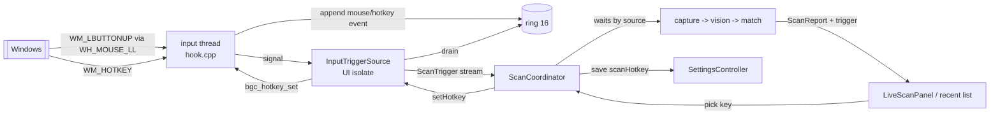
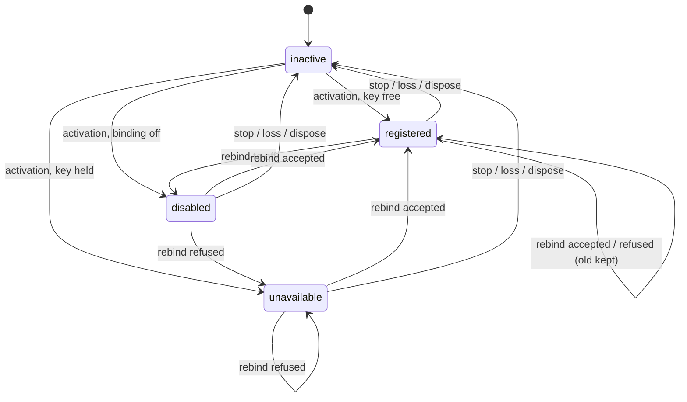
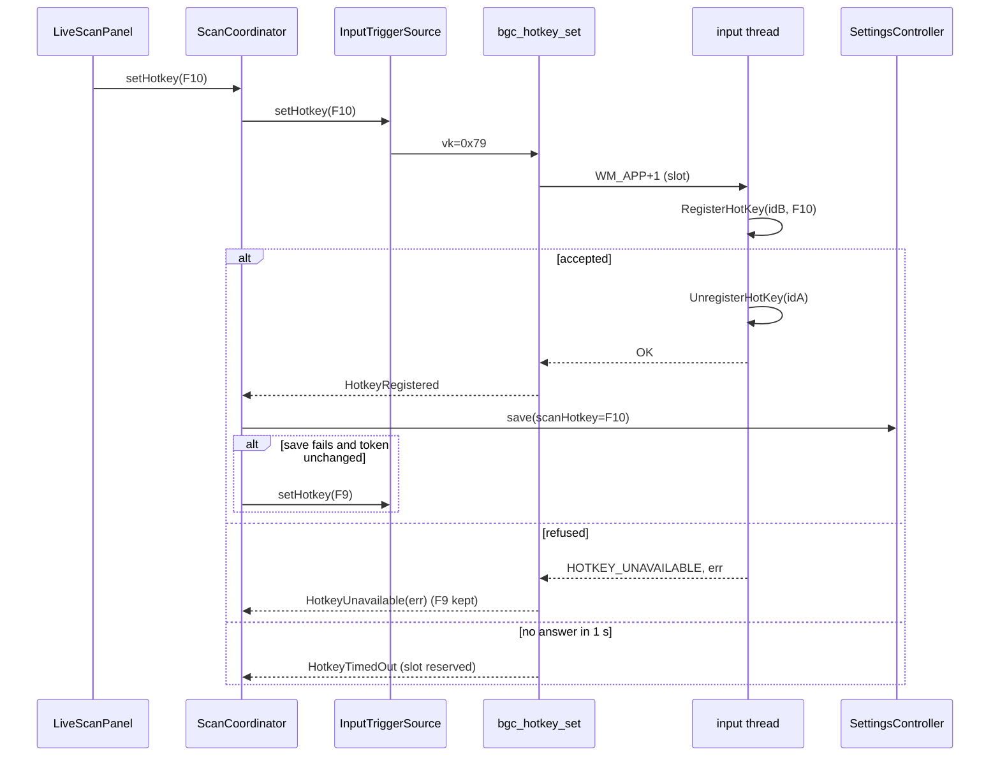

# Design

## Triage

| Trigger | Applies? | Evidence |
|---|---|---|
| T1 Components (new component, or 3+ with directed relationships) | Yes | Several components are involved: the native hook thread (`windows/capture/hook.cpp:191-223`), the Dart trigger source (`lib/data/capture/mouse_release_trigger_source.dart:26`), `ScanCoordinator` (`lib/application/scan_coordinator.dart:2034`), `SettingsController` and `LiveScanPanel`. A second trigger source joins the latest-wins flow, and a rebind path runs from the UI through the coordinator to the native thread. |
| T2 State (persistent state, caches, 3+ state machine) | Yes | There is a new persisted setting, `scanHotkey`, in the `Preferences` JSON (`lib/domain/settings.dart:41-115`). The hotkey state is a 4-state machine (`inactive`, `disabled`, `registered`, `unavailable`). |
| T3 Concurrency (background work, workers/isolates, async, retries) | Yes | Registration runs on the native input thread and the rebind is requested across threads. A rebind awaits a settings save, so a stop can interleave with it. Hotkey and mouse triggers race in one ring. |
| T4 Boundaries (data format, migration, shared interface, IPC, external) | Yes | Capture ABI v1 → v2 (`windows/capture/capture.h:17`, `lib/data/capture/capture_native.dart:13`): the event struct layout changes and there is a new export. The timing log schema goes from `"v":1` to `"v":2` (`scan_coordinator.dart:830`). There is a new settings key. |
| T5 Volume (grows without a fixed bound) | No | Hotkey triggers share the existing 16-event ring and the 1-pending-trigger flow. A rebind is a single request at a time. Nothing new grows. |
| T6 Risk (security, money, data loss, unrecoverable user data) | Yes | This is a global input facility near an anti-cheat-protected game. A ban cannot be undone, so the change must stay within the reference companion's game-interaction profile. |

TIER: FULL

## Context

`proposal.md` gives the motivation. The current state:

**The native input thread already exists, and ADR-0010 reserved it for hotkeys.** ADR-0010 says: "Hotkeys (M4) will reuse the hook thread and ring".
- `hook_start_with` (`hook.cpp:246-306`) creates one thread. It forces its message queue (`PeekMessageW`), installs `WH_MOUSE_LL`, and loops on `GetMessageW`, handling only `WM_APP`. `WM_APP` calls the payload-less Dart signal (`hook.cpp:212-217`).
- Stop posts `WM_QUIT` and joins for 1 s.
- The ring is `Ring { SRWLOCK; bgc_trigger_event slots[16]; head; count; dropped; signal_pending }` (`capture_internal.h:37-44`).
- `bgc_trigger_event` is 32 bytes, `{x, y, hwnd, pid, tid, qpc}`, and has no source field (`capture.h:65-72`).

**The hotkey has to arrive as a well-formed trigger.**
- `capture_policy.dart:30-40,114-125` requires the trigger's `hwnd/pid/tid` to match a foreground window with the target title.
- `planTargeted` (`capture_geometry.dart:58-90`) needs the point inside the client, although the region itself is centred (ADR-0016). ADR-0016 says the centred region "needs no cursor beyond the in-client guard, so a hotkey trigger can use it unchanged".

**The coordinator consumes a single `ScanTriggerPort`** (`scan_coordinator.dart:1010-1022`), hard-wired in `_NativeScanPlatform` (`:1197-1199`).
- Its waits read `trigger.event.qpc` (`:2221`). The settle delay is 50 ms and the fallback delay 200 ms (`:1462-1463`).
- Activation runs template, then vision, then `trigger.start()`, then `ready` (`:1886-1985`). A trigger start failure makes the whole activation `unavailable` (`:1975-1978`).

**Settings are one JSON blob** in `Preferences` row 1 (`database.dart:15-20,157-176`). A new key needs only a `fromJson` default, as with `liveScan` (ADR-0013). `SettingsController.save` returns `false` when busy and sets `error` on failure (`settings_controller.dart:25-42`).

**The reference companion** (the user's private fork) is the parity target:
- It registers `RegisterHotKey` on its main window, with F9 by default, `MOD_NOREPEAT` and no modifiers, accepting only F1-F24 and Delete to disable.
- Its swap is transactional. It test-registers the new key under a temporary id, and keeps the old key if that fails.
- On a hotkey press it uses `GetCursorPos`, and skips both the debounce and the fallback wait.
- It keeps the hotkey registered at all times. RatScanner, by contrast, uses a `WH_KEYBOARD_LL` hook.

Strategy §7 (`docs/IMPLEMENTATION_STRATEGY.md:222`) fixes `RegisterHotKey`, a conflict shown as unavailable with rebinding, and unregistration on rebinding and shutdown.

**The audit** (`test/data/capture/capture_source_audit_test.dart:5-14`):
- It bans process-access and input-sending APIs in `windows/capture/`.
- It lets only `scan_coordinator.dart` reach `data/capture/` (`:91-104`).
- Neither `RegisterHotKey` nor any keyboard API is mentioned today.

## Decisions

### D1: Register the hotkey on the existing input thread with `RegisterHotKey(NULL, ...)`

- **Choice:**
  - The hook thread registers the hotkey with a null window, so `WM_HOTKEY` lands in that thread's queue. The `GetMessageW` loop gains a `WM_HOTKEY` branch, and a branch for rebind requests (D5).
  - Before the loop exits, the thread unregisters every hotkey id it holds, then unhooks.
  - The flags are `MOD_NOREPEAT` with no modifier.
- **Rejected:**
  - **Registering on the Flutter runner's window and forwarding `WM_HOTKEY` over a method channel**, as the fork does on its WPF window. That puts a trigger on the platform thread, outside the ring. It loses the ordering and drop counting shared with mouse releases. It is a second integration pattern next to ADR-0010's DLL, and it ties hotkey lifetime to the window rather than to live scan.
  - **A `WH_KEYBOARD_LL` hook (RatScanner).** It sees every keystroke system-wide, which is more than the user's game-interaction ceiling requires (the fork uses `RegisterHotKey`). Strategy §7 already chose `RegisterHotKey`.
  - **A second native thread** just for hotkeys: a second lifecycle and a second stop timeout, for nothing gained.
- **Reversal cost:** medium. ABI v2 and the event layout are consumed by later changes.

### D2: Native code fills the target facts when `WM_HOTKEY` arrives

- **Choice:**
  - A testable core `hotkey_core(env, ring, target)` runs on the input thread when `WM_HOTKEY` arrives. It reads `GetForegroundWindow`, skips Blackgrid's own pid, and reads the title with `InternalGetWindowText` (no window message), requiring an exact target-title match. It then reads `GetCursorPos`, the window's pid and tid, and the QPC.
  - It appends a `bgc_trigger_event` with `source = BGC_TRIGGER_HOTKEY` under the ring lock, with the same drop and coalescing rules.
  - Because the append happens on the thread that delivers signals, it calls the signal directly instead of posting `WM_APP`.
  - A press over any other window appends nothing. The key is still consumed by the OS (Risks).
  - The cursor point serves only the in-client guard. A cursor outside the client fails `roiOutsideClient`, which already leads to the fallback pass (`scan-pipeline` "Fallback pass runs...").
- **Rejected:** **Dart reads the foreground window and the cursor after the drain.** That adds the drain's latency, during which the foreground window can change, so the facts would describe a later moment than the press. It also puts window queries on the UI isolate, against ADR-0010's "native facts, Dart policy".
- **Reversal cost:** low.

### D3: The hotkey is registered only while live scan is `ready`

- **Choice:**
  - Activation registers the saved binding after `trigger.start()` succeeds, then publishes `ready`.
  - A refused hotkey leaves live scan `ready`, with the hotkey state `unavailable(key, reason)`.
  - Stop, worker loss and dispose release it through the hook stop (D1).
- **Rejected:** **Registering at app start, independent of live scan, as the fork does.** That takes F9 away from the game and every other app even when the user has scanning off, and needs a native thread while live scan is off, against ADR-0013's "no hook unless a trigger consumer starts it". Doing less than the fork is within the user's ceiling.
- **Reversal cost:** low.

### D4: Hotkey scans skip the settle and fallback waits

- **Choice:** the coordinator's wait computation reads `trigger.event.source`. For `hotkey`, both the 50 ms settle wait and the 200 ms fallback wait are zero. For `mouse`, they are unchanged. Supersession during a wait is unchanged. ADR-0014 (`:30`) and ADR-0016 (`:42`) both left "whether the M4 hotkey keeps the fallback wait" to M4.
- **Rejected:** **Keeping both waits for every trigger.** The waits exist because the inspect window opens after the mouse release (ADR-0014). When the hotkey is pressed, the window is already open, so the wait is pure latency against the 300 ms p95 target. The fork skips both waits for manual scans.
- **Reversal cost:** low (two constants and a branch).

### D5: The rebind is one native request that swaps transactionally, and Dart saves after the OS accepts

- **Choice:**
  - **Native.** The new export `int32_t bgc_hotkey_set(uint32_t vk, uint32_t* win32_error)` takes `vk`: 0 for off, or `VK_F1`..`VK_F24`.
    - Under `g_api_lock` it requires a held installation (`BGC_NOT_STARTED` otherwise). It writes a request into a static slot, posts `WM_APP + 1` to the input thread, and waits on an event for at most 1 s.
    - The thread registers the new key under the id it is not using, and only on success unregisters the old id. A refused key leaves the old registration in place and returns `BGC_HOTKEY_UNAVAILABLE` with `GetLastError()`.
    - The same key is a no-op success, and off unregisters.
    - On timeout the call returns `BGC_HOTKEY_TIMED_OUT`, and the slot stays reserved. Later calls return `BGC_HOTKEY_TIMED_OUT` at once until the thread answers. The slot is static, so a late answer never writes to a freed stack.
    - When the thread exits, it completes a pending request with `BGC_NOT_STARTED`.
  - **Abandoned requests.** The slot carries an `abandoned` flag, set by the caller when its wait times out. When the thread picks up an abandoned request, it does nothing. For a key, the thread checks the flag again after the new key registers and before it releases the old id. If the request is abandoned by then, it releases the new id and leaves the old one untouched, so nothing is ever re-registered. For off, it checks the flag before releasing the current id, and skips the release if the request is abandoned. So a late answer never leaves the OS holding a key the coordinator did not accept.
  - **Dart.** `ScanCoordinator.setHotkey(key)` runs one rebind at a time.
    - With live scan `ready`, it calls the trigger port's `setHotkey` and, on success, saves the setting. Any refusal keeps the old registration and the old saved binding. With live scan not `ready`, it only saves.
    - **Restore after a failed save.** The restore target is the previous *registration*, not the previous binding: `off` when the prior state was `unavailable` or `disabled`, otherwise the prior key. If restoring a prior key is itself refused (another app took it in between), the coordinator releases the new key with `setHotkey(off)` and publishes `unavailable(old, reason)`. The published state therefore never disagrees with what the OS holds.
    - **Saves go through the tracked save path.** The hotkey save uses the coordinator's existing tracked save path (`_saving` / `_savesLanded`, `scan_coordinator.dart:1696-1712`), like the live-scan saves. A live-scan on or off save waits for a running hotkey save, and a hotkey save waits for a running live-scan save, so neither is refused as busy by `SettingsController.save`. Activation reads `scanHotkey` only after pending saves have landed, and dispose awaits a running hotkey save before teardown (`:1722-1730`).
    - Every step after an `await` is fenced on the activation token. A stop in between means no native call and no restore, because the stop already released the keys.
    - **Activation outcomes.** At activation a `hotkeyUnavailable`, `hotkeyTimedOut` or `notStarted` registration result publishes `unavailable(key, reason)`. Live scan still reaches `ready`.
- **Rejected:**
  - **Unregister the old key, then register the new one.** This leaves a window with no key registered, and loses the old key if another app takes it in between, which is the failure the fork's swap avoids.
  - **Save first, then register.** The saved binding would name a key the OS refused.
- **Reversal cost:** medium (ABI export and status codes).

### D6: One Dart trigger source for both sources, renamed `InputTriggerSource`

- **Choice:**
  - `MouseReleaseTriggerSource` becomes `InputTriggerSource` (file `input_trigger_source.dart`), because one native thread and one ring deliver both sources.
  - `TriggerEvent` gains `TriggerSource source` (`mouse`, `hotkey`).
  - The source gains `Future<HotkeyResult> setHotkey(ScanHotkey key)`. `CapturePlatform` gains `hotkeySet(int vk)`.
  - `ScanTriggerPort` gains `setHotkey`. The audit's `reachesCaptureLayer` list is updated to the new name.
  - `TriggerFailure` messages say "input hook" instead of "mouse hook".
  - `setHotkey` returns a sealed `HotkeyResult` that mirrors every native status:
    - `HotkeyApplied`, the success result for a key and for off;
    - `HotkeyUnavailable(win32)`;
    - `HotkeyTimedOut`;
    - `HotkeyNotStarted`;
    - `HotkeyInvalidArgument`. The closed `ScanHotkey` enum makes it unreachable from the app, but the switch stays exhaustive over the ABI.
- **Rejected:** **A separate `HotkeyTriggerSource` port merged in the coordinator.** That means two Dart objects over one native installation and one drain, and two streams whose ordering the coordinator would have to restore, although the ring already orders them.
- **Reversal cost:** low.

### D7: The binding is a closed enum `ScanHotkey` in the settings JSON

- **Choice:**
  - `enum ScanHotkey { off, f1, ..., f24 }` with `vk` (0 or `0x70 + n - 1`) and `label`.
  - The JSON key is `scanHotkey` with value `"off"` or `"F1"`..`"F24"`. The default is `f9`.
  - A missing, mistyped or unknown value reads as `f9` and never throws, unlike `selectedMap`. A bad hotkey value must not lose the user's other settings.
  - No Drift migration is needed.
- **Rejected:** **Storing a raw virtual-key code.** Any integer would round-trip, so the F1-F24 rule would have to be revalidated at every use, and the stored value would be opaque to anyone reading it.
- **Reversal cost:** medium (stored format).

### D8: Rebind with a dropdown on Scanner, not a key-capture field

- **Choice:**
  - `LiveScanPanel` gains a row with the hotkey status text (`scan-hotkey-status`) and a `DropdownButton<ScanHotkey>` (`scan-hotkey-picker`) listing Off and F1-F24.
  - The dropdown is enabled while live scan is `off` or `ready` and no rebind is running.
  - The recent scans list labels hotkey scans.
- **Rejected:** **The fork's "press the new key" field.** While a hotkey is registered, pressing it in Blackgrid produces `WM_HOTKEY` instead of a key event, so that field cannot capture the registered key. It would also need keyboard handling the dropdown avoids. Strategy §10 also keeps settings in inline controls.
- **Reversal cost:** low.

### D9: Each scan carries its trigger source, and the timing log becomes `"v":2`

- **Choice:** `ScanReport` gains `trigger` (`TriggerSource`). The log line adds `"trigger":"mouse"|"hotkey"` and bumps `"v"` to 2, as ADR-0013 requires for a key change. History and decisions are unchanged: an accepted scan is an `ActivitySource.scan` whichever trigger started it (ADR-0017).
- **Rejected:** **Leaving the log at v1 and inferring the source from timings.** The latency report (`qualify-scanner-latency`) must split hotkey from mouse scans, because hotkey scans skip the waits (D4). Inference from timings would be fragile.
- **Reversal cost:** low.

### D10: The audit bans keyboard hooks and key-state reads in the capture sources

- **Choice:**
  - Add these to the banned list for `windows/capture/`, each a separate identifier because the audit's pattern needs a word boundary after the name (`capture_source_audit_test.dart:66`):
    - the keyboard hooks `WH_KEYBOARD_LL` and `WH_KEYBOARD`;
    - the key-state reads `GetAsyncKeyState`, `GetKeyState` and `GetKeyboardState`;
    - `keybd_event`;
    - the raw-input APIs `RegisterRawInputDevices`, `GetRawInputData` and `GetRawInputBuffer`.
  - The audit's non-vacuous test asserts that a source containing `SetWindowsHookExW(WH_KEYBOARD_LL, ...)` is reported.
  - `RegisterHotKey`, `UnregisterHotKey` and `GetCursorPos` are allowed. `SendInput` stays banned.
- **Rejected:** **Leaving the audit unchanged.** Nothing would then stop a later change from swapping the hotkey for a keystroke-seeing hook, which would exceed the user's ceiling.
- **Reversal cost:** low.

## Diagrams (FULL)

T1, components and data flow:

T2, hotkey state:

T3 and T4, the rebind sequence:

## State & Ownership (FULL)

| State | Owner (sole writer) | Lifetime | Invalidation / rebuild | Authoritative copy |
|---|---|---|---|---|
| OS hotkey registrations (ids A/B) | Native input thread | Hook thread's life | Unregistered by the thread on rebind, off and loop exit | OS |
| Rebind request slot | `bgc_hotkey_set` reserves it; the input thread completes it | One request; it stays reserved after a timeout until answered | Completed by the thread, or at thread exit with `NOT_STARTED` | Native static |
| `scanHotkey` setting | `SettingsController.save`, called by `ScanCoordinator.setHotkey` | Durable | Read at activation | `Preferences` JSON |
| Hotkey state (`inactive`/`disabled`/`registered`/`unavailable`) | `ScanCoordinator` | Per coordinator, reset to `inactive` on stop | Set by activation, rebind and stop only | Coordinator field |
| Rebind in progress flag | `ScanCoordinator` | One rebind | Cleared when the rebind ends (each exit path) | Coordinator field |
| `TriggerEvent.source`, `ScanReport.trigger` | Native append, copied by the drain | Per trigger, per scan | Not mutable | Event and report |

## Failure & Visibility (FULL)

| Component | Fails / dies mid-operation → | Recovery | Retry safe? | Who finds out |
|---|---|---|---|---|
| `RegisterHotKey` at activation | Key held by another app | Live scan stays `ready`, hotkey `unavailable`; the user picks another key | Yes | User: Scanner hotkey row shows the key, reason and "mouse scans still work" |
| Rebind registration | Refused | The old key stays registered and saved | Yes | User: error naming the key and OS reason |
| Rebind save | Fails or is refused as busy | `setHotkey(old)` restores the registration | Yes | User: "preference was not saved" error |
| Restore after a failed save | Restoring the prior key is refused (another app took it in between) | The new key is released with `setHotkey(off)`; the state becomes `unavailable(old, reason)`, matching what the OS holds | Yes | User: hotkey row shows unavailable, plus the not-saved error |
| Input thread stuck | `bgc_hotkey_set` times out after 1 s; the request is marked abandoned | The slot stays reserved; a late answer finds it abandoned and rolls back the swap (D5); live scan off and on restarts the thread; stop may then report `stopTimedOut` | No native retry until answered | User: rebind error `hotkeyTimedOut`; stop warning if the stop also times out |
| Hook stop times out | The stuck thread still holds its hotkey registration | Released when the thread ends late (D1 loop exit) | n/a | User: the `stopTimedOut` warning says the hotkey may stay held until the input thread ends |
| Hook thread ends (stop) mid-rebind | Pending request completed `NOT_STARTED`; the coordinator's token fence drops the rest | Next activation registers the saved binding | Yes | Nobody needs to: the state is `inactive`, the binding saved is the old one |
| OS removes `WH_MOUSE_LL` silently (timeout) | Mouse triggers stop; the hotkey still works | None (ADR-0010 has no watchdog) | n/a | User notices mouse scans stop; unchanged by this change |

## Resource Bounds (FULL)

| Queue / buffer / cache / transfer | Bound | At the bound | Timeout | At 10x / 100x |
|---|---|---|---|---|
| Native trigger ring (shared) | 16 events | Drop oldest, counted, reported on the next delivered trigger | n/a | `MOD_NOREPEAT` caps hotkey events at one per physical press; 100x presses only drop more, counted |
| Rebind requests | 1 in flight (native slot), 1 in the coordinator (busy refusal) | Refused as busy (Dart) or `hotkeyTimedOut` (native) | 1 s native wait | Unchanged: a person picks keys |
| Hotkey registrations | ≤ 2 ids during a swap, 1 otherwise | n/a | n/a | n/a |
| Coordinator scan flow | Unchanged: 1 in flight, 1 pending | Unchanged | Unchanged, except hotkey waits are 0 | Unchanged |
| UI-isolate block during `bgc_hotkey_set` | ≤ 1 s, typically microseconds | Returns `hotkeyTimedOut` | 1 s | Same precedent as `bgc_hook_start`'s blocking wait (`hook.cpp:296`) |

## Flow & State Gaps (FULL)

- **Hotkey and mouse race:** both append to one ring under one lock, so delivery order is append order. Latest-wins handles them identically. A hotkey trigger supersedes a scan in its wait and starts without a settle wait.
- **Rebind during stop:** both run on the UI isolate. `bgc_hotkey_set` and `bgc_hook_stop` serialize on `g_api_lock`. If the stop wins, the request gets `NOT_STARTED`, which is reported as no change. If the rebind wins, stop then releases whatever is registered. After any `await`, the coordinator checks the activation token: when it changed, it makes no native call and no restore, and the saved binding stays what the save left. A save that completed after stop keeps F10 saved, which is correct, because the user chose it.
  - The `scan-pipeline` scenario "Switching off during a rebind" covers the case where the request is still waiting on the input thread. There the save has not run, so the old binding stays saved.
- **Rebind save racing a live-scan save:** both go through the coordinator's tracked save path (D5). Each waits for the other instead of being refused as busy. Activation reads `scanHotkey` after pending saves land.
- **Worker loss:** `_fail` → `_unhook` releases the hotkey through the hook stop, and the state becomes `inactive`, as with stop.
- **Rebind while `starting`:** the picker is disabled. A programmatic call is treated as "not ready" and only saves. Activation reads the setting after `trigger.start()`, which follows the template and vision steps, so a binding saved during `starting` is the one registered.
- **Rebind with live scan `unavailable`:** this means live scan is not `ready`, so the rebind only saves. That is a different state from a hotkey that is `unavailable` while live scan is `ready`.
- **Restart mid-operation:** the setting is durable and the registrations are not. The next activation registers the saved binding.
- **Settings load with a bad value:** `scanHotkey` is read as F9, and nothing else is lost (D7).
- **Hotkey pressed while live scan `ready` but the foreground is not the game:** no trigger, but the press is consumed by the OS (Risks).

## Mechanism Ledger (FULL)

| Mechanism | Built? | Why (harm nobody catches / expensive later) | Evidence that would change the call |
|---|---|---|---|
| Transactional swap (register new, then release old) | Yes | Without it a refused rebind silently leaves no hotkey, and the user may not notice until mid-raid | — |
| Restore after a failed save | Yes | Otherwise the registered key and the saved key disagree after a restart, and nobody would notice | — |
| Static request slot reserved past a timeout | Yes | A late answer writing to a returned stack frame is memory corruption | — |
| Abandoned-request rollback on the input thread | Yes | Without it, a late swap after `hotkeyTimedOut` leaves the OS holding a key the coordinator shows and saves as not held | — |
| Hotkey saves on the coordinator's tracked save path | Yes | `SettingsController.save` refuses concurrent saves, so an untracked hotkey save turns a live-scan switch into a false "not saved" error | — |
| Activation-token fence after each rebind `await` | Yes | A stop mid-rebind would otherwise re-register a key after stop, a hotkey with no consumer | — |
| `MOD_NOREPEAT` | Yes | Key repeat would flood the ring and supersede every scan (drops counted, but no scan finishes) | — |
| Keyboard-API audit bans | Yes | Exceeding the ban-risk ceiling is irreversible; adding the bans later costs nothing now | — |
| Hotkey watchdog / periodic re-registration | No | Registrations do not expire the way low-level hooks can | A report of the hotkey silently dying while live scan is `ready` |
| Registering while live scan is off | No | D3 | The user asking for F9 to work before switching live scan on |
| Modifiers, or keys beyond F1-F24 | No | Parity with the fork; the enum keeps the stored format closed | A user request; the enum and format would need extending (medium) |
| Hotkey-specific timing-log analysis | No | Belongs to `qualify-scanner-latency`; this change only records the source | — |
| Legacy import of `Scanner.ScanHotkey` | No | Out of scope (proposal non-goals); F9 is already the default | A user whose fork used a non-default key asking for it |

## Risks / Trade-offs

- **F9 is swallowed system-wide while live scan is on,** including over the game and when the game is not in front. → It is registered only while live scan is `ready` (D3). It can be rebound or turned off. This matches the fork, which holds it at all times.
- **Game interaction.** → `RegisterHotKey`, `GetCursorPos`, `GetForegroundWindow` and `InternalGetWindowText` open no handle, read no game memory and send no input. All are within the fork's profile (it does the same calls). The audit bans keyboard hooks and key-state reads (D10). The live hotkey scan is user-verified only.
- **A blocking `bgc_hotkey_set` on the UI isolate** is bounded at 1 s. → It follows the precedent of `bgc_hook_start`. A stuck input thread already breaks scanning, and the timeout surfaces it.
- **The ABI v2 bump** makes a stale `blackgrid_capture.dll` fail the `bgc_abi()` check. → That is the intended failure: live scan goes `unavailable` with a version reason. Release bundles always ship a matching DLL.
- **The timing log v2** changes the line shape for any reader. → No in-repo reader parses `v` today. The qualification tools that will (`qualify-scanner-latency`) are written against v2.
- **Renaming `MouseReleaseTriggerSource`** touches the fakes and tests. → It is a mechanical rename in one task group, with the audit test updated in the same commit.

## ADRs

- **In force, constraining this change:**
  - ADR-0007 (FFI DLL, no plugins).
  - ADR-0010 (capture DLL, input thread and ring, native facts with Dart policy, audit).
  - ADR-0013 (coordinator owns the trigger source, activation order, latest-wins, log schema versioning, only the coordinator reaches capture).
  - ADR-0014 (settle and fallback waits; it defers the hotkey's waits to M4).
  - ADR-0016 (centred region; a hotkey can use the in-client guard unchanged).
  - ADR-0017 (accepted scans become `scan` history whichever trigger started them).
- **To record during apply:**
  - **ADR-0019 "Scan hotkey on the capture input thread"**: D1, D3, D4, D5, D7, D10, capture ABI v2 and timing log v2. It does not supersede ADR-0010, which planned this reuse, or ADR-0014 and ADR-0016, which deferred the hotkey's waits to M4. It records the decision they left open.
  - The same task updates the `openspec/architecture.md` rows for the capture DLL, the capture worker and trigger source, and `ScanCoordinator`; the bounds rows; the "Not built yet" paragraph; and the strategy-alignment row that says hotkeys do not exist.
