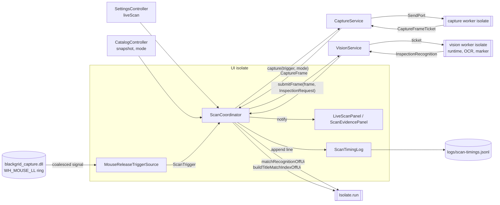
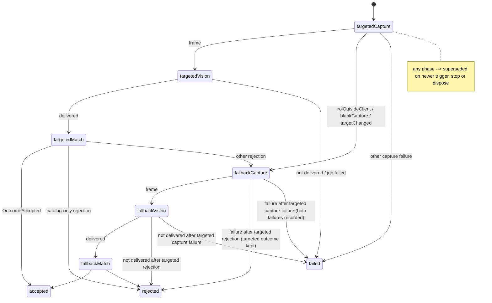
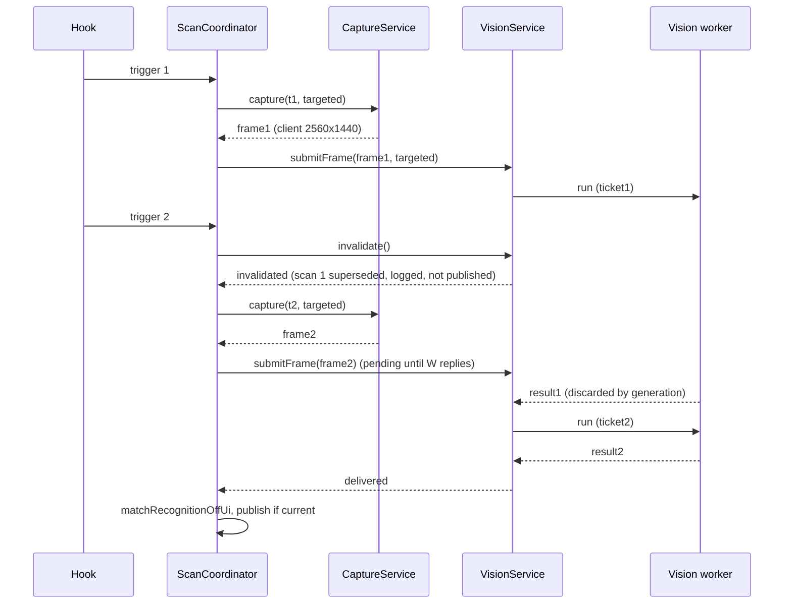

# Design

## Triage

| Trigger | Applies? | Evidence |
|---|---|---|
| T1 Components (new component, or 3+ with directed relationships) | yes | New scan coordinator, timing log writer and Scanner evidence panel. The coordinator directs the trigger source, the capture service, the vision service, the title-index adapter and the catalog controller. |
| T2 State (persistent state, caches, 3+ state machine) | yes | Persisted `liveScan` setting. Activation state machine `off`/`starting`/`ready`/`stopping`/`unavailable`. Per-scan phase machine. Title-index cache keyed by catalog snapshot. Recent-scans ring. |
| T3 Concurrency (background work, workers/isolates, async, retries) | yes | The hook signal, the capture worker isolate, the vision worker isolate, `Isolate.run` matching, async log writes and a toggle that can flip during start. |
| T4 Boundaries (data format, migration, shared interface, IPC, external) | yes | `CaptureFrameMetadata` crosses isolates and gains the client size. New on-disk JSONL timing log format that M4 tooling reads. New settings JSON key. |
| T5 Volume (grows without a fixed bound) | yes | The timing log grows with every scan, and in-game clicks are frequent. The recent-scans list and the write queue grow too. All of them are bounded below. |
| T6 Risk (security, money, data loss, unrecoverable user data) | yes | A global low-level mouse hook is now installed in production while live scan is on. The log holds OCR text, but no pixels. |

TIER: FULL

## Context

See `proposal.md`. Current state, verified in code:

- **Parts exist but nothing starts them.**
  - `MouseReleaseTriggerSource` (`lib/data/capture/mouse_release_trigger_source.dart:55-98`) exposes `start`/`stop`/`dispose` and a non-buffering broadcast `triggers` stream.
  - `CaptureService.capture(trigger, mode)` (`lib/data/capture/capture_service.dart:79-127`) admits one request and answers `captureBusy` otherwise. It has a 500 ms deadline and a 2 s close drain.
  - `VisionService<P, R>` (`lib/data/vision/vision_service.dart`) has `start`, `submitFrame` (`:237`), `invalidate` (`:309`) and `close` (`:424`), one pending slot, a 1.5 s deadline from submission, and the `overrun` and `unavailable` states (ADR-0011).
  - `inspectionRecognitionJobFactory` (`lib/data/vision/inspection_recognition.dart:39-41`) is the job, and `loadMarkerTemplate(runtimeDirectory)` (`lib/data/vision/marker_template.dart:59`) loads the bound marker.
  - `buildTitleMatchIndexOffUi` and `matchRecognitionOffUi` (`lib/application/recognition_matcher.dart:26-31,86-115`) are the matching adapters.
  - None of these is referenced from `lib/application`, `lib/ui` or `lib/main.dart`. Two source audits enforce that (`test/data/vision/vision_worker_audit_test.dart`, `test/data/capture/capture_source_audit_test.dart:142`).
- **Recognition needs the client size, and frames lack it.** `InspectionRequest` takes `clientWidth`/`clientHeight` (`inspection_evidence.dart:44-60`), but `CaptureFrameMetadata` has no client size (`capture_frame.dart:15-58`). The policy has the validated snapshot `s0.client` when it builds the metadata (`capture_policy.dart:88-104`).
- **Composition root.** `AppServices` (`lib/application/app_services.dart:26-200`) builds controllers and disposes them. `scans` is a constant stub, `SessionScanState` (`:89`, `session_scan_state.dart:1-7`), and stays M4's.
- **Settings.** Settings are one JSON payload row. `AppSettings.fromJson` defaults optional keys (`lib/domain/settings.dart:90-110`, for example `followGameLogs ?? true`), so a new key needs no Drift migration.
- **Existing patterns.**
  - One active and one pending request with fence checks: `MapSessionController._enqueue/_current/_start` (`map_session_controller.dart:319-364`).
  - Generation fences on `ChangeNotifier` controllers (ADR-0002).
- **Fallback is parity behaviour.** The reference runs full-client recognition whenever the targeted pass is not accepted (`docs/IMPLEMENTATION_STRATEGY.md:196`). The strategy also asks for latest-wins coordination (`:198`).

## Decisions

### D1: One app-scoped `ScanCoordinator` owns the whole scan flow on the UI isolate

- **Choice:** `lib/application/scan_coordinator.dart` holds a `ChangeNotifier` built by `AppServices` and disposed first in `AppServices.dispose`.
  - It owns, for the app's lifetime, the activation state, the scan flow, the published evidence and the trigger source.
  - It creates a fresh `CaptureService` and `VisionService<InspectionRequest, InspectionRecognition>` for each activation, through injected factories. The defaults live in the same file, so it is the only `lib/application`/`lib/ui` source the narrowed audits allow.
  - All its work on the UI isolate is bookkeeping: drain signal, stage hand-offs, fences and notifications. Native and CPU work stays in the capture worker, the vision worker and `Isolate.run`.
- **Rejected:** run capture, recognition and fallback policy together inside the vision worker, triggered by frame tickets from the hook. Three reasons:
  - It merges the capture and vision isolates that ADR-0010 and ADR-0011 keep apart.
  - The worker would own the retry and fallback policy, against the "orchestrator owns verification and retry" idiom.
  - A blocked OCR call would also block the next capture.
- **Reversal cost:** medium. It is internal to the application layer, but ADR-0013 records it.

### D2: Activation is a persisted `liveScan` key, off by default; start order is template → vision → hook

- **Choice:** add `liveScan` to `AppSettings`, with JSON default `false`; no Drift schema change. When it is on, at launch after `initialize()` or when it is switched on:
  1. Load the marker template in one `Isolate.run`.
  2. Construct the services and `await vision.start()`.
  3. Open the UI-side capture platform and the trigger source, created lazily once and kept for the app's lifetime because only one hook may exist per process. Then call `start()`.

  Each step checks an activation token. Switching off (or dispose) during `starting` advances the token and at once calls `close()` on every service already constructed, without waiting for the current step. The pending `vision.start()` then resolves through the service's bounded close (2 s drain, `vision_service.dart:424-432`), and the hook step is skipped because the token is stale.

  The Scanner switch calls `ScanCoordinator.setLiveScan(bool)`, the only writer of the session intent `switchOn`. The coordinator reads `settings.liveScan` once after `AppServices.initialize()` and does not listen to settings changes afterwards. Switching uses `SettingsController.save`. **Switching on:** a failed or busy save reverts the switch and starts nothing. **Switching off:** the pipeline stops at once, before and regardless of the save. A failed or busy save shows an error that the preference was not saved, keeps the switch off for the session, and never reinstalls the hook.
- **Rejected:** install the hook first and hold triggers until vision is ready. That puts a system-wide hook in place that can do nothing useful, and the bounded native ring would silently drop the held clicks.
- **Rejected:** a session-only switch. The user chose persistence.
- **Reversal cost:** low.

### D3: Latest trigger wins; supersession happens at the stage the old scan is in

- **Choice:** the coordinator holds one in-flight scan (`_active`) and one pending trigger slot (`_pending`). A new trigger marks `_active` superseded (`scanGeneration++`). Any older pending trigger is dropped and counted. How the new trigger starts depends on the old scan's stage:
  - **Capture:** wait. Capture cannot be cancelled and `CaptureService` would answer `captureBusy`, so the pending trigger starts when that capture answers, within the 500 ms deadline. The old frame is released. If that answer is `captureTimeout`, the capture service stays `overrun` until its worker replies (`capture_service.dart:226,391`) and answers `captureBusy` meanwhile. The pending trigger then still starts at once; its scan ends `ScanFailed(captureBusy)` and is logged. It does not wait for the overrun worker: `CaptureService` exposes no completion signal for an overrun reply, and adding one changes a finished boundary for a rare case.
  - **Vision:** call `vision.invalidate()`, which answers the old request `invalidated` at once (ADR-0011) and starts the pending trigger now. Its capture runs in parallel with the old job still running in the worker. Its vision request waits in the service's pending slot, and the 1.5 s deadline counts that wait.
  - **Matching:** start now. The `Isolate.run` result is discarded by its generation.
- **Rejected:** FIFO queueing of every trigger. Clicks in a raid are frequent, so the queue would grow stale, which strategy §6 forbids.
- **Rejected:** ignoring triggers while busy. That loses the user's most recent intent.
- **Reversal cost:** medium. It shapes the M4 latency profile, and ADR-0013 records it.

### D4: Fallback eligibility is a closed list

- **Choice:** a fallback pass runs after one of these targeted end states:
  - an `OutcomeRejected` whose reason is not `emptyCatalog` or `catalogModeMismatch`, and not the pipeline's `catalogUnavailable`;
  - a capture failure of `RoiOutsideClient`, `BlankCapture` or `TargetChanged`.

  Every other end state ends the scan: identity failures, `captureBusy`/`captureTimeout`/`captureClosed`/`captureUnavailable`/`frameBudgetExceeded`, and any vision non-delivery or job failure. Those would fail again or overload a worker that is already `overrun`.

  If the targeted pass ended in a capture failure and the fallback pass also fails (capture failure, or vision not delivered or job failed), the scan ends `ScanFailed` with the fallback failure and records the targeted capture failure. If the targeted pass produced a rejection outcome and the fallback fails, the scan ends `ScanRejected` with the targeted outcome and records the fallback failure.

  The fallback pass uses the same `TriggerEvent` with `CaptureMode.fallback` and `InspectionFrameKind.fullClient`. It then calls `matchRecognitionOffUi(index, targeted: <targeted result or null>, fullClient: <fallback result>)`, with `targeted: null` when the targeted pass produced no recognition (capture failed). The `fallback` phase is published before the fallback capture request.
- **Rejected:** run targeted and fallback captures in parallel for every trigger. Capture admits one request at a time, and parallel passes would double full-client work on every click.
- **Rejected:** fall back only on `noMarker`. The reference also falls back on title rejections, and parity is the target.
- **Reversal cost:** low.

### D5: Frames carry the validated client size

- **Choice:** add `clientWidth`/`clientHeight` to `CaptureFrameMetadata`, filled from `s0.client` in `CapturePolicy`. The coordinator builds `InspectionRequest(kind, clientWidth, clientHeight)` from the frame it holds, before handing the frame to `submitFrame`.
- **Rejected:** a separate snapshot call from the coordinator. It needs an extra native call on the UI isolate and races with resizes, unlike the size the capture was validated against.
- **Rejected:** derive the size from `requested`. That is wrong for targeted frames and for fallback frames clipped by the desktop.
- **Reversal cost:** low. The metadata is internal and sendable, with no persisted form.

### D6: One title index per catalog snapshot, built off the UI isolate on change

- **Choice:** the coordinator listens to `CatalogController`. When `snapshot` changes identity, it starts `buildTitleMatchIndexOffUi(snapshot)` and caches `(snapshot, Future<TitleMatchIndex?>)`, mapping a build error to null, one entry only. A scan takes the cached future at its matching stage. If there is no snapshot, or the build failed, the scan is rejected `catalogUnavailable`. The next snapshot change retries the build. The mode passed to the matcher is `catalog.mode` at matching start.
- **Rejected:** build the index per scan. That adds work to every click, on the latency path.
- **Rejected:** build on the UI isolate. Indexing thousands of names would cause a jank spike.
- **Reversal cost:** low.

### D7: Timings are QPC stamps converted once, at publication

- **Choice:** each scan keeps a `ScanTimeline` with nullable QPC stamps, structured per pass as described below. The stamps come from:
  - from the trigger (`trigger.qpc`);
  - from the coordinator, read through the UI-side `CapturePlatform.qpcNow()`: capture request, capture answer, matching start and end, publication;
  - from the frame: `qpcBefore`/`qpcAfter`;
  - from the vision answer: `submittedQpc`, `startedQpc`, `finishedQpc`;
  - from each pass's own evidence (see below): `qpcMarker`, `qpcTitle`, `qpcPreprocess`, `qpcOcr`.

  The timeline holds `trigger` and `published` once, and one `PassTimeline` per pass that ran (`targeted`, `fallback`). Each pass has `captureRequested`, `acquireStart`, `acquireEnd`, `captureAnswered`, `visionSubmitted`, `jobStarted`, `marker`, `title`, `preprocess`, `ocr`, `jobFinished`, `matchStarted` and `matchFinished`. A pass's sub-stage stamps (`marker`…`ocr`) come from that pass's own evidence: its winning entry, or its first entry when it has no winner. So when the fallback wins, the targeted pass keeps its own job timings.

  Millisecond offsets from the trigger are computed with `qpcFrequency()` when the scan ends, and that frequency is read once per activation. A stage not reached stays null and is omitted from the log line.
- **Rejected:** `Stopwatch` on the UI isolate. Its clock differs from the trigger and frame clocks, and it misses the time before Dart received the trigger.
- **Reversal cost:** low.

### D8: A bounded JSONL timing log, written asynchronously by one writer

- **Choice:** `lib/data/scan_timing_log.dart` provides `ScanTimingLog(Directory logs, {maxBytes = 1 MiB, maxQueued = 32})`.
  - `append(Map<String, Object?>)` encodes one line and enqueues it.
  - One async loop writes lines in order: open with `FileMode.append`, write, close. Before each write, if `currentLength + lineBytes > maxBytes`, it renames the file to `scan-timings.1.jsonl` first, replacing any earlier one.
  - When the queue is full, the line is dropped and counted. The next written line gets `droppedLines`.
  - A write error sets `status = unavailable(error)` and notifies, and later appends keep trying.
  - `LocalPaths` gains `logs` (`<root>/logs`).
  - The line schema is the spec's fields plus `"v":1`.

  The coordinator appends exactly once per ended scan. The log is closed in `AppServices.dispose`, after the coordinator, and flushes what is queued within 1 s, then drops the rest.
- **Rejected:** a Drift table. It adds a migration and contention with the database isolate, and it blurs history (M4), which has different retention.
- **Rejected:** synchronous writes on the UI isolate. A stalled disk would freeze the UI.
- **Reversal cost:** medium. M4 tooling reads the format, and ADR-0013 records it.

### D9: Evidence is published as immutable values; the panel decodes the crop once per scan

- **Choice:** the coordinator publishes `LiveScanStatus` (activation state, reason, stop warning, log status), the current `ScanPhase` (`idle`, `targeted`, `fallback`), `latest` as a `ScanReport`, and `recent`, a list of at most 10 reports, newest first.
  - `ScanReport` holds the end state as a sealed `ScanEnd`: `ScanAccepted`, `ScanRejected` or `ScanFailed`. A superseded scan is logged but never published.
  - It also holds the winning pass, both passes' `InspectionRecognition` or capture/vision failure, the `RecognitionOutcome`, catalog mode and revision, the timeline in milliseconds, and the dropped and superseded counts.
  - A new `LiveScanPanel` in `lib/ui/` replaces the "Manual catalog inspection" subtitle area with the switch and status above `ManualControls`. A new `ScanEvidencePanel` sits in the left column.
  - The item name comes from `catalog.snapshot` lookup by ID.
  - The thresholded crop (8-bit gray, at most 256 KiB) is expanded to RGBA and passed to `ui.decodeImageFromPixels` once per report id, cached in the panel state, and disposed on replacement.
  - `ScanReport` holds no `data/capture/` or `VisionService*` types. `scan_coordinator.dart`, the only file the narrowed audits allow, maps every capture failure, trigger failure, vision answer and start failure into UI-facing values defined there: a `ScanFailureCode` enum plus a message. Recognition results (`inspection_evidence.dart`) and outcomes (`domain/title_matching.dart`) are allowed imports, as today. So no other `lib/application` or `lib/ui` file imports `data/capture/` (`capture_source_audit_test.dart:255`) or names `VisionService*`. The vision audit's `VisionService` regex also matches `VisionServiceState`, which is one more reason the state is mapped to the coordinator's own activation state.
- **Rejected:** the vision worker encodes a PNG per evidence entry. That adds per-scan worker time on the latency path for a UI-only need.
- **Reversal cost:** low.

### D10: Scan evidence is isolated from decisions

- **Choice:** `ScanCoordinator` takes `CatalogController` (read only) and `SettingsController`, never `SelectionController` or `HistoryController`. A unit test asserts that selection and history are unchanged after accepted and rejected scans, and a widget test asserts the decision card is unchanged.
- **Rejected:** feeding accepted identities into `SelectionController` now. That is M4 scope (decisions, correction, history) and would make keep/sell advice depend on evidence not yet qualified.
- **Reversal cost:** low.

## Diagrams (FULL)

Component graph (T1):

Activation state machine (T2):

```mermaid
stateDiagram-v2
  [*] --> off
  off --> starting: liveScan on
  starting --> ready: template ok, vision ready, hook started
  starting --> unavailable: template / vision / hook failure
  starting --> stopping: liveScan off (constructed services closed at once; bounded by the 2 s close drain)
  ready --> stopping: liveScan off / dispose
  ready --> unavailable: capture or vision unavailable
  unavailable --> stopping: liveScan off / dispose
  stopping --> off: hook stopped, services closed (warning kept if stopTimedOut / shutdownIncomplete)
```

Per-scan phases (T2/T3):

A trigger during the vision stage (T3):

Timing log data flow (T4): `ScanReport` → `toLogLine()` → `{"v":1,"utc":…,"end":"accepted|rejected|failed|superseded","item":…,"reason":…,"pass":"targeted|fallback",`
`"targeted":{"bestMarker":…,"candidates":[{"id":…,"score":…}],"text":…,"failure":…},"fallback":{…},`
`"ms":{"trigger":0,"published":…,"targeted":{"captureRequested":…,"acquireStart":…,"acquireEnd":…,"captureAnswered":…,"visionSubmitted":…,"jobStarted":…,"marker":…,"title":…,"preprocess":…,"ocr":…,"jobFinished":…,"matchStarted":…,"matchFinished":…},"fallback":{…same keys…}},`
`"droppedTriggers":n,"supersededTriggers":n,"droppedLines":n}`. All `ms` values are milliseconds from the trigger, and keys of stages not reached are omitted. Then one line is written to `logs/scan-timings.jsonl`. When a write would pass 1 MiB, the file is first renamed to `logs/scan-timings.1.jsonl`.

## State & Ownership (FULL)

| State | Owner (sole writer) | Lifetime | Invalidation / rebuild | Authoritative copy |
|---|---|---|---|---|
| `liveScan` preference | `SettingsController` (via `save`) | Persistent (settings row) | Written only by `ScanCoordinator.setLiveScan` on a user switch. The coordinator reads it once, after app initialisation, and never reacts to settings notifications, so a later unrelated save that still carries `liveScan: true` (after a failed switch-off save) cannot restart the pipeline | Database settings payload (next launch) |
| Session live scan intent (`switchOn`) | `ScanCoordinator` | App session | Set from the saved setting once after initialisation. Changed only by `setLiveScan` (user switch): switch-on sets it only after a successful save; switch-off clears it at once, whatever the save result | Coordinator field; it drives the pipeline and the Scanner switch |
| Activation state, reason, warnings | `ScanCoordinator` | App lifetime | Each activation gets a token; stale steps compare it and tear down | Coordinator field |
| Trigger source and UI-side capture platform | `ScanCoordinator` | Created on first activation, kept until dispose (one hook per process) | Never rebuilt; `start`/`stop` per activation | Coordinator |
| `CaptureService`, `VisionService` | `ScanCoordinator` | One activation | Closed on stop or unavailability; new ones on the next activation | Coordinator |
| In-flight scan, pending trigger, scan generation | `ScanCoordinator` | One scan | A newer trigger, stop or dispose advances the generation | Coordinator |
| Frames | Per ADR-0010/0011: the capture worker, then the coordinator, then `VisionService`/worker | Until released | The coordinator releases any frame it holds when a scan is superseded or not current | The frame's single owner |
| Title index cache (1 entry) | `ScanCoordinator` | Until the catalog snapshot identity changes | Rebuilt off the UI isolate on change; a failed build retries on the next change | Cached future |
| Phase, latest report, recent ring (≤10) | `ScanCoordinator` | Session (memory only) | Phase replaced per scan; ring evicts oldest | Coordinator |
| Timing log queue, counters, status | `ScanTimingLog` | App lifetime | Drained in order; dropped count resets once written | The log file on disk |
| Decoded crop image | `ScanEvidencePanel` state | Until the next report id or widget dispose | Disposed on replacement | Report's crop bytes |

## Failure & Visibility (FULL)

| Component | Fails / dies mid-operation → | Recovery | Retry safe? | Who finds out |
|---|---|---|---|---|
| Marker template load | `unavailable` with a template failure; no worker or hook started | Off then on retries | Yes (read only) | User: Scanner status names the file and reason |
| Vision start | `unavailable` with a `VisionStartFailure`; the service is closed | Off then on creates a new service | Yes | User: status |
| Hook start | `unavailable` with `TriggerUnavailable(code)`; vision closed | Off then on | Yes | User: status |
| Hook stop | `stopTimedOut`: the listener is kept alive (ADR-0010); state `off` plus a warning | The next `start` retries the stop | Yes | User: warning in status |
| Capture worker dies / service unavailable | The scan ends `failed` with `captureUnavailable`; the coordinator stops the hook, goes `unavailable` and closes vision | Off then on | Yes | User: status and a failed report |
| Vision worker dies | The scan ends `failed` with `visionUnavailable`; the same teardown as above | Off then on | Yes | User |
| Vision call hangs | `visionTimeout` after 1.5 s; the service is `overrun`; later scans' vision requests wait or time out; no second native call | Ends when the native call returns; nothing is killed | n/a | User: failed reports with `visionTimeout`; the log records them |
| Matching `Isolate.run` throws | `matcherFailed` rejection (adapter) | Per scan | Yes | User: rejection reason |
| Index build fails | `catalogUnavailable` for scans | Next snapshot change | Yes | User: rejection reason |
| Timing log write | Status `unavailable(error)`; scanning continues | Each later append tries again | Yes (append-only) | User: log status in Scanner |
| Coordinator dispose with a native call still running | Close returns `shutdownIncomplete` after its bound; nothing publishes after dispose | Process exit | n/a | Debug log line; nobody else (app is exiting) |

## Resource Bounds (FULL)

| Queue / buffer / cache / transfer | Bound | At the bound | Timeout | At 10x / 100x |
|---|---|---|---|---|
| Native trigger ring | 16 (ADR-0010) | Oldest dropped, counted into `droppedTriggers` | — | Bursts of 10x/100x clicks only raise the dropped counts |
| Coordinator scans | 1 in flight, 1 pending trigger | Older pending dropped and counted (`supersededTriggers`) | Per stage: capture 500 ms, vision 1.5 s from submission | Work stays at most one capture and one vision job, plus one invalidated job still finishing in the worker |
| Live frames | 4 slots (ADR-0010); the coordinator holds at most 1 (targeted or fallback) at a time | `frameBudgetExceeded` → scan failed | — | Unchanged |
| Vision requests | 1 active and 1 pending (ADR-0011) | Pending replaced, answered `superseded` | 1.5 s | Unchanged |
| `Isolate.run` matching | At most 1 current, plus superseded runs still finishing (each ends on its own; CPU bounded per run) | Results discarded | None (pure Dart, bounded by catalog size) | Under 100x clicks, superseded runs could pile up. Mitigation: start matching only when no superseded match is still running, and otherwise wait for it; see the ledger |
| Title index cache | 1 entry | Replaced | — | Unchanged |
| Recent reports | 10 | Oldest evicted | — | Unchanged |
| Crop per report | ≤256 KiB gray (≤1 MiB RGBA decoded), one decoded image | Replaced per report | — | Unchanged |
| Log write queue | 32 lines | New line dropped, counted | Close flush 1 s | Unchanged; drops counted |
| Log file | 1 MiB current + 1 MiB previous | Rotate | — | About 3-5k scans per file at ~250-350 B per line; older history is discarded by design |

## Flow & State Gaps (FULL)

- **Switch flips during start:** switching off advances the activation token and immediately closes any constructed service. A hung runtime open is therefore bounded by the vision close drain (2 s), not by the open itself. The start step that returns afterwards sees the stale token, skips the hook and goes to `off`, or to `starting` again with fresh services if the switch is now on. Activations are serialised through one lifecycle future chain whose every link is bounded (2 s vision close, 2 s capture close, 1 s hook stop), so dispose is bounded too.
- **Trigger before `ready`:** impossible, because the hook starts last. A trigger signalled after `stop()` is ignored by the source (`_active` false).
- **Mode change mid-scan:** `catalog.setMode` clears the snapshot. A scan matching then uses the old cached future, and its outcome records the old mode and revision. The next scan sees `catalogUnavailable` until the new snapshot loads. This is accepted for M2 evidence; M4 adds the mode/session fences for decisions.
- **Late vision reply after invalidate:** discarded by `VisionService` (ADR-0011). The coordinator never sees it.
- **A capture answer after supersession:** the coordinator releases the frame and starts the pending trigger.
- **Fallback capture of a later state:** the inspection may have closed between the targeted and fallback capture. The fallback then finds no marker → `noMarker` rejection. This is honest evidence.
- **Restart mid-operation:** nothing persists except the setting and the log, so after a restart live scan comes back `starting` when the setting is on.
- **First scan after activation:** `CaptureService` spawns its worker on first use, so the first scan's capture stage includes the spawn. The timings show it.

## Mechanism Ledger (FULL)

| Mechanism | Built? | Why (harm nobody catches / expensive later) | Evidence that would change the call |
|---|---|---|---|
| Activation token / lifecycle chain | Yes | Without it, a fast off/on leaves a hook installed with no workers, which nobody would notice | — |
| Scan generation fence on every stage hand-off | Yes | The exit criterion forbids publishing after supersession or shutdown | — |
| `vision.invalidate()` on supersession | Yes | Without it the new scan waits up to 1.5 s for a stale job's answer | — |
| Wait for the capture answer before starting the pending scan | Yes | In the normal case the answer arrives within 500 ms with the worker free, so the pending scan's capture is admitted. A capture admitted earlier would answer `captureBusy` and lose the newest click. After a `captureTimeout` the worker stays overrun and the pending scan still fails `captureBusy`; that case is logged, not avoided | — |
| Signal from `CaptureService` when an overrun worker replies, to start the pending trigger then | No | It would change a finished boundary (ADR-0010) for a rare case that is visible in the log | Logged `captureTimeout` followed by `captureBusy` pairs in the user's live runs |
| Serialise matching runs (do not start a match while a superseded one still runs) | Yes | Superseded `Isolate.run` matches are uncancellable. Under rapid clicking (in-game fire) they could stack CPU work on the latency path | Logged match durations that stay far below the trigger interval |
| Explicit capture worker warm-up at activation | No | `CaptureService` has no start API. Adding one changes a finished boundary for a first-scan cost only | First-scan capture stage over 300 ms in the user's log |
| Retry of a failed pass | No | Captures and jobs are not idempotent in time (the inspection may close). The fallback pass is the only retry, as in the reference | Corpus or live data showing transient capture failures that a retry fixes |
| Index pre-warm for the other mode | No | Mode changes are rare; one entry suffices | Logs showing `catalogUnavailable` during play |
| Log fsync / crash durability | No | It is a diagnostic log; losing the last lines on a crash is harmless | M4 gate needing exact counts across crashes |
| Persisting reports across restart | No | M4 history owns persistence | — |
| Crash-safe atomic rotation | No | Rename-then-append; a crash between them leaves only a missing current file, which the next append recreates | — |

## Risks / Trade-offs

- [Fallback on every unaccepted click runs a full-client recognition during combat clicks] → Parity with the reference. Latest-wins plus the vision pending slot bound the work to about one job. Timings in the log let the user see the cost, and M4 qualifies it.
- [A global mouse hook in production] → Off by default. It is installed only after an explicit switch-on and removed on switch-off and exit. The hook callback contract is unchanged (ADR-0010), and the process-access audit stays.
- [Overrun vision worker turns later scans into `visionTimeout` until the call returns] → This is visible per scan and in the log. No kill, per ADR-0011.
- [Log holds OCR text of inspected items] → No pixels, no account data, size-capped, local only.
- [Narrowing the source audits weakens a guard] → The allow-list is exactly one file. UI-facing failure values are defined in that file (D9), so the panel needs no `data/capture/` import and no `VisionService*` name, and the regexes stay as strict as today for every other file. The audits keep rejecting every other startup or UI reference, and a test proves an off launch loads no vision library and installs no hook.

## ADRs

- **In force, constraining this change:**
  - 0001: decisions only from the shared engine; no scan advice.
  - 0002: `ChangeNotifier` and composition root, generation fences.
  - 0004: isolate model.
  - 0008: bundle-only vision runtime.
  - 0010: capture boundary, hook, frame tickets, 500 ms.
  - 0011: vision worker contract, invalidate, 1.5 s, drain.
  - 0012: recognition job and off-UI matching adapters.
- **To record during apply:** **ADR-0013, scan pipeline coordination and timing log.**
  - One app-scoped coordinator owns the activation and scan flow.
  - Start order: template, then vision, then hook.
  - Latest-wins with stage-specific supersession.
  - The fallback eligibility list.
  - Client size in frame provenance.
  - The JSONL timing log schema v1 with its 1 MiB rotation and 32-line queue.
  - Scan evidence never feeds decisions before M4.

  The same task updates `openspec/architecture.md`: component rows, the "Not built yet" paragraph, the resource-bounds rows for capture and vision ("Caller (not yet wired)" → Scanner), and the ADR index.

## Open Questions

- The exact Scanner layout of the evidence panel at compact widths (<1100 px) is left to implementation. It must keep the existing compact `ListView` pattern (`scanner_screen.dart:31-44`).
