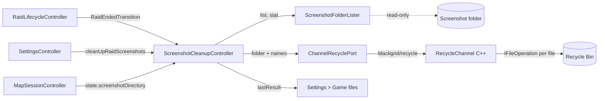
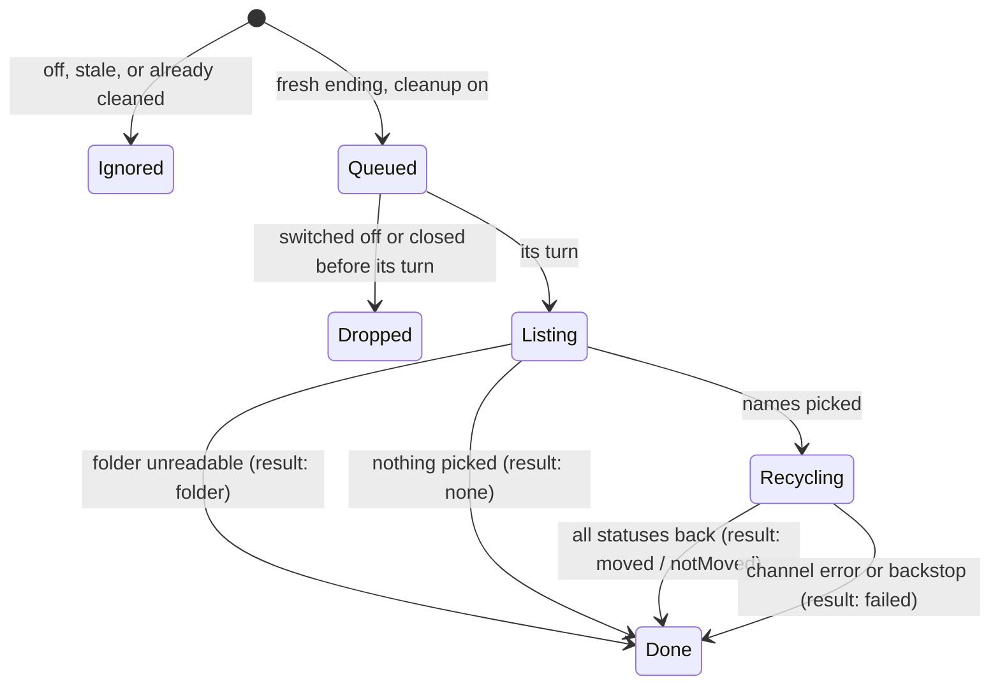
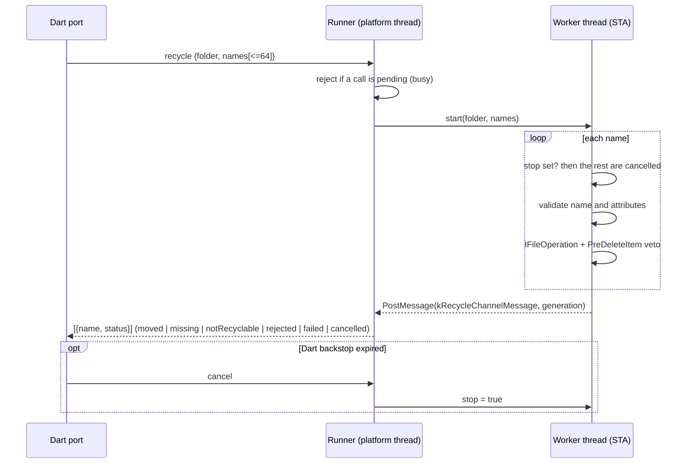

# Design

## Triage

| Trigger | Applies? | Evidence |
|---|---|---|
| T1 Components (new component, or 3+ with directed relationships) | yes | A new `ScreenshotCleanupController` reads `RaidLifecycleController`, `SettingsController` and `MapSessionController`, and drives a new recycle port over a new runner channel. |
| T2 State (persistent state, caches, 3+ state machine) | yes | A new persisted setting (`cleanUpRaidScreenshots`), plus in-memory cleaned-raid identities and a last-result value. |
| T3 Concurrency (background work, workers/isolates, async, retries) | yes | Raid endings arrive while a cleanup is still moving files. The runner moves files on a worker thread and posts results back. |
| T4 Boundaries (data format, migration, shared interface, IPC, external) | yes | A new `blackgrid/recycle` method channel, a new settings key, and the first write into a game folder that was read-only until now (`openspec/architecture.md:32`). |
| T5 Volume (grows without a fixed bound) | yes | The screenshot folder has no count cap (`openspec/architecture.md:147`). One raid can have hundreds of screenshots. |
| T6 Risk (security, money, data loss, unrecoverable user data) | yes | It removes the player's files. |

TIER: FULL

## Context

- **Raid endings.** `RaidLifecycleController.transitions` (`lib/application/raid_lifecycle_controller.dart:32`) publishes each `RaidEndedTransition` once. It carries the `Raid` with `startTime`, `startId`, `endTime` and `endCause` (`lib/domain/raid_lifecycle.dart:312-365,423-431`). The bind-time replay publishes earlier endings again with the same identities (raid-lifecycle spec, "Each lifecycle transition is published once").
- **Freshness.** Alerts already ignore replayed transitions with `isFreshLogTime(logTime, now)`, where a transition counts as fresh when it is at most `alertFreshness` (30 s) old (`lib/domain/alert_rules.dart:9,19`; used at `lib/application/alerts_controller.dart:540`). Proposal S2 uses the same rule.
- **Screenshot folder in use.** `MapSessionController` resolves the folder: the saved `screenshotDirectory`, or `GamePaths.screenshots()` when that is empty (`lib/application/map_session_controller.dart:249-258`, `lib/data/game_paths.dart:49`). It exposes the result as `state.screenshotDirectory` (`:129`). `ScreenshotDirectoryWatcher` lists `.png`/`.jpe?g` directly in the folder with `followLinks: false` (`lib/data/screenshot_directory_watcher.dart:162-174`) and only reads them.
- **Game screenshot names.** `parseScreenshotFilename` (`lib/domain/screenshot_filename.dart:23`) accepts only the game's `date[HH-MM]_xyz_quaternion_number` names, with a unit-quaternion check.
- **Runner channels.** ADR-0047 set the pattern: a runner-embedded method channel (`windows/runner/audio_channel.{h,cpp}`) registered in `flutter_window.cpp:30`. Async work posts a private `WM_APP` message back to the platform thread (`audio_channel.h:16`, `flutter_window.cpp:71`), and a typed Dart port wraps the channel (`lib/data/channel_audio_port.dart:14`). `kAudioChannelMessage` is `WM_APP + 1`.
- **Settings.** `AppSettings` (`lib/domain/settings.dart:230-363`) holds flat fields such as `screenshotDirectory` next to the nested `raidTimers` and `alerts` blocks. `SettingsController.save` (`lib/application/settings_controller.dart:160`) returns `bool`.
- **Read-only game inputs.** ADR-0030 makes the log-input sources read-only and enforces that with an audit test. The architecture diagram labels the log and screenshot files "(read-only)". This change is the first, narrow exception, and only for screenshots: see D5.

## Decisions

### D1: Dart picks the files, the runner only recycles them

- **Choice:** A pure domain function `pickRaidScreenshots(entries, raid)` takes a listing of `(name, isFile, isLink, modified)` and returns the names that pass proposal S1. A data-layer lister builds that listing with `Directory.list(followLinks: false)` and `stat`. The `RecyclePort` then gets the folder and the picked names. The runner checks each one again: it joins the name to the folder, rejects names that contain a path separator or `..`, confirms with `GetFileAttributesW` that the path is not a directory and not a reparse point, and only then recycles it. It reports one status per name.
- **Rejected:** The runner lists, filters and recycles, given the folder and the raid window. The name and time rules would then live in C++, which can only be tested in a running app, and they would duplicate `parseScreenshotFilename`.
- **Reversal cost:** medium, because the channel contract changes.
- **Important:** yes, it binds future changes through the channel contract.
- **Chosen by:** user

### D2: A per-file veto keeps the Recycle Bin the only destination

- **Choice:** For each file, the runner runs one `IFileOperation`, on a worker thread of its own initialised as STA. The flags are `FOFX_RECYCLEONDELETE | FOF_ALLOWUNDO | FOF_NO_UI`, and the operation has an `IFileOperationProgressSink` attached. In `PreDeleteItem`, a file whose `dwFlags` lack `TSF_DELETE_RECYCLE_IF_POSSIBLE` would be deleted for good, so the sink returns `E_ABORT`. That file stays and is reported as `notRecyclable`. One operation per file means a veto only stops that file (spec: "A file that cannot be moved SHALL NOT stop the others").

  **Cancel and lifetime (review M2).** The channel has two methods, `recycle` and `cancel`. The worker thread shares a `std::shared_ptr<Shared>` with the channel, following `audio_channel.cpp`'s shared state that never points back. `Shared` holds the `HWND`, a call generation and a `std::atomic<bool> stop`. The worker never references the `RecycleChannel` object. It checks `stop` before each file, and a file it skips because of `stop` gets the status `cancelled`. `cancel` sets `stop`. `~RecycleChannel` (run from `OnDestroy`) sets `stop`, completes any pending result with `cancelled` and detaches the worker. The worker then stops before its next file. Its final `PostMessage` goes to a window that may no longer exist, so the post fails harmlessly, and the channel ignores a post whose generation is not the pending one. The window message is `kRecycleChannelMessage = WM_APP + 2`, distinct from `kAudioChannelMessage` (`audio_channel.h:16`).
- **Rejected:** Checking the drive with `SHQueryRecycleBin`, then a batch `SHFileOperationW` with `FOF_ALLOWUNDO`. The drive check misses files too large for the bin, which Windows deletes for good without asking under `FOF_NOCONFIRMATION`.
- **Reversal cost:** low, because it stays inside the runner.
- **Important:** yes, it carries the never-delete-for-good guarantee, which protects user data.
- **Chosen by:** user

### D3: The setting is a flat bool

- **Choice:** `AppSettings.cleanUpRaidScreenshots`, stored as the top-level JSON key `cleanUpRaidScreenshots`. A missing value or a value that is not a bool decodes as `false`. `SettingsController.setCleanUpRaidScreenshots(bool)` saves it through `save`.
- **Rejected:** A nested `screenshotCleanup` block, which would leave room for later options (keep the newest N, an age limit). No option of that kind is planned, and adding the block later is an additive decode.
- **Reversal cost:** medium, because it is a stored key.
- **Important:** yes, it is a config key.
- **Chosen by:** user

### D4: One app-scoped controller owns cleanup

- **Choice:** `ScreenshotCleanupController` (in `lib/application/`) is built in `AppServices` next to `AlertsController`. In its constructor it subscribes to `RaidLifecycleController.transitions`, so it sees the replay and can ignore it. It reads `settings.cleanUpRaidScreenshots` and `mapSession.state.screenshotDirectory` when a raid ends, and it takes a `clock`, a lister and a `RecyclePort`, all injected. It runs one cleanup at a time from a FIFO, remembers cleaned raids by `startId` and exposes `lastResult` for the Game files row.
- **Rejected:**
  - Folding cleanup into `MapSessionController`, which owns the folder. That controller is Map evidence with an epoch model (`openspec/architecture.md:105`), and file removal would widen its failure radius.
  - Folding cleanup into `AlertsController`. It is about audio, and the two features would then share a failure path.
- **Reversal cost:** low
- **Important:** no
- **Chosen by:** agent

### D5: A new ADR for the one write into a game folder

- **Choice:** Record ADR-0048, "Screenshot cleanup recycles a raid's screenshots through a runner channel". It states the following:
  - the screenshot folder is written by this controller's port only, and only by moving files to the Recycle Bin;
  - files are picked by S1 and recycled per D1 and D2;
  - an offline audit test bans `delete`, `rename`, `openWrite`, `writeAs*`, `Process.*` and `dart:ffi` in `screenshot_directory_watcher.dart` and in the cleanup's Dart sources, so the only path to a file move is the runner channel.

  The architecture's diagram, runner row, state table and bounds table are updated in the same task. ADR-0030 is not superseded, because it governs the log inputs only.
- **Rejected:** No ADR, with the architecture text edited alone. The read-only property is cited as a boundary in the architecture's T4 triage, so changing it binds future changes and needs an ADR.
- **Reversal cost:** low
- **Important:** yes, it binds future changes, because it is a boundary.
- **Chosen by:** agent

### D6: Cleaned raids are remembered in memory, bounded

- **Choice:** A FIFO set of the last 16 `startId`s, kept in memory only. A restart needs no memory, because replayed endings are stale (S2). A transit and a reconnect each get their own `startId` or keep the same one, matching the raid-lifecycle identities, so each raid is cleaned at most once.
- **Rejected:** Persisting cleaned identities. Freshness already prevents a second cleanup after a restart, and a stored list would need a schema.
- **Reversal cost:** low
- **Important:** no
- **Chosen by:** agent

### D7: The raid window is inclusive local wall-clock time, and the folder is captured at start

- **Choice:** A file qualifies when `raid.startTime <= modified <= raid.endTime`. Both times are local `DateTime`s: the log times are local by ADR-0030, and `FileStat.modified` is local. The folder is `mapSession.state.screenshotDirectory`, read once when the cleanup starts. An empty value counts as a folder that could not be read. The picked list is built just before the move, so a file deleted in the meantime surfaces as the runner's `missing` status, which counts as neither moved nor failed.
- **Rejected:** Matching on the minute stamp in the filename. It has minute resolution only, so screenshots from the minute before the raid would also match.
- **Reversal cost:** high, because it decides which files go. The spec scenarios at 13:59:59 and 14:30:01 settle it in tests.
- **Important:** yes, the reversal cost is high.
- **Chosen by:** agent. S1 already says "modified time between start and end", so the user's answer to S1 covers this. The decision only fixes the inclusive bounds and the clock.

### D8: A crash ending is judged fresh by the queue entry that publishes it

- **Choice:** When a `RaidEndedTransition` has `cause == RaidEndCause.clientRestart`, the controller holds it and judges freshness by the `QueueEnteredTransition` that the reducer publishes right after it in the same reduction (`raid_lifecycle.dart:995`). It never uses the ending's own time, which is when the player reached the menus. A live crash raid is then cleaned when the player next queues, and a replayed one stays stale because its queue entry is old. If the next transition is not a queue entry, the held ending is dropped, which is the safe direction. The raid window keeps `raid.endTime`, the profile-selection time.
- **Rejected:** Judging by the clock reading when the transition arrives. The start-up replay also arrives "now", so this would clean replayed crash raids and break S2. Accepting the gap was the other option, which leaves every crashed raid uncleaned when the player waits more than 30 s before queueing.
- **Reversal cost:** low
- **Important:** yes, it changes what happens to users' files.
- **Chosen by:** user (design review round 1, M1: "Clean them")

### Decision summary

| # | Decision | Choice | Rejected | Reversal cost | Important | Chosen by |
|---|---|---|---|---|---|---|
| S1 | Which files are a raid's screenshots | Game-named `.png`/`.jpg`/`.jpeg` directly in the folder, modified in the raid window | Any image file in the window; window from the queue | high | yes | user |
| S2 | Which endings start a cleanup | Fresh endings only, while cleanup is on; a crash ending is judged by its queue entry | Replayed endings too | high | yes | user |
| S3 | How files are removed | Windows Recycle Bin via a runner channel | Permanent delete from Dart | medium | yes | user |
| S4 | Where the setting lives | Game files switch with a last-result line | Switch only; Map inputs section | low | yes | user |
| D1 | Dart and runner split | Dart picks, runner re-checks and recycles names | Runner lists, filters and recycles | medium | yes | user |
| D2 | No permanent delete | One `IFileOperation` per file, with a `PreDeleteItem` veto | Drive check plus `SHFileOperationW` | low | yes | user |
| D3 | Setting storage | Flat `cleanUpRaidScreenshots` bool | Nested `screenshotCleanup` block | medium | yes | user |
| D4 | Owner | New app-scoped `ScreenshotCleanupController` | Inside `MapSessionController` or `AlertsController` | low | no | agent |
| D5 | ADR | ADR-0048 for the one write into a game folder, with an audit test | Architecture edit only | low | yes | agent |
| D6 | Cleaned-raid memory | In-memory FIFO of 16 `startId`s | Persisted identities | low | no | agent |
| D7 | Window and folder | Inclusive local times; folder read at cleanup start | Filename minute stamp | high | yes | agent |
| D8 | Crash ending freshness | Judged by the queue entry published with it | Arrival clock; accept the gap | low | yes | user |

## Diagrams (FULL)

Components (T1, T4):

Cleanup state per raid ending (T2, T3):

Recycle call (T3, T4):

## State & Ownership (FULL)

| State | Owner (sole writer) | Lifetime | Invalidation / rebuild | Authoritative copy |
|---|---|---|---|---|
| `cleanUpRaidScreenshots` | `SettingsController` (`setCleanUpRaidScreenshots`) | Durable | Missing or malformed decodes as `false` | Settings record |
| Cleanup queue (pending raid endings) | `ScreenshotCleanupController` | Memory, app run | Cleared when cleanup is switched off, and on dispose | Controller |
| Cleaned `startId`s | `ScreenshotCleanupController` | Memory, app run, last 16 | FIFO eviction; not rebuilt after restart (D6) | Controller |
| `lastResult` | `ScreenshotCleanupController` | Memory, app run | Replaced by each finished cleanup; `null` until the first one | Controller |
| Pending recycle call | Runner `RecycleChannel` | One call at most | Completed by the worker's post or by destruction (`failed`) | Runner |
| Screenshot files | The player and the game; cleanup moves them only through the runner | Durable | Never rebuilt; the Recycle Bin is the undo | File system |

## Failure & Visibility (FULL)

| Component | Fails / dies mid-operation → | Recovery | Retry safe? | Who finds out |
|---|---|---|---|---|
| Lister | Folder missing, inaccessible or empty path → no move | Next raid ending tries again | yes | User: result line "screenshot folder could not be read" |
| Domain pick | Pure function; a stat failing on one entry drops that entry | none needed | yes | nobody (the file stays, which is safe) |
| Recycle port / channel | `PlatformException` or malformed reply → that call's names count as not moved. Backstop (see Resource Bounds) → `cancel`, no further batch for that raid, unanswered names reported as "could not be confirmed as moved" | Next raid, once the late reply arrives or the cancel wait ends | yes, recycling is idempotent per name (`missing` once gone) | User: result line |
| Runner worker | Vetoed or failed file → that file's status only | Other files go on | yes | User: counted as not moved |
| Runner destroyed mid-call (app closes) | `stop` set, pending result completed with `cancelled`, worker detached; it finishes at most its current file and its post is dropped | none | n/a | nobody: the app is closing; unmoved files stay (spec) |
| Controller | An exception in one cleanup → that cleanup ends with result `failed`, the queue goes on | Next ending | yes | User: result line |

## Resource Bounds (FULL)

| Queue / buffer / cache / transfer | Bound | At the bound | Timeout | At 10x / 100x |
|---|---|---|---|---|
| Cleanup queue | 4 pending raid endings | The new ending is not queued, and the next result says a raid was skipped (spec) | none (each run is bounded below) | Raids end minutes apart; 4 is never reached in play |
| Cleaned `startId`s | 16 | FIFO eviction | n/a | Raids are minutes long; 16 covers hours |
| Folder listing | No count cap, one listing per cleanup, `stat` per image file | n/a | none | 10k files: one listing of a few seconds, off the UI thread (async IO); 100k: slower, still one at a time. Recorded in the architecture bounds table |
| Names per channel call | 64 | Dart sends further batches of 64 one after another, each only after the previous one answered | Dart backstop of 10 s plus 1 s per name (74 s for a full batch) | A raid with 640 screenshots needs 10 calls; one slow file costs at most its own share of the backstop |
| Pending recycle calls in the runner | 1 | A second call is rejected with `busy`. The controller never sends one: after a backstop it calls `cancel` and waits for the late reply, up to 30 s, before its next call. With no reply by then it marks the port unavailable for this run (the result line says so) | Backstop, then a 30 s cancel wait | n/a |

## Flow & State Gaps (FULL)

- **Partial completion.** Each name has its own status. The result counts moved and not-moved names. `missing` counts as neither.
- **Concurrent endings.** These are FIFO, one at a time (spec: "Cleanups run one at a time"). A transit raid's end and the next raid's start carry different windows, so their picks do not overlap.
- **Switched off mid-run.** A running cleanup finishes and pending ones are dropped. Switched on mid-raid: the ending is fresh and cleanup is on when it arrives, so that raid is cleaned.
- **Folder changed.** The folder is read when the cleanup starts (D7). A change during a raid uses the new folder, as the spec scenario says.
- **Stale or out-of-order endings.** Freshness drops stale ones. A raid ended by a client restart is not published when the player reaches the menus. `_selectProfile` only records `restartProfile`. The ending is published by `_queueEntered` (`lib/domain/raid_lifecycle.dart:965-997`) at the next queue entry, carrying the profile-selection time, and is followed in the same reduction by that `QueueEnteredTransition`. D8 judges it by the queue entry's time.
- **Map side effect.** After a cleanup the watcher sees the files gone. `_seen` and `_fileStamps` drop them (`screenshot_directory_watcher.dart:263-264`), and the status may become "No saved screenshots found." The player's last shown position stays. This is intended and needs no change.
- **Clock skew.** The log times and the file times come from the same machine's local clock. A DST shift during a raid can move the window by an hour. Not handled; recorded as a risk.
- **Restart mid-cleanup.** Unmoved files stay. After the restart the replayed ending is stale, so that raid is not cleaned again. Recorded as a trade-off.

## Mechanism Ledger (FULL)

| Mechanism | Built? | Why (harm nobody catches / expensive later) | Evidence that would change the call |
|---|---|---|---|
| Freshness gate on endings | yes | Without it a replay removes kept screenshots (S2) | n/a |
| Runner re-check of name and attributes | yes | A bug in Dart, or a file swapped for a link after listing, would move a file outside the rules. Nobody would notice until the player looks | n/a |
| `PreDeleteItem` veto | yes | Without it a permanent delete can happen silently (D2) | n/a |
| Audit test on the watcher and the cleanup's Dart sources | yes | Keeps the Recycle Bin channel the only writer (D5) | n/a |
| Dart backstop per call, with runner `cancel` | yes | A hung shell call would stall all later cleanups with nobody told; without `cancel` the worker would keep moving files after Dart gave up (review M2) | n/a |
| Persisted cleaned identities | no | Freshness covers restarts (D6) | A report of a raid cleaned twice |
| Retry of a failed raid | no | The result line tells the player, and a retry could act long after the raid | Owner feedback asking for one |
| Confirmation before moving | no | Off by default, opt-in, and the Recycle Bin is the undo | Owner feedback |
| Cleaning raids that ended while the app was closed | no | Out of scope (S2) | Owner request |

## Risks / Trade-offs

- [The `PreDeleteItem` flag semantics differ from the documentation on some Windows build] → Unverified assumption. Task 2 adds a qualification test that drives the real channel on a temp folder on the system drive and asserts the file is in the Recycle Bin. A run on a drive with no Recycle Bin is part of the owner's `[user]` check, and stays unverified until the owner reports it.
- [A DST change during a raid shifts the window by an hour] → Accepted. Raids are at most about an hour long, and the change happens twice a year. Worst case, a few screenshots either side are moved to the bin or left, and moving them is undoable.
- [A restart mid-cleanup leaves that raid's remaining files] → Accepted. They stay in the folder, which is the safe direction.
- [The Map's screenshot status changes to "No saved screenshots found." after a cleanup] → Accepted. The status is accurate.

## ADRs

- **In force, constraining this change:**
  - ADR-0047: runner-embedded method channel pattern, platform-thread marshalling.
  - ADR-0030: log inputs stay read-only. Not touched.
  - ADR-0046: `blackgrid/local_data` sets the channel naming precedent.
- **To record during apply:** ADR-0048, "Screenshot cleanup recycles a raid's screenshots through a runner channel" (D5). The same task updates `openspec/architecture.md`: the diagram label, the runner row, the state rows, the bounds row and the T4/T6 triage lines.

## Open Questions

- The backstop constants (10 s plus 1 s per name, and the 30 s cancel wait) may be tuned once the qualification test measures a real call. That would change no spec or task.
