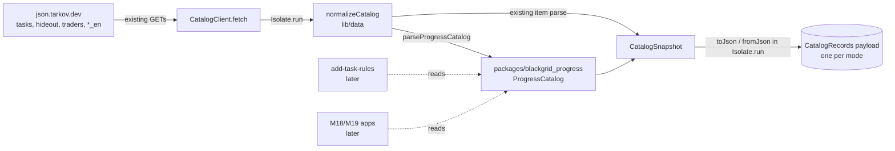
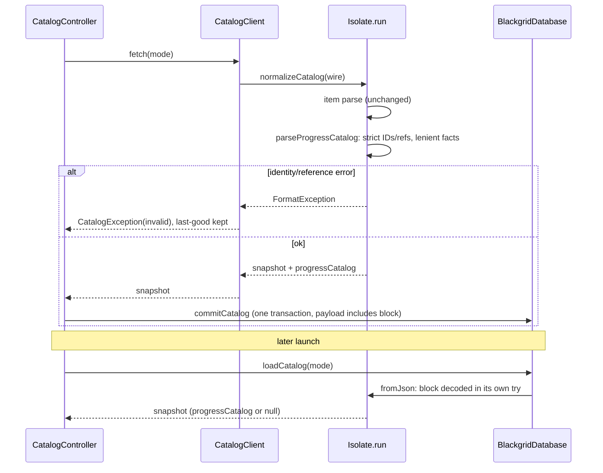

# Design

## Triage

| Trigger | Applies? | Evidence |
|---|---|---|
| T1 Components (new component, or 3+ with directed relationships) | yes | New `packages/blackgrid_progress` package, used by `catalog_normalizer.dart`, `CatalogSnapshot` and the later rules |
| T2 State (persistent state, caches, 3+ state machine) | yes | New optional block in the persisted per-mode catalog snapshot (`CatalogRecords.payload`, `lib/data/database.dart:365-399`) |
| T3 Concurrency (background work, workers/isolates, async, retries) | yes | Parsing runs inside the existing `Isolate.run` normalization (`lib/data/catalog_client.dart:128-130`) and decode (`lib/data/database.dart:784-787`); the block must be isolate-sendable |
| T4 Boundaries (data format, migration, shared interface, IPC, external) | yes | Stored JSON format, a shared package API for the rules and the web/mobile apps, the external tarkov.dev wire shape |
| T5 Volume (grows without a fixed bound) | yes | The task count grows each wire; about 1.1 MB more per mode today (measured below) |
| T6 Risk (security, money, data loss, unrecoverable user data) | no | Downloaded data that the next refresh rebuilds; no user data |

TIER: FULL

## Context

- The catalog already downloads six datasets and four English dictionaries per mode (`lib/data/catalog_normalizer.dart:8-16`) and parses `tasks` and `hideout` strictly. That parse only feeds `ItemRequirement` rows and `RequirementGate`s (`catalog_normalizer.dart:142-345`); it drops task facts, objectives other than item objectives, fail conditions and station level data.
- The snapshot is one normalized JSON payload per mode, written and swapped in one transaction. Only one record per mode is kept (`database.dart:365-399`). It is decoded in `Isolate.run` (`database.dart:784`), and `CatalogSnapshot.fromJson` refuses `schemaVersion`/`normalizerVersion` other than 1 (`lib/domain/catalog.dart:532-535`).
- Precedent for an optional block without a version bump: `scavCooldown` (`catalog.dart:468`, `:530`, `:561-565`; ADR-0031).
- A cached snapshot loads `stale`, and choosing a known mode starts an automatic refresh (catalog-authority spec). After an upgrade, the first online launch therefore fills the block.
- Live wire, checked 2026-11-12 (`json.tarkov.dev/{regular,pve}/{tasks,hideout,traders,tasks_en}`):
  - Regular has 503 tasks and PvE 499, about 25 unique to each. There are 1416 objectives in 20 types, at most 44 in one task. Hideout has 26 stations and 68 levels.
  - No `gameEditions` field exists on any task. `taskRequirements[].status` takes `complete`, `active` and `failed` in combinations.
  - Alternatives are `failConditions` of type `taskStatus` (35, all `["complete"]`). `traderRequirements` use `requirementType` `level`/`reputation` and `compareMethod` `>=`, `<=`, `<`.
  - `requiredPrestige` (3 tasks) and `gameMode` (4 tasks) are present.
  - Every reference resolves in both modes, objective IDs are unique, and every name and description has an English text.
- Local progress keys entities by tarkov.dev ID, mode and cycle (ADR-0041, `openspec/specs/local-progress/spec.md:44`).
- The proposal (S1–S5) fixes the scope: a plain-Dart package, an optional block, strict identities with lenient facts, the retained fields and synthetic fixtures.

## Decisions

### D1: Pub workspace with one lockfile

- **Choice:** The root `pubspec.yaml` declares `workspace: [packages/blackgrid_progress]`, and the package sets `resolution: workspace`. The app depends on it by path, and there is one `pubspec.lock`. The package depends only on the Dart SDK. Its dev dependencies are `test` and `lints`, at the versions the root lock already holds. `mise run test` and `mise run test:all` each gain a step that runs `dart test` in the package. `mise run analyze` (`flutter analyze`) already walks the tree. CI calls those tasks (`.github/workflows/gates.yml:75-78`), so it needs no workflow edit.
- **Rejected:** A plain path dependency with its own lockfile. Two lockfiles drift, and the weekly dependency update has to refresh both.
- **Reversal cost:** low.
- **Important:** yes. It binds future changes (the build and test boundary every later package change uses).
- **Chosen by:** user.

### D2: Immutable model, `null` or `unknown` for unknowns, sealed objective facts

- **Choice:**
  - Immutable classes `ProgressCatalog`, `CatalogTask`, `TaskPrerequisite`, `TaskAlternative`, `FailCondition`, `TraderRequirement`, `TaskObjective`, `HideoutStation`, `StationLevel`, `StationRequirement` and `SkillRequirement`.
  - Unknown facts are `null`, or an `unknown` member of the enums `TaskFaction`, `TaskStatus`, `TraderRequirementType`, `Comparison` and `ObjectiveType` (the 20 live types plus `unknown`). An unknown is never `false`, zero or `Any`.
  - An unrecognized objective type is `ObjectiveType.unknown` and keeps its raw type string, as `FailCondition` does.
  - Absent wire lists (`taskRequirements`, `traderRequirements` and `failConditions` on a task; `stationLevelRequirements`, `traderRequirements` and `skillRequirements` on a level) are `null` (unknown), and a present empty list is `[]` (none). The existing model records the same gap as `RequirementGate.incomplete` (`catalog_normalizer.dart:212-220`).
  - Each objective holds its common fields plus a `sealed ObjectiveFacts`. The rules switch over it exhaustively. The type-to-facts mapping is the one in the spec's item-bearing and target objective requirements:
    - `findItem`, `giveItem`, `plantItem` and `sellItem` read `items` and `foundInRaid` into `ItemFacts`;
    - `buildWeapon` reads `item`, `useItem` reads `useAny` and `mark` reads `markerItem`, each into `ItemFacts` with found in raid unknown;
    - the three `*QuestItem` types read `questItem` (a string or `{id}`) into `QuestItemFacts`;
    - `taskStatus` reads into `TaskStatusFacts`, `traderLevel` into `TraderLevelFacts`, `traderStanding` into `TraderStandingFacts` and `skill` into `SkillFacts`;
    - every other type gets `NoFacts`.
  - `ProgressCatalog` builds read-only indexes on construction: tasks by ID, stations by ID, and the IDs of objectives shared by more than one task. These are derived, never stored.
- **Rejected:** A flat objective class with every type fact nullable. Consumers would have to know which fields go with which type, and the compiler cannot check it.
- **Reversal cost:** medium. The rules and later changes code against it.
- **Important:** yes. It binds future changes (a shared contract).
- **Chosen by:** user.

### D3: The package owns wire parsing, and the app normalizer calls it

- **Choice:**
  - The package exposes `parseProgressCatalog(tasksData, hideoutData, traderIds, taskDictionary, hideoutDictionary)` and `ProgressCatalog.fromJson`/`toJson`.
  - `normalizeCatalog` calls it after its existing validation, inside the same `Isolate.run`, and attaches the result to `CatalogSnapshot.progressCatalog`.
  - Identity and reference errors throw `FormatException`, which the existing `catch` in `CatalogClient.fetch` maps to `CatalogFailure.invalid` (`catalog_client.dart:117-125`). The error text and the last-good behaviour stay as today.
  - The existing `ItemRequirement` and `RequirementGate` parse stays unchanged, so advice is unaffected (spec: existing advice unchanged).
- **Rejected:** Rewriting the item-requirement parse on top of the new model. It would put advice at risk in a change that must not alter it. A later change can unify the two once the rules exist.
- **Reversal cost:** low.
- **Important:** no.
- **Chosen by:** agent.

### D4: The block carries its own `formatVersion`; loading is lenient and saving strict

- **Choice:**
  - `CatalogSnapshot.toJson` writes `progressCatalog: {formatVersion: 1, tasks: [...], stations: [...]}` only when the block is present.
  - `fromJson` decodes it inside its own `try`. An absent block, another `formatVersion` or any decode error gives `progressCatalog: null`, while the item data still loads.
  - The snapshot `schemaVersion` and `normalizerVersion` stay 1, so authority (`catalog.dart:479-487`) is unchanged.
  - The next refresh rewrites the payload even when the revision is unchanged (`database.dart:389-392`).
- **Rejected:** No version field at all. A later incompatible change would then have to bump the whole snapshot schema, which refuses every cache.
- **Reversal cost:** medium. It is a stored format.
- **Important:** yes. It binds future changes (data format).
- **Chosen by:** user.

### D5: Strict and lenient fields

- **Choice:** Within S3, the following are strict and reject the refresh:
  - a missing ID on a task, objective, station or level, or one that is not a string;
  - a duplicate task or station ID, or a duplicate objective ID within one task;
  - a missing or non-positive level number;
  - an unresolved task trader, prerequisite, alternative, `taskStatus` objective task, trader requirement trader or required station.

  The fields the existing item-requirement parse already validates also keep their current strictness (user decision on review C1): `minPlayerLevel`, `factionName` type, prerequisite statuses, every objective's `type`, and the count, found-in-raid, optional and item fields of `findItem`, `giveItem`, `plantItem` and `buildWeapon` objectives (`catalog_normalizer.dart:176`, `:203-204`, `:233`, `:242-251`). The new parse never needs to reject them, because the item parse runs first.

Everything newly retained is lenient and becomes `null` or `unknown`: the Kappa, Lightkeeper and restartable flags, an unknown faction string, unknown status strings, trader requirement type, comparison and value, the facts of non-item objectives, maps, prestige, game mode, construction time, station level facts and descriptions.

Some IDs are not resolved. Maps have no catalog dataset. The `data.prestige` and `data.questItems` collections in the tasks payload are not retained by this change; `add-task-rules` decides whether prestige needs them. Item references in item objectives are already resolved by the existing parse, and objective traders are display facts.
- **Rejected:** Resolving map IDs against the prepared map packs. That couples the catalog to the map pack generation, and a new map would then reject item updates.
- **Reversal cost:** low.
- **Important:** no.
- **Chosen by:** agent.

### D6: An offline audit keeps the package pure

- **Choice:** A root test reads `packages/blackgrid_progress/pubspec.yaml` and every `.dart` file under `lib/` and fails on any Flutter SDK dependency, `package:flutter`, `dart:ui`, `dart:ffi`, `dart:io`, `dart:isolate` or `package:win32` import. This follows the precedent of the log-input source audit (architecture "Game inputs").
- **Rejected:** Relying on the package being run under `dart test` alone. `dart test` passes even when the code imports `dart:io`, which web cannot use.
- **Reversal cost:** low.
- **Important:** no.
- **Chosen by:** agent.

### D7: Record ADR-0042

- **Choice:** During apply, write `docs/adr/0042-progress-catalog-package.md`. It records that the progress model and rules live in a plain-Dart workspace package, that the task catalog rides in the per-mode item snapshot as an optional versioned block, and that identities are strict and facts lenient. The same task adds the package row and the catalog-snapshot state row to `openspec/architecture.md`, and indexes the ADR there.
- **Rejected:** Updating `architecture.md` without an ADR. A boundary that web and mobile depend on would then have no decision record.
- **Reversal cost:** low.
- **Important:** yes. It binds future changes.
- **Chosen by:** user.

### Decision summary

| # | Decision | Choice | Rejected | Reversal cost | Important | Chosen by |
|---|---|---|---|---|---|---|
| S1 | Model home | New plain-Dart package now | `lib/domain`, move later | medium | yes | user |
| S2 | Storage | Optional block in per-mode snapshot | Schema bump to v2; own Drift tables | medium | yes | user |
| S3 | Bad data | Strict identities and already-validated fields as today; new facts lenient (narrowed on review C1) | Drop block; reject on anything | low | yes | user |
| S4 | Retained scope | Roadmap list + text, maps, flags, station requirements | Also finish rewards | low | yes | user |
| S5 | Fixtures | Synthetic, live-shaped | Live excerpt now | low | no | agent |
| D1 | Wiring | Pub workspace, one lockfile, `mise run test` runs package tests | Plain path dependency | low | yes | user |
| D2 | Model API | Immutable, null/`unknown`, absent lists unknown, sealed objective facts per type table | Flat nullable objective | medium | yes | user |
| D3 | Parse ownership | Package parses; normalizer calls it; item parse untouched | Rebuild item parse on new model | low | no | agent |
| D4 | Block versioning | Own `formatVersion`; lenient load | No version field | medium | yes | user |
| D5 | Strict and lenient fields | IDs, levels, references and already-validated fields strict; new facts lenient; maps, prestige and quest items unresolved | Resolve maps against packs | low | no | agent |
| D6 | Purity guard | Offline pubspec and import audit | `dart test` only | low | no | agent |
| D7 | ADR | Record ADR-0042 and update architecture | architecture.md only | low | yes | user |

## Diagrams (FULL)

T1 components and T4 boundary:

T2/T3: refresh and load sequence:

## State & Ownership (FULL)

| State | Owner (sole writer) | Lifetime | Invalidation / rebuild | Authoritative copy |
|---|---|---|---|---|
| `progressCatalog` block in a snapshot | `normalizeCatalog` builds it; `CatalogController` publishes it through `commitCatalog` | Same as its snapshot: one per mode until the next successful refresh | Replaced atomically with the items; an unreadable or other-version block loads as `null` and the next refresh rebuilds it | `CatalogRecords.payload` of the mode's active record |
| Derived indexes (tasks by ID, stations by ID, shared objective IDs) | `ProgressCatalog` constructor | In memory, per snapshot instance | Rebuilt on every construction; never stored | Derived from the block |

## Failure & Visibility (FULL)

| Component | Fails / dies mid-operation → | Recovery | Retry safe? | Who finds out |
|---|---|---|---|---|
| `parseProgressCatalog` (identity or reference error) | The refresh throws `FormatException` → `CatalogFailure.invalid` | Last-good snapshot and block kept; a manual refresh or mode selection retries | yes (read-only) | User: the existing "Item data from tarkov.dev was incomplete or invalid." text in Settings and the status bar |
| `parseProgressCatalog` (odd fact) | The value becomes `null` or `unknown`; the refresh succeeds | — | — | Nobody now. The rules (`add-task-rules`) report unknown inputs as a reason, which makes it visible at the point of use |
| Block decode on load | The block becomes `null`; the items load | The automatic refresh on mode selection rebuilds it | yes | Nobody until a consumer exists. Consumers in later changes show "task data unavailable"; this change has no consumer (spec: no screen changes) |
| `commitCatalog` with the larger payload | The transaction rolls back (`CatalogFailure.save`) | Last-good kept | yes | User: the existing save-failure text |
| Package purity regression | Audit test fails | Fix the import | — | Developer and CI (`mise run test`) |

## Resource Bounds (FULL)

| Queue / buffer / cache / transfer | Bound | At the bound | Timeout | At 10x / 100x |
|---|---|---|---|---|
| Wire bodies (`tasks` about 2.1 MB per mode) | Unchanged: no byte cap today (architecture "HTTP response bodies"). This change adds no request | — | Existing 30 s per dataset | Unchanged by this change; the existing uncapped-body risk stays recorded in the architecture |
| Stored block | About 1.1 MB of JSON per mode (measured 2026-11-12: tasks 1.10 MB, hideout 0.03 MB), one record per mode, three modes, so about 3.4 MB | One record per mode is kept; older ones are deleted in the same transaction | — | 10x (5000 tasks) gives about 11 MB per payload, decoded in `Isolate.run` off the UI isolate: acceptable. 100x is not plausible for a game's quest list; the evidence that would change the call is a wire over 10 MB |
| In-memory indexes | Linear in the task, objective and station count | — | — | Same scaling as the block |
| Objectives per task | No cap (44 maximum today) | — | — | Lists are linear; no quadratic pass. Shared-ID detection is one map pass |

## Flow & State Gaps (FULL)

- **Partial completion:** parsing and commit happen inside one candidate and one transaction, so there is never an item snapshot of one revision with a block of another.
- **Concurrent refreshes and mode switches:** unchanged. The existing per-mode join and generation fences (`catalog_controller.dart:101-170`) publish the whole snapshot or nothing.
- **Stale data:** a cached block follows its snapshot's `stale` status. There is no separate freshness clock for task data.
- **Upgrade:** a pre-change cache loads with `progressCatalog == null`, and the automatic refresh fills it. When the wire bytes are identical, the revision is too, and the payload is overwritten in place (`database.dart:389-392`).
- **Downgrade:** an older app reads a payload with an unknown `progressCatalog` key. `fromJson` ignores unknown keys (`catalog.dart:532-567` reads named keys only), so the items still load.
- **Mode differences:** PvE and regular task sets differ. Each block is built only from its own mode's datasets, and a reference to a task of another mode is an unresolved reference.

## Mechanism Ledger (FULL)

| Mechanism | Built? | Why (harm nobody catches / expensive later) | Evidence that would change the call |
|---|---|---|---|
| Block `formatVersion` | yes | Stored format: hard to add later without a snapshot schema bump | — |
| Lenient block decode on load | yes | A damaged block must not take item data and advice with it | — |
| Purity audit test | yes | A `dart:io` import would silently break the planned web reuse | — |
| Shared objective flag | yes | Progress keyed by objective ID would merge two tasks' objectives without anyone noticing | — |
| Separate freshness or status for task data | no | Task data rides on the item snapshot's status; no consumer yet | A consumer needs task data while the items are fine but the block is missing |
| Byte cap on wire bodies | no | Out of scope; existing risk, no new request | A body cap change for the catalog client |
| Fallback that keeps the previous block when only task identity breaks | no | S3: identity errors reject the whole refresh, keeping everything last-good | tarkov.dev identity breakage observed in practice |
| Unifying the item-requirement parse with the new model | no | Would risk advice (D3) | `add-task-rules` or later needing one source |
| Edition data | no | The wire has no `gameEditions`; edition rules are written in `add-task-rules` | tarkov.dev adds edition data |

## Risks / Trade-offs

- [A tarkov.dev identity or reference glitch now also rejects item and price updates] → The same strictness already applies to `taskRequirements`, traders and stations in the existing parse (`catalog_normalizer.dart:84-89`, `:167-176`). The only new strict checks are alternatives, `taskStatus` objective tasks and objective IDs per task, and the live data passes all of them in both modes.
- [Bigger payload slows the cached load at startup] → The decode already runs in `Isolate.run`, and the load is non-blocking (catalog-authority). The size is measured above.
- [Two parses of `taskRequirements` (existing gate and new model) could disagree] → Both read the same wire. Tests pin the new model, and D3 records the unification as deliberately deferred.
- [A synthetic fixture misses a real wire quirk] → The fixtures copy the field shapes observed on 2026-11-12. `add-task-rules` adds frozen live fixtures (S5).

## ADRs

- **In force, constraining this change:**
  - ADR-0003: one Drift store, no new tables here.
  - ADR-0004: parse and decode stay in `Isolate.run`.
  - ADR-0031: optional block precedent.
  - ADR-0041: tarkov.dev IDs, mode and cycle keys.
- **To record during apply:** ADR-0042, the progress catalog package and stored block (D7).

## Open Questions

- The package name `blackgrid_progress` can be changed during apply without affecting specs or tasks.
