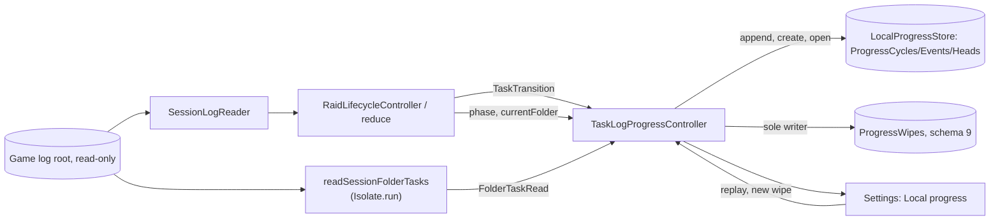
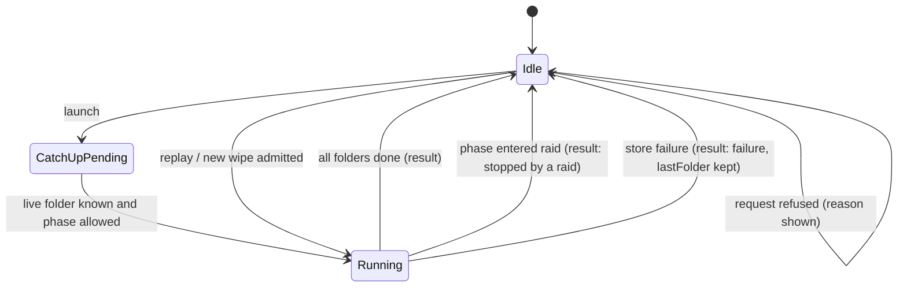
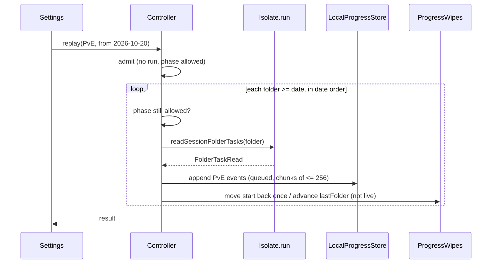

# Design

## Triage

| Trigger | Applies? | Evidence |
|---|---|---|
| T1 Components (new component, or 3+ with directed relationships) | yes | New log-progress controller and one-shot folder reader. Reader, lifecycle, controller, progress store, wipe table and Settings are linked in a chain. |
| T2 State (persistent state, caches, 3+ state machine) | yes | New `ProgressWipes` table (Drift schema 9). The controller's run state has idle, catch-up pending, running and refused. The reducer gains a per-folder mode. |
| T3 Concurrency (background work, workers/isolates, async, retries) | yes | Folder reads in `Isolate.run`. Live writes interleave with catch-up and replay writes against a store that admits one operation (`local_progress_store.dart:204-207`). |
| T4 Boundaries (data format, migration, shared interface, IPC, external) | yes | Durable log event ID format, schema 9 migration, a new raid transition type, and reading game log files. |
| T5 Volume (grows without a fixed bound) | yes | The number of log folders in the root and their sizes. Events per wipe grow with play. |
| T6 Risk (security, money, data loss, unrecoverable user data) | yes | Progress history is user data. Writing to the wrong mode or wipe cannot be removed later (ADR-0041 forbids deletion). |

TIER: FULL

## Context

See proposal.md for the why and scope decisions S1–S7.

- **Task events exist and are dropped.** `parseGameLogRecord` turns push types 10/11/12 into `TaskStarted/Failed/Finished` (`lib/data/game_log/game_log_parsers.dart:152-169`). The reducer returns them with no transition (`lib/domain/raid_lifecycle.dart:629`). Flea sales are the model to follow: a `FleaSoldTransition` carries `state.sessionMode` (`raid_lifecycle.dart:615-627`).
- **Session mode carries across folders.** `_folderChanged` keeps `sessionMode` (`raid_lifecycle.dart:647-659`); only `LogInputReset` clears the state (`:598`). D3 needs a per-folder mode.
- **Live reader.** `SessionLogReader` selects the newest folder (`lib/data/session_log_reader.dart:242-302`). It frames files with `LogFileTail.read(file, size)` (`lib/data/game_log/log_file_tail.dart:158`) and sorts each scan by (time, file rank, offset) (`session_log_reader.dart:320-331`). The folder regex and file patterns are private (`:614-625`). It publishes batches that the lifecycle folds (`lib/application/raid_lifecycle_controller.dart:36-46`).
- **Wiring.** `AppServices` builds the lifecycle and its subscribers before the first bind, because transitions are not buffered (`lib/application/app_services.dart:101-120`). `LocalStatsController` is the pattern for a transition subscriber with one write queue and per-kind error messages (`lib/application/local_stats_controller.dart:25-120`).
- **Ledger.** `LocalProgressStore` gives cycles per mode, idempotent appends of at most 256 events and one admitted operation per instance, with `ProgressBusy` and no queue (`lib/domain/local_progress_store.dart:204-260`). Events are named version-1 records (`lib/domain/local_progress.dart:160-230`). ADR-0041 leaves active cycles, writers and timezone conversion to later M9 changes.
- **Database.** Drift schema 8 with an explicit upgrade chain (`lib/data/database.dart:303-340`). Progress tables live in `lib/data/database_progress.dart`.
- **Isolates.** `Isolate.run` is already used for pure work (`lib/application/live_map_data_controller.dart:262`, `lib/application/recognition_matcher.dart:3-17`).
- **Push log gap.** The game writes no push notification during raid loading or play (ADR-0030 consequences).

## Decisions

### D1: Active wipes live in a Drift schema 9 `ProgressWipes` table

- **Choice:** `ProgressWipes(mode TEXT PK, cycleId, startDate TEXT YYYY-MM-DD, lastFolder TEXT NULL, updatedAtMs)`, with a composite foreign key `(mode, cycleId)` to `ProgressCycles`. The upgrade is additive (`from < 9` creates the table) and existing rows are untouched. A `ProgressWipeStore` interface in `lib/domain/` (read all, insert-or-replace one mode, advance `lastFolder` monotonically, move `startDate` earlier) is implemented by `BlackgridDatabase`. The log-progress controller is its only writer.
- **Rejected:** A `progressWipes` key in the `Preferences` row, because SettingsController would then own progress state and nothing would tie the stored cycle ID to a real cycle.
- **Reversal cost:** medium. It is a stored table, but additive and with one owner.
- **Important:** yes. It is a stored data format.
- **Chosen by:** user.

### D2: Log events have deterministic readable IDs (new ADR-0044)

- **Choice:** `eventId = "log1|" + cycleId + "|" + folder + "|" + fileName + "|" + offset`, with `fileName` the literal token `pushNotifications` (written out in the ID builder, never `LogFile.name`, so renaming the enum cannot change stored IDs; a test pins one full ID) and `offset` in decimal. The device ID is the store's `progressDeviceId()`. `occurredAtMs` is the record's local log time via `DateTime.millisecondsSinceEpoch`, which is UTC; an ambiguous fall-back hour resolves the same way on every read. `source` is `log`, the target is `(task, <taskId>, state)` and the value is `ProgressTaskState`. An ID over the identity budget (`ProgressEventCodec.validateIdentity`) is skipped and counted. The `log1` prefix versions the scheme.
- **Rejected:** A SHA-256 of the same parts, because it is opaque in history and the readable form fits the budget (about 120 of 256 bytes) for every real folder name.
- **Reversal cost:** high. IDs are durable and portable. Evidence: real folder names are at most about 50 characters (`log_2026.10.31_21-21-11_1.3.0.0.48484`).
- **Important:** yes. It binds a data format.
- **Chosen by:** user.

### D3: Task transitions carry the mode logged in the same folder

- **Choice:** `RaidLifecycleState` keeps `folderMode` and immutable timestamped mode evidence for the current folder, cleared by `SessionFolderChanged` and `LogInputReset`. Each `SessionModeChanged` contributes its time, application-record offset and recognised mode (`GameMode.unknown` contributes null). `TaskTransition(id, time, taskId, ProgressTaskStatus status, GameMode? mode)` resolves the greatest mode-evidence `(time, offset)` whose time is at or before the task's log time. Application records precede push records at equal times. This also handles a push file recovering after a read failure: live scans only sort their own batches, so processing order is not log-time order across scans. No preceding recognised evidence, or a latest applicable unknown mode, yields null. `sessionMode`, `folderMode` as the latest processed mode, and flea sales retain their existing behavior. Mode history changes only on mode events; task lookup does not copy it.
- Attribution also requires complete input evidence: both readers snapshot the push file first and the application file last, then consume application bytes through that later snapshot before releasing any tasks from the push snapshot. Live input defers push consumption if the application read fails, ends short or leaves a partial line; completed application records may still be published, and the unchanged push position is recovered on a later scan. A one-shot read returns unreadable with no partial tasks in those cases. A missing application file remains the specified no-mode case, not a fallback to carried mode. A shared snapshot helper and injected stat callback expose this ordering seam to deterministic offline tests (design review C1).
- **Rejected:** Using carried `sessionMode` or only the latest processed `folderMode`, because delayed push records would disagree with one-shot replay and could permanently contaminate another mode's immutable ledger.
- **Reversal cost:** low. It is an internal reducer field.
- **Important:** yes. It changes which mode progress lands in, as players see it.
- **Chosen by:** user.
- **Pre-ship correction:** The user approved timestamped same-folder evidence on 2026-11-12 after review F1 demonstrated delayed push recovery across a mode change.

### D4: Dates are picked with the Flutter date picker

- **Choice:** Each mode row has a date button that opens `showDatePicker` with the app theme. Its range is the oldest folder date (or 2017-01-01 when unknown) to today, and the initial date is the wipe start or today. The theme's `ColorScheme` comes from Ember (ADR-0037). No colour literals are added.
- **Rejected:** A typed `YYYY-MM-DD` field, because it allows invalid dates that then need rejecting.
- **Reversal cost:** low.
- **Important:** yes. Players see it.
- **Chosen by:** user.

### D5: One `TaskLogProgressController` owns recording, runs and the wipe table

- **Choice:** An app-scoped `ChangeNotifier` built in `AppServices` before the first bind, beside `LocalStatsController`. It subscribes to `raidLifecycle.transitions` (`TaskTransition` only), listens to the lifecycle for phase and current folder, and owns the `ProgressWipes` rows and every `LocalProgressStore` write for log progress, through one FIFO write queue. Append failures are split in two kinds. Transient failures (`ProgressStorageFailure`, `ProgressBusy`, `ProgressUnavailable`) stop a run with `lastFolder` kept, and are shown for a live batch. Per-record failures (`ProgressIdentityConflict`, `ProgressInvalidInput`) reject the whole batch, so the controller retries that chunk one event at a time. Each rejected record is counted as skipped for a conflicting record, and the rest are stored. A run then continues and advances `lastFolder` as usual, so one bad record (for example a re-read after a Windows time-zone change, which gives the same ID a different time) can never block catch-up. It exposes the wipes per mode, the run state, the last result and the error messages to Settings.
- Live writes resolve the active wipe inside the FIFO operation and skip records whose folder date precedes that wipe's start. This applies to restart/rebind replay as well as newly appended log bytes; explicit earlier-date replay is the separate path that may move the start earlier (pre-ship F2).
- **Rejected:** Recording inside `RaidLifecycleController` or in a store-side writer, because that mixes the pure lifecycle with storage, and the queue is needed anyway since the store rejects concurrent operations.
- **Reversal cost:** medium. `add-manual-progress` will also write to the store and must share this queue or one above it (see Risks).
- **Important:** yes. It binds future changes, being the writer boundary for the ledger.
- **Chosen by:** agent.

### D6: Older folders are read in `Isolate.run`, one folder per call

- **Choice:** `lib/data/game_log/session_folders.dart` exposes the shared folder regex, file patterns and `listSessionFolders(root)`; the live reader then uses the same helpers. `readSessionFolderTasks(folderPath)` runs in `Isolate.run`. It reads `application_000.log` and `push-notifications_000.log` with `LogFileTail` to their current sizes, parses with `parseGameLogRecord`, sorts as the live reader does, and folds `SessionFolderChanged` plus the events through `reduce` from the initial state. It returns a compact `FolderTaskRead(folder, tasks: List<TaskTransition>, skippedNoMode, rejected, unreadable)`. The backend log is not read: it holds no mode or task lines.
- Both live and one-shot readers use push-first/application-last size snapshots. The application completeness barrier precedes task attribution even when replay reads a growing live folder; timestamped mode history alone cannot compensate for a preceding mode line omitted by an earlier snapshot.
- **Rejected:** Reading on the UI isolate, because application logs can be tens of megabytes per session (unverified, judged from log volume) and regex parsing of a month of them would jank the UI. A long-lived worker isolate was also rejected: there is no state to keep between folders.
- **Reversal cost:** low.
- **Important:** no.
- **Chosen by:** agent.

### D7: Catch-up and runs exclude or include the live folder by kind

- **Choice:** Folder order is always (parsed folder date-time, then name), from the shared `session_folders.dart` helper. Raw name order is wrong for one-digit hours (`_9-00-00` sorts after `_10-00-00`), and the folder regex accepts those (`session_log_reader.dart:614-617`). Catch-up reads the union, over the existing wipes, of folders with `date >= startDate`, later than `lastFolder` in that order, and older than the live folder, which the live reader owns. Each folder's messages go to each mode's wipe only when the folder is within that wipe's range. A mode with no wipe gets one from its first message, with that folder's date as start (S4), and its later messages in the same run go to it. With no wipe at all (a fresh install) catch-up has no range and reads nothing; the first live message creates the wipe. Replay and new wipe also read the live folder to its current size, so a new wipe gets the messages already published into the old one. `lastFolder` only ever advances in that order, and never to the live folder.
- Each run captures its live-folder frontier at admission. Replay may read a newly listed folder at or beyond that frontier, but only folders strictly older than the captured frontier can advance `lastFolder`. Equality alone does not prove a folder is closed: a newer folder may already exist before the live reader binds it (pre-ship F3).
- **Rejected:** Excluding the live folder from replay too, because a new wipe would then miss the live session's earlier task messages.
- **Reversal cost:** low.
- **Important:** no. It is forced by correctness of S1 and is in the spec.
- **Chosen by:** agent.

### D8: Raid guard and run admission

- **Choice:** A run is admitted only when no run is active, a live folder is known (`state.currentFolder != null`) and the phase is `unknown`, `inMenus` or `raidEnded`. Catch-up is requested once per launch and whenever a refused catch-up's guard clears. A running replay or catch-up checks the phase before reading each folder and stops with "stopped by a raid" when it is in queue, match found, raid starting or in raid. The folder being stored is finished first.
The "stopped by a raid" result may name the last folder stored as progress, but a replay also exposes its original selected date as `retryFrom`. The player replays again from that original date: catch-up cannot resume older work below an existing watermark.
- **Rejected:** Pausing and resuming a replay after the raid, because it keeps hidden state across raids. A stopped catch-up continues at the next launch. A stopped replay is requested again by the player from its original selected date.
- **Reversal cost:** low.
- **Important:** no.
- **Chosen by:** agent.

### Decision summary

| # | Decision | Choice | Rejected | Reversal cost | Important | Chosen by |
|---|---|---|---|---|---|---|
| S1 | Wipe model | Replay fills the active wipe; new wipe is a fresh cycle + replay | Every replay builds a new cycle | high | yes | user |
| S2 | Missed sessions | Catch up at startup, outside a raid | Manual replay only | medium | yes | user |
| S3 | UI home | Settings "Local progress" after Tracker progress | Diagnostics | low | yes | user |
| S4 | First wipe | Auto-created at that folder's date | Record nothing until set | low | yes | user |
| S5 | Unknown task IDs | Stored as given | Dropped | low | no | agent |
| S6 | No mode | Skipped and counted, including an unrecognised mode | Guess from app mode | low | no | agent |
| S7 | Tracker and screens | Unchanged | Show recorded tasks now | low | no | agent |
| D1 | Wipe storage | Drift schema 9 `ProgressWipes` | Preferences JSON | medium | yes | user |
| D2 | Event IDs | `log1\|cycle\|folder\|file\|offset` (ADR-0044) | SHA-256 | high | yes | user |
| D3 | Task mode | Timestamped same-folder mode evidence at task log time, behind a complete application snapshot; unknown = no mode | Carried/latest processed mode; unseen preceding evidence | low | yes | user |
| D4 | Date entry | Flutter date picker | Typed field | low | yes | user |
| D5 | Writer | One controller and write queue; per-event fallback on per-record rejections | Lifecycle or store-side writer | medium | yes | agent |
| D6 | Folder reads | `Isolate.run` per folder; both readers snapshot push first/application last and gate tasks on complete application consumption | UI isolate; long-lived worker; unordered/incomplete snapshots | low | no | agent |
| D7 | Folder range and order | Date-time order; live appends respect wipe start; only folders older than captured live frontier advance the watermark; earlier replay failures expose original retry date | Any non-live folder watermark; implicit earlier-replay resumption | low | no | agent |
| D8 | Raid guard | Admit in unknown/menus/ended; stop between folders | Pause and resume | low | no | agent |

## Diagrams (FULL)

Components (T1, T4):

Run state (T2, T3):

Replay sequence (T3):

## State & Ownership (FULL)

| State | Owner (sole writer) | Lifetime | Invalidation / rebuild | Authoritative copy |
|---|---|---|---|---|
| Active wipe per mode (cycle, start date, last folder read) | `TaskLogProgressController` via `ProgressWipeStore` | Durable | `lastFolder` only advances in (folder date-time, name) order; `startDate` only moves earlier, except a new wipe, which replaces the row with a new cycle | `ProgressWipes` row |
| Task progress events | `LocalProgressStore` (written only by the controller in this change) | Durable, never deleted | Heads are rebuilt by the store (ADR-0041) | `ProgressEvents` |
| Per-folder mode evidence | Pure reducer | Memory, current folder | Cleared on folder change and reset; task lookup uses log time and mode-record offset, not delivery order | Reducer state |
| Run state, last result, error messages | Controller | Memory, app run | Replaced by the next run; a write error clears on the next successful write | Controller fields |
| Opened-cycle validity per mode | Controller (from `openProgressCycle` at start) | Memory, app run | Re-opened at launch and after a new wipe | Store's validation |

## Failure & Visibility (FULL)

| Component | Fails / dies mid-operation → | Recovery | Retry safe? | Who finds out |
|---|---|---|---|---|
| Live recording write | That batch is not stored; later batches continue | The next catch-up re-reads that folder once it is no longer live; replay reads it at any time | Yes, IDs are deterministic | User: "Some task progress could not be saved." in Local progress until the next successful write |
| Wipe creation | No wipe for the mode; message not stored | The next task message tries again | Yes (an orphan cycle is possible only if the row write fails after creation; it holds nothing and is harmless) | User: section message |
| `openProgressCycle` unavailable | Mode's wipe shown unavailable; nothing recorded for it | The player starts a new wipe (old history kept) | Yes | User: row says the wipe is unavailable |
| One-shot read of a folder | Counted unreadable; run continues | Replay from its date | Yes | User: run result |
| Catch-up append, transient failure | Run stops without advancing the failed folder | Next launch's catch-up resumes from the watermark | Yes | User: failure result |
| Replay append, transient failure | Stored work remains; an older existing watermark may stay ahead of the interrupted replay | Player replays again from the original selected date, exposed as `retryFrom` in the failed result | Yes, deterministic IDs | User: failure and retry date in Local progress |
| Append rejects a record (identity conflict, invalid input) | The chunk is retried one event at a time; the rejected record is skipped and counted; the run continues | None needed: the record can never be stored as is | Yes, deterministic | User: run result counts "conflicting record"; for live batches, the not-saved message |
| Isolate error or crash in a folder read | Treated as unreadable for that folder | As above | Yes | User: run result |
| App closed during catch-up | Completed folders remain stored | Next launch catches up after the retained watermark | Yes | Existing watermark provides recovery |
| App closed during replay | Completed work remains; unfinished work below an old watermark is not resumed | Player replays again from the same originally selected date | Yes, deterministic IDs | Standing Local progress note warns that closing Blackgrid stops replay; no hidden auto-resume state |
| Schema 9 upgrade | Database open fails, as for any upgrade failure today | Existing durability rules | — | User: existing database error path |

## Resource Bounds (FULL)

| Queue / buffer / cache / transfer | Bound | At the bound | Timeout | At 10x / 100x |
|---|---|---|---|---|
| Controller write queue | One running operation. Live transitions queue in order; runs add one folder's chunks at a time | Runs wait between folders, so live writes are never starved for more than one chunk | None (local SQLite) | Live messages are a few per session; fine |
| Append batch | At most 256 events (`progressPageLimit`); a folder's events are chunked | Chunked | — | — |
| Mode evidence | One compact entry per mode-change record in the current application log; no hard count cap | Retained until folder change/reset so arbitrarily delayed push records remain attributable | — | Linear in mode changes, not all log records; repeated tasks add no history entries |
| One-shot read input | Existing tail limits: 8 KiB chunks, 64 KiB lines, push records of at most 1 MiB and 8 192 lines (ADR-0030); files read to their size at stat | Over-limit record rejected and counted | None | A 50 MB application log streams in 8 KiB chunks; memory stays flat |
| `FolderTaskRead` transfer | Task messages of one folder (typically under 50) plus counters | No cap needed: bounded by the push file's size and the 1 MiB record cap | — | 100x is still small lists |
| Folder listing | All `log_*` entries in the root, names and dates only | Linear scan | — | 10 000 folders is a list of 10 000 short records; acceptable |
| Folders per run | Unbounded (all folders from the date) | Progress shown; stops on raid; later catch-up continues catch-up only, while replay is requested again from its original selected date | None | 100x means minutes of background reading; the UI stays responsive (D6) |
| Concurrent runs | 1 | Refused with "another log read is running" | — | — |

## Flow & State Gaps (FULL)

- **Live write while a run appends.** Both go through the controller queue, never concurrently into the store, so no `ProgressBusy` arises from this controller. Another writer instance could still return busy; that is reported as a write failure.
- **New wipe while live messages arrive.** The row is switched before the replay starts. Messages published before the switch went to the old cycle, and the replay re-reads the live folder into the new one. Messages after it go to the new cycle. The same record in both cycles has different IDs (D2), which is correct.
- **Out-of-order arrival.** Same-folder timestamped mode evidence resolves delayed live push records before storage. The ledger's winner is by occurrence time (ADR-0041), so catch-up storing older folders after newer live messages cannot override them wrongly.
- **Writes between file snapshots.** Push is snapshotted before application. A mode line written before a task included in that push snapshot is therefore in the later application snapshot. Tasks wait until application consumption reaches that snapshot with no partial line. Failure or short reads never fall back to stale mode evidence.
- **Folder deleted between listing and reading.** Counted unreadable.
- **Live folder changes during a run.** The run keeps its starting folder list and captured live frontier. A folder at or beyond that frontier is never marked fully read, even if listed before it becomes live. A later launch catches it up once it is older than the new live folder.
- **Crash between append and the `lastFolder` update.** The folder is re-read next time and adds nothing.
- **Phase `unknown` with a stale crashed-in-raid folder.** If the newest folder ends in a raid, runs are refused until the game is next played. The reason is shown.
- **Clock and DST.** Log times are local; an ambiguous fall-back hour maps the same way on every read, so IDs and times stay stable.

## Mechanism Ledger (FULL)

| Mechanism | Built? | Why (harm nobody catches / expensive later) | Evidence that would change the call |
|---|---|---|---|
| Controller write queue | Yes | The store rejects concurrent operations; without it live writes collide with runs | — |
| Deterministic event IDs | Yes | Re-reads must not duplicate; expensive to change later | — |
| Per-event fallback on a rejected batch | Yes | A deterministic rejection would otherwise stop catch-up at the same folder forever | — |
| Monotonic `lastFolder` | Yes | A replay from an early date must not make catch-up re-read everything | — |
| Per-folder mode | Yes | Without it the same record can land in two modes, which cannot be undone | — |
| Isolate per folder | Yes | UI jank on big application logs | Measured application logs under 1 MB would allow the UI isolate |
| Cancel button for a run | No | A raid stops a run; replay can be requested again from the original selected date | The owner finds long replays annoying |
| Automatic retry of failed writes | No | Catch-up recovers from its watermark; failed replay exposes its original retry date; failures are shown | — |
| Detecting a new wipe automatically | No | ADR-0041 forbids automatic rollover; the player starts it | — |
| Validating task IDs against the catalog | No | S5 | — |
| Re-reading the backend log in one-shot reads | No | No mode or task lines there | A task line appears in the backend log |

## Risks / Trade-offs

- [The game deletes old log folders, so catch-up cannot recover them] → The result says how many folders were read. Manual progress (`add-manual-progress`) fills the gaps.
- [Tasks failed mid-raid never reach the push log (ADR-0030)] → Known gap; manual override later.
- [`add-manual-progress` adds a second writer to the same store] → D5 makes this controller the writer boundary. The store's busy guard rejects reads as well as writes (`lib/data/database_progress.dart:24-51`), so the next change must route its reads and writes through this queue or one shared above it. Recorded in ADR-0044.
- [Type 12 means "finished" in our reading of the logs] → Same reading as M7's parser fixtures; the owner's real-log check at the close (criterion 5) confirms it.
- [A player picks a replay date in the previous wipe] → Old-wipe messages would join the active wipe. The date picker defaults to the wipe start, and "Start a new wipe" is the clean path. Not guarded further.

## ADRs

- **In force, constraining this change:** ADR-0003 (local SQLite), ADR-0030 (game log input, record identity, push gap), ADR-0041 (event ledger, cycles, conflict order), ADR-0037 (Ember theme colours), ADR-0042/0043 (catalog and rules package, unaffected).
- **To record during apply:** ADR-0044, "Log task progress records into one active wipe per mode". It covers the `ProgressWipes` table and its single writer, the controller queue that every later progress reader and writer must share, the `log1|cycle|folder|file|offset` event ID with its literal file token, per-folder mode, catch-up, replay and the new-wipe rules, and the live-folder rule. It extends ADR-0041 and supersedes nothing.
- **Also recorded during the approved pre-ship correction:** ADR-0045 supersedes only ADR-0030's snapshot-order/completeness limit for task attribution and extends ADR-0044 with timestamped mode evidence, live wipe boundaries, captured-frontier watermarks and explicit replay recovery.

## Open Questions

- The exact Settings wording of results and reasons is settled during apply against the existing section style.
