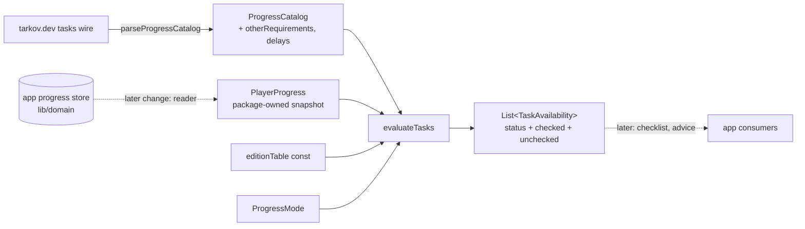
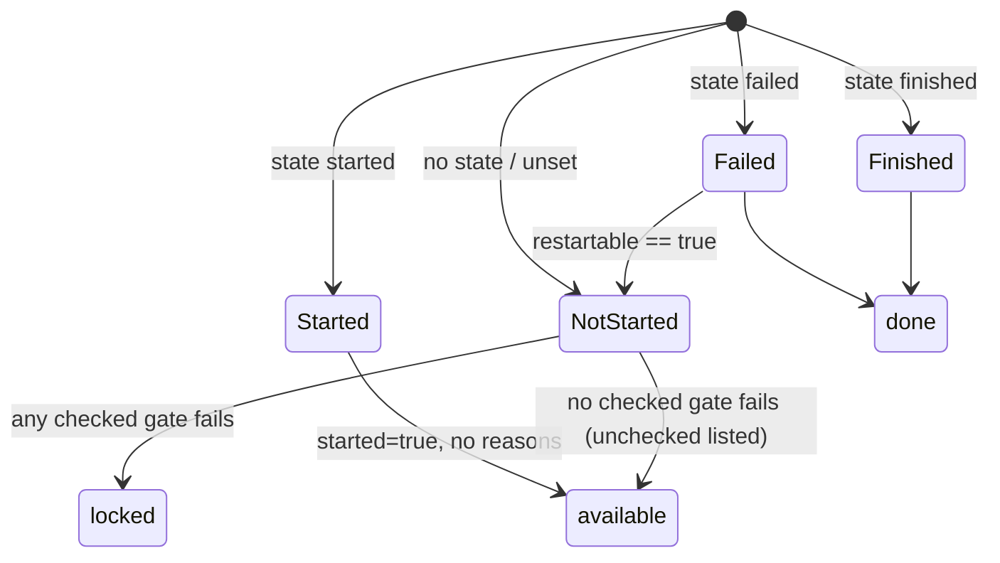

# Design

## Triage

| Trigger | Applies? | Evidence |
|---|---|---|
| T1 Components (new component, or 3+ with directed relationships) | yes | A new rules component in `packages/blackgrid_progress` reads the catalog model, a new progress snapshot and a new edition table |
| T2 State (persistent state, caches, 3+ state machine) | yes | The stored task catalog JSON gains two fields (`progress_catalog_tasks.dart:56-96`). Task state (none/started/failed/finished) maps to done/available/locked |
| T3 Concurrency (background work, workers/isolates, async, retries) | no | The rules are a synchronous pure function. Catalog parsing already runs in the existing `Isolate.run` normalization (ADR-0004), and this change adds no async work |
| T4 Boundaries (data format, migration, shared interface, IPC, external) | yes | The public package API (result and reason types) is shared with later changes and later web and mobile apps. The stored catalog format gains fields. The tarkov.dev wire fields are newly read |
| T5 Volume (grows without a fixed bound) | no | The work is bounded by catalog size (about 500 tasks per mode) times gates per task. There is no history or queue |
| T6 Risk (security, money, data loss, unrecoverable user data) | no | Read-only over in-memory values. No user data is written |

TIER: FULL

## Context

- `packages/blackgrid_progress` (ADR-0042) holds the immutable catalog model:
  - `ProgressCatalog` with `tasksById` (`progress_catalog.dart:144-218`) and `CatalogTask` (`progress_catalog_tasks.dart:4-170`), with unknown-aware fields: `minPlayerLevel`, `faction`, `restartable`, `gameModes`, `requiredPrestigeId`, `prerequisites` (statuses), `traderRequirements` (type/comparison/value) and `alternatives`.
  - The wire parse is in `parse_progress_catalog.dart`. Fail conditions are parsed leniently: a malformed row makes the whole list unknown (`parse_progress_catalog.dart:110-150`). The new `otherRequirements` parse follows the same pattern.
  - Stored JSON uses `formatVersion` 1. `_optional` reads an absent key as null (`progress_catalog.dart:240-244`), so new optional fields are backward-compatible without a version bump.
- Progress values live in the app, not the package: `lib/domain/local_progress.dart`.
  - Registers: task `state` (started/failed/finished), player `level`/`faction` (`bear`/`usec`)/`edition` (opaque text), trader `loyalty` (`local_progress.dart:24-33`, `:405-440`).
  - There is no reputation or prestige register (ADR-0041 lists the registers).
- The package boundary is enforced by `test/data/progress_package_audit_test.dart:160-200`, which checks the pubspec and that `lib/` imports no Flutter, Windows or `dart:io`. `mise.toml:12,27` runs the package's `dart test` in `mise run test`.
- Live wire facts, checked 2026-11-12 on `json.tarkov.dev/regular/tasks` (503 tasks):
  - `otherRequirements` holds `globalVariable` (168, with `variableId`/`compareMethod`/`value`) and `dialogue` (12, with `traders`). No task sets any of these variables, so they are opaque game counters.
  - `availableDelaySecondsMin/Max` is nonzero on 10 tasks (36000/36000 ×9, 1800/2100 ×1) and absent on 8.
  - Prerequisite status sets: `complete` 195, `active` 12, `active+complete` 10, `complete+failed` 3, `failed` 2.
  - Trader requirements: 112 `level >=`, 8 reputation.
  - 34 tasks are faction-only. 3 have a prestige requirement and 4 a game-mode restriction (`['regular']`).
- Edition research (2026-11-12, ideas only, nothing copied). The official wiki's search snippets say:
  - "The Good Times - Part 1" (Prapor, `666314b4d7f171c4c20226c3`) is "only available to buyers of the Edge of Darkness edition".
  - "Small Business - Part 3" (Fence, `66631493312343839d032d22`) is "not available to owners of The Unheard edition". Another page of the same wiki puts that restriction on the reward only, so the evidence conflicts.
  - Direct fetches of the wiki were refused (HTTP 402), so neither claim is confirmed. The current edition IDs are `standard`, `left-behind`, `prepare-for-escape`, `edge-of-darkness` and `unheard`. Unheard is commonly described as including Edge of Darkness perks; that is unverified for quest access.

## Decisions

### D1: The package owns the rules' progress input

- **Choice:** The package defines an immutable `PlayerProgress`:
  - `taskStates: Map<String, TaskProgressState>` (started/failed/finished; an absent key means not started);
  - `level: int?`;
  - `faction: PlayerFaction?` (bear/usec);
  - `edition: String?`;
  - `traderLoyalty: Map<String, int>`.

  `null` or an absent key means unset. The rules never see the store's types. The first change that calls the rules adds an app-side reader from store registers.
- **Rejected:** Moving `local_progress.dart`'s value and target types into the package so that the rules read registers directly. That would couple the rules to the event ledger's storage vocabulary and mean editing the store and its tests in a change about rules, and web or mobile would inherit the ledger's types even with a different sync story.
- **Reversal cost:** medium. Callers build the snapshot.
- **Important:** yes. It binds future changes (a shared interface).
- **Chosen by:** user.

### D2: Typed sealed reasons, pure evaluation, recorded in ADR-0043

- **Choice:** `evaluateTasks(ProgressCatalog, ProgressMode, PlayerProgress, {EditionTable table = editionTable}) → List<TaskAvailability>` in catalog order.
  - `TaskAvailability(taskId, status: AvailabilityStatus {done, available, locked}, started: bool, checked: List<CheckedReason>, unchecked: List<UncheckedReason>)`.
  - `CheckedReason` is sealed: `Finished`, `Failed`, `LevelTooLow(required, actual)`, `LoyaltyTooLow(traderId, comparison, required, actual)`, `PrerequisiteNotMet(taskId, needed: Set<TaskStatus>)`, `AlternativeTaken(taskId)`, `WrongFaction(required)`, `WrongGameMode(allowed)` and `EditionNotPermitted(edition)`.
  - `UncheckedReason` is sealed: `LevelUnset(required)`, `LevelRequirementUnknown`, `LoyaltyUnset(traderId)`, `LoyaltyRequirementUnknown(traderId)`, `ReputationRequirement(traderId)`, `PrerequisitesUnknown`, `PrerequisiteStatusUnknown(taskId)`, `ActivePrerequisiteFinished(taskId)`, `AlternativesUnknown`, `FactionUnset(required)`, `FactionUnknown`, `EditionUnset`, `EditionUnrecognised(edition)`, `GlobalVariable(variableId)`, `TraderDialogue(traderIds)`, `OtherRequirementUnknownType(rawType)`, `OtherRequirementsUnknown`, `AvailabilityDelay(minSeconds, maxSeconds)`, `AvailabilityDelayUnknown` and `PrestigeRequired(prestigeId)`.
  - Display text is the consumer's job.
  - `ProgressMode` is a package enum `{regular, pve, seasonal}`, each carrying its tarkov.dev name (`regular`, `pve`, `pvp-season`), which the game-mode gate compares with a task's `gameModes`. It is deliberately not named `GameMode`: the app's `GameMode` (`lib/domain/catalog.dart:5`) is imported beside the package in `catalog_normalizer.dart`, and a second `GameMode` would make those imports ambiguous. The later reader maps the app's mode to it. (Review round 1, M1: the owner chose this enum on 2026-11-12.)

  ADR-0043 records the pure-function contract, that the edition table's IDs are the vocabulary every progress writer must use for the player's edition, the precedence (state first, then any failing checked gate locks, unchecked gates never lock), the reason vocabulary as an open, additive sealed set, and the edition table's ownership. A new gate adds a reason subtype. Consumers switch exhaustively and get a compile error, which is intended.
- **Rejected:**
  - Reason enum codes with English text, which puts UI wording into a package shared with other apps.
  - An evaluator class with cached indexes, which needs no state because `ProgressCatalog` already indexes tasks.
- **Reversal cost:** medium. The contract feeds every later M9 consumer.
- **Important:** yes. It binds future changes.
- **Chosen by:** user.

### D3: Edition table is a const Dart source in the package

- **Choice:** `lib/src/edition_table.dart` holds:
  - `const editionTable = EditionTable(version: 1, editions: {...}, entries: {...})`, with the five edition IDs from Context;
  - entries `taskId → EditionRule.allowed({...}, source: '...')` or `.excluded({...}, source: '...')`.

  A table test checks that every entry names only known editions, has a non-empty source and keys a task ID present in the frozen excerpt or listed as checked against the live data on the given date.
- **Rejected:** A JSON data file parsed at load, which adds a parse-failure path and per-platform asset plumbing for about 2 entries.
- **Reversal cost:** low.
- **Important:** yes. It binds future changes (the data's home and its ownership).
- **Chosen by:** user.

### D4: Seed entries come from research, owner-confirmed at review

- **Choice:** The table starts with one entry, confirmed by the owner on 2026-11-12 after review round 1: The Good Times - Part 1 (`666314b4d7f171c4c20226c3`) `allowed {edge-of-darkness, unheard}`. Its source note names the official wiki's quest page and the owner's confirmation that Unheard is included. Small Business - Part 3 is left out on the owner's decision, because the wiki contradicts itself and the reward-only reading is more likely. The entries need checking every wipe (roadmap upkeep note).
- **Rejected:** Shipping an empty table, which the owner did not choose.
- **Reversal cost:** low.
- **Important:** yes. It is chosen on weak evidence. The owner's in-game knowledge settles it.
- **Chosen by:** user.

### D5: Precedence and state mapping

- **Choice:** Evaluation order per task:
  1. Recorded `finished` gives `done` [Finished].
  2. `failed` and restartable is not `true` gives `done` [Failed]. A failed task with restartable `true` falls through as not started.
  3. `started` gives `available` with `started: true` and no reasons.
  4. Otherwise every gate is evaluated, and every failing checked gate is collected.

  A task with any failing checked gate is `locked`; otherwise it is `available`. Unchecked reasons are collected for not-started tasks only.

  State mapping for prerequisite and alternative statuses: `complete ↔ finished`, `active ↔ started`, `failed ↔ failed`. An unknown status is skipped.

  The requirement in the spec "Finished active-only prerequisite is unchecked" covers this case: the accepted set has `active` but not `complete`, and the prerequisite task is finished. The result is `ActivePrerequisiteFinished`.
- **Rejected:** Short-circuiting on the first failing gate, which loses reasons the player needs ("level and loyalty both"). Recursing through prerequisite chains is not needed, because a prerequisite's own recorded state is the fact.
- **Reversal cost:** low.
- **Important:** no. The spec fixes the visible behaviour, and this is its mechanics.
- **Chosen by:** agent.

### D6: Trivially satisfied gates pass without input

- **Choice:**
  - A level minimum of 1 or less passes even with level unset.
  - With loyalty unset, only requirements that every loyalty meets pass: `>= v` with v ≤ 1 and `> v` with v < 1, because loyalty is never below 1. Upper bounds (`<=`, `<`) and `=` are unchecked, because the real loyalty may be higher (review round 1, M2).
  - Everything else needs a value or is unchecked.
- **Rejected:** Treating unset as level 1 or loyalty 1, which would lock new players' tasks on guessed data.
- **Reversal cost:** low.
- **Important:** no.
- **Chosen by:** agent.

### D7: `otherRequirements` and delays in the catalog model

- **Choice:**
  - `CatalogTask` gains `otherRequirements: List<OtherRequirement>?`. `OtherRequirement` is sealed: `GlobalVariableRequirement(id, variableId?, comparison, rawComparison?, value?)`, `DialogueRequirement(id, traderIds?)` and `UnknownOtherRequirement(id, rawType?)`. JSON discriminator `kind`.
  - `CatalogTask` also gains `availableDelaySecondsMin/Max: int?`. Every hand-written copy of a task, including `CatalogTask._withObjectives` (`progress_catalog_tasks.dart:36-54`), copies the new fields.
  - Wire parse: a non-list value, any non-object row, or a row without a string `id` or `type` makes the whole list `null`. This mirrors fail conditions (`parse_progress_catalog.dart:110-150`), and references stay unresolved.
  - A delay that is not a nonnegative integer becomes `null`.
  - The stored form stays `formatVersion` 1, and absent keys decode to `null`.
- **Rejected:**
  - Keeping individual valid rows when one row is malformed. That could silently lose a gate and make a locked task look open, when an unknown list is reported as unchecked instead.
  - A format version 2, which would make old caches load an unavailable catalog until refresh.
- **Reversal cost:** low.
- **Important:** yes. It binds future changes (stored data format).
- **Chosen by:** agent. It follows the user's S2 and the ADR-0042 lenient-facts pattern.

### D8: Frozen excerpt as JSON fixtures with a manifest

- **Choice:**
  - `packages/blackgrid_progress/test/fixtures/tarkov_dev/` holds:
    - `regular_tasks.json` and `pve_tasks.json`: the wire `data.tasks` objects of the selected tasks plus the transitive closure of every task they reference (prerequisites, alternatives and `taskStatus` objectives), because `parseProgressCatalog` rejects any unresolved reference. Measured on 2026-11-12, that is about 50 KB for regular and 96 KB for PvE. with `zones`, `position` and `outline` removed and `translations` dropped;
    - `traders.json`: the trader IDs used;
    - `SOURCE.md`, recording the URLs, the fetch date and the selection by rule.
  - Tests parse the fixtures with the real `parseProgressCatalog`, so the excerpt also checks the parse.
  - A test asserts the manifest fields exist and that each gate kind is hit by at least one excerpt task. The test runs the rules over the excerpt with a progress snapshot built to provoke that gate.
  - Target size: under 150 KB per mode.
- **Rejected:** A fixture-building tool that downloads and trims, which adds network tooling for a once-per-wipe manual step. The selection list in `SOURCE.md` is enough to redo it.
- **Reversal cost:** low.
- **Important:** no. The how-to-prove scope was the user's S4.
- **Chosen by:** agent.

### D9: Architecture update, no new runtime wiring

- **Choice:** ADR-0043 (D2) is written during apply. The `blackgrid_progress` component row and the ADR index in `openspec/architecture.md` are updated in the same task. Nothing in `lib/` imports the rules.
- **Rejected:** Amending ADR-0042. Accepted ADRs are immutable, and the rules are a new contract.
- **Reversal cost:** low.
- **Important:** no.
- **Chosen by:** agent.

### Decision summary

| # | Decision | Choice | Rejected | Reversal cost | Important | Chosen by |
|---|---|---|---|---|---|---|
| S1 | Undecidable gates | Available, listed as unchecked, never lock | Fourth `unknown` status; treat as locked | medium | yes | user |
| S2 | Missing catalog gates | Retain `otherRequirements` and delays here | Ignore them | low | yes | user |
| S3 | Edition rules source | Reviewed table seeded by owner | Empty table; drop edition | low | yes | user |
| S4 | Fixtures | Real per-rule excerpt | Full snapshots | low | yes | user |
| S5 | Hideout build availability | Not in this change | Add now | low | no | agent |
| S6 | App wiring | None; first consumer adds the reader | Store reader now | low | no | agent |
| D1 | Rules input | Package-owned `PlayerProgress` | Move store types into package | medium | yes | user |
| D2 | Result contract | Typed sealed reasons, pure function, `ProgressMode {regular, pve, seasonal}`, ADR-0043 | Codes + English text; stateful evaluator; package `GameMode` | medium | yes | user |
| D3 | Edition table form | Const Dart table with version and sources | JSON data file | low | yes | user |
| D4 | Edition seed | One owner-confirmed entry (Good Times Part 1: EoD + Unheard) | Empty table; Small Business Part 3 exclusion | low | yes | user |
| D5 | Precedence | State first; collect all failing gates; unchecked never lock | First-failure short-circuit | low | no | agent |
| D6 | Trivial gates | Min level ≤1 and lower-bound loyalty ≤1 pass when unset; upper bounds unchecked | Assume unset = 1 | low | no | agent |
| D7 | Catalog fields | Sealed `OtherRequirement`, whole list unknown on malformed row, format v1 | Keep valid rows; format v2 | low | yes | agent |
| D8 | Fixtures form | Trimmed wire JSON + `SOURCE.md` manifest, parsed by real parser | Download-and-trim tool | low | no | agent |
| D9 | Architecture | ADR-0043 + component row; no `lib/` wiring | Amend ADR-0042 | low | no | agent |

## Diagrams (FULL)

T1, components:

T2, per-task decision state:

T4, the stored and wire boundary: the catalog JSON gains `otherRequirements` (a list of objects with a `kind` of `globalVariable`, `dialogue` or `unknown`, or null) and `availableDelaySecondsMin/Max` (an int or null). `formatVersion` stays 1, and an absent key means null.

## State & Ownership (FULL)

| State | Owner (sole writer) | Lifetime | Invalidation / rebuild | Authoritative copy |
|---|---|---|---|---|
| Task catalog incl. new fields | Catalog refresh (`catalog_normalizer.dart` → `parseProgressCatalog`) | Per mode snapshot, until the next successful refresh | Replaced atomically with items. An older stored copy reads the new fields as unknown | Stored snapshot (Drift), per ADR-0042 |
| `PlayerProgress` | Caller (a later change's reader) | Per evaluation call | Rebuilt by the caller when progress changes | Progress store (ADR-0041) |
| `editionTable` | Source code (owner-reviewed edits) | Compile time | Edited by a change, with `version` bumped | The package source |
| `TaskAvailability` results | `evaluateTasks` | Per call; never stored | Recomputed on any input change | None. Derived only |

## Failure & Visibility (FULL)

| Component | Fails / dies mid-operation → | Recovery | Retry safe? | Who finds out |
|---|---|---|---|---|
| Wire parse of new fields | A malformed list or delay becomes unknown and the refresh still succeeds | Next refresh | yes | The player, as unchecked reasons (`OtherRequirementsUnknown`) once a consumer shows them |
| Stored catalog decode with new fields | A wrong-typed stored field makes the whole task catalog unavailable, as today (`task-catalog` "Damaged stored task catalog") | Next refresh | yes | The existing unavailable-catalog state |
| `evaluateTasks` | Pure and total. It must not throw on any catalog that `ProgressCatalog` accepts. An unknown enum value maps to an unchecked reason | n/a | yes | Tests. A throw is a bug caught by the excerpt and synthetic tests |
| Edition table | A bad entry (unknown edition, empty source) | Fix the source | n/a | Table test fails in `mise run test` |

## Resource Bounds (FULL)

| Queue / buffer / cache / transfer | Bound | At the bound | Timeout | At 10x / 100x |
|---|---|---|---|---|
| Evaluation work | O(tasks × gates per task). About 500 tasks × at most 10 gates, with constant-time map lookups | n/a | none (synchronous, sub-millisecond scale) | 5k or 50k tasks still finish in milliseconds. No caller holds a UI frame on it in this change |
| Results list | One per catalog task | n/a | n/a | Linear |
| Stored JSON growth | The two fields add about 15 KB per mode (180 short rows) | n/a | n/a | Already within the Isolate-decoded snapshot (ADR-0004) |
| Fixtures | Target under 150 KB per mode | The test fails if a fixture is over 200 KB, keeping the excerpt small | n/a | n/a |

## Flow & State Gaps (FULL)

- **Unknown availability delay:** a task without delay fields lists `AvailabilityDelayUnknown`, as the spec requires, and is not locked by it.
- **Stale catalog:** a snapshot stored before this change gives `OtherRequirementsUnknown` on every not-started task until the next refresh. That is honest, and it does not lock anything.
- **Progress for tasks removed by a wipe or a catalog change:** ignored, per spec.
- **Catalog task referencing a prerequisite missing from progress:** the prerequisite counts as not started, so the gate fails. This is intended for a fresh player.
- **Out-of-order or conflicting progress:** resolved by the store (ADR-0041) before the snapshot is built. The rules see one value per field.
- **Mode mismatch** (a PvE catalog evaluated as regular): the caller's responsibility. The game-mode gate only reads per-task restrictions.
- **Concurrency:** none. The inputs are immutable.

## Mechanism Ledger (FULL)

| Mechanism | Built? | Why (harm nobody catches / expensive later) | Evidence that would change the call |
|---|---|---|---|
| Sealed reason types | yes | They are a shared interface, expensive to change later | none |
| Whole-list unknown on a malformed `otherRequirements` row | yes | Dropping one row silently opens a locked task, and nobody would notice | tarkov.dev shipping frequent partial rows |
| Edition table validation test | yes | A typo in an edition ID would silently never match | none |
| Fixture gate-coverage test | yes | It proves exit criterion 2, and a trimmed excerpt could drop a gate unnoticed | none |
| Result caching / memoization | no | Evaluation is cheap, and callers can cache | A profile showing a UI-frame cost |
| Transitive prerequisite reasoning | no | The prerequisite's own recorded state is the fact. Recursion adds nothing | A need to show "how far away" a task is (a checklist feature) |
| Availability-delay timing from event timestamps | no | Needs the prerequisite's finish time, which is outside the snapshot. It is listed as unchecked | Owner wants the timer shown, which belongs in a later change |
| Global-variable evaluation | no | Nothing in the data or the logs sets these variables | tarkov.dev or the logs exposing variable values |
| Fixture download tool | no | Once per wipe, and the `SOURCE.md` selection makes it repeatable by hand | Wipe refresh becoming frequent or error-prone |

## Risks / Trade-offs

- [Edition seed is wrong] → the entries are owner-confirmed at review, each carries its source, and the upkeep note asks for a check every wipe.
- [About a third of tasks carry unchecked global-variable gates] → this is the accepted cost of S1. Consumers must surface unchecked reasons, which ADR-0043 states.
- [The `active`-only prerequisite unchecked rule hides a true lock] → it is rare (12 sets in the data) and visible as an unchecked reason.
- [tarkov.dev changes the `otherRequirements` shape] → the whole list becomes unknown, which reads as unchecked and never locks or blocks a refresh.

## ADRs

- **In force, constraining this change:**
  - ADR-0042: package boundary, lenient new facts, stored format v1.
  - ADR-0041: register vocabulary. Edition is opaque, and availability does not belong to storage.
  - ADR-0004: off-UI decode.
  - ADR-0003: no Drift schema change.
- **To record during apply:** ADR-0043 "Task availability rules contract": the pure evaluation over package-owned progress input, the sealed checked and unchecked reasons, unchecked-never-locks precedence, and the edition table owned as reviewed const data in the package. It extends ADR-0042.

## Open Questions

None. The edition seed was settled by the owner on 2026-11-12 (D4).
