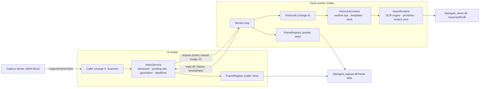
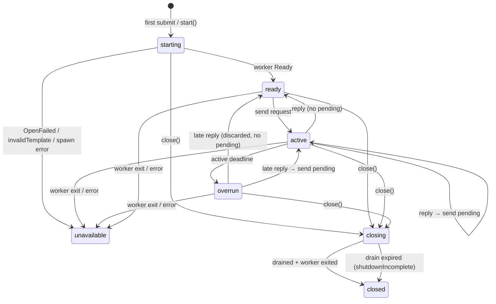
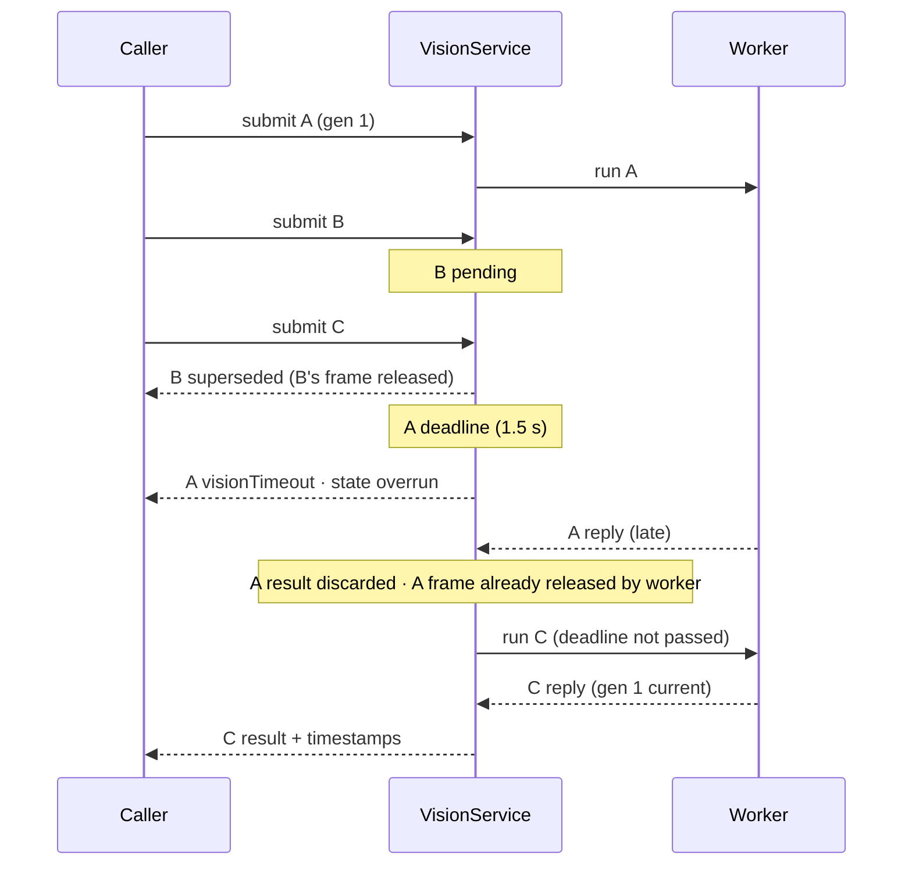
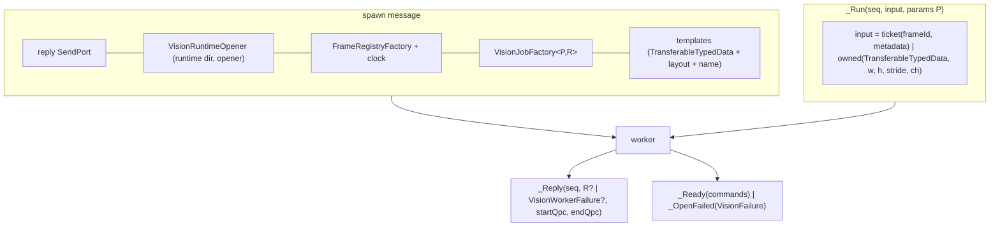

# Design

## Triage

| Trigger | Applies? | Evidence |
|---|---|---|
| T1 Components (new component, or 3+ with directed relationships) | Yes | New service (UI side) → worker isolate → vision runtime + frame registry; capture service hands frames in |
| T2 State (persistent state, caches, 3+ state machine) | Yes | Service states starting/ready/active/overrun/closing/closed/unavailable; warm runtime + templates + scratch held for the worker's lifetime |
| T3 Concurrency (background work, workers/isolates, async, retries) | Yes | Dedicated isolate, deadline timers, pending replacement, generation fences, drain |
| T4 Boundaries (data format, migration, shared interface, IPC, external) | Yes | Cross-isolate message contract; the job seam that change 4 codes against; frame tickets crossing a third isolate |
| T5 Volume (grows without a fixed bound) | Yes (bounded here) | Requests and scratch buffers: both get explicit bounds below |
| T6 Risk (security, money, data loss, unrecoverable user data) | No | No persistence, no credentials, no user data; frames are transient pixels |

TIER: FULL

## Context

See proposal.md for the why. Current state the approach builds on:

- **Vision runtime** is a synchronous owner with no isolate of its own: `VisionRuntime.open` (`lib/data/vision/vision_runtime.dart:100`) hashes every file, opens the libraries, checks the ABI and engine version and initialises Tesseract (LSTM-only, raw line); `dispose()` (`:225`) is idempotent; operations return `VisionResult` through `_run` (`:342-365`). `vision.h:1-4` requires callers to serialise calls from one owning isolate (OpenCV is built without threads). `VisionTimeout(step)` already exists (`lib/data/vision/vision_failure.dart:118`).
- **Per-call copies**: every primitive copies its input into a fresh `calloc` buffer and copies the output back (`lib/data/vision/vision_primitives.dart:203-230`); `recognise` does the same (`lib/data/vision/tesseract_binding.dart:160-192`). Nothing is reused between calls.
- **Only caller today** is the self-check helper isolate with a 60 s watchdog that kills the helper (`lib/application/vision_self_check.dart:239,252`). Killing is acceptable there because the process exits next; it is not acceptable for a long-lived worker.
- **Worker pattern to follow**: `CaptureService` (`lib/data/capture/capture_service.dart:29-300`) — lazy spawn with a top-level factory, `RawReceivePort` with `onExit`/`onError`, private sendable message classes, a deadline that moves the service to `overrun` without starting a second call (`:257-261`), a bounded drain that never kills the worker (`:134-160`), no respawn (`:263-284`), and the "held reply + self-sent flush" trick so a queued close can release a finished result (`:364-391`).
- **Latest-wins pattern to follow**: `MapSessionController` keeps one replaceable `_pending` and fences results with counters (`lib/application/map_session_controller.dart:319-363`).
- **Frame tickets** are process-wide ids; any isolate may adopt and release (`lib/data/capture/capture_frame.dart:75-101`). Pixels are lent only synchronously through `withPixels` (`:133-154`). Release is generation-checked and repeat-safe; at most 4 frames live (inspection-capture spec).
- **No marker templates exist** in the repo; they are rights-gated (G11, `docs/qualification/m0/u2-rights-decision-packet.md:45`). The worker therefore takes templates as inputs.
- **Test seams**: hand-written `VisionNative`/`VisionEngine`/`VisionPrimitives` fakes injected via `VisionRuntime.open(opener:)` (`test/data/vision/vision_runtime_test.dart`), and holdable fakes built by a top-level factory over shared `calloc` control addresses (`test/data/capture/support/holdable_capture_platform.dart`), which let a test hold a "native" call across isolates.

## Decisions

### D1: The pending slot lives on the service, the worker runs one request at a time

- **Choice:** `VisionService` (UI side) owns admission: at most one request is sent to the worker, the next one waits in a single pending slot on the service and is sent only after the worker replies to the active one. The worker has no queue; it receives, runs, replies.
- **Rejected:** a queue (or replaceable slot) inside the worker isolate, because the worker is blocked inside native calls exactly when replacement matters — it could not process a "replace" or "invalidate" message until the call returns, so supersession and deadline answers would be late. Keeping the slot on the service answers `superseded`/`visionTimeout`/`invalidated` immediately, and non-overlap becomes structural (the service never has two requests out).
- **Reversal cost:** low — internal to the service.

### D2: Fences, deadlines and the "never publish stale" rule are enforced on the service side

- **Choice:** the service stamps each request with its generation and a deadline timer at submission. A worker reply is delivered only if it matches the active sequence number, its caller is still waiting, and its generation is current; otherwise its result is discarded. `invalidate()` advances the generation and answers both the pending and the active request `invalidated` at once. It cancels their deadline timers, but the service keeps tracking the active in-flight seq until the worker replies, so the late result is discarded and no second call starts. The service still enters `overrun` if the call outlasts the original deadline, without answering the caller again. A timed-out active request also leaves the service `overrun` until the reply arrives (like `CaptureService._onDeadline`, `capture_service.dart:257`); submissions during `overrun` still go to the pending slot and start once the call returns, if their own deadline has not passed.
- **Rejected:** killing the worker on deadline and respawning a fresh runtime (as the self-check does). `Isolate.kill` cannot interrupt a native call; the native thread keeps running inside Tesseract while a second engine opens beside it — two engines, doubled memory, and an engine deleted by nobody. It also costs a full warm start (hash every file, load the model) on every overrun.
- **Reversal cost:** low.

### D3: Deadline default 1.5 s from submission, close drain 2 s

- **Choice:** one service-wide deadline, default 1.5 s, measured from submission (so time spent pending counts). The close drain is 2 s, as for capture.
- **Rejected:** a deadline from job start (the reference's mistake, §6: "automatic fallback waits only until approximately 200 ms after enqueue, not after targeted processing" — a deadline that ignores queueing lets total latency grow unbounded). Rejected also: the 500 ms capture deadline, because a fallback recognition of a full-client frame legitimately exceeds 500 ms; 1.5 s is the total p95 budget from the trigger, so a request older than that cannot produce a useful answer.
- **Reversal cost:** low — a constructor parameter; change 5 may tune or add a per-request deadline once timings exist.

### D4: A job seam fixed at spawn; requests carry sendable parameters

- **Choice:** the service is constructed with a top-level `VisionJobFactory<P, R>` sent to the worker at spawn. Each request carries an input (frame ticket or owned image) and sendable parameters `P`; the job runs synchronously in the worker as `R run(VisionJobContext context, VisionJobInput input, P params)` and returns a sendable `R` that holds no native resource. The context exposes the runtime operations, the templates by name and the monotonic clock. The clock is the capture DLL's QPC counter (`CapturePlatform.qpcNow`, `capture_native.dart:207`, `bgc_qpc_now`), the same one that stamps triggers and frames. The service reads it through its frame-registry factory's platform for submission times, and the worker reads it through its own platform for job start and end. Tests inject a fake clock through the same factories. Change 4 provides the inspection job; this change ships test jobs only.
- **Rejected:** a fixed request vocabulary (match/OCR/resize messages) driven from the UI side, because one recognition takes many dependent native steps; round-tripping each step through the isolate boundary adds latency and lets the UI side interleave steps from different requests. Rejected also: sending a closure per request, because closures capturing caller state are easy to make non-sendable and hide what crosses the boundary.
- **Reversal cost:** medium — change 4 codes against `VisionJobContext`. Recorded in ADR-0011.

### D5: Input ownership moves with the request; the holder releases

- **Choice:** two input kinds. (a) A capture frame: the submitter passes the adopted `CaptureFrame` itself, and the service holds it, finalizer attached, while the request is pending. If the request is superseded, invalidated, expired or closed, the service calls `frame.release()`. It calls `frame.handOff()` only when it sends the request to the worker, so a service dropped without `close()` cannot strand a frame slot (inspection-capture: "a frame its owner drops unreleased SHALL be released by a finalizer"). When sent, ownership moves to the worker, which adopts it with its registry, lends pixels to the job through `withPixels`, and releases it before replying. (b) An owned image: its layout is validated in `submit()` with `VisionImage.validate` (`vision_image.dart:35`), so a malformed image is answered `invalidInput` without displacing the pending request. The bytes then move with `TransferableTypedData`. If the worker dies, the service releases every ticket it has sent and not seen answered (release is generation-checked, so a frame the worker already released is a no-op).
- **Rejected:** the worker returning the frame to the service for release, because it holds a frame slot (of 4) across an extra round-trip and creates two holders. Rejected also: copying frame pixels into a Dart buffer on the capture side before submitting, because it doubles memory for full-client frames and moves pixel work onto the UI isolate.
- **Reversal cost:** low.

### D6: Worker-owned reusable scratch buffers replace per-call allocation, with a retention cap

- **Choice:** the worker owns a scratch pool of native buffers (input staging and output) that the primitives and OCR reuse instead of `calloc`/`free` per call. Buffers grow to the largest request; after a request ends, any buffer above 16 MiB is freed back to 16 MiB, so one full-client fallback does not pin hundreds of MiB. The pool is freed on dispose. The Dart API of `VisionRuntime` is unchanged for existing callers (self-check keeps working through the same code path with a per-runtime pool).
- **Rejected:** zero-copy (passing the frame's native pointer straight into `bgv_*` and keeping intermediates native between steps). It needs a pointer-lending API on `CaptureFrame` and a native-image type in the job context; copies of a 1080p BGRX frame (~8 MiB) cost a few ms against a 300 ms budget, so the gain is unproven. Tesseract copies on `SetImage` anyway (§6).
- **Reversal cost:** low — internal to the primitives; the job context hides it. Evidence that would change the call: change 5 stage timings where input staging is more than ~10 % of targeted time.

### D7: Templates are validated inputs at start, owned by the worker

- **Choice:** the service is constructed with a list of named 1-channel templates (owned bytes). They are copied into the worker at spawn, validated there (`VisionImage.validate` layout, exactly 1 channel, and non-zero variance; `validateTemplate`'s size-against-image check needs a target, so it stays per match) before the service reports `ready`, and kept for the worker's lifetime. A bad template fails the start with `invalidTemplate` and disposes the runtime.
- **Rejected:** loading templates from a bundled asset path in this change, because no rights-cleared templates exist; adding an asset path and manifest entry now would bind a format before change 4 knows what it needs.
- **Reversal cost:** low.

### D8: Not wired into app startup

- **Choice:** nothing in `lib/main.dart`, `lib/application` or `lib/ui` constructs the service; an offline source audit test enforces it, like the capture startup audit (`test/data/capture/capture_source_audit_test.dart`, the "no startup path" test). The audit matches the service's own file and class name, not every `data/vision/` import, because `lib/application/vision_self_check.dart` legitimately imports the runtime. Change 5 wires it.
- **Rejected:** warm-starting at launch now, because nothing would consume it and it would load the vision runtime on every launch, contradicting the vision-runtime spec's normal-launch requirement.
- **Reversal cost:** low.

## Diagrams (FULL)

**T1 components**

**T2 service state machine**

**T3 latest-wins sequence with an overrun**

**T4 cross-isolate contract**

## State & Ownership (FULL)

| State | Owner (sole writer) | Lifetime | Invalidation / rebuild | Authoritative copy |
|---|---|---|---|---|
| Service state, active seq, pending slot, generation, deadline timers | `VisionService` (UI isolate) | Service instance | `invalidate()` advances generation; `close()`; worker exit → `unavailable` | Service |
| Pending request's frame (adopted `CaptureFrame`, finalizer attached) | Service while pending | Until sent (then `handOff()`) or answered without running | Service calls `frame.release()` on supersede / invalidate / expire / close / unavailable; the finalizer releases it if the service is dropped | Native frame slot |
| Active request's frame | Worker from receipt | Until the job returns | Worker releases before replying; service releases by id only if the worker died | Native frame slot |
| Vision runtime (engine handle, libraries) | Worker | Warm start → close (after drain) | Never rebuilt; failure → `unavailable` | Worker |
| Templates | Worker (copied at spawn) | Worker lifetime | Not replaceable in this change (new service to change) | Worker copy |
| Scratch pool | Worker's runtime | Worker lifetime; trimmed to 16 MiB after each request | Freed on dispose | Worker |
| Job result `R` | Worker until sent, then service | One reply | Discarded if not current | Delivered value |

## Failure & Visibility (FULL)

| Component | Fails / dies mid-operation → | Recovery | Retry safe? | Who finds out |
|---|---|---|---|---|
| Runtime open (warm start) | Typed `VisionFailure` sent as `_OpenFailed`; worker exits | None: service `unavailable`, no respawn | Yes, by constructing a new service (caller's choice; change 5) | Caller via every answer `unavailable(reason)`; change 5 shows it in Scanner |
| Job throws | Caught in worker; reply `jobFailed(description)`; frame released | Worker stays ready | Yes | Caller (typed answer) |
| Native op returns error | `VisionFailed(VisionNativeFailure)` surfaces through the job's result or as `visionFailure` | Worker stays ready | Yes | Caller |
| Native call hangs | Caller answered `visionTimeout` at deadline; service `overrun`; next request waits | Returns when the call returns; none otherwise | n/a — never starts a second call | Caller (timeout), service state `overrun` (observable for change 5's UI) |
| Native crash | Process dies (ADR-0004) | None | — | User (app closes) |
| Worker isolate exits / uncaught error | Outstanding requests `unavailable`; their tickets released by id | None (no respawn) | — | Caller |
| Close with hung call | `shutdownIncomplete`; runtime not disposed; worker left to finish | Process exit | — | Close's caller (app shutdown path in change 5; logs it) |
| Frame registry open fails (service side) | Service `unavailable` before any frame is accepted | None | Yes, new service | Caller |

## Resource Bounds (FULL)

| Queue / buffer / cache / transfer | Bound | At the bound | Timeout | At 10x / 100x |
|---|---|---|---|---|
| Requests | 1 active + 1 pending | Newer replaces pending (`superseded`) | Deadline 1.5 s from submission (D3) | 10x/100x submit rate → all but the latest pending are superseded at once; worker load unchanged |
| In-flight to worker | 1 | Service never sends a second | — | Same |
| Frames held by vision | ≤ 2 (active + pending) of the 4 capture slots | Pending's frame released on replace | Frame released by the deadline path only once the job returns (it is lent) | Same; capture's `frameBudgetExceeded` still guards the 4-slot total |
| Owned-image transfer | One image per request, validated ≤ 8192 per side, ≤ 24 Mi px, ≤ 4 channels (`vision_image.dart:35`) | `invalidInput` | — | Same |
| Scratch pool | Grows to the largest request (≤ 2 buffers × 96 MiB at the validated maximum); trimmed to 16 MiB retained after each request | A Dart-side allocation failure surfaces as `nativeFailure(-5)` through `_run` (`vision_runtime.dart:362-363`), a native one as `-4`, for that request only | — | Not volume-driven: one request at a time |
| Templates | Fixed at start (count and size set by change 4; each ≤ image bounds) | — | — | — |
| Close drain | 2 s | `shutdownIncomplete` | 2 s | — |
| Warm start | One open (hashes all files, loads model) | Requests submitted during start wait in the normal slots | Each request's deadline still runs during start | — |

## Flow & State Gaps (FULL)

- **Submit during warm start:** the first request is held as unsent (like `CaptureService._unsent`) and sent on `_Ready`; a second becomes pending. Their deadlines run from submission, so a slow start times them out rather than hiding the delay.
- **Deadline on the active request, then pending arrives:** goes to the pending slot; starts after the late reply if not expired.
- **Invalidation while overrun:** generation advances; the late reply is discarded either way; pending answered `invalidated`.
- **Close during warm start:** the service moves `starting → closing`, answers the unsent and pending requests `closed` and releases their inputs. When the late `_Ready` arrives it sends `_Close` at once (as `CaptureService` does, `capture_service.dart:196-200`). The worker disposes the runtime it just opened, frees scratch and exits. If the open is still running when the 2 s drain expires, close reports `shutdownIncomplete`, and the worker still disposes and exits on its own when `_Ready` meets the queued `_Close`. A late `_OpenFailed` during closing is ignored.
- **Close while the worker is finishing a job:** the worker releases the frame before it replies (D5), so a queued `_Close` has no frame to release. The service discards the reply and the worker then disposes and exits. Capture's held-reply flush trick is not needed.
- **Out-of-order replies:** impossible by D1 (one in flight); a reply whose seq is not the active one is treated as late and discarded.
- **Worker dies while a ticket is in transit:** service releases every sent-and-unanswered ticket by id; release is generation-checked, so a frame already released by the worker is a no-op.
- **Job returns a non-sendable `R`:** the send throws in the worker; caught and replaced with `jobFailed('result is not sendable')`.
- **Template mutation by caller:** bytes are copied at construction (spec scenario).
- **Restart mid-operation:** not supported; a closed or unavailable service is replaced by constructing a new one (change 5 decides when).

## Mechanism Ledger (FULL)

| Mechanism | Built? | Why (harm nobody catches / expensive later) | Evidence that would change the call |
|---|---|---|---|
| Service-side pending slot + single in-flight | Yes | Overlapping calls on the OCR engine corrupt state silently; exit criterion | — |
| Generation fence | Yes | Stale result published after a mode/session change would advise on the wrong item | — |
| Deadline + overrun state | Yes | ADR-0004 requires the bound; without it a hung call is invisible | — |
| Bounded close drain, no kill | Yes | Disposing the engine under a running call is use-after-free | — |
| Release of tickets on every path + by-id fallback on worker death | Yes | A leaked frame holds one of 4 slots until GC; captures then fail `frameBudgetExceeded` with no obvious cause | — |
| Job seam (`VisionJobFactory`) | Yes | Change 4's pipeline needs it; expensive later (shared interface) | — |
| Scratch pool with 16 MiB retention | Yes | Roadmap scope; avoids per-call allocation churn on every step | Timings showing it does not matter → could be removed cheaply |
| Respawn after worker death / overrun | No | Native call cannot be interrupted; respawn creates a second engine beside a running one | A measured hang rate in user qualification that makes `unavailable` too common |
| Kill worker at deadline | No | See D2 | — |
| Zero-copy native image path | No | See D6 | Change 5 timings: staging > ~10 % of targeted time |
| Minimum remaining budget before starting a pending request | No | A pending request that starts with little budget left times out and causes an `overrun`; harmless except for latency, and the 1.5 s default is itself provisional | Change 5 timings show pending starts with < ~200 ms left routinely time out |
| Per-request deadline override | No | Single default suffices until timings exist | Change 5 needs a shorter targeted deadline than fallback |
| Template hot-swap | No | Templates are fixed per build | Locale/resolution-specific template sets in change 4 |
| Worker-side queue | No | See D1 | — |

## Risks / Trade-offs

- [A hung native call leaves recognition `overrun` for the rest of the session] → Visible as service state and `visionTimeout` answers; change 5 shows it. Respawn is deliberately not built (ledger) until a hang rate is measured.
- [1.5 s default deadline is a guess before timings exist] → Constructor parameter; change 5 timings decide.
- [Job seam is generic and could leak native resources in `R`] → Contract: `R` must be sendable plain data; frames and runtime handles never leave the worker; enforced by a test job that tries and gets `jobFailed`.
- [Scratch pool trimming adds allocator churn at the 16 MiB boundary] → Only for requests above 16 MiB (fallback frames); cost is one free/alloc per such request.
- [Worker opens its own capture frame registry (full capture DLL open with hash check)] → One-time at warm start; failure makes the service `unavailable` with a typed reason.

## ADRs

- **In force, constraining this change:** ADR-0002 (generation counters fence results), ADR-0004 (purpose-specific isolates; the M2 worker must add the duration bound), ADR-0008 (bundle-only, hash-bound vision runtime; serialised calls), ADR-0010 (frame tickets cross isolates; capture worker deadline/drain pattern).
- **To record during apply:** ADR-0011 "Vision worker contract": one warm worker per service owning runtime, templates and scratch; service-side single pending slot and generation fence; deadline from submission with `overrun` and no kill or respawn; job seam fixed at spawn with sendable params/results; input ownership moves with the request. Update `openspec/architecture.md` (component table row for the vision worker, Resource bounds "Vision call duration" row, "Not built yet" paragraph, ADR index).
