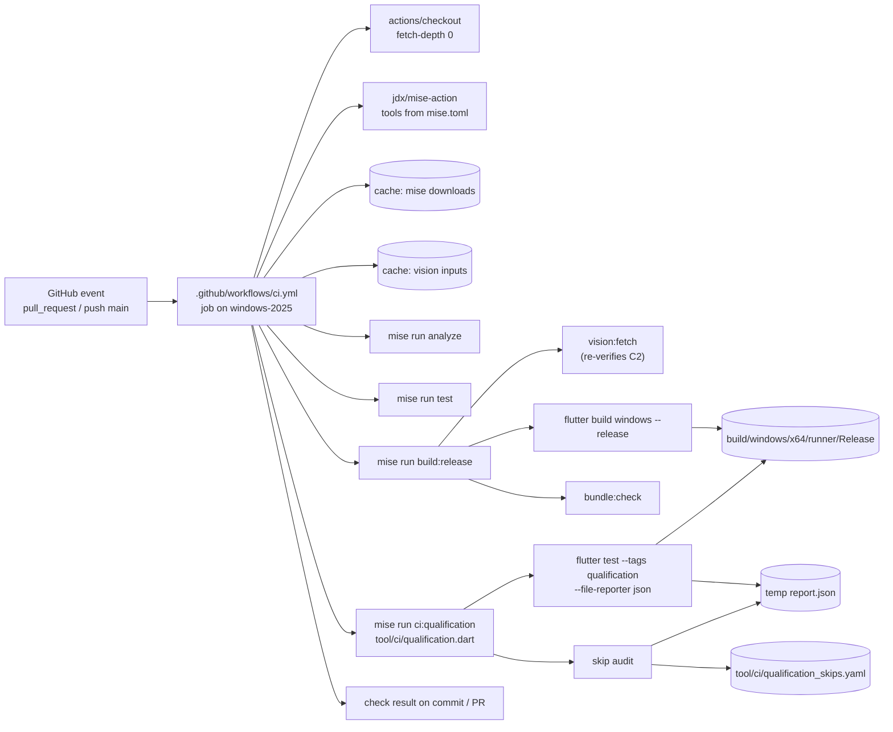
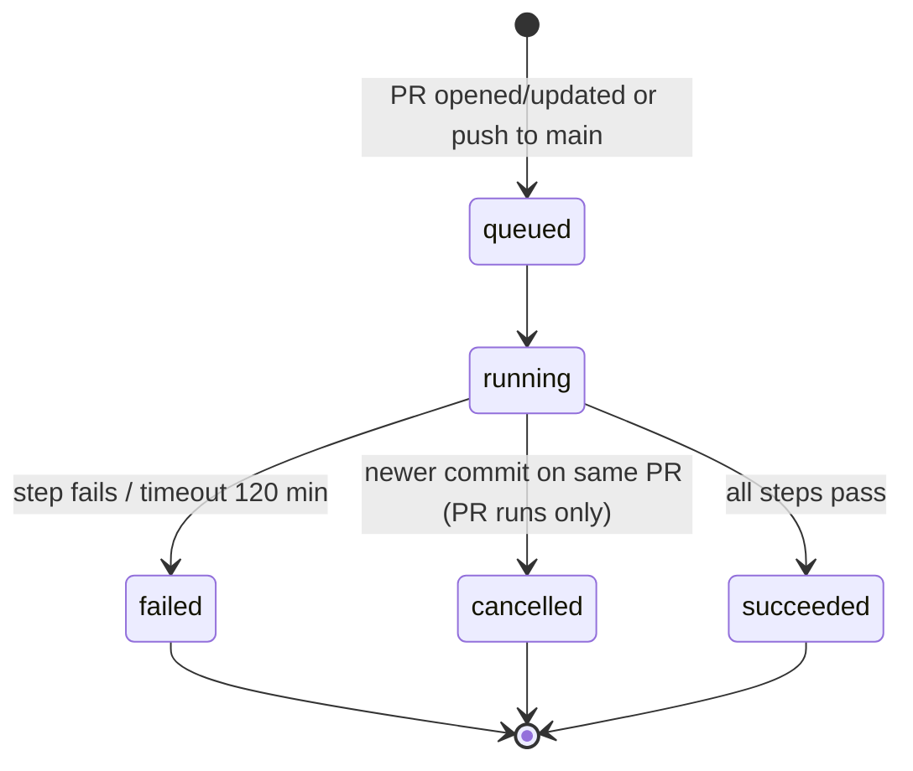
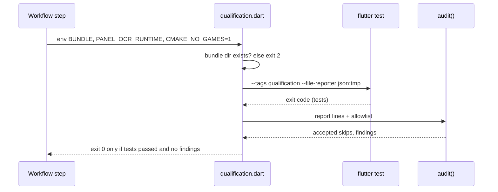

# Design

## Triage

| Trigger | Applies? | Evidence |
|---|---|---|
| T1 Components (new component, or 3+ with directed relationships) | Yes | New: the CI workflow and the qualification runner/skip-audit tool. The workflow drives mise, the release build tool (`tool/release/src/build_step.dart:10`), the bundle check (`tool/vision/check_bundle.dart`) and the qualification tests, which load the built bundle's DLLs |
| T2 State (persistent state, caches, 3+ state machine) | Yes | Two GitHub Actions caches: mise's tool downloads and the verified vision inputs (`.dart_tool/blackgrid_vision_inputs`, `tool/vision/fetch_runtime.dart:10`) |
| T3 Concurrency (background work, workers/isolates, async, retries) | Yes | Concurrent runs for the same PR or `main`, with cancellation. The runner tool starts `flutter test` as a child process |
| T4 Boundaries (data format, migration, shared interface, IPC, external) | Yes | External system: GitHub Actions and third-party actions. A data format: the committed skip allowlist and the `flutter test` JSON report the audit parses |
| T5 Volume (grows without a fixed bound) | No | 15 qualification files (`git grep -l "@Tags(\['qualification'\])" test`). The JSON report is one line per event and grows with the suite, not without bound. Cache keys rotate with pins, and GitHub evicts caches at its 10 GB repository quota |
| T6 Risk (security, money, data loss, unrecoverable user data) | Yes | Workflow token permissions and third-party action supply chain. The safety confirmation `BLACKGRID_NO_GAMES_RUNNING` (AGENTS.md; `test/data/capture/support/native_guard.dart:6`) is set by an automated run for the first time |

TIER: FULL

## Context

The proposal covers the why. Current state:

- **No CI.** There is no `.github/`. `pr.validate` (`openspec/specwright.yaml`) runs `mise run analyze && mise run test` locally before each push.
- **Release build exists.** `mise run build:release` (`mise.toml`) runs `tool/release/src/build_step.dart:10-89`. It refuses a dirty tree (`:19-28`), reads the pubspec version, takes the build number from `git rev-list --count HEAD` (`:44`), then runs `vision:fetch`, a versioned `flutter build windows --release` and `bundle:check` on `build/windows/x64/runner/Release` (`:6`, `:57-74`).
- **Vision inputs** are fetched into `.dart_tool/blackgrid_vision_inputs`. A cached input is re-verified by size and SHA-256 and downloaded again if invalid (`tool/vision/fetch_runtime.dart:131-136`). CMake refuses unverified inputs (`windows/vision/CMakeLists.txt:12-16`). OpenCV 4.13 is compiled through `ExternalProject_Add` in the build tree (`windows/vision/CMakeLists.txt:39-42`; ADR-0008: "First builds compile OpenCV").
- **The qualification tier** is `flutter test --tags qualification` (`mise.toml`). Its inputs come from environment variables, and a test without its input *skips*, which exits 0:
  - `BLACKGRID_RELEASE_BUNDLE`: vision runtime, worker, peaks, self-check, bundle integrity, inspection recognition and capture.
  - `BLACKGRID_PANEL_OCR_RUNTIME`: `test/qualification/m5_panel_ocr_test.dart:17`.
  - `BLACKGRID_CMAKE`: `test/qualification/m2_vision_cmake_test.dart:12`.
  - `BLACKGRID_NO_GAMES_RUNNING=1` plus a `tasklist` refusal: `test/data/capture/support/native_guard.dart:13-34`.
  - Private inputs: `BLACKGRID_CORPUS_DIR` (`inspection_corpus_test.dart:44-50`), `BLACKGRID_RECORDING_DIRS`/`REPLAY_CATALOG`/`REPLAY_OUT` (`targeted_region_replay_test.dart:49-70`) and `BLACKGRID_PANEL_IMAGE` (`m5_panel_ocr_test.dart:124-126`).
  - Without an audit, CI would be green while running almost none of the tier.
- **The `flutter test` JSON reporter** (`--file-reporter json:<path>`, checked against Flutter 3.47.6) emits a `testStart` event per test with `metadata.skip`/`metadata.skipReason` and the test file `url`, a `testDone` with `skipped` and `result`, and a final `done` event with `success`. A hidden `loading <file>` test precedes each suite.
- **Line endings.** The developer's Git has `core.autocrlf=true`. Hosted Windows runners default to the same. Hash-bound paths are `-text` in `.gitattributes`, so a runner checkout matches the developer's byte for byte where hashes matter.
- **Toolchain.** Flutter is a mise `http:` backend tool with a checksum per platform, including `windows-x64` (`mise tool flutter`). `jdx/mise-action@v4` installs mise and the `mise.toml` tools and caches mise's data directory (Context7 `/jdx/mise-action`).
- **Safety rules.** AGENTS.md: agents never interact with a game. The user decided (2026-10-30) that the CI workflow, and only it, sets `BLACKGRID_NO_GAMES_RUNNING=1` for the qualification step on GitHub-hosted runners. The three private-input tests stay local-only and become declared skips. After the pre-ship review, one host-platform skip with a covering CI-run test was added (D3). Agents still never set the variable on the user's machine (they always have game launchers running).

## Decisions

### D1: One sequential job on a pinned hosted Windows image

- **Choice:** One job, `runs-on: windows-2025`, with steps in spec order: checkout (full history), restore the vision input cache, mise install, `analyze`, `test`, `build:release`, then qualification. GitHub stops a job at the first failing step. Job timeout: 120 minutes.
- **Rejected:** parallel jobs (analyze/test on one runner, build plus qualification on another, passing the bundle as an artifact). It would be faster when analysis fails late, but it moves a large bundle between runners and loses the stop-at-first-failure order the spec requires. It also doubles toolchain setup minutes.
- **Rejected:** `windows-latest`, because the label moves to a new image without a commit, so a toolchain change would appear as an unexplained red run.
- **Reversal cost:** low. Splitting into jobs later only edits the workflow.

### D2: CI calls the existing `build:release`, not its own build commands

- **Choice:** CI runs `mise run build:release` unchanged. It is the flow ADR-0009 defines (clean-tree refusal, commit-count build number, `BLACKGRID_VERSION` define, `vision:fetch`, `bundle:check`). Checkout uses `fetch-depth: 0` so the commit count is real. `persist-credentials: false` keeps the token out of `.git/config`.
- **Rejected:** a CI-specific `flutter build windows` plus a separate `bundle:check` step. That would drift from the release flow, and the build number would come from a shallow clone (always 1).
- **Reversal cost:** low.

### D3: A qualification runner tool that owns the report and the skip audit

- **Choice:** a new Dart tool, `tool/ci/qualification.dart`, exposed as `mise run ci:qualification`, does the following:
  1. It checks that `BLACKGRID_RELEASE_BUNDLE` names an existing directory, or exits 2 with a message.
  2. It runs `flutter test --tags qualification --file-reporter json:<temp>/report.json`, streaming normal output. `<temp>` is a fresh system-temp directory, so the checkout stays clean.
  3. It audits the report against `tool/ci/qualification_skips.yaml`.
  4. It exits non-zero if the tests failed or the audit failed, and prints both results.

  **CI-only.** The task is the CI gate, not a developer command. It has no local mode or option. Run locally, it fails the audit by design: the capture test skips with "set BLACKGRID_NO_GAMES_RUNNING=1 ...", which is not on the allowlist. Only the *user*, confirming that no game is running, may set the flag for a local run. An agent never does, and never to turn this task green. Developers keep using `mise run test:qualification` with the inputs they have, where skips are normal.

  The audit is a pure function over the report lines and the allowlist (typed results, a sealed `AuditFinding`). It fails on:
  - an unlisted skip (file plus reason);
  - a missing `done` event or a malformed line;
  - a report in which no test ran unskipped.

  It logs each accepted skip.
- **Allowlist format:** YAML, a list of `{kind: private_input | host_platform, file: <repo-relative test path>, reason: <exact skipReason>, why: <one line>}`. A `host_platform` entry also carries `covered_by: {file: <repo-relative test path>, test: <exact test name>}`; `parseAllowlist` rejects a `host_platform` entry without it and a `private_input` entry with it. Entries are matched on the repo-relative `suite.path` of the test's suite (review S1) and the exact `skipReason` string. Fast-loop tests read the committed file itself and fail in any of these cases:
  - an entry's reason equals a capture-guard reason (from `nativeCaptureSkipReason` with fake inputs, plus the self-check test's "Escape from Tarkov is running ..." reason);
  - an entry's reason names `BLACKGRID_RELEASE_BUNDLE`, `BLACKGRID_PANEL_OCR_RUNTIME`, `BLACKGRID_CMAKE` or `BLACKGRID_NO_GAMES_RUNNING`;
  - a `covered_by` file is missing, or does not declare a test with exactly that name. It starts with three private-input entries: `test/qualification/inspection_corpus_test.dart` ("Requires BLACKGRID_CORPUS_DIR ..."), `test/qualification/targeted_region_replay_test.dart` ("Requires BLACKGRID_RECORDING_DIRS ...") and `test/qualification/m5_panel_ocr_test.dart` ("Requires the explicitly authorized Shoreline image and built OCR DLL.").

  **Host-platform entry (pre-ship amendment, user decision 2026-10-30).** The pre-ship review found that `test/qualification/m2_vision_runtime_test.dart` "bundle copied under Cyrillic path opens ready" skips whenever the system ANSI code page is not UTF-8 (`GetACP() != 65001`), because the test process has no UTF-8 `activeCodePage` manifest. GitHub's `windows-2025` image runs code page 1252, and a hosted runner cannot switch to UTF-8 without a reboot, so this skip would fail every run. A fourth entry accepts that exact reason, `ANSI code page 1252 is not UTF-8; covered by the blackgrid.exe self-check under a Cyrillic path (m2_vision_self_check_test).`. The entry is `kind: host_platform`, and its `covered_by` names the covering test, `test/qualification/m2_vision_self_check_test.dart` "self-check from bundle copied under Cyrillic path exits 0", which runs on CI because `blackgrid.exe` carries the UTF-8 manifest. Only code page 1252 is accepted: a different code page on a future image produces a different reason, which fails the audit visibly until someone decides about it.
- **Rejected:** shell glue in the workflow (`jq` over the report). It cannot be unit-tested offline, a developer could not run it, and a parse slip would quietly pass. Also rejected: making skips impossible by having tests `fail` when inputs are missing. That changes 15 test files and breaks the developer's offline loop, where skipping is the intended behaviour.
- **Reversal cost:** low (tooling only; the allowlist format is internal).

### D4: The no-games confirmation lives in the workflow's qualification step only

- **Choice:** the `env:` block of the qualification step alone sets `BLACKGRID_NO_GAMES_RUNNING: "1"`, next to `BLACKGRID_RELEASE_BUNDLE`, `BLACKGRID_PANEL_OCR_RUNTIME` (both the bundle directory) and `BLACKGRID_CMAKE`. The step resolves `BLACKGRID_CMAKE` from the runner's `cmake` on `PATH` before calling the tool. `native_guard.dart` is unchanged: its `tasklist` refusal still runs, and a refusal is an unlisted skip, so it fails the run. An offline test (`test/tool/ci/workflow_test.dart`) parses the workflow and checks three things:
  - the variable is set only in that step's `env`;
  - no other tracked script or config file sets it: `mise.toml` `env` tables, `*.ps1` `$env:` assignments, `*.cmd`/`*.bat` `set`, `*.sh` `export`, YAML `env:` keys and `dart_test.yaml`;
  - `permissions` is exactly `contents: read`, every `uses:` is pinned to a 40-hex SHA, and the triggers are `pull_request` plus `push` to `main`;
  - the concurrency group for a push contains `github.sha`, so no later push can cancel or replace a `main` run (D5).

  Comments, descriptions and Markdown that only *mention* the variable are not settings and are ignored.
- **Rejected:** a CI-specific detection inside `native_guard.dart`, such as trusting `GITHUB_ACTIONS=true`. Any local shell can set that variable, so it would turn an explicit human confirmation into an inferable one and widen the safety rule beyond the hosted runner.
- **Reversal cost:** low to remove. It is a safety policy, so it is recorded as ADR-0024.

### D5: Least-privilege triggers and concurrency

- **Choice:**
  - `on: pull_request` (default types: opened, synchronize, reopened) and `push: branches: [main]`. Never `pull_request_target`, so fork PRs run with a read-only token and no secrets.
  - Top-level `permissions: contents: read`.
  - `concurrency: group: ${{ github.event_name == 'pull_request' && format('ci-pr-{0}', github.event.pull_request.number) || format('ci-push-{0}', github.sha) }}`, with `cancel-in-progress: ${{ github.event_name == 'pull_request' }}`.
    - Superseded PR runs are cancelled.
    - Each push to `main` gets its own group, keyed by its commit SHA. GitHub keeps one running and one pending run per group and cancels a pending run when a newer one queues, whatever `cancel-in-progress` says. A shared group would therefore drop the middle commit of a merge burst. Separate groups mean every `main` push runs and reports.
  - Third-party actions (`actions/checkout`, `actions/cache`, `jdx/mise-action`) are pinned to commit SHAs with the tag in a trailing comment.
- **Rejected:** `pull_request_target`, which gives fork code a write token. Also rejected: cancelling `main` runs, which would leave a merged commit with no result.
- **Reversal cost:** low.

### D6: Cache tool downloads and vision inputs; do not cache the build tree

- **Choice:**
  - mise-action's built-in cache (key from `mise.toml`) for the Flutter SDK and git-cliff.
  - `actions/cache` for `.dart_tool/blackgrid_vision_inputs`, keyed `vision-inputs-${{ hashFiles('windows/vision/third_party.lock.json') }}`.

  Both are re-verified on use (Context; flutter by mise's checksum). The OpenCV build is not cached, so each run compiles it.
- **Rejected:** caching `build/windows/x64/` (with the OpenCV install). A stale or partial build tree could hide a CMake regression that a clean build would show, and the build tree is not verified on restore. The time saved is real but unmeasured.
- **Reversal cost:** low. Adding a cache later is one step; the evidence to measure is the OpenCV step time across the first runs.

### D7: Documentation and the agent rule

- **Choice:**
  - README gains a "Continuous integration" section: the gates, the allowlisted qualification skips (the three local-only private-input tests, and the one host-platform entry with its covering test), and the note that `mise run ci:qualification` is CI-only and fails locally by design unless the user confirms that no game is running. Local qualification runs use `mise run test:qualification` (D3).
  - AGENTS.md gains one line under the testing boundary: the CI workflow's `BLACKGRID_NO_GAMES_RUNNING=1` applies only to GitHub-hosted runners. Agents never set it on a developer machine, including to make a local `ci:qualification` run pass.
  - The architecture file gets the ADR-0024 index row and a CI line under its Release/bundle section.
- **Rejected:** documenting only in the workflow file, because a later agent reading AGENTS.md could take the workflow as precedent for setting the variable locally.
- **Reversal cost:** low.

## Diagrams (FULL)

T1 - components and data flow:

T2/T3 - run lifecycle and cancellation:

T4 - qualification runner sequence:

## State & Ownership (FULL)

| State | Owner (sole writer) | Lifetime | Invalidation / rebuild | Authoritative copy |
|---|---|---|---|---|
| mise tool cache | `jdx/mise-action` | Until GitHub evicts it (7 days unused, or quota) | Key changes with `mise.toml`; a miss re-downloads | `mise.toml` pins + mise's checksums |
| Vision input cache | `actions/cache` restore/save around `vision:fetch` | As above | Key changes with the lock file; `fetch_runtime.dart` re-verifies and re-downloads any bad entry | `windows/vision/third_party.lock.json` |
| Build tree and bundle | `build:release` in the job | One job | Fresh per run (not cached) | The bundle that this run built and `bundle:check` passed |
| JSON report | `flutter test`, inside `qualification.dart`'s temp directory | One step | New temp directory per run | The report file; stdout is for humans |
| Skip allowlist | Committed by changes (reviewed in PRs) | Repository | Edited only with a reason line | `tool/ci/qualification_skips.yaml` |
| Check result | GitHub Actions | Per commit | A re-run replaces it | GitHub check on the head commit |

## Failure & Visibility (FULL)

| Component | Fails / dies mid-operation → | Recovery | Retry safe? | Who finds out |
|---|---|---|---|---|
| mise install | Download or checksum failure | Re-run job | Yes | PR author: red check at install |
| Vision fetch | Download or pin mismatch; nothing cached for that input (`fetch_runtime.dart:29`) | Re-run; a pin mismatch needs a lock fix | Yes | Red check at the build step |
| OpenCV/Flutter build | Compile error, or runner image toolchain drift | Fix code, or pin the image | Yes | Red check at the build step |
| `bundle:check` | Failing step in its report (non-zero) | Fix the bundle inputs | Yes | Red check at the build step |
| Qualification tests | Test failure, or a native DLL crash taking down a test process | Fix; the crash shows as a failed suite in the report | Yes | Red check at the qualification step |
| Skip audit | Unlisted skip, unreadable report, no `done` event, zero unskipped tests | Supply the input, or add an allowlist entry with a reason in a reviewed PR | Yes | Red check; the log names each test and reason |
| Capture test on the runner | No interactive desktop or hook failure on the hosted image | Investigate; any change to the safety scope goes back to the user | Yes | Red check (a failure, never a silent skip) |
| Job | Timeout at 120 min, or cancelled by a newer PR commit | Re-run, or the newer run reports | Yes | The PR shows cancelled or failed for the old head; the newest head has its own check |
| Cache save | Save fails or is evicted | The next run is cold and slower | Yes | Nobody needs to: correctness does not depend on it (D6) |

## Resource Bounds (FULL)

| Queue / buffer / cache / transfer | Bound | At the bound | Timeout | At 10x / 100x |
|---|---|---|---|---|
| Job duration | 120 min | GitHub cancels and fails the job | `timeout-minutes: 120` | 10x the suite: qualification grows linearly; revisit splitting (D1) when a warm run passes 60 min |
| Concurrent runs per PR | 1 (older cancelled) | Cancel in progress | - | Unchanged |
| Concurrent runs on `main` | One group per pushed SHA, so none is cancelled or replaced (D5) | Each push runs in parallel, limited only by the account's runner concurrency | - | A merge burst uses more runner minutes, and every commit still gets a result |
| Vision input download | Pinned size per input; 120 s per request (`fetch_runtime.dart:11`) | Abort that input; build fails | 120 s | Unchanged (fixed pins) |
| JSON report | One line per suite/test event; about 2 lines per test across 15 files | Read line by line | - | 100x tests is still MBs, well under runner disk |
| Actions cache | GitHub's 10 GB repo quota; LRU eviction | Oldest keys evicted | - | Keys only change with pins |
| Per-test runtime | Existing test timeouts (for example self-check 90 s, `m2_vision_self_check_test.dart:35`) | Test fails | Per test | Unchanged |

## Flow & State Gaps (FULL)

- **Partial completion.** A failure mid-build leaves only runner-local state, which is discarded. Nothing is published or written back except the caches, which are verified on use.
- **Concurrent operations.** Two PRs run in separate groups, on separate runners and caches. A cache-save race between them is harmless, because each key is content-addressed by its pins.
- **Stale data.** A stale cache is re-verified (D6). A stale allowlist entry (its test renamed or removed) never matches and never fails the run. Accepted, see the Mechanism Ledger.
- **Out-of-order events.** A fast push after a PR update: concurrency cancels the older run, and the check for each SHA is its own.
- **Restart mid-operation.** A re-run starts from a fresh runner and repeats every step. No step depends on a previous run's output except the caches.
- **PR merge commit.** On `pull_request`, checkout builds `refs/pull/N/merge`, so the build number is that merge commit's count. CI bundles are not releases, so this is acceptable. Tagged releases are built in `publish-github-releases`.

## Mechanism Ledger (FULL)

| Mechanism | Built? | Why (harm nobody catches / expensive later) | Evidence that would change the call |
|---|---|---|---|
| Skip audit with allowlist | Yes | Without it, a missing variable skips most of the tier and CI stays green: harm nobody catches | - |
| Audit fails on missing/partial report and on zero unskipped tests | Yes | A crashed or misfiltered run would otherwise count as clean | - |
| Offline workflow test (permissions, SHA pins, triggers, no-games scope) | Yes | The safety-flag scope and token scope are security properties. An edit that widens them would pass review silently | - |
| Check that each bundle-based test actually ran (not just "not skipped") | No | Spec-level "runs and is not skipped" is covered by the audit. A test that returns early without `skip:` would evade it, but no current qualification test does (checked: every gate uses `skip:`) | A qualification test that guards with an early return |
| Host-platform allowlist entry for the in-process Cyrillic-path runtime test | Yes (pre-ship amendment) | Without it every hosted run fails on code page 1252, a host setting CI cannot change; the same behaviour is proven on CI by the `blackgrid.exe` self-check under a Cyrillic path | A hosted image with a UTF-8 system code page, after which the entry no longer matches and can be removed |
| Stale allowlist entry check | No | A stale entry only loosens nothing that still exists; a renamed test with the same reason would be accepted, low harm | A rename that keeps a private-input skip reason for a test that should run |
| Build-tree cache | No (D6) | Not needed for correctness | Warm-run OpenCV step above ~15 min |
| Retry of flaky steps | No | Retries hide flakiness; re-run is manual | Repeated infrastructure flakes in the first weeks |
| Required status check on `main` | No (user setting) | A GitHub setting, not repo content | User asks for it |

## Risks / Trade-offs

- [The native capture test needs an interactive desktop, which the hosted image may not give] → The test fails visibly; it does not skip. The first PR run shows the result. If it cannot run, ask the user whether to add an allowlist entry with that reason. The agent does not add it alone.
- [Hosted image toolchain drift (Visual Studio or CMake update) breaks the build] → The image is pinned to `windows-2025`. `bundle:check` enforces the VC runtime minimum version. The image's software list is linked in the README CI section.
- [A third-party action is compromised] → Actions are pinned by SHA, the token is `contents: read` only, and there are no secrets.
- [OpenCV compile time makes every run slow] → Accepted for correctness (D6). The step time is measured on the first runs and is the evidence for a later cache.
- [Setting the no-games flag in automation normalizes it] → It is scoped by the offline test (D4), ADR-0024 and the AGENTS.md line (D7), and agents never set it locally.

## ADRs

- **In force, constraining this change:**
  - ADR-0008: pinned inputs, app-local VC runtime, OpenCV compiled in the build.
  - ADR-0009: `build:release` flow, commit-count build number, conventional PR titles.
  - ADR-0010: capture boundary; the qualification capture test's skip conditions are kept.
- **To record during apply:** ADR-0024, "Hosted CI runs every offline gate". A GitHub-hosted Windows runner runs analysis, tests, the Release build with `bundle:check` and the qualification tier on every PR and `main` push. Qualification skips are allowed only by a committed allowlist of private-input tests and of host-platform skips, each of which names a covering test that runs on CI. `BLACKGRID_NO_GAMES_RUNNING=1` is set only in the hosted workflow's qualification step and never on a developer machine. Rejected: inferring the confirmation from CI environment variables. The ADR binds `publish-github-releases` and future workflows. Its index row goes into `openspec/architecture.md`.

## Open Questions

- Whether mise in the runner needs `mise trust` for the repository's `mise.toml` or whether mise-action handles it. Settled by the first PR run; either way it is one workflow line.
- The exact commit SHAs for `actions/checkout`, `actions/cache` and `jdx/mise-action` at their current major tags. Looked up during apply.
