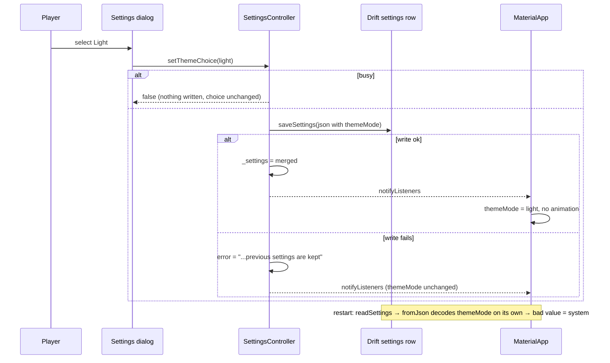

# Design

## Triage

| Trigger | Applies? | Evidence |
|---|---|---|
| T1 Components (new component, or 3+ with directed relationships) | yes | New theme module (`lib/ui/ember/`), a Blackgrid token extension, a pure verdict-reason function in `lib/domain/`; `BlackgridApp` (`lib/ui/app.dart:13-23`) starts reading `SettingsController` for the theme |
| T2 State (persistent state, caches, 3+ state machine) | yes | New persisted setting `themeMode` in the settings row (`lib/domain/settings.dart:283-328`, `lib/data/database.dart:431-446`) |
| T3 Concurrency (background work, workers/isolates, async, retries) | yes | The theme save goes through `SettingsController._write`, which is async and drops a save while `busy` (`lib/application/settings_controller.dart:107-160`). The Windows brightness can change while the app runs |
| T4 Boundaries (data format, migration, shared interface, IPC, external) | yes | A stored settings JSON key; new font assets from an external source with notices; `ItemDecision` (`lib/domain/decision.dart:31-55`) gains a typed field read by the UI |
| T5 Volume (grows without a fixed bound) | no | Fixed sets: three theme values, six verdicts, two font files |
| T6 Risk (security, money, data loss, unrecoverable user data) | no | A bad theme value must not reset other settings (covered under T2); no secrets, money or user data loss beyond that |

TIER: FULL

## Context

See proposal.md for scope. The current state this design builds on:

- **Theme today.** `blackgridTheme()` (`lib/ui/theme.dart:16-73`) is one dark `ThemeData` built from `GridColors` (`lib/ui/theme.dart:4-14`). `GridColors.*` is read directly in 13 other `lib/ui` files (the counts are in proposal.md Impact), and a few raw literals remain (`lib/ui/shell.dart:267`, `lib/ui/marker_popup.dart:342`). `MaterialApp` gets only `theme:` (`lib/ui/app.dart:20`, `:71`), with no `darkTheme` or `themeMode`.
- **Panels.** `GridPanel` and `CollapsibleGridPanel` (`lib/ui/theme.dart:75-225`) draw a gold-bordered `Material` with a 26px gold icon and a `titleMedium` title. Section labels are uppercase strings: `lib/ui/live_scan_panel.dart:56`, `lib/ui/manual_controls.dart:49`, `lib/ui/scan_evidence_panel.dart:136` and `lib/ui/map_screen.dart:327` (`toUpperCase()`).
- **Verdict today.** `ItemDecisionCard` (`lib/ui/item_decision_card.dart:30`) shows `recommendationLabel` (`:14-21`) in one gold-bordered box for every verdict (`:172-191`). The price row is three `_value` boxes (`:194-214`, `:353`). The same card renders compact in the Map rail (`lib/ui/map_screen.dart:402`). It rebuilds on `selection` and `scans` (`:39-40`). `SelectionController` notifies every 30 s for age updates (`lib/application/selection_controller.dart:29-33`).
- **Decision engine.** `DecisionEngine.evaluate` (`lib/domain/decision_engine.dart:9-140`) is the only keep/sell authority (ADR-0001). It records open inputs only as English warning strings (`:25-31`, `:93-104`), and an unresolved need as a `NeedReason` with `NeedState.unresolved`. It compares Flea and Trader on gross price (`:117-121`). `ItemDecision` is never persisted. It is built only by the engine and two tests (`test/application/session_scan_state_test.dart:15`, `test/ui/requirement_panel_test.dart:20`).
- **Settings storage.** One JSON row (ADR-0003). `AppSettings.fromJson` throws on a bad required field, and `readSettings` then falls back to defaults with `unreadable: true` (`lib/data/database.dart:436-445`). `raidTimers` is decoded on its own so a bad block cannot reset the rest (`lib/domain/settings.dart:306-314`). That is the pattern `themeMode` follows. A failed save keeps the previous settings and sets `error` (`lib/application/settings_controller.dart:133-135`). `save` returns `false` without writing while `busy` (`:155-156`).
- **Kit.** `brand/flutter/ember_tokens.dart` is generated by `brand/tools/build.mjs:151-152` from `brand/tokens.json`. `brand/flutter/ember_theme.dart` is hand-written. Neither has ever been compiled (`brand/README.md`, Status). The kit has no `ok-*` verdict greens and no `map-ground`. Those are Blackgrid roles, listed only in DESIGN.md's frontmatter (DESIGN.md "Adopting the kit").
- **Fonts.** Flutter's `FontWeight` also sets the `wght` axis of variable fonts (Flutter breaking-change note "FontWeight also controls the weight attribute of variable fonts", checked through Context7 against `/flutter/website`). The pinned Flutter is 3.47.9 (`mise.toml`). `brand/fonts/OFL-NOTICE.md` names the upstream sources (google/fonts `ofl/geist`, `ofl/literata`).
- **Source checks.** `test/ui/plain_language_source_test.dart` with `test/ui/support/plain_language_check.dart` is the existing pattern for an offline scan over `lib/ui` that names file and line.

## Decisions

### D1: Bundle the variable TTFs

- **Choice:** Bundle `Geist[wght].ttf` and `Literata[opsz,wght].ttf` from the google/fonts repository, pinned to one commit, under `assets/fonts/`. Declare them as the `Geist` and `Literata` families in `pubspec.yaml`. Weights come from `FontWeight`. No italic file is bundled, because no Ember role uses italics.
- **Rejected:** Static per-weight TTFs from the upstream font repositories. Five files and more notices to track. A weight the tokens do not list would snap to the nearest file, and nothing is gained over the axis Flutter already drives.
- **Reversal cost:** low (swap asset files and the `fonts:` block)
- **Important:** yes, because it adds external third-party assets with licence obligations to the bundle
- **Chosen by:** user

### D2: Copy the kit's Flutter files, guard the generated one

- **Choice:** Copy `ember_tokens.dart` byte for byte into `lib/ui/ember/ember_tokens.dart`, and adapt `ember_theme.dart` into `lib/ui/ember/ember_theme.dart` (Blackgrid wiring, analyzer fixes). The generated file carries `import 'dart:ui' show FontFeature;`, which Flutter 3.47.9 reports as `unnecessary_import` because `material.dart` already exports `FontFeature`. With the owner's approval (review round 1, M2), Blackgrid's copy of `brand/tools/build.mjs` stops emitting that import, and `node brand/tools/build.mjs` regenerates `brand/flutter/ember_tokens.dart` and `brand/tokens.css`. Token values do not change, and Mythspine's copy of the kit is not changed. Otherwise `brand/` stays as it is. An offline test fails when `lib/ui/ember/ember_tokens.dart` differs from `brand/flutter/ember_tokens.dart`, so a regeneration in `brand/` forces the copy to follow. `brand/**` stays excluded from analysis, and the copy in `lib/` is analyzed.
- **Rejected:** Moving the files and retargeting `build.mjs` at `lib/`. That changes the kit's layout for every adopter, beyond the one import fix. Also rejected: moving without a link, because a later regeneration would write to `brand/flutter/` again and the copies would drift silently. Also rejected: excluding the generated copy from analysis, because then the token file would never be analyzed.
- **Reversal cost:** low
- **Important:** yes, because it binds future changes (where tokens come from and how they are kept in step)
- **Chosen by:** user

### D3: Blackgrid roles in their own theme extension

- **Choice:** A hand-written `BlackgridColors extends ThemeExtension<BlackgridColors>` in `lib/ui/ember/blackgrid_tokens.dart`, with `dark` and `light` constants for the DESIGN.md frontmatter values `ok-fill`, `ok-on-fill`, `ok-bg`, `ok-line`, `ok-ink`, `ok-strong` and `map-ground` (the same value in both rooms). The verdict type role (Geist 600, 22px, height 1.2) goes in the same file as `BlackgridType.verdict`. `blackgridTheme(Brightness)` registers both extensions.
- **Rejected:** Adding the roles to `EmberColors`. That edits a generated file and leaks Blackgrid roles into the shared kit, which DESIGN.md forbids.
- **Reversal cost:** low
- **Important:** no
- **Chosen by:** agent

### D4: `themeMode` key in the settings JSON

- **Choice:** `AppSettings.themeMode` is an enum `ThemeChoice { system, dark, light }`, stored as the key `themeMode` with its name. It is decoded on its own: a missing, non-string or unknown value reads as `system`, and the other keys decode as before. It is not counted as unreadable. `SettingsController.setThemeChoice` saves it through `save`.
- **Rejected:** A dedicated Drift column with a schema migration. It needs a migration for one enum, and older app versions would refuse the newer database. A JSON key is ignored by older versions.
- **Reversal cost:** medium (a stored key, once shipped, must stay readable)
- **Important:** yes, because it adds a config key and a stored data format
- **Chosen by:** user

### D5: The app root maps the choice to `ThemeMode`

- **Choice:** `BlackgridApp` wraps `MaterialApp` in a `ListenableBuilder` on `services.settings` and passes `theme: blackgridTheme(Brightness.light)`, `darkTheme: blackgridTheme(Brightness.dark)`, `themeMode` mapped from the saved choice, and `themeAnimationDuration: Duration.zero` (the One Motion Rule). The two `ThemeData` values are built once (`final` fields of a top-level holder), so a settings notify that does not change the room, such as the busy flips around every save, does not hand dependents a new theme object. System follows `MediaQuery.platformBrightness`, which Flutter updates when Windows changes. The bootstrap screen (`lib/ui/app.dart:70`) uses `ThemeMode.system`, because settings are not loaded yet.
- **Rejected:** A dedicated `ThemeController` that owns the choice. It would be a second writer of a setting and would split ownership of the settings row (ADR-0002 keeps one controller per store). It also adds nothing over the existing notifier.
- **Reversal cost:** low
- **Important:** no
- **Chosen by:** agent

### D6: Typed open inputs on `ItemDecision`

- **Choice:** The engine also records why a decision is open, as an ordered `List<OpenInput>` on `ItemDecision` (`itemData`, `trackerProgress`, `foundInRaid`, `unresolvedNeed`, `fleaEligibility`, `priceTimeStale`, `priceTimeUnknown`), set from the conditions it already checks (`lib/domain/decision_engine.dart:26-31`, `:92-104`, `:107`). The field is optional and defaults to empty, so existing constructors compile. The recommendation logic and the warning strings do not change.
- **Rejected:** Parsing the English warning strings in the reason function. It would couple presentation to wording, and the unresolved need is not in the warnings at all.
- **Reversal cost:** low (not persisted; two test constructors)
- **Important:** no
- **Chosen by:** agent (the order of found in raid before unresolved need: user, review round 1)

### D7: The verdict reason is a pure domain function

- **Choice:** `String verdictReason(ItemDecision decision)` in `lib/domain/verdict_reason.dart`. It has no Flutter import, and it applies the selection rules and wording of the `verdict-presentation` spec, with prices formatted by the same rouble formatter the card uses (moved from `lib/ui/theme.dart:310-312` to `lib/domain/`). Keep takes the first need, in engine order, whose state is actionable. Keep for later takes the first need whose state is future. For Check / May Need it takes the first `OpenInput` in the spec's order (found in raid before unresolved need), naming the first unresolved need's source for `unresolvedNeed`. Flea and Trader quote the gross prices the engine compares (`fleaGross`, `traderGross`; `lib/domain/decision_engine.dart:117-121`), never the per-slot values, and pick the Trader line from `fleaEligible` and `fleaGross`. Every branch returns a non-empty string. Because the file is outside the `lib/ui` scope of the plain-language source check, its test also runs `findBannedTermHits` (`test/ui/support/plain_language_check.dart`) over `lib/domain/verdict_reason.dart`.
- **Rejected:** Building the reason inside the widget. Its permutations (six verdicts, six open inputs, unknown counts, no trader) would then be tested through widget tests instead of fast unit tests (AGENTS.md: the cheapest layer).
- **Reversal cost:** low
- **Important:** no (the wording itself was settled in S3)
- **Chosen by:** agent

### D8: Freshness is a pure classification plus a small widget

- **Choice:** `PriceFreshness priceFreshness(DateTime? quoteAt, DateTime now, {required bool? fleaEligible})` in `lib/domain/` returns hidden (when `fleaEligible` is `false`, because the engine then ignores the Flea price time, `lib/domain/decision_engine.dart:105-107`), fresh (with the time), stale (with whole hours under 48 h, else whole days) or unknown (null or in the future). It shares the one-hour limit with the engine through one constant: the engine's literal (`lib/domain/decision_engine.dart:102`) is replaced by `priceFreshnessLimit`. A `FreshnessTag` widget renders it. The card reads `now` from `SelectionController.clock`, so a fake clock drives the widget tests, and the 30 s age notify refreshes it.
- **Rejected:** Computing the age inline in the card with `DateTime.now()`. It cannot be tested with a fake clock, and the limit would be stated twice.
- **Reversal cost:** low
- **Important:** no
- **Chosen by:** agent (hiding the tag for items that can't go on the Flea: user, review round 1)

### D9: Ember panel widgets replace the gold panels in place

- **Choice:** Keep the `GridPanel`, `CollapsibleGridPanel` and `DetailsSection` APIs, so call sites do not churn. Restyle their bodies to Ember: panel surface, 1px hairline, 12px radius, 18px padding, no elevation, a 16px `inkSecondary` icon and a UI Heading title. Move them and the label helpers (`modeLabel`, `mapLabel`) out of `theme.dart` into `lib/ui/panels.dart` and `lib/ui/labels.dart`. `theme.dart` is deleted, and `GridColors` goes with it.
- **Rejected:** Renaming every panel to new Ember widgets now. It touches every screen twice, because `add-answer-strip` and `restyle-dialogs` replace most of these panels anyway.
- **Reversal cost:** low
- **Important:** no
- **Chosen by:** agent

### D10: An offline check bans colour literals in `lib/ui`

- **Choice:** `test/ui/theme_source_test.dart` scans `lib/ui/**.dart`, except `lib/ui/ember/`, ignoring comments, for `\bColor\s*\(`, `Color\.from(ARGB|RGBO)?\s*\(` and `\bColors\.(?!transparent\b)\w+`, and names file and line, following `test/ui/plain_language_source_test.dart`. The map's own colours in `lib/maps/` and `lib/domain/map_zone_style.dart` are outside its scope. ADR-0023 owns them, and `restyle-map-workspace` changes them. The map colours still built in `lib/ui` move into a new `lib/maps/map_palette.dart` as `Color` constants with unchanged values: the player marker fill (`lib/ui/map_workspace.dart:753`, `Colors.white`), the place label colour (`:851`), the extract label colours (`:912`, built from `labelColourFor`) and the marker bubble's leader line (`lib/ui/marker_popup.dart:342`, `0xffdcc05a`). The painters read them from there. `lib/ui/shell.dart:267` is chrome and takes a theme role. The Price unavailable plate's dashed border is drawn by a small `DashedBorderPainter` that exposes its `color`, so a widget test can assert the dashed `ink-tertiary` border.
- **Rejected:** A custom analyzer lint plugin. It costs much more for the same guarantee.
- **Reversal cost:** low
- **Important:** no
- **Chosen by:** agent

### D11: Record ADR-0037 for the UI colour contract

- **Choice:** During apply, write `docs/adr/0037-interface-colours-come-from-the-ember-theme.md`. Screens take colours, type, radii and control sizes only from the Ember theme (`EmberColors`, `EmberType`) and the Blackgrid extension. Blackgrid roles never go into the shared kit. The generated tokens are a byte-identical copy of the kit's. The colour check enforces the rule. The map palette is the named exception, owned by ADR-0023. The ADR is indexed in `openspec/architecture.md`.
- **Rejected:** No ADR, with DESIGN.md as the only authority. The architecture index would then say nothing about the UI layer's contract that the later M8.5 changes must follow.
- **Reversal cost:** low
- **Important:** yes, because it binds future changes
- **Chosen by:** user

### D12: Font notices are proven offline

- **Choice:** `THIRD_PARTY_NOTICES.md` gets a "Bundled fonts" section with one entry per TTF (family, google/fonts commit, source URL, SHA-256), then each family's full OFL 1.1 text with its copyright line. The texts come from `brand/fonts/OFL-geist.txt` and `OFL-literata.txt`, checked against the pinned commit's `OFL.txt`. `.gitattributes` gets `assets/fonts/** -text`, like the repo's other hash-bound asset directories, so no checkout setting alters the bytes. `test/ui/font_notice_test.dart` reads the `fonts:` block of `pubspec.yaml`, hashes each file and asserts that the notice names it with that SHA-256 and that the family's OFL text is present.
- **Rejected:** Adding a step to the release bundle-integrity check. The fonts are plain Flutter assets with no runtime binding, so a fast offline test already proves the notice matches the files. A bundle step adds release-time cost for no extra guarantee.
- **Reversal cost:** low
- **Important:** no
- **Chosen by:** agent

### Decision summary

| # | Decision | Choice | Rejected | Reversal cost | Important | Chosen by |
|---|---|---|---|---|---|---|
| S1 | Scope | Ember under today's layout; layout, Settings page, map colours and dialogs later | Restyle and re-layout in one change | low | yes | user |
| S2 | Theme default | System | Dark until changed | low | yes | user |
| S3 | Verdict reason | New plain summary per verdict | Reuse first reason or warning | low | yes | user |
| S4 | Freshness tag | Price row only | Price row plus Data sources | low | yes | user |
| S5 | Switch placement | Top of today's Settings dialog | Wait for the Settings page | low | no | agent |
| S6 | Map palette | Untouched (ADR-0023) | Recolour the map now | low | no | agent |
| D1 | Font files | Variable TTFs from google/fonts, pinned commit | Static per-weight TTFs | low | yes | user |
| D2 | Kit files | Copy into `lib/ui/ember/`, identity test on tokens; owner-approved generator fix drops the redundant import | Move and retarget build; move without link; exclude from analysis | low | yes | user |
| D3 | Blackgrid roles | Separate `BlackgridColors` extension | Add to `EmberColors` | low | no | agent |
| D4 | Theme storage | `themeMode` JSON key, decoded on its own | Own Drift column with migration | medium | yes | user |
| D5 | Theme wiring | `MaterialApp` theme/darkTheme/themeMode from `SettingsController`, zero animation | Separate `ThemeController` | low | no | agent |
| D6 | Open inputs | Typed ordered `OpenInput` list on `ItemDecision`, found in raid before unresolved need | Parse warning strings | low | no | agent (order: user) |
| D7 | Reason function | Pure `verdictReason` in `lib/domain/`; Keep takes actionable, Keep for later takes future; gross prices | Build it in the widget | low | no | agent |
| D8 | Freshness | Pure classification, hidden when not Flea-sellable, shared one-hour constant, injected clock | Inline `DateTime.now()` in the card | low | no | agent (hidden: user) |
| D9 | Panels | Restyle `GridPanel` family in place, delete `theme.dart` | New Ember widgets everywhere now | low | no | agent |
| D10 | Colour rule | Offline source check over `lib/ui`; map literals move to `lib/maps/map_palette.dart` unchanged | Analyzer lint plugin | low | no | agent |
| D11 | ADR | Record ADR-0037 | No ADR | low | yes | user |
| D12 | Font notices | Offline hash and licence test | Bundle-integrity step | low | no | agent |

## Diagrams (FULL)

T1, components and who reads what:

```mermaid
graph LR
  K[brand/flutter/ember_tokens.dart<br/>generated kit copy] -. identity test .- T[lib/ui/ember/ember_tokens.dart]
  T --> TH[lib/ui/ember/ember_theme.dart<br/>blackgridTheme(Brightness)]
  B[lib/ui/ember/blackgrid_tokens.dart<br/>BlackgridColors, BlackgridType] --> TH
  S[SettingsController] -->|themeMode| APP[BlackgridApp / MaterialApp]
  TH --> APP
  APP --> UI[lib/ui screens]
  E[DecisionEngine] -->|ItemDecision + OpenInput list| R[verdictReason]
  E --> CARD[ItemDecisionCard]
  R --> CARD
  F[priceFreshness] --> CARD
  SEL[SelectionController clock, 30 s notify] --> CARD
```

T2 and T3, the theme choice from click to restart:



T4, the stored format: the settings JSON gains `"themeMode": "system" | "dark" | "light"`, optional, defaulting to `system`.

## State & Ownership (FULL)

| State | Owner (sole writer) | Lifetime | Invalidation / rebuild | Authoritative copy |
|---|---|---|---|---|
| Saved theme choice | `SettingsController` (via `_write`) | Persisted in the settings row | Rewritten on each successful save; decoded at `load` | Drift settings row; `SettingsController.settings` mirrors the last successful read or write |
| Effective room (light/dark) | `MaterialApp` (derived) | Per frame | Recomputed from the theme choice and `platformBrightness` | Derived, never stored |
| Token values | Generated kit file (`brand/flutter/ember_tokens.dart`) | Source | Regenerated by `node brand/tools/build.mjs`; the copy in `lib/` must match | `brand/tokens.json` |
| Blackgrid roles | `lib/ui/ember/blackgrid_tokens.dart` | Source | Edited by hand with DESIGN.md frontmatter | DESIGN.md frontmatter |
| `ItemDecision.openInputs` | `DecisionEngine` | Per evaluation, in memory | Recomputed on each evaluation | Engine output |
| Price freshness shown | Derived in the card from `quoteAt` and the clock | Per build | 30 s age notify and any selection change | `CatalogItem.quoteAt` |

## Failure & Visibility (FULL)

| Component | Fails / dies mid-operation → | Recovery | Retry safe? | Who finds out |
|---|---|---|---|---|
| Theme save | Write throws | Previous settings kept; room stays on the previous choice | Yes, the player selects again | Player: the existing settings error text |
| Theme save while busy | `save` returns false | Choice unchanged, the control shows the previous value | Yes | Player sees the selection did not move; the same as every other setting today |
| Settings decode | `themeMode` bad | Reads as System, other settings kept, not marked unreadable | n/a | Nobody needs to: System is the safe default, and the player sees System selected |
| Font asset missing at runtime | Flutter falls back to the platform font | None needed | n/a | Offline font test fails before release (file list from `pubspec.yaml`); Flutter's build fails on a missing declared asset |
| Token copy drift | `lib/` tokens differ from the kit | Recopy | n/a | Offline identity test fails |
| Colour literal added | Hard-coded colour | Use a theme role | n/a | Offline colour check names file and line |
| `verdictReason` | Unhandled combination | Every branch returns a fixed fallback line for its verdict | n/a | Unit tests cover all six verdicts and every open input |

## Resource Bounds (FULL)

| Queue / buffer / cache / transfer | Bound | At the bound | Timeout | At 10x / 100x |
|---|---|---|---|---|
| Bundled font files | 2 files; the variable TTFs are each about 0.3–1 MB (to be measured at apply and recorded in the notice) | n/a | n/a | Fixed set, no growth |
| `openInputs` list | At most 6 entries (one per kind) | n/a | n/a | Fixed |
| Theme rebuild on change | One full-app rebuild per successful save or Windows switch | n/a | n/a | Player-driven, rare |

## Flow & State Gaps (FULL)

- **Restart mid-save.** The save is a single row write: either the old or the new JSON is stored. Both decode.
- **Startup before settings load.** The bootstrap screen uses System (D5), so a player who chose Dark on light-mode Windows sees the light room until services open, which takes longer when the startup screen shows an error. Accepted: "a chosen room survives a restart" holds once settings are loaded, and `restyle-dialogs` restyles the startup screen.
- **Windows changes while Dark or Light is chosen.** Ignored by design. Only System follows Windows.
- **Old app version reads a new row.** It ignores the unknown key (`fromJson` reads named keys only). Its next save drops the key, so the newer version reads System. Accepted: a downgrade is not a supported flow, and the loss is one preference.
- **Legacy import** (`lib/data/database.dart:620`) saves `imported.applyTo(stored.settings)`, a `copyWith` over the stored settings (`lib/domain/import_preview.dart:47-53`), so the player's theme choice survives an import as long as `copyWith` carries `themeMode`. A model test proves that.
- **Stale tag while the card is idle.** The tag can lag the one-hour limit by up to 30 s (the age notify period). Accepted, and the engine's verdict uses the same limit on the same notify.
- **A selection made before the catalog has prices.** `quoteAt` null shows "price time unknown", matching the engine's Check.

## Mechanism Ledger (FULL)

| Mechanism | Built? | Why (harm nobody catches / expensive later) | Evidence that would change the call |
|---|---|---|---|
| Independent decode of `themeMode` | Yes | Without it, one bad value marks all settings unreadable and resets folders and timers to defaults (`lib/data/database.dart:443-444`) | — |
| Token identity test | Yes | A kit regeneration would otherwise leave `lib/` silently stale | — |
| Colour-literal source check | Yes | A hard-coded colour breaks the light room and nobody sees it until the user switches rooms | — |
| Font notice hash test | Yes | Licence obligation; a swapped font file without a notice ships unnoticed | — |
| Session-only theme override on save failure | No | The save failure is already shown, and matching the other settings is simpler | A user report that a theme save fails in practice |
| Bundle-integrity step for fonts | No | The offline test covers the notice; nothing binds the font at runtime | A rule that every bundled third-party asset must be hash-bound at release |
| Contrast test for plate text | No | DESIGN.md X1 records the ratios for these fixed token values, and the identity and token tests pin those values | A change of token values without a DESIGN.md update |
| Animated room change | No | Forbidden by the One Motion Rule | — |

## Risks / Trade-offs

- [Light room surfaces where today's widgets assume dark, for example icons or images drawn for a dark ground] → Widget tests render the Scanner and Map rail in both rooms. The map keeps `map-ground` in both rooms. The user judges the look at the milestone close.
- [Variable-font weight rendering differs on Windows from the web specimen] → The weights come from `FontWeight` (Flutter's documented behaviour). The user-verified M8.5 criterion covers the look.
- [Literata's `opsz` axis stays at its default instance, because Flutter does not set it automatically] → Accepted. The serif titles are 19–30px, near the default instance's design size. A `FontVariation('opsz', …)` on the title roles can be added later without changing specs.
- [Players on light-mode Windows see a light Blackgrid after updating (S2)] → The release notes say so, and the switch is in Settings.
- [Large mechanical diff touching 14 UI files] → `GridPanel` APIs stay (D9), so call sites change only where they read `GridColors`.

## ADRs

- **In force, constraining this change:** ADR-0001 (the engine stays the only keep/sell authority; `openInputs` is engine output, and the reason is presentation of it), ADR-0002 (`SettingsController` stays the single settings writer), ADR-0003 (one settings row in Drift), ADR-0023 (map marker and role colours untouched).
- **To record during apply:** ADR-0037, "Interface colours come from the Ember theme" (D11), with its index row in `openspec/architecture.md`.

## Open Questions

- The exact google/fonts commit and the measured TTF sizes are recorded at apply, in the notice. This changes no spec or task.
