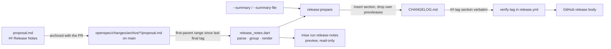
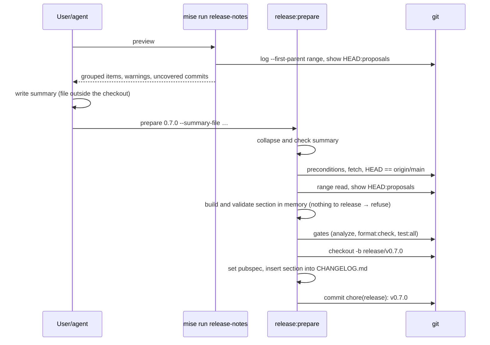

# Design

## Triage

| Trigger | Applies? | Evidence |
|---|---|---|
| T1 Components (new component, or 3+ with directed relationships) | No | One new library (`tool/release/src/release_notes.dart`) used by two existing entry points (`tool/changelog.dart`, `prepare` in `tool/release/src/release_steps.dart`); no runtime component. |
| T2 State (persistent state, caches, 3+ state machine) | Yes | `CHANGELOG.md` changes from a regenerated file to the durable, hand-curated store of every release's notes. |
| T3 Concurrency (background work, workers/isolates, async, retries) | No | Sequential local commands; the release workflow is unchanged. |
| T4 Boundaries (data format, migration, shared interface, IPC, external) | Yes | A new file format read from archives forever (the proposal `## Release Notes` section), the `CHANGELOG.md` section format read by `verify-tag` and the release workflow, and edits to two published GitHub releases. |
| T5 Volume (grows without a fixed bound) | Yes | The number of changes, items and proposals in a release range grows with the milestone. |
| T6 Risk (security, money, data loss, unrecoverable user data) | No | Notes on a permanent tag can be wrong, but the tag message is only the version (`git cat-file -p v0.6.0`), and the GitHub release body can be edited. |

TIER: FULL

## Context

- `tool/changelog.dart:19-52` runs git-cliff in two stages and keeps only first-parent commits; `cliff.toml` groups PR titles by conventional type. `prepare` regenerates the whole `CHANGELOG.md` through it (`tool/release/src/release_steps.dart:119-136`) and prints git-cliff's suggested next version (`:146-158`).
- `verify-tag` publishes the `## <tag>` section of the tagged `CHANGELOG.md` verbatim, refusing a missing or empty section (`tool/release/src/verify_tag_step.dart:78-91,121-131`). The release workflow only uploads that `notes.md`. Neither changes here.
- `prepare` refuses any untracked file (`release_steps.dart:39-47`), so a summary file must sit outside the checkout.
- Release PRs are squash-merged and `release:tag` requires the PR to have exactly one commit (`release-versioning`, "Release tag marks the merged release commit"). A follow-up commit on the release PR is therefore not a way to fill in a summary.
- PRs are squash-merged with `(#N)` in the subject (`openspec/specwright.yaml` `merge_method: squash`); archives land on main inside that commit, because `finish: pr` archives on the branch. Older history also has `Merge pull request #N` merges (ADR-0009).
- The format and the fallback mirror sh1ny/specwright ADR 0015 and its `release.sh` (`build_notes`, `change_lines`, `first_sentence`; limits of 600 and 500 characters, 150 items, 100 change lines, proposals of 64 KB). The specwright skills only run `release.sh notes --proposal` when `release.enabled` is true, which it is not here, so the `openspec/config.yaml` rule names the check to run (`mise run release-notes -- --check <proposal.md>`, optionally `release.sh notes --proposal`) and the D6 test enforces it; the Dart parser follows the same rules so both accept the same sections.
- Tags present: `v0.1.0`, `v0.4.0`, `v0.5.0`, `v0.6.0-beta.1`, `v0.6.0`. GitHub releases exist only for `v0.6.0-beta.1` and `v0.6.0`.

## Decisions

### D1: Release notes come from each change's proposal, as in specwright

- **Choice:** Every proposal has a `## Release Notes` section in specwright's format, kept with `release.enabled: false` through a `rules: proposal:` entry and a context line in `openspec/config.yaml`. The release tooling reads the sections of the proposals archived in the release range.
- **Rejected:** Keep git-cliff and rewrite PR titles into better prose. PR titles cannot carry a summary or Added/Changed/Fixed grouping, and a title is fixed when the PR merges. Also rejected: turning on `release.enabled` and using specwright's `release.sh publish`. It creates the GitHub release itself, which the tag workflow's preflight refuses (a release already exists), and it has no installer assets.
- **Reversal cost:** medium. Archived sections stay readable; only the reader changes.

### D2: `CHANGELOG.md` becomes the durable store; each release inserts one section

- **Choice:** `prepare` inserts the new section above the newest existing section and leaves every other section byte for byte. A final version deletes the sections of its own prereleases (`v0.7.0-beta.*` for `0.7.0`). Earlier sections are rewritten by hand once, in this change, and never regenerated.
- **Rejected:** Regenerate the whole file from the archived proposals on every release. Proposals archived before this change have no section, so v0.1.0-v0.6.0 would fall back to bare Why lines and lose the hand-written history the user asked for.
- **Reversal cost:** low. It is one Markdown file.

### D3: The release summary is an input to `prepare`

- **Choice:** `prepare <version> --summary <text>` or `--summary-file <path>` (outside the checkout). The summary is collapsed to one line (whitespace runs, newlines included, become one space; ends trimmed), as specwright does; this also keeps a `## ` line inside the file from cutting the section short in `verify-tag` (`verify_tag_step.dart:121-129`). A summary that starts with `#` would still put a heading line first in the section, so it is refused too. It refuses before the gates when the collapsed summary is missing, blank, over 600 characters or starts with `#`.
- **Order inside `prepare`:** summary checks, then the existing preconditions (branch, clean tree, fetch, `HEAD == origin/main`, version, tag and branch absent), then the whole section is built and validated in memory from `HEAD` (range read, parsing, the bounds in Resource Bounds, the "nothing to release" refusal), then the gates. `HEAD` cannot move after the preconditions pass, so the in-memory section stays valid. Only the pubspec edit and inserting the section into `CHANGELOG.md` happen after `checkout -b`; today's build-after-branch (`release_steps.dart:107-136`) moves before the gates. `mise run release-notes` prints the draft (grouped items, warnings, uncovered commits) first, so the summary is written from what it shows.
- **Rejected:** A placeholder summary that the user replaces in the release PR, with `verify-tag` refusing the placeholder. The edit would be a second commit on the release PR, which `release:tag` refuses. Amending the release commit by hand could work, but it is easy to get wrong. Also rejected: the last change's summary (specwright's fallback). It describes one change, not the release.
- **Reversal cost:** low.

### D4: The range is archived proposals added on main's first-parent line since the last final tag

- **Choice:** `git log --first-parent --diff-merges=first-parent --diff-filter=A --name-only <last final>..HEAD -- ':(glob)openspec/changes/archive/*/proposal.md'`, oldest first, with all of history when there is no final tag. The PR number comes from that commit's subject: the trailing `(#N)` of a squash, or `Merge pull request #N` of a merge. Each proposal is read at `HEAD`. The change name is the archive directory name without its `YYYY-MM-DD-` prefix.
- **Rejected:** Asking GitHub which PRs merged, as specwright's `release.sh` does. It needs the network and a login inside `prepare`, and the commit subject already records the number offline. Also rejected: ranges between all tags. A final release must list the whole milestone (ADR-0009), so prereleases do not bound it.
- **Reversal cost:** low.

### D5: One Dart library owns parsing and rendering; two thin entry points

- **Choice:** `tool/release/src/release_notes.dart` holds the section parser (errors with line numbers), the Why-line extractor, the range reader (through the existing `Git`/`CommandRunner` seam, `tool/release/src/git.dart`) and the renderer. `tool/changelog.dart` becomes its CLI: `--preview` (default) and `--check <proposal.md>`. `prepare` calls the library in-process instead of spawning `dart run tool/changelog.dart`.
- **Rejected:** Shelling out to specwright's `release.sh`. It lives in `.claude/skills/`, which a Specwright update overwrites, and it needs bash and Python. Also, its range is GitHub-backed.
- **Reversal cost:** low.

### D6: In-flight proposals are checked by the fast offline suite

- **Choice:** A test reads every `openspec/changes/<name>/proposal.md` that is not under `archive/` and fails on a missing or invalid section, naming the file and its first error. Archived proposals are not checked; the release tooling falls back for them (D7).
- **Rejected:** Relying on the agent running `release.sh notes --proposal`. That check is advisory and leaves no trace in CI. Also rejected: checking all archived proposals. The 33 proposals archived before this change have no section.
- **Reversal cost:** low.

### D7: An invalid or missing section is a warning, not a stop

- **Choice:** That change is listed under `Changes:` as `- <name> (#<PR>): <first sentence of Why>` after the grouped items, as in specwright. `prepare` and the preview print a warning per change. With no valid section in the range the section is the summary and `Changes:` only.
- **Rejected:** Refusing the release. A typo in one archived proposal would block a release until a fix PR lands, and an archive is not supposed to be edited.
- **Reversal cost:** low.

### D8: Historic notes and published releases are rewritten by hand once

- **Choice:** In this change, rewrite the `v0.6.0`, `v0.5.0`, `v0.4.0` and `v0.1.0` sections of `CHANGELOG.md` in the new format from their archived proposals and PRs. The new `v0.6.0-beta.1` body (what had landed by that tag) is kept in the repository as `release-bodies/v0.6.0-beta.1.md` in this change's directory, archived with it, because the v0.6.0 release already removed that section from `CHANGELOG.md`. After merge, show the user both bodies and replace the `v0.6.0-beta.1` and `v0.6.0` GitHub release bodies with `gh release edit --notes-file` only after the user approves. Tags are not touched.
- **Exception, recorded in ADR-0029:** for these two published releases the body no longer equals the tagged commit's `CHANGELOG.md` section, which `release-publishing` ("Release notes are the version's changelog section") requires of a publish. The requirement still governs every publish; this is a one-time, owner-approved edit after publishing. The authoritative copy for `v0.6.0` is its section in `CHANGELOG.md` on main, and for `v0.6.0-beta.1` the archived `release-bodies/v0.6.0-beta.1.md`.
- **Rejected:** Backfill `## Release Notes` sections into archived proposals and generate history from them. It edits archives and still needs hand-written summaries.
- **Reversal cost:** low. Release bodies can be edited again; the old text stays in git history (`CHANGELOG.md` at `v0.6.0`).

## Diagrams (FULL)

## State & Ownership (FULL)

| State | Owner (sole writer) | Lifetime | Invalidation / rebuild | Authoritative copy |
|---|---|---|---|---|
| Proposal `## Release Notes` section | The change's author, during planning and apply | Forever once archived | Not rebuilt; an archive is not edited | The archived `proposal.md` at the release commit |
| `CHANGELOG.md` release section | `release:prepare` (insert, prerelease removal); the hand rewrite in this change for history | Forever | Never regenerated; a wrong section is fixed by a reviewed commit before the tag | The section at the tagged commit |
| GitHub release body | The release workflow at publish; one approved hand edit for the two existing releases | Until edited | `gh release edit` | The tagged `CHANGELOG.md` section; for `v0.6.0` and `v0.6.0-beta.1` the approved text (D8) |

## Failure & Visibility (FULL)

| Component | Fails / dies mid-operation → | Recovery | Retry safe? | Who finds out |
|---|---|---|---|---|
| Section parser | Invalid section in an in-flight proposal | Fix the proposal | Yes | Fast test suite, CI on the PR |
| Range reader (`git log`/`git show`) | Git error | `prepare` refuses before the gates and before the branch exists; nothing is changed; the preview exits non-zero | Yes | User, on the terminal |
| Notes builder | No change in range (direct commits only included: intended, a release needs at least one change) | `prepare` refuses before the gates and before creating the branch | Yes | User |
| Fallback | Archived section invalid or missing; archived proposal over 64 KB or no longer at `HEAD` (reverted or moved) | Listed under `Changes:` (by name and PR only when the proposal was not read) | n/a | Warning printed by preview and `prepare`; visible in the release PR diff |
| Hand edit of GitHub releases | `gh release edit` fails half-way (one of two) | Re-run for the failed one | Yes, idempotent | Agent reports per release |

## Resource Bounds (FULL)

| Queue / buffer / cache / transfer | Bound | At the bound | Timeout | At 10x / 100x |
|---|---|---|---|---|
| Proposals read per release | 1 000 changes in range | Refuse, naming the count | None (local git) | A milestone has ~5-15 changes; 100x is still under the bound |
| Proposal size | 64 KB, checked with `git cat-file -s` before reading | That change falls back to its name only, with a warning | n/a | Largest archived proposal is a few KB |
| Items listed | 150 | `…and <n> more items` | n/a | |
| `Changes:` lines | 100 | names only, then `…and <n> more` (specwright `change_lines`) | n/a | |
| Summary | 600 characters | Refused by `prepare` | n/a | |

## Flow & State Gaps (FULL)

- **Prepare interrupted after branch creation:** unchanged behaviour: nothing committed, the message names the branch and the files to discard.
- **A change archived on main between the preview and `prepare`:** `prepare` fetches, requires `HEAD == origin/main`, and builds from `HEAD`, so the section includes it; the summary may not mention it. The release PR diff shows it. Accepted.
- **Final after prereleases whose sections were edited by hand:** the final's section is rebuilt from proposals; the edited prerelease text is dropped with the prerelease section. Accepted: a prerelease section is superseded by design.
- **A change archived directly on main (local finish), or archived after its PR merged (as `fix-changelog-spec` was after #60):** the commit that added the proposal names no PR, so its items are listed as written and its fallback line has no `(#N)`. Accepted; an item can name its PR itself.
- **The same change name archived twice:** prevented by `specwright-branch`; if it happens, both directories are distinct and both are listed.
- **Release PRs:** a `chore(release)` commit adds no archived proposal, so it never appears; the preview also skips it in the uncovered list.

## Mechanism Ledger (FULL)

| Mechanism | Built? | Why (harm nobody catches / expensive later) | Evidence that would change the call |
|---|---|---|---|
| Dart parser matching `release.sh notes --proposal` | Yes | A disagreement would let an in-flight check pass while the release falls back silently | — |
| Parity test against `release.sh` in CI | No | Needs bash and Python in the test; the rules are small and copied into unit tests | A section accepted by one and refused by the other |
| Placeholder check in `verify-tag` | No | D3 makes a placeholder impossible | A path that writes a section without a summary |
| Refuse tag on fallback warnings | No | D7: warnings are visible in the release PR | A release shipped with an unnoticed fallback |
| GitHub-API PR lookup | No | Commit subjects carry the PR offline (D4) | A merge method that drops `(#N)` |
| Size checks before reads | Yes | Mirrors specwright; cheap | — |

## Risks / Trade-offs

- [The schema tells authors to delete the section when releases are off] → `openspec/config.yaml` rule plus the D6 test, which fails CI.
- [The Dart parser drifts from specwright's] → unit tests take their cases from specwright's ADR 0015 rules; the authoring check stays `release.sh`, and the D6 test runs the Dart parser on the same files.
- [Hand-written history contains a wrong claim] → each historic section is written from the archived proposals and reviewed in this PR; the GitHub bodies wait for the user's approval.
- [`verify_tag_test.dart` proves `prepare`'s beta heading through git-cliff (ADR-0026)] → that test is rewritten to build the section with `prepare`'s in-process insert and run `verify-tag` on it, so the heading proof survives.
- [Direct commits on main (README, licence) are not in the notes] → the preview lists them as uncovered, so the summary can mention them.

## ADRs

- In force and constraining: ADR-0009 (release versioning; its changelog decision is superseded), ADR-0026 (the tag workflow publishes the tagged `CHANGELOG.md` section, unchanged).
- New: ADR-0029 "Release notes come from each change's proposal", superseding ADR-0009's "Changelog: one entry per merged PR" decision and its git-cliff rejected-alternative note. It records D1-D4, D7 and D8, including D8's one-time exception to `release-publishing` for the `v0.6.0` and `v0.6.0-beta.1` bodies and where their authoritative copies live. `openspec/architecture.md` index updated in the same task.
