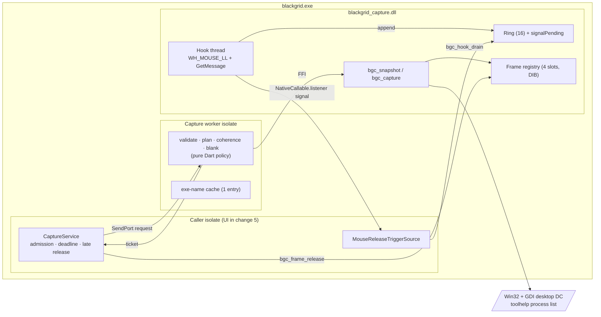
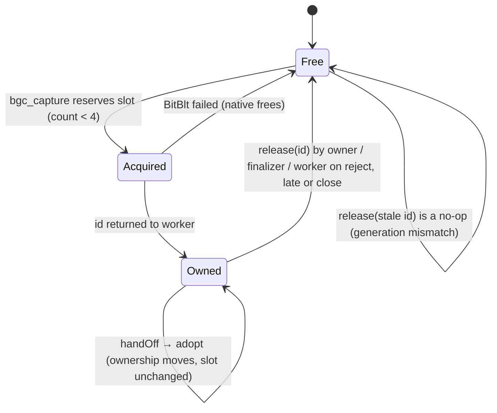
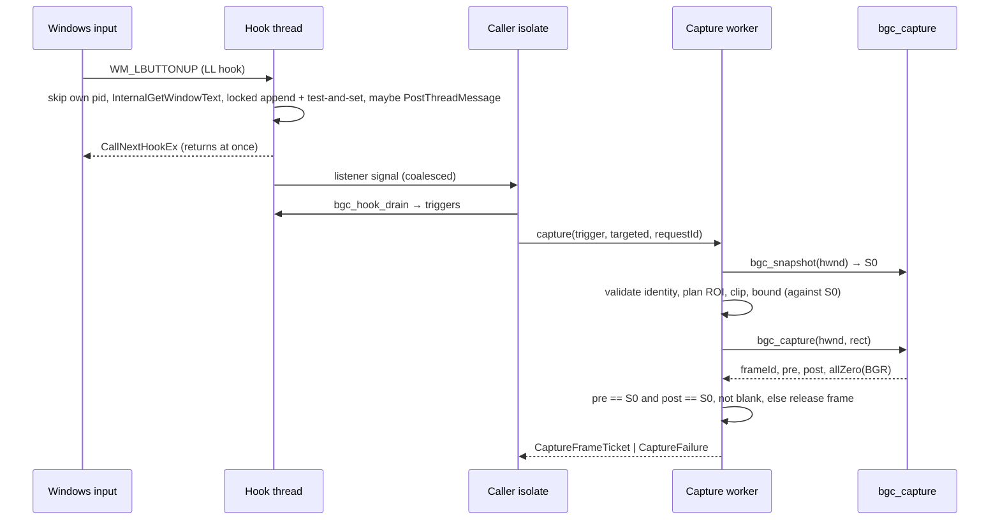

# Design

## Triage

| Trigger | Applies? | Evidence |
|---|---|---|
| T1 Components (new component, or 3+ with directed relationships) | Yes | New native DLL with its own hook thread, a new capture worker isolate, a Dart trigger source and capture service. Nothing similar exists (architecture.md, "Not built yet") |
| T2 State (persistent state, caches, 3+ state machine) | Yes | Frame slots (free → acquired → owned → released), capture-service admission (idle/active/overrun/closing/closed), hook lifecycle, and an executable-name cache. No persistent state |
| T3 Concurrency (background work, workers/isolates, async, retries) | Yes | A native hook thread, a worker isolate, deadlines that outlive native calls, late results and cross-isolate frame hand-off |
| T4 Boundaries (data format, migration, shared interface, IPC, external) | Yes | A new C ABI (`bgc_*`), a cross-isolate frame contract that changes 3 and 5 consume, a Win32 boundary and a bundle inventory change |
| T5 Volume (grows without a fixed bound) | Yes | Trigger events and frames arrive at user input rate. They are bounded here (Resource Bounds), and would be unbounded without the bounds |
| T6 Risk (security, money, data loss, unrecoverable user data) | Yes | A global input hook is privacy-sensitive. Any access to the game process risks an anti-cheat ban (AGENTS.md) |

TIER: FULL

## Context

The proposal gives the why and scope. Current state that the approach depends on:

- **PerMonitorV2 process.** `windows/runner/runner.exe.manifest:5` declares PerMonitorV2. Low-level hook points, `GetClientRect`/`ClientToScreen` and screen-DC `BitBlt` are therefore all in physical pixels. The reference companion (WPF, system-DPI aware) multiplies its client-pixel region by `dpi/96` (`Services/InspectionCaptureService.cs` `TryCapture`). Here that would misplace the targeted ROI at any OS scale above 100%. Its fallback, a full client scaled and then clipped, would hide the error. The reference's ROI formula (`CreateNameScanRegion`: 50·s marker scan, 600·s title reach, `s = min(w/1920, h/1080)` from `RatEye/Config/Processing.cs:74-79`) is kept.
- **Native DLL pattern.** Panel OCR is a standalone FFI DLL bound by an install-time `.sha256` sidecar (`windows/CMakeLists.txt:95-102`). Dart verifies that sidecar and checks an ABI integer before any lookup (`lib/data/raid_panel_ocr.dart:193,203`). Its worker isolate has single admission and returns busy rather than queueing (`:116-142`). Its close waits for native work to drain (`:146`). The bundle check verifies sidecars only for role `panel-ocr` (`tool/vision/check_bundle.dart:159-172`). The capture roles therefore need a code change there, not just new inventory rows.
- **Typed results.** The vision runtime uses sealed failure and result types and never throws (`lib/data/vision/vision_failure.dart:3,128`). Capture follows the same pattern.
- **Vision bounds.** `visionMaxSide` 8192 and `visionMaxPixels` 24 Mi (`lib/data/vision/vision_image.dart`). The capture size cap equals these, so every frame can go straight to the vision primitives.
- **Constraints.** ADR-0004: blocking native work runs on a long-lived worker isolate, never on the UI isolate. ADR-0007: this change decides how input and capture are packaged. §6/§7 of the implementation strategy: never start a second native call because a Dart future timed out; never capture inside the input callback. AGENTS.md: nothing may touch the game process, and agents never test against the game.

## Decisions

### D1: Packaging - standalone hash-bound `blackgrid_capture.dll`

- **Choice:** A new owned DLL under `windows/capture/`, statically linked against the CRT (like panel OCR), exporting a versioned `bgc_*` C ABI. CMake writes `blackgrid_capture.dll.sha256` at install. Dart verifies the hash, then `bgc_abi()`, before any lookup. The bundle inventory gains roles `capture` and `capture-binding`, which reuse the panel-sidecar check.
- **Rejected:** A runner-embedded method channel (the credentials pattern) because channel handlers run on the platform thread, so pixels would cross the UI channel. §7 forbids both. Also rejected: adding exports to `blackgrid_vision.dll`, because that couples capture to the OpenCV build and the vision manifest, and bumps an ABI that changes 3 and 4 code against.
- **Reversal cost:** low. It is one DLL behind a Dart platform seam.

### D2: Trigger delivery - native hook thread, bounded ring, coalesced signal, Dart drain

- **Choice:** `bgc_hook_start(title, signal)` creates one thread. That thread installs `WH_MOUSE_LL` and runs `GetMessage`. The hook procedure filters `WM_LBUTTONUP` with `nCode >= 0`. It reads `GetForegroundWindow` and `GetWindowThreadProcessId`. If the pid is Blackgrid's own, it stops there with no trigger. Otherwise it reads the title with `InternalGetWindowText`, which never sends a message (`GetWindowTextW` would send `WM_GETTEXT` to windows of its own process and could stall behind a blocked platform thread). Then it compares the title. One SRW-lock critical section then does all of this: append `{x, y, hwnd, pid, tid, qpc}` to the 16-slot ring (dropping and counting the oldest when full), then test-and-set `signalPending`. Only when that call set the flag does it `PostThreadMessage` `WM_APP` to its own thread, after leaving the lock. Then it returns `CallNextHookEx`. The loop handles `WM_APP` by invoking a `NativeCallable.listener` signal with no payload. Dart then calls `bgc_hook_drain(buf, 16)`, which in one critical section under the same lock copies and empties the ring, clears `signalPending` and returns the drop count. Ordering argument: an append either happens before the drain's critical section, so that drain delivers it, or after it, in which case it sees the flag clear and posts a new signal. Wake-ups are never lost. An empty drain happens only when a signal was posted for events that an earlier drain already took, and it is harmless (it returns 0 events).
- **Rejected:** A listener invocation per event that carries a struct pointer, because the pointer lifetime outlives the callback and the Dart port queue is unbounded. Also rejected: a Dart polling timer, because it adds latency (up to one period on every click) and wakes the CPU while idle.
- **Reversal cost:** medium. Hotkeys (M4) will reuse this thread and ring.

### D3: Policy split - native supplies facts, Dart decides

- **Choice:** Native code exposes three things. `bgc_snapshot(hwnd, *snap)` returns identity and geometry facts. `bgc_capture(hwnd, screenRect, *frameId, *pre, *post, *allZero)` takes the pre snapshot, runs the BitBlt and takes the post snapshot. `bgc_frame_*` handles ownership. All decisions are pure Dart and run in the capture worker: target validation, ROI planning, clipping, size bounds, coherence and blank detection. The worker validates and plans against snapshot S0. Coherence then compares **both** the native pre and post snapshots with S0 (window, pid/tid, foreground, minimised, client rectangle, DPI), so a change between validation and the BitBlt is caught too. `allZero` is computed natively over the B, G and R bytes only, ignoring the undefined fourth byte. The failure catalogue is a sealed `CaptureFailure`: `targetGone`, `targetNotForeground`, `targetMinimised`, `wrongTarget(exe|title)`, `roiOutsideClient`, `captureTooLarge`, `targetChanged`, `blankCapture`, `frameBudgetExceeded`, `captureFailed(win32)`, `captureBusy`, `captureTimeout`, `captureClosed`, `captureUnavailable(reason)`. Reading a released or handed-off frame yields `frameReleased`, and a close that cannot drain yields `shutdownIncomplete`. Trigger results: `alreadyStarted`, `unavailable(win32)`, `stopTimedOut`.
- **Rejected:** Native validation and planning, which puts policy in C++ (§7) and leaves the 16-cell and failure fixtures needing a real window and a real game.
- **Reversal cost:** low.

### D4: Physical-pixel, DPI-independent ROI

- **Choice:** `planTargeted(triggerPoint, snapshot)` converts the trigger point to client pixels by subtracting the signed client origin. It computes `s` as the exact rational `min(w·1080, h·1920)/(1920·1080)`, then `m = floor(50·s)`, `r = floor(600·s)`, giving the region `(x - m~/2, y - m~/2, m + r, m)`. DPI is recorded as metadata only. `planFallback` is the full client.
- **Rejected:** Matching the reference's `dpi/96` scaling (see Context).
- **Reversal cost:** low (one pure function). The evidence that would reopen it: the user's live check at 125% or 150% in change 5 shows targeted misses that a DPI-scaled ROI would hit.

### D5: Clip, never pad

- **Choice:** Intersect the region with the client and the virtual desktop (`SM_XVIRTUALSCREEN`…). Capture the intersection at its real size. Report the requested and captured rectangles and a clipped flag. An empty intersection fails.
- **Rejected:** The reference's black padding to the requested size, because it hides a wrong ROI (§7) and makes a padded edge look like real dark pixels to the marker search.
- **Reversal cost:** low. Change 4 can pad from the reported rectangles if it ever needs to.

### D6: Process identity without touching the process

- **Choice:** Resolve the executable name for a pid from `CreateToolhelp32Snapshot(TH32CS_SNAPPROCESS)`, caching one entry keyed by `(hwnd, pid, tid)` in the worker. Detect handle reuse by comparing the pid and tid from `GetWindowThreadProcessId` across trigger, pre and post. An offline audit test fails if the capture sources mention `OpenProcess`, `ReadProcessMemory`, `WriteProcessMemory`, `CreateRemoteThread`, `SendInput`, `PostMessage`, `SendMessage` or `PrintWindow`.
- **Rejected:** `OpenProcess(PROCESS_QUERY_LIMITED_INFORMATION)` with `QueryFullProcessImageNameW`/`GetProcessTimes`. It identifies a process more precisely, but anti-cheat can flag a handle to the game process (T6), and the user cannot recover from a ban.
- **Reversal cost:** low.

### D7: Frames - native slot registry, DIB-backed, handle release, transferable ticket

- **Choice:** The native registry has 4 fixed slots. Each slot holds an `HBITMAP` DIB section (32 bpp, negative height, so rows run top-down) and its bits pointer. A frame id is `(slot << 32) | generation`. `bgc_frame_release(id)` atomically clears the slot only if the generation matches, so stale or repeated ids are no-ops. `bgc_frame_info(id)` returns the pointer, dimensions and stride while the frame is live. In Dart, `CaptureFrame implements Finalizable` and holds the id, a `NativeFinalizer` on `bgc_frame_release`, and the metadata. `withPixels(use)` lends a `Pointer<Uint8>.asTypedList` view to a synchronous callback. It keeps the frame reachable for the call and refuses `release` and `handOff` until the callback returns, because a bare view would not keep the frame alive against its finalizer. `handOff()` detaches the finalizer, marks the local object released and returns a sendable `CaptureFrameTicket` (id plus metadata). `CaptureFrame.adopt(ticket)` in the receiver attaches a new finalizer.
- **Rejected:** Copying pixels into `TransferableTypedData`, which adds up to 96 MiB of copying per fallback frame (§6: no redundant full-frame copies). Also rejected: raw `malloc` pointers released by address, because a double free becomes undefined behaviour.
- **Reversal cost:** medium. Changes 3 and 5 consume the ticket contract. The registry stays internal.

### D8: A dedicated capture worker isolate owned by `CaptureService`

- **Choice:** `CaptureService` (any caller isolate) spawns one long-lived worker the first time it is used. The worker opens the verified DLL and runs snapshot, plan, capture and validate for each request. Admission is single: a request during an active one returns `captureBusy`. The deadline is 500 ms from admission. When it passes, the caller gets `captureTimeout`, the service moves to `overrun`, and further requests are busy until the worker replies. Ticket rule: in **every** state (`Active`, `Overrun`, `Closing`, `Closed`, `Unavailable`), any reply that carries a ticket and is not delivered to a waiting caller is adopted and released immediately. Responses are matched by request id. The response port stays open until the worker's exit message, even after close has returned. A worker error or unexpected exit makes the service `unavailable` with a reason; there is no automatic respawn. Close stops admission, waits up to 2 s for the active call, sends `close` and reports `shutdownIncomplete` instead of killing a worker that is still in a native call. The worker processes messages in order. When its active call returns and `close` is already queued, it releases that result's frame itself before acknowledging close and exiting. A frame produced after a `shutdownIncomplete` close is therefore released by the worker, and the open port's ticket rule is a second safety net.
- **Rejected:** Running capture inside the future vision worker (change 3), because it couples change 2 to change 3 and puts a slow full-client BitBlt in front of recognition admission. Also rejected: `Isolate.run` per capture, because each click would pay isolate spawn plus DLL hash verification.
- **Reversal cost:** low. Change 5 may host the service wherever it likes.

### D9: Native self-test executable instead of an app launch mode

- **Choice:** `blackgrid_capture_selftest.exe` is a CMake target with `EXCLUDE_FROM_ALL`, so it is never installed. A `mise run capture:selftest` task builds and runs it. On start it lists processes and exits 2 if a game executable is present. It then creates a window with a known gradient and tries `SetForegroundWindow`. If its window is not foreground, it skips the pixel checks. Otherwise it captures a targeted and a full region through the real `bgc_*` ABI, checks the pixels, geometry and coherence, checks the minimised and not-foreground failures on its own window, and installs and removes the hook. The Dart binding is also covered by a `qualification`-tagged test that loads the built DLL and checks the ABI, struct sizes, an invalid-handle snapshot (`targetGone`) and hook start/stop. It skips with a recorded reason if a game process is listed. It never captures the foreground window.
- **Rejected:** A `--capture-self-check` app mode, because the Flutter window and runner complicate foreground control and add a launch path to the shipped app. Also rejected: a Dart test that captures "whatever is foreground", because it could capture the game.
- **Reversal cost:** low.

## Diagrams (FULL)

Components (T1):

Frame slot lifecycle (T2):

Capture service admission (T2/T3):

```mermaid
stateDiagram-v2
  [*] --> Idle
  Idle --> Active: request admitted
  Active --> Idle: reply before 500 ms → result
  Active --> Overrun: 500 ms → caller gets captureTimeout
  Overrun --> Idle: late reply → release ticket
  Active --> Closing: close()
  Overrun --> Closing: close()
  Idle --> Closing: close()
  Closing --> Closed: worker exited
  Closing --> Closed: 2 s elapsed → shutdownIncomplete
  Idle --> Unavailable: worker error/exit
  Active --> Unavailable: worker error/exit
  Overrun --> Unavailable: worker error/exit
  note right of Closed: ticket replies in Closed/Unavailable are adopted and released; port open until worker exit
```

Trigger to frame (T3/T4):

## State & Ownership (FULL)

| State | Owner (sole writer) | Lifetime | Invalidation / rebuild | Authoritative copy |
|---|---|---|---|---|
| Hook installation and thread | `bgc_hook_start/stop`, called only by the `MouseReleaseTriggerSource` that started it (one per process, native guard) | Start until stop/dispose | Stop unhooks on the hook thread, then joins (1 s) | Native |
| Trigger ring and drop count | Hook thread appends; the drain removes. Two writers, justified: one SRW lock, and the drain only removes | Process | Cleared on stop | Native ring |
| `signalPending` flag | Hook thread sets; the drain clears (atomic compare-exchange) | Process | Cleared by each drain | Native |
| Frame slots | Native registry: reserve in `bgc_capture`; release by id (generation-checked) from any isolate | Capture until release | Release, finaliser, worker reject or close | Native registry |
| `CaptureFrame` Dart object | The isolate that currently owns it (after `adopt`) | Until release or hand-off | `handOff` invalidates the sender's object | Owning isolate |
| Admission state, active request id, deadline | `CaptureService` (caller isolate) | Service lifetime | Request id matching drops stale replies | `CaptureService` |
| Executable-name cache | Capture worker | Worker lifetime, one entry | Key `(hwnd, pid, tid)` mismatch → re-list | Toolhelp listing |
| Target title and executable allow-list | Dart constants (`capture_target.dart`) | Build | Code change | Dart |

## Failure & Visibility (FULL)

| Component | Fails / dies mid-operation → | Recovery | Retry safe? | Who finds out |
|---|---|---|---|---|
| Hook install | `SetWindowsHookExW` fails → `unavailable(win32)`, thread ends | Caller may call start again | Yes | Caller (change 5 shows it in Scanner) |
| Hook callback | The OS silently removes the hook after the `LowLevelHooksTimeout` → no more triggers | Not detected in this change (Mechanism Ledger) | — | User notices that clicks no longer scan (change 5 shows the last-trigger time) |
| Hook thread stop | Join exceeds 1 s → `stopTimedOut`; the listener is kept alive (leaked) | None; app exit cleans up | Yes | Caller and log |
| Capture worker | Error or exit → service `unavailable(reason)`; the active caller gets `captureUnavailable` | No automatic respawn; a new `CaptureService` is needed | Yes, new service | Caller and log |
| `bgc_capture` | GDI failure → `captureFailed(win32)`, slot freed natively | Next request | Yes | Caller |
| `bgc_capture` | Hangs (display-mode change) → `captureTimeout` at 500 ms; the service stays overrun | Late reply releases the frame | Not until the reply | Caller; log notes the overrun duration |
| Frame owner | Drops the frame without releasing it | Finaliser releases it | n/a | Nobody needs to; `bgc_frame_live_count` is logged at close |
| Close | Native call outlives 2 s → `shutdownIncomplete` | Process exit | — | Log |
| Self-test | Game running → exit 2 before any hook or capture | User closes the game | Yes | Agent/user running it |

## Resource Bounds (FULL)

| Queue / buffer / cache / transfer | Bound | At the bound | Timeout | At 10x / 100x |
|---|---|---|---|---|
| Native trigger ring | 16 events | Drop oldest, count, report on next trigger | — | Human click rate (≤ ~10/s) stays far below this even with a 1 s UI stall. 100x means a drop count, never growth |
| Dart port signals | ≤ 1 pending (coalesced) | No post while one is pending | — | Constant |
| Live frames | 4 slots | `frameBudgetExceeded` before acquisition | — | Constant memory: ≤ 4 × 96 MiB worst case; a realistic 4K fallback is 33 MiB |
| Frame size | Side ≤ 8192, ≤ 25,165,824 px | `captureTooLarge` | — | n/a |
| Capture admission | 1 active, 0 queued | `captureBusy` | 500 ms deadline | Constant; change 5 owns latest-wins pending |
| Exe-name cache | 1 entry | Replaced | — | Constant |
| Hook stop | — | — | 1 s join | — |
| Service close | — | — | 2 s drain | — |
| Toolhelp listing | One per target change | — | — | Cost grows with the process count (ms), and only on a cache miss |

## Flow & State Gaps (FULL)

- **Click while a capture is active:** the trigger is delivered. A capture request for it returns `captureBusy`. Latest-wins pending belongs to change 5.
- **Alt-tab between click and capture:** `targetNotForeground`. Focus changing after validation, before or during the BitBlt: `targetChanged`, because the pre and post snapshots are both compared with S0.
- **Restart after `stopTimedOut`:** the one-per-process installation guard stays held, so start returns `alreadyStarted` until the stuck thread ends. A thread that ends late releases the guard.
- **Game restart (new process, maybe a reused HWND value):** the pid/tid mismatch gives `targetGone`, and the cache key misses.
- **Move, resize or DPI change during capture:** `targetChanged`, and the frame is released.
- **Monitor unplugged:** the client rectangle or virtual desktop changes. Either `targetChanged`, or the next snapshot plans against the new geometry.
- **Exclusive fullscreen or a protected surface:** BitBlt succeeds but produces zeros → `blankCapture`. This is never false evidence.
- **Late reply after timeout:** matched by request id, then adopted and released, never delivered.
- **Reply after close, after `shutdownIncomplete` or after the worker failed:** the worker releases a result whose caller is gone when `close` is queued. Any ticket that still reaches the service is adopted and released in any state (D8).
- **Stop while a drain is in flight:** the drain under the SRW lock completes. After the join, the ring is cleared and no signal can fire.
- **Hand-off then sender finaliser:** `handOff` detaches the finaliser first, so only the receiver's finaliser exists.
- **Restart mid-operation (app crash):** no persistent state. The OS removes the hook and frees the DIBs with the process.

## Mechanism Ledger (FULL)

| Mechanism | Built? | Why (harm nobody catches / expensive later) | Evidence that would change the call |
|---|---|---|---|
| Bounded ring with drop count | Yes | Without it, a stalled isolate grows a queue nobody sees | — |
| Coalesced signal | Yes | Bounds the Dart port queue cheaply | — |
| Pre/post coherence snapshot | Yes | A moved or switched window yields plausible wrong evidence that nobody catches (§7) | — |
| Blank-frame rejection | Yes | Black frames from fullscreen would read as "no item", silently costing coverage | — |
| Generation-checked frame ids | Yes | Without them a double release or stale id is a use-after-free, a crash nobody can diagnose | — |
| Finaliser backstop | Yes | A leaked 33 MiB frame consumes a slot permanently, until `frameBudgetExceeded` blocks all capture | — |
| Process-access source audit | Yes | A ban is unrecoverable (T6) | — |
| Hook watchdog / re-install heartbeat | No | The OS removes the hook only if the callback overruns about 1 s. This callback makes only non-blocking calls: it skips the own-process window, uses `InternalGetWindowText` (no message), and holds a short SRW lock that is never held across a call that can block | User reports that triggers stop after long sessions |
| Worker auto-respawn | No | Worker death is visible to the caller (`unavailable`). Respawning risks loops around a crashing DLL | Repeated worker deaths in user sessions |
| Capture retry | No | The caller (change 5) owns retry and fallback policy | — |
| Pending-request queue | No | Change 5 owns latest-wins | — |
| Desktop Duplication / WGC capture | No | §7 picks BitBlt first, and `blankCapture` makes failure explicit | The user's live check in change 5 shows blank frames in their display mode |

## Risks / Trade-offs

- [Anti-cheat treats a global LL hook or screen BitBlt as suspicious] → The reference companion uses both in the same game. No handle to, memory access of or input to the game process (D6, audit test).
- [The OS silently removes the hook] → A minimal callback (D2). Visibility through the last-trigger time in change 5.
- [BitBlt returns black in the user's display mode] → `blankCapture` is typed. The user verifies it live in change 5. Alternatives are recorded in the Mechanism Ledger.
- [The DPI-independent ROI diverges from the reference] → Grounded in PerMonitorV2 semantics. The fixtures pin it. The user's live check at their DPI settles it (D4).
- [The self-test cannot take the foreground (focus-stealing rules)] → Pixel checks report skipped, not passed. The geometry and failure policy are still covered by Dart fixtures.

## ADRs

- **In force, constraining this change:** ADR-0004 (worker isolate for blocking native work), ADR-0007 (no plugins; this change picks the input/capture packaging), ADR-0008 (static CRT and app-local runtime rules; frame bounds match the vision bounds).
- **To record during apply:** ADR-0010, "Windows input and capture boundary". It covers: a standalone hash-bound `blackgrid_capture.dll`; a native hook thread with a bounded ring and coalesced `NativeCallable.listener` signal; the physical-pixel PerMonitorV2 contract with a DPI-independent ROI; clip-not-pad; generation-checked frame slots with ticket hand-off; native facts with Dart policy; and no handle to, memory access of or input to the target process. Apply also updates the architecture.md components, boundaries and resource-bounds tables, and the ADR index.
