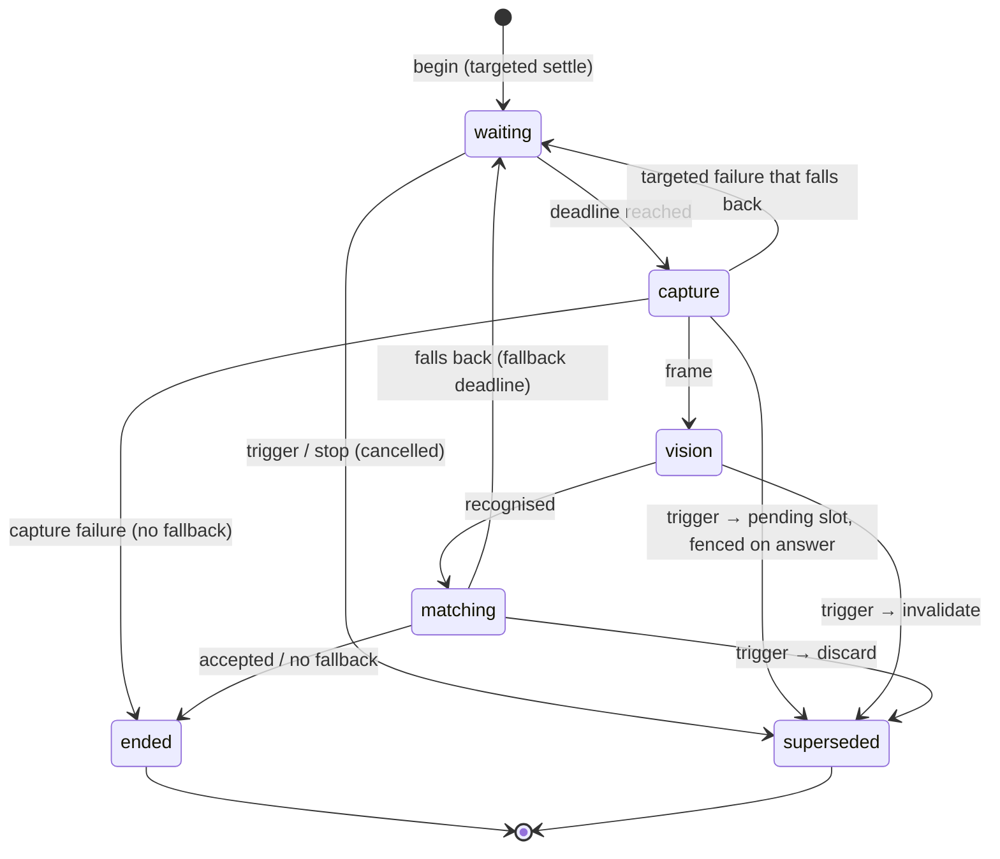
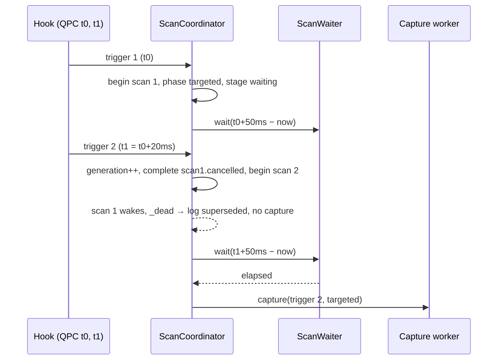

# Design

## Triage

| Trigger | Applies? | Evidence |
|---|---|---|
| T1 Components (new component, or 3+ with directed relationships) | No | No new component. `ScanCoordinator`, the evidence panel, the Scanner layout and the shell footer already exist. |
| T2 State (persistent state, caches, 3+ state machine) | Yes | The per-scan stage machine (`_Stage`, `lib/application/scan_coordinator.dart:1244`) gains a fourth state, `waiting`. The coordinator gains `lastAccepted` beside `latest` (memory only). |
| T3 Concurrency (background work, workers/isolates, async, retries) | Yes | A new async wait inside `_flow` that a trigger can interrupt (`_onTrigger`, `:1896-1919`). |
| T4 Boundaries (data format, migration, shared interface, IPC, external) | No | Timing log v1 (ADR-0013) is unchanged: no key is added. No capture or vision contract changes. |
| T5 Volume (grows without a fixed bound) | No | No new collection. `recent` stays bounded at 10 (`:1413`). |
| T6 Risk (security, money, data loss, unrecoverable user data) | No | No stored data. Game-interaction risk does not change: the same capture calls run, only later. |

TIER: FULL

## Context

- `proposal.md` gives the live evidence and the fork constants.
- **Scan flow today:**
  - `_onTrigger` (`scan_coordinator.dart:1896-1919`) supersedes by stage. During capture the trigger goes to the one pending slot, because a native capture cannot be cancelled. During vision the request is invalidated and a new scan starts. During matching a new scan starts and the old result is fenced off.
  - `_begin` publishes the `targeted` phase and runs `_flow` (`:1921-1934`, `:1973-2060`).
  - `_runPass` sets `stage = capture` and stamps `captureRequested` right before `capture.capture(...)` (`:2099-2101`). Today that is under 1 ms after the trigger.
  - The fallback phase is published at `:2014`, then `_runPass(fallback)` runs right away.
- **Clock:** `_now(a)` reads QPC (`:1886`), and `a.qpcFrequency` is read at start (`:1843`). The trigger's own QPC is `s.trigger.event.qpc` (`:2343`).
- **Fences:** `_dead(s)` (`:1883`) covers supersession, stop or loss, and dispose. `_abandonScans` (`:1940`) advances the generation on stop.
- **Publish:** `_publish` (`:2392-2400`) replaces `_latest` and pushes onto `_recent`. Nothing remembers the last accepted scan.
- **UI:**
  - The desktop Scanner layout puts the evidence panel under the 760 px left column, inside a nested scroll view (`lib/ui/scanner_screen.dart:78-98`). History takes the right column at flex 24 (`:119`).
  - The footer text is a constant (`lib/ui/shell.dart:222-228`). Shell already reads `widget.services` for catalog and progress status. `services.scanner` is the coordinator, and its `status` is a `LiveScanStatus` (`scan_coordinator.dart:33-70`).
- **Fork reference:** `ScannerOrchestrator.cs:42` (`AutomaticSettle = 50 ms`, no debounce) and `MainWindow.xaml.cs:727-770` (fallback at enqueue plus 200 ms). `ScannerStateStore.cs:63-73` keeps `CurrentResult` on a correction. Also `docs/IMPLEMENTATION_STRATEGY.md:35,196`.

## Decisions

### D1: Waits are a coordinator stage, measured from the trigger's QPC stamp

- **Choice:**
  - `_Stage` gains `waiting`. Before each capture request, `_flow` calls `_waitUntil(s, deadline)`.
  - The targeted deadline is `trigger.qpc + settleDelay` and the fallback deadline is `trigger.qpc + fallbackDelay`. Both are converted to ticks with `a.qpcFrequency`.
  - The remaining time is `deadline − _now(a)`. When it is ≤ 0, there is no wait.
  - The wait races an injected `ScanWaiter` (`Future<void> Function(Duration)`, defaulting to a `Timer`-backed future) against the scan's `cancelled` completer. After it, `_dead(s)` is checked.
  - `settleDelay` (default 50 ms), `fallbackDelay` (default 200 ms) and `waiter` are constructor parameters of `ScanCoordinator`.
- **Rejected:** a debounce in the native hook or in `MouseReleaseTriggerSource` that delays trigger delivery by 50 ms. It changes the capture DLL boundary (ADR-0010) for a policy that belongs to Dart. It also cannot express the fallback deadline. And a held trigger could not be superseded without native queue changes.
- **Rejected:** measuring from when the coordinator receives the trigger. The fork measures from enqueue. The trigger's QPC stamp is the closest equivalent, and it is immune to Dart scheduling jitter.
- **Scope:** the waits sit in `_flow`, not in the mouse trigger path, so every scan the coordinator runs gets them.
  - The fork settles manual scans too (`ScannerOrchestrator.cs:182-183`), but its fallback deadline applies only to automatic scans (`MainWindow.xaml.cs:763-768`).
  - The fork's settle starts when its worker dequeues the request, not at enqueue. Blackgrid starts both waits at the hook's QPC stamp.
  - Whether M4's hotkey keeps the fallback wait is M4's call. ADR-0014 records both differences.
- **Wiring:** `lib/application/app_services.dart` (`:82-91`) forwards `scanWaiter`, `scanSettleDelay` and `scanFallbackDelay` to `ScanCoordinator`.
- **Tests:** the test rigs default to an immediate waiter (`(_) => Future<void>.value()`), so no existing test waits in real time. The rigs are `test/application/support/fake_scan_ports.dart`, `test/ui/support/scan_ui_support.dart` and `test/support/m1_widget_harness.dart`. Only the wait tests inject a controllable fake waiter that records each requested duration and completes on a `Completer`.
- **Reversal cost:** low. Internal to the coordinator; the defaults are single constants.

### D2: A trigger during a wait starts the new scan at once

- **Choice:** in `_onTrigger`, `_Stage.waiting` behaves like `vision`: no native call is in flight, so the new scan starts right away with no pending slot. The new trigger also completes the old scan's `cancelled`, so the old scan wakes at once, sees `_dead`, and logs itself as superseded. `_abandonScans` (stop, loss) completes `cancelled` on the active scan too.
- **Rejected:** putting a trigger that arrives during a wait in the pending slot. That delays the newer click by up to 200 ms for no reason, unlike the fork, where a new click cancels the queued scan.
- **Reversal cost:** low.

### D3: The coordinator keeps `lastAccepted`; the panel picks the view

- **Choice:**
  - `_publish` also sets `_lastAccepted = report` when `report.end is ScanAccepted`. `lastAccepted` is exposed as a getter beside `latest`.
  - The panel shows `lastAccepted ?? latest` as the main evidence. When `latest` is not the same report as `lastAccepted` and `lastAccepted != null`, it adds a "Last scan not accepted" note built from `latest`.
  - Timings and recent scans keep reading `latest` and `recent`.
  - **Crop:** the panel decodes the title crop of the *shown* report (`lastAccepted ?? latest`), keyed by that report's id. Today `_syncImage` reads `scanner.latest` (`lib/ui/scan_evidence_panel.dart:70-72`), so it switches to the shown report.
  - **Timings:** the TIMINGS block moves out of the main evidence view (`:160-177`). It is drawn on its own for `latest` and labelled with `latest`'s scan id, so it never mixes with the accepted scan's evidence.
- **Rejected:** a separate correction store, as in the fork's `ScannerStateStore`. M4 owns corrections and decisions. Here the need is display only, and one field on the existing owner is enough.
- **Reversal cost:** low. Memory only, never persisted.

### D4: The evidence panel moves to the right column above history

- **Choice:**
  - The desktop right column becomes a `Column`: `Expanded(flex: 60, evidence)`, a 14 px gap, then `Expanded(flex: 40, history)`.
  - The left column drops the page-level scroll view that held the Scanner controls and the evidence slot. It is now the Scanner panel only and fills the column height (`Expanded`) instead of a fixed 760 px.
  - *Amended during apply:* the Scanner controls need about 760 px at scale 1 (744 px measured at 1100 wide). `ManualControls` scrolling only its own results is not enough at 1100x720, where the panel overflowed by 117 px. So the controls scroll inside the Scanner panel (`SingleChildScrollView` sized to `max(available, 760 × scale)`). The desktop page keeps its existing scroll view with a `700 × scale` minimum height, which stops the middle column overflowing on short windows (at 1100x720 the page can scroll by 108 px). On such windows the Scanner controls are reached through both scrolls. The evidence panel's frame is on screen with the page unscrolled, which is what the spec requires; the 1100x720 test asserts a page offset of 0. The mode dropdown gets `isExpanded: true`, which fixes a 19 px width overflow at that size.
  - The panel's existing inner `ListView` scrolls the content. The compact layout keeps its current order, which already puts evidence right after the Scanner controls.
  - *Amended during apply:* the breakpoint is measured on the window, as the spec states ("window at least 1100 logical pixels wide"). The shell pads the screen by 14 px per side, so the old `constraints.maxWidth < 1100` sent windows of 1100 to 1127 px to the compact layout. The compare is now `maxWidth + 28 < 1100` (`desktopWindowWidth`).
- **Rejected:** a tab or toggle in the left column between Scanner controls and evidence. It hides evidence behind a click again, which is the problem we are fixing.
- **Rejected:** squeezing evidence into the middle column. It competes with the decision card, the main manual surface.
- **Reversal cost:** low.

### D5: The footer reads `LiveScanStatus`

- **Choice:** replace the constant with a `ListenableBuilder` on `services.scanner`:

  | State | Footer text |
  |---|---|
  | `off` | `Live scan off • no capture` |
  | `starting` | `Live scan starting` |
  | `ready` | `Live scan on • captures on click` |
  | `stopping` | `Live scan stopping` |
  | `unavailable` | `Live scan unavailable` |

  `ready` is shown in gold, the others muted.
- **Rejected:** removing the footer label. The user relies on the footer for status, and a capture-free claim must never show while capture is on.
- **Reversal cost:** low.

## Diagrams (FULL)

Scan stage machine (T2):

Supersession during the settle wait (T3):

## State & Ownership (FULL)

| State | Owner (sole writer) | Lifetime | Invalidation / rebuild | Authoritative copy |
|---|---|---|---|---|
| `_Scan.stage` incl. `waiting` | the scan's own `_flow` / `_runPass` | one scan | ends with the scan | coordinator memory |
| `_Scan.cancelled` completer | completed by `_onTrigger` or `_abandonScans`, awaited only by that scan's wait | one scan | completed at most once, guarded by `isCompleted` | coordinator memory |
| `_lastAccepted` | `_publish` | coordinator lifetime; survives stop and start of live scan | replaced by the next accepted publish | coordinator memory |
| `_latest`, `_recent` | `_publish` (unchanged) | coordinator lifetime | unchanged | coordinator memory |
| settle and fallback delays, waiter | constructor | coordinator lifetime | immutable | constructor arguments |

## Failure & Visibility (FULL)

| Component | Fails / dies mid-operation → | Recovery | Retry safe? | Who finds out |
|---|---|---|---|---|
| Wait (timer) | Stop or dispose during the wait | `cancelled` completes. The scan sees `_dead` and logs as superseded, with no capture. Dispose already awaits nothing from it. | n/a | timing log (`superseded` line) |
| Wait superseded by a trigger | old scan abandoned | the new scan runs | yes | timing log `supersededTriggers` |
| Waiter throws (test fake or a bug) | `_run` catch → `_endSuperseded` (`:1944-1952`) | the next trigger starts a fresh scan | yes | `debugPrint` plus a superseded log line |
| Footer builder | status listener throws | none needed: a pure read of `status` | n/a | widget error in debug |
| Panel note | `latest` has no evidence (failure) | the note shows the failure code only | n/a | user |

## Resource Bounds (FULL)

| Queue / buffer / cache / transfer | Bound | At the bound | Timeout | At 10x / 100x |
|---|---|---|---|---|
| Waiting scans | 1 active scan. A superseded waiting scan wakes at once via `cancelled` | — | 50 ms / 200 ms after the trigger | Click bursts at 10x: each click cancels the previous wait; one timer is outstanding per superseded scan until it fires (≤ 200 ms) and holds no frame |
| Pending trigger slot | 1 (unchanged) | replaced and counted | — | unchanged |
| `_lastAccepted` | 1 report (with crops) | replaced | — | constant |

## Flow & State Gaps (FULL)

- **Trigger already old** (a pending trigger started after an overrun capture): the deadline has passed, so the capture runs at once. The spec's "trigger already old" scenario covers this.
- **QPC clock missing** (`a.clock == null`, `_now` returns 0 at `:1886`): only a test or teardown edge. A remaining time computed against 0 would be huge, so the wait is capped at the configured delay. `remaining = min(deadline − now, delay)`, and no wait when ≤ 0.
- **Fallback after a slow targeted pass** (> 200 ms): no wait, as the fork does (`IMPLEMENTATION_STRATEGY.md:196`).
- **Switch off during a wait:** `_abandonScans` completes `cancelled`, and the flow ends superseded with no capture request.
- **Dispose during a wait:** the same path. `_disposed` makes `_dead` true, and no listener is notified.
- **Accepted scan, then live scan switched off and on:** `lastAccepted` stays shown until a newer acceptance, the same as `latest` today.
- **Timing log:** the settle wait shows up as the targeted `captureRequested` offset (about 50 ms), and the fallback wait as the fallback `captureRequested` offset (≥ 200 ms). The keys are unchanged.

## Mechanism Ledger (FULL)

| Mechanism | Built? | Why (harm nobody catches / expensive later) | Evidence that would change the call |
|---|---|---|---|
| Cancellable wait (`cancelled` completer) | Yes | Without it a superseded scan lingers until its timer fires and logs late. That is not harmful, but supersession tests would then need real time. It is cheap. | — |
| Cap on the wait at the configured delay | Yes | It guards the no-clock edge against a wait of minutes. | — |
| New timing-log keys for the wait | No | ADR-0013 freezes v1, and the offsets already show the wait | M4 tooling needs the wait as its own stage |
| Configurable delays in settings UI | No | The fork's constants are fixed. Parity is the target ([[fork-parity-target]]). | The user's live retest shows 50 ms is too short on their machine |
| Re-capture when the frame still shows the context menu | No | The fork has none. The settle wait removes the case seen live. | The live retest still shows `FILTERBYITEM` rejections |
| Persisting `lastAccepted` | No | Display only; M4 owns history | — |

## Risks / Trade-offs

- **[50 ms may be too short on a slow frame]** → Matches the fork, which the user already runs. The log's `captureRequested` and the OCR text make a recurrence visible, and the delay is a single constant.
- **[Showing an old accepted item could mislead]** → The note says plainly that the last scan was not accepted, and the recent list shows every scan. Evidence never drives decisions in M2 (`scanner-evidence` "never produces a recommendation").
- **[Layout change hides part of history on short windows]** → History keeps 40 % of the right column and its own scroll.

## ADRs

- **In force, constraining this change:** ADR-0010 (input and capture boundary: no policy in native code), ADR-0013 (coordinator, latest-wins supersession, timing log v1).
- **To record during apply:** ADR-0014 "Scan settle and fallback waits". It supersedes ADR-0013's stage-specific supersession bullet only, adding the `waiting` stage and its start-now rule plus the 50 ms and 200 ms deadlines from the trigger's QPC stamp. It also records the differences from the fork. The fork's settle starts at dequeue and its fallback deadline at enqueue, for automatic scans only. Blackgrid measures both from the hook's QPC stamp, for every scan. Update the `openspec/architecture.md` ADR index and the scan pipeline row.

## Out of scope (from the 2026-10-10 parity and game-interaction audit)

- **Recognition parity follow-up** (a separate change). It covers:
  - blank-title fallback candidates, which the fork drops (`RatEyeInspectionRecognizer.cs:115-117`);
  - the Cyrillic map in the primary matcher (the fork's `ScannerItemMatcher.cs:59`);
  - confirming against all ready modes' catalogs (`MainWindow.xaml.cs:556-561`);
  - minor tie and length details;
  - the ADR-0010:12 dpi rationale error.

  None of these explains the live failure, and each changes matching specs.
- **Safety hardening follow-up.** It covers:
  - widening `capture_source_audit_test.dart` to all of `windows/` and to more banned APIs;
  - asserting that the self-test's game guard runs before its topmost window and `SetForegroundWindow`.

  The audit found no current code more invasive than the fork.

## Open Questions

- None.
