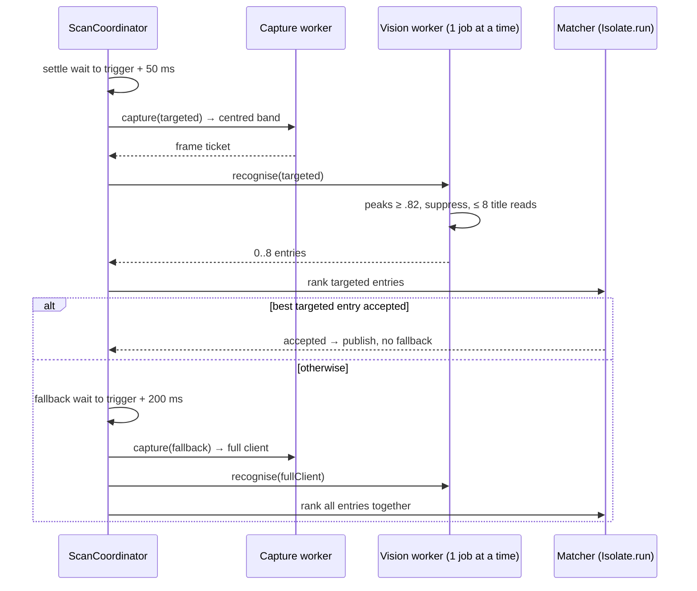
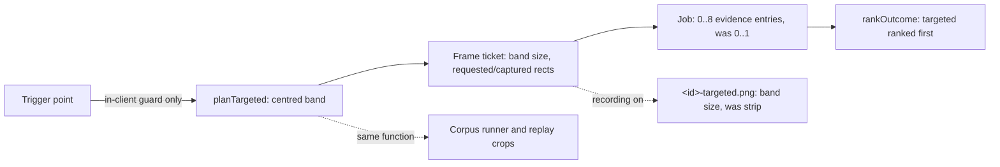

# Design

## Triage

| Trigger | Applies? | Evidence |
|---|---|---|
| T1 Components | No | No new component. Changes stay inside `planTargeted` (`lib/data/capture/capture_geometry.dart:45`), the targeted branch of the recognition job (`lib/data/vision/inspection_recognition.dart:91`) and `rankOutcome` (`lib/domain/title_matching.dart:818`). The replay is a test, not a component. |
| T2 State | No | No persistent state, cache or state machine changes. The scan flow, its stages and the waits are untouched (`lib/application/scan_coordinator.dart:2219`). |
| T3 Concurrency | Yes | A targeted job now does up to 8 title reads in the single vision worker, under the existing 1.5 s deadline (ADR-0011). That changes how long the worker is busy and when a superseding trigger's job can start. |
| T4 Boundaries | Yes | The sendable `InspectionRecognised.evidence` contract changes from "Targeted: 0 or 1 entries" (`lib/data/vision/inspection_evidence.dart:162`) to 0–8. The capture region contract (ADR-0010) and the size of the recorded `<id>-targeted.png` (ADR-0015 format, unchanged schema) change too. |
| T5 Volume | No | Every new collection is capped: 8 kept peaks and one frame per pass, as before. |
| T6 Risk | No | Nothing is written that cannot be recreated. A wrong accepted identity is a qualification risk, measured by the replay (D5); scans make no decisions before M4 change 2 (ADR-0013). |

TIER: FULL

## Context

See [proposal.md](proposal.md) for the problem and the recorded evidence. Paths are relative to `F:\Dev\Dart\blackgrid`; planning is in the same repo.

- **Region today.** `planTargeted` builds the fork's cursor strip `(cx - m~/2, cy - m~/2, m + r, m)` from the trigger point with exact-rational `s` (`capture_geometry.dart:45-64`), then `_clip` intersects it with the client and the virtual desktop (`:73-97`). `CapturePolicy` calls it with the trigger point (`capture_policy.dart:40`). The corpus runner crops `targeted` cases with the same function (`test/qualification/support/inspection_corpus.dart:185-208`), so the M2 corpus tooling follows any region change automatically.
- **Targeted recognition today** takes one `matchTemplate` best location and keeps it at ≥ .82 (`inspection_recognition.dart:91-97`). Full-client recognition lists peaks with `matchTemplatePeaks`, maps the overflow status to `markerPeaksOverflow`, then applies `suppressPeaks` with an 8-peak cap (`:98-127`). Title reads then loop over `found`, whatever their count.
- **Ranking today.** `rankOutcome` returns the first accepted targeted entry immediately (`title_matching.dart:843-846`). Otherwise it ranks targeted and fallback entries together with `_outranks` (`:872-886`). With one targeted entry, "first accepted" and "best accepted" agree. With several they do not.
- **Coordinator.** It is generic over entry counts: `_pickEntry` (`scan_coordinator.dart:464-479`) and `_winningPass` (`:2706-2724`) find the winner by marker position, score and text in either pass. Fallback eligibility (`:2211`, ADR-0013) and the waits (ADR-0014) are not touched.
- **Measured geometry** (3440×1440 recordings, `s = 4/3`). A direct inspect opens centred on the client: frame `20261017-130909-0002` has the window at x 1187–2253 with its title at y ≈ 358. Inspects opened from a container window cascade from it. In `-0023` the window is at x 1433–2494 with its title at y ≈ 432. In `-0019` it is at x 1338–2403, a tall window clamped near the top, with its title at y ≈ 141, and four container title bars, each with a marker, to its left. The window is about 800·s wide.
- **Settle evidence.** The strips captured at the 50 ms settle already show the inspect window's striped background where the strip overlaps the window (`-0003`, `-0006`). The timing log shows the targeted capture at 50.7 ms and the full-client job at about 280 ms on 3440×1440 (`scan-timings.jsonl`, 2026-10-17).
- **Unverified assumptions.** (a) On clients that are not 16:9, the inspect window stays centred on the client centre. Only 3440×1440 was observed, where the 16:9 UI is centred horizontally. (b) Container cascades open to the right of and below their parent. Two samples show this. The replay (D5) and the user's live check test both.
- **ADRs in force here:** 0010 (capture boundary and the region formula), 0011 (one worker, deadline), 0012 (job and pure matching), 0013 (scan flow, fallback list), 0014 (waits), 0015 (recording).

## Decisions

### D1: A fixed band around the client centre replaces the cursor strip

- **Choice:** `planTargeted` returns the region of the `inspection-capture` spec, `(cx - f(440), 0, f(440) + f(700), cy + f(60))` with `f(k) = floor(k·s)` in the existing exact-rational form. The band covers the centred window (±400·s), a cascade margin of 300·s to the right and 40·s to the left, and every title height from the top of the client to 60·s below its centre. A centred window's title is always above the centre. The band is about a third of a 16:9 client (24 % at 3440×1440), and the band is always inside the client: `f(440) < w/2`, `f(700) < w/2` and `cy + f(60) ≤ h` (since `f(60) ≤ h/18`). Starting at the client top, not at `cy - f(540)`, keeps a tall window clamped to the top inside the band on clients taller than 16:9; on 16:9 and wider clients the two are equal. Only the virtual desktop can clip it. The trigger-point-in-client check stays as an identity guard, and the point no longer moves the region. The constants are named in one place, `capture_geometry.dart`.
- **Rejected:** (a) *Keep the cursor strip and add the centred band as a second targeted capture.* Capture admits one request at a time (ADR-0013), so a third pass adds a capture and a job to every miss, and the strip has accepted nothing since the settle wait. (b) *Find the window first, with a low-resolution marker search over the whole client, then capture its title.* That needs a whole-client capture on every scan, which is the cost the targeted pass exists to avoid. (c) *A narrow band at a fixed title height:* the title's height follows the window's height (`-0002` at 358, `-0019` at 141), so no single row works.
- **Reversal cost:** low. One pure function and its tests. The constants are the only tuning point, and the replay re-measures them.

### D2: The targeted frame is searched for every marker peak

- **Choice:** The targeted branch of `InspectionRecognitionJob` uses the full-client path: `matchTemplatePeaks` at the .82 gate with the same native cap, `markerPeaksOverflow` on overflow, `suppressPeaks` with 8 kept peaks, and the best-score fallback query when no peak exists. Both kinds share one code path, keyed only for the request's `kind` in the result. The doc comment at `inspection_evidence.dart:162` becomes "0 to 8, in score order" for both kinds.
- **Rejected:** *Single best match over the band.* In `-0019` the band holds five markers. The best score can belong to a container's title bar ("THICC"), which then reads the wrong title and either rejects, which costs the fallback, or matches a container item. The fallback already solved this with peaks and ranking (ADR-0012), and reusing that path keeps the two passes consistent.
- **Reversal cost:** low. One branch in the job, with no contract version (the entry list was already a list).

### D3: Targeted entries are ranked among themselves before the targeted pass may win alone

- **Choice:** `rankOutcome` matches every targeted entry, picks the best with the existing `_outranks` order, and returns it when it is accepted, without matching the fallback. Otherwise it continues as today: it matches the fallback entries and ranks all entries together, and on a full tie a targeted entry precedes a fallback one. The coordinator's `_fallsBackAfterCapture` and rejection handling are unchanged. They see one outcome as before.
- **Rejected:** *First accepted targeted entry wins (today's loop).* The visit order is the marker score, so a container title that happens to be accepted would beat the inspected item's better title match. *Always run the fallback and rank everything:* this loses the latency the change exists for.
- **Reversal cost:** low. Pure function and tests.

### D4: The 50 ms settle and 200 ms fallback deadlines stay (ADR-0014 unchanged)

- **Choice:** No new wait. The recorded strips show the inspect window drawn by the 50 ms settle, and a superseding click still cancels a wait (ADR-0014). The roadmap entry asked for "its own settle deadline". The evidence does not show one is needed, so none is added. If the user's live log shows targeted `noMarker` scans whose fallback then accepts, with a marker inside the band, that would call for a longer settle. It is a one-constant change (`settleDelay`).
- **Rejected:** *A longer settle for the band, such as 100 ms:* it spends 50 ms of the 300 ms budget on every scan with no evidence that it is needed. *A retry of the targeted capture after `noMarker`:* it adds a capture and job before the fallback on every true miss, which ADR-0013's closed retry list excludes.
- **Reversal cost:** low.

### D5: Offline replay over the recorded scans, judged against the full-client pass

- **Choice:** A `qualification`-tagged test, `test/qualification/targeted_region_replay_test.dart`, reads one or more recording session folders (`BLACKGRID_RECORDING_DIRS`, `;`-separated), a `catalog.json` (`BLACKGRID_REPLAY_CATALOG`) and the Release bundle (`BLACKGRID_RELEASE_BUNDLE`). For each `frames.jsonl` line with an `image` and `clipped: false`, it:
  - crops the new region from the full PNG with `planTargeted`;
  - runs targeted recognition and matches it alone;
  - runs full-client recognition and matches it alone.

  It writes `out/replay.json`, replaced atomically, with per-frame outcomes, accepted IDs, targeted and full-client job times, and whether the full-client winner's marker lies inside the band. It also writes a summary. The pass rule:
  - **Hard:** no conflicting accept. A frame where the targeted pass accepts an ID that the full-client pass does not accept, or rejects, is a regression.
  - **Reported:** the share of full-client accepts that the targeted pass also accepts, each miss with its cause (winner marker outside the band, or inside it and still rejected), and the job-time distribution of both kinds.

  The pure parts (parsing `frames.jsonl` with the CORPUS.md rules, classification, summary) live in `test/qualification/support/targeted_region_replay.dart`, unit-tested offline in `mise run test`. The catalog comes from a read-only copy of the app's catalog cache, the PvP snapshot that matches the recorded session. It is never committed, like the corpus. The agent runs the replay only after confirming that Escape from Tarkov is not running (AGENTS.md). It reads saved PNGs and never touches a game window.
- **Rejected:** (a) *The M2 corpus runner with the user's labels.* The labelled corpus directory is no longer on this machine. When the user supplies it again, the existing runner exercises the new region with no code change, because it calls `planTargeted`. (b) *Hint fields (`acceptedId`) as truth.* CORPUS.md forbids it. Running the full-client pass in the same run compares the two passes on equal footing without labels. Parity with the fallback, which is what M2 qualified, is the bar.
- **Reversal cost:** low. Test-only code.

### D6: ADR-0016 records the band and the multi-peak targeted pass

- **Choice:** Written during apply, after this review. It supersedes only ADR-0010's "Physical-pixel, DPI-independent ROI" bullet's region formula: physical pixels, DPI independence, the fallback being the full client and clip-not-pad stay in force. It records D1–D3 as binding for later changes, among them M4's hotkey trigger, whose region no longer needs the cursor beyond the in-client guard. ADR-0012 and ADR-0014 are not superseded: ADR-0012's decision bullets do not fix single-best targeted search (only the spec did), and D4 keeps the waits. `openspec/architecture.md` gains the 0016 row, the 0010 row notes the partial supersession, and the component rows that say "ROI plan" stay accurate.
- **Rejected:** *Superseding ADR-0014 as the roadmap entry said:* nothing in ADR-0014 changes (D4), and an ADR that restated it would be noise.
- **Reversal cost:** low.

## Diagrams (FULL)

T3: the targeted pass now does the full-client work inside the same single worker.

T4: what crosses each boundary, and what changes.

## State & Ownership (FULL)

| State | Owner (sole writer) | Lifetime | Invalidation / rebuild | Authoritative copy |
|---|---|---|---|---|
| Region constants | `capture_geometry.dart` (compile-time) | Build | Code change | Source |
| Planned region per request | `CapturePolicy` in the capture worker | One capture | Recomputed per request from the validated snapshot | `CapturePlan` |
| Targeted evidence list | Recognition job in the vision worker | One request | Existing generation fence and supersession | Sendable result |
| Ranked outcome | Matcher adapter (`Isolate.run`) | One scan | Existing scan generation fence | Coordinator's scan |
| Replay report | Replay test | Local file | Atomic replace per run | `out/replay.json` |

## Failure & Visibility (FULL)

| Component | Fails / dies mid-operation → | Recovery | Retry safe? | Who finds out |
|---|---|---|---|---|
| Region planning | Band off the desktop → `roiOutsideClient` | Fallback pass (eligible per ADR-0013) | Yes | Timing log, Scanner evidence |
| Targeted peak listing | Native overflow → `markerPeaksOverflow` | Fallback pass (rejection not catalog-only) | Yes | Timing log `noMarker`: the reason is not carried to the outcome (#38) |
| Targeted job time | Up to 8 OCR calls approaching the 1.5 s deadline → `visionTimeout`, worker `overrun` | Existing ADR-0011 behaviour; the scan fails | No (existing) | Scanner failed report, timing log |
| Container title accepted in the band | Wrong identity published | None automatic; D3 ranking and the D5 hard rule limit it | n/a | Replay (agent), user live check |
| Replay | Missing bundle, catalog or folder → skip with reason; malformed line → `FormatException` naming it | Fix input, rerun | Yes (reads only, atomic report) | Agent |

## Resource Bounds (FULL)

| Queue / buffer / cache / transfer | Bound | At the bound | Timeout | At 10x / 100x |
|---|---|---|---|---|
| Targeted frame | One band, ≤ 1/3 of the client (2280×1200 at 3840×2160, 10.9 MB BGRX); 4-frame budget unchanged | `captureTooLarge` only on clients far beyond any monitor (band width ≈ 0.59 w, so over 13,800 px wide); then the fallback fails too, as today | 500 ms capture | Fixed per scan |
| Targeted peaks | Native cap 4096 listed, 8 kept | `markerPeaksOverflow` | Existing 1.5 s vision | Fixed |
| Title reads per targeted job | 8 | Suppression cap | 1.5 s | Fixed |
| Evidence transfer | ≤ 8 entries × 256 KiB crop | Existing preview downscale | Existing | Fixed |
| Recording copy and PNG (recording on only) | Band size instead of strip, for example 1519×800 at 3440×1440 (4.9 MB copy), still below the whole-client copy | Existing 2-outstanding cap (ADR-0015) | Existing | Fixed |
| Replay output | One report per run, per-frame rows for the given folders (70 today; recorder caps a session at 500) | n/a | None (offline) | Linear in frames, bounded by input |

## Flow & State Gaps (FULL)

- **Superseding click during a longer targeted job.** The job can now take tens of milliseconds more. Supersession already invalidates the vision request and starts the new scan's settle at once (ADR-0014). The new job queues in the worker's single pending slot, as today.
- **Window outside the band** (dragged container, unusual cascade): targeted `noMarker` or rejection, then the fallback, as today. The replay reports these misses.
- **Non-inspect centred windows** (for example ITEM SEARCH, `-0007`): its marker lies in the band, the title does not match, and the fallback runs as today.
- **Window still drawing at 50 ms:** a `noMarker` targeted pass followed by the fallback. This is visible in the live log (D4).
- **Restart, mode or catalog change mid-scan:** unchanged fences (ADR-0013).

## Mechanism Ledger (FULL)

| Mechanism | Built? | Why (harm nobody catches / expensive later) | Evidence that would change the call |
|---|---|---|---|
| Centred band | Yes | The strip accepted none of the 36 recorded accepts since the settle wait (30 on 2026-10-14, 6 on 2026-10-17) | Replay misses with markers outside the band |
| Multi-peak targeted search | Yes | Cascades put several markers in the band (`-0019`) | None needed; it reuses the fallback path |
| Ranking within targeted entries | Yes | Otherwise the first accepted entry beats a better title | n/a |
| Replay over recordings | Yes | The only agent-side evidence that the band holds the titles; the labelled corpus is absent | The user restores the labelled corpus (then also run the corpus runner) |
| Longer or separate settle | No | Strips show the window drawn at 50 ms | Live `noMarker` targeted scans with an in-band fallback winner |
| Cursor strip kept as a second pass | No | It has accepted nothing since the settle wait, and costs a capture | A case class where only the strip works |
| Per-resolution or calibrated band | No | One formula covers 16:9 and ultrawide via `s` | Replay or live misses on another aspect ratio |
| Window-detection pre-pass | No | Needs a whole-client capture each scan | Band misses too many to reach "most" |

## Risks / Trade-offs

- [Band misses inspects from containers dragged far from centre] → The fallback still covers them. The replay and the user's live share show how often it happens. Widen the cascade margin if misses cluster just outside the band.
- [A bigger targeted job raises the targeted p95] → Band area ≈ 24–33 % of the client against the 280 ms whole-client job. The expected targeted path is about 50 ms settle + capture + under 150 ms job + match. The replay reports targeted job times before the user's live measurement.
- [A container title is accepted as the item] → D3 ranking and the D5 hard rule on the recordings. M4 change 3 (correction) handles residual ambiguity.
- [Only 3440×1440 was observed] → The formula is scale-correct by construction. Other aspect ratios stay an assumption until M6's display matrix (roadmap).

## ADRs

- **In force, constraining this change:** ADR-0010 (boundary and clip-not-pad; its region formula superseded), ADR-0011, ADR-0012, ADR-0013, ADR-0014 (unchanged, D4), ADR-0015.
- **To record during apply:** ADR-0016, centred targeted region and multi-peak targeted pass, `Supersedes: 0010` (region formula in the ROI bullet only). Update the in-force index in `openspec/architecture.md`.

## Open Questions

- Does the user still have the labelled M2 corpus (`F:\Dev\Dart\blackgrid-corpus\inspection`)? If so, a corpus-runner pass over it is an additional before/after check. It changes no spec or task beyond running it.
