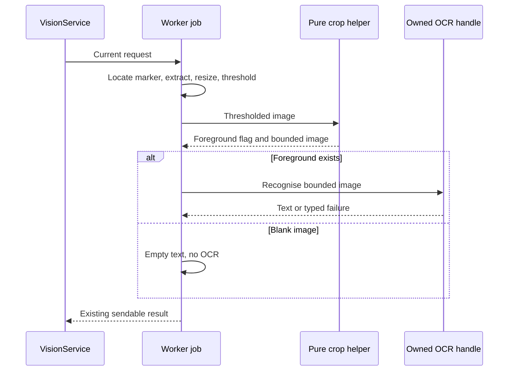
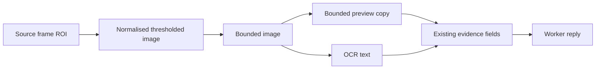

# Design

## Triage

| Trigger | Applies? | Evidence |
|---|---|---|
| T1 Components | No | One existing recognition job plus a synchronous image helper; no service or process is introduced. |
| T2 State | No | No persistent state, cache policy or state-machine change. |
| T3 Concurrency | Yes | Preprocessing runs inside the existing vision worker, before OCR (`inspection_recognition.dart:165`). |
| T4 Boundaries | Yes | Evidence crosses the worker boundary; crop dimensions now describe the narrowed OCR buffer (`inspection_evidence.dart:103`). |
| T5 Volume | No | Work is bounded by the already-clamped title crop and existing kept-peak limit. |
| T6 Risk | No | No decisions, credentials or durable user records are written. Wrong identities remain a measured qualification risk. |

TIER: FULL

## Context

See [proposal.md](proposal.md) for scope and [evidence.md](evidence.md) for the baseline and controlled comparison. Paths below are relative to the code repo, `F:\Dev\Dart\blackgrid`; planning is in the same repo.

`lib/data/vision/inspection_geometry.dart:142` bounds the physical title ROI and its close-button probe. `lib/data/vision/inspection_recognition.dart:213` copies that ROI, rescales it, then thresholds it; `:228` currently sends the entire thresholded image to OCR. `_preview` at `:255` already bounds evidence independently of OCR. `titleRect` is explicitly the clamped, close-button-narrowed frame rectangle (`inspection_evidence.dart:91`), not a promise that the preview has the same dimensions.

Relevant in-force ADRs are 0008 (pinned bundle OCR, LSTM/raw-line configuration), 0011 (one worker owns native resources and admission) and 0012 (job preprocessing, sendable evidence, pure off-UI matching). The change preserves those contracts. Right-margin reduction is tactical preprocessing; no new or superseding ADR is needed. Accepted ADRs will not be edited.

## Decisions

### D1: Bound the thresholded image immediately before OCR

- **Choice:** Add a pure helper in `lib/data/vision/inspection_title_crop.dart` which takes a valid one-channel thresholded `VisionImage` and finds the last foreground column across every logical row, respecting stride. Return a result with `hasForeground` and the image to use. Apply the exact margin rule in the spec; copy logical rows into an owned, tightly packed buffer only when narrowing. Return the original image when its width stays unchanged. Keep left edge, height, all text pixels and internal spaces. Invoke it after thresholding and before the preprocessing timestamp.
- **Rejected:** Post-process the recognised string, because text cannot reliably distinguish a hallucinated suffix from real punctuation or a variant identifier. Changing Tesseract/model/segmentation configuration would affect every OCR consumer and invalidate the controlled comparison. Detecting a right edge in the original colour frame needs another intensity policy and changes resampling at the glyph boundary; the thresholded image is the buffer on which the hypothesis was confirmed.
- **Reversal cost:** Low; a local pure helper and call site, with no format migration.

### D2: Empty pixels produce empty text without an OCR call

- **Choice:** With no foreground, retain the existing white crop for preview, set text empty, keep `read` status (geometry was non-empty) and advance stage timestamps monotonically. Geometry-empty regions retain their existing `emptyTitleRegion` path. No new status or failure variant is introduced. The helper returns a normalised empty-content indication, not an invalid zero-width `VisionImage`.
- **Rejected:** Calling raw-line OCR on a blank image, since it provides no evidence and can invent text. Conflating blank content with invalid geometry would change the meaning of `emptyTitleRegion`.
- **Reversal cost:** Low; no persisted representation.

### D3: Preview exactly the buffer used by OCR

- **Choice:** Pass the helper's image to both `context.recognise` and `_preview`. Retain `titleRect` as the source extraction rectangle, and clarify public evidence documentation about normalised, narrowed preview dimensions. Preview downscaling remains after OCR. Keep all result fields and transfers intact.
- **Rejected:** Narrowing only inside the native binding, because the evidence would continue showing a different image from the one OCR read and couple item-title policy to the shared runtime.
- **Reversal cost:** Low; unchanged field types and ownership.

### D4: Qualify the complete pipeline against the preserved current-app baseline

- **Choice:** Use the local before report as a before/after comparator, distinct from the absent reference baseline. Acceptance requires more than 26 correct item cases, retention of all 26 previously correct items, no newly false-positive case, and rejection of every negative case. Existing wrong cases may become correct or rejected, but accepting a different wrong ID on one of those cases is a regression and blocks completion. Record each of the five original ambiguous outcomes, rather than claiming that cleaner OCR proves matching success.
- **Rejected:** Accepting only a lower total false-positive count, since an old wrong accept could hide a new one; and testing only the five failures, since their fix could regress other items.
- **Reversal cost:** Low; comparison uses existing report fields. No corpus images or catalog data are committed.

## Diagrams (FULL)

T3: the helper stays synchronous in the existing single worker.

T4: evidence continues crossing the existing boundary with owned bytes.

## State & Ownership (FULL)

| State | Owner (sole writer) | Lifetime | Invalidation / rebuild | Authoritative copy |
|---|---|---|---|---|
| Source and thresholded images | Existing job/native context | One title read | Dropped when title completes | Worker-local image |
| Narrowed pixel copy | Pure helper, then immutable job use | One title read | Recomputed for each title | Worker-local owned bytes |
| OCR handle and scratch | Existing runtime in worker | Activation | Existing drain/dispose | Runtime only |
| Evidence preview/text | Job during construction | Result lifetime | Existing supersession/publication fences | Detached result bytes |
| Before/after reports | Qualification runner | Local files | Explicit saved baseline and atomic report replacement | Local corpus output |

## Failure & Visibility (FULL)

| Component | Fails / dies mid-operation | Recovery | Retry safe? | Who finds out |
|---|---|---|---|---|
| Crop helper | Invalid internal descriptor or unexpected exception | Existing job failure path; no partial result | Next request can retry | Existing failed scan evidence |
| OCR | Native failure | Existing typed abort of whole recognition request | Existing service policy | Scanner/report failure |
| Worker | Exit, supersession or timeout | Existing service fences and admission; no new recovery | Existing policy only | Existing service status |
| Qualification | Coverage or per-case regression | Stop completion, retain inputs and before report | Yes, with game closed | Agent and recorded qualification result |

The helper consumes the runtime's validated binary image; use descriptor checks/assertions consistent with existing image helpers, never weaken validation to fit a fixture. Row padding is excluded from foreground detection and copying.

## Resource Bounds (FULL)

| Queue / buffer / cache / transfer | Bound | At the bound | Timeout | At 10x / 100x |
|---|---|---|---|---|
| Helper scan and optional copy | At most one existing normalised crop, no larger than input | Narrowing only; no padding/growth | Existing request deadline | Same per-title bound |
| Title iteration | Existing maximum eight kept peaks | Existing suppression/cap | Existing worker deadline | No extra queued work |
| Result preview and transfers | Existing 256 KiB per evidence entry | Existing preview downscale | Existing service deadline | No larger transfer |
| Requests, templates and scratch | Existing ADR-0011/0012 caps | Existing admission/eviction | Existing service bounds | Unchanged |

The new scan is O(width x height); it performs no native call and allocates at most one smaller image per title. No additional cache, queue, retained frame or retry is introduced.

## Flow & State Gaps (FULL)

- Multiple markers each receive independent crop analysis; do not carry the last title's extent to another peak.
- A blank title skips only its OCR call; later peaks still run and the original frame-level ranking applies.
- A native OCR failure still aborts the request, even after earlier titles succeeded.
- Supersession, mode changes, out-of-order replies and shutdown remain fenced by the existing service. The helper never publishes or schedules work.
- Restart rebuilds everything from new frames; there is no new persisted state or migration.

## Mechanism Ledger (FULL)

| Mechanism | Built? | Why | Evidence that would change the call |
|---|---|---|---|
| Right-edge scan over thresholded pixels | Yes | Reproduced suffix disappears in controlled comparison | Full-corpus regressions require re-evaluation |
| Blank-content indication | Yes | Avoid OCR hallucination without manufacturing invalid images | Contract/test evidence against the stated empty path |
| OCR suffix cleaner | No | Cannot safely infer which text is genuine | Separate reproducible text-only corruption |
| New image cache, native primitive or worker | No | Small bounded pure operation; existing ownership suffices | Measured material preprocessing cost |
| Catalog identity/preset policy | No | Independent matcher ambiguity problem | A separately scoped roadmap change |

## Risks / Trade-offs

- Stray foreground pixels can keep the crop wide; keep all foreground rather than deleting possible text. Investigate residual failures as evidence, not by relaxing matching gates.
- OCR can still misread quantities or variants after trimming; run existing quantity safeguards and report the final identity per case.
- The single-resolution corpus cannot establish all-resolution accuracy; small stride/edge/scale tests cover crop invariants only. Live and reference comparisons remain explicitly unverified.

## ADRs

- **In force, constraining this change:** ADR-0008, ADR-0011, ADR-0012.
- **To record during apply:** None; the existing job, worker and evidence contracts remain intact.
