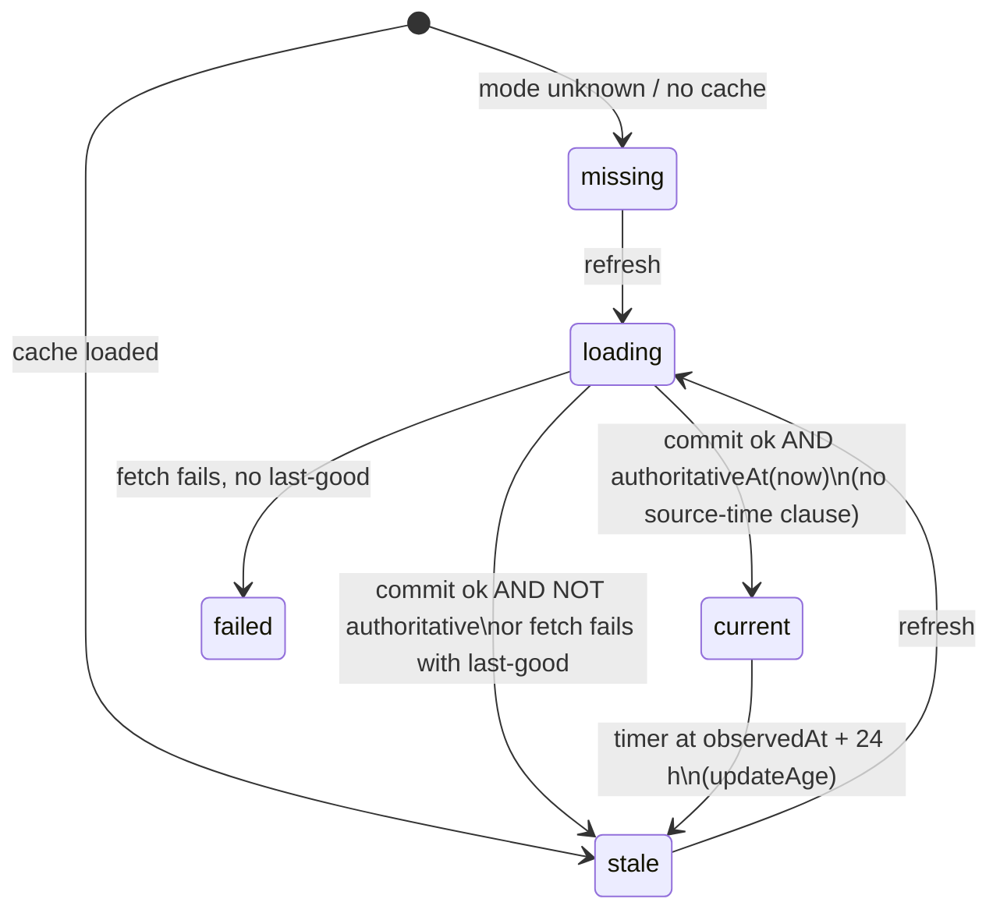
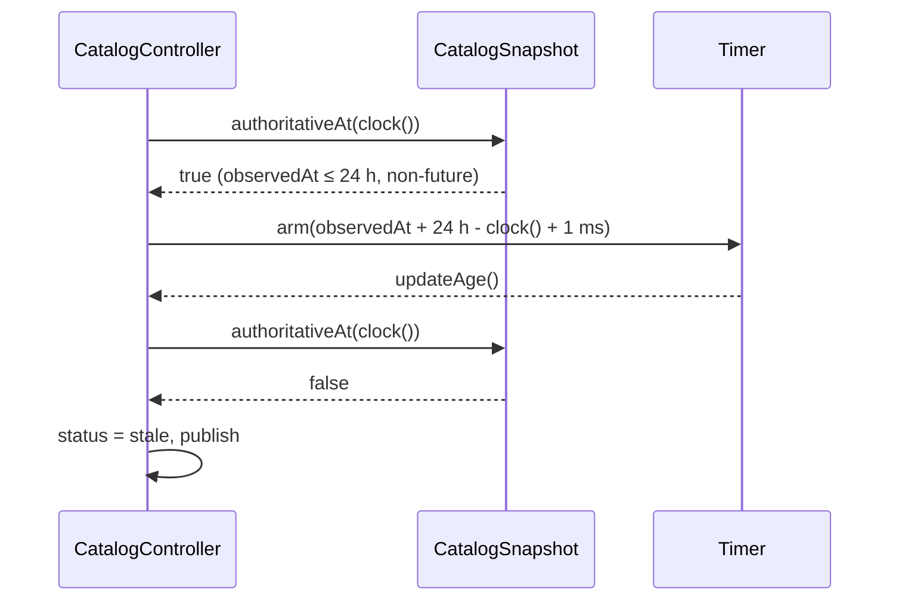
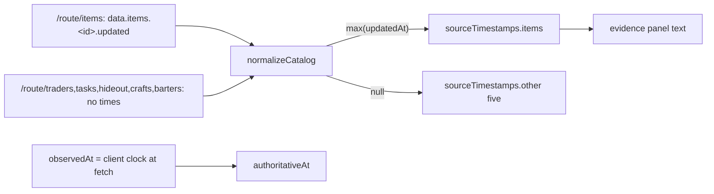

# Design

## Triage

| Trigger | Applies? | Evidence |
|---|---|---|
| T1 Components (new component, or 3+ with directed relationships) | No | No new component. Normalizer → snapshot → controller/decision engine/evidence panel already exist; only rules inside them change. |
| T2 State (persistent state, caches, 3+ state machine) | Yes | Changes when the five-state catalog status (`missing/loading/current/stale/failed`, `catalog_controller.dart:46-128`) reaches `current`; `sourceTimestamps` is persisted in the cached payload (`catalog.dart:334-336`). |
| T3 Concurrency (background work, workers/isolates, async, retries) | Yes | The `current` expiry `Timer` (`catalog_controller.dart:109-121`) changes its deadline. |
| T4 Boundaries (data format, migration, shared interface, IPC, external) | Yes | External wire shape of `json.tarkov.dev`; public `CatalogSnapshot.sourceFreshAt` is removed; the cached JSON format is kept unchanged on purpose. |
| T5 Volume (grows without a fixed bound) | No | One max over the items already iterated; no new collection. |
| T6 Risk (security, money, data loss, unrecoverable user data) | No | Advice can now reach Sell again, but every existing Check gate (quote age, progress, FIR) still applies; no data loss. |

TIER: FULL

## Context

See proposal.md for the bug and the 2026-10-18 probe of the live sources.

- `CatalogSnapshot.sourceFreshAt` (`lib/domain/catalog.dart:298-307`) needs six non-null equal timestamps under 24 h old; `authoritativeAt` (`:309-316`) requires it to be `true` on top of observation age ≤ 24 h, a non-future observation, a supported source/schema/normalizer and a known mode.
- `normalizeCatalog` fills `sourceTimestamps` from `roots[key]['updated']` (`lib/data/catalog_normalizer.dart:383-385`), a field the live API never sends. Per-item `updated` is already parsed into `CatalogItem.updatedAt` (`catalog_normalizer.dart:127`); `_time` throws on a non-string or unparseable value (`:464-470`), so a malformed item time already fails validation.
- `CatalogController._refresh` sets `current` from `authoritativeAt`, then arms an expiry timer at the earliest of `observedAt + 24 h` and every `sourceTime + 24 h` (`lib/application/catalog_controller.dart:106-121`); `updateAge` demotes to `stale` (`:133-139`). A cached load always publishes `stale` (`:59`).
- `DecisionEngine.evaluate` requires `catalog.authoritativeAt(now)` and names "source freshness unknown" in its warning (`lib/domain/decision_engine.dart:12-29`). The evidence panel prints `sourceFreshAt` (`lib/ui/evidence_panels.dart:120-123`).
- Market freshness is separate: quotes use `lastScanISO`/`lastScan` with a 1 h limit (ADR-0001, `decision_engine.dart:99`). It is not touched.
- Fixtures: `test/fixtures/m1/catalog/six_datasets.json` gives every dataset a top-level `updated` and no `translations`; its items have no `updated`. `sharedObjectiveWireFixture` already strips the top-level field and the tests assert the result is *not* authoritative (`test/data/catalog_normalizer_test.dart:125-127`, `test/data/catalog_client_test.dart:109-110`), so the suite encodes the bug as intended behaviour. `decision_engine_test.dart:364` expects Check for a catalog with no source times.

## Decisions

### D1: Authority from observation time only

- **Choice:** `authoritativeAt` keeps every existing clause except `sourceFreshAt(now) == true`, which is dropped. `sourceFreshAt` is deleted rather than redefined, so no caller can rebuild a source-time gate by accident.
- **Rejected:** keep a source-time gate fed by a different signal (newest item `updated` < 24 h, or HTTP `Last-Modified` per dataset) because only `items` has any per-entry time, `Last-Modified` moves only on content change (hideout was 40 days old in normal operation), and an items-liveness gate needs a clock-skew tolerance for item times a few minutes ahead of a slow local clock. The user chose download time on 2026-10-18. It is also the less strict rule, in line with the project's preference for fork parity over stricter gates. The fork's own catalog rule was not checked, so that is not claimed here.
- **Reversal cost:** low. A later gate can be reintroduced in `authoritativeAt` from the kept evidence.

### D2: Source-time evidence: items = newest per-item `updated`, others absent

- **Choice:** Keep the six-key `sourceTimestamps` map and its persisted shape. `items` = max of the parsed `CatalogItem.updatedAt` values (null when none); the other five = null. Stop reading the dataset-level `updated`.
- **Rejected:** drop `sourceTimestamps` from the snapshot and the cache payload because that changes the persisted format and `fromJson` for no behavioural gain, and loses the one real signal the evidence panel can show. Also rejected: plumb HTTP `Last-Modified` through `CatalogClient` and `CatalogWireCandidate` because nothing consumes it and it widens the client boundary.
- **Reversal cost:** low. Evidence only.

### D3: No version bump; cached payloads keep loading

- **Choice:** `schemaVersion` and `normalizerVersion` stay 1. A cached snapshot written by the old code has six null source times; under D1 that changes nothing, and a cached load still publishes `stale` until a refresh (`catalog_controller.dart:59`).
- **Rejected:** bump `normalizerVersion` to 2 because `fromJson` rejects any version other than 1 (`catalog.dart:342`), so every existing cache would fail to load ("Stored catalog unavailable") and lose its last-good data until the user refreshed, all to relabel an evidence field.
- **Reversal cost:** low.

### D4: Expiry timer from observation only

- **Choice:** The timer deadline is `observedAt + 24 h`; the loop over `sourceTimestamps` is removed. `updateAge` is unchanged and still demotes once `authoritativeAt` is false.
- **Rejected:** keep the source-time loop because under D2 the one-shot timer would fire at `itemsUpdated + 24 h`. `updateAge` (`catalog_controller.dart:133-139`) would find the snapshot still authoritative, do nothing and never re-arm, so the expiry at `observedAt + 24 h` would be lost. Demotion would then depend on `SelectionController`'s 30 s poll (`selection_controller.dart:25-29`), and nothing would demote in a controller used without one.
- **Reversal cost:** low.

### D5: Fixtures follow the live wire shape; regression proven at the normalizer

- **Choice:** Remove every top-level `updated` from `six_datasets.json`, add `translations: []` to each dataset envelope, and give the two items distinct `updated` values at or before `fixtureNow`. The regression test sits in `test/data/catalog_normalizer_test.dart`: the live-shape fixture normalised at `fixtureNow` is authoritative at `fixtureNow` (fails on the current code, where `sourceFreshAt` is null). A controller test, driven by fake time with no `updateAge` call, publishes a catalog observed at T with an items time of T − 23 h. It must still be `current` at T + 2 h and `stale` at T + 24 h + 1 ms through the expiry timer alone. That proves D4: with the source-time loop kept, the timer fires early, does nothing, and the T + 24 h demotion never happens. `decisionCatalog` defaults to an items-only source time.
- **Rejected:** prove "becomes current" only through a full-app or widget test because the rule is a pure function of the snapshot and a clock (AGENTS.md: cheapest sufficient layer).
- **Reversal cost:** low.

## Diagrams (FULL)

T2: catalog status machine; only the guarded edges change.

T3: expiry sequence.

T4: wire → evidence data flow.

## State & Ownership (FULL)

| State | Owner (sole writer) | Lifetime | Invalidation / rebuild | Authoritative copy |
|---|---|---|---|---|
| `CatalogSnapshot.sourceTimestamps` | `normalizeCatalog` (built once, immutable) | Snapshot lifetime, persisted in the cache payload | Replaced by the next committed refresh | The in-memory snapshot; the cache is its serialisation |
| `CatalogSnapshot.observedAt` | `CatalogClient.fetch` (clock at fetch) via the wire candidate | Same | Same | Same |
| `CatalogController.status` | `CatalogController` | Controller lifetime | Recomputed on refresh, on `updateAge`, on mode change | Controller field |
| `CatalogController._expiry` | `CatalogController` | Until it fires, a new refresh, or dispose | Cancelled and re-armed on each refresh | Controller field |

## Failure & Visibility (FULL)

| Component | Fails / dies mid-operation → | Recovery | Retry safe? | Who finds out |
|---|---|---|---|---|
| Normalizer, malformed item `updated` | Throws; refresh fails | Last-good kept, status `stale`/`failed` (unchanged path) | Yes, manual refresh | User: "Catalog refresh failed; last-good data retained" |
| Normalizer, no item has `updated` | Items source time null; authority unaffected | None needed | n/a | User: evidence panel says the items update time is unknown |
| Expiry timer | Not fired (app suspended past deadline) | `updateAge` and `authoritativeAt(now)` in the decision engine still evaluate the real clock | Yes | Decisions drop to Check by themselves; the status chip catches up on the next `updateAge` |
| Upstream feed stalls while still serving | Catalog stays `current` for 24 h after download with stale content | Not detected; accepted residual risk of the user's 2026-10-18 download-time decision (D1) | n/a | Partly. The 1 h quote rule (`lastScanISO`) turns only Flea advice into Check, and only when the stall is in `items`. Trader advice for Flea-ineligible items stands without a quote (ADR-0001; `decision_engine.dart:112-121,372-380`), and any Sell advice after a stall in `tasks`/`hideout` (separate routes) is bounded only by the 24 h download-time rule. The items update time in the evidence panel shows its age. |

## Resource Bounds (FULL)

| Queue / buffer / cache / transfer | Bound | At the bound | Timeout | At 10x / 100x |
|---|---|---|---|---|
| Max over item `updatedAt` | One pass over items already normalised (~5.5k live) | n/a | n/a | O(n) on top of the existing O(n) normalisation; negligible |
| Expiry timer | One per controller | Re-armed, the old one cancelled | 24 h | n/a |

## Flow & State Gaps (FULL)

- **Cached snapshot (including one from the old code):** loads with null source times, publishes `stale`, and becomes `current` only through a refresh. Under D1 a cached snapshot under 24 h old is `authoritativeAt` true. For the live mode that does not leak: the selection layer sets `catalogStale` whenever the controller status is not `current` (`selection_controller.dart:163-164`), so a cached catalog cannot drive decisions before a refresh. A history row in another mode uses that mode's cached snapshot with `catalogStale` false (`selection_controller.dart:47-49,100-102`). Progress then does not match the mode (`:154,161`), so ADR-0001 still gives Check, never Sell. The tests leave this path alone. Before this change the same path was authoritative whenever source times were present, so it is not new behaviour.
- **Clock moved backwards after a refresh:** `observedAt` in the future → not authoritative (existing clause, kept).
- **Concurrent refreshes / mode switch:** unchanged generation fencing (`catalog_controller.dart:101-103`).
- **Restart mid-refresh:** unchanged; nothing is committed before validation.

## Mechanism Ledger (FULL)

| Mechanism | Built? | Why (harm nobody catches / expensive later) | Evidence that would change the call |
|---|---|---|---|
| Items-liveness gate (newest item `updated` < 24 h) | No | The user chose download time (2026-10-18), and the stall it misses is the accepted residual risk in Failure & Visibility. The gate would add clock-skew edge cases and would cover only `items`, whose Flea quotes the 1 h rule already guards. |  An incident where the API served stale requirements/traders for days while prices looked fresh |
| HTTP `Last-Modified` capture | No | No consumer; changes only on content change | A future rule that needs per-dataset content age |
| `normalizerVersion` bump | No | Would drop every cached last-good (D3) | A change to the persisted snapshot format |
| Clock-skew tolerance on `observedAt` | No | `observedAt` is the local clock, so skew cannot make it future except a backwards clock jump, which correctly withdraws authority | n/a |

## Risks / Trade-offs

- [The catalog can be `current` while upstream data is old] → Accepted residual risk of the user's 2026-10-18 decision: the source gives no time signal for five of the six datasets. The 1 h quote rule guards only Flea advice, and only against a stalled `items` dataset. Trader advice for Flea-ineligible items (ADR-0001; `decision_engine.dart:112-121,372-380`), and any Sell advice after a stall in `tasks`/`hideout`, is bounded only by the 24 h download-time rule. The evidence panel shows the newest items update time.
- [Sell advice becomes reachable for the first time in production] → Every other Check gate (progress authority, FIR, quote age, flea eligibility) is unchanged and covered by the existing decision-engine tests. The user verifies the live behaviour.
- [Tests that encoded the bug change meaning] → Each one is rewritten to assert the new spec scenario, not deleted.

## ADRs

- **In force, constraining this change:** ADR-0001 (shared conservative decision engine: stale or unknown authority gives Check, and the 1 h flea quote freshness, both kept). ADR-0003 (single Drift store: the cached payload format is kept, D3).
- **To record during apply:** none. The rule is a catalog contract owned by the new `catalog-authority` spec, not a boundary or pattern decision. `openspec/architecture.md:90` and README (lines 181 and 185) are updated to state it.

## Open Questions

None.
