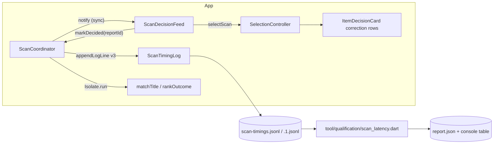
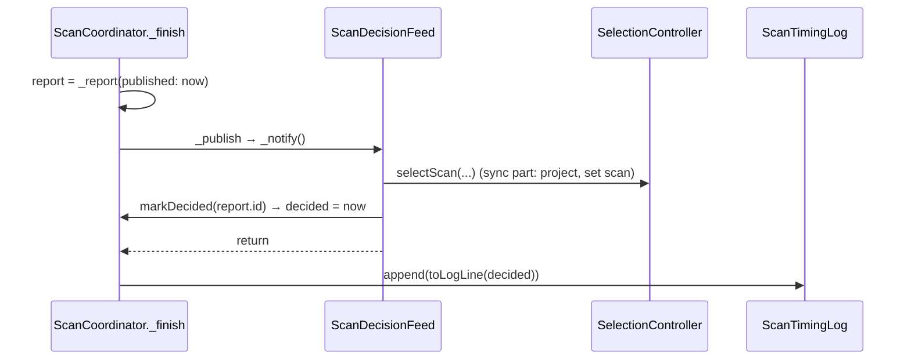
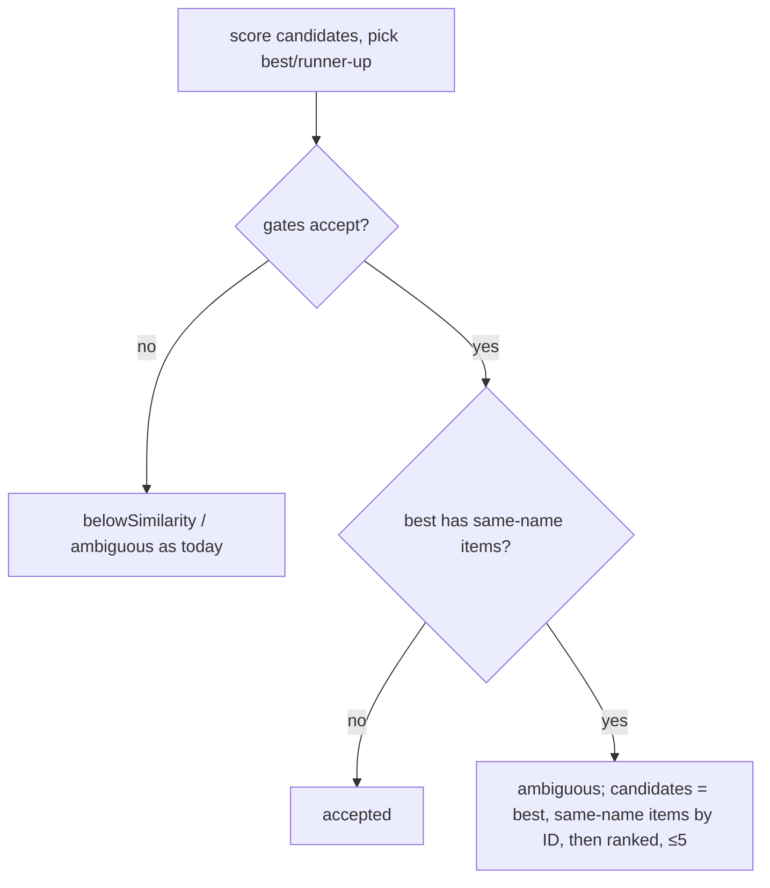

# Design

## Triage

| Trigger | Applies? | Evidence |
|---|---|---|
| T1 Components (new component, or 3+ with directed relationships) | Yes | New offline report tool; `ScanCoordinator` → `ScanDecisionFeed` → `SelectionController` gains a back-edge for the decision stamp |
| T2 State (persistent state, caches, 3+ state machine) | No | No new persisted state; the log is an existing file whose line format changes (T4) |
| T3 Concurrency (background work, workers/isolates, async, retries) | Yes | Ordering of publish, decision and log append inside `_finish` (`lib/application/scan_coordinator.dart:2733`); matching runs in `Isolate.run` |
| T4 Boundaries (data format, migration, shared interface, IPC, external) | Yes | Timing log line schema v2 → v3 (ADR-0013/0019 govern it); `TitleMatch.candidates` contract (ADR-0018); `AcceptedScanSource` interface |
| T5 Volume (grows without a fixed bound) | Yes | The report reads log files; bounded by the 1 MiB + 1 MiB rotation, but it takes any path the user names |
| T6 Risk (security, money, data loss, unrecoverable user data) | No | Read-only offline tool; no user data written beyond its own report |

TIER: FULL

## Context

See `proposal.md` for the why. Current state the approach depends on:

- **Timing line.** `ScanReport.toLogLine` (`lib/application/scan_coordinator.dart:898-957`) writes v2: `ms.trigger`, `ms.published`, and per-pass stamps from `PassTimeline` (`:424-470`): `captureRequested` … `matchFinished`. There is no stamp for pass start or decision, and no recording flag.
- **Phase changes.**
  - The targeted phase is set in `_begin` (`:2358`), before the settle wait.
  - The fallback phase is set at `:2448`, before the fallback wait, "so the fallback stays visibly underway while it waits" (ADR-0014).
  - `_setPhase` returns early when the phase is unchanged (`:2396`), so a stamp must not live inside it.
- **Publish order.** `_finish` (`:2733`) builds the report with `published: _now(a)`, then `_log`, then `_publish`, which ends in `_notify()`.
  - `ScanDecisionFeed._onSource` (`lib/application/scan_decision_feed.dart:57`) runs synchronously inside that notify.
  - `SelectionController.selectScan` (`lib/application/selection_controller.dart:155-190`) projects the decision and sets `_scan` before its first `await`.
  - So once `_notify()` returns, an accepted scan's decision is applied or fenced. Today the log line is written before that.
- **Recording.** `_recordingOn` (`:2767`) reads the recorder state. `_copyForRecording` (`:2770`) runs per pass and sets `recordedSession`.
- **Matcher.** `TitleMatchIndex.build` (`lib/domain/title_matching.dart:507-532`) names each candidate from `normalizedName`.
  - In the current catalog, 46 display names are shared by two to fifty items. Same-name items are told apart by slug suffixes (`weapon-case` / `weapon-case-1`).
  - The base slug wins with 1.0 against about .909, and the margin passes the .05 gate.
  - The assert at `:698-706` pins `candidates[1]` to the runner-up.
- **Correction offer.** `SelectionController.correctionCandidates` (`:85-94`) maps offer candidates to live catalog items. `ItemDecisionCard` renders `'${c.item.name} • ${c.score}'` (`lib/ui/item_decision_card.dart:448-455`). `CatalogItem.noFlea` exists (`lib/domain/catalog.dart:68`).
- **Report helpers.** `nearestRankQuantile` (`tool/qualification/statistics.dart:5`) is the nearest-rank p95 already used by M0. M0 tools are `dart run tool/qualification/*.dart` with mise tasks (`mise.toml:37-47`). Their tests live in `test/qualification/` as plain, untagged unit tests (`m0_statistics_test.dart`).
- **Corpus comparison.** It already exists. `inspection_corpus_test.dart` with `baseline.json` reports coverage, false positives and regressions against a baseline (`test/qualification/support/inspection_corpus.dart:491-589`). The reference's outcomes go into `baseline.json` (`docs/qualification/m2/CORPUS.md:83-89`). No reference timing baseline or outcomes exist yet, and the corpus folder is not on this machine (user to restore).

## Decisions

### D1: Pass start and decision are stamped in the coordinator; the feed reports the decision back through `AcceptedScanSource`

- **Choice.**
  - Each pass's start is stamped when the pass begins:
    - targeted: in `_begin`, next to the phase change;
    - fallback: at `:2448`, before its wait.
    - The stamp is stored as `PassTimeline.started`, outside `_setPhase`.
  - `AcceptedScanSource` gains `void markDecided(int reportId)`. `ScanDecisionFeed._applyAccepted` calls it after `selection.selectScan` has set `selection.scan` for that report. That is exactly where it advances `SessionScanState` today, so a fenced or undecided scan never calls it.
  - The coordinator stamps `_now(a)` into a per-scan `decided` field only when `reportId` is the scan being finished. A late or foreign call is ignored.
  - `_finish` becomes: build report → `_publish` (sync notify; the feed may call `markDecided`) → `_log` with the stamp.
- **Rejected.**
  - *Stamp "after notify returns" for every accepted scan.* It would record a decision for fenced scans (mode or session change, item missing) and overstate coverage of the decision path.
  - *Let the feed or `SelectionController` write its own log line.* That is two writers for one scan's record, breaks ADR-0013's "appended exactly once by the coordinator", and needs a join in the report.
- **Reversal cost:** low. One interface method and a reorder inside `_finish`.

### D2: Timing log v3 adds keys only; `recording` is sticky per scan

- **Choice.**
  - `"v":3`.
  - `ms.<pass>.started` for each pass that began.
  - `ms.decided` when D1 stamped it.
  - Top-level `"recording": bool`: true when `_recordingOn` at `_begin`, or when any pass copied a frame for recording. A per-scan flag set at those two points, never cleared.
  - No key is renamed or removed, so a v2 reader that ignores unknown keys still works. The schema rule (ADR-0013/0019: a key change bumps `v`) is kept.
- **Rejected.**
  - *Keep v2 and infer from the existing stamps* (the targeted pass's last stamp as "fallback underway", `published` as "decided"). The strategy gate (§6) says "visibly begin real fallback" and "trigger-to-actionable decision". The proxies miss the matching time on rejection paths and the decision step, and the user chose real stamps (2026-10-20).
  - *Infer recording from session folders by time*, which the M2 tooling does by hand. That is fragile and is the reason recording-on scans have polluted earlier timing reads.
- **Reversal cost:** medium. A log format is tooling-facing, and later readers key on v3.

### D3: Report is a separate offline Dart CLI with pure, tested core

- **Choice.**
  - `tool/qualification/scan_latency.dart` holds the CLI: argument parsing, file IO, output and refusal to overwrite.
  - `tool/qualification/scan_latency_report.dart` holds the pure functions: `parseLine`, `classify`, `summarise`. It reuses `nearestRankQuantile`.
  - mise task: `qualification:scan-latency`.
  - Strata are per trigger and never pooled, following M0's "never emit a pooled p95".
  - Targets: targeted share > 50 %; targeted decided ≤ 300 ms; fallback `started` ≤ 300 ms; total ≤ 1500 ms (per the spec).
  - A verdict needs at least 20 samples, below which the nearest-rank p95 is the max of the sample (`scan-latency-report` spec).
  - Total population: published scans that ran the fallback pass (accepted, rejected or failed). They use `decided` when present, else `published`.
- **Rejected.**
  - *Extend `m0.dart report`.* Its 2373-line dossier model assumes M0 video-clocked attempt bundles, not the app's own log. Coupling them would drag M0 contracts into M4.
  - *An in-app latency panel.* It needs the game running to be useful, and it adds UI for a one-off qualification.
- **Reversal cost:** low. It is an offline tool.

### D4: A shared display name makes an otherwise accepted match `ambiguous`; same-name items lead the candidates

- **Choice.**
  - `TitleMatchIndex.build` computes each item's display name, `normaliseTitle(item.name)`, and a `sameName` group: for each index position, the other positions with that display name, in ID order. Groups are built once per snapshot, in O(n) with a map.
  - In `matchTitle`, after the gates accept the best candidate: if its group is non-empty, the result becomes `TitleRejected(ambiguous)` with the same best, runner-up and margin.
  - Candidates are the best, then its group in ID order, then the usual distinct-name ranking, capped at 5. The assert at `:698-706` is relaxed for this case only.
  - The rule is the same for targeted and fallback evidence, so `rankOutcome` needs no change. An ambiguous targeted entry falls through to the fallback, as any rejection does, and the scan ends `ambiguous` and offers a correction (scan-correction spec).
- **Rejected.**
  - *Prefer the flea-listable variant* (status quo). It is the false positive this change exists to remove.
  - *Restrict the rule to groups whose `noFlea` differs.* The decision differs for any two IDs (quest and hideout needs are per ID), so a same-name pair with equal `noFlea` can still give the wrong keep or sell.
  - *Disambiguate by icon or by a second OCR read.* Nothing in the inspect window's title differs, and icon matching is M4.5 scope.
- **Reversal cost:** low. One rule in the matcher, and the corpus shows its effect.

### D5: Correction rows for same-name candidates show flea status and an ID suffix

- **Choice.**
  - `ItemDecisionCard` counts display names, `normaliseTitle(item.name)`, across every row the offer lists: its candidates and its search results together.
  - A candidate or search row whose display name another listed row shares adds its flea status and the last 6 characters of its ID.
  - Flea status is `flea` (`noFlea == false`), `no flea` (`noFlea == true`) or `flea unknown` (`noFlea == null`). Unknown is never shown as `flea`, matching the decision engine and strategy §6.
  - Candidate rows render `'<name> · <flea status> · <last 6 of id> • <score>'`, and search rows the same without the score. Other rows are unchanged.
  - The search is the route to the variants of a group larger than the 5 candidates.
- **Rejected.**
  - *Show `normalizedName` (the slug).* `weapon-case-1` tells the user nothing.
  - *Show the short name.* It is identical in the observed groups ("Weapons").
- **Reversal cost:** low.

### D6: Qualification protocol and evidence live in `docs/qualification/m4/`; the user's live checks stay unverified until reported

- **Choice.**
  - `PROTOCOL.md` holds the user's steps:
    1. the named setup, recorded as an `environment` block like M0's;
    2. recording off, a live session of at least 40 mouse and 20 hotkey scans of mixed items, including Weapon cases;
    3. running the report with `--since`;
    4. recording the reference timing baseline with `tool/qualification/reference/instrumentation-recipe.md`;
    5. restoring the corpus and writing the reference's outcomes into `baseline.json`.
  - `EVIDENCE.md` lists every M4 exit criterion with its verifier (agent or user), its result and its source file. Unrun items say `unverified`.
  - The agent-side corpus rerun and gap investigation are tasks that run only once the user has restored the corpus. Until then they are recorded as blocked, not done.
  - **Corpus judging rule.**
    - `EVIDENCE.md` records the corpus criterion from the unmodified `compareWithBaseline` result.
    - Each regression whose expected item is in the best candidate's same-name group is listed separately, with its case ID, its group, and whether the expected item appears among the offer's candidates.
    - The criterion is not marked met on that basis. It stays `fail` (or `unverified` while inputs are missing) until the user explicitly decides whether the M4 coverage criterion (roadmap; strategy §6 and §12) is amended for same-name groups.
- **Rejected.** *Wait for the user's evidence before merging the tooling.* The tooling is what the user needs to produce that evidence. The roadmap's close step walks the criteria anyway.
- **Reversal cost:** low.

## Diagrams (FULL)

T1/T4: components and contracts after this change.

T3: ordering inside `_finish` (all synchronous on the UI isolate).

T4: the shared-display-name rule in matching.

## State & Ownership (FULL)

| State | Owner (sole writer) | Lifetime | Invalidation / rebuild | Authoritative copy |
|---|---|---|---|---|
| `PassTimeline.started` | `ScanCoordinator` flow for that scan | One scan | Discarded with the scan | The scan's timeline |
| Per-scan `decided` stamp | `ScanCoordinator`, on `markDecided` for the scan being finished | Between `_publish` and `_log` in one `_finish` call | Ignored when the id is not the finishing scan's | The log line |
| Per-scan `recording` flag | `ScanCoordinator` (`_begin`, `_copyForRecording`) | One scan | Never cleared once true | The log line |
| Same-name groups | `TitleMatchIndex.build` | One index (one catalog snapshot) | Rebuilt with the index on snapshot change | The index |
| Report output | The CLI process | One run | Overwrite refused without `--force` | `report.json` |

## Failure & Visibility (FULL)

| Component | Fails / dies mid-operation → | Recovery | Retry safe? | Who finds out |
|---|---|---|---|---|
| `markDecided` path | The feed throws before calling it → `notifyListeners` reports the listener error and returns (unverified assumption: `_notify` is `ChangeNotifier.notifyListeners`; a test pins it), so `_log` still runs and the line has no `decided` | None needed | n/a | The report: an accepted targeted scan without `decided` is counted as "accepted, no decision" and is not a sample |
| Log append after publish | `toLogLine` throws → caught, `debugPrint` (`:3061`), as today | The next scan | Yes | Log status shows `available`; a missing line shows as a count gap in the report |
| Report CLI | Unreadable or missing file → non-zero exit naming the file | Rerun with a correct path | Yes | User (console) |
| Report CLI | Malformed lines → skipped and counted by reason | n/a | n/a | User (skip counts in the report) |
| Matcher rule | A wrong group (for example a name normalisation bug) → extra ambiguous rejects | Fix the rule | n/a | Corpus run (coverage drop), correction offers in the live session |

## Resource Bounds (FULL)

| Queue / buffer / cache / transfer | Bound | At the bound | Timeout | At 10x / 100x |
|---|---|---|---|---|
| Timing log queue and file | Unchanged: 32 lines, 1 MiB + 1 MiB | Unchanged (drop and count, rotate) | Unchanged | The v3 line grows by about 60 bytes; 1 MiB still holds over 1,500 lines |
| Same-name groups | One map per index, O(items) | n/a | n/a | 5,476 items today; 100x is about 550k entries, still built once per snapshot off the UI isolate |
| Report input | Reads lines streaming, one file at a time; keeps only numeric samples per stratum | A single line over 1 MiB is skipped as malformed (the app never writes one) | n/a | 100 MiB of logs is about 150k lines × 4 doubles, a few MB, which is fine |
| Candidates list | ≤ 5 (unchanged) | Same-name items beyond 4 are dropped; the text search (≤ 8) remains | n/a | n/a |

## Flow & State Gaps (FULL)

- **Superseded or abandoned scan.** It is never published, so it has no `decided`. `markDecided` is never called for it.
- **Mode or session change between publish and decision.** The feed fences and never calls `markDecided`. The line has `published` and no `decided`, as the spec scenario says.
- **`markDecided` for an older report.** This happens if the feed applied a report other than the one being finished; it cannot, because the notify is synchronous for this report. The id check ignores it.
- **Recording toggled mid-scan.** The flag is sticky, so any recording touch marks the scan.
- **Rotation during a session.** The report reads `.1.jsonl` and the live file, and the window selects by `utc`. Lines lost to rotation past the previous file show as a smaller N, not as an error.
- **Hotkey scans skip waits (ADR-0019).** Their fallback `started` is right after the targeted pass. They are a separate stratum, so they do not flatter the mouse figures.
- **Index built before this change ships.** Indexes are in memory only and rebuilt each activation, so nothing persists.

## Mechanism Ledger (FULL)

| Mechanism | Built? | Why (harm nobody catches / expensive later) | Evidence that would change the call |
|---|---|---|---|
| `markDecided` id check | Yes | A misattributed decision stamp would corrupt the gate figure silently | n/a |
| Sticky `recording` flag | Yes | A recording-touched scan counted as recording-off inflates latency silently, which has happened before | n/a |
| Minimum 20 samples per verdict | Yes | A p95 over 5 samples passes or fails by noise, and nobody would notice | User asks for a different floor |
| Frame-render stamp (time the card is painted) | No | `decided` is synchronous before the next frame; the frame adds at most about 16 ms, inside the margin | Live figures within 20 ms of a target |
| v2 proxies driving verdicts | No | Proxies understate decision time; the gate needs v3 | n/a |
| Same-name rule only when `noFlea` differs | No | See D4 | User reports that same-name prompts are a nuisance for items where the decisions never differ |
| Per-run report history or trend | No | One-off qualification | A later milestone re-qualifies regularly |

## Risks / Trade-offs

- **[Risk] The same-name rule costs a click for 46 shared names**, such as a flea Weapon case or the dogtags.
  - Mitigation: the correction offer lists the variants, labelled by D5, one click away.
  - The user chose this over accepting the wrong variant (2026-10-20). It is stricter than the reference fork on purpose; the fork-parity default does not apply.
- **[Risk] Coverage on the corpus can drop** if a labelled case expects the base-slug variant.
  - Mitigation: the corpus rerun reports regressions by case, with same-name regressions listed separately. Under D6's judging rule they still count against the criterion until the user decides on amending it (Open Questions).
- **[Risk] The live figures fail the targets.**
  - Mitigation: the report says which figure and which stratum fails. The fix is a separate gap-closing change through roadmap **next**, not this change.
- **[Risk] The user's reference baseline or corpus never arrives.**
  - Mitigation: those criteria stay `unverified` in `EVIDENCE.md`, and the milestone cannot close. That is the honest state.
- **[Trade-off] Logging after publish moves the log append later by the feed's synchronous work.** That is a few hundred microseconds; the log is asynchronous anyway.

## ADRs

- **In force, constraining this change:**
  - 0013: the coordinator is the sole log writer; a key change bumps `v`.
  - 0014: the fallback phase is published before its wait.
  - 0015: latency is judged with recording off.
  - 0016: targeted entries are ranked.
  - 0017: the feed and the report-id high-water mark.
  - 0018: distinct-name top 5 candidates; correction is transient.
  - 0019: timing log v2; hotkey scans skip waits.
- **To record during apply:**
  - **ADR-0020 – Scan timing log v3.** Pass `started`; `decided` reported back by the feed through `AcceptedScanSource.markDecided`; the sticky `recording` flag; the log is appended after publication. It supersedes 0019's "Timing log v2" bullet only.
  - **ADR-0021 – Shared display names are ambiguous.** It covers the matcher rule and the same-name candidate listing. It supersedes 0018's "`TitleMatch.candidates` keeps a distinct-name top 5" for same-name groups only.
  - Update `openspec/architecture.md`: the `ScanCoordinator` row (v3), the `ScanDecisionFeed` row (`markDecided`) and the in-force index rows.

## Open Questions

- **User decision, needed at or before M4 close.** Is the M4 corpus coverage criterion ("at least the reference's"; strategy §6 and §12) amended so that a regression to an ambiguous reject within a same-name group, whose expected item is offered as a candidate, does not count against coverage?
  - If the user amends it, ADR-0021 records the amendment. If ADR-0021 is already accepted, a superseding ADR records it.
  - Until then, the criterion is judged unmodified (D6).
  - This changes no spec or task of this change: the rerun and `EVIDENCE.md` record the same data either way.

- **The live session size** (40 mouse, 20 hotkey) is a protocol default the user may change. Only N changes, and below 20 the verdict reads `indeterminate`.
