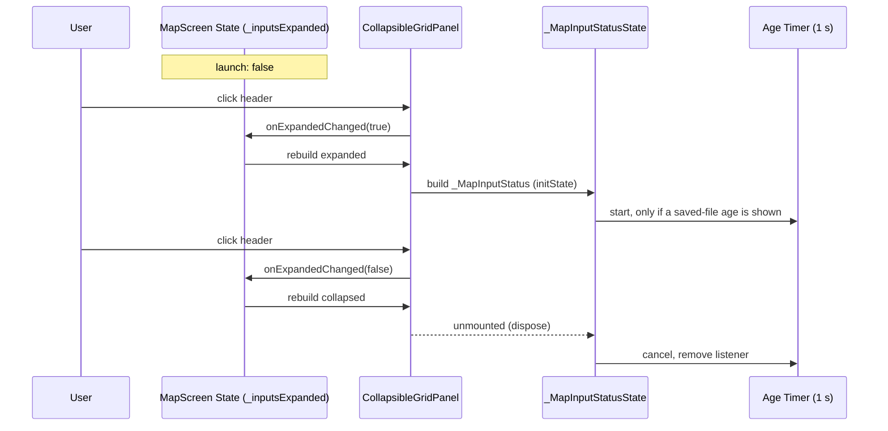

# Design

## Triage

| Trigger | Applies? | Evidence |
|---|---|---|
| T1 Components (new component, or 3+ with directed relationships) | No | One new presentation widget in `lib/ui/theme.dart`. No new controller, service or process. The relationships stay `MapScreen` → rail → `_MapInputStatus` → `MapSessionController`/`SettingsController`, as today (`lib/ui/map_screen.dart:66-73`). |
| T2 State (persistent state, caches, 3+ state machine) | No | The new state is one in-memory `bool` (expanded or not), with two states. Nothing is persisted (spec: "Expansion state lasts for the session only"). |
| T3 Concurrency (background work, workers/isolates, async, retries) | Yes | The change decides when the saved-file age `Timer.periodic` runs (`lib/ui/map_screen.dart:45-56`). It now stops when the section collapses. |
| T4 Boundaries (data format, migration, shared interface, IPC, external) | No | No settings field, Drift schema, API or isolate contract changes. `GridPanel` keeps its constructor. |
| T5 Volume (grows without a fixed bound) | No | The rail has a fixed set of five sections. |
| T6 Risk (security, money, data loss, unrecoverable user data) | No | Display-only. Collapsing changes no setting (spec scenario "Collapsing keeps settings"). |

TIER: FULL

## Context

- **Rail today.** `MapScreen.build` builds the rail as one `ListView` keyed `map-rail-scroll` (`lib/ui/map_screen.dart:340-495`). Its order is: Active map (`SizedBox(145 * scale)`, `:343-368`), Map saved-file inputs (`GridPanel` around `_MapInputStatus`, natural height, `:370-374`), the decision card (`300 * scale`, `:376-379`), Marker preferences (`430 * scale`, `:381-481`) and Manual item search (`650 * scale`, `:483-493`).
- **Layouts.** Below 1100 px wide, the rail is placed inside another `ListView` keyed `map-compact-scroll`, as a `SizedBox(800 * scale)` under the workspace (`:496-504`). Otherwise it is the right 30 % of a `Row` (`:506-518`). The two layouts put the rail at different places in the tree.
- **Screen lifetime.** The shell keeps `MapScreen` and `ScannerScreen` alive in an `IndexedStack` (`lib/ui/shell.dart:161-171`). The `MapScreen` element, and any `State` it owns, survives a tab switch.
- **The age timer.** `_MapInputStatusState` ticks once a second only while a saved-file age is shown (`:44-56`), and cancels the timer in `dispose` (`:58-63`).
- **Panel look.** `GridPanel` (`lib/ui/theme.dart:76-`) draws the bordered surface, a gold icon, the title, an optional subtitle and a trailing widget. Tests find panels with `w is GridPanel && w.title == ...` (`test/ui/map_screen_test.dart:245-262`, `test/ui/latest_scan_card_test.dart:15-16`).
- **Already done.** `add-map-scan-snapshot` D4 left the Active map panel alone on the rail's first row. That change's spec scenario (`openspec/specs/latest-accepted-scan`, "No separate panel") must keep passing.
- **Out of scope:**
  - Strings inside the section. `plain-language-pass` owns them.
  - Small-window and large-text-scale combinations. These are not a target configuration.
  - The decision card's fixed height and where the correction offer sits in it. The `add-scan-correction` review left that suggestion to M4.5. It does not serve this change's exit criterion, so it stays with `plain-language-pass` or a later change and is not taken up here.

## Decisions

### D1: `MapScreen` owns the expansion flag

- **Choice:**
  - `MapScreen` becomes a `StatefulWidget`. Its `State` holds `bool _inputsExpanded = false` and is the only writer of it.
  - The rail passes the flag and a toggle callback to the section.
  - The `State` sits above the `LayoutBuilder`, so the flag survives a tab switch (the element is kept alive by the `IndexedStack`) and a layout change across 1100 px (only the subtree below the `LayoutBuilder` moves).
  - A new launch builds a new `State`, so the section starts collapsed.
- **Rejected:** `ExpansionTile` with a `PageStorageKey`, keeping the state in `PageStorage`. The storage identifier is built from the ancestor `PageStorageKey`s:
  - wide layout: `map` → `map-rail-scroll`;
  - compact layout: `map` → `map-compact-scroll` → `map-rail-scroll`.

  The two paths differ, so the flag would be lost when the layout changes, which breaks the spec scenario "Survives a layout change". The tile would also own its own state, a second writer.
- **Rejected:** a `mapInputsExpanded` field in `Settings`. It persists, so it adds a settings JSON field and a save on every click. The spec requires each launch to start collapsed.
- **Reversal cost:** low. The flag is presentation state in one widget.

### D2: A `CollapsibleGridPanel` next to `GridPanel`

- **Choice:**
  - A new `CollapsibleGridPanel` in `lib/ui/theme.dart`, with `title`, `icon`, `expanded`, `onExpandedChanged`, an optional `toggleKey` and `child`, each documented with `///`.
  - It draws the same bordered surface and header row as `GridPanel`, plus a chevron that shows the expanded state.
  - The whole header row is one button (`InkWell`) keyed with `toggleKey`. The call site passes `Key('map-inputs-toggle')`, so a test tap on the expanded panel lands on the header, never on the Follow logs switch. Its `Semantics` give `button: true`, `expanded: <flag>` and the title as the label.
  - The child is built only when `expanded` is true. There is no animation.
- **Rejected:** adding `collapsible`/`expanded` parameters to `GridPanel` itself. Every rail, Scanner and card panel would then take a branch it does not need, and `GridPanel`'s collapse behaviour would become a shared contract before a second user exists.
- **Rejected:** `ExpansionTile` inside a `GridPanel`:
  - it brings `ListTile` padding and its own dividers, so the rail loses its consistent header;
  - with `maintainState: false` it keeps the child mounted during the collapse animation, so the timer stops a frame late;
  - its expansion state stays internal unless a controller is threaded through.
- **Reversal cost:** low. The new widget is used in one place.

### D3: A collapsed section is not built, so its timer stops

- **Choice:** When collapsed, `CollapsibleGridPanel` does not build `_MapInputStatus`. Collapsing disposes `_MapInputStatusState`, and its existing `dispose` cancels the age timer and removes its listener (`map_screen.dart:58-63`). Expanding builds a new `State`, whose `initState` runs `_syncAgeTimer` and computes the current age (`:28-32`, `:76-78`). The section needs no new timer code. The call site gives `_MapInputStatus` the key `Key('map-input-status')`. Tests use it to assert that the status is absent when collapsed and present when expanded. That absence is how a test proves no age refresh runs, because a widget test cannot observe a private timer.
- **Rejected:** keeping the content mounted under `Offstage` or `Visibility(maintainState: true)`. The timer and both listeners would keep running, and the rail would rebuild every second for a section nobody sees.
- **Reversal cost:** low.

### D4: Raid-time sections first, inputs last, fixed heights unchanged

- **Choice:**
  - The rail order becomes Active map, decision card, Marker preferences, Manual item search, Map saved-file inputs.
  - The existing fixed heights (`145`, `300`, `430` and `650` × scale) stay.
  - The inputs section keeps its natural height: a header row when collapsed, today's content when expanded.
  - The compact layout keeps its `800 * scale` rail box, so the section is reached by scrolling the rail, as Manual item search is today.
  - The Follow logs switch and Read Latest stay inside the section. Follow logs is a standing preference, and the screenshot watcher already reads new files, so Read Latest is a manual fallback, not a raid-time action.
- **Rejected:** a pinned footer outside the scroll view. It takes height away from the decision card on every screen size, which is the opposite of the goal.
- **Rejected:** moving Follow logs to the Active map row. It adds a control to the row the roadmap keeps alone, and it changes what Follow logs means on that row. If the user's in-raid read asks for it, a later change can do it.
- **Reversal cost:** low.

## Diagrams (FULL)

T3: timer lifecycle across expand and collapse.

## State & Ownership (FULL)

| State | Owner (sole writer) | Lifetime | Invalidation / rebuild | Authoritative copy |
|---|---|---|---|---|
| Inputs section expanded | `MapScreen`'s `State` (D1) | The `MapScreen` element, which lasts the app session (`IndexedStack`) | Reset to `false` when the element is created, at each launch | The `State` field |
| Saved-file age timer | `_MapInputStatusState` (unchanged) | While that state is mounted and an age is shown | Cancelled on dispose, which now includes collapse (D3) | n/a |
| Map inputs (Follow logs, selected map, directories) | `SettingsController` / `MapSessionController` (unchanged) | Durable or session, as today | Unchanged | Settings in SQLite |

## Failure & Visibility (FULL)

| Component | Fails / dies mid-operation → | Recovery | Retry safe? | Who finds out |
|---|---|---|---|---|
| `CollapsibleGridPanel` | A build error shows the Flutter error widget in the rail slot | Fix and rebuild | n/a | User sees it. Widget tests catch it (`tester.takeException()`). |
| Read Latest started, then collapsed | `MapSessionController.readLatest` keeps running. The controller owns it, not the widget | Expanding shows the result and the `readingLatest` state from the controller | Yes, the button is disabled while a read runs (`:182-184`) | User, on expanding. The map highlights update either way. |
| Section collapsed while the screenshot watcher reports an error | The status is still held by `MapSessionController`. Only its display is hidden | Expanding shows it | n/a | The user does not see it until they expand. Accepted: the roadmap moves this developer status out of the raid view, and `plain-language-pass` decides which failures surface elsewhere. |

## Resource Bounds (FULL)

| Queue / buffer / cache / transfer | Bound | At the bound | Timeout | At 10x / 100x |
|---|---|---|---|---|
| Age timer | 0 when collapsed, 1 when expanded with an age shown | n/a | 1 s period | n/a: one per `MapScreen` |
| Rail sections | 5, fixed | n/a | n/a | n/a |

## Flow & State Gaps (FULL)

- **Collapse during a Read Latest.** The read continues in `MapSessionController`. Expanding shows `Reading latest…` or the result. Nothing is lost.
- **A saved screenshot arrives while collapsed.** The session state updates as today. Expanding builds the status from the current state and starts the timer if an age is shown (spec scenario "Pending screenshot while collapsed").
- **A layout change while expanded.** The subtree under the `LayoutBuilder` rebuilds in its new position. `_MapInputStatusState` may be recreated, which restarts its timer from `initState`. The flag stays `true` (D1).
- **Settings busy.** The section header stays clickable. The busy state disables only the controls inside it, as today.

## Mechanism Ledger (FULL)

| Mechanism | Built? | Why (harm nobody catches / expensive later) | Evidence that would change the call |
|---|---|---|---|
| Remember the expansion across launches | No | The spec requires collapsed at each launch. Persisting it costs a settings field. | The user asks for it after the in-raid read. |
| Expand/collapse animation | No | No harm without it. An animation would keep the timer alive during the collapse (D2). | The user finds the jump jarring. |
| A summary line in the collapsed header (for example, the log status) | No | The roadmap wants the developer status out of the raid view. `plain-language-pass` decides what player-facing status shows. | `plain-language-pass` or the user's in-raid read asks for one. |
| A generic collapsible option on `GridPanel` | No | Only one panel collapses (D2). | A second collapsible panel appears. |

## Risks / Trade-offs

- [The tests that reach Read Latest, Follow logs or the map-authority lines now find nothing while the section is collapsed] → Each of those tests expands the section first, through one shared test helper. The assertions stay the same, and none is deleted. The rail is a lazy `ListView`, so the section, now last, is not built in the test window until it is scrolled to. The helper first scrolls the rail (`scrollUntilVisible` on the `Scrollable` under `PageStorageKey('map-rail-scroll')`) until the "Map saved-file inputs" header is built, then taps `Key('map-inputs-toggle')`. Every collapsed-state assertion also first brings the header into view and asserts that it is found, so no absence check passes vacuously.
- [A user who relied on the visible log and screenshot status loses it from view] → It is one click away. The in-raid read is a user check of the M4.5 exit criterion.

## ADRs

- **In force, constraining this change:**
  - ADR-0002: SDK notifiers. UI-only state stays in widget `State`, not in a new controller.
  - ADR-0006: Map-owned raid-panel OCR. Its status display moves but is unchanged.
- **To record during apply:** none. The decisions here are tactical.
