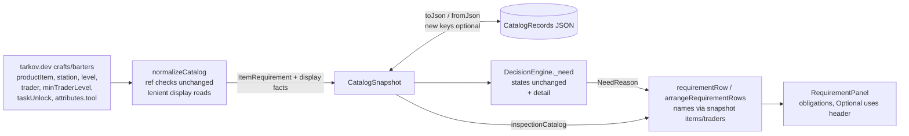

# Design

## Triage

| Trigger | Applies? | Evidence |
|---|---|---|
| T1 Components (new component, or 3+ with directed relationships) | No | No new component. The normalizer, `ItemRequirement`, `DecisionEngine` and `RequirementPanel` already form this path. The new row-label module is a pure helper of the panel, not a component with its own state. |
| T2 State (persistent state, caches, 3+ state machine) | Yes | New optional fields go into the cached catalog projection, which is SQLite `CatalogRecords` normalised JSON (`lib/data/database.dart:354`, `lib/domain/catalog.dart:244-275`). The open/closed flag of the group is two-state widget state. |
| T3 Concurrency (background work, workers/isolates, async, retries) | No | Normalisation already runs off the UI isolate. Nothing new runs concurrently, and the panel is a synchronous build over the current decision. |
| T4 Boundaries (data format, migration, shared interface, IPC, external) | Yes | The stored projection format gains keys and must still read older rows. The wire fields it reads from tarkov.dev (`level`, `minTraderLevel`, `taskUnlock`, `attributes.tool`) were checked against `json.tarkov.dev/regular/{crafts,barters}` on 2026-10-29. `NeedReason` is shared by the engine and the UI. |
| T5 Volume (grows without a fixed bound) | No | Rows per item are bounded by the catalog (214 crafts and 855 barters live in total). The panel stays a lazy `ListView.builder`. |
| T6 Risk (security, money, data loss, unrecoverable user data) | No | Display only. Decisions, totals and integrity checks do not change, and the cache is rebuilt by any refresh. |

TIER: FULL

## Context

See `proposal.md` and #43 for the problem. The current state the approach needs:

- **Normalizer.** It reads `productItem`/`offeredItem`, `station`, `trader` and `taskUnlock` only to check references, then sets `sourceName: '${kind.name} ${entry.key}'` (`lib/data/catalog_normalizer.dart:352-381`). It never reads the craft `level`, the barter `minTraderLevel` or `attributes.tool`. Live crafts also carry `taskUnlock`, which the normalizer does not check today. Station and task names exist only inside the normalizer, through `label('hideout'|'tasks', ...)` (`:61-68`), and the snapshot keeps no station or task dictionary (`lib/domain/catalog.dart:278-300`). Items and traders do stay on the snapshot.
- **Requirement model.** `ItemRequirement` is persisted through `toJson`/`fromJson` and already has optional `stationId`/`stationLevel` for hideout rows (`lib/domain/catalog.dart:213-276`). `CatalogItem.iconLink` shows the "write only when non-null" pattern for a newer key (`:105`).
- **Engine.** `_need` builds `message: '${r.sourceName}: $detail'` (`lib/domain/decision_engine.dart:140-147`) and returns every craft and barter row as `irrelevant` before reading any other field (`:148-155`). `stationLevel` is read only for `RequirementKind.hideout` (`:348-357`). `NeedReason` has `requirement`, `state`, `message` and `remaining` (`lib/domain/decision.dart:14-25`). Nothing persists a `NeedReason`; history re-evaluates on reopen.
- **Panel.** `RequirementPanel` renders each reason as four `Text`s: `sourceName`, `state.name • kind.name • remaining ...`, `message` and `FIR requirement: ...` (`lib/ui/evidence_panels.dart:18-83`). Its rows come from `decision.reasons`, in `compareRequirements` order (kind, then source id, then id; `lib/domain/catalog.dart:435-440`). The catalog the reasons came from is `services.selection.inspectionCatalog` (`lib/application/selection_controller.dart:59`), which is the live snapshot or a history mode's cached one. `itemsSourceUpdateLabel` (`evidence_panels.dart:14`) is the pattern for a pure label function next to the widget.
- **Fixture.** `test/fixtures/m1/catalog/six_datasets.json` has `craft-a` (station `station-a`, level 1, product `item-b` ×1, `item-a` ×1.5) and `barter-a` (`trader-a`, `minTraderLevel` 1, no unlock, offered `item-b` ×1).

## Decisions

### D1: Keep ids for items and traders, ids and names for stations and tasks

- **Choice:** `ItemRequirement` gains optional `productItemId`, `productCount`, `traderId`, `traderLevel`, `unlockTaskId`, `unlockTaskName`, `stationName` and `tool`. Craft rows reuse `stationId` and `stationLevel` for the station and its level. The row resolves item and trader names through the snapshot the reasons came from, falling back to the id. Station and task names are resolved at normalize time (label, then normalized name, then id, as the hideout and task `sourceName` already do) and stored, because the snapshot has no dictionary to resolve them from later.
- **Rejected:** add station and task dictionaries to `CatalogSnapshot` and store only ids on rows. It is cleaner, but it changes the snapshot's shape and its projection for two names used by one panel, and every snapshot test would have to build those dictionaries. Also rejected: store only formatted strings (`Workbench level 2`). The UI could then not change a format or fall back per entity, and the change to plain language would need a re-normalize.
- **Reversal cost:** medium. The keys are in stored projections, but every refresh rewrites the projection, so a later change of shape only needs one more tolerant read.

### D2: Display facts are read leniently and never gate a refresh

- **Choice:** The new facts use a lenient reader: a missing value or one of the wrong type becomes null, and the normalizer throws nothing new. The existing `ref(...)` checks on product, station, trader and barter `taskUnlock` stay exactly as they are. A craft's `taskUnlock` gets no new reference check: an unknown id is kept, and its name falls back to that id.
- **Rejected:** validate the new fields strictly with `_integer`/`ref`, like the integrity fields. A bad level on one of about 1,000 recipes would then fail the whole catalog refresh and leave the user on stale decisions, for a label.
- **Reversal cost:** low.

### D3: `sourceName` of a craft or barter becomes its product item's name

- **Choice:** The normalizer sets the craft and barter `sourceName` to the product or offered item's resolved name (the item's id when no name resolved). The message keeps its `<source>: <reason>` form, and the old-projection fallback title stays readable as the stored value.
- **Rejected:** keep `craft <id>` in `sourceName` and only change the UI. Every other consumer of `sourceName` or `message`, current or future, would keep showing the raw id.
- **Reversal cost:** low.

### D4: `NeedReason.detail` carries the reason without the prefix

- **Choice:** `NeedReason` gains a required `detail`, the text after `<source>: `. `message` is still built from it, so its text does not change. The engine's states, remaining values and branch order are untouched.
- **Rejected:** strip `'${sourceName}: '` from `message` in the UI. It couples the UI to the engine's string format and breaks silently when a source name contains `: `.
- **Reversal cost:** low. `NeedReason` is built only in `_need` and in tests.

### D5: A pure row-model function, then a thin widget

- **Choice:** `lib/ui/requirement_rows.dart` holds pure Dart, with no Flutter import. `requirementRow(NeedReason, CatalogSnapshot?)` returns a `RequirementRowView` with the title, kind tag, state label, source line, needs, remaining, FIR and reason texts. `arrangeRequirementRows(List<NeedReason>)` returns the ordered obligations and the optional uses. `RequirementPanel` becomes a `StatefulWidget` that flattens them into one `ListView.builder` list: obligation rows, then the `Optional uses (N)` header, then the optional rows when the group is open. Every format rule in `specs/requirement-rows/spec.md` is proven by unit tests on these functions, and one widget test covers the header, its tap and the reset.
- **FIR-only exclusion:** the row function recognises a non-FIR copy of a FIR obligation from the reason's own fields only: `state == NeedState.irrelevant`, `remaining > 0` and `requirement.foundInRaid == true`, on a task or hideout row. The engine gives every other irrelevant obligation `remaining` 0 (`decision_engine.dart:163-166`). It moves no decision logic and parses no message into the UI (ADR-0001).
- **Rejected:** format inside `build()`, as today. Every wording and ordering permutation would then need a widget test. Also rejected: an `ExpansionTile` inside the list. It keeps its own expansion state, which a parent cannot reset per item without key tricks, and it puts a nested column of possibly dozens of rows into one list item, so the rows stop being lazy.
- **Reversal cost:** low.

### D6: Group open state is per item, held by the panel

- **Choice:** The panel keeps `_optionalOpen` and the item id it was set for. When `selection.selectedId` differs from that id, the group starts collapsed again. Nothing is saved.
- **Rejected:** a setting or session-wide flag to keep it open. In raid the player looks at one item at a time, and an open group of a dozen recipes would push the next item's obligations down again. If players ask for it, a setting can be added later.
- **Reversal cost:** low.

## Diagrams (FULL)

T2 and T4: data flow of the display facts from the wire to the row.

## State & Ownership (FULL)

| State | Owner (sole writer) | Lifetime | Invalidation / rebuild | Authoritative copy |
|---|---|---|---|---|
| Display facts on `ItemRequirement` | `normalizeCatalog` (in memory); `CatalogController` writes the projection | One snapshot | Replaced on each refresh by the atomic swap (`database.dart:126-154`) | The published `CatalogSnapshot` |
| Stored projection keys | `CatalogController` through the database | Durable, one per mode | Rewritten by the next successful refresh; old rows lack the keys | SQLite `CatalogRecords` |
| `NeedReason.detail` | `DecisionEngine._need` | One decision | Rebuilt on every evaluation | The decision |
| `_optionalOpen` + its item id | `RequirementPanel` state | Widget lifetime | Reset when `selectedId` changes | Widget state only |

## Failure & Visibility (FULL)

| Component | Fails / dies mid-operation → | Recovery | Retry safe? | Who finds out |
|---|---|---|---|---|
| Normalizer display reads | A malformed level or count becomes null, never a throw (D2) | None needed | — | The player sees the row without that part. Nothing is logged, because the data error belongs to tarkov.dev and the row still works. |
| Name resolution | An unresolved name shows the id | The next refresh with a translation | — | The player sees an id in that spot, which is the visible signal |
| Projection read | An old row without the new keys loads with nulls; a wrong-typed new key in a corrupt cache fails `fromJson` as any corrupt key does today | The existing "Stored catalog unavailable" path, then the automatic refresh | Yes | The status bar, as today |
| Panel | A reason whose catalog is null (no snapshot) | The row uses the stored fields and ids | — | The player sees ids |

## Resource Bounds (FULL)

| Queue / buffer / cache / transfer | Bound | At the bound | Timeout | At 10x / 100x |
|---|---|---|---|---|
| Extra fields per craft/barter row | 8 small scalars per row. Live: about 1,000 recipes with one or more inputs each, a few thousand rows | — | — | 10x adds well under 1 MB to the projection, small next to the item data. 100x would also grow the projection the cache already stores, without a new bound |
| Rows in the panel | The item's requirement count from the catalog | Lazy `ListView.builder`; optional rows are not built while the group is collapsed | — | Unchanged from today |

## Flow & State Gaps (FULL)

- **Old projection, then refresh:** rows show the stored `sourceName` (`craft <id>`) with tag and state and no source line, until the automatic refresh on launch replaces the snapshot (`catalog-authority` requirement: one refresh per mode selection).
- **History item from another mode:** names resolve through that history catalog (`inspectionCatalog`), the same snapshot the reasons came from, so names never mix modes.
- **Catalog swaps while a row is shown:** the row takes names from the current `inspectionCatalog` at build time, which can be newer than the reasons until the selection re-evaluates. An id names the same entity in both snapshots, so the worst case is a newer spelling of the same name. An id missing from the newer snapshot falls back to the id.
- **Item changes with the group open:** the group collapses (D6).
- **Alternative item groups (a task row with several `itemIds`):** `Needs N` shows the shared count as today. No new wording is added in this change.

## Mechanism Ledger (FULL)

| Mechanism | Built? | Why (harm nobody catches / expensive later) | Evidence that would change the call |
|---|---|---|---|
| Lenient display-field reader | Yes | Without it, a malformed label field would fail the whole refresh, and the user would only see `stale` | — |
| Bump `normalizerVersion` | No | `authoritativeAt` requires `normalizerVersion == 1` (`catalog.dart:313`), so a bump would make every cached snapshot non-authoritative until refresh. The new keys are optional, so no bump is needed | A later change that makes a display fact required |
| Station/task dictionaries on the snapshot | No (D1) | Two names for one panel | A second consumer that needs station or task names by id |
| Persisting the group's open state | No (D6) | — | Player feedback asking for it |
| Reference check on craft `taskUnlock` | No (D2) | Adding one would add a new way for a refresh to fail | — |

## Risks / Trade-offs

- [The live data has a craft whose product item is not in the items dataset] → The existing `ref` already rejects this today, so nothing changes.
- [Stored names for stations and tasks go stale when tarkov.dev renames them] → Each refresh re-normalizes, and the snapshot is at most one session old.
- [A tool row's count looks like consumption] → The tool flag replaces `Needs N` with `Tool, not used up`.
- [Old cached rows still show `craft <id>` until a refresh] → Accepted. The refresh runs automatically at launch, and the exit criterion asks only that old projections load.

## ADRs

- **In force, constraining this change:** ADR-0001 (one conservative decision engine: this change adds `detail` but no rule, and the panel adds no decision logic); ADR-0003 (the catalog cache lives in the Drift store as normalised JSON; there is no schema migration because the new keys are optional JSON fields).
- **To record during apply:** none. The choices are tactical, display only.

## Open Questions

None.
